# Monthly Custom GSTAR(a,b) Experiments

## Experiment design

Chronological 70:30, 80:20, and 90:10 splits are evaluated independently. All transformation, ADF, ACF/PACF, CCF, candidate selection, and fitting use training data only. Monthly diagnostic lags run through 36 months; peaks only are retained, up to six per dimension.

The custom OLS fitter supports independent spatial order a and own-city order b.

## Split comparison

| split | train_rows | test_rows | selected_model | differencing_d | selection_status | AIC | training_R_squared | testing_R_squared | testing_RMSE |
|---|---|---|---|---|---|---|---|---|---|
| 70:30 | 285 | 123 | GSTAR(17,9) | 1 | white-noise fallback | 9635.471 | 0.577043 | 0.465610 | 101.0859 |
| 80:20 | 326 | 82 | GSTAR(19,1) | 0 | white-noise fallback | 10990.129 | 0.589709 | 0.406956 | 105.7785 |
| 90:10 | 367 | 41 | GSTAR(16,8) | 1 | white-noise fallback | 12607.924 | 0.562194 | 0.160631 | 124.5863 |

## Split 70:30

Training rows: 285; test rows: 123. Selected **GSTAR(17,9)** with d = 1 (white-noise fallback).

### Stationarity

| stage | location | test | lag | statistic | p_value | stationary |
|---|---|---|---|---|---|---|
| raw_training | Juanda | Fligner-Killeen variance | NA | 0.602739 | 0.437535 | TRUE |
| raw_training | Perak1 | Fligner-Killeen variance | NA | 0.431879 | 0.511068 | TRUE |
| raw_training | Perak2 | Fligner-Killeen variance | NA | 0.450801 | 0.501955 | TRUE |
| raw_training_reused | Juanda | Fligner-Killeen variance | NA | 0.602739 | 0.437535 | TRUE |
| raw_training_reused | Perak1 | Fligner-Killeen variance | NA | 0.431879 | 0.511068 | TRUE |
| raw_training_reused | Perak2 | Fligner-Killeen variance | NA | 0.450801 | 0.501955 | TRUE |
| first_difference_training | Juanda | Fligner-Killeen variance | NA | 0.496027 | 0.481251 | TRUE |
| first_difference_training | Perak1 | Fligner-Killeen variance | NA | 0.098225 | 0.753970 | TRUE |
| first_difference_training | Perak2 | Fligner-Killeen variance | NA | 0.002854 | 0.957392 | TRUE |

| stage | location | test | lag | statistic | p_value | stationary |
|---|---|---|---|---|---|---|
| raw_training | Juanda | ADF | 0 | -8.246183 | 0.010000 | TRUE |
| raw_training | Juanda | ADF | 1 | -8.584543 | 0.010000 | TRUE |
| raw_training | Juanda | ADF | 2 | -9.726719 | 0.010000 | TRUE |
| raw_training | Juanda | ADF | 3 | -11.079397 | 0.010000 | TRUE |
| raw_training | Juanda | ADF | 4 | -12.214401 | 0.010000 | TRUE |
| raw_training | Juanda | ADF | 5 | -12.644334 | 0.010000 | TRUE |
| raw_training | Juanda | ADF | 6 | -11.964494 | 0.010000 | TRUE |
| raw_training | Juanda | ADF | 7 | -11.340732 | 0.010000 | TRUE |
| raw_training | Juanda | ADF | 8 | -9.666403 | 0.010000 | TRUE |
| raw_training | Juanda | ADF | 9 | -8.166416 | 0.010000 | TRUE |
| raw_training | Juanda | ADF | 10 | -6.336170 | 0.010000 | TRUE |
| raw_training | Juanda | ADF | 11 | -4.443628 | 0.010000 | TRUE |
| raw_training | Juanda | ADF | 12 | -4.511079 | 0.010000 | TRUE |
| raw_training | Juanda | ADF | 13 | -4.415905 | 0.010000 | TRUE |
| raw_training | Juanda | ADF | 14 | -4.802857 | 0.010000 | TRUE |
| raw_training | Juanda | ADF | 15 | -5.172013 | 0.010000 | TRUE |
| raw_training | Juanda | ADF | 16 | -5.148550 | 0.010000 | TRUE |
| raw_training | Juanda | ADF | 17 | -5.650993 | 0.010000 | TRUE |
| raw_training | Juanda | ADF | 18 | -5.629516 | 0.010000 | TRUE |
| raw_training | Juanda | ADF | 19 | -5.904306 | 0.010000 | TRUE |
| raw_training | Juanda | ADF | 20 | -6.237087 | 0.010000 | TRUE |
| raw_training | Juanda | ADF | 21 | -5.091862 | 0.010000 | TRUE |
| raw_training | Juanda | ADF | 22 | -3.969616 | 0.010951 | TRUE |
| raw_training | Juanda | ADF | 23 | -3.791481 | 0.019858 | TRUE |
| raw_training | Juanda | ADF | 24 | -3.939716 | 0.012446 | TRUE |
| raw_training | Juanda | ADF | 25 | -3.912534 | 0.013805 | TRUE |
| raw_training | Juanda | ADF | 26 | -3.828911 | 0.017986 | TRUE |
| raw_training | Juanda | ADF | 27 | -3.609899 | 0.032571 | TRUE |
| raw_training | Juanda | ADF | 28 | -3.500934 | 0.043049 | TRUE |
| raw_training | Juanda | ADF | 29 | -3.802802 | 0.019292 | TRUE |
| raw_training | Juanda | ADF | 30 | -4.024011 | 0.010000 | TRUE |
| raw_training | Juanda | ADF | 31 | -3.857187 | 0.016573 | TRUE |
| raw_training | Juanda | ADF | 32 | -3.788556 | 0.020004 | TRUE |
| raw_training | Juanda | ADF | 33 | -3.847209 | 0.017072 | TRUE |
| raw_training | Juanda | ADF | 34 | -3.130270 | 0.099955 | FALSE |
| raw_training | Juanda | ADF | 35 | -2.423823 | 0.397551 | FALSE |
| raw_training | Juanda | ADF | 36 | -2.141091 | 0.516681 | FALSE |
| raw_training | Juanda | KPSS | NA | 0.016228 | 0.100000 | TRUE |
| raw_training | Perak1 | ADF | 0 | -11.065227 | 0.010000 | TRUE |
| raw_training | Perak1 | ADF | 1 | -8.538606 | 0.010000 | TRUE |
| raw_training | Perak1 | ADF | 2 | -9.304050 | 0.010000 | TRUE |
| raw_training | Perak1 | ADF | 3 | -10.033999 | 0.010000 | TRUE |
| raw_training | Perak1 | ADF | 4 | -10.509238 | 0.010000 | TRUE |
| raw_training | Perak1 | ADF | 5 | -9.970261 | 0.010000 | TRUE |
| raw_training | Perak1 | ADF | 6 | -10.953325 | 0.010000 | TRUE |
| raw_training | Perak1 | ADF | 7 | -10.204716 | 0.010000 | TRUE |
| raw_training | Perak1 | ADF | 8 | -7.943873 | 0.010000 | TRUE |
| raw_training | Perak1 | ADF | 9 | -6.770612 | 0.010000 | TRUE |
| raw_training | Perak1 | ADF | 10 | -5.153075 | 0.010000 | TRUE |
| raw_training | Perak1 | ADF | 11 | -3.924401 | 0.013212 | TRUE |
| raw_training | Perak1 | ADF | 12 | -3.509675 | 0.042208 | TRUE |
| raw_training | Perak1 | ADF | 13 | -3.492829 | 0.043828 | TRUE |
| raw_training | Perak1 | ADF | 14 | -3.682999 | 0.025542 | TRUE |
| raw_training | Perak1 | ADF | 15 | -3.842771 | 0.017293 | TRUE |
| raw_training | Perak1 | ADF | 16 | -3.891601 | 0.014852 | TRUE |
| raw_training | Perak1 | ADF | 17 | -4.123594 | 0.010000 | TRUE |
| raw_training | Perak1 | ADF | 18 | -3.967685 | 0.011048 | TRUE |
| raw_training | Perak1 | ADF | 19 | -4.121923 | 0.010000 | TRUE |
| raw_training | Perak1 | ADF | 20 | -4.442706 | 0.010000 | TRUE |
| raw_training | Perak1 | ADF | 21 | -4.330012 | 0.010000 | TRUE |
| raw_training | Perak1 | ADF | 22 | -3.577624 | 0.035675 | TRUE |
| raw_training | Perak1 | ADF | 23 | -2.943896 | 0.178416 | FALSE |
| raw_training | Perak1 | ADF | 24 | -3.423946 | 0.050786 | FALSE |
| raw_training | Perak1 | ADF | 25 | -3.141510 | 0.098073 | FALSE |
| raw_training | Perak1 | ADF | 26 | -3.525328 | 0.040703 | TRUE |
| raw_training | Perak1 | ADF | 27 | -3.645409 | 0.029157 | TRUE |
| raw_training | Perak1 | ADF | 28 | -3.477815 | 0.045272 | TRUE |
| raw_training | Perak1 | ADF | 29 | -3.403044 | 0.054285 | FALSE |
| raw_training | Perak1 | ADF | 30 | -3.322362 | 0.067794 | FALSE |
| raw_training | Perak1 | ADF | 31 | -3.693766 | 0.024744 | TRUE |
| raw_training | Perak1 | ADF | 32 | -3.705719 | 0.024146 | TRUE |
| raw_training | Perak1 | ADF | 33 | -3.852421 | 0.016811 | TRUE |
| raw_training | Perak1 | ADF | 34 | -2.947975 | 0.176697 | FALSE |
| raw_training | Perak1 | ADF | 35 | -2.457362 | 0.383419 | FALSE |
| raw_training | Perak1 | ADF | 36 | -2.066899 | 0.547942 | FALSE |
| raw_training | Perak1 | KPSS | NA | 0.031423 | 0.100000 | TRUE |
| raw_training | Perak2 | ADF | 0 | -8.309234 | 0.010000 | TRUE |
| raw_training | Perak2 | ADF | 1 | -7.932305 | 0.010000 | TRUE |
| raw_training | Perak2 | ADF | 2 | -9.944647 | 0.010000 | TRUE |
| raw_training | Perak2 | ADF | 3 | -11.305583 | 0.010000 | TRUE |
| raw_training | Perak2 | ADF | 4 | -12.055925 | 0.010000 | TRUE |
| raw_training | Perak2 | ADF | 5 | -12.372204 | 0.010000 | TRUE |
| raw_training | Perak2 | ADF | 6 | -12.115221 | 0.010000 | TRUE |
| raw_training | Perak2 | ADF | 7 | -10.466032 | 0.010000 | TRUE |
| raw_training | Perak2 | ADF | 8 | -8.450114 | 0.010000 | TRUE |
| raw_training | Perak2 | ADF | 9 | -6.210606 | 0.010000 | TRUE |
| raw_training | Perak2 | ADF | 10 | -4.984027 | 0.010000 | TRUE |
| raw_training | Perak2 | ADF | 11 | -3.539536 | 0.039337 | TRUE |
| raw_training | Perak2 | ADF | 12 | -3.183553 | 0.091034 | FALSE |
| raw_training | Perak2 | ADF | 13 | -3.090298 | 0.116729 | FALSE |
| raw_training | Perak2 | ADF | 14 | -3.120034 | 0.104199 | FALSE |
| raw_training | Perak2 | ADF | 15 | -3.370130 | 0.059796 | FALSE |
| raw_training | Perak2 | ADF | 16 | -3.365948 | 0.060496 | FALSE |
| raw_training | Perak2 | ADF | 17 | -3.105741 | 0.110222 | FALSE |
| raw_training | Perak2 | ADF | 18 | -2.995571 | 0.156642 | FALSE |
| raw_training | Perak2 | ADF | 19 | -3.280311 | 0.074834 | FALSE |
| raw_training | Perak2 | ADF | 20 | -3.362636 | 0.061051 | FALSE |
| raw_training | Perak2 | ADF | 21 | -2.888225 | 0.201873 | FALSE |
| raw_training | Perak2 | ADF | 22 | -2.428586 | 0.395544 | FALSE |
| raw_training | Perak2 | ADF | 23 | -2.111065 | 0.529333 | FALSE |
| raw_training | Perak2 | ADF | 24 | -2.298476 | 0.450366 | FALSE |
| raw_training | Perak2 | ADF | 25 | -2.134741 | 0.519357 | FALSE |
| raw_training | Perak2 | ADF | 26 | -2.350241 | 0.428555 | FALSE |
| raw_training | Perak2 | ADF | 27 | -2.425066 | 0.397027 | FALSE |
| raw_training | Perak2 | ADF | 28 | -2.615874 | 0.316629 | FALSE |
| raw_training | Perak2 | ADF | 29 | -2.975754 | 0.164992 | FALSE |
| raw_training | Perak2 | ADF | 30 | -3.220954 | 0.084772 | FALSE |
| raw_training | Perak2 | ADF | 31 | -3.257268 | 0.078692 | FALSE |
| raw_training | Perak2 | ADF | 32 | -3.247674 | 0.080298 | FALSE |
| raw_training | Perak2 | ADF | 33 | -3.237808 | 0.081950 | FALSE |
| raw_training | Perak2 | ADF | 34 | -2.432186 | 0.394027 | FALSE |
| raw_training | Perak2 | ADF | 35 | -1.954334 | 0.595372 | FALSE |
| raw_training | Perak2 | ADF | 36 | -2.045976 | 0.556758 | FALSE |
| raw_training | Perak2 | KPSS | NA | 0.037170 | 0.100000 | TRUE |
| raw_training_reused | Juanda | ADF | 0 | -8.246183 | 0.010000 | TRUE |
| raw_training_reused | Juanda | ADF | 1 | -8.584543 | 0.010000 | TRUE |
| raw_training_reused | Juanda | ADF | 2 | -9.726719 | 0.010000 | TRUE |
| raw_training_reused | Juanda | ADF | 3 | -11.079397 | 0.010000 | TRUE |
| raw_training_reused | Juanda | ADF | 4 | -12.214401 | 0.010000 | TRUE |
| raw_training_reused | Juanda | ADF | 5 | -12.644334 | 0.010000 | TRUE |
| raw_training_reused | Juanda | ADF | 6 | -11.964494 | 0.010000 | TRUE |
| raw_training_reused | Juanda | ADF | 7 | -11.340732 | 0.010000 | TRUE |
| raw_training_reused | Juanda | ADF | 8 | -9.666403 | 0.010000 | TRUE |
| raw_training_reused | Juanda | ADF | 9 | -8.166416 | 0.010000 | TRUE |
| raw_training_reused | Juanda | ADF | 10 | -6.336170 | 0.010000 | TRUE |
| raw_training_reused | Juanda | ADF | 11 | -4.443628 | 0.010000 | TRUE |
| raw_training_reused | Juanda | ADF | 12 | -4.511079 | 0.010000 | TRUE |
| raw_training_reused | Juanda | ADF | 13 | -4.415905 | 0.010000 | TRUE |
| raw_training_reused | Juanda | ADF | 14 | -4.802857 | 0.010000 | TRUE |
| raw_training_reused | Juanda | ADF | 15 | -5.172013 | 0.010000 | TRUE |
| raw_training_reused | Juanda | ADF | 16 | -5.148550 | 0.010000 | TRUE |
| raw_training_reused | Juanda | ADF | 17 | -5.650993 | 0.010000 | TRUE |
| raw_training_reused | Juanda | ADF | 18 | -5.629516 | 0.010000 | TRUE |
| raw_training_reused | Juanda | ADF | 19 | -5.904306 | 0.010000 | TRUE |
| raw_training_reused | Juanda | ADF | 20 | -6.237087 | 0.010000 | TRUE |
| raw_training_reused | Juanda | ADF | 21 | -5.091862 | 0.010000 | TRUE |
| raw_training_reused | Juanda | ADF | 22 | -3.969616 | 0.010951 | TRUE |
| raw_training_reused | Juanda | ADF | 23 | -3.791481 | 0.019858 | TRUE |
| raw_training_reused | Juanda | ADF | 24 | -3.939716 | 0.012446 | TRUE |
| raw_training_reused | Juanda | ADF | 25 | -3.912534 | 0.013805 | TRUE |
| raw_training_reused | Juanda | ADF | 26 | -3.828911 | 0.017986 | TRUE |
| raw_training_reused | Juanda | ADF | 27 | -3.609899 | 0.032571 | TRUE |
| raw_training_reused | Juanda | ADF | 28 | -3.500934 | 0.043049 | TRUE |
| raw_training_reused | Juanda | ADF | 29 | -3.802802 | 0.019292 | TRUE |
| raw_training_reused | Juanda | ADF | 30 | -4.024011 | 0.010000 | TRUE |
| raw_training_reused | Juanda | ADF | 31 | -3.857187 | 0.016573 | TRUE |
| raw_training_reused | Juanda | ADF | 32 | -3.788556 | 0.020004 | TRUE |
| raw_training_reused | Juanda | ADF | 33 | -3.847209 | 0.017072 | TRUE |
| raw_training_reused | Juanda | ADF | 34 | -3.130270 | 0.099955 | FALSE |
| raw_training_reused | Juanda | ADF | 35 | -2.423823 | 0.397551 | FALSE |
| raw_training_reused | Juanda | ADF | 36 | -2.141091 | 0.516681 | FALSE |
| raw_training_reused | Juanda | KPSS | NA | 0.016228 | 0.100000 | TRUE |
| raw_training_reused | Perak1 | ADF | 0 | -11.065227 | 0.010000 | TRUE |
| raw_training_reused | Perak1 | ADF | 1 | -8.538606 | 0.010000 | TRUE |
| raw_training_reused | Perak1 | ADF | 2 | -9.304050 | 0.010000 | TRUE |
| raw_training_reused | Perak1 | ADF | 3 | -10.033999 | 0.010000 | TRUE |
| raw_training_reused | Perak1 | ADF | 4 | -10.509238 | 0.010000 | TRUE |
| raw_training_reused | Perak1 | ADF | 5 | -9.970261 | 0.010000 | TRUE |
| raw_training_reused | Perak1 | ADF | 6 | -10.953325 | 0.010000 | TRUE |
| raw_training_reused | Perak1 | ADF | 7 | -10.204716 | 0.010000 | TRUE |
| raw_training_reused | Perak1 | ADF | 8 | -7.943873 | 0.010000 | TRUE |
| raw_training_reused | Perak1 | ADF | 9 | -6.770612 | 0.010000 | TRUE |
| raw_training_reused | Perak1 | ADF | 10 | -5.153075 | 0.010000 | TRUE |
| raw_training_reused | Perak1 | ADF | 11 | -3.924401 | 0.013212 | TRUE |
| raw_training_reused | Perak1 | ADF | 12 | -3.509675 | 0.042208 | TRUE |
| raw_training_reused | Perak1 | ADF | 13 | -3.492829 | 0.043828 | TRUE |
| raw_training_reused | Perak1 | ADF | 14 | -3.682999 | 0.025542 | TRUE |
| raw_training_reused | Perak1 | ADF | 15 | -3.842771 | 0.017293 | TRUE |
| raw_training_reused | Perak1 | ADF | 16 | -3.891601 | 0.014852 | TRUE |
| raw_training_reused | Perak1 | ADF | 17 | -4.123594 | 0.010000 | TRUE |
| raw_training_reused | Perak1 | ADF | 18 | -3.967685 | 0.011048 | TRUE |
| raw_training_reused | Perak1 | ADF | 19 | -4.121923 | 0.010000 | TRUE |
| raw_training_reused | Perak1 | ADF | 20 | -4.442706 | 0.010000 | TRUE |
| raw_training_reused | Perak1 | ADF | 21 | -4.330012 | 0.010000 | TRUE |
| raw_training_reused | Perak1 | ADF | 22 | -3.577624 | 0.035675 | TRUE |
| raw_training_reused | Perak1 | ADF | 23 | -2.943896 | 0.178416 | FALSE |
| raw_training_reused | Perak1 | ADF | 24 | -3.423946 | 0.050786 | FALSE |
| raw_training_reused | Perak1 | ADF | 25 | -3.141510 | 0.098073 | FALSE |
| raw_training_reused | Perak1 | ADF | 26 | -3.525328 | 0.040703 | TRUE |
| raw_training_reused | Perak1 | ADF | 27 | -3.645409 | 0.029157 | TRUE |
| raw_training_reused | Perak1 | ADF | 28 | -3.477815 | 0.045272 | TRUE |
| raw_training_reused | Perak1 | ADF | 29 | -3.403044 | 0.054285 | FALSE |
| raw_training_reused | Perak1 | ADF | 30 | -3.322362 | 0.067794 | FALSE |
| raw_training_reused | Perak1 | ADF | 31 | -3.693766 | 0.024744 | TRUE |
| raw_training_reused | Perak1 | ADF | 32 | -3.705719 | 0.024146 | TRUE |
| raw_training_reused | Perak1 | ADF | 33 | -3.852421 | 0.016811 | TRUE |
| raw_training_reused | Perak1 | ADF | 34 | -2.947975 | 0.176697 | FALSE |
| raw_training_reused | Perak1 | ADF | 35 | -2.457362 | 0.383419 | FALSE |
| raw_training_reused | Perak1 | ADF | 36 | -2.066899 | 0.547942 | FALSE |
| raw_training_reused | Perak1 | KPSS | NA | 0.031423 | 0.100000 | TRUE |
| raw_training_reused | Perak2 | ADF | 0 | -8.309234 | 0.010000 | TRUE |
| raw_training_reused | Perak2 | ADF | 1 | -7.932305 | 0.010000 | TRUE |
| raw_training_reused | Perak2 | ADF | 2 | -9.944647 | 0.010000 | TRUE |
| raw_training_reused | Perak2 | ADF | 3 | -11.305583 | 0.010000 | TRUE |
| raw_training_reused | Perak2 | ADF | 4 | -12.055925 | 0.010000 | TRUE |
| raw_training_reused | Perak2 | ADF | 5 | -12.372204 | 0.010000 | TRUE |
| raw_training_reused | Perak2 | ADF | 6 | -12.115221 | 0.010000 | TRUE |
| raw_training_reused | Perak2 | ADF | 7 | -10.466032 | 0.010000 | TRUE |
| raw_training_reused | Perak2 | ADF | 8 | -8.450114 | 0.010000 | TRUE |
| raw_training_reused | Perak2 | ADF | 9 | -6.210606 | 0.010000 | TRUE |
| raw_training_reused | Perak2 | ADF | 10 | -4.984027 | 0.010000 | TRUE |
| raw_training_reused | Perak2 | ADF | 11 | -3.539536 | 0.039337 | TRUE |
| raw_training_reused | Perak2 | ADF | 12 | -3.183553 | 0.091034 | FALSE |
| raw_training_reused | Perak2 | ADF | 13 | -3.090298 | 0.116729 | FALSE |
| raw_training_reused | Perak2 | ADF | 14 | -3.120034 | 0.104199 | FALSE |
| raw_training_reused | Perak2 | ADF | 15 | -3.370130 | 0.059796 | FALSE |
| raw_training_reused | Perak2 | ADF | 16 | -3.365948 | 0.060496 | FALSE |
| raw_training_reused | Perak2 | ADF | 17 | -3.105741 | 0.110222 | FALSE |
| raw_training_reused | Perak2 | ADF | 18 | -2.995571 | 0.156642 | FALSE |
| raw_training_reused | Perak2 | ADF | 19 | -3.280311 | 0.074834 | FALSE |
| raw_training_reused | Perak2 | ADF | 20 | -3.362636 | 0.061051 | FALSE |
| raw_training_reused | Perak2 | ADF | 21 | -2.888225 | 0.201873 | FALSE |
| raw_training_reused | Perak2 | ADF | 22 | -2.428586 | 0.395544 | FALSE |
| raw_training_reused | Perak2 | ADF | 23 | -2.111065 | 0.529333 | FALSE |
| raw_training_reused | Perak2 | ADF | 24 | -2.298476 | 0.450366 | FALSE |
| raw_training_reused | Perak2 | ADF | 25 | -2.134741 | 0.519357 | FALSE |
| raw_training_reused | Perak2 | ADF | 26 | -2.350241 | 0.428555 | FALSE |
| raw_training_reused | Perak2 | ADF | 27 | -2.425066 | 0.397027 | FALSE |
| raw_training_reused | Perak2 | ADF | 28 | -2.615874 | 0.316629 | FALSE |
| raw_training_reused | Perak2 | ADF | 29 | -2.975754 | 0.164992 | FALSE |
| raw_training_reused | Perak2 | ADF | 30 | -3.220954 | 0.084772 | FALSE |
| raw_training_reused | Perak2 | ADF | 31 | -3.257268 | 0.078692 | FALSE |
| raw_training_reused | Perak2 | ADF | 32 | -3.247674 | 0.080298 | FALSE |
| raw_training_reused | Perak2 | ADF | 33 | -3.237808 | 0.081950 | FALSE |
| raw_training_reused | Perak2 | ADF | 34 | -2.432186 | 0.394027 | FALSE |
| raw_training_reused | Perak2 | ADF | 35 | -1.954334 | 0.595372 | FALSE |
| raw_training_reused | Perak2 | ADF | 36 | -2.045976 | 0.556758 | FALSE |
| raw_training_reused | Perak2 | KPSS | NA | 0.037170 | 0.100000 | TRUE |
| first_difference_training | Juanda | ADF | 0 | -18.176983 | 0.010000 | TRUE |
| first_difference_training | Juanda | ADF | 1 | -12.551027 | 0.010000 | TRUE |
| first_difference_training | Juanda | ADF | 2 | -10.479613 | 0.010000 | TRUE |
| first_difference_training | Juanda | ADF | 3 | -10.019807 | 0.010000 | TRUE |
| first_difference_training | Juanda | ADF | 4 | -10.239698 | 0.010000 | TRUE |
| first_difference_training | Juanda | ADF | 5 | -11.302220 | 0.010000 | TRUE |
| first_difference_training | Juanda | ADF | 6 | -11.813449 | 0.010000 | TRUE |
| first_difference_training | Juanda | ADF | 7 | -12.964764 | 0.010000 | TRUE |
| first_difference_training | Juanda | ADF | 8 | -13.328340 | 0.010000 | TRUE |
| first_difference_training | Juanda | ADF | 9 | -14.160375 | 0.010000 | TRUE |
| first_difference_training | Juanda | ADF | 10 | -15.574701 | 0.010000 | TRUE |
| first_difference_training | Juanda | ADF | 11 | -12.033751 | 0.010000 | TRUE |
| first_difference_training | Juanda | ADF | 12 | -10.007824 | 0.010000 | TRUE |
| first_difference_training | Juanda | ADF | 13 | -8.006894 | 0.010000 | TRUE |
| first_difference_training | Juanda | ADF | 14 | -6.831437 | 0.010000 | TRUE |
| first_difference_training | Juanda | ADF | 15 | -6.552093 | 0.010000 | TRUE |
| first_difference_training | Juanda | ADF | 16 | -5.839001 | 0.010000 | TRUE |
| first_difference_training | Juanda | ADF | 17 | -5.824944 | 0.010000 | TRUE |
| first_difference_training | Juanda | ADF | 18 | -5.527019 | 0.010000 | TRUE |
| first_difference_training | Juanda | ADF | 19 | -5.300837 | 0.010000 | TRUE |
| first_difference_training | Juanda | ADF | 20 | -6.458860 | 0.010000 | TRUE |
| first_difference_training | Juanda | ADF | 21 | -7.819334 | 0.010000 | TRUE |
| first_difference_training | Juanda | ADF | 22 | -7.638314 | 0.010000 | TRUE |
| first_difference_training | Juanda | ADF | 23 | -6.721644 | 0.010000 | TRUE |
| first_difference_training | Juanda | ADF | 24 | -6.149838 | 0.010000 | TRUE |
| first_difference_training | Juanda | ADF | 25 | -6.038896 | 0.010000 | TRUE |
| first_difference_training | Juanda | ADF | 26 | -5.953350 | 0.010000 | TRUE |
| first_difference_training | Juanda | ADF | 27 | -5.803004 | 0.010000 | TRUE |
| first_difference_training | Juanda | ADF | 28 | -5.065138 | 0.010000 | TRUE |
| first_difference_training | Juanda | ADF | 29 | -4.677906 | 0.010000 | TRUE |
| first_difference_training | Juanda | ADF | 30 | -4.775147 | 0.010000 | TRUE |
| first_difference_training | Juanda | ADF | 31 | -4.734572 | 0.010000 | TRUE |
| first_difference_training | Juanda | ADF | 32 | -4.529759 | 0.010000 | TRUE |
| first_difference_training | Juanda | ADF | 33 | -5.433138 | 0.010000 | TRUE |
| first_difference_training | Juanda | ADF | 34 | -6.713433 | 0.010000 | TRUE |
| first_difference_training | Juanda | ADF | 35 | -7.024218 | 0.010000 | TRUE |
| first_difference_training | Juanda | ADF | 36 | -6.284500 | 0.010000 | TRUE |
| first_difference_training | Juanda | KPSS | NA | 0.008615 | 0.100000 | TRUE |
| first_difference_training | Perak1 | ADF | 0 | -24.358741 | 0.010000 | TRUE |
| first_difference_training | Perak1 | ADF | 1 | -14.436805 | 0.010000 | TRUE |
| first_difference_training | Perak1 | ADF | 2 | -11.652438 | 0.010000 | TRUE |
| first_difference_training | Perak1 | ADF | 3 | -10.728744 | 0.010000 | TRUE |
| first_difference_training | Perak1 | ADF | 4 | -11.004394 | 0.010000 | TRUE |
| first_difference_training | Perak1 | ADF | 5 | -9.934325 | 0.010000 | TRUE |
| first_difference_training | Perak1 | ADF | 6 | -10.704509 | 0.010000 | TRUE |
| first_difference_training | Perak1 | ADF | 7 | -12.744702 | 0.010000 | TRUE |
| first_difference_training | Perak1 | ADF | 8 | -12.591656 | 0.010000 | TRUE |
| first_difference_training | Perak1 | ADF | 9 | -13.729645 | 0.010000 | TRUE |
| first_difference_training | Perak1 | ADF | 10 | -14.247479 | 0.010000 | TRUE |
| first_difference_training | Perak1 | ADF | 11 | -13.236576 | 0.010000 | TRUE |
| first_difference_training | Perak1 | ADF | 12 | -10.382863 | 0.010000 | TRUE |
| first_difference_training | Perak1 | ADF | 13 | -8.126610 | 0.010000 | TRUE |
| first_difference_training | Perak1 | ADF | 14 | -7.159381 | 0.010000 | TRUE |
| first_difference_training | Perak1 | ADF | 15 | -6.293887 | 0.010000 | TRUE |
| first_difference_training | Perak1 | ADF | 16 | -5.569391 | 0.010000 | TRUE |
| first_difference_training | Perak1 | ADF | 17 | -5.477187 | 0.010000 | TRUE |
| first_difference_training | Perak1 | ADF | 18 | -5.036510 | 0.010000 | TRUE |
| first_difference_training | Perak1 | ADF | 19 | -4.598035 | 0.010000 | TRUE |
| first_difference_training | Perak1 | ADF | 20 | -4.629993 | 0.010000 | TRUE |
| first_difference_training | Perak1 | ADF | 21 | -5.455111 | 0.010000 | TRUE |
| first_difference_training | Perak1 | ADF | 22 | -6.255540 | 0.010000 | TRUE |
| first_difference_training | Perak1 | ADF | 23 | -5.090276 | 0.010000 | TRUE |
| first_difference_training | Perak1 | ADF | 24 | -5.319190 | 0.010000 | TRUE |
| first_difference_training | Perak1 | ADF | 25 | -4.633385 | 0.010000 | TRUE |
| first_difference_training | Perak1 | ADF | 26 | -4.339638 | 0.010000 | TRUE |
| first_difference_training | Perak1 | ADF | 27 | -4.432959 | 0.010000 | TRUE |
| first_difference_training | Perak1 | ADF | 28 | -4.427170 | 0.010000 | TRUE |
| first_difference_training | Perak1 | ADF | 29 | -4.400581 | 0.010000 | TRUE |
| first_difference_training | Perak1 | ADF | 30 | -3.901513 | 0.014358 | TRUE |
| first_difference_training | Perak1 | ADF | 31 | -3.876490 | 0.015610 | TRUE |
| first_difference_training | Perak1 | ADF | 32 | -3.708429 | 0.024013 | TRUE |
| first_difference_training | Perak1 | ADF | 33 | -4.673701 | 0.010000 | TRUE |
| first_difference_training | Perak1 | ADF | 34 | -5.302004 | 0.010000 | TRUE |
| first_difference_training | Perak1 | ADF | 35 | -5.675043 | 0.010000 | TRUE |
| first_difference_training | Perak1 | ADF | 36 | -5.290316 | 0.010000 | TRUE |
| first_difference_training | Perak1 | KPSS | NA | 0.008639 | 0.100000 | TRUE |
| first_difference_training | Perak2 | ADF | 0 | -19.381849 | 0.010000 | TRUE |
| first_difference_training | Perak2 | ADF | 1 | -11.843942 | 0.010000 | TRUE |
| first_difference_training | Perak2 | ADF | 2 | -10.037864 | 0.010000 | TRUE |
| first_difference_training | Perak2 | ADF | 3 | -9.898492 | 0.010000 | TRUE |
| first_difference_training | Perak2 | ADF | 4 | -10.284265 | 0.010000 | TRUE |
| first_difference_training | Perak2 | ADF | 5 | -10.980066 | 0.010000 | TRUE |
| first_difference_training | Perak2 | ADF | 6 | -12.451224 | 0.010000 | TRUE |
| first_difference_training | Perak2 | ADF | 7 | -13.721463 | 0.010000 | TRUE |
| first_difference_training | Perak2 | ADF | 8 | -15.190910 | 0.010000 | TRUE |
| first_difference_training | Perak2 | ADF | 9 | -14.537313 | 0.010000 | TRUE |
| first_difference_training | Perak2 | ADF | 10 | -15.403164 | 0.010000 | TRUE |
| first_difference_training | Perak2 | ADF | 11 | -12.781148 | 0.010000 | TRUE |
| first_difference_training | Perak2 | ADF | 12 | -10.239273 | 0.010000 | TRUE |
| first_difference_training | Perak2 | ADF | 13 | -8.534110 | 0.010000 | TRUE |
| first_difference_training | Perak2 | ADF | 14 | -7.098053 | 0.010000 | TRUE |
| first_difference_training | Perak2 | ADF | 15 | -6.535307 | 0.010000 | TRUE |
| first_difference_training | Perak2 | ADF | 16 | -6.646768 | 0.010000 | TRUE |
| first_difference_training | Perak2 | ADF | 17 | -6.424833 | 0.010000 | TRUE |
| first_difference_training | Perak2 | ADF | 18 | -5.497995 | 0.010000 | TRUE |
| first_difference_training | Perak2 | ADF | 19 | -5.292854 | 0.010000 | TRUE |
| first_difference_training | Perak2 | ADF | 20 | -5.784632 | 0.010000 | TRUE |
| first_difference_training | Perak2 | ADF | 21 | -6.365585 | 0.010000 | TRUE |
| first_difference_training | Perak2 | ADF | 22 | -6.720338 | 0.010000 | TRUE |
| first_difference_training | Perak2 | ADF | 23 | -5.798767 | 0.010000 | TRUE |
| first_difference_training | Perak2 | ADF | 24 | -5.777227 | 0.010000 | TRUE |
| first_difference_training | Perak2 | ADF | 25 | -5.020233 | 0.010000 | TRUE |
| first_difference_training | Perak2 | ADF | 26 | -4.535277 | 0.010000 | TRUE |
| first_difference_training | Perak2 | ADF | 27 | -4.072415 | 0.010000 | TRUE |
| first_difference_training | Perak2 | ADF | 28 | -3.503744 | 0.042782 | TRUE |
| first_difference_training | Perak2 | ADF | 29 | -3.195811 | 0.088983 | FALSE |
| first_difference_training | Perak2 | ADF | 30 | -3.142816 | 0.097855 | FALSE |
| first_difference_training | Perak2 | ADF | 31 | -3.123841 | 0.102595 | FALSE |
| first_difference_training | Perak2 | ADF | 32 | -3.113374 | 0.107005 | FALSE |
| first_difference_training | Perak2 | ADF | 33 | -4.001831 | 0.010000 | TRUE |
| first_difference_training | Perak2 | ADF | 34 | -4.659577 | 0.010000 | TRUE |
| first_difference_training | Perak2 | ADF | 35 | -4.291734 | 0.010000 | TRUE |
| first_difference_training | Perak2 | ADF | 36 | -4.347530 | 0.010000 | TRUE |
| first_difference_training | Perak2 | KPSS | NA | 0.010414 | 0.100000 | TRUE |

### ACF/PACF and candidate lags

Own-city candidates: **1, 5, 6, 7, 8, 9**. Spatial candidates from absolute CCF peak magnitudes: **1, 5, 7, 12, 16, 17**.

| location | lag | acf | pacf | significance_bound | acf_significant | pacf_significant |
|---|---|---|---|---|---|---|
| Juanda | 1 | -0.080492 | -0.080492 | 0.116302 | FALSE | FALSE |
| Juanda | 2 | -0.015789 | -0.022414 | 0.116302 | FALSE | FALSE |
| Juanda | 3 | -0.046216 | -0.049666 | 0.116302 | FALSE | FALSE |
| Juanda | 4 | -0.113916 | -0.123350 | 0.116302 | FALSE | TRUE |
| Juanda | 5 | -0.150606 | -0.177403 | 0.116302 | TRUE | TRUE |
| Juanda | 6 | -0.199570 | -0.254494 | 0.116302 | TRUE | TRUE |
| Juanda | 7 | -0.117266 | -0.226232 | 0.116302 | TRUE | TRUE |
| Juanda | 8 | -0.114613 | -0.278871 | 0.116302 | FALSE | TRUE |
| Juanda | 9 | 0.004481 | -0.245718 | 0.116302 | FALSE | TRUE |
| Juanda | 10 | 0.044206 | -0.275615 | 0.116302 | FALSE | TRUE |
| Juanda | 11 | 0.098804 | -0.304721 | 0.116302 | FALSE | TRUE |
| Juanda | 12 | 0.345194 | -0.009013 | 0.116302 | TRUE | FALSE |
| Juanda | 13 | 0.146242 | -0.000409 | 0.116302 | TRUE | FALSE |
| Juanda | 14 | 0.084979 | 0.052479 | 0.116302 | FALSE | FALSE |
| Juanda | 15 | -0.046244 | 0.022603 | 0.116302 | FALSE | FALSE |
| Juanda | 16 | -0.141047 | -0.044478 | 0.116302 | TRUE | FALSE |
| Juanda | 17 | -0.099284 | 0.031961 | 0.116302 | FALSE | FALSE |
| Juanda | 18 | -0.201759 | -0.037239 | 0.116302 | TRUE | FALSE |
| Juanda | 19 | -0.098029 | 0.007078 | 0.116302 | FALSE | FALSE |
| Juanda | 20 | -0.090963 | -0.012646 | 0.116302 | FALSE | FALSE |
| Juanda | 21 | -0.113589 | -0.209641 | 0.116302 | FALSE | TRUE |
| Juanda | 22 | 0.071941 | -0.205020 | 0.116302 | FALSE | TRUE |
| Juanda | 23 | 0.247731 | -0.031187 | 0.116302 | TRUE | FALSE |
| Juanda | 24 | 0.257311 | 0.052480 | 0.116302 | TRUE | FALSE |
| Juanda | 25 | 0.097387 | -0.008264 | 0.116302 | FALSE | FALSE |
| Juanda | 26 | 0.051357 | -0.066662 | 0.116302 | FALSE | FALSE |
| Juanda | 27 | -0.002243 | -0.034913 | 0.116302 | FALSE | FALSE |
| Juanda | 28 | -0.110132 | -0.021238 | 0.116302 | FALSE | FALSE |
| Juanda | 29 | -0.082435 | 0.074064 | 0.116302 | FALSE | FALSE |
| Juanda | 30 | -0.197915 | 0.031231 | 0.116302 | TRUE | FALSE |
| Juanda | 31 | -0.154727 | -0.050905 | 0.116302 | TRUE | FALSE |
| Juanda | 32 | -0.048730 | -0.010973 | 0.116302 | FALSE | FALSE |
| Juanda | 33 | -0.038093 | 0.023326 | 0.116302 | FALSE | FALSE |
| Juanda | 34 | -0.040479 | -0.139867 | 0.116302 | FALSE | TRUE |
| Juanda | 35 | 0.176756 | -0.138537 | 0.116302 | TRUE | TRUE |
| Juanda | 36 | 0.326697 | 0.014918 | 0.116302 | TRUE | FALSE |
| Perak1 | 1 | -0.358457 | -0.358457 | 0.116302 | TRUE | TRUE |
| Perak1 | 2 | 0.084855 | -0.050070 | 0.116302 | FALSE | FALSE |
| Perak1 | 3 | -0.075742 | -0.071032 | 0.116302 | FALSE | FALSE |
| Perak1 | 4 | -0.056371 | -0.120349 | 0.116302 | FALSE | TRUE |
| Perak1 | 5 | -0.105489 | -0.196079 | 0.116302 | FALSE | TRUE |
| Perak1 | 6 | 0.041305 | -0.087893 | 0.116302 | FALSE | FALSE |
| Perak1 | 7 | -0.153402 | -0.226954 | 0.116302 | TRUE | TRUE |
| Perak1 | 8 | -0.078966 | -0.336572 | 0.116302 | FALSE | TRUE |
| Perak1 | 9 | 0.077795 | -0.216940 | 0.116302 | FALSE | TRUE |
| Perak1 | 10 | -0.055539 | -0.307695 | 0.116302 | FALSE | TRUE |
| Perak1 | 11 | 0.110629 | -0.293322 | 0.116302 | FALSE | TRUE |
| Perak1 | 12 | 0.131350 | -0.197754 | 0.116302 | TRUE | TRUE |
| Perak1 | 13 | 0.122305 | -0.025813 | 0.116302 | TRUE | FALSE |
| Perak1 | 14 | 0.008283 | 0.036647 | 0.116302 | FALSE | FALSE |
| Perak1 | 15 | -0.042130 | -0.019068 | 0.116302 | FALSE | FALSE |
| Perak1 | 16 | -0.061693 | 0.005956 | 0.116302 | FALSE | FALSE |
| Perak1 | 17 | -0.061383 | 0.026350 | 0.116302 | FALSE | FALSE |
| Perak1 | 18 | -0.089524 | -0.045438 | 0.116302 | FALSE | FALSE |
| Perak1 | 19 | -0.005910 | 0.031857 | 0.116302 | FALSE | FALSE |
| Perak1 | 20 | -0.069250 | 0.037771 | 0.116302 | FALSE | FALSE |
| Perak1 | 21 | -0.035493 | -0.032849 | 0.116302 | FALSE | FALSE |
| Perak1 | 22 | -0.008980 | -0.172301 | 0.116302 | FALSE | TRUE |
| Perak1 | 23 | 0.123454 | -0.141549 | 0.116302 | TRUE | TRUE |
| Perak1 | 24 | 0.208265 | 0.123186 | 0.116302 | TRUE | TRUE |
| Perak1 | 25 | -0.067123 | -0.078445 | 0.116302 | FALSE | FALSE |
| Perak1 | 26 | 0.156033 | 0.060516 | 0.116302 | TRUE | FALSE |
| Perak1 | 27 | -0.141075 | 0.010812 | 0.116302 | TRUE | FALSE |
| Perak1 | 28 | -0.038363 | -0.062306 | 0.116302 | FALSE | FALSE |
| Perak1 | 29 | -0.039294 | -0.043239 | 0.116302 | FALSE | FALSE |
| Perak1 | 30 | -0.051704 | -0.036920 | 0.116302 | FALSE | FALSE |
| Perak1 | 31 | -0.052439 | 0.072217 | 0.116302 | FALSE | FALSE |
| Perak1 | 32 | -0.039372 | -0.009915 | 0.116302 | FALSE | FALSE |
| Perak1 | 33 | -0.004344 | 0.002517 | 0.116302 | FALSE | FALSE |
| Perak1 | 34 | -0.122298 | -0.199495 | 0.116302 | TRUE | TRUE |
| Perak1 | 35 | 0.251801 | -0.102600 | 0.116302 | TRUE | FALSE |
| Perak1 | 36 | 0.036254 | -0.099760 | 0.116302 | FALSE | FALSE |
| Perak2 | 1 | -0.145856 | -0.145856 | 0.116302 | TRUE | TRUE |
| Perak2 | 2 | 0.084062 | 0.064152 | 0.116302 | FALSE | FALSE |
| Perak2 | 3 | -0.060304 | -0.040497 | 0.116302 | FALSE | FALSE |
| Perak2 | 4 | -0.117296 | -0.139971 | 0.116302 | TRUE | TRUE |
| Perak2 | 5 | -0.147573 | -0.183798 | 0.116302 | TRUE | TRUE |
| Perak2 | 6 | -0.171477 | -0.222418 | 0.116302 | TRUE | TRUE |
| Perak2 | 7 | -0.194825 | -0.293573 | 0.116302 | TRUE | TRUE |
| Perak2 | 8 | -0.110609 | -0.297712 | 0.116302 | FALSE | TRUE |
| Perak2 | 9 | -0.051064 | -0.323103 | 0.116302 | FALSE | TRUE |
| Perak2 | 10 | 0.137681 | -0.215909 | 0.116302 | TRUE | TRUE |
| Perak2 | 11 | 0.106592 | -0.253073 | 0.116302 | FALSE | TRUE |
| Perak2 | 12 | 0.308539 | -0.030368 | 0.116302 | TRUE | FALSE |
| Perak2 | 13 | 0.178452 | 0.070404 | 0.116302 | TRUE | FALSE |
| Perak2 | 14 | 0.079227 | 0.072813 | 0.116302 | FALSE | FALSE |
| Perak2 | 15 | -0.012821 | 0.067743 | 0.116302 | FALSE | FALSE |
| Perak2 | 16 | -0.136105 | -0.006298 | 0.116302 | TRUE | FALSE |
| Perak2 | 17 | -0.190053 | -0.090783 | 0.116302 | TRUE | FALSE |
| Perak2 | 18 | -0.122183 | -0.027144 | 0.116302 | TRUE | FALSE |
| Perak2 | 19 | -0.103510 | 0.086843 | 0.116302 | FALSE | FALSE |
| Perak2 | 20 | -0.172675 | -0.031588 | 0.116302 | TRUE | FALSE |
| Perak2 | 21 | -0.064907 | -0.122283 | 0.116302 | FALSE | TRUE |
| Perak2 | 22 | 0.104218 | -0.100851 | 0.116302 | FALSE | FALSE |
| Perak2 | 23 | 0.183227 | -0.049567 | 0.116302 | TRUE | FALSE |
| Perak2 | 24 | 0.287790 | 0.101245 | 0.116302 | TRUE | FALSE |
| Perak2 | 25 | 0.085235 | -0.012090 | 0.116302 | FALSE | FALSE |
| Perak2 | 26 | 0.140914 | 0.079604 | 0.116302 | TRUE | FALSE |
| Perak2 | 27 | -0.048418 | 0.040205 | 0.116302 | FALSE | FALSE |
| Perak2 | 28 | -0.090807 | 0.020197 | 0.116302 | FALSE | FALSE |
| Perak2 | 29 | -0.135439 | 0.048963 | 0.116302 | TRUE | FALSE |
| Perak2 | 30 | -0.193353 | 0.011761 | 0.116302 | TRUE | FALSE |
| Perak2 | 31 | -0.163194 | -0.042889 | 0.116302 | TRUE | FALSE |
| Perak2 | 32 | -0.091738 | -0.027106 | 0.116302 | FALSE | FALSE |
| Perak2 | 33 | -0.026807 | -0.006906 | 0.116302 | FALSE | FALSE |
| Perak2 | 34 | -0.002648 | -0.179455 | 0.116302 | FALSE | TRUE |
| Perak2 | 35 | 0.234662 | -0.049580 | 0.116302 | TRUE | FALSE |
| Perak2 | 36 | 0.285095 | 0.096228 | 0.116302 | TRUE | FALSE |

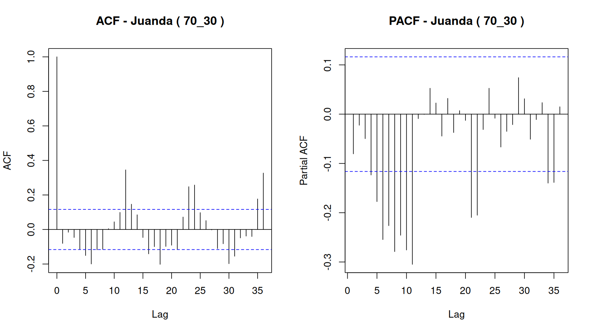

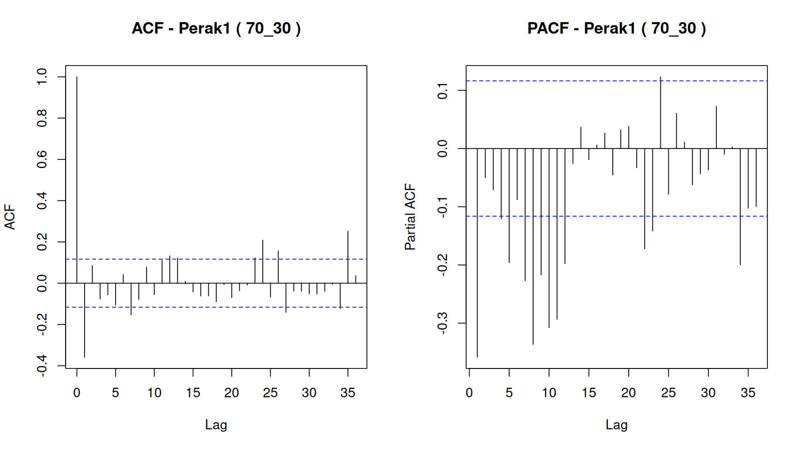

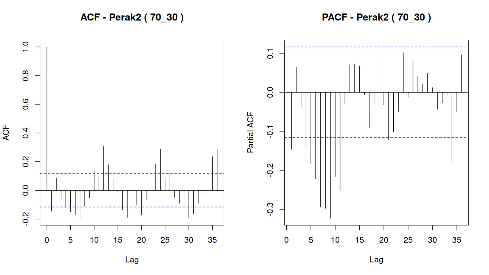

### CCF

Negative CCF lag means the second named location leads the first; positive lag means the first leads the second. The strongest correlation at each absolute non-zero lag is used to propose spatial-order candidates.

| location_x | location_y | lag | ccf | significance_bound | significant | direction |
|---|---|---|---|---|---|---|
| Juanda | Perak1 | -36 | 0.148692 | 0.116302 | TRUE | Perak1 leads Juanda |
| Juanda | Perak1 | -35 | 0.155441 | 0.116302 | TRUE | Perak1 leads Juanda |
| Juanda | Perak1 | -34 | -0.028796 | 0.116302 | FALSE | Perak1 leads Juanda |
| Juanda | Perak1 | -33 | 0.001882 | 0.116302 | FALSE | Perak1 leads Juanda |
| Juanda | Perak1 | -32 | 0.092987 | 0.116302 | FALSE | Perak1 leads Juanda |
| Juanda | Perak1 | -31 | -0.084491 | 0.116302 | FALSE | Perak1 leads Juanda |
| Juanda | Perak1 | -30 | -0.154572 | 0.116302 | TRUE | Perak1 leads Juanda |
| Juanda | Perak1 | -29 | -0.040791 | 0.116302 | FALSE | Perak1 leads Juanda |
| Juanda | Perak1 | -28 | -0.162741 | 0.116302 | TRUE | Perak1 leads Juanda |
| Juanda | Perak1 | -27 | -0.065071 | 0.116302 | FALSE | Perak1 leads Juanda |
| Juanda | Perak1 | -26 | 0.030955 | 0.116302 | FALSE | Perak1 leads Juanda |
| Juanda | Perak1 | -25 | 0.035580 | 0.116302 | FALSE | Perak1 leads Juanda |
| Juanda | Perak1 | -24 | 0.193754 | 0.116302 | TRUE | Perak1 leads Juanda |
| Juanda | Perak1 | -23 | 0.160236 | 0.116302 | TRUE | Perak1 leads Juanda |
| Juanda | Perak1 | -22 | 0.082570 | 0.116302 | FALSE | Perak1 leads Juanda |
| Juanda | Perak1 | -21 | -0.078569 | 0.116302 | FALSE | Perak1 leads Juanda |
| Juanda | Perak1 | -20 | 0.064232 | 0.116302 | FALSE | Perak1 leads Juanda |
| Juanda | Perak1 | -19 | -0.064571 | 0.116302 | FALSE | Perak1 leads Juanda |
| Juanda | Perak1 | -18 | -0.097781 | 0.116302 | FALSE | Perak1 leads Juanda |
| Juanda | Perak1 | -17 | -0.089896 | 0.116302 | FALSE | Perak1 leads Juanda |
| Juanda | Perak1 | -16 | -0.214362 | 0.116302 | TRUE | Perak1 leads Juanda |
| Juanda | Perak1 | -15 | -0.067954 | 0.116302 | FALSE | Perak1 leads Juanda |
| Juanda | Perak1 | -14 | 0.044614 | 0.116302 | FALSE | Perak1 leads Juanda |
| Juanda | Perak1 | -13 | 0.130218 | 0.116302 | TRUE | Perak1 leads Juanda |
| Juanda | Perak1 | -12 | 0.152334 | 0.116302 | TRUE | Perak1 leads Juanda |
| Juanda | Perak1 | -11 | 0.098474 | 0.116302 | FALSE | Perak1 leads Juanda |
| Juanda | Perak1 | -10 | 0.029260 | 0.116302 | FALSE | Perak1 leads Juanda |
| Juanda | Perak1 | -9 | 0.084481 | 0.116302 | FALSE | Perak1 leads Juanda |
| Juanda | Perak1 | -8 | -0.008003 | 0.116302 | FALSE | Perak1 leads Juanda |
| Juanda | Perak1 | -7 | -0.062624 | 0.116302 | FALSE | Perak1 leads Juanda |
| Juanda | Perak1 | -6 | -0.009288 | 0.116302 | FALSE | Perak1 leads Juanda |
| Juanda | Perak1 | -5 | -0.231925 | 0.116302 | TRUE | Perak1 leads Juanda |
| Juanda | Perak1 | -4 | -0.150486 | 0.116302 | TRUE | Perak1 leads Juanda |
| Juanda | Perak1 | -3 | -0.074020 | 0.116302 | FALSE | Perak1 leads Juanda |
| Juanda | Perak1 | -2 | 0.009708 | 0.116302 | FALSE | Perak1 leads Juanda |
| Juanda | Perak1 | -1 | -0.036450 | 0.116302 | FALSE | Perak1 leads Juanda |
| Juanda | Perak1 | 0 | 0.550877 | 0.116302 | TRUE | contemporaneous |
| Juanda | Perak1 | 1 | -0.059782 | 0.116302 | FALSE | Juanda leads Perak1 |
| Juanda | Perak1 | 2 | 0.081134 | 0.116302 | FALSE | Juanda leads Perak1 |
| Juanda | Perak1 | 3 | -0.054241 | 0.116302 | FALSE | Juanda leads Perak1 |
| Juanda | Perak1 | 4 | 0.038143 | 0.116302 | FALSE | Juanda leads Perak1 |
| Juanda | Perak1 | 5 | -0.091628 | 0.116302 | FALSE | Juanda leads Perak1 |
| Juanda | Perak1 | 6 | -0.018908 | 0.116302 | FALSE | Juanda leads Perak1 |
| Juanda | Perak1 | 7 | -0.216834 | 0.116302 | TRUE | Juanda leads Perak1 |
| Juanda | Perak1 | 8 | -0.121001 | 0.116302 | TRUE | Juanda leads Perak1 |
| Juanda | Perak1 | 9 | -0.051578 | 0.116302 | FALSE | Juanda leads Perak1 |
| Juanda | Perak1 | 10 | 0.009240 | 0.116302 | FALSE | Juanda leads Perak1 |
| Juanda | Perak1 | 11 | 0.093598 | 0.116302 | FALSE | Juanda leads Perak1 |
| Juanda | Perak1 | 12 | 0.184755 | 0.116302 | TRUE | Juanda leads Perak1 |
| Juanda | Perak1 | 13 | 0.151127 | 0.116302 | TRUE | Juanda leads Perak1 |
| Juanda | Perak1 | 14 | 0.043765 | 0.116302 | FALSE | Juanda leads Perak1 |
| Juanda | Perak1 | 15 | -0.002433 | 0.116302 | FALSE | Juanda leads Perak1 |
| Juanda | Perak1 | 16 | -0.005596 | 0.116302 | FALSE | Juanda leads Perak1 |
| Juanda | Perak1 | 17 | -0.044007 | 0.116302 | FALSE | Juanda leads Perak1 |
| Juanda | Perak1 | 18 | -0.063898 | 0.116302 | FALSE | Juanda leads Perak1 |
| Juanda | Perak1 | 19 | -0.153262 | 0.116302 | TRUE | Juanda leads Perak1 |
| Juanda | Perak1 | 20 | -0.149258 | 0.116302 | TRUE | Juanda leads Perak1 |
| Juanda | Perak1 | 21 | -0.098229 | 0.116302 | FALSE | Juanda leads Perak1 |
| Juanda | Perak1 | 22 | 0.032539 | 0.116302 | FALSE | Juanda leads Perak1 |
| Juanda | Perak1 | 23 | 0.172307 | 0.116302 | TRUE | Juanda leads Perak1 |
| Juanda | Perak1 | 24 | 0.164356 | 0.116302 | TRUE | Juanda leads Perak1 |
| Juanda | Perak1 | 25 | 0.028091 | 0.116302 | FALSE | Juanda leads Perak1 |
| Juanda | Perak1 | 26 | 0.118342 | 0.116302 | TRUE | Juanda leads Perak1 |
| Juanda | Perak1 | 27 | -0.043023 | 0.116302 | FALSE | Juanda leads Perak1 |
| Juanda | Perak1 | 28 | 0.004084 | 0.116302 | FALSE | Juanda leads Perak1 |
| Juanda | Perak1 | 29 | 0.054288 | 0.116302 | FALSE | Juanda leads Perak1 |
| Juanda | Perak1 | 30 | -0.176643 | 0.116302 | TRUE | Juanda leads Perak1 |
| Juanda | Perak1 | 31 | -0.104447 | 0.116302 | FALSE | Juanda leads Perak1 |
| Juanda | Perak1 | 32 | -0.138703 | 0.116302 | TRUE | Juanda leads Perak1 |
| Juanda | Perak1 | 33 | -0.043315 | 0.116302 | FALSE | Juanda leads Perak1 |
| Juanda | Perak1 | 34 | -0.048761 | 0.116302 | FALSE | Juanda leads Perak1 |
| Juanda | Perak1 | 35 | 0.152587 | 0.116302 | TRUE | Juanda leads Perak1 |
| Juanda | Perak1 | 36 | 0.146987 | 0.116302 | TRUE | Juanda leads Perak1 |
| Juanda | Perak2 | -36 | 0.254520 | 0.116302 | TRUE | Perak2 leads Juanda |
| Juanda | Perak2 | -35 | 0.265733 | 0.116302 | TRUE | Perak2 leads Juanda |
| Juanda | Perak2 | -34 | 0.005734 | 0.116302 | FALSE | Perak2 leads Juanda |
| Juanda | Perak2 | -33 | -0.034045 | 0.116302 | FALSE | Perak2 leads Juanda |
| Juanda | Perak2 | -32 | 0.017819 | 0.116302 | FALSE | Perak2 leads Juanda |
| Juanda | Perak2 | -31 | -0.145157 | 0.116302 | TRUE | Perak2 leads Juanda |
| Juanda | Perak2 | -30 | -0.190362 | 0.116302 | TRUE | Perak2 leads Juanda |
| Juanda | Perak2 | -29 | -0.102392 | 0.116302 | FALSE | Perak2 leads Juanda |
| Juanda | Perak2 | -28 | -0.165216 | 0.116302 | TRUE | Perak2 leads Juanda |
| Juanda | Perak2 | -27 | -0.096780 | 0.116302 | FALSE | Perak2 leads Juanda |
| Juanda | Perak2 | -26 | 0.103858 | 0.116302 | FALSE | Perak2 leads Juanda |
| Juanda | Perak2 | -25 | 0.083349 | 0.116302 | FALSE | Perak2 leads Juanda |
| Juanda | Perak2 | -24 | 0.205410 | 0.116302 | TRUE | Perak2 leads Juanda |
| Juanda | Perak2 | -23 | 0.225797 | 0.116302 | TRUE | Perak2 leads Juanda |
| Juanda | Perak2 | -22 | 0.222178 | 0.116302 | TRUE | Perak2 leads Juanda |
| Juanda | Perak2 | -21 | -0.086165 | 0.116302 | FALSE | Perak2 leads Juanda |
| Juanda | Perak2 | -20 | -0.120091 | 0.116302 | TRUE | Perak2 leads Juanda |
| Juanda | Perak2 | -19 | -0.069280 | 0.116302 | FALSE | Perak2 leads Juanda |
| Juanda | Perak2 | -18 | -0.111453 | 0.116302 | FALSE | Perak2 leads Juanda |
| Juanda | Perak2 | -17 | -0.195424 | 0.116302 | TRUE | Perak2 leads Juanda |
| Juanda | Perak2 | -16 | -0.191117 | 0.116302 | TRUE | Perak2 leads Juanda |
| Juanda | Perak2 | -15 | -0.091815 | 0.116302 | FALSE | Perak2 leads Juanda |
| Juanda | Perak2 | -14 | 0.064885 | 0.116302 | FALSE | Perak2 leads Juanda |
| Juanda | Perak2 | -13 | 0.172772 | 0.116302 | TRUE | Perak2 leads Juanda |
| Juanda | Perak2 | -12 | 0.244125 | 0.116302 | TRUE | Perak2 leads Juanda |
| Juanda | Perak2 | -11 | 0.191259 | 0.116302 | TRUE | Perak2 leads Juanda |
| Juanda | Perak2 | -10 | 0.058117 | 0.116302 | FALSE | Perak2 leads Juanda |
| Juanda | Perak2 | -9 | 0.059637 | 0.116302 | FALSE | Perak2 leads Juanda |
| Juanda | Perak2 | -8 | -0.091246 | 0.116302 | FALSE | Perak2 leads Juanda |
| Juanda | Perak2 | -7 | -0.082366 | 0.116302 | FALSE | Perak2 leads Juanda |
| Juanda | Perak2 | -6 | -0.159206 | 0.116302 | TRUE | Perak2 leads Juanda |
| Juanda | Perak2 | -5 | -0.208179 | 0.116302 | TRUE | Perak2 leads Juanda |
| Juanda | Perak2 | -4 | -0.171265 | 0.116302 | TRUE | Perak2 leads Juanda |
| Juanda | Perak2 | -3 | -0.060666 | 0.116302 | FALSE | Perak2 leads Juanda |
| Juanda | Perak2 | -2 | 0.026663 | 0.116302 | FALSE | Perak2 leads Juanda |
| Juanda | Perak2 | -1 | 0.010401 | 0.116302 | FALSE | Perak2 leads Juanda |
| Juanda | Perak2 | 0 | 0.551521 | 0.116302 | TRUE | contemporaneous |
| Juanda | Perak2 | 1 | 0.142915 | 0.116302 | TRUE | Juanda leads Perak2 |
| Juanda | Perak2 | 2 | 0.072976 | 0.116302 | FALSE | Juanda leads Perak2 |
| Juanda | Perak2 | 3 | -0.037009 | 0.116302 | FALSE | Juanda leads Perak2 |
| Juanda | Perak2 | 4 | -0.052589 | 0.116302 | FALSE | Juanda leads Perak2 |
| Juanda | Perak2 | 5 | -0.139388 | 0.116302 | TRUE | Juanda leads Perak2 |
| Juanda | Perak2 | 6 | -0.113718 | 0.116302 | FALSE | Juanda leads Perak2 |
| Juanda | Perak2 | 7 | -0.227462 | 0.116302 | TRUE | Juanda leads Perak2 |
| Juanda | Perak2 | 8 | -0.142525 | 0.116302 | TRUE | Juanda leads Perak2 |
| Juanda | Perak2 | 9 | -0.122000 | 0.116302 | TRUE | Juanda leads Perak2 |
| Juanda | Perak2 | 10 | 0.104737 | 0.116302 | FALSE | Juanda leads Perak2 |
| Juanda | Perak2 | 11 | 0.111645 | 0.116302 | FALSE | Juanda leads Perak2 |
| Juanda | Perak2 | 12 | 0.251042 | 0.116302 | TRUE | Juanda leads Perak2 |
| Juanda | Perak2 | 13 | 0.202679 | 0.116302 | TRUE | Juanda leads Perak2 |
| Juanda | Perak2 | 14 | 0.147697 | 0.116302 | TRUE | Juanda leads Perak2 |
| Juanda | Perak2 | 15 | 0.018493 | 0.116302 | FALSE | Juanda leads Perak2 |
| Juanda | Perak2 | 16 | -0.119243 | 0.116302 | TRUE | Juanda leads Perak2 |
| Juanda | Perak2 | 17 | -0.121399 | 0.116302 | TRUE | Juanda leads Perak2 |
| Juanda | Perak2 | 18 | -0.123632 | 0.116302 | TRUE | Juanda leads Perak2 |
| Juanda | Perak2 | 19 | -0.149433 | 0.116302 | TRUE | Juanda leads Perak2 |
| Juanda | Perak2 | 20 | -0.184735 | 0.116302 | TRUE | Juanda leads Perak2 |
| Juanda | Perak2 | 21 | -0.103086 | 0.116302 | FALSE | Juanda leads Perak2 |
| Juanda | Perak2 | 22 | 0.024123 | 0.116302 | FALSE | Juanda leads Perak2 |
| Juanda | Perak2 | 23 | 0.200731 | 0.116302 | TRUE | Juanda leads Perak2 |
| Juanda | Perak2 | 24 | 0.238320 | 0.116302 | TRUE | Juanda leads Perak2 |
| Juanda | Perak2 | 25 | 0.153747 | 0.116302 | TRUE | Juanda leads Perak2 |
| Juanda | Perak2 | 26 | 0.120733 | 0.116302 | TRUE | Juanda leads Perak2 |
| Juanda | Perak2 | 27 | 0.001209 | 0.116302 | FALSE | Juanda leads Perak2 |
| Juanda | Perak2 | 28 | -0.047390 | 0.116302 | FALSE | Juanda leads Perak2 |
| Juanda | Perak2 | 29 | -0.047840 | 0.116302 | FALSE | Juanda leads Perak2 |
| Juanda | Perak2 | 30 | -0.244656 | 0.116302 | TRUE | Juanda leads Perak2 |
| Juanda | Perak2 | 31 | -0.163548 | 0.116302 | TRUE | Juanda leads Perak2 |
| Juanda | Perak2 | 32 | -0.115152 | 0.116302 | FALSE | Juanda leads Perak2 |
| Juanda | Perak2 | 33 | -0.048614 | 0.116302 | FALSE | Juanda leads Perak2 |
| Juanda | Perak2 | 34 | -0.042751 | 0.116302 | FALSE | Juanda leads Perak2 |
| Juanda | Perak2 | 35 | 0.147522 | 0.116302 | TRUE | Juanda leads Perak2 |
| Juanda | Perak2 | 36 | 0.235516 | 0.116302 | TRUE | Juanda leads Perak2 |
| Perak1 | Perak2 | -36 | 0.124596 | 0.116302 | TRUE | Perak2 leads Perak1 |
| Perak1 | Perak2 | -35 | 0.263624 | 0.116302 | TRUE | Perak2 leads Perak1 |
| Perak1 | Perak2 | -34 | -0.059674 | 0.116302 | FALSE | Perak2 leads Perak1 |
| Perak1 | Perak2 | -33 | -0.009335 | 0.116302 | FALSE | Perak2 leads Perak1 |
| Perak1 | Perak2 | -32 | -0.099331 | 0.116302 | FALSE | Perak2 leads Perak1 |
| Perak1 | Perak2 | -31 | -0.139210 | 0.116302 | TRUE | Perak2 leads Perak1 |
| Perak1 | Perak2 | -30 | -0.102644 | 0.116302 | FALSE | Perak2 leads Perak1 |
| Perak1 | Perak2 | -29 | -0.109505 | 0.116302 | FALSE | Perak2 leads Perak1 |
| Perak1 | Perak2 | -28 | 0.044799 | 0.116302 | FALSE | Perak2 leads Perak1 |
| Perak1 | Perak2 | -27 | -0.097169 | 0.116302 | FALSE | Perak2 leads Perak1 |
| Perak1 | Perak2 | -26 | 0.155662 | 0.116302 | TRUE | Perak2 leads Perak1 |
| Perak1 | Perak2 | -25 | -0.005342 | 0.116302 | FALSE | Perak2 leads Perak1 |
| Perak1 | Perak2 | -24 | 0.185069 | 0.116302 | TRUE | Perak2 leads Perak1 |
| Perak1 | Perak2 | -23 | 0.145695 | 0.116302 | TRUE | Perak2 leads Perak1 |
| Perak1 | Perak2 | -22 | 0.092503 | 0.116302 | FALSE | Perak2 leads Perak1 |
| Perak1 | Perak2 | -21 | -0.065512 | 0.116302 | FALSE | Perak2 leads Perak1 |
| Perak1 | Perak2 | -20 | -0.155077 | 0.116302 | TRUE | Perak2 leads Perak1 |
| Perak1 | Perak2 | -19 | -0.107350 | 0.116302 | FALSE | Perak2 leads Perak1 |
| Perak1 | Perak2 | -18 | -0.043621 | 0.116302 | FALSE | Perak2 leads Perak1 |
| Perak1 | Perak2 | -17 | -0.152297 | 0.116302 | TRUE | Perak2 leads Perak1 |
| Perak1 | Perak2 | -16 | 0.012851 | 0.116302 | FALSE | Perak2 leads Perak1 |
| Perak1 | Perak2 | -15 | -0.010542 | 0.116302 | FALSE | Perak2 leads Perak1 |
| Perak1 | Perak2 | -14 | -0.030679 | 0.116302 | FALSE | Perak2 leads Perak1 |
| Perak1 | Perak2 | -13 | 0.170846 | 0.116302 | TRUE | Perak2 leads Perak1 |
| Perak1 | Perak2 | -12 | 0.220930 | 0.116302 | TRUE | Perak2 leads Perak1 |
| Perak1 | Perak2 | -11 | 0.085572 | 0.116302 | FALSE | Perak2 leads Perak1 |
| Perak1 | Perak2 | -10 | 0.016941 | 0.116302 | FALSE | Perak2 leads Perak1 |
| Perak1 | Perak2 | -9 | 0.010940 | 0.116302 | FALSE | Perak2 leads Perak1 |
| Perak1 | Perak2 | -8 | -0.091074 | 0.116302 | FALSE | Perak2 leads Perak1 |
| Perak1 | Perak2 | -7 | -0.186427 | 0.116302 | TRUE | Perak2 leads Perak1 |
| Perak1 | Perak2 | -6 | -0.089402 | 0.116302 | FALSE | Perak2 leads Perak1 |
| Perak1 | Perak2 | -5 | -0.108098 | 0.116302 | FALSE | Perak2 leads Perak1 |
| Perak1 | Perak2 | -4 | -0.033658 | 0.116302 | FALSE | Perak2 leads Perak1 |
| Perak1 | Perak2 | -3 | -0.010758 | 0.116302 | FALSE | Perak2 leads Perak1 |
| Perak1 | Perak2 | -2 | 0.111451 | 0.116302 | FALSE | Perak2 leads Perak1 |
| Perak1 | Perak2 | -1 | -0.217907 | 0.116302 | TRUE | Perak2 leads Perak1 |
| Perak1 | Perak2 | 0 | 0.730852 | 0.116302 | TRUE | contemporaneous |
| Perak1 | Perak2 | 1 | -0.131146 | 0.116302 | TRUE | Perak1 leads Perak2 |
| Perak1 | Perak2 | 2 | 0.114337 | 0.116302 | FALSE | Perak1 leads Perak2 |
| Perak1 | Perak2 | 3 | -0.097447 | 0.116302 | FALSE | Perak1 leads Perak2 |
| Perak1 | Perak2 | 4 | -0.124053 | 0.116302 | TRUE | Perak1 leads Perak2 |
| Perak1 | Perak2 | 5 | -0.160370 | 0.116302 | TRUE | Perak1 leads Perak2 |
| Perak1 | Perak2 | 6 | -0.030331 | 0.116302 | FALSE | Perak1 leads Perak2 |
| Perak1 | Perak2 | 7 | -0.140937 | 0.116302 | TRUE | Perak1 leads Perak2 |
| Perak1 | Perak2 | 8 | -0.057589 | 0.116302 | FALSE | Perak1 leads Perak2 |
| Perak1 | Perak2 | 9 | 0.025304 | 0.116302 | FALSE | Perak1 leads Perak2 |
| Perak1 | Perak2 | 10 | 0.057795 | 0.116302 | FALSE | Perak1 leads Perak2 |
| Perak1 | Perak2 | 11 | 0.114285 | 0.116302 | FALSE | Perak1 leads Perak2 |
| Perak1 | Perak2 | 12 | 0.146735 | 0.116302 | TRUE | Perak1 leads Perak2 |
| Perak1 | Perak2 | 13 | 0.128449 | 0.116302 | TRUE | Perak1 leads Perak2 |
| Perak1 | Perak2 | 14 | 0.096471 | 0.116302 | FALSE | Perak1 leads Perak2 |
| Perak1 | Perak2 | 15 | -0.027045 | 0.116302 | FALSE | Perak1 leads Perak2 |
| Perak1 | Perak2 | 16 | -0.164018 | 0.116302 | TRUE | Perak1 leads Perak2 |
| Perak1 | Perak2 | 17 | -0.119905 | 0.116302 | TRUE | Perak1 leads Perak2 |
| Perak1 | Perak2 | 18 | -0.135915 | 0.116302 | TRUE | Perak1 leads Perak2 |
| Perak1 | Perak2 | 19 | -0.017129 | 0.116302 | FALSE | Perak1 leads Perak2 |
| Perak1 | Perak2 | 20 | -0.055714 | 0.116302 | FALSE | Perak1 leads Perak2 |
| Perak1 | Perak2 | 21 | 0.004702 | 0.116302 | FALSE | Perak1 leads Perak2 |
| Perak1 | Perak2 | 22 | 0.002646 | 0.116302 | FALSE | Perak1 leads Perak2 |
| Perak1 | Perak2 | 23 | 0.125370 | 0.116302 | TRUE | Perak1 leads Perak2 |
| Perak1 | Perak2 | 24 | 0.234656 | 0.116302 | TRUE | Perak1 leads Perak2 |
| Perak1 | Perak2 | 25 | 0.015697 | 0.116302 | FALSE | Perak1 leads Perak2 |
| Perak1 | Perak2 | 26 | 0.126301 | 0.116302 | TRUE | Perak1 leads Perak2 |
| Perak1 | Perak2 | 27 | -0.058967 | 0.116302 | FALSE | Perak1 leads Perak2 |
| Perak1 | Perak2 | 28 | -0.114888 | 0.116302 | FALSE | Perak1 leads Perak2 |
| Perak1 | Perak2 | 29 | -0.116718 | 0.116302 | TRUE | Perak1 leads Perak2 |
| Perak1 | Perak2 | 30 | -0.099795 | 0.116302 | FALSE | Perak1 leads Perak2 |
| Perak1 | Perak2 | 31 | -0.123335 | 0.116302 | TRUE | Perak1 leads Perak2 |
| Perak1 | Perak2 | 32 | 0.035193 | 0.116302 | FALSE | Perak1 leads Perak2 |
| Perak1 | Perak2 | 33 | 0.000215 | 0.116302 | FALSE | Perak1 leads Perak2 |
| Perak1 | Perak2 | 34 | -0.072213 | 0.116302 | FALSE | Perak1 leads Perak2 |
| Perak1 | Perak2 | 35 | 0.215164 | 0.116302 | TRUE | Perak1 leads Perak2 |
| Perak1 | Perak2 | 36 | 0.133420 | 0.116302 | TRUE | Perak1 leads Perak2 |

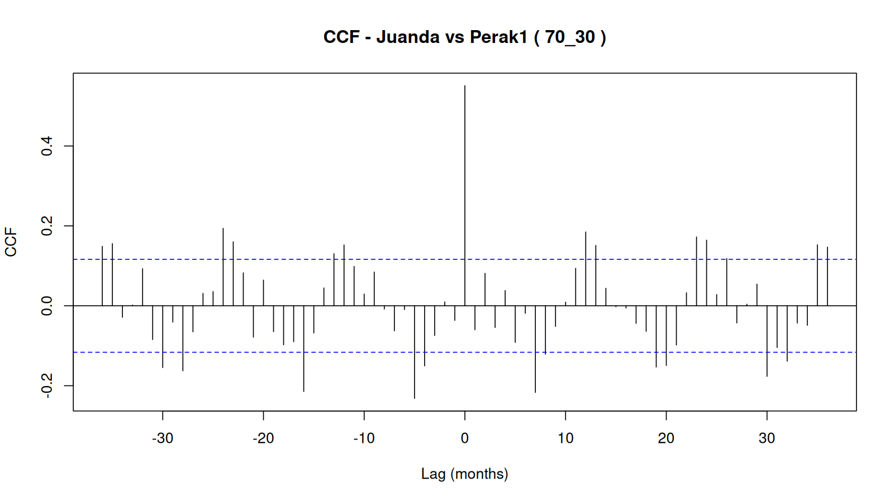

### Candidate models

| a | b | fitted | AIC | coefficients_finite | iidn_pass | white_noise_pass | error |
|---|---|---|---|---|---|---|---|
| 1 | 1 | TRUE | 10590.526 | TRUE | FALSE | FALSE |  |
| 5 | 1 | TRUE | 10403.025 | TRUE | FALSE | FALSE |  |
| 7 | 1 | TRUE | 10278.511 | TRUE | FALSE | FALSE |  |
| 12 | 1 | TRUE | 9887.485 | TRUE | FALSE | FALSE |  |
| 16 | 1 | TRUE | 9757.897 | TRUE | FALSE | FALSE |  |
| 17 | 1 | TRUE | 9729.580 | TRUE | FALSE | FALSE |  |
| 1 | 5 | TRUE | 10403.107 | TRUE | FALSE | FALSE |  |
| 5 | 5 | TRUE | 10355.601 | TRUE | FALSE | FALSE |  |
| 7 | 5 | TRUE | 10229.164 | TRUE | FALSE | FALSE |  |
| 12 | 5 | TRUE | 9818.791 | TRUE | FALSE | TRUE |  |
| 16 | 5 | TRUE | 9694.374 | TRUE | FALSE | TRUE |  |
| 17 | 5 | TRUE | 9665.641 | TRUE | FALSE | TRUE |  |
| 1 | 6 | TRUE | 10333.897 | TRUE | FALSE | FALSE |  |
| 5 | 6 | TRUE | 10292.149 | TRUE | FALSE | FALSE |  |
| 7 | 6 | TRUE | 10201.519 | TRUE | FALSE | FALSE |  |
| 12 | 6 | TRUE | 9800.930 | TRUE | FALSE | TRUE |  |
| 16 | 6 | TRUE | 9677.684 | TRUE | FALSE | TRUE |  |
| 17 | 6 | TRUE | 9649.331 | TRUE | FALSE | TRUE |  |
| 1 | 7 | TRUE | 10255.104 | TRUE | FALSE | FALSE |  |
| 5 | 7 | TRUE | 10218.706 | TRUE | FALSE | FALSE |  |
| 7 | 7 | TRUE | 10194.347 | TRUE | FALSE | FALSE |  |
| 12 | 7 | TRUE | 9801.704 | TRUE | FALSE | TRUE |  |
| 16 | 7 | TRUE | 9678.591 | TRUE | FALSE | TRUE |  |
| 17 | 7 | TRUE | 9650.421 | TRUE | FALSE | TRUE |  |
| 1 | 8 | TRUE | 10148.670 | TRUE | FALSE | FALSE |  |
| 5 | 8 | TRUE | 10120.707 | TRUE | FALSE | FALSE |  |
| 7 | 8 | TRUE | 10097.334 | TRUE | FALSE | FALSE |  |
| 12 | 8 | TRUE | 9789.893 | TRUE | FALSE | TRUE |  |
| 16 | 8 | TRUE | 9663.972 | TRUE | FALSE | TRUE |  |
| 17 | 8 | TRUE | 9636.792 | TRUE | FALSE | TRUE |  |
| 1 | 9 | TRUE | 10057.722 | TRUE | FALSE | FALSE |  |
| 5 | 9 | TRUE | 10039.225 | TRUE | FALSE | FALSE |  |
| 7 | 9 | TRUE | 10021.042 | TRUE | FALSE | FALSE |  |
| 12 | 9 | TRUE | 9788.795 | TRUE | FALSE | TRUE |  |
| 16 | 9 | TRUE | 9662.579 | TRUE | FALSE | TRUE |  |
| 17 | 9 | TRUE | 9635.471 | TRUE | FALSE | TRUE |  |

### Selected parameters

| a | b | parameter | estimate | std_error | t_value | p_value |
|---|---|---|---|---|---|---|
| 17 | 9 | phi1(Juanda) | -0.560404 | 0.061000 | -9.186916 | 0.000000 |
| 17 | 9 | phi1(Perak1) | -0.992682 | 0.091498 | -10.849175 | 0.000000 |
| 17 | 9 | phi1(Perak2) | -0.506363 | 0.120424 | -4.204824 | 0.000029 |
| 17 | 9 | phi2(Juanda) | -0.524516 | 0.070915 | -7.396451 | 0.000000 |
| 17 | 9 | phi2(Perak1) | -0.796472 | 0.117136 | -6.799558 | 0.000000 |
| 17 | 9 | phi2(Perak2) | -0.398107 | 0.144730 | -2.750682 | 0.006096 |
| 17 | 9 | phi3(Juanda) | -0.385975 | 0.077002 | -5.012530 | 0.000001 |
| 17 | 9 | phi3(Perak1) | -0.674466 | 0.133164 | -5.064912 | 0.000001 |
| 17 | 9 | phi3(Perak2) | -0.408177 | 0.162121 | -2.517736 | 0.012026 |
| 17 | 9 | phi4(Juanda) | -0.388475 | 0.077701 | -4.999642 | 0.000001 |
| 17 | 9 | phi4(Perak1) | -0.567008 | 0.141252 | -4.014170 | 0.000066 |
| 17 | 9 | phi4(Perak2) | -0.338084 | 0.173308 | -1.950766 | 0.051471 |
| 17 | 9 | phi5(Juanda) | -0.371425 | 0.079339 | -4.681494 | 0.000003 |
| 17 | 9 | phi5(Perak1) | -0.424509 | 0.145759 | -2.912393 | 0.003697 |
| 17 | 9 | phi5(Perak2) | -0.227650 | 0.175670 | -1.295898 | 0.195424 |
| 17 | 9 | phi6(Juanda) | -0.453101 | 0.079632 | -5.689934 | 0.000000 |
| 17 | 9 | phi6(Perak1) | -0.326705 | 0.141660 | -2.306256 | 0.021378 |
| 17 | 9 | phi6(Perak2) | -0.202902 | 0.170576 | -1.189514 | 0.234628 |
| 17 | 9 | phi7(Juanda) | -0.257168 | 0.081284 | -3.163808 | 0.001622 |
| 17 | 9 | phi7(Perak1) | -0.362615 | 0.132713 | -2.732337 | 0.006442 |
| 17 | 9 | phi7(Perak2) | -0.189737 | 0.162139 | -1.170214 | 0.242300 |
| 17 | 9 | phi8(Juanda) | -0.245032 | 0.074984 | -3.267778 | 0.001135 |
| 17 | 9 | phi8(Perak1) | -0.308694 | 0.117002 | -2.638374 | 0.008510 |
| 17 | 9 | phi8(Perak2) | -0.197192 | 0.147094 | -1.340586 | 0.180476 |
| 17 | 9 | phi9(Juanda) | -0.063823 | 0.065783 | -0.970203 | 0.332270 |
| 17 | 9 | phi9(Perak1) | -0.065763 | 0.092503 | -0.710928 | 0.477358 |
| 17 | 9 | phi9(Perak2) | -0.280782 | 0.123234 | -2.278451 | 0.022991 |
| 17 | 9 | theta1(Juanda) | -0.163932 | 0.093698 | -1.749572 | 0.080617 |
| 17 | 9 | theta1(Perak1) | 0.266475 | 0.125721 | 2.119580 | 0.034382 |
| 17 | 9 | theta1(Perak2) | -0.165974 | 0.098094 | -1.691990 | 0.091079 |
| 17 | 9 | theta2(Juanda) | -0.313254 | 0.122702 | -2.552956 | 0.010886 |
| 17 | 9 | theta2(Perak1) | 0.218926 | 0.147143 | 1.487850 | 0.137226 |
| 17 | 9 | theta2(Perak2) | -0.127445 | 0.127809 | -0.997151 | 0.319025 |
| 17 | 9 | theta3(Juanda) | -0.523047 | 0.136576 | -3.829716 | 0.000139 |
| 17 | 9 | theta3(Perak1) | 0.076173 | 0.171414 | 0.444384 | 0.656898 |
| 17 | 9 | theta3(Perak2) | -0.128336 | 0.149995 | -0.855605 | 0.392500 |
| 17 | 9 | theta4(Juanda) | -0.456660 | 0.147860 | -3.088459 | 0.002089 |
| 17 | 9 | theta4(Perak1) | -0.063079 | 0.185891 | -0.339336 | 0.734455 |
| 17 | 9 | theta4(Perak2) | -0.187894 | 0.167882 | -1.119202 | 0.263426 |
| 17 | 9 | theta5(Juanda) | -0.424849 | 0.155653 | -2.729461 | 0.006498 |
| 17 | 9 | theta5(Perak1) | -0.301943 | 0.198153 | -1.523785 | 0.128000 |
| 17 | 9 | theta5(Perak2) | -0.274755 | 0.180587 | -1.521456 | 0.128583 |
| 17 | 9 | theta6(Juanda) | -0.371049 | 0.161518 | -2.297261 | 0.021889 |
| 17 | 9 | theta6(Perak1) | -0.228253 | 0.202324 | -1.128153 | 0.259629 |
| 17 | 9 | theta6(Perak2) | -0.297281 | 0.188630 | -1.576005 | 0.115462 |
| 17 | 9 | theta7(Juanda) | -0.761913 | 0.165896 | -4.592712 | 0.000005 |
| 17 | 9 | theta7(Perak1) | -0.146528 | 0.203837 | -0.718848 | 0.472467 |
| 17 | 9 | theta7(Perak2) | -0.343532 | 0.186629 | -1.840725 | 0.066072 |
| 17 | 9 | theta8(Juanda) | -0.942990 | 0.171508 | -5.498230 | 0.000000 |
| 17 | 9 | theta8(Perak1) | -0.150771 | 0.197877 | -0.761945 | 0.446342 |
| 17 | 9 | theta8(Perak2) | -0.347371 | 0.179247 | -1.937946 | 0.053019 |
| 17 | 9 | theta9(Juanda) | -1.085152 | 0.176456 | -6.149716 | 0.000000 |
| 17 | 9 | theta9(Perak1) | -0.227443 | 0.189685 | -1.199056 | 0.230899 |
| 17 | 9 | theta9(Perak2) | -0.244334 | 0.168915 | -1.446491 | 0.148473 |
| 17 | 9 | theta10(Juanda) | -1.007337 | 0.172974 | -5.823645 | 0.000000 |
| 17 | 9 | theta10(Perak1) | -0.236027 | 0.168951 | -1.397009 | 0.162839 |
| 17 | 9 | theta10(Perak2) | -0.343517 | 0.144495 | -2.377358 | 0.017696 |
| 17 | 9 | theta11(Juanda) | -0.774593 | 0.171011 | -4.529488 | 0.000007 |
| 17 | 9 | theta11(Perak1) | -0.198166 | 0.164762 | -1.202740 | 0.229471 |
| 17 | 9 | theta11(Perak2) | -0.202536 | 0.141286 | -1.433512 | 0.152144 |
| 17 | 9 | theta12(Juanda) | -0.378243 | 0.165143 | -2.290390 | 0.022286 |
| 17 | 9 | theta12(Perak1) | -0.032462 | 0.159748 | -0.203204 | 0.839032 |
| 17 | 9 | theta12(Perak2) | 0.020738 | 0.137066 | 0.151297 | 0.879784 |
| 17 | 9 | theta13(Juanda) | -0.133316 | 0.152975 | -0.871494 | 0.383774 |
| 17 | 9 | theta13(Perak1) | 0.106664 | 0.147984 | 0.720778 | 0.471279 |
| 17 | 9 | theta13(Perak2) | 0.124603 | 0.127478 | 0.977444 | 0.328676 |
| 17 | 9 | theta14(Juanda) | -0.038800 | 0.138744 | -0.279651 | 0.779825 |
| 17 | 9 | theta14(Perak1) | 0.241967 | 0.135737 | 1.782623 | 0.075067 |
| 17 | 9 | theta14(Perak2) | 0.066302 | 0.116486 | 0.569186 | 0.569407 |
| 17 | 9 | theta15(Juanda) | -0.037876 | 0.122967 | -0.308016 | 0.758159 |
| 17 | 9 | theta15(Perak1) | 0.194501 | 0.122122 | 1.592678 | 0.111670 |
| 17 | 9 | theta15(Perak2) | 0.039558 | 0.102736 | 0.385046 | 0.700317 |
| 17 | 9 | theta16(Juanda) | 0.002667 | 0.106486 | 0.025049 | 0.980023 |
| 17 | 9 | theta16(Perak1) | -0.000563 | 0.105708 | -0.005323 | 0.995754 |
| 17 | 9 | theta16(Perak2) | 0.056829 | 0.088961 | 0.638805 | 0.523152 |
| 17 | 9 | theta17(Juanda) | 0.029996 | 0.079994 | 0.374979 | 0.707786 |
| 17 | 9 | theta17(Perak1) | 0.004740 | 0.087252 | 0.054320 | 0.956695 |
| 17 | 9 | theta17(Perak2) | -0.016275 | 0.069045 | -0.235712 | 0.813723 |

### Training fit and hold-out forecast

Each panel compares actual rainfall with fitted values (left), recursive multi-step forecasts, and actual-lag one-step forecasts (right).

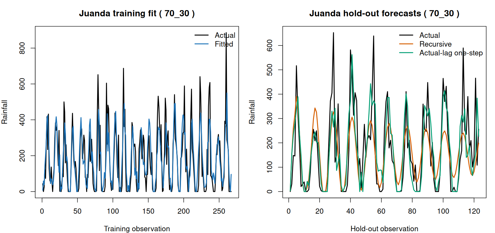

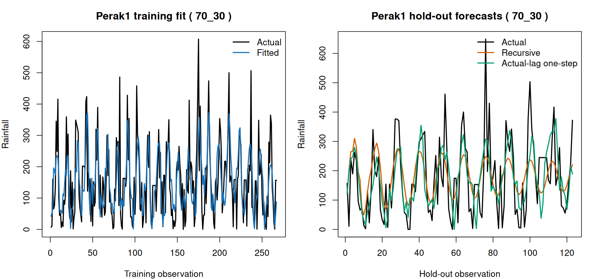

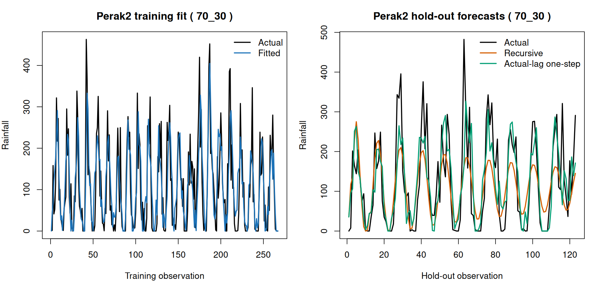

### Training metrics

| location | MSE | RMSE | MAE | sMAPE | MAPE_nonzero | R_squared |
|---|---|---|---|---|---|---|
| Juanda | 11718.057 | 108.24997 | 77.64748 | 71.39112 | 365.6636 | 0.599687 |
| Perak1 | 7925.489 | 89.02521 | 70.61236 | 61.42568 | 906.7517 | 0.431534 |
| Perak2 | 4352.472 | 65.97327 | 49.09887 | 78.12466 | 212.4984 | 0.612514 |
| Overall | 7998.672 | 89.43530 | 65.78624 | 70.31382 | 519.9546 | 0.577043 |

### Testing metrics: recursive multi-step

Each forecasted test value is used as a lag input for the next test forecast; no actual test value enters the forecast recursion.

| location | MSE | RMSE | MAE | sMAPE | MAPE_nonzero | R_squared |
|---|---|---|---|---|---|---|
| Juanda | 13568.618 | 116.48441 | 85.91478 | 81.42594 | 547.9854 | 0.484259 |
| Perak1 | 10385.654 | 101.91003 | 84.01119 | 61.42458 | 2100.0286 | 0.365831 |
| Perak2 | 6700.794 | 81.85838 | 62.77210 | 81.56086 | 356.2261 | 0.490947 |
| Overall | 10218.355 | 101.08588 | 77.56603 | 74.80379 | 1068.1985 | 0.465610 |

### Testing metrics: actual-lag one-step

Each test prediction uses observed rainfall only from earlier test months as lag inputs; it does not use the current month’s actual rainfall. This is a one-step-ahead evaluation, not a deployable long-horizon forecast.

| location | MSE | RMSE | MAE | sMAPE | MAPE_nonzero | R_squared |
|---|---|---|---|---|---|---|
| Juanda | 12803.065 | 113.15063 | 82.05077 | 75.04007 | 131.3168 | 0.513357 |
| Perak1 | 10562.504 | 102.77404 | 81.19458 | 63.94712 | 1519.8576 | 0.355033 |
| Perak2 | 6275.488 | 79.21798 | 58.34940 | 74.22754 | 153.3465 | 0.523257 |
| Overall | 9880.353 | 99.39996 | 73.86492 | 71.07158 | 657.3338 | 0.483287 |

### Selected residual diagnostics

| location | mean_residual | residual_variance | mean_zero_p_value | normality_shapiro_p_value | variance_stability_fligner_p_value | ljung_box_10_p_value | ljung_box_20_p_value |
|---|---|---|---|---|---|---|---|
| Juanda | -0.820917 | 11929.970 | 0.902350 | 0.000000 | 0.626982 | 0.821950 | 0.911187 |
| Perak1 | 0.413321 | 7966.064 | 0.939739 | 0.000186 | 0.255456 | 0.850862 | 0.622356 |
| Perak2 | -0.353988 | 4422.476 | 0.930754 | 0.001729 | 0.829081 | 0.883675 | 0.498444 |

### Equation terms

Custom convention: each city equation combines its own b lags and the inverse-distance-weighted other-city values through a lags.

| location | lag | source_location | effect | parameter | spatial_weight | coefficient |
|---|---|---|---|---|---|---|
| Juanda | 1 | Juanda | own temporal | phi1(Juanda) | 1.000000 | -0.560404 |
| Juanda | 2 | Juanda | own temporal | phi2(Juanda) | 1.000000 | -0.524516 |
| Juanda | 3 | Juanda | own temporal | phi3(Juanda) | 1.000000 | -0.385975 |
| Juanda | 4 | Juanda | own temporal | phi4(Juanda) | 1.000000 | -0.388475 |
| Juanda | 5 | Juanda | own temporal | phi5(Juanda) | 1.000000 | -0.371425 |
| Juanda | 6 | Juanda | own temporal | phi6(Juanda) | 1.000000 | -0.453101 |
| Juanda | 7 | Juanda | own temporal | phi7(Juanda) | 1.000000 | -0.257168 |
| Juanda | 8 | Juanda | own temporal | phi8(Juanda) | 1.000000 | -0.245032 |
| Juanda | 9 | Juanda | own temporal | phi9(Juanda) | 1.000000 | -0.063823 |
| Juanda | 1 | Perak1 | spatial weighted | theta1(Juanda) | 0.512359 | -0.083992 |
| Juanda | 1 | Perak2 | spatial weighted | theta1(Juanda) | 0.487641 | -0.079940 |
| Juanda | 2 | Perak1 | spatial weighted | theta2(Juanda) | 0.512359 | -0.160498 |
| Juanda | 2 | Perak2 | spatial weighted | theta2(Juanda) | 0.487641 | -0.152755 |
| Juanda | 3 | Perak1 | spatial weighted | theta3(Juanda) | 0.512359 | -0.267988 |
| Juanda | 3 | Perak2 | spatial weighted | theta3(Juanda) | 0.487641 | -0.255059 |
| Juanda | 4 | Perak1 | spatial weighted | theta4(Juanda) | 0.512359 | -0.233974 |
| Juanda | 4 | Perak2 | spatial weighted | theta4(Juanda) | 0.487641 | -0.222686 |
| Juanda | 5 | Perak1 | spatial weighted | theta5(Juanda) | 0.512359 | -0.217675 |
| Juanda | 5 | Perak2 | spatial weighted | theta5(Juanda) | 0.487641 | -0.207174 |
| Juanda | 6 | Perak1 | spatial weighted | theta6(Juanda) | 0.512359 | -0.190110 |
| Juanda | 6 | Perak2 | spatial weighted | theta6(Juanda) | 0.487641 | -0.180939 |
| Juanda | 7 | Perak1 | spatial weighted | theta7(Juanda) | 0.512359 | -0.390373 |
| Juanda | 7 | Perak2 | spatial weighted | theta7(Juanda) | 0.487641 | -0.371540 |
| Juanda | 8 | Perak1 | spatial weighted | theta8(Juanda) | 0.512359 | -0.483150 |
| Juanda | 8 | Perak2 | spatial weighted | theta8(Juanda) | 0.487641 | -0.459841 |
| Juanda | 9 | Perak1 | spatial weighted | theta9(Juanda) | 0.512359 | -0.555987 |
| Juanda | 9 | Perak2 | spatial weighted | theta9(Juanda) | 0.487641 | -0.529165 |
| Juanda | 10 | Perak1 | spatial weighted | theta10(Juanda) | 0.512359 | -0.516118 |
| Juanda | 10 | Perak2 | spatial weighted | theta10(Juanda) | 0.487641 | -0.491219 |
| Juanda | 11 | Perak1 | spatial weighted | theta11(Juanda) | 0.512359 | -0.396870 |
| Juanda | 11 | Perak2 | spatial weighted | theta11(Juanda) | 0.487641 | -0.377724 |
| Juanda | 12 | Perak1 | spatial weighted | theta12(Juanda) | 0.512359 | -0.193796 |
| Juanda | 12 | Perak2 | spatial weighted | theta12(Juanda) | 0.487641 | -0.184447 |
| Juanda | 13 | Perak1 | spatial weighted | theta13(Juanda) | 0.512359 | -0.068306 |
| Juanda | 13 | Perak2 | spatial weighted | theta13(Juanda) | 0.487641 | -0.065011 |
| Juanda | 14 | Perak1 | spatial weighted | theta14(Juanda) | 0.512359 | -0.019879 |
| Juanda | 14 | Perak2 | spatial weighted | theta14(Juanda) | 0.487641 | -0.018920 |
| Juanda | 15 | Perak1 | spatial weighted | theta15(Juanda) | 0.512359 | -0.019406 |
| Juanda | 15 | Perak2 | spatial weighted | theta15(Juanda) | 0.487641 | -0.018470 |
| Juanda | 16 | Perak1 | spatial weighted | theta16(Juanda) | 0.512359 | 0.001367 |
| Juanda | 16 | Perak2 | spatial weighted | theta16(Juanda) | 0.487641 | 0.001301 |
| Juanda | 17 | Perak1 | spatial weighted | theta17(Juanda) | 0.512359 | 0.015369 |
| Juanda | 17 | Perak2 | spatial weighted | theta17(Juanda) | 0.487641 | 0.014627 |
| Perak1 | 1 | Perak1 | own temporal | phi1(Perak1) | 1.000000 | -0.992682 |
| Perak1 | 2 | Perak1 | own temporal | phi2(Perak1) | 1.000000 | -0.796472 |
| Perak1 | 3 | Perak1 | own temporal | phi3(Perak1) | 1.000000 | -0.674466 |
| Perak1 | 4 | Perak1 | own temporal | phi4(Perak1) | 1.000000 | -0.567008 |
| Perak1 | 5 | Perak1 | own temporal | phi5(Perak1) | 1.000000 | -0.424509 |
| Perak1 | 6 | Perak1 | own temporal | phi6(Perak1) | 1.000000 | -0.326705 |
| Perak1 | 7 | Perak1 | own temporal | phi7(Perak1) | 1.000000 | -0.362615 |
| Perak1 | 8 | Perak1 | own temporal | phi8(Perak1) | 1.000000 | -0.308694 |
| Perak1 | 9 | Perak1 | own temporal | phi9(Perak1) | 1.000000 | -0.065763 |
| Perak1 | 1 | Juanda | spatial weighted | theta1(Perak1) | 0.274073 | 0.073034 |
| Perak1 | 1 | Perak2 | spatial weighted | theta1(Perak1) | 0.725927 | 0.193441 |
| Perak1 | 2 | Juanda | spatial weighted | theta2(Perak1) | 0.274073 | 0.060002 |
| Perak1 | 2 | Perak2 | spatial weighted | theta2(Perak1) | 0.725927 | 0.158924 |
| Perak1 | 3 | Juanda | spatial weighted | theta3(Perak1) | 0.274073 | 0.020877 |
| Perak1 | 3 | Perak2 | spatial weighted | theta3(Perak1) | 0.725927 | 0.055296 |
| Perak1 | 4 | Juanda | spatial weighted | theta4(Perak1) | 0.274073 | -0.017288 |
| Perak1 | 4 | Perak2 | spatial weighted | theta4(Perak1) | 0.725927 | -0.045791 |
| Perak1 | 5 | Juanda | spatial weighted | theta5(Perak1) | 0.274073 | -0.082754 |
| Perak1 | 5 | Perak2 | spatial weighted | theta5(Perak1) | 0.725927 | -0.219188 |
| Perak1 | 6 | Juanda | spatial weighted | theta6(Perak1) | 0.274073 | -0.062558 |
| Perak1 | 6 | Perak2 | spatial weighted | theta6(Perak1) | 0.725927 | -0.165695 |
| Perak1 | 7 | Juanda | spatial weighted | theta7(Perak1) | 0.274073 | -0.040159 |
| Perak1 | 7 | Perak2 | spatial weighted | theta7(Perak1) | 0.725927 | -0.106369 |
| Perak1 | 8 | Juanda | spatial weighted | theta8(Perak1) | 0.274073 | -0.041322 |
| Perak1 | 8 | Perak2 | spatial weighted | theta8(Perak1) | 0.725927 | -0.109449 |
| Perak1 | 9 | Juanda | spatial weighted | theta9(Perak1) | 0.274073 | -0.062336 |
| Perak1 | 9 | Perak2 | spatial weighted | theta9(Perak1) | 0.725927 | -0.165107 |
| Perak1 | 10 | Juanda | spatial weighted | theta10(Perak1) | 0.274073 | -0.064689 |
| Perak1 | 10 | Perak2 | spatial weighted | theta10(Perak1) | 0.725927 | -0.171338 |
| Perak1 | 11 | Juanda | spatial weighted | theta11(Perak1) | 0.274073 | -0.054312 |
| Perak1 | 11 | Perak2 | spatial weighted | theta11(Perak1) | 0.725927 | -0.143854 |
| Perak1 | 12 | Juanda | spatial weighted | theta12(Perak1) | 0.274073 | -0.008897 |
| Perak1 | 12 | Perak2 | spatial weighted | theta12(Perak1) | 0.725927 | -0.023565 |
| Perak1 | 13 | Juanda | spatial weighted | theta13(Perak1) | 0.274073 | 0.029234 |
| Perak1 | 13 | Perak2 | spatial weighted | theta13(Perak1) | 0.725927 | 0.077430 |
| Perak1 | 14 | Juanda | spatial weighted | theta14(Perak1) | 0.274073 | 0.066317 |
| Perak1 | 14 | Perak2 | spatial weighted | theta14(Perak1) | 0.725927 | 0.175650 |
| Perak1 | 15 | Juanda | spatial weighted | theta15(Perak1) | 0.274073 | 0.053308 |
| Perak1 | 15 | Perak2 | spatial weighted | theta15(Perak1) | 0.725927 | 0.141194 |
| Perak1 | 16 | Juanda | spatial weighted | theta16(Perak1) | 0.274073 | -0.000154 |
| Perak1 | 16 | Perak2 | spatial weighted | theta16(Perak1) | 0.725927 | -0.000408 |
| Perak1 | 17 | Juanda | spatial weighted | theta17(Perak1) | 0.274073 | 0.001299 |
| Perak1 | 17 | Perak2 | spatial weighted | theta17(Perak1) | 0.725927 | 0.003441 |
| Perak2 | 1 | Perak2 | own temporal | phi1(Perak2) | 1.000000 | -0.506363 |
| Perak2 | 2 | Perak2 | own temporal | phi2(Perak2) | 1.000000 | -0.398107 |
| Perak2 | 3 | Perak2 | own temporal | phi3(Perak2) | 1.000000 | -0.408177 |
| Perak2 | 4 | Perak2 | own temporal | phi4(Perak2) | 1.000000 | -0.338084 |
| Perak2 | 5 | Perak2 | own temporal | phi5(Perak2) | 1.000000 | -0.227650 |
| Perak2 | 6 | Perak2 | own temporal | phi6(Perak2) | 1.000000 | -0.202902 |
| Perak2 | 7 | Perak2 | own temporal | phi7(Perak2) | 1.000000 | -0.189737 |
| Perak2 | 8 | Perak2 | own temporal | phi8(Perak2) | 1.000000 | -0.197192 |
| Perak2 | 9 | Perak2 | own temporal | phi9(Perak2) | 1.000000 | -0.280782 |
| Perak2 | 1 | Juanda | spatial weighted | theta1(Perak2) | 0.264347 | -0.043875 |
| Perak2 | 1 | Perak1 | spatial weighted | theta1(Perak2) | 0.735653 | -0.122099 |
| Perak2 | 2 | Juanda | spatial weighted | theta2(Perak2) | 0.264347 | -0.033690 |
| Perak2 | 2 | Perak1 | spatial weighted | theta2(Perak2) | 0.735653 | -0.093755 |
| Perak2 | 3 | Juanda | spatial weighted | theta3(Perak2) | 0.264347 | -0.033925 |
| Perak2 | 3 | Perak1 | spatial weighted | theta3(Perak2) | 0.735653 | -0.094411 |
| Perak2 | 4 | Juanda | spatial weighted | theta4(Perak2) | 0.264347 | -0.049669 |
| Perak2 | 4 | Perak1 | spatial weighted | theta4(Perak2) | 0.735653 | -0.138225 |
| Perak2 | 5 | Juanda | spatial weighted | theta5(Perak2) | 0.264347 | -0.072631 |
| Perak2 | 5 | Perak1 | spatial weighted | theta5(Perak2) | 0.735653 | -0.202125 |
| Perak2 | 6 | Juanda | spatial weighted | theta6(Perak2) | 0.264347 | -0.078585 |
| Perak2 | 6 | Perak1 | spatial weighted | theta6(Perak2) | 0.735653 | -0.218696 |
| Perak2 | 7 | Juanda | spatial weighted | theta7(Perak2) | 0.264347 | -0.090812 |
| Perak2 | 7 | Perak1 | spatial weighted | theta7(Perak2) | 0.735653 | -0.252721 |
| Perak2 | 8 | Juanda | spatial weighted | theta8(Perak2) | 0.264347 | -0.091826 |
| Perak2 | 8 | Perak1 | spatial weighted | theta8(Perak2) | 0.735653 | -0.255545 |
| Perak2 | 9 | Juanda | spatial weighted | theta9(Perak2) | 0.264347 | -0.064589 |
| Perak2 | 9 | Perak1 | spatial weighted | theta9(Perak2) | 0.735653 | -0.179745 |
| Perak2 | 10 | Juanda | spatial weighted | theta10(Perak2) | 0.264347 | -0.090807 |
| Perak2 | 10 | Perak1 | spatial weighted | theta10(Perak2) | 0.735653 | -0.252709 |
| Perak2 | 11 | Juanda | spatial weighted | theta11(Perak2) | 0.264347 | -0.053540 |
| Perak2 | 11 | Perak1 | spatial weighted | theta11(Perak2) | 0.735653 | -0.148996 |
| Perak2 | 12 | Juanda | spatial weighted | theta12(Perak2) | 0.264347 | 0.005482 |
| Perak2 | 12 | Perak1 | spatial weighted | theta12(Perak2) | 0.735653 | 0.015256 |
| Perak2 | 13 | Juanda | spatial weighted | theta13(Perak2) | 0.264347 | 0.032938 |
| Perak2 | 13 | Perak1 | spatial weighted | theta13(Perak2) | 0.735653 | 0.091664 |
| Perak2 | 14 | Juanda | spatial weighted | theta14(Perak2) | 0.264347 | 0.017527 |
| Perak2 | 14 | Perak1 | spatial weighted | theta14(Perak2) | 0.735653 | 0.048775 |
| Perak2 | 15 | Juanda | spatial weighted | theta15(Perak2) | 0.264347 | 0.010457 |
| Perak2 | 15 | Perak1 | spatial weighted | theta15(Perak2) | 0.735653 | 0.029101 |
| Perak2 | 16 | Juanda | spatial weighted | theta16(Perak2) | 0.264347 | 0.015023 |
| Perak2 | 16 | Perak1 | spatial weighted | theta16(Perak2) | 0.735653 | 0.041806 |
| Perak2 | 17 | Juanda | spatial weighted | theta17(Perak2) | 0.264347 | -0.004302 |
| Perak2 | 17 | Perak1 | spatial weighted | theta17(Perak2) | 0.735653 | -0.011973 |

## Split 80:20

Training rows: 326; test rows: 82. Selected **GSTAR(19,1)** with d = 0 (white-noise fallback).

### Stationarity

| stage | location | test | lag | statistic | p_value | stationary |
|---|---|---|---|---|---|---|
| raw_training | Juanda | Fligner-Killeen variance | NA | 0.527932 | 0.467478 | TRUE |
| raw_training | Perak1 | Fligner-Killeen variance | NA | 0.076708 | 0.781809 | TRUE |
| raw_training | Perak2 | Fligner-Killeen variance | NA | 0.348532 | 0.554945 | TRUE |
| raw_training_reused | Juanda | Fligner-Killeen variance | NA | 0.527932 | 0.467478 | TRUE |
| raw_training_reused | Perak1 | Fligner-Killeen variance | NA | 0.076708 | 0.781809 | TRUE |
| raw_training_reused | Perak2 | Fligner-Killeen variance | NA | 0.348532 | 0.554945 | TRUE |

| stage | location | test | lag | statistic | p_value | stationary |
|---|---|---|---|---|---|---|
| raw_training | Juanda | ADF | 0 | -8.765573 | 0.010000 | TRUE |
| raw_training | Juanda | ADF | 1 | -9.113309 | 0.010000 | TRUE |
| raw_training | Juanda | ADF | 2 | -10.191746 | 0.010000 | TRUE |
| raw_training | Juanda | ADF | 3 | -11.679412 | 0.010000 | TRUE |
| raw_training | Juanda | ADF | 4 | -12.775811 | 0.010000 | TRUE |
| raw_training | Juanda | ADF | 5 | -13.226149 | 0.010000 | TRUE |
| raw_training | Juanda | ADF | 6 | -12.397557 | 0.010000 | TRUE |
| raw_training | Juanda | ADF | 7 | -11.585973 | 0.010000 | TRUE |
| raw_training | Juanda | ADF | 8 | -9.877770 | 0.010000 | TRUE |
| raw_training | Juanda | ADF | 9 | -8.220636 | 0.010000 | TRUE |
| raw_training | Juanda | ADF | 10 | -6.262905 | 0.010000 | TRUE |
| raw_training | Juanda | ADF | 11 | -4.396225 | 0.010000 | TRUE |
| raw_training | Juanda | ADF | 12 | -4.346907 | 0.010000 | TRUE |
| raw_training | Juanda | ADF | 13 | -4.307844 | 0.010000 | TRUE |
| raw_training | Juanda | ADF | 14 | -4.865601 | 0.010000 | TRUE |
| raw_training | Juanda | ADF | 15 | -5.156432 | 0.010000 | TRUE |
| raw_training | Juanda | ADF | 16 | -5.148247 | 0.010000 | TRUE |
| raw_training | Juanda | ADF | 17 | -5.550825 | 0.010000 | TRUE |
| raw_training | Juanda | ADF | 18 | -5.502367 | 0.010000 | TRUE |
| raw_training | Juanda | ADF | 19 | -5.698409 | 0.010000 | TRUE |
| raw_training | Juanda | ADF | 20 | -5.761987 | 0.010000 | TRUE |
| raw_training | Juanda | ADF | 21 | -4.589390 | 0.010000 | TRUE |
| raw_training | Juanda | ADF | 22 | -3.663807 | 0.027230 | TRUE |
| raw_training | Juanda | ADF | 23 | -3.499724 | 0.043007 | TRUE |
| raw_training | Juanda | ADF | 24 | -3.779253 | 0.020387 | TRUE |
| raw_training | Juanda | ADF | 25 | -3.856783 | 0.016511 | TRUE |
| raw_training | Juanda | ADF | 26 | -3.696407 | 0.024530 | TRUE |
| raw_training | Juanda | ADF | 27 | -3.669030 | 0.026728 | TRUE |
| raw_training | Juanda | ADF | 28 | -3.609069 | 0.032493 | TRUE |
| raw_training | Juanda | ADF | 29 | -3.900676 | 0.014316 | TRUE |
| raw_training | Juanda | ADF | 30 | -4.137979 | 0.010000 | TRUE |
| raw_training | Juanda | ADF | 31 | -3.987985 | 0.010000 | TRUE |
| raw_training | Juanda | ADF | 32 | -3.789485 | 0.019876 | TRUE |
| raw_training | Juanda | ADF | 33 | -3.830035 | 0.017848 | TRUE |
| raw_training | Juanda | ADF | 34 | -3.043101 | 0.136647 | FALSE |
| raw_training | Juanda | ADF | 35 | -2.201996 | 0.491356 | FALSE |
| raw_training | Juanda | ADF | 36 | -2.020799 | 0.567771 | FALSE |
| raw_training | Juanda | KPSS | NA | 0.016990 | 0.100000 | TRUE |
| raw_training | Perak1 | ADF | 0 | -11.546874 | 0.010000 | TRUE |
| raw_training | Perak1 | ADF | 1 | -8.996060 | 0.010000 | TRUE |
| raw_training | Perak1 | ADF | 2 | -9.812252 | 0.010000 | TRUE |
| raw_training | Perak1 | ADF | 3 | -10.716994 | 0.010000 | TRUE |
| raw_training | Perak1 | ADF | 4 | -11.338114 | 0.010000 | TRUE |
| raw_training | Perak1 | ADF | 5 | -10.764552 | 0.010000 | TRUE |
| raw_training | Perak1 | ADF | 6 | -11.825188 | 0.010000 | TRUE |
| raw_training | Perak1 | ADF | 7 | -11.302311 | 0.010000 | TRUE |
| raw_training | Perak1 | ADF | 8 | -8.670771 | 0.010000 | TRUE |
| raw_training | Perak1 | ADF | 9 | -7.329503 | 0.010000 | TRUE |
| raw_training | Perak1 | ADF | 10 | -5.645208 | 0.010000 | TRUE |
| raw_training | Perak1 | ADF | 11 | -4.153076 | 0.010000 | TRUE |
| raw_training | Perak1 | ADF | 12 | -3.715511 | 0.023574 | TRUE |
| raw_training | Perak1 | ADF | 13 | -3.670321 | 0.026604 | TRUE |
| raw_training | Perak1 | ADF | 14 | -3.841378 | 0.017281 | TRUE |
| raw_training | Perak1 | ADF | 15 | -4.046196 | 0.010000 | TRUE |
| raw_training | Perak1 | ADF | 16 | -4.122707 | 0.010000 | TRUE |
| raw_training | Perak1 | ADF | 17 | -4.354664 | 0.010000 | TRUE |
| raw_training | Perak1 | ADF | 18 | -4.178952 | 0.010000 | TRUE |
| raw_training | Perak1 | ADF | 19 | -4.443789 | 0.010000 | TRUE |
| raw_training | Perak1 | ADF | 20 | -4.559178 | 0.010000 | TRUE |
| raw_training | Perak1 | ADF | 21 | -4.316142 | 0.010000 | TRUE |
| raw_training | Perak1 | ADF | 22 | -3.646304 | 0.028913 | TRUE |
| raw_training | Perak1 | ADF | 23 | -3.031328 | 0.141612 | FALSE |
| raw_training | Perak1 | ADF | 24 | -3.422607 | 0.050740 | FALSE |
| raw_training | Perak1 | ADF | 25 | -3.208837 | 0.086728 | FALSE |
| raw_training | Perak1 | ADF | 26 | -3.565171 | 0.036714 | TRUE |
| raw_training | Perak1 | ADF | 27 | -3.590301 | 0.034298 | TRUE |
| raw_training | Perak1 | ADF | 28 | -3.382390 | 0.057510 | FALSE |
| raw_training | Perak1 | ADF | 29 | -3.317046 | 0.068511 | FALSE |
| raw_training | Perak1 | ADF | 30 | -3.188755 | 0.090109 | FALSE |
| raw_training | Perak1 | ADF | 31 | -3.625171 | 0.030945 | TRUE |
| raw_training | Perak1 | ADF | 32 | -3.499437 | 0.043035 | TRUE |
| raw_training | Perak1 | ADF | 33 | -3.631121 | 0.030373 | TRUE |
| raw_training | Perak1 | ADF | 34 | -2.871109 | 0.209179 | FALSE |
| raw_training | Perak1 | ADF | 35 | -2.399864 | 0.407912 | FALSE |
| raw_training | Perak1 | ADF | 36 | -2.034936 | 0.561809 | FALSE |
| raw_training | Perak1 | KPSS | NA | 0.029102 | 0.100000 | TRUE |
| raw_training | Perak2 | ADF | 0 | -8.571356 | 0.010000 | TRUE |
| raw_training | Perak2 | ADF | 1 | -8.375447 | 0.010000 | TRUE |
| raw_training | Perak2 | ADF | 2 | -10.545865 | 0.010000 | TRUE |
| raw_training | Perak2 | ADF | 3 | -12.149689 | 0.010000 | TRUE |
| raw_training | Perak2 | ADF | 4 | -12.844728 | 0.010000 | TRUE |
| raw_training | Perak2 | ADF | 5 | -13.048387 | 0.010000 | TRUE |
| raw_training | Perak2 | ADF | 6 | -13.093284 | 0.010000 | TRUE |
| raw_training | Perak2 | ADF | 7 | -11.325978 | 0.010000 | TRUE |
| raw_training | Perak2 | ADF | 8 | -8.977316 | 0.010000 | TRUE |
| raw_training | Perak2 | ADF | 9 | -6.887276 | 0.010000 | TRUE |
| raw_training | Perak2 | ADF | 10 | -5.462146 | 0.010000 | TRUE |
| raw_training | Perak2 | ADF | 11 | -3.787288 | 0.019986 | TRUE |
| raw_training | Perak2 | ADF | 12 | -3.491796 | 0.043770 | TRUE |
| raw_training | Perak2 | ADF | 13 | -3.330564 | 0.066235 | FALSE |
| raw_training | Perak2 | ADF | 14 | -3.403995 | 0.053873 | FALSE |
| raw_training | Perak2 | ADF | 15 | -3.775753 | 0.020562 | TRUE |
| raw_training | Perak2 | ADF | 16 | -3.745920 | 0.022054 | TRUE |
| raw_training | Perak2 | ADF | 17 | -3.397452 | 0.054974 | FALSE |
| raw_training | Perak2 | ADF | 18 | -3.307604 | 0.070100 | FALSE |
| raw_training | Perak2 | ADF | 19 | -3.492490 | 0.043703 | TRUE |
| raw_training | Perak2 | ADF | 20 | -3.521809 | 0.040884 | TRUE |
| raw_training | Perak2 | ADF | 21 | -3.060919 | 0.129133 | FALSE |
| raw_training | Perak2 | ADF | 22 | -2.560626 | 0.340115 | FALSE |
| raw_training | Perak2 | ADF | 23 | -2.216874 | 0.485082 | FALSE |
| raw_training | Perak2 | ADF | 24 | -2.433208 | 0.393850 | FALSE |
| raw_training | Perak2 | ADF | 25 | -2.277194 | 0.459644 | FALSE |
| raw_training | Perak2 | ADF | 26 | -2.522286 | 0.356284 | FALSE |
| raw_training | Perak2 | ADF | 27 | -2.618360 | 0.315768 | FALSE |
| raw_training | Perak2 | ADF | 28 | -2.779289 | 0.247901 | FALSE |
| raw_training | Perak2 | ADF | 29 | -3.157181 | 0.095424 | FALSE |
| raw_training | Perak2 | ADF | 30 | -3.466160 | 0.046235 | TRUE |
| raw_training | Perak2 | ADF | 31 | -3.502195 | 0.042770 | TRUE |
| raw_training | Perak2 | ADF | 32 | -3.354358 | 0.062229 | FALSE |
| raw_training | Perak2 | ADF | 33 | -3.300164 | 0.071353 | FALSE |
| raw_training | Perak2 | ADF | 34 | -2.582199 | 0.331018 | FALSE |
| raw_training | Perak2 | ADF | 35 | -2.190786 | 0.496084 | FALSE |
| raw_training | Perak2 | ADF | 36 | -2.216322 | 0.485315 | FALSE |
| raw_training | Perak2 | KPSS | NA | 0.029182 | 0.100000 | TRUE |
| raw_training_reused | Juanda | ADF | 0 | -8.765573 | 0.010000 | TRUE |
| raw_training_reused | Juanda | ADF | 1 | -9.113309 | 0.010000 | TRUE |
| raw_training_reused | Juanda | ADF | 2 | -10.191746 | 0.010000 | TRUE |
| raw_training_reused | Juanda | ADF | 3 | -11.679412 | 0.010000 | TRUE |
| raw_training_reused | Juanda | ADF | 4 | -12.775811 | 0.010000 | TRUE |
| raw_training_reused | Juanda | ADF | 5 | -13.226149 | 0.010000 | TRUE |
| raw_training_reused | Juanda | ADF | 6 | -12.397557 | 0.010000 | TRUE |
| raw_training_reused | Juanda | ADF | 7 | -11.585973 | 0.010000 | TRUE |
| raw_training_reused | Juanda | ADF | 8 | -9.877770 | 0.010000 | TRUE |
| raw_training_reused | Juanda | ADF | 9 | -8.220636 | 0.010000 | TRUE |
| raw_training_reused | Juanda | ADF | 10 | -6.262905 | 0.010000 | TRUE |
| raw_training_reused | Juanda | ADF | 11 | -4.396225 | 0.010000 | TRUE |
| raw_training_reused | Juanda | ADF | 12 | -4.346907 | 0.010000 | TRUE |
| raw_training_reused | Juanda | ADF | 13 | -4.307844 | 0.010000 | TRUE |
| raw_training_reused | Juanda | ADF | 14 | -4.865601 | 0.010000 | TRUE |
| raw_training_reused | Juanda | ADF | 15 | -5.156432 | 0.010000 | TRUE |
| raw_training_reused | Juanda | ADF | 16 | -5.148247 | 0.010000 | TRUE |
| raw_training_reused | Juanda | ADF | 17 | -5.550825 | 0.010000 | TRUE |
| raw_training_reused | Juanda | ADF | 18 | -5.502367 | 0.010000 | TRUE |
| raw_training_reused | Juanda | ADF | 19 | -5.698409 | 0.010000 | TRUE |
| raw_training_reused | Juanda | ADF | 20 | -5.761987 | 0.010000 | TRUE |
| raw_training_reused | Juanda | ADF | 21 | -4.589390 | 0.010000 | TRUE |
| raw_training_reused | Juanda | ADF | 22 | -3.663807 | 0.027230 | TRUE |
| raw_training_reused | Juanda | ADF | 23 | -3.499724 | 0.043007 | TRUE |
| raw_training_reused | Juanda | ADF | 24 | -3.779253 | 0.020387 | TRUE |
| raw_training_reused | Juanda | ADF | 25 | -3.856783 | 0.016511 | TRUE |
| raw_training_reused | Juanda | ADF | 26 | -3.696407 | 0.024530 | TRUE |
| raw_training_reused | Juanda | ADF | 27 | -3.669030 | 0.026728 | TRUE |
| raw_training_reused | Juanda | ADF | 28 | -3.609069 | 0.032493 | TRUE |
| raw_training_reused | Juanda | ADF | 29 | -3.900676 | 0.014316 | TRUE |
| raw_training_reused | Juanda | ADF | 30 | -4.137979 | 0.010000 | TRUE |
| raw_training_reused | Juanda | ADF | 31 | -3.987985 | 0.010000 | TRUE |
| raw_training_reused | Juanda | ADF | 32 | -3.789485 | 0.019876 | TRUE |
| raw_training_reused | Juanda | ADF | 33 | -3.830035 | 0.017848 | TRUE |
| raw_training_reused | Juanda | ADF | 34 | -3.043101 | 0.136647 | FALSE |
| raw_training_reused | Juanda | ADF | 35 | -2.201996 | 0.491356 | FALSE |
| raw_training_reused | Juanda | ADF | 36 | -2.020799 | 0.567771 | FALSE |
| raw_training_reused | Juanda | KPSS | NA | 0.016990 | 0.100000 | TRUE |
| raw_training_reused | Perak1 | ADF | 0 | -11.546874 | 0.010000 | TRUE |
| raw_training_reused | Perak1 | ADF | 1 | -8.996060 | 0.010000 | TRUE |
| raw_training_reused | Perak1 | ADF | 2 | -9.812252 | 0.010000 | TRUE |
| raw_training_reused | Perak1 | ADF | 3 | -10.716994 | 0.010000 | TRUE |
| raw_training_reused | Perak1 | ADF | 4 | -11.338114 | 0.010000 | TRUE |
| raw_training_reused | Perak1 | ADF | 5 | -10.764552 | 0.010000 | TRUE |
| raw_training_reused | Perak1 | ADF | 6 | -11.825188 | 0.010000 | TRUE |
| raw_training_reused | Perak1 | ADF | 7 | -11.302311 | 0.010000 | TRUE |
| raw_training_reused | Perak1 | ADF | 8 | -8.670771 | 0.010000 | TRUE |
| raw_training_reused | Perak1 | ADF | 9 | -7.329503 | 0.010000 | TRUE |
| raw_training_reused | Perak1 | ADF | 10 | -5.645208 | 0.010000 | TRUE |
| raw_training_reused | Perak1 | ADF | 11 | -4.153076 | 0.010000 | TRUE |
| raw_training_reused | Perak1 | ADF | 12 | -3.715511 | 0.023574 | TRUE |
| raw_training_reused | Perak1 | ADF | 13 | -3.670321 | 0.026604 | TRUE |
| raw_training_reused | Perak1 | ADF | 14 | -3.841378 | 0.017281 | TRUE |
| raw_training_reused | Perak1 | ADF | 15 | -4.046196 | 0.010000 | TRUE |
| raw_training_reused | Perak1 | ADF | 16 | -4.122707 | 0.010000 | TRUE |
| raw_training_reused | Perak1 | ADF | 17 | -4.354664 | 0.010000 | TRUE |
| raw_training_reused | Perak1 | ADF | 18 | -4.178952 | 0.010000 | TRUE |
| raw_training_reused | Perak1 | ADF | 19 | -4.443789 | 0.010000 | TRUE |
| raw_training_reused | Perak1 | ADF | 20 | -4.559178 | 0.010000 | TRUE |
| raw_training_reused | Perak1 | ADF | 21 | -4.316142 | 0.010000 | TRUE |
| raw_training_reused | Perak1 | ADF | 22 | -3.646304 | 0.028913 | TRUE |
| raw_training_reused | Perak1 | ADF | 23 | -3.031328 | 0.141612 | FALSE |
| raw_training_reused | Perak1 | ADF | 24 | -3.422607 | 0.050740 | FALSE |
| raw_training_reused | Perak1 | ADF | 25 | -3.208837 | 0.086728 | FALSE |
| raw_training_reused | Perak1 | ADF | 26 | -3.565171 | 0.036714 | TRUE |
| raw_training_reused | Perak1 | ADF | 27 | -3.590301 | 0.034298 | TRUE |
| raw_training_reused | Perak1 | ADF | 28 | -3.382390 | 0.057510 | FALSE |
| raw_training_reused | Perak1 | ADF | 29 | -3.317046 | 0.068511 | FALSE |
| raw_training_reused | Perak1 | ADF | 30 | -3.188755 | 0.090109 | FALSE |
| raw_training_reused | Perak1 | ADF | 31 | -3.625171 | 0.030945 | TRUE |
| raw_training_reused | Perak1 | ADF | 32 | -3.499437 | 0.043035 | TRUE |
| raw_training_reused | Perak1 | ADF | 33 | -3.631121 | 0.030373 | TRUE |
| raw_training_reused | Perak1 | ADF | 34 | -2.871109 | 0.209179 | FALSE |
| raw_training_reused | Perak1 | ADF | 35 | -2.399864 | 0.407912 | FALSE |
| raw_training_reused | Perak1 | ADF | 36 | -2.034936 | 0.561809 | FALSE |
| raw_training_reused | Perak1 | KPSS | NA | 0.029102 | 0.100000 | TRUE |
| raw_training_reused | Perak2 | ADF | 0 | -8.571356 | 0.010000 | TRUE |
| raw_training_reused | Perak2 | ADF | 1 | -8.375447 | 0.010000 | TRUE |
| raw_training_reused | Perak2 | ADF | 2 | -10.545865 | 0.010000 | TRUE |
| raw_training_reused | Perak2 | ADF | 3 | -12.149689 | 0.010000 | TRUE |
| raw_training_reused | Perak2 | ADF | 4 | -12.844728 | 0.010000 | TRUE |
| raw_training_reused | Perak2 | ADF | 5 | -13.048387 | 0.010000 | TRUE |
| raw_training_reused | Perak2 | ADF | 6 | -13.093284 | 0.010000 | TRUE |
| raw_training_reused | Perak2 | ADF | 7 | -11.325978 | 0.010000 | TRUE |
| raw_training_reused | Perak2 | ADF | 8 | -8.977316 | 0.010000 | TRUE |
| raw_training_reused | Perak2 | ADF | 9 | -6.887276 | 0.010000 | TRUE |
| raw_training_reused | Perak2 | ADF | 10 | -5.462146 | 0.010000 | TRUE |
| raw_training_reused | Perak2 | ADF | 11 | -3.787288 | 0.019986 | TRUE |
| raw_training_reused | Perak2 | ADF | 12 | -3.491796 | 0.043770 | TRUE |
| raw_training_reused | Perak2 | ADF | 13 | -3.330564 | 0.066235 | FALSE |
| raw_training_reused | Perak2 | ADF | 14 | -3.403995 | 0.053873 | FALSE |
| raw_training_reused | Perak2 | ADF | 15 | -3.775753 | 0.020562 | TRUE |
| raw_training_reused | Perak2 | ADF | 16 | -3.745920 | 0.022054 | TRUE |
| raw_training_reused | Perak2 | ADF | 17 | -3.397452 | 0.054974 | FALSE |
| raw_training_reused | Perak2 | ADF | 18 | -3.307604 | 0.070100 | FALSE |
| raw_training_reused | Perak2 | ADF | 19 | -3.492490 | 0.043703 | TRUE |
| raw_training_reused | Perak2 | ADF | 20 | -3.521809 | 0.040884 | TRUE |
| raw_training_reused | Perak2 | ADF | 21 | -3.060919 | 0.129133 | FALSE |
| raw_training_reused | Perak2 | ADF | 22 | -2.560626 | 0.340115 | FALSE |
| raw_training_reused | Perak2 | ADF | 23 | -2.216874 | 0.485082 | FALSE |
| raw_training_reused | Perak2 | ADF | 24 | -2.433208 | 0.393850 | FALSE |
| raw_training_reused | Perak2 | ADF | 25 | -2.277194 | 0.459644 | FALSE |
| raw_training_reused | Perak2 | ADF | 26 | -2.522286 | 0.356284 | FALSE |
| raw_training_reused | Perak2 | ADF | 27 | -2.618360 | 0.315768 | FALSE |
| raw_training_reused | Perak2 | ADF | 28 | -2.779289 | 0.247901 | FALSE |
| raw_training_reused | Perak2 | ADF | 29 | -3.157181 | 0.095424 | FALSE |
| raw_training_reused | Perak2 | ADF | 30 | -3.466160 | 0.046235 | TRUE |
| raw_training_reused | Perak2 | ADF | 31 | -3.502195 | 0.042770 | TRUE |
| raw_training_reused | Perak2 | ADF | 32 | -3.354358 | 0.062229 | FALSE |
| raw_training_reused | Perak2 | ADF | 33 | -3.300164 | 0.071353 | FALSE |
| raw_training_reused | Perak2 | ADF | 34 | -2.582199 | 0.331018 | FALSE |
| raw_training_reused | Perak2 | ADF | 35 | -2.190786 | 0.496084 | FALSE |
| raw_training_reused | Perak2 | ADF | 36 | -2.216322 | 0.485315 | FALSE |
| raw_training_reused | Perak2 | KPSS | NA | 0.029182 | 0.100000 | TRUE |

### ACF/PACF and candidate lags

Own-city candidates: **1, 3, 4, 5, 6, 7**. Spatial candidates from absolute CCF peak magnitudes: **1, 5, 7, 12, 17, 19**.

| location | lag | acf | pacf | significance_bound | acf_significant | pacf_significant |
|---|---|---|---|---|---|---|
| Juanda | 1 | 0.603473 | 0.603473 | 0.108552 | TRUE | TRUE |
| Juanda | 2 | 0.267822 | -0.151548 | 0.108552 | TRUE | TRUE |
| Juanda | 3 | -0.036944 | -0.211851 | 0.108552 | FALSE | TRUE |
| Juanda | 4 | -0.311169 | -0.265745 | 0.108552 | TRUE | TRUE |
| Juanda | 5 | -0.497419 | -0.251991 | 0.108552 | TRUE | TRUE |
| Juanda | 6 | -0.569150 | -0.240752 | 0.108552 | TRUE | TRUE |
| Juanda | 7 | -0.486671 | -0.155122 | 0.108552 | TRUE | TRUE |
| Juanda | 8 | -0.305613 | -0.130753 | 0.108552 | TRUE | TRUE |
| Juanda | 9 | -0.040784 | -0.025074 | 0.108552 | FALSE | FALSE |
| Juanda | 10 | 0.225210 | 0.026356 | 0.108552 | TRUE | FALSE |
| Juanda | 11 | 0.469385 | 0.160047 | 0.108552 | TRUE | TRUE |
| Juanda | 12 | 0.633147 | 0.264640 | 0.108552 | TRUE | TRUE |
| Juanda | 13 | 0.504274 | -0.025882 | 0.108552 | TRUE | FALSE |
| Juanda | 14 | 0.266083 | -0.017158 | 0.108552 | TRUE | FALSE |
| Juanda | 15 | -0.055210 | -0.138626 | 0.108552 | FALSE | TRUE |
| Juanda | 16 | -0.314295 | -0.070121 | 0.108552 | TRUE | FALSE |
| Juanda | 17 | -0.463624 | -0.020314 | 0.108552 | TRUE | FALSE |
| Juanda | 18 | -0.536703 | -0.094253 | 0.108552 | TRUE | FALSE |
| Juanda | 19 | -0.453117 | -0.034518 | 0.108552 | TRUE | FALSE |
| Juanda | 20 | -0.291138 | -0.092003 | 0.108552 | TRUE | FALSE |
| Juanda | 21 | -0.049082 | -0.059141 | 0.108552 | FALSE | FALSE |
| Juanda | 22 | 0.274467 | 0.144036 | 0.108552 | TRUE | TRUE |
| Juanda | 23 | 0.522961 | 0.134918 | 0.108552 | TRUE | TRUE |
| Juanda | 24 | 0.580642 | -0.003931 | 0.108552 | TRUE | FALSE |
| Juanda | 25 | 0.435303 | -0.101845 | 0.108552 | TRUE | FALSE |
| Juanda | 26 | 0.224131 | -0.035012 | 0.108552 | TRUE | FALSE |
| Juanda | 27 | -0.032752 | 0.032577 | 0.108552 | FALSE | FALSE |
| Juanda | 28 | -0.284824 | -0.011677 | 0.108552 | TRUE | FALSE |
| Juanda | 29 | -0.439405 | -0.001940 | 0.108552 | TRUE | FALSE |
| Juanda | 30 | -0.521046 | -0.099943 | 0.108552 | TRUE | FALSE |
| Juanda | 31 | -0.457103 | -0.089371 | 0.108552 | TRUE | FALSE |
| Juanda | 32 | -0.275772 | 0.000288 | 0.108552 | TRUE | FALSE |
| Juanda | 33 | -0.032319 | 0.000700 | 0.108552 | FALSE | FALSE |
| Juanda | 34 | 0.229310 | -0.054676 | 0.108552 | TRUE | FALSE |
| Juanda | 35 | 0.518365 | 0.144961 | 0.108552 | TRUE | TRUE |
| Juanda | 36 | 0.658527 | 0.188677 | 0.108552 | TRUE | TRUE |
| Perak1 | 1 | 0.409885 | 0.409885 | 0.108552 | TRUE | TRUE |
| Perak1 | 2 | 0.225810 | 0.069477 | 0.108552 | TRUE | FALSE |
| Perak1 | 3 | -0.047893 | -0.196256 | 0.108552 | FALSE | TRUE |
| Perak1 | 4 | -0.241630 | -0.219648 | 0.108552 | TRUE | TRUE |
| Perak1 | 5 | -0.365854 | -0.208045 | 0.108552 | TRUE | TRUE |
| Perak1 | 6 | -0.354173 | -0.124507 | 0.108552 | TRUE | TRUE |
| Perak1 | 7 | -0.384714 | -0.241748 | 0.108552 | TRUE | TRUE |
| Perak1 | 8 | -0.247547 | -0.133160 | 0.108552 | TRUE | TRUE |
| Perak1 | 9 | 0.018609 | 0.092645 | 0.108552 | FALSE | FALSE |
| Perak1 | 10 | 0.184266 | 0.048500 | 0.108552 | TRUE | FALSE |
| Perak1 | 11 | 0.399161 | 0.178716 | 0.108552 | TRUE | TRUE |
| Perak1 | 12 | 0.509287 | 0.247776 | 0.108552 | TRUE | TRUE |
| Perak1 | 13 | 0.405252 | 0.125438 | 0.108552 | TRUE | TRUE |
| Perak1 | 14 | 0.181194 | -0.021203 | 0.108552 | TRUE | FALSE |
| Perak1 | 15 | -0.057054 | -0.083658 | 0.108552 | FALSE | FALSE |
| Perak1 | 16 | -0.255386 | -0.049676 | 0.108552 | TRUE | FALSE |
| Perak1 | 17 | -0.365931 | -0.051774 | 0.108552 | TRUE | FALSE |
| Perak1 | 18 | -0.389072 | -0.066156 | 0.108552 | TRUE | FALSE |
| Perak1 | 19 | -0.312134 | 0.014461 | 0.108552 | TRUE | FALSE |
| Perak1 | 20 | -0.237641 | -0.095696 | 0.108552 | TRUE | FALSE |
| Perak1 | 21 | -0.027235 | -0.052438 | 0.108552 | FALSE | FALSE |
| Perak1 | 22 | 0.181132 | -0.002027 | 0.108552 | TRUE | FALSE |
| Perak1 | 23 | 0.395234 | 0.102982 | 0.108552 | TRUE | FALSE |
| Perak1 | 24 | 0.473614 | 0.111094 | 0.108552 | TRUE | TRUE |
| Perak1 | 25 | 0.283418 | -0.150335 | 0.108552 | TRUE | TRUE |
| Perak1 | 26 | 0.162412 | 0.028867 | 0.108552 | TRUE | FALSE |
| Perak1 | 27 | -0.123141 | -0.108426 | 0.108552 | TRUE | FALSE |
| Perak1 | 28 | -0.245565 | -0.036306 | 0.108552 | TRUE | FALSE |
| Perak1 | 29 | -0.319755 | 0.045175 | 0.108552 | TRUE | FALSE |
| Perak1 | 30 | -0.339265 | -0.001925 | 0.108552 | TRUE | FALSE |
| Perak1 | 31 | -0.300039 | 0.004310 | 0.108552 | TRUE | FALSE |
| Perak1 | 32 | -0.212278 | -0.128341 | 0.108552 | TRUE | TRUE |
| Perak1 | 33 | -0.004695 | 0.004593 | 0.108552 | FALSE | FALSE |
| Perak1 | 34 | 0.140364 | -0.058207 | 0.108552 | TRUE | FALSE |
| Perak1 | 35 | 0.443714 | 0.159279 | 0.108552 | TRUE | TRUE |
| Perak1 | 36 | 0.455644 | 0.116122 | 0.108552 | TRUE | TRUE |
| Perak2 | 1 | 0.610202 | 0.610202 | 0.108552 | TRUE | TRUE |
| Perak2 | 2 | 0.321279 | -0.081361 | 0.108552 | TRUE | FALSE |
| Perak2 | 3 | -0.024292 | -0.299344 | 0.108552 | FALSE | TRUE |
| Perak2 | 4 | -0.322356 | -0.284654 | 0.108552 | TRUE | TRUE |
| Perak2 | 5 | -0.516168 | -0.236572 | 0.108552 | TRUE | TRUE |
| Perak2 | 6 | -0.588763 | -0.220222 | 0.108552 | TRUE | TRUE |
| Perak2 | 7 | -0.538558 | -0.212316 | 0.108552 | TRUE | TRUE |
| Perak2 | 8 | -0.327636 | -0.071584 | 0.108552 | TRUE | FALSE |
| Perak2 | 9 | -0.025484 | 0.046125 | 0.108552 | FALSE | FALSE |
| Perak2 | 10 | 0.293425 | 0.134797 | 0.108552 | TRUE | TRUE |
| Perak2 | 11 | 0.527590 | 0.153128 | 0.108552 | TRUE | TRUE |
| Perak2 | 12 | 0.676699 | 0.280505 | 0.108552 | TRUE | TRUE |
| Perak2 | 13 | 0.548473 | 0.031255 | 0.108552 | TRUE | FALSE |
| Perak2 | 14 | 0.310455 | -0.002724 | 0.108552 | TRUE | FALSE |
| Perak2 | 15 | -0.006904 | -0.045953 | 0.108552 | FALSE | FALSE |
| Perak2 | 16 | -0.311796 | -0.079040 | 0.108552 | TRUE | FALSE |
| Perak2 | 17 | -0.487133 | 0.010610 | 0.108552 | TRUE | FALSE |
| Perak2 | 18 | -0.518138 | 0.086730 | 0.108552 | TRUE | FALSE |
| Perak2 | 19 | -0.462346 | 0.008671 | 0.108552 | TRUE | FALSE |
| Perak2 | 20 | -0.304126 | -0.069226 | 0.108552 | TRUE | FALSE |
| Perak2 | 21 | -0.034974 | -0.000101 | 0.108552 | FALSE | FALSE |
| Perak2 | 22 | 0.277017 | 0.089815 | 0.108552 | TRUE | FALSE |
| Perak2 | 23 | 0.521382 | 0.118093 | 0.108552 | TRUE | TRUE |
| Perak2 | 24 | 0.616461 | 0.075256 | 0.108552 | TRUE | FALSE |
| Perak2 | 25 | 0.470096 | -0.086360 | 0.108552 | TRUE | FALSE |
| Perak2 | 26 | 0.275429 | 0.044516 | 0.108552 | TRUE | FALSE |
| Perak2 | 27 | -0.040758 | -0.085571 | 0.108552 | FALSE | FALSE |
| Perak2 | 28 | -0.304232 | -0.036345 | 0.108552 | TRUE | FALSE |
| Perak2 | 29 | -0.488617 | -0.044558 | 0.108552 | TRUE | FALSE |
| Perak2 | 30 | -0.568095 | -0.113927 | 0.108552 | TRUE | TRUE |
| Perak2 | 31 | -0.501558 | -0.090379 | 0.108552 | TRUE | FALSE |
| Perak2 | 32 | -0.297632 | -0.028275 | 0.108552 | TRUE | FALSE |
| Perak2 | 33 | -0.016158 | 0.005134 | 0.108552 | FALSE | FALSE |
| Perak2 | 34 | 0.260279 | -0.034646 | 0.108552 | TRUE | FALSE |
| Perak2 | 35 | 0.534088 | 0.137345 | 0.108552 | TRUE | TRUE |
| Perak2 | 36 | 0.626147 | 0.062787 | 0.108552 | TRUE | FALSE |

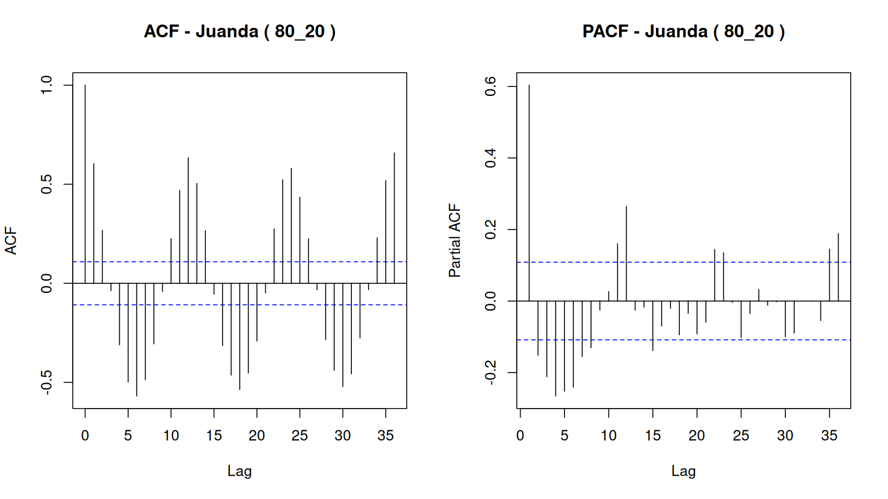

### CCF

Negative CCF lag means the second named location leads the first; positive lag means the first leads the second. The strongest correlation at each absolute non-zero lag is used to propose spatial-order candidates.

| location_x | location_y | lag | ccf | significance_bound | significant | direction |
|---|---|---|---|---|---|---|
| Juanda | Perak1 | -36 | 0.492924 | 0.108552 | TRUE | Perak1 leads Juanda |
| Juanda | Perak1 | -35 | 0.481774 | 0.108552 | TRUE | Perak1 leads Juanda |
| Juanda | Perak1 | -34 | 0.308950 | 0.108552 | TRUE | Perak1 leads Juanda |
| Juanda | Perak1 | -33 | 0.142426 | 0.108552 | TRUE | Perak1 leads Juanda |
| Juanda | Perak1 | -32 | -0.034514 | 0.108552 | FALSE | Perak1 leads Juanda |
| Juanda | Perak1 | -31 | -0.245548 | 0.108552 | TRUE | Perak1 leads Juanda |
| Juanda | Perak1 | -30 | -0.427345 | 0.108552 | TRUE | Perak1 leads Juanda |
| Juanda | Perak1 | -29 | -0.437499 | 0.108552 | TRUE | Perak1 leads Juanda |
| Juanda | Perak1 | -28 | -0.417336 | 0.108552 | TRUE | Perak1 leads Juanda |
| Juanda | Perak1 | -27 | -0.224749 | 0.108552 | TRUE | Perak1 leads Juanda |
| Juanda | Perak1 | -26 | 0.038869 | 0.108552 | FALSE | Perak1 leads Juanda |
| Juanda | Perak1 | -25 | 0.282866 | 0.108552 | TRUE | Perak1 leads Juanda |
| Juanda | Perak1 | -24 | 0.486862 | 0.108552 | TRUE | Perak1 leads Juanda |
| Juanda | Perak1 | -23 | 0.500660 | 0.108552 | TRUE | Perak1 leads Juanda |
| Juanda | Perak1 | -22 | 0.372477 | 0.108552 | TRUE | Perak1 leads Juanda |
| Juanda | Perak1 | -21 | 0.120715 | 0.108552 | TRUE | Perak1 leads Juanda |
| Juanda | Perak1 | -20 | -0.062451 | 0.108552 | FALSE | Perak1 leads Juanda |
| Juanda | Perak1 | -19 | -0.266004 | 0.108552 | TRUE | Perak1 leads Juanda |
| Juanda | Perak1 | -18 | -0.440701 | 0.108552 | TRUE | Perak1 leads Juanda |
| Juanda | Perak1 | -17 | -0.491651 | 0.108552 | TRUE | Perak1 leads Juanda |
| Juanda | Perak1 | -16 | -0.462928 | 0.108552 | TRUE | Perak1 leads Juanda |
| Juanda | Perak1 | -15 | -0.228774 | 0.108552 | TRUE | Perak1 leads Juanda |
| Juanda | Perak1 | -14 | 0.073756 | 0.108552 | FALSE | Perak1 leads Juanda |
| Juanda | Perak1 | -13 | 0.352670 | 0.108552 | TRUE | Perak1 leads Juanda |
| Juanda | Perak1 | -12 | 0.501459 | 0.108552 | TRUE | Perak1 leads Juanda |
| Juanda | Perak1 | -11 | 0.470754 | 0.108552 | TRUE | Perak1 leads Juanda |
| Juanda | Perak1 | -10 | 0.366269 | 0.108552 | TRUE | Perak1 leads Juanda |
| Juanda | Perak1 | -9 | 0.196792 | 0.108552 | TRUE | Perak1 leads Juanda |
| Juanda | Perak1 | -8 | -0.021145 | 0.108552 | FALSE | Perak1 leads Juanda |
| Juanda | Perak1 | -7 | -0.237113 | 0.108552 | TRUE | Perak1 leads Juanda |
| Juanda | Perak1 | -6 | -0.400453 | 0.108552 | TRUE | Perak1 leads Juanda |
| Juanda | Perak1 | -5 | -0.525525 | 0.108552 | TRUE | Perak1 leads Juanda |
| Juanda | Perak1 | -4 | -0.440522 | 0.108552 | TRUE | Perak1 leads Juanda |
| Juanda | Perak1 | -3 | -0.222992 | 0.108552 | TRUE | Perak1 leads Juanda |
| Juanda | Perak1 | -2 | 0.076187 | 0.108552 | FALSE | Perak1 leads Juanda |
| Juanda | Perak1 | -1 | 0.383333 | 0.108552 | TRUE | Perak1 leads Juanda |
| Juanda | Perak1 | 0 | 0.706470 | 0.108552 | TRUE | contemporaneous |
| Juanda | Perak1 | 1 | 0.506976 | 0.108552 | TRUE | Juanda leads Perak1 |
| Juanda | Perak1 | 2 | 0.349231 | 0.108552 | TRUE | Juanda leads Perak1 |
| Juanda | Perak1 | 3 | 0.108997 | 0.108552 | TRUE | Juanda leads Perak1 |
| Juanda | Perak1 | 4 | -0.067165 | 0.108552 | FALSE | Juanda leads Perak1 |
| Juanda | Perak1 | 5 | -0.286341 | 0.108552 | TRUE | Juanda leads Perak1 |
| Juanda | Perak1 | 6 | -0.430190 | 0.108552 | TRUE | Juanda leads Perak1 |
| Juanda | Perak1 | 7 | -0.532705 | 0.108552 | TRUE | Juanda leads Perak1 |
| Juanda | Perak1 | 8 | -0.442102 | 0.108552 | TRUE | Juanda leads Perak1 |
| Juanda | Perak1 | 9 | -0.217871 | 0.108552 | TRUE | Juanda leads Perak1 |
| Juanda | Perak1 | 10 | 0.069575 | 0.108552 | FALSE | Juanda leads Perak1 |
| Juanda | Perak1 | 11 | 0.354557 | 0.108552 | TRUE | Juanda leads Perak1 |
| Juanda | Perak1 | 12 | 0.527457 | 0.108552 | TRUE | Juanda leads Perak1 |
| Juanda | Perak1 | 13 | 0.507479 | 0.108552 | TRUE | Juanda leads Perak1 |
| Juanda | Perak1 | 14 | 0.351490 | 0.108552 | TRUE | Juanda leads Perak1 |
| Juanda | Perak1 | 15 | 0.116205 | 0.108552 | TRUE | Juanda leads Perak1 |
| Juanda | Perak1 | 16 | -0.080040 | 0.108552 | FALSE | Juanda leads Perak1 |
| Juanda | Perak1 | 17 | -0.261245 | 0.108552 | TRUE | Juanda leads Perak1 |
| Juanda | Perak1 | 18 | -0.413277 | 0.108552 | TRUE | Juanda leads Perak1 |
| Juanda | Perak1 | 19 | -0.496090 | 0.108552 | TRUE | Juanda leads Perak1 |
| Juanda | Perak1 | 20 | -0.426398 | 0.108552 | TRUE | Juanda leads Perak1 |
| Juanda | Perak1 | 21 | -0.219750 | 0.108552 | TRUE | Juanda leads Perak1 |
| Juanda | Perak1 | 22 | 0.088214 | 0.108552 | FALSE | Juanda leads Perak1 |
| Juanda | Perak1 | 23 | 0.367522 | 0.108552 | TRUE | Juanda leads Perak1 |
| Juanda | Perak1 | 24 | 0.468959 | 0.108552 | TRUE | Juanda leads Perak1 |
| Juanda | Perak1 | 25 | 0.414943 | 0.108552 | TRUE | Juanda leads Perak1 |
| Juanda | Perak1 | 26 | 0.333918 | 0.108552 | TRUE | Juanda leads Perak1 |
| Juanda | Perak1 | 27 | 0.111441 | 0.108552 | TRUE | Juanda leads Perak1 |
| Juanda | Perak1 | 28 | -0.044984 | 0.108552 | FALSE | Juanda leads Perak1 |
| Juanda | Perak1 | 29 | -0.205579 | 0.108552 | TRUE | Juanda leads Perak1 |
| Juanda | Perak1 | 30 | -0.411926 | 0.108552 | TRUE | Juanda leads Perak1 |
| Juanda | Perak1 | 31 | -0.453513 | 0.108552 | TRUE | Juanda leads Perak1 |
| Juanda | Perak1 | 32 | -0.382048 | 0.108552 | TRUE | Juanda leads Perak1 |
| Juanda | Perak1 | 33 | -0.172233 | 0.108552 | TRUE | Juanda leads Perak1 |
| Juanda | Perak1 | 34 | 0.067739 | 0.108552 | FALSE | Juanda leads Perak1 |
| Juanda | Perak1 | 35 | 0.375398 | 0.108552 | TRUE | Juanda leads Perak1 |
| Juanda | Perak1 | 36 | 0.491940 | 0.108552 | TRUE | Juanda leads Perak1 |
| Juanda | Perak2 | -36 | 0.613498 | 0.108552 | TRUE | Perak2 leads Juanda |
| Juanda | Perak2 | -35 | 0.576276 | 0.108552 | TRUE | Perak2 leads Juanda |
| Juanda | Perak2 | -34 | 0.342268 | 0.108552 | TRUE | Perak2 leads Juanda |
| Juanda | Perak2 | -33 | 0.065762 | 0.108552 | FALSE | Perak2 leads Juanda |
| Juanda | Perak2 | -32 | -0.188770 | 0.108552 | TRUE | Perak2 leads Juanda |
| Juanda | Perak2 | -31 | -0.417906 | 0.108552 | TRUE | Perak2 leads Juanda |
| Juanda | Perak2 | -30 | -0.539554 | 0.108552 | TRUE | Perak2 leads Juanda |
| Juanda | Perak2 | -29 | -0.516303 | 0.108552 | TRUE | Perak2 leads Juanda |
| Juanda | Perak2 | -28 | -0.403011 | 0.108552 | TRUE | Perak2 leads Juanda |
| Juanda | Perak2 | -27 | -0.162612 | 0.108552 | TRUE | Perak2 leads Juanda |
| Juanda | Perak2 | -26 | 0.150924 | 0.108552 | TRUE | Perak2 leads Juanda |
| Juanda | Perak2 | -25 | 0.403100 | 0.108552 | TRUE | Perak2 leads Juanda |
| Juanda | Perak2 | -24 | 0.580711 | 0.108552 | TRUE | Perak2 leads Juanda |
| Juanda | Perak2 | -23 | 0.588588 | 0.108552 | TRUE | Perak2 leads Juanda |
| Juanda | Perak2 | -22 | 0.435359 | 0.108552 | TRUE | Perak2 leads Juanda |
| Juanda | Perak2 | -21 | 0.072345 | 0.108552 | FALSE | Perak2 leads Juanda |
| Juanda | Perak2 | -20 | -0.207150 | 0.108552 | TRUE | Perak2 leads Juanda |
| Juanda | Perak2 | -19 | -0.394133 | 0.108552 | TRUE | Perak2 leads Juanda |
| Juanda | Perak2 | -18 | -0.516110 | 0.108552 | TRUE | Perak2 leads Juanda |
| Juanda | Perak2 | -17 | -0.546702 | 0.108552 | TRUE | Perak2 leads Juanda |
| Juanda | Perak2 | -16 | -0.427065 | 0.108552 | TRUE | Perak2 leads Juanda |
| Juanda | Perak2 | -15 | -0.164300 | 0.108552 | TRUE | Perak2 leads Juanda |
| Juanda | Perak2 | -14 | 0.170288 | 0.108552 | TRUE | Perak2 leads Juanda |
| Juanda | Perak2 | -13 | 0.462623 | 0.108552 | TRUE | Perak2 leads Juanda |
| Juanda | Perak2 | -12 | 0.613912 | 0.108552 | TRUE | Perak2 leads Juanda |
| Juanda | Perak2 | -11 | 0.552734 | 0.108552 | TRUE | Perak2 leads Juanda |
| Juanda | Perak2 | -10 | 0.357173 | 0.108552 | TRUE | Perak2 leads Juanda |
| Juanda | Perak2 | -9 | 0.102841 | 0.108552 | FALSE | Perak2 leads Juanda |
| Juanda | Perak2 | -8 | -0.184325 | 0.108552 | TRUE | Perak2 leads Juanda |
| Juanda | Perak2 | -7 | -0.402179 | 0.108552 | TRUE | Perak2 leads Juanda |
| Juanda | Perak2 | -6 | -0.539880 | 0.108552 | TRUE | Perak2 leads Juanda |
| Juanda | Perak2 | -5 | -0.555205 | 0.108552 | TRUE | Perak2 leads Juanda |
| Juanda | Perak2 | -4 | -0.406494 | 0.108552 | TRUE | Perak2 leads Juanda |
| Juanda | Perak2 | -3 | -0.139654 | 0.108552 | TRUE | Perak2 leads Juanda |
| Juanda | Perak2 | -2 | 0.183021 | 0.108552 | TRUE | Perak2 leads Juanda |
| Juanda | Perak2 | -1 | 0.503478 | 0.108552 | TRUE | Perak2 leads Juanda |
| Juanda | Perak2 | 0 | 0.789157 | 0.108552 | TRUE | contemporaneous |
| Juanda | Perak2 | 1 | 0.633732 | 0.108552 | TRUE | Juanda leads Perak2 |
| Juanda | Perak2 | 2 | 0.380155 | 0.108552 | TRUE | Juanda leads Perak2 |
| Juanda | Perak2 | 3 | 0.065468 | 0.108552 | FALSE | Juanda leads Perak2 |
| Juanda | Perak2 | 4 | -0.213622 | 0.108552 | TRUE | Juanda leads Perak2 |
| Juanda | Perak2 | 5 | -0.443815 | 0.108552 | TRUE | Juanda leads Perak2 |
| Juanda | Perak2 | 6 | -0.560886 | 0.108552 | TRUE | Juanda leads Perak2 |
| Juanda | Perak2 | 7 | -0.581498 | 0.108552 | TRUE | Juanda leads Perak2 |
| Juanda | Perak2 | 8 | -0.432962 | 0.108552 | TRUE | Juanda leads Perak2 |
| Juanda | Perak2 | 9 | -0.176224 | 0.108552 | TRUE | Juanda leads Perak2 |
| Juanda | Perak2 | 10 | 0.169552 | 0.108552 | TRUE | Juanda leads Perak2 |
| Juanda | Perak2 | 11 | 0.460784 | 0.108552 | TRUE | Juanda leads Perak2 |
| Juanda | Perak2 | 12 | 0.628240 | 0.108552 | TRUE | Juanda leads Perak2 |
| Juanda | Perak2 | 13 | 0.588186 | 0.108552 | TRUE | Juanda leads Perak2 |
| Juanda | Perak2 | 14 | 0.408227 | 0.108552 | TRUE | Juanda leads Perak2 |
| Juanda | Perak2 | 15 | 0.090393 | 0.108552 | FALSE | Juanda leads Perak2 |
| Juanda | Perak2 | 16 | -0.202632 | 0.108552 | TRUE | Juanda leads Perak2 |
| Juanda | Perak2 | 17 | -0.405063 | 0.108552 | TRUE | Juanda leads Perak2 |
| Juanda | Perak2 | 18 | -0.511548 | 0.108552 | TRUE | Juanda leads Perak2 |
| Juanda | Perak2 | 19 | -0.521876 | 0.108552 | TRUE | Juanda leads Perak2 |
| Juanda | Perak2 | 20 | -0.406396 | 0.108552 | TRUE | Juanda leads Perak2 |
| Juanda | Perak2 | 21 | -0.168680 | 0.108552 | TRUE | Juanda leads Perak2 |
| Juanda | Perak2 | 22 | 0.154259 | 0.108552 | TRUE | Juanda leads Perak2 |
| Juanda | Perak2 | 23 | 0.450801 | 0.108552 | TRUE | Juanda leads Perak2 |
| Juanda | Perak2 | 24 | 0.571275 | 0.108552 | TRUE | Juanda leads Perak2 |
| Juanda | Perak2 | 25 | 0.521910 | 0.108552 | TRUE | Juanda leads Perak2 |
| Juanda | Perak2 | 26 | 0.360717 | 0.108552 | TRUE | Juanda leads Perak2 |
| Juanda | Perak2 | 27 | 0.082743 | 0.108552 | FALSE | Juanda leads Perak2 |
| Juanda | Perak2 | 28 | -0.167997 | 0.108552 | TRUE | Juanda leads Perak2 |
| Juanda | Perak2 | 29 | -0.373358 | 0.108552 | TRUE | Juanda leads Perak2 |
| Juanda | Perak2 | 30 | -0.538540 | 0.108552 | TRUE | Juanda leads Perak2 |
| Juanda | Perak2 | 31 | -0.516066 | 0.108552 | TRUE | Juanda leads Perak2 |
| Juanda | Perak2 | 32 | -0.368830 | 0.108552 | TRUE | Juanda leads Perak2 |
| Juanda | Perak2 | 33 | -0.124675 | 0.108552 | TRUE | Juanda leads Perak2 |
| Juanda | Perak2 | 34 | 0.138485 | 0.108552 | TRUE | Juanda leads Perak2 |
| Juanda | Perak2 | 35 | 0.434616 | 0.108552 | TRUE | Juanda leads Perak2 |
| Juanda | Perak2 | 36 | 0.586737 | 0.108552 | TRUE | Juanda leads Perak2 |
| Perak1 | Perak2 | -36 | 0.522566 | 0.108552 | TRUE | Perak2 leads Perak1 |
| Perak1 | Perak2 | -35 | 0.466693 | 0.108552 | TRUE | Perak2 leads Perak1 |
| Perak1 | Perak2 | -34 | 0.173422 | 0.108552 | TRUE | Perak2 leads Perak1 |
| Perak1 | Perak2 | -33 | -0.072113 | 0.108552 | FALSE | Perak2 leads Perak1 |
| Perak1 | Perak2 | -32 | -0.337621 | 0.108552 | TRUE | Perak2 leads Perak1 |
| Perak1 | Perak2 | -31 | -0.480947 | 0.108552 | TRUE | Perak2 leads Perak1 |
| Perak1 | Perak2 | -30 | -0.472908 | 0.108552 | TRUE | Perak2 leads Perak1 |
| Perak1 | Perak2 | -29 | -0.366070 | 0.108552 | TRUE | Perak2 leads Perak1 |
| Perak1 | Perak2 | -28 | -0.160053 | 0.108552 | TRUE | Perak2 leads Perak1 |
| Perak1 | Perak2 | -27 | 0.005205 | 0.108552 | FALSE | Perak2 leads Perak1 |
| Perak1 | Perak2 | -26 | 0.263459 | 0.108552 | TRUE | Perak2 leads Perak1 |
| Perak1 | Perak2 | -25 | 0.373621 | 0.108552 | TRUE | Perak2 leads Perak1 |
| Perak1 | Perak2 | -24 | 0.497498 | 0.108552 | TRUE | Perak2 leads Perak1 |
| Perak1 | Perak2 | -23 | 0.411964 | 0.108552 | TRUE | Perak2 leads Perak1 |
| Perak1 | Perak2 | -22 | 0.192233 | 0.108552 | TRUE | Perak2 leads Perak1 |
| Perak1 | Perak2 | -21 | -0.112153 | 0.108552 | TRUE | Perak2 leads Perak1 |
| Perak1 | Perak2 | -20 | -0.362022 | 0.108552 | TRUE | Perak2 leads Perak1 |
| Perak1 | Perak2 | -19 | -0.447134 | 0.108552 | TRUE | Perak2 leads Perak1 |
| Perak1 | Perak2 | -18 | -0.428301 | 0.108552 | TRUE | Perak2 leads Perak1 |
| Perak1 | Perak2 | -17 | -0.359137 | 0.108552 | TRUE | Perak2 leads Perak1 |
| Perak1 | Perak2 | -16 | -0.161950 | 0.108552 | TRUE | Perak2 leads Perak1 |
| Perak1 | Perak2 | -15 | 0.053410 | 0.108552 | FALSE | Perak2 leads Perak1 |
| Perak1 | Perak2 | -14 | 0.277918 | 0.108552 | TRUE | Perak2 leads Perak1 |
| Perak1 | Perak2 | -13 | 0.505127 | 0.108552 | TRUE | Perak2 leads Perak1 |
| Perak1 | Perak2 | -12 | 0.585288 | 0.108552 | TRUE | Perak2 leads Perak1 |
| Perak1 | Perak2 | -11 | 0.422200 | 0.108552 | TRUE | Perak2 leads Perak1 |
| Perak1 | Perak2 | -10 | 0.181180 | 0.108552 | TRUE | Perak2 leads Perak1 |
| Perak1 | Perak2 | -9 | -0.077656 | 0.108552 | FALSE | Perak2 leads Perak1 |
| Perak1 | Perak2 | -8 | -0.348028 | 0.108552 | TRUE | Perak2 leads Perak1 |
| Perak1 | Perak2 | -7 | -0.504642 | 0.108552 | TRUE | Perak2 leads Perak1 |
| Perak1 | Perak2 | -6 | -0.483263 | 0.108552 | TRUE | Perak2 leads Perak1 |
| Perak1 | Perak2 | -5 | -0.367171 | 0.108552 | TRUE | Perak2 leads Perak1 |
| Perak1 | Perak2 | -4 | -0.159027 | 0.108552 | TRUE | Perak2 leads Perak1 |
| Perak1 | Perak2 | -3 | 0.090030 | 0.108552 | FALSE | Perak2 leads Perak1 |
| Perak1 | Perak2 | -2 | 0.334541 | 0.108552 | TRUE | Perak2 leads Perak1 |
| Perak1 | Perak2 | -1 | 0.489026 | 0.108552 | TRUE | Perak2 leads Perak1 |
| Perak1 | Perak2 | 0 | 0.824724 | 0.108552 | TRUE | contemporaneous |
| Perak1 | Perak2 | 1 | 0.465255 | 0.108552 | TRUE | Perak1 leads Perak2 |
| Perak1 | Perak2 | 2 | 0.214997 | 0.108552 | TRUE | Perak1 leads Perak2 |
| Perak1 | Perak2 | 3 | -0.127180 | 0.108552 | TRUE | Perak1 leads Perak2 |
| Perak1 | Perak2 | 4 | -0.377488 | 0.108552 | TRUE | Perak1 leads Perak2 |
| Perak1 | Perak2 | 5 | -0.503876 | 0.108552 | TRUE | Perak1 leads Perak2 |
| Perak1 | Perak2 | 6 | -0.460625 | 0.108552 | TRUE | Perak1 leads Perak2 |
| Perak1 | Perak2 | 7 | -0.389784 | 0.108552 | TRUE | Perak1 leads Perak2 |
| Perak1 | Perak2 | 8 | -0.191301 | 0.108552 | TRUE | Perak1 leads Perak2 |
| Perak1 | Perak2 | 9 | 0.082846 | 0.108552 | FALSE | Perak1 leads Perak2 |
| Perak1 | Perak2 | 10 | 0.304129 | 0.108552 | TRUE | Perak1 leads Perak2 |
| Perak1 | Perak2 | 11 | 0.478593 | 0.108552 | TRUE | Perak1 leads Perak2 |
| Perak1 | Perak2 | 12 | 0.545542 | 0.108552 | TRUE | Perak1 leads Perak2 |
| Perak1 | Perak2 | 13 | 0.423123 | 0.108552 | TRUE | Perak1 leads Perak2 |
| Perak1 | Perak2 | 14 | 0.208413 | 0.108552 | TRUE | Perak1 leads Perak2 |
| Perak1 | Perak2 | 15 | -0.094196 | 0.108552 | FALSE | Perak1 leads Perak2 |
| Perak1 | Perak2 | 16 | -0.369077 | 0.108552 | TRUE | Perak1 leads Perak2 |
| Perak1 | Perak2 | 17 | -0.475796 | 0.108552 | TRUE | Perak1 leads Perak2 |
| Perak1 | Perak2 | 18 | -0.450762 | 0.108552 | TRUE | Perak1 leads Perak2 |
| Perak1 | Perak2 | 19 | -0.317551 | 0.108552 | TRUE | Perak1 leads Perak2 |
| Perak1 | Perak2 | 20 | -0.152222 | 0.108552 | TRUE | Perak1 leads Perak2 |
| Perak1 | Perak2 | 21 | 0.074645 | 0.108552 | FALSE | Perak1 leads Perak2 |
| Perak1 | Perak2 | 22 | 0.266064 | 0.108552 | TRUE | Perak1 leads Perak2 |
| Perak1 | Perak2 | 23 | 0.459803 | 0.108552 | TRUE | Perak1 leads Perak2 |
| Perak1 | Perak2 | 24 | 0.529503 | 0.108552 | TRUE | Perak1 leads Perak2 |
| Perak1 | Perak2 | 25 | 0.356464 | 0.108552 | TRUE | Perak1 leads Perak2 |
| Perak1 | Perak2 | 26 | 0.183571 | 0.108552 | TRUE | Perak1 leads Perak2 |
| Perak1 | Perak2 | 27 | -0.113150 | 0.108552 | TRUE | Perak1 leads Perak2 |
| Perak1 | Perak2 | 28 | -0.342333 | 0.108552 | TRUE | Perak1 leads Perak2 |
| Perak1 | Perak2 | 29 | -0.448526 | 0.108552 | TRUE | Perak1 leads Perak2 |
| Perak1 | Perak2 | 30 | -0.440043 | 0.108552 | TRUE | Perak1 leads Perak2 |
| Perak1 | Perak2 | 31 | -0.340465 | 0.108552 | TRUE | Perak1 leads Perak2 |
| Perak1 | Perak2 | 32 | -0.129969 | 0.108552 | TRUE | Perak1 leads Perak2 |
| Perak1 | Perak2 | 33 | 0.092541 | 0.108552 | FALSE | Perak1 leads Perak2 |
| Perak1 | Perak2 | 34 | 0.252598 | 0.108552 | TRUE | Perak1 leads Perak2 |
| Perak1 | Perak2 | 35 | 0.493085 | 0.108552 | TRUE | Perak1 leads Perak2 |
| Perak1 | Perak2 | 36 | 0.525696 | 0.108552 | TRUE | Perak1 leads Perak2 |

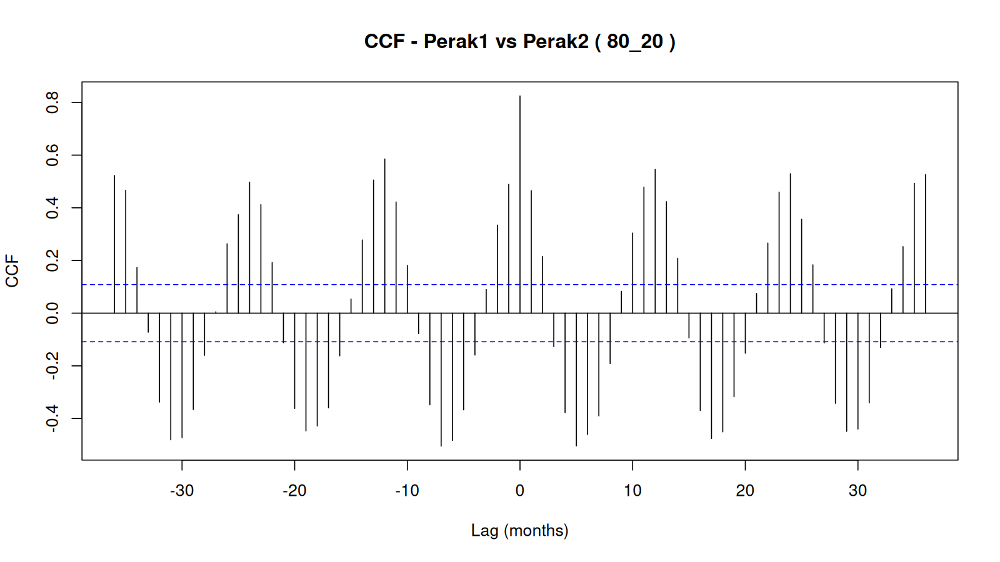

### Candidate models

| a | b | fitted | AIC | coefficients_finite | iidn_pass | white_noise_pass | error |
|---|---|---|---|---|---|---|---|
| 1 | 1 | TRUE | 12040.43 | TRUE | FALSE | FALSE |  |
| 5 | 1 | TRUE | 11886.67 | TRUE | FALSE | FALSE |  |
| 7 | 1 | TRUE | 11768.86 | TRUE | FALSE | FALSE |  |
| 12 | 1 | TRUE | 11239.86 | TRUE | FALSE | TRUE |  |
| 17 | 1 | TRUE | 11048.82 | TRUE | FALSE | TRUE |  |
| 19 | 1 | TRUE | 10990.13 | TRUE | FALSE | TRUE |  |
| 1 | 3 | TRUE | 11951.86 | TRUE | FALSE | FALSE |  |
| 5 | 3 | TRUE | 11822.20 | TRUE | FALSE | FALSE |  |
| 7 | 3 | TRUE | 11716.56 | TRUE | FALSE | FALSE |  |
| 12 | 3 | TRUE | 11247.82 | TRUE | FALSE | TRUE |  |
| 17 | 3 | TRUE | 11055.51 | TRUE | FALSE | TRUE |  |
| 19 | 3 | TRUE | 10996.63 | TRUE | FALSE | TRUE |  |
| 1 | 4 | TRUE | 11918.78 | TRUE | FALSE | FALSE |  |
| 5 | 4 | TRUE | 11806.13 | TRUE | FALSE | FALSE |  |
| 7 | 4 | TRUE | 11701.00 | TRUE | FALSE | FALSE |  |
| 12 | 4 | TRUE | 11250.01 | TRUE | FALSE | TRUE |  |
| 17 | 4 | TRUE | 11060.19 | TRUE | FALSE | TRUE |  |
| 19 | 4 | TRUE | 11001.49 | TRUE | FALSE | TRUE |  |
| 1 | 5 | TRUE | 11884.90 | TRUE | FALSE | FALSE |  |
| 5 | 5 | TRUE | 11807.45 | TRUE | FALSE | FALSE |  |
| 7 | 5 | TRUE | 11702.97 | TRUE | FALSE | FALSE |  |
| 12 | 5 | TRUE | 11253.26 | TRUE | FALSE | TRUE |  |
| 17 | 5 | TRUE | 11065.31 | TRUE | FALSE | TRUE |  |
| 19 | 5 | TRUE | 11006.93 | TRUE | FALSE | TRUE |  |
| 1 | 6 | TRUE | 11834.21 | TRUE | FALSE | FALSE |  |
| 5 | 6 | TRUE | 11752.52 | TRUE | FALSE | FALSE |  |
| 7 | 6 | TRUE | 11706.23 | TRUE | FALSE | FALSE |  |
| 12 | 6 | TRUE | 11255.06 | TRUE | FALSE | TRUE |  |
| 17 | 6 | TRUE | 11068.93 | TRUE | FALSE | TRUE |  |
| 19 | 6 | TRUE | 11010.81 | TRUE | FALSE | TRUE |  |
| 1 | 7 | TRUE | 11791.27 | TRUE | FALSE | FALSE |  |
| 5 | 7 | TRUE | 11709.34 | TRUE | FALSE | FALSE |  |
| 7 | 7 | TRUE | 11695.21 | TRUE | FALSE | FALSE |  |
| 12 | 7 | TRUE | 11252.49 | TRUE | FALSE | TRUE |  |
| 17 | 7 | TRUE | 11066.98 | TRUE | FALSE | TRUE |  |
| 19 | 7 | TRUE | 11008.43 | TRUE | FALSE | TRUE |  |

### Selected parameters

| a | b | parameter | estimate | std_error | t_value | p_value |
|---|---|---|---|---|---|---|
| 19 | 1 | phi1(Juanda) | 0.304111 | 0.056241 | 5.407320 | 0.000000 |
| 19 | 1 | phi1(Perak1) | -0.091661 | 0.086226 | -1.063030 | 0.288066 |
| 19 | 1 | phi1(Perak2) | 0.364633 | 0.113927 | 3.200568 | 0.001422 |
| 19 | 1 | theta1(Juanda) | 0.048972 | 0.087916 | 0.557028 | 0.577653 |
| 19 | 1 | theta1(Perak1) | 0.377957 | 0.110793 | 3.411389 | 0.000676 |
| 19 | 1 | theta1(Perak2) | -0.088470 | 0.091632 | -0.965493 | 0.334569 |
| 19 | 1 | theta2(Juanda) | -0.027179 | 0.074509 | -0.364776 | 0.715368 |
| 19 | 1 | theta2(Perak1) | 0.113411 | 0.081997 | 1.383114 | 0.166988 |
| 19 | 1 | theta2(Perak2) | 0.075410 | 0.063638 | 1.184977 | 0.236354 |
| 19 | 1 | theta3(Juanda) | -0.106962 | 0.074811 | -1.429756 | 0.153150 |
| 19 | 1 | theta3(Perak1) | -0.022844 | 0.082684 | -0.276284 | 0.782396 |
| 19 | 1 | theta3(Perak2) | -0.001098 | 0.063823 | -0.017197 | 0.986284 |
| 19 | 1 | theta4(Juanda) | 0.065681 | 0.074876 | 0.877201 | 0.380622 |
| 19 | 1 | theta4(Perak1) | -0.029154 | 0.082127 | -0.354989 | 0.722685 |
| 19 | 1 | theta4(Perak2) | -0.007576 | 0.064175 | -0.118048 | 0.906057 |
| 19 | 1 | theta5(Juanda) | 0.020667 | 0.074621 | 0.276960 | 0.781877 |
| 19 | 1 | theta5(Perak1) | -0.108170 | 0.082000 | -1.319145 | 0.187471 |
| 19 | 1 | theta5(Perak2) | -0.012485 | 0.063862 | -0.195498 | 0.845050 |
| 19 | 1 | theta6(Juanda) | 0.036046 | 0.074562 | 0.483431 | 0.628913 |
| 19 | 1 | theta6(Perak1) | 0.138929 | 0.082013 | 1.693991 | 0.090629 |
| 19 | 1 | theta6(Perak2) | -0.015851 | 0.063822 | -0.248364 | 0.803912 |
| 19 | 1 | theta7(Juanda) | -0.154987 | 0.073057 | -2.121458 | 0.034168 |
| 19 | 1 | theta7(Perak1) | 0.023581 | 0.081780 | 0.288348 | 0.773150 |
| 19 | 1 | theta7(Perak2) | -0.044677 | 0.062695 | -0.712617 | 0.476276 |
| 19 | 1 | theta8(Juanda) | -0.099400 | 0.070552 | -1.408900 | 0.159226 |
| 19 | 1 | theta8(Perak1) | 0.016702 | 0.077213 | 0.216311 | 0.828797 |
| 19 | 1 | theta8(Perak2) | -0.015472 | 0.059874 | -0.258408 | 0.796154 |
| 19 | 1 | theta9(Juanda) | 0.030604 | 0.069710 | 0.439009 | 0.660765 |
| 19 | 1 | theta9(Perak1) | 0.165548 | 0.076487 | 2.164383 | 0.030709 |
| 19 | 1 | theta9(Perak2) | 0.081768 | 0.058915 | 1.387902 | 0.165526 |
| 19 | 1 | theta10(Juanda) | 0.128367 | 0.070037 | 1.832830 | 0.067173 |
| 19 | 1 | theta10(Perak1) | 0.094797 | 0.076602 | 1.237526 | 0.216229 |
| 19 | 1 | theta10(Perak2) | 0.073420 | 0.059379 | 1.236458 | 0.216626 |
| 19 | 1 | theta11(Juanda) | 0.274672 | 0.069286 | 3.964297 | 0.000080 |
| 19 | 1 | theta11(Perak1) | 0.101143 | 0.076224 | 1.326920 | 0.184887 |
| 19 | 1 | theta11(Perak2) | 0.113848 | 0.059003 | 1.929535 | 0.053993 |
| 19 | 1 | theta12(Juanda) | 0.358834 | 0.070594 | 5.083041 | 0.000000 |
| 19 | 1 | theta12(Perak1) | 0.231877 | 0.077603 | 2.988003 | 0.002888 |
| 19 | 1 | theta12(Perak2) | 0.246356 | 0.059817 | 4.118479 | 0.000042 |
| 19 | 1 | theta13(Juanda) | 0.266657 | 0.073810 | 3.612768 | 0.000320 |
| 19 | 1 | theta13(Perak1) | 0.111855 | 0.082477 | 1.356198 | 0.175392 |
| 19 | 1 | theta13(Perak2) | 0.132093 | 0.063340 | 2.085454 | 0.037322 |
| 19 | 1 | theta14(Juanda) | 0.141330 | 0.074751 | 1.890671 | 0.059004 |
| 19 | 1 | theta14(Perak1) | 0.117960 | 0.082656 | 1.427115 | 0.153909 |
| 19 | 1 | theta14(Perak2) | -0.019903 | 0.063498 | -0.313437 | 0.754025 |
| 19 | 1 | theta15(Juanda) | -0.056957 | 0.075079 | -0.758618 | 0.448289 |
| 19 | 1 | theta15(Perak1) | -0.008962 | 0.083063 | -0.107891 | 0.914107 |
| 19 | 1 | theta15(Perak2) | -0.015559 | 0.063346 | -0.245615 | 0.806039 |
| 19 | 1 | theta16(Juanda) | -0.002426 | 0.074562 | -0.032539 | 0.974050 |
| 19 | 1 | theta16(Perak1) | -0.153970 | 0.083050 | -1.853939 | 0.064090 |
| 19 | 1 | theta16(Perak2) | -0.010268 | 0.063236 | -0.162377 | 0.871047 |
| 19 | 1 | theta17(Juanda) | 0.059370 | 0.074428 | 0.797682 | 0.425275 |
| 19 | 1 | theta17(Perak1) | 0.022240 | 0.083183 | 0.267359 | 0.789257 |
| 19 | 1 | theta17(Perak2) | -0.039998 | 0.063125 | -0.633638 | 0.526485 |
| 19 | 1 | theta18(Juanda) | 0.011650 | 0.073887 | 0.157675 | 0.874750 |
| 19 | 1 | theta18(Perak1) | 0.013350 | 0.082857 | 0.161125 | 0.872033 |
| 19 | 1 | theta18(Perak2) | 0.025141 | 0.063197 | 0.397818 | 0.690863 |
| 19 | 1 | theta19(Juanda) | -0.112876 | 0.072683 | -1.552993 | 0.120792 |
| 19 | 1 | theta19(Perak1) | 0.090622 | 0.078887 | 1.148764 | 0.250972 |
| 19 | 1 | theta19(Perak2) | -0.047403 | 0.061798 | -0.767071 | 0.443250 |

### Training fit and hold-out forecast

Each panel compares actual rainfall with fitted values (left), recursive multi-step forecasts, and actual-lag one-step forecasts (right).

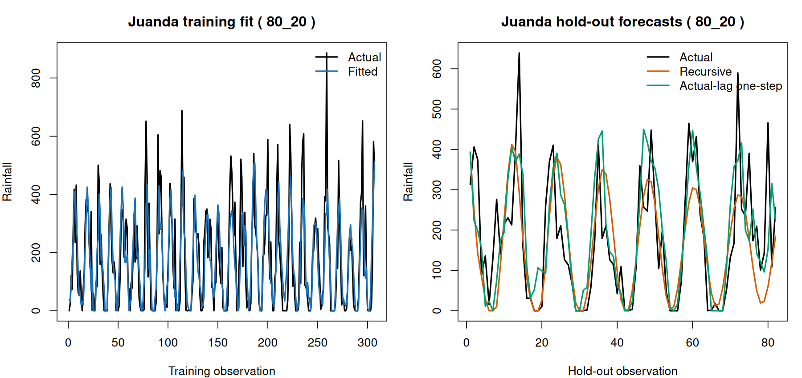

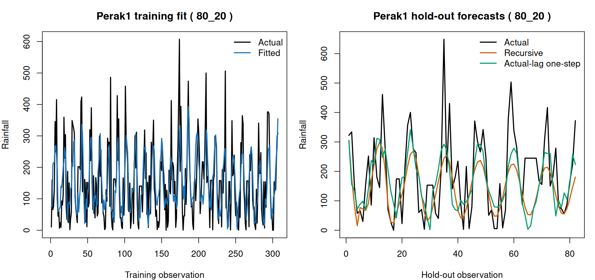

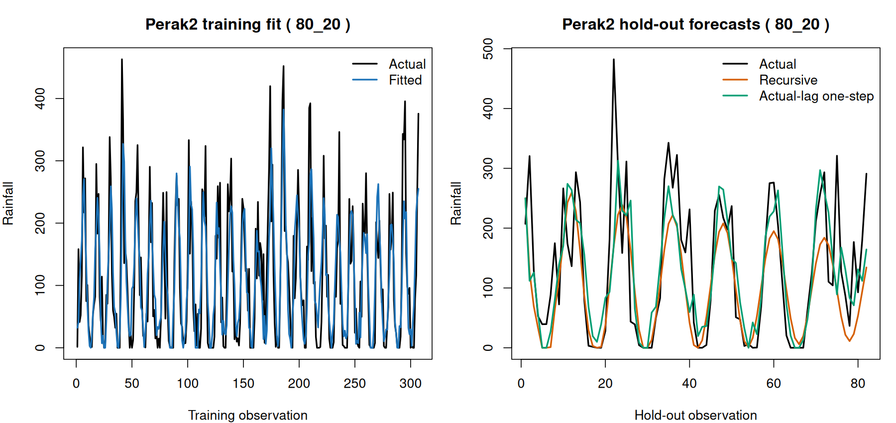

### Training metrics

| location | MSE | RMSE | MAE | sMAPE | MAPE_nonzero | R_squared |
|---|---|---|---|---|---|---|
| Juanda | 11639.197 | 107.88511 | 76.22720 | 72.24921 | 695.0522 | 0.607106 |
| Perak1 | 7419.866 | 86.13864 | 68.65211 | 61.49457 | 1116.9263 | 0.458948 |
| Perak2 | 4273.260 | 65.37017 | 48.97251 | 76.57751 | 174.9967 | 0.626232 |
| Overall | 7777.441 | 88.18980 | 64.61728 | 70.10710 | 689.3357 | 0.589709 |

### Testing metrics: recursive multi-step

Each forecasted test value is used as a lag input for the next test forecast; no actual test value enters the forecast recursion.

| location | MSE | RMSE | MAE | sMAPE | MAPE_nonzero | R_squared |
|---|---|---|---|---|---|---|
| Juanda | 13762.966 | 117.31567 | 83.31015 | 74.03733 | 159.6770 | 0.419730 |
| Perak1 | 13180.599 | 114.80679 | 90.66502 | 65.67674 | 450.6110 | 0.260453 |
| Perak2 | 6623.683 | 81.38601 | 59.24182 | 76.95931 | 277.7626 | 0.499663 |
| Overall | 11189.082 | 105.77846 | 77.73900 | 72.22446 | 303.7244 | 0.406956 |

### Testing metrics: actual-lag one-step

Each test prediction uses observed rainfall only from earlier test months as lag inputs; it does not use the current month’s actual rainfall. This is a one-step-ahead evaluation, not a deployable long-horizon forecast.

| location | MSE | RMSE | MAE | sMAPE | MAPE_nonzero | R_squared |
|---|---|---|---|---|---|---|
| Juanda | 13056.813 | 114.26641 | 85.47562 | 71.27184 | 116.4469 | 0.449502 |
| Perak1 | 13680.142 | 116.96214 | 93.28967 | 68.52018 | 1303.7835 | 0.232424 |
| Perak2 | 6211.895 | 78.81558 | 57.10157 | 72.13935 | 202.5046 | 0.530769 |
| Overall | 10982.950 | 104.79957 | 78.62229 | 70.64379 | 580.0596 | 0.417881 |

### Selected residual diagnostics

| location | mean_residual | residual_variance | mean_zero_p_value | normality_shapiro_p_value | variance_stability_fligner_p_value | ljung_box_10_p_value | ljung_box_20_p_value |
|---|---|---|---|---|---|---|---|
| Juanda | 3.565540 | 11771.421 | 0.565166 | 0.000000 | 0.273062 | 0.672126 | 0.429026 |
| Perak1 | 2.592046 | 7437.373 | 0.598835 | 0.000009 | 0.830611 | 0.991121 | 0.935330 |
| Perak2 | 1.368814 | 4311.481 | 0.715171 | 0.000021 | 0.359566 | 0.907525 | 0.429779 |

### Equation terms

Custom convention: each city equation combines its own b lags and the inverse-distance-weighted other-city values through a lags.

| location | lag | source_location | effect | parameter | spatial_weight | coefficient |
|---|---|---|---|---|---|---|
| Juanda | 1 | Juanda | own temporal | phi1(Juanda) | 1.000000 | 0.304111 |
| Juanda | 1 | Perak1 | spatial weighted | theta1(Juanda) | 0.512359 | 0.025091 |
| Juanda | 1 | Perak2 | spatial weighted | theta1(Juanda) | 0.487641 | 0.023881 |
| Juanda | 2 | Perak1 | spatial weighted | theta2(Juanda) | 0.512359 | -0.013925 |
| Juanda | 2 | Perak2 | spatial weighted | theta2(Juanda) | 0.487641 | -0.013254 |
| Juanda | 3 | Perak1 | spatial weighted | theta3(Juanda) | 0.512359 | -0.054803 |
| Juanda | 3 | Perak2 | spatial weighted | theta3(Juanda) | 0.487641 | -0.052159 |
| Juanda | 4 | Perak1 | spatial weighted | theta4(Juanda) | 0.512359 | 0.033652 |
| Juanda | 4 | Perak2 | spatial weighted | theta4(Juanda) | 0.487641 | 0.032029 |
| Juanda | 5 | Perak1 | spatial weighted | theta5(Juanda) | 0.512359 | 0.010589 |
| Juanda | 5 | Perak2 | spatial weighted | theta5(Juanda) | 0.487641 | 0.010078 |
| Juanda | 6 | Perak1 | spatial weighted | theta6(Juanda) | 0.512359 | 0.018468 |
| Juanda | 6 | Perak2 | spatial weighted | theta6(Juanda) | 0.487641 | 0.017577 |
| Juanda | 7 | Perak1 | spatial weighted | theta7(Juanda) | 0.512359 | -0.079409 |
| Juanda | 7 | Perak2 | spatial weighted | theta7(Juanda) | 0.487641 | -0.075578 |
| Juanda | 8 | Perak1 | spatial weighted | theta8(Juanda) | 0.512359 | -0.050929 |
| Juanda | 8 | Perak2 | spatial weighted | theta8(Juanda) | 0.487641 | -0.048472 |
| Juanda | 9 | Perak1 | spatial weighted | theta9(Juanda) | 0.512359 | 0.015680 |
| Juanda | 9 | Perak2 | spatial weighted | theta9(Juanda) | 0.487641 | 0.014924 |
| Juanda | 10 | Perak1 | spatial weighted | theta10(Juanda) | 0.512359 | 0.065770 |
| Juanda | 10 | Perak2 | spatial weighted | theta10(Juanda) | 0.487641 | 0.062597 |
| Juanda | 11 | Perak1 | spatial weighted | theta11(Juanda) | 0.512359 | 0.140731 |
| Juanda | 11 | Perak2 | spatial weighted | theta11(Juanda) | 0.487641 | 0.133941 |
| Juanda | 12 | Perak1 | spatial weighted | theta12(Juanda) | 0.512359 | 0.183852 |
| Juanda | 12 | Perak2 | spatial weighted | theta12(Juanda) | 0.487641 | 0.174982 |
| Juanda | 13 | Perak1 | spatial weighted | theta13(Juanda) | 0.512359 | 0.136624 |
| Juanda | 13 | Perak2 | spatial weighted | theta13(Juanda) | 0.487641 | 0.130033 |
| Juanda | 14 | Perak1 | spatial weighted | theta14(Juanda) | 0.512359 | 0.072411 |
| Juanda | 14 | Perak2 | spatial weighted | theta14(Juanda) | 0.487641 | 0.068918 |
| Juanda | 15 | Perak1 | spatial weighted | theta15(Juanda) | 0.512359 | -0.029182 |
| Juanda | 15 | Perak2 | spatial weighted | theta15(Juanda) | 0.487641 | -0.027774 |
| Juanda | 16 | Perak1 | spatial weighted | theta16(Juanda) | 0.512359 | -0.001243 |
| Juanda | 16 | Perak2 | spatial weighted | theta16(Juanda) | 0.487641 | -0.001183 |
| Juanda | 17 | Perak1 | spatial weighted | theta17(Juanda) | 0.512359 | 0.030419 |
| Juanda | 17 | Perak2 | spatial weighted | theta17(Juanda) | 0.487641 | 0.028951 |
| Juanda | 18 | Perak1 | spatial weighted | theta18(Juanda) | 0.512359 | 0.005969 |
| Juanda | 18 | Perak2 | spatial weighted | theta18(Juanda) | 0.487641 | 0.005681 |
| Juanda | 19 | Perak1 | spatial weighted | theta19(Juanda) | 0.512359 | -0.057833 |
| Juanda | 19 | Perak2 | spatial weighted | theta19(Juanda) | 0.487641 | -0.055043 |
| Perak1 | 1 | Perak1 | own temporal | phi1(Perak1) | 1.000000 | -0.091661 |
| Perak1 | 1 | Juanda | spatial weighted | theta1(Perak1) | 0.274073 | 0.103588 |
| Perak1 | 1 | Perak2 | spatial weighted | theta1(Perak1) | 0.725927 | 0.274369 |
| Perak1 | 2 | Juanda | spatial weighted | theta2(Perak1) | 0.274073 | 0.031083 |
| Perak1 | 2 | Perak2 | spatial weighted | theta2(Perak1) | 0.725927 | 0.082328 |
| Perak1 | 3 | Juanda | spatial weighted | theta3(Perak1) | 0.274073 | -0.006261 |
| Perak1 | 3 | Perak2 | spatial weighted | theta3(Perak1) | 0.725927 | -0.016583 |
| Perak1 | 4 | Juanda | spatial weighted | theta4(Perak1) | 0.274073 | -0.007990 |
| Perak1 | 4 | Perak2 | spatial weighted | theta4(Perak1) | 0.725927 | -0.021164 |
| Perak1 | 5 | Juanda | spatial weighted | theta5(Perak1) | 0.274073 | -0.029646 |
| Perak1 | 5 | Perak2 | spatial weighted | theta5(Perak1) | 0.725927 | -0.078523 |
| Perak1 | 6 | Juanda | spatial weighted | theta6(Perak1) | 0.274073 | 0.038077 |
| Perak1 | 6 | Perak2 | spatial weighted | theta6(Perak1) | 0.725927 | 0.100852 |
| Perak1 | 7 | Juanda | spatial weighted | theta7(Perak1) | 0.274073 | 0.006463 |
| Perak1 | 7 | Perak2 | spatial weighted | theta7(Perak1) | 0.725927 | 0.017118 |
| Perak1 | 8 | Juanda | spatial weighted | theta8(Perak1) | 0.274073 | 0.004578 |
| Perak1 | 8 | Perak2 | spatial weighted | theta8(Perak1) | 0.725927 | 0.012125 |
| Perak1 | 9 | Juanda | spatial weighted | theta9(Perak1) | 0.274073 | 0.045372 |
| Perak1 | 9 | Perak2 | spatial weighted | theta9(Perak1) | 0.725927 | 0.120176 |
| Perak1 | 10 | Juanda | spatial weighted | theta10(Perak1) | 0.274073 | 0.025981 |
| Perak1 | 10 | Perak2 | spatial weighted | theta10(Perak1) | 0.725927 | 0.068816 |
| Perak1 | 11 | Juanda | spatial weighted | theta11(Perak1) | 0.274073 | 0.027721 |
| Perak1 | 11 | Perak2 | spatial weighted | theta11(Perak1) | 0.725927 | 0.073423 |
| Perak1 | 12 | Juanda | spatial weighted | theta12(Perak1) | 0.274073 | 0.063551 |
| Perak1 | 12 | Perak2 | spatial weighted | theta12(Perak1) | 0.725927 | 0.168325 |
| Perak1 | 13 | Juanda | spatial weighted | theta13(Perak1) | 0.274073 | 0.030656 |
| Perak1 | 13 | Perak2 | spatial weighted | theta13(Perak1) | 0.725927 | 0.081198 |
| Perak1 | 14 | Juanda | spatial weighted | theta14(Perak1) | 0.274073 | 0.032330 |
| Perak1 | 14 | Perak2 | spatial weighted | theta14(Perak1) | 0.725927 | 0.085630 |
| Perak1 | 15 | Juanda | spatial weighted | theta15(Perak1) | 0.274073 | -0.002456 |
| Perak1 | 15 | Perak2 | spatial weighted | theta15(Perak1) | 0.725927 | -0.006506 |
| Perak1 | 16 | Juanda | spatial weighted | theta16(Perak1) | 0.274073 | -0.042199 |
| Perak1 | 16 | Perak2 | spatial weighted | theta16(Perak1) | 0.725927 | -0.111771 |
| Perak1 | 17 | Juanda | spatial weighted | theta17(Perak1) | 0.274073 | 0.006095 |
| Perak1 | 17 | Perak2 | spatial weighted | theta17(Perak1) | 0.725927 | 0.016144 |
| Perak1 | 18 | Juanda | spatial weighted | theta18(Perak1) | 0.274073 | 0.003659 |
| Perak1 | 18 | Perak2 | spatial weighted | theta18(Perak1) | 0.725927 | 0.009691 |
| Perak1 | 19 | Juanda | spatial weighted | theta19(Perak1) | 0.274073 | 0.024837 |
| Perak1 | 19 | Perak2 | spatial weighted | theta19(Perak1) | 0.725927 | 0.065785 |
| Perak2 | 1 | Perak2 | own temporal | phi1(Perak2) | 1.000000 | 0.364633 |
| Perak2 | 1 | Juanda | spatial weighted | theta1(Perak2) | 0.264347 | -0.023387 |
| Perak2 | 1 | Perak1 | spatial weighted | theta1(Perak2) | 0.735653 | -0.065083 |
| Perak2 | 2 | Juanda | spatial weighted | theta2(Perak2) | 0.264347 | 0.019934 |
| Perak2 | 2 | Perak1 | spatial weighted | theta2(Perak2) | 0.735653 | 0.055476 |
| Perak2 | 3 | Juanda | spatial weighted | theta3(Perak2) | 0.264347 | -0.000290 |
| Perak2 | 3 | Perak1 | spatial weighted | theta3(Perak2) | 0.735653 | -0.000807 |
| Perak2 | 4 | Juanda | spatial weighted | theta4(Perak2) | 0.264347 | -0.002003 |
| Perak2 | 4 | Perak1 | spatial weighted | theta4(Perak2) | 0.735653 | -0.005573 |
| Perak2 | 5 | Juanda | spatial weighted | theta5(Perak2) | 0.264347 | -0.003300 |
| Perak2 | 5 | Perak1 | spatial weighted | theta5(Perak2) | 0.735653 | -0.009184 |
| Perak2 | 6 | Juanda | spatial weighted | theta6(Perak2) | 0.264347 | -0.004190 |
| Perak2 | 6 | Perak1 | spatial weighted | theta6(Perak2) | 0.735653 | -0.011661 |
| Perak2 | 7 | Juanda | spatial weighted | theta7(Perak2) | 0.264347 | -0.011810 |
| Perak2 | 7 | Perak1 | spatial weighted | theta7(Perak2) | 0.735653 | -0.032867 |
| Perak2 | 8 | Juanda | spatial weighted | theta8(Perak2) | 0.264347 | -0.004090 |
| Perak2 | 8 | Perak1 | spatial weighted | theta8(Perak2) | 0.735653 | -0.011382 |
| Perak2 | 9 | Juanda | spatial weighted | theta9(Perak2) | 0.264347 | 0.021615 |
| Perak2 | 9 | Perak1 | spatial weighted | theta9(Perak2) | 0.735653 | 0.060153 |
| Perak2 | 10 | Juanda | spatial weighted | theta10(Perak2) | 0.264347 | 0.019408 |
| Perak2 | 10 | Perak1 | spatial weighted | theta10(Perak2) | 0.735653 | 0.054012 |
| Perak2 | 11 | Juanda | spatial weighted | theta11(Perak2) | 0.264347 | 0.030095 |
| Perak2 | 11 | Perak1 | spatial weighted | theta11(Perak2) | 0.735653 | 0.083753 |
| Perak2 | 12 | Juanda | spatial weighted | theta12(Perak2) | 0.264347 | 0.065123 |
| Perak2 | 12 | Perak1 | spatial weighted | theta12(Perak2) | 0.735653 | 0.181233 |
| Perak2 | 13 | Juanda | spatial weighted | theta13(Perak2) | 0.264347 | 0.034918 |
| Perak2 | 13 | Perak1 | spatial weighted | theta13(Perak2) | 0.735653 | 0.097175 |
| Perak2 | 14 | Juanda | spatial weighted | theta14(Perak2) | 0.264347 | -0.005261 |
| Perak2 | 14 | Perak1 | spatial weighted | theta14(Perak2) | 0.735653 | -0.014641 |
| Perak2 | 15 | Juanda | spatial weighted | theta15(Perak2) | 0.264347 | -0.004113 |
| Perak2 | 15 | Perak1 | spatial weighted | theta15(Perak2) | 0.735653 | -0.011446 |
| Perak2 | 16 | Juanda | spatial weighted | theta16(Perak2) | 0.264347 | -0.002714 |
| Perak2 | 16 | Perak1 | spatial weighted | theta16(Perak2) | 0.735653 | -0.007554 |
| Perak2 | 17 | Juanda | spatial weighted | theta17(Perak2) | 0.264347 | -0.010573 |
| Perak2 | 17 | Perak1 | spatial weighted | theta17(Perak2) | 0.735653 | -0.029425 |
| Perak2 | 18 | Juanda | spatial weighted | theta18(Perak2) | 0.264347 | 0.006646 |
| Perak2 | 18 | Perak1 | spatial weighted | theta18(Perak2) | 0.735653 | 0.018495 |
| Perak2 | 19 | Juanda | spatial weighted | theta19(Perak2) | 0.264347 | -0.012531 |
| Perak2 | 19 | Perak1 | spatial weighted | theta19(Perak2) | 0.735653 | -0.034872 |

## Split 90:10

Training rows: 367; test rows: 41. Selected **GSTAR(16,8)** with d = 1 (white-noise fallback).

### Stationarity

| stage | location | test | lag | statistic | p_value | stationary |
|---|---|---|---|---|---|---|
| raw_training | Juanda | Fligner-Killeen variance | NA | 0.958784 | 0.327493 | TRUE |
| raw_training | Perak1 | Fligner-Killeen variance | NA | 0.098058 | 0.754172 | TRUE |
| raw_training | Perak2 | Fligner-Killeen variance | NA | 2.029676 | 0.154253 | TRUE |
| raw_training_reused | Juanda | Fligner-Killeen variance | NA | 0.958784 | 0.327493 | TRUE |
| raw_training_reused | Perak1 | Fligner-Killeen variance | NA | 0.098058 | 0.754172 | TRUE |
| raw_training_reused | Perak2 | Fligner-Killeen variance | NA | 2.029676 | 0.154253 | TRUE |
| first_difference_training | Juanda | Fligner-Killeen variance | NA | 0.003030 | 0.956099 | TRUE |
| first_difference_training | Perak1 | Fligner-Killeen variance | NA | 0.002363 | 0.961230 | TRUE |
| first_difference_training | Perak2 | Fligner-Killeen variance | NA | 0.228125 | 0.632918 | TRUE |

| stage | location | test | lag | statistic | p_value | stationary |
|---|---|---|---|---|---|---|
| raw_training | Juanda | ADF | 0 | -9.486285 | 0.010000 | TRUE |
| raw_training | Juanda | ADF | 1 | -9.850640 | 0.010000 | TRUE |
| raw_training | Juanda | ADF | 2 | -10.780643 | 0.010000 | TRUE |
| raw_training | Juanda | ADF | 3 | -12.337572 | 0.010000 | TRUE |
| raw_training | Juanda | ADF | 4 | -13.488704 | 0.010000 | TRUE |
| raw_training | Juanda | ADF | 5 | -13.722800 | 0.010000 | TRUE |
| raw_training | Juanda | ADF | 6 | -12.853988 | 0.010000 | TRUE |
| raw_training | Juanda | ADF | 7 | -11.698125 | 0.010000 | TRUE |
| raw_training | Juanda | ADF | 8 | -9.925496 | 0.010000 | TRUE |
| raw_training | Juanda | ADF | 9 | -8.505995 | 0.010000 | TRUE |
| raw_training | Juanda | ADF | 10 | -6.301726 | 0.010000 | TRUE |
| raw_training | Juanda | ADF | 11 | -4.455018 | 0.010000 | TRUE |
| raw_training | Juanda | ADF | 12 | -4.379069 | 0.010000 | TRUE |
| raw_training | Juanda | ADF | 13 | -4.044035 | 0.010000 | TRUE |
| raw_training | Juanda | ADF | 14 | -4.538327 | 0.010000 | TRUE |
| raw_training | Juanda | ADF | 15 | -4.940844 | 0.010000 | TRUE |
| raw_training | Juanda | ADF | 16 | -4.973735 | 0.010000 | TRUE |
| raw_training | Juanda | ADF | 17 | -5.507334 | 0.010000 | TRUE |
| raw_training | Juanda | ADF | 18 | -5.423239 | 0.010000 | TRUE |
| raw_training | Juanda | ADF | 19 | -5.553554 | 0.010000 | TRUE |
| raw_training | Juanda | ADF | 20 | -5.551826 | 0.010000 | TRUE |
| raw_training | Juanda | ADF | 21 | -4.340138 | 0.010000 | TRUE |
| raw_training | Juanda | ADF | 22 | -3.537819 | 0.039187 | TRUE |
| raw_training | Juanda | ADF | 23 | -3.522870 | 0.040624 | TRUE |
| raw_training | Juanda | ADF | 24 | -3.860455 | 0.016245 | TRUE |
| raw_training | Juanda | ADF | 25 | -3.952084 | 0.011664 | TRUE |
| raw_training | Juanda | ADF | 26 | -3.919844 | 0.013276 | TRUE |
| raw_training | Juanda | ADF | 27 | -3.981196 | 0.010208 | TRUE |
| raw_training | Juanda | ADF | 28 | -4.066628 | 0.010000 | TRUE |
| raw_training | Juanda | ADF | 29 | -4.327652 | 0.010000 | TRUE |
| raw_training | Juanda | ADF | 30 | -4.625184 | 0.010000 | TRUE |
| raw_training | Juanda | ADF | 31 | -4.502097 | 0.010000 | TRUE |
| raw_training | Juanda | ADF | 32 | -4.387424 | 0.010000 | TRUE |
| raw_training | Juanda | ADF | 33 | -4.608076 | 0.010000 | TRUE |
| raw_training | Juanda | ADF | 34 | -3.733129 | 0.022612 | TRUE |
| raw_training | Juanda | ADF | 35 | -2.818436 | 0.231506 | FALSE |
| raw_training | Juanda | ADF | 36 | -2.761384 | 0.255587 | FALSE |
| raw_training | Juanda | KPSS | NA | 0.019052 | 0.100000 | TRUE |
| raw_training | Perak1 | ADF | 0 | -12.534924 | 0.010000 | TRUE |
| raw_training | Perak1 | ADF | 1 | -9.798067 | 0.010000 | TRUE |
| raw_training | Perak1 | ADF | 2 | -10.539370 | 0.010000 | TRUE |
| raw_training | Perak1 | ADF | 3 | -11.460996 | 0.010000 | TRUE |
| raw_training | Perak1 | ADF | 4 | -11.638383 | 0.010000 | TRUE |
| raw_training | Perak1 | ADF | 5 | -11.246940 | 0.010000 | TRUE |
| raw_training | Perak1 | ADF | 6 | -12.898357 | 0.010000 | TRUE |
| raw_training | Perak1 | ADF | 7 | -12.004373 | 0.010000 | TRUE |
| raw_training | Perak1 | ADF | 8 | -9.481799 | 0.010000 | TRUE |
| raw_training | Perak1 | ADF | 9 | -7.955837 | 0.010000 | TRUE |
| raw_training | Perak1 | ADF | 10 | -6.094292 | 0.010000 | TRUE |
| raw_training | Perak1 | ADF | 11 | -4.358090 | 0.010000 | TRUE |
| raw_training | Perak1 | ADF | 12 | -3.822290 | 0.018154 | TRUE |
| raw_training | Perak1 | ADF | 13 | -3.778112 | 0.020362 | TRUE |
| raw_training | Perak1 | ADF | 14 | -3.859472 | 0.016294 | TRUE |
| raw_training | Perak1 | ADF | 15 | -3.918252 | 0.013355 | TRUE |
| raw_training | Perak1 | ADF | 16 | -3.996458 | 0.010000 | TRUE |
| raw_training | Perak1 | ADF | 17 | -4.286333 | 0.010000 | TRUE |
| raw_training | Perak1 | ADF | 18 | -4.140709 | 0.010000 | TRUE |
| raw_training | Perak1 | ADF | 19 | -4.404255 | 0.010000 | TRUE |
| raw_training | Perak1 | ADF | 20 | -4.294086 | 0.010000 | TRUE |
| raw_training | Perak1 | ADF | 21 | -3.898103 | 0.014363 | TRUE |
| raw_training | Perak1 | ADF | 22 | -3.438879 | 0.048700 | TRUE |
| raw_training | Perak1 | ADF | 23 | -2.876530 | 0.206986 | FALSE |
| raw_training | Perak1 | ADF | 24 | -3.225964 | 0.083755 | FALSE |
| raw_training | Perak1 | ADF | 25 | -3.064035 | 0.127843 | FALSE |
| raw_training | Perak1 | ADF | 26 | -3.262040 | 0.077648 | FALSE |
| raw_training | Perak1 | ADF | 27 | -3.445823 | 0.048032 | TRUE |
| raw_training | Perak1 | ADF | 28 | -3.373166 | 0.058836 | FALSE |
| raw_training | Perak1 | ADF | 29 | -3.294987 | 0.072070 | FALSE |
| raw_training | Perak1 | ADF | 30 | -3.251963 | 0.079353 | FALSE |
| raw_training | Perak1 | ADF | 31 | -3.564120 | 0.036658 | TRUE |
| raw_training | Perak1 | ADF | 32 | -3.395772 | 0.055009 | FALSE |
| raw_training | Perak1 | ADF | 33 | -3.544509 | 0.038543 | TRUE |
| raw_training | Perak1 | ADF | 34 | -2.784264 | 0.245929 | FALSE |
| raw_training | Perak1 | ADF | 35 | -2.254665 | 0.469465 | FALSE |
| raw_training | Perak1 | ADF | 36 | -1.819888 | 0.652976 | FALSE |
| raw_training | Perak1 | KPSS | NA | 0.054239 | 0.100000 | TRUE |
| raw_training | Perak2 | ADF | 0 | -9.421980 | 0.010000 | TRUE |
| raw_training | Perak2 | ADF | 1 | -9.073909 | 0.010000 | TRUE |
| raw_training | Perak2 | ADF | 2 | -10.948736 | 0.010000 | TRUE |
| raw_training | Perak2 | ADF | 3 | -13.222519 | 0.010000 | TRUE |
| raw_training | Perak2 | ADF | 4 | -13.741720 | 0.010000 | TRUE |
| raw_training | Perak2 | ADF | 5 | -13.830240 | 0.010000 | TRUE |
| raw_training | Perak2 | ADF | 6 | -13.693350 | 0.010000 | TRUE |
| raw_training | Perak2 | ADF | 7 | -11.514028 | 0.010000 | TRUE |
| raw_training | Perak2 | ADF | 8 | -9.433419 | 0.010000 | TRUE |
| raw_training | Perak2 | ADF | 9 | -7.382902 | 0.010000 | TRUE |
| raw_training | Perak2 | ADF | 10 | -5.785137 | 0.010000 | TRUE |
| raw_training | Perak2 | ADF | 11 | -3.900232 | 0.014256 | TRUE |
| raw_training | Perak2 | ADF | 12 | -3.692860 | 0.024625 | TRUE |
| raw_training | Perak2 | ADF | 13 | -3.387860 | 0.056348 | FALSE |
| raw_training | Perak2 | ADF | 14 | -3.321060 | 0.067656 | FALSE |
| raw_training | Perak2 | ADF | 15 | -3.692628 | 0.024637 | TRUE |
| raw_training | Perak2 | ADF | 16 | -3.657558 | 0.027673 | TRUE |
| raw_training | Perak2 | ADF | 17 | -3.371219 | 0.059165 | FALSE |
| raw_training | Perak2 | ADF | 18 | -3.278056 | 0.074936 | FALSE |
| raw_training | Perak2 | ADF | 19 | -3.360855 | 0.060920 | FALSE |
| raw_training | Perak2 | ADF | 20 | -3.266553 | 0.076884 | FALSE |
| raw_training | Perak2 | ADF | 21 | -2.645980 | 0.304297 | FALSE |
| raw_training | Perak2 | ADF | 22 | -2.221362 | 0.483521 | FALSE |
| raw_training | Perak2 | ADF | 23 | -2.033527 | 0.562803 | FALSE |
| raw_training | Perak2 | ADF | 24 | -2.199104 | 0.492916 | FALSE |
| raw_training | Perak2 | ADF | 25 | -2.124194 | 0.524534 | FALSE |
| raw_training | Perak2 | ADF | 26 | -2.377473 | 0.417629 | FALSE |
| raw_training | Perak2 | ADF | 27 | -2.435493 | 0.393140 | FALSE |
| raw_training | Perak2 | ADF | 28 | -2.691273 | 0.285180 | FALSE |
| raw_training | Perak2 | ADF | 29 | -2.970175 | 0.167460 | FALSE |
| raw_training | Perak2 | ADF | 30 | -3.323982 | 0.067162 | FALSE |
| raw_training | Perak2 | ADF | 31 | -3.478609 | 0.044880 | TRUE |
| raw_training | Perak2 | ADF | 32 | -3.277165 | 0.075087 | FALSE |
| raw_training | Perak2 | ADF | 33 | -3.119301 | 0.104516 | FALSE |
| raw_training | Perak2 | ADF | 34 | -2.372841 | 0.419584 | FALSE |
| raw_training | Perak2 | ADF | 35 | -1.800850 | 0.661012 | FALSE |
| raw_training | Perak2 | ADF | 36 | -1.766153 | 0.675657 | FALSE |
| raw_training | Perak2 | KPSS | NA | 0.052202 | 0.100000 | TRUE |
| raw_training_reused | Juanda | ADF | 0 | -9.486285 | 0.010000 | TRUE |
| raw_training_reused | Juanda | ADF | 1 | -9.850640 | 0.010000 | TRUE |
| raw_training_reused | Juanda | ADF | 2 | -10.780643 | 0.010000 | TRUE |
| raw_training_reused | Juanda | ADF | 3 | -12.337572 | 0.010000 | TRUE |
| raw_training_reused | Juanda | ADF | 4 | -13.488704 | 0.010000 | TRUE |
| raw_training_reused | Juanda | ADF | 5 | -13.722800 | 0.010000 | TRUE |
| raw_training_reused | Juanda | ADF | 6 | -12.853988 | 0.010000 | TRUE |
| raw_training_reused | Juanda | ADF | 7 | -11.698125 | 0.010000 | TRUE |
| raw_training_reused | Juanda | ADF | 8 | -9.925496 | 0.010000 | TRUE |
| raw_training_reused | Juanda | ADF | 9 | -8.505995 | 0.010000 | TRUE |
| raw_training_reused | Juanda | ADF | 10 | -6.301726 | 0.010000 | TRUE |
| raw_training_reused | Juanda | ADF | 11 | -4.455018 | 0.010000 | TRUE |
| raw_training_reused | Juanda | ADF | 12 | -4.379069 | 0.010000 | TRUE |
| raw_training_reused | Juanda | ADF | 13 | -4.044035 | 0.010000 | TRUE |
| raw_training_reused | Juanda | ADF | 14 | -4.538327 | 0.010000 | TRUE |
| raw_training_reused | Juanda | ADF | 15 | -4.940844 | 0.010000 | TRUE |
| raw_training_reused | Juanda | ADF | 16 | -4.973735 | 0.010000 | TRUE |
| raw_training_reused | Juanda | ADF | 17 | -5.507334 | 0.010000 | TRUE |
| raw_training_reused | Juanda | ADF | 18 | -5.423239 | 0.010000 | TRUE |
| raw_training_reused | Juanda | ADF | 19 | -5.553554 | 0.010000 | TRUE |
| raw_training_reused | Juanda | ADF | 20 | -5.551826 | 0.010000 | TRUE |
| raw_training_reused | Juanda | ADF | 21 | -4.340138 | 0.010000 | TRUE |
| raw_training_reused | Juanda | ADF | 22 | -3.537819 | 0.039187 | TRUE |
| raw_training_reused | Juanda | ADF | 23 | -3.522870 | 0.040624 | TRUE |
| raw_training_reused | Juanda | ADF | 24 | -3.860455 | 0.016245 | TRUE |
| raw_training_reused | Juanda | ADF | 25 | -3.952084 | 0.011664 | TRUE |
| raw_training_reused | Juanda | ADF | 26 | -3.919844 | 0.013276 | TRUE |
| raw_training_reused | Juanda | ADF | 27 | -3.981196 | 0.010208 | TRUE |
| raw_training_reused | Juanda | ADF | 28 | -4.066628 | 0.010000 | TRUE |
| raw_training_reused | Juanda | ADF | 29 | -4.327652 | 0.010000 | TRUE |
| raw_training_reused | Juanda | ADF | 30 | -4.625184 | 0.010000 | TRUE |
| raw_training_reused | Juanda | ADF | 31 | -4.502097 | 0.010000 | TRUE |
| raw_training_reused | Juanda | ADF | 32 | -4.387424 | 0.010000 | TRUE |
| raw_training_reused | Juanda | ADF | 33 | -4.608076 | 0.010000 | TRUE |
| raw_training_reused | Juanda | ADF | 34 | -3.733129 | 0.022612 | TRUE |
| raw_training_reused | Juanda | ADF | 35 | -2.818436 | 0.231506 | FALSE |
| raw_training_reused | Juanda | ADF | 36 | -2.761384 | 0.255587 | FALSE |
| raw_training_reused | Juanda | KPSS | NA | 0.019052 | 0.100000 | TRUE |
| raw_training_reused | Perak1 | ADF | 0 | -12.534924 | 0.010000 | TRUE |
| raw_training_reused | Perak1 | ADF | 1 | -9.798067 | 0.010000 | TRUE |
| raw_training_reused | Perak1 | ADF | 2 | -10.539370 | 0.010000 | TRUE |
| raw_training_reused | Perak1 | ADF | 3 | -11.460996 | 0.010000 | TRUE |
| raw_training_reused | Perak1 | ADF | 4 | -11.638383 | 0.010000 | TRUE |
| raw_training_reused | Perak1 | ADF | 5 | -11.246940 | 0.010000 | TRUE |
| raw_training_reused | Perak1 | ADF | 6 | -12.898357 | 0.010000 | TRUE |
| raw_training_reused | Perak1 | ADF | 7 | -12.004373 | 0.010000 | TRUE |
| raw_training_reused | Perak1 | ADF | 8 | -9.481799 | 0.010000 | TRUE |
| raw_training_reused | Perak1 | ADF | 9 | -7.955837 | 0.010000 | TRUE |
| raw_training_reused | Perak1 | ADF | 10 | -6.094292 | 0.010000 | TRUE |
| raw_training_reused | Perak1 | ADF | 11 | -4.358090 | 0.010000 | TRUE |
| raw_training_reused | Perak1 | ADF | 12 | -3.822290 | 0.018154 | TRUE |
| raw_training_reused | Perak1 | ADF | 13 | -3.778112 | 0.020362 | TRUE |
| raw_training_reused | Perak1 | ADF | 14 | -3.859472 | 0.016294 | TRUE |
| raw_training_reused | Perak1 | ADF | 15 | -3.918252 | 0.013355 | TRUE |
| raw_training_reused | Perak1 | ADF | 16 | -3.996458 | 0.010000 | TRUE |
| raw_training_reused | Perak1 | ADF | 17 | -4.286333 | 0.010000 | TRUE |
| raw_training_reused | Perak1 | ADF | 18 | -4.140709 | 0.010000 | TRUE |
| raw_training_reused | Perak1 | ADF | 19 | -4.404255 | 0.010000 | TRUE |
| raw_training_reused | Perak1 | ADF | 20 | -4.294086 | 0.010000 | TRUE |
| raw_training_reused | Perak1 | ADF | 21 | -3.898103 | 0.014363 | TRUE |
| raw_training_reused | Perak1 | ADF | 22 | -3.438879 | 0.048700 | TRUE |
| raw_training_reused | Perak1 | ADF | 23 | -2.876530 | 0.206986 | FALSE |
| raw_training_reused | Perak1 | ADF | 24 | -3.225964 | 0.083755 | FALSE |
| raw_training_reused | Perak1 | ADF | 25 | -3.064035 | 0.127843 | FALSE |
| raw_training_reused | Perak1 | ADF | 26 | -3.262040 | 0.077648 | FALSE |
| raw_training_reused | Perak1 | ADF | 27 | -3.445823 | 0.048032 | TRUE |
| raw_training_reused | Perak1 | ADF | 28 | -3.373166 | 0.058836 | FALSE |
| raw_training_reused | Perak1 | ADF | 29 | -3.294987 | 0.072070 | FALSE |
| raw_training_reused | Perak1 | ADF | 30 | -3.251963 | 0.079353 | FALSE |
| raw_training_reused | Perak1 | ADF | 31 | -3.564120 | 0.036658 | TRUE |
| raw_training_reused | Perak1 | ADF | 32 | -3.395772 | 0.055009 | FALSE |
| raw_training_reused | Perak1 | ADF | 33 | -3.544509 | 0.038543 | TRUE |
| raw_training_reused | Perak1 | ADF | 34 | -2.784264 | 0.245929 | FALSE |
| raw_training_reused | Perak1 | ADF | 35 | -2.254665 | 0.469465 | FALSE |
| raw_training_reused | Perak1 | ADF | 36 | -1.819888 | 0.652976 | FALSE |
| raw_training_reused | Perak1 | KPSS | NA | 0.054239 | 0.100000 | TRUE |
| raw_training_reused | Perak2 | ADF | 0 | -9.421980 | 0.010000 | TRUE |
| raw_training_reused | Perak2 | ADF | 1 | -9.073909 | 0.010000 | TRUE |
| raw_training_reused | Perak2 | ADF | 2 | -10.948736 | 0.010000 | TRUE |
| raw_training_reused | Perak2 | ADF | 3 | -13.222519 | 0.010000 | TRUE |
| raw_training_reused | Perak2 | ADF | 4 | -13.741720 | 0.010000 | TRUE |
| raw_training_reused | Perak2 | ADF | 5 | -13.830240 | 0.010000 | TRUE |
| raw_training_reused | Perak2 | ADF | 6 | -13.693350 | 0.010000 | TRUE |
| raw_training_reused | Perak2 | ADF | 7 | -11.514028 | 0.010000 | TRUE |
| raw_training_reused | Perak2 | ADF | 8 | -9.433419 | 0.010000 | TRUE |
| raw_training_reused | Perak2 | ADF | 9 | -7.382902 | 0.010000 | TRUE |
| raw_training_reused | Perak2 | ADF | 10 | -5.785137 | 0.010000 | TRUE |
| raw_training_reused | Perak2 | ADF | 11 | -3.900232 | 0.014256 | TRUE |
| raw_training_reused | Perak2 | ADF | 12 | -3.692860 | 0.024625 | TRUE |
| raw_training_reused | Perak2 | ADF | 13 | -3.387860 | 0.056348 | FALSE |
| raw_training_reused | Perak2 | ADF | 14 | -3.321060 | 0.067656 | FALSE |
| raw_training_reused | Perak2 | ADF | 15 | -3.692628 | 0.024637 | TRUE |
| raw_training_reused | Perak2 | ADF | 16 | -3.657558 | 0.027673 | TRUE |
| raw_training_reused | Perak2 | ADF | 17 | -3.371219 | 0.059165 | FALSE |
| raw_training_reused | Perak2 | ADF | 18 | -3.278056 | 0.074936 | FALSE |
| raw_training_reused | Perak2 | ADF | 19 | -3.360855 | 0.060920 | FALSE |
| raw_training_reused | Perak2 | ADF | 20 | -3.266553 | 0.076884 | FALSE |
| raw_training_reused | Perak2 | ADF | 21 | -2.645980 | 0.304297 | FALSE |
| raw_training_reused | Perak2 | ADF | 22 | -2.221362 | 0.483521 | FALSE |
| raw_training_reused | Perak2 | ADF | 23 | -2.033527 | 0.562803 | FALSE |
| raw_training_reused | Perak2 | ADF | 24 | -2.199104 | 0.492916 | FALSE |
| raw_training_reused | Perak2 | ADF | 25 | -2.124194 | 0.524534 | FALSE |
| raw_training_reused | Perak2 | ADF | 26 | -2.377473 | 0.417629 | FALSE |
| raw_training_reused | Perak2 | ADF | 27 | -2.435493 | 0.393140 | FALSE |
| raw_training_reused | Perak2 | ADF | 28 | -2.691273 | 0.285180 | FALSE |
| raw_training_reused | Perak2 | ADF | 29 | -2.970175 | 0.167460 | FALSE |
| raw_training_reused | Perak2 | ADF | 30 | -3.323982 | 0.067162 | FALSE |
| raw_training_reused | Perak2 | ADF | 31 | -3.478609 | 0.044880 | TRUE |
| raw_training_reused | Perak2 | ADF | 32 | -3.277165 | 0.075087 | FALSE |
| raw_training_reused | Perak2 | ADF | 33 | -3.119301 | 0.104516 | FALSE |
| raw_training_reused | Perak2 | ADF | 34 | -2.372841 | 0.419584 | FALSE |
| raw_training_reused | Perak2 | ADF | 35 | -1.800850 | 0.661012 | FALSE |
| raw_training_reused | Perak2 | ADF | 36 | -1.766153 | 0.675657 | FALSE |
| raw_training_reused | Perak2 | KPSS | NA | 0.052202 | 0.100000 | TRUE |
| first_difference_training | Juanda | ADF | 0 | -20.702517 | 0.010000 | TRUE |
| first_difference_training | Juanda | ADF | 1 | -14.668440 | 0.010000 | TRUE |
| first_difference_training | Juanda | ADF | 2 | -11.986248 | 0.010000 | TRUE |
| first_difference_training | Juanda | ADF | 3 | -11.401768 | 0.010000 | TRUE |
| first_difference_training | Juanda | ADF | 4 | -11.708726 | 0.010000 | TRUE |
| first_difference_training | Juanda | ADF | 5 | -12.798641 | 0.010000 | TRUE |
| first_difference_training | Juanda | ADF | 6 | -13.627454 | 0.010000 | TRUE |
| first_difference_training | Juanda | ADF | 7 | -14.624248 | 0.010000 | TRUE |
| first_difference_training | Juanda | ADF | 8 | -14.682567 | 0.010000 | TRUE |
| first_difference_training | Juanda | ADF | 9 | -16.265789 | 0.010000 | TRUE |
| first_difference_training | Juanda | ADF | 10 | -17.486387 | 0.010000 | TRUE |
| first_difference_training | Juanda | ADF | 11 | -13.599663 | 0.010000 | TRUE |
| first_difference_training | Juanda | ADF | 12 | -11.923028 | 0.010000 | TRUE |
| first_difference_training | Juanda | ADF | 13 | -9.170460 | 0.010000 | TRUE |
| first_difference_training | Juanda | ADF | 14 | -7.718108 | 0.010000 | TRUE |
| first_difference_training | Juanda | ADF | 15 | -7.281524 | 0.010000 | TRUE |
| first_difference_training | Juanda | ADF | 16 | -6.404017 | 0.010000 | TRUE |
| first_difference_training | Juanda | ADF | 17 | -6.377585 | 0.010000 | TRUE |
| first_difference_training | Juanda | ADF | 18 | -6.124550 | 0.010000 | TRUE |
| first_difference_training | Juanda | ADF | 19 | -6.052026 | 0.010000 | TRUE |
| first_difference_training | Juanda | ADF | 20 | -7.432581 | 0.010000 | TRUE |
| first_difference_training | Juanda | ADF | 21 | -8.388259 | 0.010000 | TRUE |
| first_difference_training | Juanda | ADF | 22 | -7.800675 | 0.010000 | TRUE |
| first_difference_training | Juanda | ADF | 23 | -6.702891 | 0.010000 | TRUE |
| first_difference_training | Juanda | ADF | 24 | -6.224584 | 0.010000 | TRUE |
| first_difference_training | Juanda | ADF | 25 | -6.051685 | 0.010000 | TRUE |
| first_difference_training | Juanda | ADF | 26 | -5.732490 | 0.010000 | TRUE |
| first_difference_training | Juanda | ADF | 27 | -5.436423 | 0.010000 | TRUE |
| first_difference_training | Juanda | ADF | 28 | -4.996173 | 0.010000 | TRUE |
| first_difference_training | Juanda | ADF | 29 | -4.630394 | 0.010000 | TRUE |
| first_difference_training | Juanda | ADF | 30 | -4.721162 | 0.010000 | TRUE |
| first_difference_training | Juanda | ADF | 31 | -4.792090 | 0.010000 | TRUE |
| first_difference_training | Juanda | ADF | 32 | -4.518096 | 0.010000 | TRUE |
| first_difference_training | Juanda | ADF | 33 | -5.483472 | 0.010000 | TRUE |
| first_difference_training | Juanda | ADF | 34 | -6.888373 | 0.010000 | TRUE |
| first_difference_training | Juanda | ADF | 35 | -6.576572 | 0.010000 | TRUE |
| first_difference_training | Juanda | ADF | 36 | -5.718942 | 0.010000 | TRUE |
| first_difference_training | Juanda | KPSS | NA | 0.005460 | 0.100000 | TRUE |
| first_difference_training | Perak1 | ADF | 0 | -27.361078 | 0.010000 | TRUE |
| first_difference_training | Perak1 | ADF | 1 | -16.569908 | 0.010000 | TRUE |
| first_difference_training | Perak1 | ADF | 2 | -13.271510 | 0.010000 | TRUE |
| first_difference_training | Perak1 | ADF | 3 | -12.502968 | 0.010000 | TRUE |
| first_difference_training | Perak1 | ADF | 4 | -12.479977 | 0.010000 | TRUE |
| first_difference_training | Perak1 | ADF | 5 | -10.970942 | 0.010000 | TRUE |
| first_difference_training | Perak1 | ADF | 6 | -12.066819 | 0.010000 | TRUE |
| first_difference_training | Perak1 | ADF | 7 | -14.355275 | 0.010000 | TRUE |
| first_difference_training | Perak1 | ADF | 8 | -14.588918 | 0.010000 | TRUE |
| first_difference_training | Perak1 | ADF | 9 | -15.735855 | 0.010000 | TRUE |
| first_difference_training | Perak1 | ADF | 10 | -17.095146 | 0.010000 | TRUE |
| first_difference_training | Perak1 | ADF | 11 | -15.427374 | 0.010000 | TRUE |
| first_difference_training | Perak1 | ADF | 12 | -12.165703 | 0.010000 | TRUE |
| first_difference_training | Perak1 | ADF | 13 | -9.892038 | 0.010000 | TRUE |
| first_difference_training | Perak1 | ADF | 14 | -8.829391 | 0.010000 | TRUE |
| first_difference_training | Perak1 | ADF | 15 | -7.600142 | 0.010000 | TRUE |
| first_difference_training | Perak1 | ADF | 16 | -6.558006 | 0.010000 | TRUE |
| first_difference_training | Perak1 | ADF | 17 | -6.383632 | 0.010000 | TRUE |
| first_difference_training | Perak1 | ADF | 18 | -5.737141 | 0.010000 | TRUE |
| first_difference_training | Perak1 | ADF | 19 | -5.767316 | 0.010000 | TRUE |
| first_difference_training | Perak1 | ADF | 20 | -6.097336 | 0.010000 | TRUE |
| first_difference_training | Perak1 | ADF | 21 | -6.560153 | 0.010000 | TRUE |
| first_difference_training | Perak1 | ADF | 22 | -7.275818 | 0.010000 | TRUE |
| first_difference_training | Perak1 | ADF | 23 | -6.140582 | 0.010000 | TRUE |
| first_difference_training | Perak1 | ADF | 24 | -6.138695 | 0.010000 | TRUE |
| first_difference_training | Perak1 | ADF | 25 | -5.582034 | 0.010000 | TRUE |
| first_difference_training | Perak1 | ADF | 26 | -5.095888 | 0.010000 | TRUE |
| first_difference_training | Perak1 | ADF | 27 | -5.053255 | 0.010000 | TRUE |
| first_difference_training | Perak1 | ADF | 28 | -5.024720 | 0.010000 | TRUE |
| first_difference_training | Perak1 | ADF | 29 | -4.941376 | 0.010000 | TRUE |
| first_difference_training | Perak1 | ADF | 30 | -4.447863 | 0.010000 | TRUE |
| first_difference_training | Perak1 | ADF | 31 | -4.592528 | 0.010000 | TRUE |
| first_difference_training | Perak1 | ADF | 32 | -4.333211 | 0.010000 | TRUE |
| first_difference_training | Perak1 | ADF | 33 | -5.266752 | 0.010000 | TRUE |
| first_difference_training | Perak1 | ADF | 34 | -6.083454 | 0.010000 | TRUE |
| first_difference_training | Perak1 | ADF | 35 | -6.715999 | 0.010000 | TRUE |
| first_difference_training | Perak1 | ADF | 36 | -5.949586 | 0.010000 | TRUE |
| first_difference_training | Perak1 | KPSS | NA | 0.006855 | 0.100000 | TRUE |
| first_difference_training | Perak2 | ADF | 0 | -21.759166 | 0.010000 | TRUE |
| first_difference_training | Perak2 | ADF | 1 | -13.726670 | 0.010000 | TRUE |
| first_difference_training | Perak2 | ADF | 2 | -10.990307 | 0.010000 | TRUE |
| first_difference_training | Perak2 | ADF | 3 | -11.235611 | 0.010000 | TRUE |
| first_difference_training | Perak2 | ADF | 4 | -11.846056 | 0.010000 | TRUE |
| first_difference_training | Perak2 | ADF | 5 | -12.492700 | 0.010000 | TRUE |
| first_difference_training | Perak2 | ADF | 6 | -14.457493 | 0.010000 | TRUE |
| first_difference_training | Perak2 | ADF | 7 | -15.550560 | 0.010000 | TRUE |
| first_difference_training | Perak2 | ADF | 8 | -16.294553 | 0.010000 | TRUE |
| first_difference_training | Perak2 | ADF | 9 | -16.346856 | 0.010000 | TRUE |
| first_difference_training | Perak2 | ADF | 10 | -17.949360 | 0.010000 | TRUE |
| first_difference_training | Perak2 | ADF | 11 | -13.966297 | 0.010000 | TRUE |
| first_difference_training | Perak2 | ADF | 12 | -12.022487 | 0.010000 | TRUE |
| first_difference_training | Perak2 | ADF | 13 | -10.199351 | 0.010000 | TRUE |
| first_difference_training | Perak2 | ADF | 14 | -8.056266 | 0.010000 | TRUE |
| first_difference_training | Perak2 | ADF | 15 | -7.448446 | 0.010000 | TRUE |
| first_difference_training | Perak2 | ADF | 16 | -7.565634 | 0.010000 | TRUE |
| first_difference_training | Perak2 | ADF | 17 | -7.219672 | 0.010000 | TRUE |
| first_difference_training | Perak2 | ADF | 18 | -6.644053 | 0.010000 | TRUE |
| first_difference_training | Perak2 | ADF | 19 | -6.672972 | 0.010000 | TRUE |
| first_difference_training | Perak2 | ADF | 20 | -7.567405 | 0.010000 | TRUE |
| first_difference_training | Perak2 | ADF | 21 | -8.054526 | 0.010000 | TRUE |
| first_difference_training | Perak2 | ADF | 22 | -7.882361 | 0.010000 | TRUE |
| first_difference_training | Perak2 | ADF | 23 | -6.854929 | 0.010000 | TRUE |
| first_difference_training | Perak2 | ADF | 24 | -6.536917 | 0.010000 | TRUE |
| first_difference_training | Perak2 | ADF | 25 | -5.609754 | 0.010000 | TRUE |
| first_difference_training | Perak2 | ADF | 26 | -5.150817 | 0.010000 | TRUE |
| first_difference_training | Perak2 | ADF | 27 | -4.587714 | 0.010000 | TRUE |
| first_difference_training | Perak2 | ADF | 28 | -4.067938 | 0.010000 | TRUE |
| first_difference_training | Perak2 | ADF | 29 | -3.585686 | 0.034588 | TRUE |
| first_difference_training | Perak2 | ADF | 30 | -3.414113 | 0.051910 | FALSE |
| first_difference_training | Perak2 | ADF | 31 | -3.571250 | 0.035976 | TRUE |
| first_difference_training | Perak2 | ADF | 32 | -3.707654 | 0.023887 | TRUE |
| first_difference_training | Perak2 | ADF | 33 | -4.609500 | 0.010000 | TRUE |
| first_difference_training | Perak2 | ADF | 34 | -5.484911 | 0.010000 | TRUE |
| first_difference_training | Perak2 | ADF | 35 | -5.346247 | 0.010000 | TRUE |
| first_difference_training | Perak2 | ADF | 36 | -5.138292 | 0.010000 | TRUE |
| first_difference_training | Perak2 | KPSS | NA | 0.008029 | 0.100000 | TRUE |

### ACF/PACF and candidate lags

Own-city candidates: **1, 4, 5, 6, 7, 8**. Spatial candidates from absolute CCF peak magnitudes: **1, 4, 5, 7, 12, 16**.

| location | lag | acf | pacf | significance_bound | acf_significant | pacf_significant |
|---|---|---|---|---|---|---|
| Juanda | 1 | -0.082823 | -0.082823 | 0.102449 | FALSE | FALSE |
| Juanda | 2 | -0.041175 | -0.048367 | 0.102449 | FALSE | FALSE |
| Juanda | 3 | -0.028724 | -0.036641 | 0.102449 | FALSE | FALSE |
| Juanda | 4 | -0.110159 | -0.119113 | 0.102449 | TRUE | TRUE |
| Juanda | 5 | -0.153178 | -0.181336 | 0.102449 | TRUE | TRUE |
| Juanda | 6 | -0.185960 | -0.247072 | 0.102449 | TRUE | TRUE |
| Juanda | 7 | -0.133667 | -0.248354 | 0.102449 | TRUE | TRUE |
| Juanda | 8 | -0.095573 | -0.274307 | 0.102449 | FALSE | TRUE |
| Juanda | 9 | 0.015994 | -0.236823 | 0.102449 | FALSE | TRUE |
| Juanda | 10 | 0.005168 | -0.326809 | 0.102449 | FALSE | TRUE |
| Juanda | 11 | 0.115609 | -0.333887 | 0.102449 | TRUE | TRUE |
| Juanda | 12 | 0.348769 | -0.053413 | 0.102449 | TRUE | FALSE |
| Juanda | 13 | 0.114290 | -0.090871 | 0.102449 | TRUE | FALSE |
| Juanda | 14 | 0.132148 | 0.065263 | 0.102449 | TRUE | FALSE |
| Juanda | 15 | -0.043619 | 0.032306 | 0.102449 | FALSE | FALSE |
| Juanda | 16 | -0.156498 | -0.042942 | 0.102449 | TRUE | FALSE |
| Juanda | 17 | -0.099640 | 0.040141 | 0.102449 | FALSE | FALSE |
| Juanda | 18 | -0.212793 | -0.054122 | 0.102449 | TRUE | FALSE |
| Juanda | 19 | -0.113580 | -0.011629 | 0.102449 | TRUE | FALSE |
| Juanda | 20 | -0.082823 | -0.035800 | 0.102449 | FALSE | FALSE |
| Juanda | 21 | -0.096138 | -0.226094 | 0.102449 | FALSE | TRUE |
| Juanda | 22 | 0.101900 | -0.169007 | 0.102449 | FALSE | TRUE |
| Juanda | 23 | 0.257083 | -0.007647 | 0.102449 | TRUE | FALSE |
| Juanda | 24 | 0.221602 | 0.059387 | 0.102449 | TRUE | FALSE |
| Juanda | 25 | 0.063086 | -0.017311 | 0.102449 | FALSE | FALSE |
| Juanda | 26 | 0.083300 | -0.058596 | 0.102449 | FALSE | FALSE |
| Juanda | 27 | 0.001191 | -0.019557 | 0.102449 | FALSE | FALSE |
| Juanda | 28 | -0.110762 | -0.019399 | 0.102449 | TRUE | FALSE |
| Juanda | 29 | -0.108656 | 0.038255 | 0.102449 | TRUE | FALSE |
| Juanda | 30 | -0.184982 | 0.047818 | 0.102449 | TRUE | FALSE |
| Juanda | 31 | -0.147963 | -0.031894 | 0.102449 | TRUE | FALSE |
| Juanda | 32 | -0.078771 | -0.023465 | 0.102449 | FALSE | FALSE |
| Juanda | 33 | -0.024869 | 0.025021 | 0.102449 | FALSE | FALSE |
| Juanda | 34 | -0.031074 | -0.193779 | 0.102449 | FALSE | TRUE |
| Juanda | 35 | 0.189410 | -0.218099 | 0.102449 | TRUE | TRUE |
| Juanda | 36 | 0.358238 | -0.009538 | 0.102449 | TRUE | FALSE |
| Perak1 | 1 | -0.348378 | -0.348378 | 0.102449 | TRUE | TRUE |
| Perak1 | 2 | 0.067399 | -0.061423 | 0.102449 | FALSE | FALSE |
| Perak1 | 3 | -0.060513 | -0.065107 | 0.102449 | FALSE | FALSE |
| Perak1 | 4 | -0.082739 | -0.140288 | 0.102449 | FALSE | TRUE |
| Perak1 | 5 | -0.073169 | -0.177542 | 0.102449 | FALSE | TRUE |
| Perak1 | 6 | 0.046325 | -0.059555 | 0.102449 | FALSE | FALSE |
| Perak1 | 7 | -0.168913 | -0.231747 | 0.102449 | TRUE | TRUE |
| Perak1 | 8 | -0.074281 | -0.330583 | 0.102449 | FALSE | TRUE |
| Perak1 | 9 | 0.051578 | -0.236060 | 0.102449 | FALSE | TRUE |
| Perak1 | 10 | -0.034349 | -0.291751 | 0.102449 | FALSE | TRUE |
| Perak1 | 11 | 0.078472 | -0.320096 | 0.102449 | FALSE | TRUE |
| Perak1 | 12 | 0.181396 | -0.168428 | 0.102449 | TRUE | TRUE |
| Perak1 | 13 | 0.089793 | -0.001901 | 0.102449 | FALSE | FALSE |
| Perak1 | 14 | 0.013948 | 0.032379 | 0.102449 | FALSE | FALSE |
| Perak1 | 15 | -0.033363 | -0.008134 | 0.102449 | FALSE | FALSE |
| Perak1 | 16 | -0.049490 | 0.035442 | 0.102449 | FALSE | FALSE |
| Perak1 | 17 | -0.066095 | 0.042983 | 0.102449 | FALSE | FALSE |
| Perak1 | 18 | -0.085305 | -0.055115 | 0.102449 | FALSE | FALSE |
| Perak1 | 19 | -0.013749 | 0.020176 | 0.102449 | FALSE | FALSE |
| Perak1 | 20 | -0.133670 | -0.066254 | 0.102449 | TRUE | FALSE |
| Perak1 | 21 | 0.023539 | -0.093910 | 0.102449 | FALSE | FALSE |
| Perak1 | 22 | 0.033796 | -0.101329 | 0.102449 | FALSE | FALSE |
| Perak1 | 23 | 0.065773 | -0.109407 | 0.102449 | FALSE | TRUE |
| Perak1 | 24 | 0.213046 | 0.107555 | 0.102449 | TRUE | TRUE |
| Perak1 | 25 | -0.040639 | -0.027675 | 0.102449 | FALSE | FALSE |
| Perak1 | 26 | 0.080848 | 0.027730 | 0.102449 | FALSE | FALSE |
| Perak1 | 27 | -0.038351 | 0.045773 | 0.102449 | FALSE | FALSE |
| Perak1 | 28 | -0.065165 | -0.030403 | 0.102449 | FALSE | FALSE |
| Perak1 | 29 | -0.058283 | -0.049512 | 0.102449 | FALSE | FALSE |
| Perak1 | 30 | -0.035744 | -0.023502 | 0.102449 | FALSE | FALSE |
| Perak1 | 31 | -0.065436 | 0.056255 | 0.102449 | FALSE | FALSE |
| Perak1 | 32 | -0.092953 | -0.042100 | 0.102449 | FALSE | FALSE |
| Perak1 | 33 | 0.056449 | 0.026454 | 0.102449 | FALSE | FALSE |
| Perak1 | 34 | -0.115770 | -0.161769 | 0.102449 | TRUE | TRUE |
| Perak1 | 35 | 0.205702 | -0.119452 | 0.102449 | TRUE | TRUE |
| Perak1 | 36 | 0.091456 | -0.108058 | 0.102449 | FALSE | TRUE |
| Perak2 | 1 | -0.137200 | -0.137200 | 0.102449 | TRUE | TRUE |
| Perak2 | 2 | 0.056573 | 0.038473 | 0.102449 | FALSE | FALSE |
| Perak2 | 3 | -0.003556 | 0.009376 | 0.102449 | FALSE | FALSE |
| Perak2 | 4 | -0.159198 | -0.163968 | 0.102449 | TRUE | TRUE |
| Perak2 | 5 | -0.146258 | -0.197952 | 0.102449 | TRUE | TRUE |
| Perak2 | 6 | -0.163088 | -0.214443 | 0.102449 | TRUE | TRUE |
| Perak2 | 7 | -0.220583 | -0.310325 | 0.102449 | TRUE | TRUE |
| Perak2 | 8 | -0.087821 | -0.284274 | 0.102449 | FALSE | TRUE |
| Perak2 | 9 | -0.024463 | -0.277242 | 0.102449 | FALSE | TRUE |
| Perak2 | 10 | 0.083723 | -0.240949 | 0.102449 | FALSE | TRUE |
| Perak2 | 11 | 0.105413 | -0.292389 | 0.102449 | TRUE | TRUE |
| Perak2 | 12 | 0.349154 | 0.005653 | 0.102449 | TRUE | FALSE |
| Perak2 | 13 | 0.120760 | 0.000934 | 0.102449 | TRUE | FALSE |
| Perak2 | 14 | 0.112686 | 0.042083 | 0.102449 | TRUE | FALSE |
| Perak2 | 15 | 0.033945 | 0.095854 | 0.102449 | FALSE | FALSE |
| Perak2 | 16 | -0.176617 | -0.020232 | 0.102449 | TRUE | FALSE |
| Perak2 | 17 | -0.182230 | -0.106199 | 0.102449 | TRUE | TRUE |
| Perak2 | 18 | -0.121630 | -0.041189 | 0.102449 | TRUE | FALSE |
| Perak2 | 19 | -0.156084 | 0.006387 | 0.102449 | TRUE | FALSE |
| Perak2 | 20 | -0.124785 | -0.066387 | 0.102449 | TRUE | FALSE |
| Perak2 | 21 | -0.053630 | -0.138730 | 0.102449 | FALSE | TRUE |
| Perak2 | 22 | 0.117878 | -0.058555 | 0.102449 | TRUE | FALSE |
| Perak2 | 23 | 0.185081 | 0.024820 | 0.102449 | TRUE | FALSE |
| Perak2 | 24 | 0.247203 | 0.097315 | 0.102449 | TRUE | FALSE |
| Perak2 | 25 | 0.094401 | 0.017477 | 0.102449 | FALSE | FALSE |
| Perak2 | 26 | 0.132801 | 0.082194 | 0.102449 | TRUE | FALSE |
| Perak2 | 27 | -0.030288 | 0.013220 | 0.102449 | FALSE | FALSE |
| Perak2 | 28 | -0.101805 | 0.024022 | 0.102449 | FALSE | FALSE |
| Perak2 | 29 | -0.150376 | 0.042398 | 0.102449 | TRUE | FALSE |
| Perak2 | 30 | -0.169695 | 0.038011 | 0.102449 | TRUE | FALSE |
| Perak2 | 31 | -0.182464 | -0.019115 | 0.102449 | TRUE | FALSE |
| Perak2 | 32 | -0.109132 | -0.065918 | 0.102449 | TRUE | FALSE |
| Perak2 | 33 | -0.002863 | -0.042341 | 0.102449 | FALSE | FALSE |
| Perak2 | 34 | 0.035981 | -0.153769 | 0.102449 | FALSE | TRUE |
| Perak2 | 35 | 0.220673 | -0.061661 | 0.102449 | TRUE | FALSE |
| Perak2 | 36 | 0.270442 | 0.068178 | 0.102449 | TRUE | FALSE |

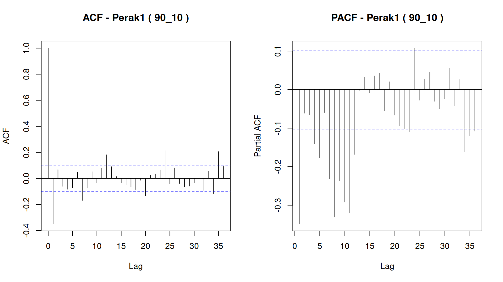

### CCF

Negative CCF lag means the second named location leads the first; positive lag means the first leads the second. The strongest correlation at each absolute non-zero lag is used to propose spatial-order candidates.

| location_x | location_y | lag | ccf | significance_bound | significant | direction |
|---|---|---|---|---|---|---|
| Juanda | Perak1 | -36 | 0.183681 | 0.102449 | TRUE | Perak1 leads Juanda |
| Juanda | Perak1 | -35 | 0.166028 | 0.102449 | TRUE | Perak1 leads Juanda |
| Juanda | Perak1 | -34 | -0.020848 | 0.102449 | FALSE | Perak1 leads Juanda |
| Juanda | Perak1 | -33 | -0.000227 | 0.102449 | FALSE | Perak1 leads Juanda |
| Juanda | Perak1 | -32 | 0.049322 | 0.102449 | FALSE | Perak1 leads Juanda |
| Juanda | Perak1 | -31 | -0.040981 | 0.102449 | FALSE | Perak1 leads Juanda |
| Juanda | Perak1 | -30 | -0.150298 | 0.102449 | TRUE | Perak1 leads Juanda |
| Juanda | Perak1 | -29 | -0.074929 | 0.102449 | FALSE | Perak1 leads Juanda |
| Juanda | Perak1 | -28 | -0.167953 | 0.102449 | TRUE | Perak1 leads Juanda |
| Juanda | Perak1 | -27 | -0.040230 | 0.102449 | FALSE | Perak1 leads Juanda |
| Juanda | Perak1 | -26 | 0.021582 | 0.102449 | FALSE | Perak1 leads Juanda |
| Juanda | Perak1 | -25 | 0.045939 | 0.102449 | FALSE | Perak1 leads Juanda |
| Juanda | Perak1 | -24 | 0.149740 | 0.102449 | TRUE | Perak1 leads Juanda |
| Juanda | Perak1 | -23 | 0.153672 | 0.102449 | TRUE | Perak1 leads Juanda |
| Juanda | Perak1 | -22 | 0.146453 | 0.102449 | TRUE | Perak1 leads Juanda |
| Juanda | Perak1 | -21 | -0.058108 | 0.102449 | FALSE | Perak1 leads Juanda |
| Juanda | Perak1 | -20 | 0.012077 | 0.102449 | FALSE | Perak1 leads Juanda |
| Juanda | Perak1 | -19 | -0.031444 | 0.102449 | FALSE | Perak1 leads Juanda |
| Juanda | Perak1 | -18 | -0.155513 | 0.102449 | TRUE | Perak1 leads Juanda |
| Juanda | Perak1 | -17 | -0.082001 | 0.102449 | FALSE | Perak1 leads Juanda |
| Juanda | Perak1 | -16 | -0.184656 | 0.102449 | TRUE | Perak1 leads Juanda |
| Juanda | Perak1 | -15 | -0.074281 | 0.102449 | FALSE | Perak1 leads Juanda |
| Juanda | Perak1 | -14 | 0.066775 | 0.102449 | FALSE | Perak1 leads Juanda |
| Juanda | Perak1 | -13 | 0.113797 | 0.102449 | TRUE | Perak1 leads Juanda |
| Juanda | Perak1 | -12 | 0.143687 | 0.102449 | TRUE | Perak1 leads Juanda |
| Juanda | Perak1 | -11 | 0.095433 | 0.102449 | FALSE | Perak1 leads Juanda |
| Juanda | Perak1 | -10 | 0.066566 | 0.102449 | FALSE | Perak1 leads Juanda |
| Juanda | Perak1 | -9 | 0.037982 | 0.102449 | FALSE | Perak1 leads Juanda |
| Juanda | Perak1 | -8 | 0.027838 | 0.102449 | FALSE | Perak1 leads Juanda |
| Juanda | Perak1 | -7 | -0.072231 | 0.102449 | FALSE | Perak1 leads Juanda |
| Juanda | Perak1 | -6 | -0.070084 | 0.102449 | FALSE | Perak1 leads Juanda |
| Juanda | Perak1 | -5 | -0.173884 | 0.102449 | TRUE | Perak1 leads Juanda |
| Juanda | Perak1 | -4 | -0.145331 | 0.102449 | TRUE | Perak1 leads Juanda |
| Juanda | Perak1 | -3 | -0.089783 | 0.102449 | FALSE | Perak1 leads Juanda |
| Juanda | Perak1 | -2 | 0.023540 | 0.102449 | FALSE | Perak1 leads Juanda |
| Juanda | Perak1 | -1 | -0.048661 | 0.102449 | FALSE | Perak1 leads Juanda |
| Juanda | Perak1 | 0 | 0.538450 | 0.102449 | TRUE | contemporaneous |
| Juanda | Perak1 | 1 | -0.023435 | 0.102449 | FALSE | Juanda leads Perak1 |
| Juanda | Perak1 | 2 | 0.050296 | 0.102449 | FALSE | Juanda leads Perak1 |
| Juanda | Perak1 | 3 | -0.060051 | 0.102449 | FALSE | Juanda leads Perak1 |
| Juanda | Perak1 | 4 | 0.059757 | 0.102449 | FALSE | Juanda leads Perak1 |
| Juanda | Perak1 | 5 | -0.097971 | 0.102449 | FALSE | Juanda leads Perak1 |
| Juanda | Perak1 | 6 | -0.026519 | 0.102449 | FALSE | Juanda leads Perak1 |
| Juanda | Perak1 | 7 | -0.189020 | 0.102449 | TRUE | Juanda leads Perak1 |
| Juanda | Perak1 | 8 | -0.127997 | 0.102449 | TRUE | Juanda leads Perak1 |
| Juanda | Perak1 | 9 | -0.061956 | 0.102449 | FALSE | Juanda leads Perak1 |
| Juanda | Perak1 | 10 | -0.000735 | 0.102449 | FALSE | Juanda leads Perak1 |
| Juanda | Perak1 | 11 | 0.086751 | 0.102449 | FALSE | Juanda leads Perak1 |
| Juanda | Perak1 | 12 | 0.200134 | 0.102449 | TRUE | Juanda leads Perak1 |
| Juanda | Perak1 | 13 | 0.140352 | 0.102449 | TRUE | Juanda leads Perak1 |
| Juanda | Perak1 | 14 | 0.076431 | 0.102449 | FALSE | Juanda leads Perak1 |
| Juanda | Perak1 | 15 | -0.020081 | 0.102449 | FALSE | Juanda leads Perak1 |
| Juanda | Perak1 | 16 | -0.012245 | 0.102449 | FALSE | Juanda leads Perak1 |
| Juanda | Perak1 | 17 | -0.039770 | 0.102449 | FALSE | Juanda leads Perak1 |
| Juanda | Perak1 | 18 | -0.083354 | 0.102449 | FALSE | Juanda leads Perak1 |
| Juanda | Perak1 | 19 | -0.146545 | 0.102449 | TRUE | Juanda leads Perak1 |
| Juanda | Perak1 | 20 | -0.134067 | 0.102449 | TRUE | Juanda leads Perak1 |
| Juanda | Perak1 | 21 | -0.092156 | 0.102449 | FALSE | Juanda leads Perak1 |
| Juanda | Perak1 | 22 | 0.054030 | 0.102449 | FALSE | Juanda leads Perak1 |
| Juanda | Perak1 | 23 | 0.137347 | 0.102449 | TRUE | Juanda leads Perak1 |
| Juanda | Perak1 | 24 | 0.144214 | 0.102449 | TRUE | Juanda leads Perak1 |
| Juanda | Perak1 | 25 | 0.039716 | 0.102449 | FALSE | Juanda leads Perak1 |
| Juanda | Perak1 | 26 | 0.129103 | 0.102449 | TRUE | Juanda leads Perak1 |
| Juanda | Perak1 | 27 | -0.032559 | 0.102449 | FALSE | Juanda leads Perak1 |
| Juanda | Perak1 | 28 | 0.017461 | 0.102449 | FALSE | Juanda leads Perak1 |
| Juanda | Perak1 | 29 | 0.020006 | 0.102449 | FALSE | Juanda leads Perak1 |
| Juanda | Perak1 | 30 | -0.175108 | 0.102449 | TRUE | Juanda leads Perak1 |
| Juanda | Perak1 | 31 | -0.100445 | 0.102449 | FALSE | Juanda leads Perak1 |
| Juanda | Perak1 | 32 | -0.152509 | 0.102449 | TRUE | Juanda leads Perak1 |
| Juanda | Perak1 | 33 | -0.019315 | 0.102449 | FALSE | Juanda leads Perak1 |
| Juanda | Perak1 | 34 | -0.053791 | 0.102449 | FALSE | Juanda leads Perak1 |
| Juanda | Perak1 | 35 | 0.171193 | 0.102449 | TRUE | Juanda leads Perak1 |
| Juanda | Perak1 | 36 | 0.137623 | 0.102449 | TRUE | Juanda leads Perak1 |
| Juanda | Perak2 | -36 | 0.268802 | 0.102449 | TRUE | Perak2 leads Juanda |
| Juanda | Perak2 | -35 | 0.244213 | 0.102449 | TRUE | Perak2 leads Juanda |
| Juanda | Perak2 | -34 | 0.091966 | 0.102449 | FALSE | Perak2 leads Juanda |
| Juanda | Perak2 | -33 | -0.056959 | 0.102449 | FALSE | Perak2 leads Juanda |
| Juanda | Perak2 | -32 | -0.034155 | 0.102449 | FALSE | Perak2 leads Juanda |
| Juanda | Perak2 | -31 | -0.122583 | 0.102449 | TRUE | Perak2 leads Juanda |
| Juanda | Perak2 | -30 | -0.189489 | 0.102449 | TRUE | Perak2 leads Juanda |
| Juanda | Perak2 | -29 | -0.126021 | 0.102449 | TRUE | Perak2 leads Juanda |
| Juanda | Perak2 | -28 | -0.171309 | 0.102449 | TRUE | Perak2 leads Juanda |
| Juanda | Perak2 | -27 | -0.087666 | 0.102449 | FALSE | Perak2 leads Juanda |
| Juanda | Perak2 | -26 | 0.114764 | 0.102449 | TRUE | Perak2 leads Juanda |
| Juanda | Perak2 | -25 | 0.082296 | 0.102449 | FALSE | Perak2 leads Juanda |
| Juanda | Perak2 | -24 | 0.163329 | 0.102449 | TRUE | Perak2 leads Juanda |
| Juanda | Perak2 | -23 | 0.238215 | 0.102449 | TRUE | Perak2 leads Juanda |
| Juanda | Perak2 | -22 | 0.287857 | 0.102449 | TRUE | Perak2 leads Juanda |
| Juanda | Perak2 | -21 | -0.131949 | 0.102449 | TRUE | Perak2 leads Juanda |
| Juanda | Perak2 | -20 | -0.083562 | 0.102449 | FALSE | Perak2 leads Juanda |
| Juanda | Perak2 | -19 | -0.089211 | 0.102449 | FALSE | Perak2 leads Juanda |
| Juanda | Perak2 | -18 | -0.152932 | 0.102449 | TRUE | Perak2 leads Juanda |
| Juanda | Perak2 | -17 | -0.175454 | 0.102449 | TRUE | Perak2 leads Juanda |
| Juanda | Perak2 | -16 | -0.197396 | 0.102449 | TRUE | Perak2 leads Juanda |
| Juanda | Perak2 | -15 | -0.074661 | 0.102449 | FALSE | Perak2 leads Juanda |
| Juanda | Perak2 | -14 | 0.106705 | 0.102449 | TRUE | Perak2 leads Juanda |
| Juanda | Perak2 | -13 | 0.137857 | 0.102449 | TRUE | Perak2 leads Juanda |
| Juanda | Perak2 | -12 | 0.231027 | 0.102449 | TRUE | Perak2 leads Juanda |
| Juanda | Perak2 | -11 | 0.222536 | 0.102449 | TRUE | Perak2 leads Juanda |
| Juanda | Perak2 | -10 | 0.038081 | 0.102449 | FALSE | Perak2 leads Juanda |
| Juanda | Perak2 | -9 | 0.036741 | 0.102449 | FALSE | Perak2 leads Juanda |
| Juanda | Perak2 | -8 | -0.039379 | 0.102449 | FALSE | Perak2 leads Juanda |
| Juanda | Perak2 | -7 | -0.121190 | 0.102449 | TRUE | Perak2 leads Juanda |
| Juanda | Perak2 | -6 | -0.176695 | 0.102449 | TRUE | Perak2 leads Juanda |
| Juanda | Perak2 | -5 | -0.192722 | 0.102449 | TRUE | Perak2 leads Juanda |
| Juanda | Perak2 | -4 | -0.167610 | 0.102449 | TRUE | Perak2 leads Juanda |
| Juanda | Perak2 | -3 | -0.050026 | 0.102449 | FALSE | Perak2 leads Juanda |
| Juanda | Perak2 | -2 | 0.016340 | 0.102449 | FALSE | Perak2 leads Juanda |
| Juanda | Perak2 | -1 | 0.021752 | 0.102449 | FALSE | Perak2 leads Juanda |
| Juanda | Perak2 | 0 | 0.552679 | 0.102449 | TRUE | contemporaneous |
| Juanda | Perak2 | 1 | 0.147244 | 0.102449 | TRUE | Juanda leads Perak2 |
| Juanda | Perak2 | 2 | 0.039687 | 0.102449 | FALSE | Juanda leads Perak2 |
| Juanda | Perak2 | 3 | -0.017826 | 0.102449 | FALSE | Juanda leads Perak2 |
| Juanda | Perak2 | 4 | -0.067516 | 0.102449 | FALSE | Juanda leads Perak2 |
| Juanda | Perak2 | 5 | -0.142704 | 0.102449 | TRUE | Juanda leads Perak2 |
| Juanda | Perak2 | 6 | -0.112011 | 0.102449 | TRUE | Juanda leads Perak2 |
| Juanda | Perak2 | 7 | -0.220838 | 0.102449 | TRUE | Juanda leads Perak2 |
| Juanda | Perak2 | 8 | -0.117413 | 0.102449 | TRUE | Juanda leads Perak2 |
| Juanda | Perak2 | 9 | -0.109687 | 0.102449 | TRUE | Juanda leads Perak2 |
| Juanda | Perak2 | 10 | 0.060429 | 0.102449 | FALSE | Juanda leads Perak2 |
| Juanda | Perak2 | 11 | 0.135600 | 0.102449 | TRUE | Juanda leads Perak2 |
| Juanda | Perak2 | 12 | 0.243376 | 0.102449 | TRUE | Juanda leads Perak2 |
| Juanda | Perak2 | 13 | 0.183848 | 0.102449 | TRUE | Juanda leads Perak2 |
| Juanda | Perak2 | 14 | 0.180575 | 0.102449 | TRUE | Juanda leads Perak2 |
| Juanda | Perak2 | 15 | -0.003806 | 0.102449 | FALSE | Juanda leads Perak2 |
| Juanda | Perak2 | 16 | -0.118227 | 0.102449 | TRUE | Juanda leads Perak2 |
| Juanda | Perak2 | 17 | -0.109241 | 0.102449 | TRUE | Juanda leads Perak2 |
| Juanda | Perak2 | 18 | -0.158751 | 0.102449 | TRUE | Juanda leads Perak2 |
| Juanda | Perak2 | 19 | -0.157081 | 0.102449 | TRUE | Juanda leads Perak2 |
| Juanda | Perak2 | 20 | -0.145257 | 0.102449 | TRUE | Juanda leads Perak2 |
| Juanda | Perak2 | 21 | -0.089308 | 0.102449 | FALSE | Juanda leads Perak2 |
| Juanda | Perak2 | 22 | 0.057123 | 0.102449 | FALSE | Juanda leads Perak2 |
| Juanda | Perak2 | 23 | 0.196129 | 0.102449 | TRUE | Juanda leads Perak2 |
| Juanda | Perak2 | 24 | 0.179617 | 0.102449 | TRUE | Juanda leads Perak2 |
| Juanda | Perak2 | 25 | 0.146525 | 0.102449 | TRUE | Juanda leads Perak2 |
| Juanda | Perak2 | 26 | 0.144096 | 0.102449 | TRUE | Juanda leads Perak2 |
| Juanda | Perak2 | 27 | -0.012907 | 0.102449 | FALSE | Juanda leads Perak2 |
| Juanda | Perak2 | 28 | -0.034974 | 0.102449 | FALSE | Juanda leads Perak2 |
| Juanda | Perak2 | 29 | -0.065364 | 0.102449 | FALSE | Juanda leads Perak2 |
| Juanda | Perak2 | 30 | -0.252532 | 0.102449 | TRUE | Juanda leads Perak2 |
| Juanda | Perak2 | 31 | -0.136854 | 0.102449 | TRUE | Juanda leads Perak2 |
| Juanda | Perak2 | 32 | -0.145224 | 0.102449 | TRUE | Juanda leads Perak2 |
| Juanda | Perak2 | 33 | -0.014453 | 0.102449 | FALSE | Juanda leads Perak2 |
| Juanda | Perak2 | 34 | -0.037076 | 0.102449 | FALSE | Juanda leads Perak2 |
| Juanda | Perak2 | 35 | 0.189740 | 0.102449 | TRUE | Juanda leads Perak2 |
| Juanda | Perak2 | 36 | 0.190087 | 0.102449 | TRUE | Juanda leads Perak2 |
| Perak1 | Perak2 | -36 | 0.168332 | 0.102449 | TRUE | Perak2 leads Perak1 |
| Perak1 | Perak2 | -35 | 0.212555 | 0.102449 | TRUE | Perak2 leads Perak1 |
| Perak1 | Perak2 | -34 | -0.031408 | 0.102449 | FALSE | Perak2 leads Perak1 |
| Perak1 | Perak2 | -33 | 0.020087 | 0.102449 | FALSE | Perak2 leads Perak1 |
| Perak1 | Perak2 | -32 | -0.121602 | 0.102449 | TRUE | Perak2 leads Perak1 |
| Perak1 | Perak2 | -31 | -0.170520 | 0.102449 | TRUE | Perak2 leads Perak1 |
| Perak1 | Perak2 | -30 | -0.091692 | 0.102449 | FALSE | Perak2 leads Perak1 |
| Perak1 | Perak2 | -29 | -0.105535 | 0.102449 | TRUE | Perak2 leads Perak1 |
| Perak1 | Perak2 | -28 | -0.000199 | 0.102449 | FALSE | Perak2 leads Perak1 |
| Perak1 | Perak2 | -27 | -0.018035 | 0.102449 | FALSE | Perak2 leads Perak1 |
| Perak1 | Perak2 | -26 | 0.128923 | 0.102449 | TRUE | Perak2 leads Perak1 |
| Perak1 | Perak2 | -25 | -0.009108 | 0.102449 | FALSE | Perak2 leads Perak1 |
| Perak1 | Perak2 | -24 | 0.205378 | 0.102449 | TRUE | Perak2 leads Perak1 |
| Perak1 | Perak2 | -23 | 0.110664 | 0.102449 | TRUE | Perak2 leads Perak1 |
| Perak1 | Perak2 | -22 | 0.088163 | 0.102449 | FALSE | Perak2 leads Perak1 |
| Perak1 | Perak2 | -21 | -0.022234 | 0.102449 | FALSE | Perak2 leads Perak1 |
| Perak1 | Perak2 | -20 | -0.169048 | 0.102449 | TRUE | Perak2 leads Perak1 |
| Perak1 | Perak2 | -19 | -0.116746 | 0.102449 | TRUE | Perak2 leads Perak1 |
| Perak1 | Perak2 | -18 | -0.064122 | 0.102449 | FALSE | Perak2 leads Perak1 |
| Perak1 | Perak2 | -17 | -0.125891 | 0.102449 | TRUE | Perak2 leads Perak1 |
| Perak1 | Perak2 | -16 | -0.037479 | 0.102449 | FALSE | Perak2 leads Perak1 |
| Perak1 | Perak2 | -15 | 0.032706 | 0.102449 | FALSE | Perak2 leads Perak1 |
| Perak1 | Perak2 | -14 | 0.008228 | 0.102449 | FALSE | Perak2 leads Perak1 |
| Perak1 | Perak2 | -13 | 0.115091 | 0.102449 | TRUE | Perak2 leads Perak1 |
| Perak1 | Perak2 | -12 | 0.266245 | 0.102449 | TRUE | Perak2 leads Perak1 |
| Perak1 | Perak2 | -11 | 0.070945 | 0.102449 | FALSE | Perak2 leads Perak1 |
| Perak1 | Perak2 | -10 | -0.007302 | 0.102449 | FALSE | Perak2 leads Perak1 |
| Perak1 | Perak2 | -9 | 0.032204 | 0.102449 | FALSE | Perak2 leads Perak1 |
| Perak1 | Perak2 | -8 | -0.117082 | 0.102449 | TRUE | Perak2 leads Perak1 |
| Perak1 | Perak2 | -7 | -0.182741 | 0.102449 | TRUE | Perak2 leads Perak1 |
| Perak1 | Perak2 | -6 | -0.096851 | 0.102449 | FALSE | Perak2 leads Perak1 |
| Perak1 | Perak2 | -5 | -0.084303 | 0.102449 | FALSE | Perak2 leads Perak1 |
| Perak1 | Perak2 | -4 | -0.057094 | 0.102449 | FALSE | Perak2 leads Perak1 |
| Perak1 | Perak2 | -3 | 0.034594 | 0.102449 | FALSE | Perak2 leads Perak1 |
| Perak1 | Perak2 | -2 | 0.063927 | 0.102449 | FALSE | Perak2 leads Perak1 |
| Perak1 | Perak2 | -1 | -0.182840 | 0.102449 | TRUE | Perak2 leads Perak1 |
| Perak1 | Perak2 | 0 | 0.711805 | 0.102449 | TRUE | contemporaneous |
| Perak1 | Perak2 | 1 | -0.102285 | 0.102449 | FALSE | Perak1 leads Perak2 |
| Perak1 | Perak2 | 2 | 0.078336 | 0.102449 | FALSE | Perak1 leads Perak2 |
| Perak1 | Perak2 | 3 | -0.059906 | 0.102449 | FALSE | Perak1 leads Perak2 |
| Perak1 | Perak2 | 4 | -0.160061 | 0.102449 | TRUE | Perak1 leads Perak2 |
| Perak1 | Perak2 | 5 | -0.135746 | 0.102449 | TRUE | Perak1 leads Perak2 |
| Perak1 | Perak2 | 6 | -0.048352 | 0.102449 | FALSE | Perak1 leads Perak2 |
| Perak1 | Perak2 | 7 | -0.150946 | 0.102449 | TRUE | Perak1 leads Perak2 |
| Perak1 | Perak2 | 8 | -0.035985 | 0.102449 | FALSE | Perak1 leads Perak2 |
| Perak1 | Perak2 | 9 | 0.024496 | 0.102449 | FALSE | Perak1 leads Perak2 |
| Perak1 | Perak2 | 10 | 0.065814 | 0.102449 | FALSE | Perak1 leads Perak2 |
| Perak1 | Perak2 | 11 | 0.077751 | 0.102449 | FALSE | Perak1 leads Perak2 |
| Perak1 | Perak2 | 12 | 0.167809 | 0.102449 | TRUE | Perak1 leads Perak2 |
| Perak1 | Perak2 | 13 | 0.134603 | 0.102449 | TRUE | Perak1 leads Perak2 |
| Perak1 | Perak2 | 14 | 0.076520 | 0.102449 | FALSE | Perak1 leads Perak2 |
| Perak1 | Perak2 | 15 | -0.004593 | 0.102449 | FALSE | Perak1 leads Perak2 |
| Perak1 | Perak2 | 16 | -0.154963 | 0.102449 | TRUE | Perak1 leads Perak2 |
| Perak1 | Perak2 | 17 | -0.135825 | 0.102449 | TRUE | Perak1 leads Perak2 |
| Perak1 | Perak2 | 18 | -0.121915 | 0.102449 | TRUE | Perak1 leads Perak2 |
| Perak1 | Perak2 | 19 | -0.041404 | 0.102449 | FALSE | Perak1 leads Perak2 |
| Perak1 | Perak2 | 20 | -0.085159 | 0.102449 | FALSE | Perak1 leads Perak2 |
| Perak1 | Perak2 | 21 | 0.051614 | 0.102449 | FALSE | Perak1 leads Perak2 |
| Perak1 | Perak2 | 22 | 0.038036 | 0.102449 | FALSE | Perak1 leads Perak2 |
| Perak1 | Perak2 | 23 | 0.096277 | 0.102449 | FALSE | Perak1 leads Perak2 |
| Perak1 | Perak2 | 24 | 0.210624 | 0.102449 | TRUE | Perak1 leads Perak2 |
| Perak1 | Perak2 | 25 | 0.040180 | 0.102449 | FALSE | Perak1 leads Perak2 |
| Perak1 | Perak2 | 26 | 0.067818 | 0.102449 | FALSE | Perak1 leads Perak2 |
| Perak1 | Perak2 | 27 | 0.008420 | 0.102449 | FALSE | Perak1 leads Perak2 |
| Perak1 | Perak2 | 28 | -0.140746 | 0.102449 | TRUE | Perak1 leads Perak2 |
| Perak1 | Perak2 | 29 | -0.126366 | 0.102449 | TRUE | Perak1 leads Perak2 |
| Perak1 | Perak2 | 30 | -0.087141 | 0.102449 | FALSE | Perak1 leads Perak2 |
| Perak1 | Perak2 | 31 | -0.106472 | 0.102449 | TRUE | Perak1 leads Perak2 |
| Perak1 | Perak2 | 32 | -0.036687 | 0.102449 | FALSE | Perak1 leads Perak2 |
| Perak1 | Perak2 | 33 | 0.081051 | 0.102449 | FALSE | Perak1 leads Perak2 |
| Perak1 | Perak2 | 34 | -0.098983 | 0.102449 | FALSE | Perak1 leads Perak2 |
| Perak1 | Perak2 | 35 | 0.220996 | 0.102449 | TRUE | Perak1 leads Perak2 |
| Perak1 | Perak2 | 36 | 0.147228 | 0.102449 | TRUE | Perak1 leads Perak2 |

### Candidate models

| a | b | fitted | AIC | coefficients_finite | iidn_pass | white_noise_pass | error |
|---|---|---|---|---|---|---|---|
| 1 | 1 | TRUE | 13675.55 | TRUE | FALSE | FALSE |  |
| 4 | 1 | TRUE | 13553.07 | TRUE | FALSE | FALSE |  |
| 5 | 1 | TRUE | 13480.51 | TRUE | FALSE | FALSE |  |
| 7 | 1 | TRUE | 13333.54 | TRUE | FALSE | FALSE |  |
| 12 | 1 | TRUE | 12887.87 | TRUE | FALSE | FALSE |  |
| 16 | 1 | TRUE | 12760.39 | TRUE | FALSE | FALSE |  |
| 1 | 4 | TRUE | 13549.51 | TRUE | FALSE | FALSE |  |
| 4 | 4 | TRUE | 13501.85 | TRUE | FALSE | FALSE |  |
| 5 | 4 | TRUE | 13425.57 | TRUE | FALSE | FALSE |  |
| 7 | 4 | TRUE | 13262.79 | TRUE | FALSE | FALSE |  |
| 12 | 4 | TRUE | 12780.37 | TRUE | FALSE | TRUE |  |
| 16 | 4 | TRUE | 12655.21 | TRUE | FALSE | TRUE |  |
| 1 | 5 | TRUE | 13468.30 | TRUE | FALSE | FALSE |  |
| 4 | 5 | TRUE | 13415.56 | TRUE | FALSE | FALSE |  |
| 5 | 5 | TRUE | 13404.42 | TRUE | FALSE | FALSE |  |
| 7 | 5 | TRUE | 13247.87 | TRUE | FALSE | FALSE |  |
| 12 | 5 | TRUE | 12769.46 | TRUE | FALSE | TRUE |  |
| 16 | 5 | TRUE | 12644.31 | TRUE | FALSE | TRUE |  |
| 1 | 6 | TRUE | 13394.82 | TRUE | FALSE | FALSE |  |
| 4 | 6 | TRUE | 13342.59 | TRUE | FALSE | FALSE |  |
| 5 | 6 | TRUE | 13333.25 | TRUE | FALSE | FALSE |  |
| 7 | 6 | TRUE | 13212.78 | TRUE | FALSE | FALSE |  |
| 12 | 6 | TRUE | 12752.28 | TRUE | FALSE | TRUE |  |
| 16 | 6 | TRUE | 12628.95 | TRUE | FALSE | TRUE |  |
| 1 | 7 | TRUE | 13296.17 | TRUE | FALSE | FALSE |  |
| 4 | 7 | TRUE | 13245.11 | TRUE | FALSE | FALSE |  |
| 5 | 7 | TRUE | 13239.07 | TRUE | FALSE | FALSE |  |
| 7 | 7 | TRUE | 13192.07 | TRUE | FALSE | FALSE |  |
| 12 | 7 | TRUE | 12748.69 | TRUE | FALSE | TRUE |  |
| 16 | 7 | TRUE | 12626.07 | TRUE | FALSE | TRUE |  |
| 1 | 8 | TRUE | 13174.39 | TRUE | FALSE | FALSE |  |
| 4 | 8 | TRUE | 13128.73 | TRUE | FALSE | FALSE |  |
| 5 | 8 | TRUE | 13129.26 | TRUE | FALSE | FALSE |  |
| 7 | 8 | TRUE | 13088.59 | TRUE | FALSE | FALSE |  |
| 12 | 8 | TRUE | 12732.78 | TRUE | FALSE | TRUE |  |
| 16 | 8 | TRUE | 12607.92 | TRUE | FALSE | TRUE |  |

### Selected parameters

| a | b | parameter | estimate | std_error | t_value | p_value |
|---|---|---|---|---|---|---|
| 16 | 8 | phi1(Juanda) | -0.585580 | 0.053280 | -10.990601 | 0.000000 |
| 16 | 8 | phi1(Perak1) | -1.020743 | 0.077106 | -13.238212 | 0.000000 |
| 16 | 8 | phi1(Perak2) | -0.481000 | 0.100133 | -4.803624 | 0.000002 |
| 16 | 8 | phi2(Juanda) | -0.545089 | 0.062484 | -8.723602 | 0.000000 |
| 16 | 8 | phi2(Perak1) | -0.865328 | 0.102002 | -8.483450 | 0.000000 |
| 16 | 8 | phi2(Perak2) | -0.316573 | 0.122988 | -2.574026 | 0.010198 |
| 16 | 8 | phi3(Juanda) | -0.379811 | 0.067758 | -5.605405 | 0.000000 |
| 16 | 8 | phi3(Perak1) | -0.769254 | 0.116985 | -6.575678 | 0.000000 |
| 16 | 8 | phi3(Perak2) | -0.272213 | 0.136649 | -1.992051 | 0.046643 |
| 16 | 8 | phi4(Juanda) | -0.399084 | 0.069550 | -5.738097 | 0.000000 |
| 16 | 8 | phi4(Perak1) | -0.644209 | 0.124344 | -5.180865 | 0.000000 |
| 16 | 8 | phi4(Perak2) | -0.291670 | 0.144008 | -2.025371 | 0.043100 |
| 16 | 8 | phi5(Juanda) | -0.373923 | 0.069573 | -5.374512 | 0.000000 |
| 16 | 8 | phi5(Perak1) | -0.435512 | 0.125084 | -3.481753 | 0.000520 |
| 16 | 8 | phi5(Perak2) | -0.186684 | 0.143107 | -1.304507 | 0.192368 |
| 16 | 8 | phi6(Juanda) | -0.438397 | 0.068340 | -6.414940 | 0.000000 |
| 16 | 8 | phi6(Perak1) | -0.198596 | 0.118158 | -1.680769 | 0.093127 |
| 16 | 8 | phi6(Perak2) | -0.092742 | 0.137369 | -0.675127 | 0.499755 |
| 16 | 8 | phi7(Juanda) | -0.274385 | 0.063184 | -4.342620 | 0.000016 |
| 16 | 8 | phi7(Perak1) | -0.227568 | 0.103833 | -2.191678 | 0.028638 |
| 16 | 8 | phi7(Perak2) | -0.094905 | 0.124903 | -0.759826 | 0.447541 |
| 16 | 8 | phi8(Juanda) | -0.202221 | 0.053273 | -3.795964 | 0.000156 |
| 16 | 8 | phi8(Perak1) | -0.231743 | 0.080254 | -2.887609 | 0.003967 |
| 16 | 8 | phi8(Perak2) | -0.008323 | 0.103127 | -0.080702 | 0.935696 |
| 16 | 8 | theta1(Juanda) | -0.082410 | 0.080775 | -1.020236 | 0.307869 |
| 16 | 8 | theta1(Perak1) | 0.316026 | 0.103262 | 3.060440 | 0.002270 |
| 16 | 8 | theta1(Perak2) | -0.176441 | 0.084190 | -2.095734 | 0.036362 |
| 16 | 8 | theta2(Juanda) | -0.262554 | 0.105801 | -2.481590 | 0.013247 |
| 16 | 8 | theta2(Perak1) | 0.270094 | 0.123193 | 2.192445 | 0.028582 |
| 16 | 8 | theta2(Perak2) | -0.214117 | 0.112260 | -1.907323 | 0.056772 |
| 16 | 8 | theta3(Juanda) | -0.453168 | 0.118822 | -3.813847 | 0.000145 |
| 16 | 8 | theta3(Perak1) | 0.159091 | 0.141269 | 1.126153 | 0.260377 |
| 16 | 8 | theta3(Perak2) | -0.227505 | 0.131867 | -1.725264 | 0.084796 |
| 16 | 8 | theta4(Juanda) | -0.347765 | 0.128136 | -2.714029 | 0.006764 |
| 16 | 8 | theta4(Perak1) | -0.036631 | 0.151396 | -0.241956 | 0.808865 |
| 16 | 8 | theta4(Perak2) | -0.252914 | 0.147995 | -1.708942 | 0.087779 |
| 16 | 8 | theta5(Juanda) | -0.373603 | 0.137009 | -2.726860 | 0.006508 |
| 16 | 8 | theta5(Perak1) | -0.279086 | 0.158564 | -1.760088 | 0.078705 |
| 16 | 8 | theta5(Perak2) | -0.341716 | 0.156508 | -2.183372 | 0.029246 |
| 16 | 8 | theta6(Juanda) | -0.320796 | 0.140392 | -2.285005 | 0.022526 |
| 16 | 8 | theta6(Perak1) | -0.400659 | 0.159896 | -2.505751 | 0.012381 |
| 16 | 8 | theta6(Perak2) | -0.438807 | 0.157268 | -2.790181 | 0.005370 |
| 16 | 8 | theta7(Juanda) | -0.674561 | 0.141199 | -4.777371 | 0.000002 |
| 16 | 8 | theta7(Perak1) | -0.361293 | 0.156051 | -2.315222 | 0.020807 |
| 16 | 8 | theta7(Perak2) | -0.482347 | 0.149724 | -3.221569 | 0.001317 |
| 16 | 8 | theta8(Juanda) | -0.896663 | 0.143553 | -6.246201 | 0.000000 |
| 16 | 8 | theta8(Perak1) | -0.241589 | 0.148379 | -1.628185 | 0.103808 |
| 16 | 8 | theta8(Perak2) | -0.527060 | 0.138676 | -3.800647 | 0.000153 |
| 16 | 8 | theta9(Juanda) | -1.097673 | 0.139830 | -7.850063 | 0.000000 |
| 16 | 8 | theta9(Perak1) | -0.333502 | 0.130649 | -2.552649 | 0.010842 |
| 16 | 8 | theta9(Perak2) | -0.439273 | 0.119446 | -3.677597 | 0.000248 |
| 16 | 8 | theta10(Juanda) | -1.002594 | 0.139269 | -7.198971 | 0.000000 |
| 16 | 8 | theta10(Perak1) | -0.235724 | 0.128287 | -1.837482 | 0.066442 |
| 16 | 8 | theta10(Perak2) | -0.399571 | 0.116336 | -3.434625 | 0.000618 |
| 16 | 8 | theta11(Juanda) | -0.737974 | 0.138129 | -5.342626 | 0.000000 |
| 16 | 8 | theta11(Perak1) | -0.216863 | 0.126386 | -1.715874 | 0.086502 |
| 16 | 8 | theta11(Perak2) | -0.261880 | 0.114679 | -2.283591 | 0.022609 |
| 16 | 8 | theta12(Juanda) | -0.352103 | 0.132214 | -2.663121 | 0.007869 |
| 16 | 8 | theta12(Perak1) | -0.057043 | 0.120016 | -0.475296 | 0.634682 |
| 16 | 8 | theta12(Perak2) | -0.008734 | 0.108421 | -0.080559 | 0.935809 |
| 16 | 8 | theta13(Juanda) | -0.151968 | 0.121125 | -1.254644 | 0.209908 |
| 16 | 8 | theta13(Perak1) | 0.054009 | 0.109722 | 0.492237 | 0.622662 |
| 16 | 8 | theta13(Perak2) | 0.063533 | 0.098840 | 0.642793 | 0.520509 |
| 16 | 8 | theta14(Juanda) | -0.015199 | 0.107922 | -0.140837 | 0.888028 |
| 16 | 8 | theta14(Perak1) | 0.165970 | 0.099275 | 1.671816 | 0.094881 |
| 16 | 8 | theta14(Perak2) | 0.063853 | 0.087407 | 0.730527 | 0.465243 |
| 16 | 8 | theta15(Juanda) | -0.056613 | 0.093460 | -0.605750 | 0.544822 |
| 16 | 8 | theta15(Perak1) | 0.120598 | 0.087284 | 1.381683 | 0.167385 |
| 16 | 8 | theta15(Perak2) | 0.075453 | 0.075844 | 0.994840 | 0.320060 |
| 16 | 8 | theta16(Juanda) | -0.030416 | 0.071274 | -0.426746 | 0.669658 |
| 16 | 8 | theta16(Perak1) | -0.010367 | 0.073784 | -0.140502 | 0.888292 |
| 16 | 8 | theta16(Perak2) | 0.049328 | 0.059809 | 0.824769 | 0.409704 |

### Training fit and hold-out forecast

Each panel compares actual rainfall with fitted values (left), recursive multi-step forecasts, and actual-lag one-step forecasts (right).

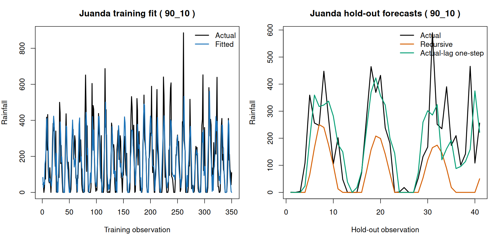

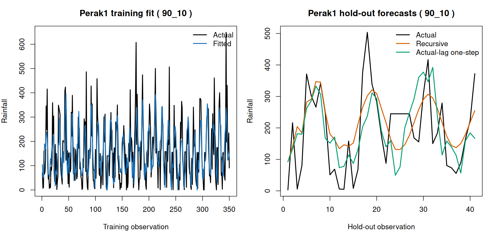

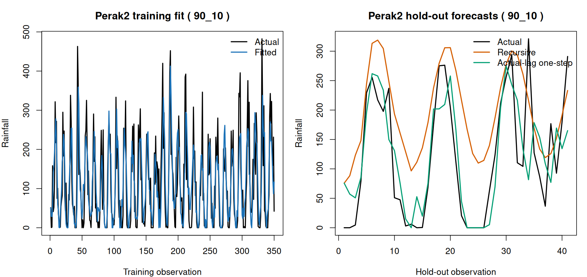

### Training metrics

| location | MSE | RMSE | MAE | sMAPE | MAPE_nonzero | R_squared |
|---|---|---|---|---|---|---|
| Juanda | 11804.342 | 108.64779 | 79.56727 | 74.03419 | 311.3658 | 0.587982 |
| Perak1 | 8177.685 | 90.43055 | 71.43584 | 62.51734 | 1141.9260 | 0.435748 |
| Perak2 | 4971.151 | 70.50639 | 52.83948 | 79.05200 | 206.0014 | 0.585409 |
| Overall | 8317.726 | 91.20157 | 67.94753 | 71.86785 | 589.2118 | 0.562194 |

### Testing metrics: recursive multi-step

Each forecasted test value is used as a lag input for the next test forecast; no actual test value enters the forecast recursion.

| location | MSE | RMSE | MAE | sMAPE | MAPE_nonzero | R_squared |
|---|---|---|---|---|---|---|
| Juanda | 26895.674 | 163.99901 | 114.70341 | 109.39455 | 71.79286 | -0.057249 |
| Perak1 | 9786.667 | 98.92758 | 85.56070 | 59.50633 | 375.48981 | 0.396889 |
| Perak2 | 9882.899 | 99.41277 | 86.11181 | 88.02832 | 1330.38894 | 0.086880 |
| Overall | 15521.747 | 124.58630 | 95.45864 | 85.64307 | 574.00960 | 0.160631 |

### Testing metrics: actual-lag one-step

Each test prediction uses observed rainfall only from earlier test months as lag inputs; it does not use the current month’s actual rainfall. This is a one-step-ahead evaluation, not a deployable long-horizon forecast.

| location | MSE | RMSE | MAE | sMAPE | MAPE_nonzero | R_squared |
|---|---|---|---|---|---|---|
| Juanda | 13208.266 | 114.92722 | 80.34553 | 72.29858 | 59.43825 | 0.480793 |
| Perak1 | 12633.758 | 112.39999 | 91.20235 | 63.73695 | 286.04063 | 0.221435 |
| Perak2 | 4268.824 | 65.33624 | 48.62394 | 63.96561 | 229.25175 | 0.605587 |
| Overall | 10036.949 | 100.18458 | 73.39061 | 66.66705 | 196.38695 | 0.457232 |

### Selected residual diagnostics

| location | mean_residual | residual_variance | mean_zero_p_value | normality_shapiro_p_value | variance_stability_fligner_p_value | ljung_box_10_p_value | ljung_box_20_p_value |
|---|---|---|---|---|---|---|---|
| Juanda | -0.800658 | 11947.241 | 0.891078 | 0.000000 | 0.693859 | 0.722089 | 0.868129 |
| Perak1 | 0.883470 | 8209.192 | 0.855358 | 0.000051 | 0.621624 | 0.402137 | 0.347569 |
| Perak2 | 0.474584 | 5026.825 | 0.900415 | 0.000092 | 0.340825 | 0.504793 | 0.223755 |

### Equation terms

Custom convention: each city equation combines its own b lags and the inverse-distance-weighted other-city values through a lags.

| location | lag | source_location | effect | parameter | spatial_weight | coefficient |
|---|---|---|---|---|---|---|
| Juanda | 1 | Juanda | own temporal | phi1(Juanda) | 1.000000 | -0.585580 |
| Juanda | 2 | Juanda | own temporal | phi2(Juanda) | 1.000000 | -0.545089 |
| Juanda | 3 | Juanda | own temporal | phi3(Juanda) | 1.000000 | -0.379811 |
| Juanda | 4 | Juanda | own temporal | phi4(Juanda) | 1.000000 | -0.399084 |
| Juanda | 5 | Juanda | own temporal | phi5(Juanda) | 1.000000 | -0.373923 |
| Juanda | 6 | Juanda | own temporal | phi6(Juanda) | 1.000000 | -0.438397 |
| Juanda | 7 | Juanda | own temporal | phi7(Juanda) | 1.000000 | -0.274385 |
| Juanda | 8 | Juanda | own temporal | phi8(Juanda) | 1.000000 | -0.202221 |
| Juanda | 1 | Perak1 | spatial weighted | theta1(Juanda) | 0.512359 | -0.042223 |
| Juanda | 1 | Perak2 | spatial weighted | theta1(Juanda) | 0.487641 | -0.040186 |
| Juanda | 2 | Perak1 | spatial weighted | theta2(Juanda) | 0.512359 | -0.134522 |
| Juanda | 2 | Perak2 | spatial weighted | theta2(Juanda) | 0.487641 | -0.128032 |
| Juanda | 3 | Perak1 | spatial weighted | theta3(Juanda) | 0.512359 | -0.232185 |
| Juanda | 3 | Perak2 | spatial weighted | theta3(Juanda) | 0.487641 | -0.220983 |
| Juanda | 4 | Perak1 | spatial weighted | theta4(Juanda) | 0.512359 | -0.178181 |
| Juanda | 4 | Perak2 | spatial weighted | theta4(Juanda) | 0.487641 | -0.169585 |
| Juanda | 5 | Perak1 | spatial weighted | theta5(Juanda) | 0.512359 | -0.191419 |
| Juanda | 5 | Perak2 | spatial weighted | theta5(Juanda) | 0.487641 | -0.182184 |
| Juanda | 6 | Perak1 | spatial weighted | theta6(Juanda) | 0.512359 | -0.164362 |
| Juanda | 6 | Perak2 | spatial weighted | theta6(Juanda) | 0.487641 | -0.156433 |
| Juanda | 7 | Perak1 | spatial weighted | theta7(Juanda) | 0.512359 | -0.345617 |
| Juanda | 7 | Perak2 | spatial weighted | theta7(Juanda) | 0.487641 | -0.328944 |
| Juanda | 8 | Perak1 | spatial weighted | theta8(Juanda) | 0.512359 | -0.459413 |
| Juanda | 8 | Perak2 | spatial weighted | theta8(Juanda) | 0.487641 | -0.437250 |
| Juanda | 9 | Perak1 | spatial weighted | theta9(Juanda) | 0.512359 | -0.562403 |
| Juanda | 9 | Perak2 | spatial weighted | theta9(Juanda) | 0.487641 | -0.535271 |
| Juanda | 10 | Perak1 | spatial weighted | theta10(Juanda) | 0.512359 | -0.513688 |
| Juanda | 10 | Perak2 | spatial weighted | theta10(Juanda) | 0.487641 | -0.488906 |
| Juanda | 11 | Perak1 | spatial weighted | theta11(Juanda) | 0.512359 | -0.378108 |
| Juanda | 11 | Perak2 | spatial weighted | theta11(Juanda) | 0.487641 | -0.359867 |
| Juanda | 12 | Perak1 | spatial weighted | theta12(Juanda) | 0.512359 | -0.180403 |
| Juanda | 12 | Perak2 | spatial weighted | theta12(Juanda) | 0.487641 | -0.171700 |
| Juanda | 13 | Perak1 | spatial weighted | theta13(Juanda) | 0.512359 | -0.077862 |
| Juanda | 13 | Perak2 | spatial weighted | theta13(Juanda) | 0.487641 | -0.074106 |
| Juanda | 14 | Perak1 | spatial weighted | theta14(Juanda) | 0.512359 | -0.007788 |
| Juanda | 14 | Perak2 | spatial weighted | theta14(Juanda) | 0.487641 | -0.007412 |
| Juanda | 15 | Perak1 | spatial weighted | theta15(Juanda) | 0.512359 | -0.029006 |
| Juanda | 15 | Perak2 | spatial weighted | theta15(Juanda) | 0.487641 | -0.027607 |
| Juanda | 16 | Perak1 | spatial weighted | theta16(Juanda) | 0.512359 | -0.015584 |
| Juanda | 16 | Perak2 | spatial weighted | theta16(Juanda) | 0.487641 | -0.014832 |
| Perak1 | 1 | Perak1 | own temporal | phi1(Perak1) | 1.000000 | -1.020743 |
| Perak1 | 2 | Perak1 | own temporal | phi2(Perak1) | 1.000000 | -0.865328 |
| Perak1 | 3 | Perak1 | own temporal | phi3(Perak1) | 1.000000 | -0.769254 |
| Perak1 | 4 | Perak1 | own temporal | phi4(Perak1) | 1.000000 | -0.644209 |
| Perak1 | 5 | Perak1 | own temporal | phi5(Perak1) | 1.000000 | -0.435512 |
| Perak1 | 6 | Perak1 | own temporal | phi6(Perak1) | 1.000000 | -0.198596 |
| Perak1 | 7 | Perak1 | own temporal | phi7(Perak1) | 1.000000 | -0.227568 |
| Perak1 | 8 | Perak1 | own temporal | phi8(Perak1) | 1.000000 | -0.231743 |
| Perak1 | 1 | Juanda | spatial weighted | theta1(Perak1) | 0.274073 | 0.086614 |
| Perak1 | 1 | Perak2 | spatial weighted | theta1(Perak1) | 0.725927 | 0.229412 |
| Perak1 | 2 | Juanda | spatial weighted | theta2(Perak1) | 0.274073 | 0.074026 |
| Perak1 | 2 | Perak2 | spatial weighted | theta2(Perak1) | 0.725927 | 0.196069 |
| Perak1 | 3 | Juanda | spatial weighted | theta3(Perak1) | 0.274073 | 0.043603 |
| Perak1 | 3 | Perak2 | spatial weighted | theta3(Perak1) | 0.725927 | 0.115488 |
| Perak1 | 4 | Juanda | spatial weighted | theta4(Perak1) | 0.274073 | -0.010040 |
| Perak1 | 4 | Perak2 | spatial weighted | theta4(Perak1) | 0.725927 | -0.026592 |
| Perak1 | 5 | Juanda | spatial weighted | theta5(Perak1) | 0.274073 | -0.076490 |
| Perak1 | 5 | Perak2 | spatial weighted | theta5(Perak1) | 0.725927 | -0.202596 |
| Perak1 | 6 | Juanda | spatial weighted | theta6(Perak1) | 0.274073 | -0.109810 |
| Perak1 | 6 | Perak2 | spatial weighted | theta6(Perak1) | 0.725927 | -0.290849 |
| Perak1 | 7 | Juanda | spatial weighted | theta7(Perak1) | 0.274073 | -0.099021 |
| Perak1 | 7 | Perak2 | spatial weighted | theta7(Perak1) | 0.725927 | -0.262272 |
| Perak1 | 8 | Juanda | spatial weighted | theta8(Perak1) | 0.274073 | -0.066213 |
| Perak1 | 8 | Perak2 | spatial weighted | theta8(Perak1) | 0.725927 | -0.175376 |
| Perak1 | 9 | Juanda | spatial weighted | theta9(Perak1) | 0.274073 | -0.091404 |
| Perak1 | 9 | Perak2 | spatial weighted | theta9(Perak1) | 0.725927 | -0.242098 |
| Perak1 | 10 | Juanda | spatial weighted | theta10(Perak1) | 0.274073 | -0.064606 |
| Perak1 | 10 | Perak2 | spatial weighted | theta10(Perak1) | 0.725927 | -0.171119 |
| Perak1 | 11 | Juanda | spatial weighted | theta11(Perak1) | 0.274073 | -0.059436 |
| Perak1 | 11 | Perak2 | spatial weighted | theta11(Perak1) | 0.725927 | -0.157427 |
| Perak1 | 12 | Juanda | spatial weighted | theta12(Perak1) | 0.274073 | -0.015634 |
| Perak1 | 12 | Perak2 | spatial weighted | theta12(Perak1) | 0.725927 | -0.041409 |
| Perak1 | 13 | Juanda | spatial weighted | theta13(Perak1) | 0.274073 | 0.014802 |
| Perak1 | 13 | Perak2 | spatial weighted | theta13(Perak1) | 0.725927 | 0.039207 |
| Perak1 | 14 | Juanda | spatial weighted | theta14(Perak1) | 0.274073 | 0.045488 |
| Perak1 | 14 | Perak2 | spatial weighted | theta14(Perak1) | 0.725927 | 0.120482 |
| Perak1 | 15 | Juanda | spatial weighted | theta15(Perak1) | 0.274073 | 0.033053 |
| Perak1 | 15 | Perak2 | spatial weighted | theta15(Perak1) | 0.725927 | 0.087546 |
| Perak1 | 16 | Juanda | spatial weighted | theta16(Perak1) | 0.274073 | -0.002841 |
| Perak1 | 16 | Perak2 | spatial weighted | theta16(Perak1) | 0.725927 | -0.007526 |
| Perak2 | 1 | Perak2 | own temporal | phi1(Perak2) | 1.000000 | -0.481000 |
| Perak2 | 2 | Perak2 | own temporal | phi2(Perak2) | 1.000000 | -0.316573 |
| Perak2 | 3 | Perak2 | own temporal | phi3(Perak2) | 1.000000 | -0.272213 |
| Perak2 | 4 | Perak2 | own temporal | phi4(Perak2) | 1.000000 | -0.291670 |
| Perak2 | 5 | Perak2 | own temporal | phi5(Perak2) | 1.000000 | -0.186684 |
| Perak2 | 6 | Perak2 | own temporal | phi6(Perak2) | 1.000000 | -0.092742 |
| Perak2 | 7 | Perak2 | own temporal | phi7(Perak2) | 1.000000 | -0.094905 |
| Perak2 | 8 | Perak2 | own temporal | phi8(Perak2) | 1.000000 | -0.008323 |
| Perak2 | 1 | Juanda | spatial weighted | theta1(Perak2) | 0.264347 | -0.046642 |
| Perak2 | 1 | Perak1 | spatial weighted | theta1(Perak2) | 0.735653 | -0.129799 |
| Perak2 | 2 | Juanda | spatial weighted | theta2(Perak2) | 0.264347 | -0.056601 |
| Perak2 | 2 | Perak1 | spatial weighted | theta2(Perak2) | 0.735653 | -0.157516 |
| Perak2 | 3 | Juanda | spatial weighted | theta3(Perak2) | 0.264347 | -0.060140 |
| Perak2 | 3 | Perak1 | spatial weighted | theta3(Perak2) | 0.735653 | -0.167365 |
| Perak2 | 4 | Juanda | spatial weighted | theta4(Perak2) | 0.264347 | -0.066857 |
| Perak2 | 4 | Perak1 | spatial weighted | theta4(Perak2) | 0.735653 | -0.186057 |
| Perak2 | 5 | Juanda | spatial weighted | theta5(Perak2) | 0.264347 | -0.090331 |
| Perak2 | 5 | Perak1 | spatial weighted | theta5(Perak2) | 0.735653 | -0.251384 |
| Perak2 | 6 | Juanda | spatial weighted | theta6(Perak2) | 0.264347 | -0.115997 |
| Perak2 | 6 | Perak1 | spatial weighted | theta6(Perak2) | 0.735653 | -0.322810 |
| Perak2 | 7 | Juanda | spatial weighted | theta7(Perak2) | 0.264347 | -0.127507 |
| Perak2 | 7 | Perak1 | spatial weighted | theta7(Perak2) | 0.735653 | -0.354841 |
| Perak2 | 8 | Juanda | spatial weighted | theta8(Perak2) | 0.264347 | -0.139326 |
| Perak2 | 8 | Perak1 | spatial weighted | theta8(Perak2) | 0.735653 | -0.387733 |
| Perak2 | 9 | Juanda | spatial weighted | theta9(Perak2) | 0.264347 | -0.116120 |
| Perak2 | 9 | Perak1 | spatial weighted | theta9(Perak2) | 0.735653 | -0.323152 |
| Perak2 | 10 | Juanda | spatial weighted | theta10(Perak2) | 0.264347 | -0.105625 |
| Perak2 | 10 | Perak1 | spatial weighted | theta10(Perak2) | 0.735653 | -0.293946 |
| Perak2 | 11 | Juanda | spatial weighted | theta11(Perak2) | 0.264347 | -0.069227 |
| Perak2 | 11 | Perak1 | spatial weighted | theta11(Perak2) | 0.735653 | -0.192653 |
| Perak2 | 12 | Juanda | spatial weighted | theta12(Perak2) | 0.264347 | -0.002309 |
| Perak2 | 12 | Perak1 | spatial weighted | theta12(Perak2) | 0.735653 | -0.006425 |
| Perak2 | 13 | Juanda | spatial weighted | theta13(Perak2) | 0.264347 | 0.016795 |
| Perak2 | 13 | Perak1 | spatial weighted | theta13(Perak2) | 0.735653 | 0.046739 |
| Perak2 | 14 | Juanda | spatial weighted | theta14(Perak2) | 0.264347 | 0.016879 |
| Perak2 | 14 | Perak1 | spatial weighted | theta14(Perak2) | 0.735653 | 0.046974 |
| Perak2 | 15 | Juanda | spatial weighted | theta15(Perak2) | 0.264347 | 0.019946 |
| Perak2 | 15 | Perak1 | spatial weighted | theta15(Perak2) | 0.735653 | 0.055507 |
| Perak2 | 16 | Juanda | spatial weighted | theta16(Perak2) | 0.264347 | 0.013040 |
| Perak2 | 16 | Perak1 | spatial weighted | theta16(Perak2) | 0.735653 | 0.036288 |

## Reproducibility

Run `Rscript Week2/gstar_ab_monthly_experiments.R` in Docker.
