# GSTAR(a,b) Analysis of Rainfall at Juanda, Perak1, and Perak2

## Pipeline recap

The first 326 rows are training data and the final 82 rows are the untouched 20% chronological test set.

1. Read and validate rainfall plus station coordinates.
2. Build inverse-distance spatial weights.
3. Plot training data and check variance/mean stationarity.
4. Apply Box-Cox only when variance is non-stationary; difference only when mean remains non-stationary.
5. Use ACF/PACF to propose multiple GSTAR(a,b) candidates.
6. Fit candidates by custom OLS, diagnose residuals, and expand identification if none passes full IIDN.
7. Forecast the untouched test data.

## 1. Coordinates, distances, and spatial weights

### Input coordinates

| location | latitude | longitude |
|---|---|---|
| Juanda | -7.372564 | 112.7817 |
| Perak1 | -7.223913 | 112.7241 |
| Perak2 | -7.205236 | 112.7817 |

### Haversine distance matrix (km)

| location | Juanda | Perak1 | Perak2 |
|---|---|---|---|
| Juanda | 0.00000 | 17.708382 | 18.605991 |
| Perak1 | 17.70838 | 0.000000 | 6.685798 |
| Perak2 | 18.60599 | 6.685798 | 0.000000 |

### Row-standardized inverse-distance matrix

| location | Juanda | Perak1 | Perak2 |
|---|---|---|---|
| Juanda | 0.000000 | 0.512359 | 0.487641 |
| Perak1 | 0.274073 | 0.000000 | 0.725927 |
| Perak2 | 0.264347 | 0.735653 | 0.000000 |

## 2. Raw training plots

### Juanda

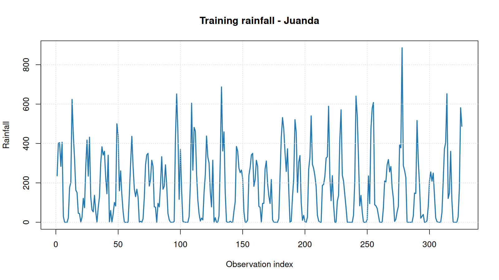

### Perak1

### Perak2

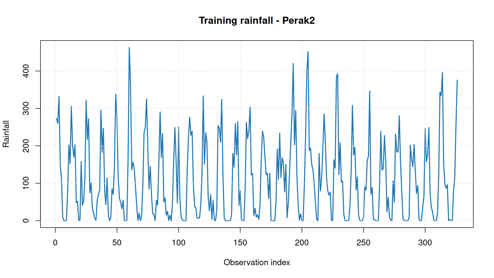

## 3. Stationarity checks and treatment decision

**Decision:** Box-Cox = FALSE; lambda = NA; shift = 0; differencing order d = 0.

### All variance-stationarity results

| stage | location | test | lag | statistic | p_value | stationary |
|---|---|---|---|---|---|---|
| raw_training | Juanda | Fligner-Killeen variance | NA | 0.527932 | 0.467478 | TRUE |
| raw_training | Perak1 | Fligner-Killeen variance | NA | 0.076708 | 0.781809 | TRUE |
| raw_training | Perak2 | Fligner-Killeen variance | NA | 0.348532 | 0.554945 | TRUE |
| raw_training_reused | Juanda | Fligner-Killeen variance | NA | 0.527932 | 0.467478 | TRUE |
| raw_training_reused | Perak1 | Fligner-Killeen variance | NA | 0.076708 | 0.781809 | TRUE |
| raw_training_reused | Perak2 | Fligner-Killeen variance | NA | 0.348532 | 0.554945 | TRUE |

### All mean-stationarity results

| stage | location | test | lag | statistic | p_value | stationary |
|---|---|---|---|---|---|---|
| raw_training | Juanda | ADF | 0 | -8.765573 | 0.010000 | TRUE |
| raw_training | Juanda | ADF | 1 | -9.113309 | 0.010000 | TRUE |
| raw_training | Juanda | ADF | 2 | -10.191746 | 0.010000 | TRUE |
| raw_training | Juanda | ADF | 3 | -11.679412 | 0.010000 | TRUE |
| raw_training | Juanda | ADF | 4 | -12.775811 | 0.010000 | TRUE |
| raw_training | Juanda | ADF | 5 | -13.226149 | 0.010000 | TRUE |
| raw_training | Juanda | ADF | 6 | -12.397557 | 0.010000 | TRUE |
| raw_training | Juanda | ADF | 7 | -11.585973 | 0.010000 | TRUE |
| raw_training | Juanda | ADF | 8 | -9.877770 | 0.010000 | TRUE |
| raw_training | Juanda | ADF | 9 | -8.220636 | 0.010000 | TRUE |
| raw_training | Juanda | ADF | 10 | -6.262905 | 0.010000 | TRUE |
| raw_training | Juanda | ADF | 11 | -4.396225 | 0.010000 | TRUE |
| raw_training | Juanda | ADF | 12 | -4.346907 | 0.010000 | TRUE |
| raw_training | Perak1 | ADF | 0 | -11.546874 | 0.010000 | TRUE |
| raw_training | Perak1 | ADF | 1 | -8.996060 | 0.010000 | TRUE |
| raw_training | Perak1 | ADF | 2 | -9.812252 | 0.010000 | TRUE |
| raw_training | Perak1 | ADF | 3 | -10.716994 | 0.010000 | TRUE |
| raw_training | Perak1 | ADF | 4 | -11.338114 | 0.010000 | TRUE |
| raw_training | Perak1 | ADF | 5 | -10.764552 | 0.010000 | TRUE |
| raw_training | Perak1 | ADF | 6 | -11.825188 | 0.010000 | TRUE |
| raw_training | Perak1 | ADF | 7 | -11.302311 | 0.010000 | TRUE |
| raw_training | Perak1 | ADF | 8 | -8.670771 | 0.010000 | TRUE |
| raw_training | Perak1 | ADF | 9 | -7.329503 | 0.010000 | TRUE |
| raw_training | Perak1 | ADF | 10 | -5.645208 | 0.010000 | TRUE |
| raw_training | Perak1 | ADF | 11 | -4.153076 | 0.010000 | TRUE |
| raw_training | Perak1 | ADF | 12 | -3.715511 | 0.023574 | TRUE |
| raw_training | Perak2 | ADF | 0 | -8.571356 | 0.010000 | TRUE |
| raw_training | Perak2 | ADF | 1 | -8.375447 | 0.010000 | TRUE |
| raw_training | Perak2 | ADF | 2 | -10.545865 | 0.010000 | TRUE |
| raw_training | Perak2 | ADF | 3 | -12.149689 | 0.010000 | TRUE |
| raw_training | Perak2 | ADF | 4 | -12.844728 | 0.010000 | TRUE |
| raw_training | Perak2 | ADF | 5 | -13.048387 | 0.010000 | TRUE |
| raw_training | Perak2 | ADF | 6 | -13.093284 | 0.010000 | TRUE |
| raw_training | Perak2 | ADF | 7 | -11.325978 | 0.010000 | TRUE |
| raw_training | Perak2 | ADF | 8 | -8.977316 | 0.010000 | TRUE |
| raw_training | Perak2 | ADF | 9 | -6.887276 | 0.010000 | TRUE |
| raw_training | Perak2 | ADF | 10 | -5.462146 | 0.010000 | TRUE |
| raw_training | Perak2 | ADF | 11 | -3.787288 | 0.019986 | TRUE |
| raw_training | Perak2 | ADF | 12 | -3.491796 | 0.043770 | TRUE |
| raw_training | Juanda | KPSS | NA | 0.016990 | 0.100000 | TRUE |
| raw_training | Perak1 | KPSS | NA | 0.029102 | 0.100000 | TRUE |
| raw_training | Perak2 | KPSS | NA | 0.029182 | 0.100000 | TRUE |
| raw_training_reused | Juanda | ADF | 0 | -8.765573 | 0.010000 | TRUE |
| raw_training_reused | Juanda | ADF | 1 | -9.113309 | 0.010000 | TRUE |
| raw_training_reused | Juanda | ADF | 2 | -10.191746 | 0.010000 | TRUE |
| raw_training_reused | Juanda | ADF | 3 | -11.679412 | 0.010000 | TRUE |
| raw_training_reused | Juanda | ADF | 4 | -12.775811 | 0.010000 | TRUE |
| raw_training_reused | Juanda | ADF | 5 | -13.226149 | 0.010000 | TRUE |
| raw_training_reused | Juanda | ADF | 6 | -12.397557 | 0.010000 | TRUE |
| raw_training_reused | Juanda | ADF | 7 | -11.585973 | 0.010000 | TRUE |
| raw_training_reused | Juanda | ADF | 8 | -9.877770 | 0.010000 | TRUE |
| raw_training_reused | Juanda | ADF | 9 | -8.220636 | 0.010000 | TRUE |
| raw_training_reused | Juanda | ADF | 10 | -6.262905 | 0.010000 | TRUE |
| raw_training_reused | Juanda | ADF | 11 | -4.396225 | 0.010000 | TRUE |
| raw_training_reused | Juanda | ADF | 12 | -4.346907 | 0.010000 | TRUE |
| raw_training_reused | Perak1 | ADF | 0 | -11.546874 | 0.010000 | TRUE |
| raw_training_reused | Perak1 | ADF | 1 | -8.996060 | 0.010000 | TRUE |
| raw_training_reused | Perak1 | ADF | 2 | -9.812252 | 0.010000 | TRUE |
| raw_training_reused | Perak1 | ADF | 3 | -10.716994 | 0.010000 | TRUE |
| raw_training_reused | Perak1 | ADF | 4 | -11.338114 | 0.010000 | TRUE |
| raw_training_reused | Perak1 | ADF | 5 | -10.764552 | 0.010000 | TRUE |
| raw_training_reused | Perak1 | ADF | 6 | -11.825188 | 0.010000 | TRUE |
| raw_training_reused | Perak1 | ADF | 7 | -11.302311 | 0.010000 | TRUE |
| raw_training_reused | Perak1 | ADF | 8 | -8.670771 | 0.010000 | TRUE |
| raw_training_reused | Perak1 | ADF | 9 | -7.329503 | 0.010000 | TRUE |
| raw_training_reused | Perak1 | ADF | 10 | -5.645208 | 0.010000 | TRUE |
| raw_training_reused | Perak1 | ADF | 11 | -4.153076 | 0.010000 | TRUE |
| raw_training_reused | Perak1 | ADF | 12 | -3.715511 | 0.023574 | TRUE |
| raw_training_reused | Perak2 | ADF | 0 | -8.571356 | 0.010000 | TRUE |
| raw_training_reused | Perak2 | ADF | 1 | -8.375447 | 0.010000 | TRUE |
| raw_training_reused | Perak2 | ADF | 2 | -10.545865 | 0.010000 | TRUE |
| raw_training_reused | Perak2 | ADF | 3 | -12.149689 | 0.010000 | TRUE |
| raw_training_reused | Perak2 | ADF | 4 | -12.844728 | 0.010000 | TRUE |
| raw_training_reused | Perak2 | ADF | 5 | -13.048387 | 0.010000 | TRUE |
| raw_training_reused | Perak2 | ADF | 6 | -13.093284 | 0.010000 | TRUE |
| raw_training_reused | Perak2 | ADF | 7 | -11.325978 | 0.010000 | TRUE |
| raw_training_reused | Perak2 | ADF | 8 | -8.977316 | 0.010000 | TRUE |
| raw_training_reused | Perak2 | ADF | 9 | -6.887276 | 0.010000 | TRUE |
| raw_training_reused | Perak2 | ADF | 10 | -5.462146 | 0.010000 | TRUE |
| raw_training_reused | Perak2 | ADF | 11 | -3.787288 | 0.019986 | TRUE |
| raw_training_reused | Perak2 | ADF | 12 | -3.491796 | 0.043770 | TRUE |
| raw_training_reused | Juanda | KPSS | NA | 0.016990 | 0.100000 | TRUE |
| raw_training_reused | Perak1 | KPSS | NA | 0.029102 | 0.100000 | TRUE |
| raw_training_reused | Perak2 | KPSS | NA | 0.029182 | 0.100000 | TRUE |

## 4. ACF/PACF identification and diagnostic iteration

For each station, ACF/PACF was calculated to lag 12. Initial lag suggestions are: **1, 2, 3, 4, 5, 6, 7, 8, 10, 11, 12**. Every pair (a,b) from these suggestions is fitted, where a is the maximum weighted-other-location lag and b is the maximum own-location lag. If no suggested pair passes full IIDN, remaining pairs through the identification limit are evaluated.

### ACF/PACF values

| location | lag | acf | pacf | significance_bound | acf_significant | pacf_significant |
|---|---|---|---|---|---|---|
| Juanda | 1 | 0.603473 | 0.603473 | 0.108552 | TRUE | TRUE |
| Juanda | 2 | 0.267822 | -0.151548 | 0.108552 | TRUE | TRUE |
| Juanda | 3 | -0.036944 | -0.211851 | 0.108552 | FALSE | TRUE |
| Juanda | 4 | -0.311169 | -0.265745 | 0.108552 | TRUE | TRUE |
| Juanda | 5 | -0.497419 | -0.251991 | 0.108552 | TRUE | TRUE |
| Juanda | 6 | -0.569150 | -0.240752 | 0.108552 | TRUE | TRUE |
| Juanda | 7 | -0.486671 | -0.155122 | 0.108552 | TRUE | TRUE |
| Juanda | 8 | -0.305613 | -0.130753 | 0.108552 | TRUE | TRUE |
| Juanda | 9 | -0.040784 | -0.025074 | 0.108552 | FALSE | FALSE |
| Juanda | 10 | 0.225210 | 0.026356 | 0.108552 | TRUE | FALSE |
| Juanda | 11 | 0.469385 | 0.160047 | 0.108552 | TRUE | TRUE |
| Juanda | 12 | 0.633147 | 0.264640 | 0.108552 | TRUE | TRUE |
| Perak1 | 1 | 0.409885 | 0.409885 | 0.108552 | TRUE | TRUE |
| Perak1 | 2 | 0.225810 | 0.069477 | 0.108552 | TRUE | FALSE |
| Perak1 | 3 | -0.047893 | -0.196256 | 0.108552 | FALSE | TRUE |
| Perak1 | 4 | -0.241630 | -0.219648 | 0.108552 | TRUE | TRUE |
| Perak1 | 5 | -0.365854 | -0.208045 | 0.108552 | TRUE | TRUE |
| Perak1 | 6 | -0.354173 | -0.124507 | 0.108552 | TRUE | TRUE |
| Perak1 | 7 | -0.384714 | -0.241748 | 0.108552 | TRUE | TRUE |
| Perak1 | 8 | -0.247547 | -0.133160 | 0.108552 | TRUE | TRUE |
| Perak1 | 9 | 0.018609 | 0.092645 | 0.108552 | FALSE | FALSE |
| Perak1 | 10 | 0.184266 | 0.048500 | 0.108552 | TRUE | FALSE |
| Perak1 | 11 | 0.399161 | 0.178716 | 0.108552 | TRUE | TRUE |
| Perak1 | 12 | 0.509287 | 0.247776 | 0.108552 | TRUE | TRUE |
| Perak2 | 1 | 0.610202 | 0.610202 | 0.108552 | TRUE | TRUE |
| Perak2 | 2 | 0.321279 | -0.081361 | 0.108552 | TRUE | FALSE |
| Perak2 | 3 | -0.024292 | -0.299344 | 0.108552 | FALSE | TRUE |
| Perak2 | 4 | -0.322356 | -0.284654 | 0.108552 | TRUE | TRUE |
| Perak2 | 5 | -0.516168 | -0.236572 | 0.108552 | TRUE | TRUE |
| Perak2 | 6 | -0.588763 | -0.220222 | 0.108552 | TRUE | TRUE |
| Perak2 | 7 | -0.538558 | -0.212316 | 0.108552 | TRUE | TRUE |
| Perak2 | 8 | -0.327636 | -0.071584 | 0.108552 | TRUE | FALSE |
| Perak2 | 9 | -0.025484 | 0.046125 | 0.108552 | FALSE | FALSE |
| Perak2 | 10 | 0.293425 | 0.134797 | 0.108552 | TRUE | TRUE |
| Perak2 | 11 | 0.527590 | 0.153128 | 0.108552 | TRUE | TRUE |
| Perak2 | 12 | 0.676699 | 0.280505 | 0.108552 | TRUE | TRUE |

### Juanda

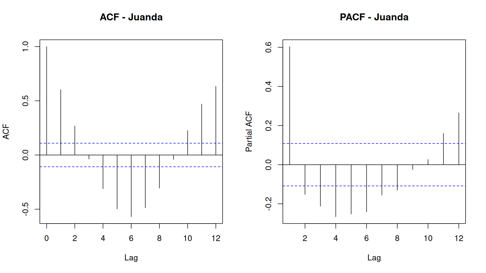

### Perak1

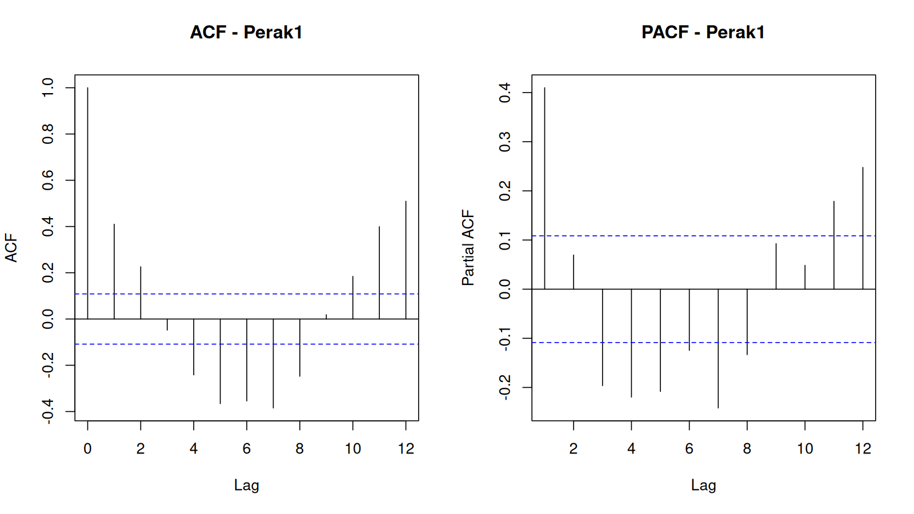

### Perak2

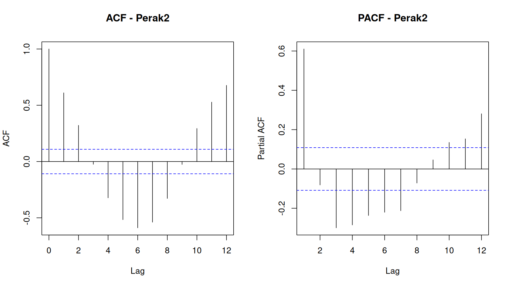

### Candidate summary and selection flags

| a | b | identification_round | fitted | AIC | coefficients_finite | error | min_mean_zero_p | min_normality_p | min_variance_stability_p | min_ljung_box_10_p | min_ljung_box_20_p | iidn_pass | white_noise_pass |
|---|---|---|---|---|---|---|---|---|---|---|---|---|---|
| 1 | 1 | ACF/PACF suggestion | TRUE | 12040.43 | TRUE |  | 0.000000 | 0 | 0.448862 | 0.000000 | 0.000000 | FALSE | FALSE |
| 2 | 1 | ACF/PACF suggestion | TRUE | 12004.82 | TRUE |  | 0.000000 | 0 | 0.507648 | 0.000000 | 0.000000 | FALSE | FALSE |
| 3 | 1 | ACF/PACF suggestion | TRUE | 11960.73 | TRUE |  | 0.000000 | 0 | 0.427029 | 0.000000 | 0.000000 | FALSE | FALSE |
| 4 | 1 | ACF/PACF suggestion | TRUE | 11927.65 | TRUE |  | 0.000000 | 0 | 0.439594 | 0.000000 | 0.000000 | FALSE | FALSE |
| 5 | 1 | ACF/PACF suggestion | TRUE | 11886.67 | TRUE |  | 0.000003 | 0 | 0.363107 | 0.000000 | 0.000000 | FALSE | FALSE |
| 6 | 1 | ACF/PACF suggestion | TRUE | 11819.86 | TRUE |  | 0.000260 | 0 | 0.307496 | 0.000068 | 0.000000 | FALSE | FALSE |
| 7 | 1 | ACF/PACF suggestion | TRUE | 11768.86 | TRUE |  | 0.002614 | 0 | 0.413836 | 0.000234 | 0.000000 | FALSE | FALSE |
| 8 | 1 | ACF/PACF suggestion | TRUE | 11683.45 | TRUE |  | 0.027634 | 0 | 0.265377 | 0.000053 | 0.000000 | FALSE | FALSE |
| 10 | 1 | ACF/PACF suggestion | TRUE | 11461.52 | TRUE |  | 0.245420 | 0 | 0.338403 | 0.002249 | 0.000051 | FALSE | FALSE |
| 11 | 1 | ACF/PACF suggestion | TRUE | 11350.87 | TRUE |  | 0.395493 | 0 | 0.328634 | 0.138735 | 0.000478 | FALSE | FALSE |
| 12 | 1 | ACF/PACF suggestion | TRUE | 11239.86 | TRUE |  | 0.516578 | 0 | 0.115131 | 0.387256 | 0.334402 | FALSE | TRUE |
| 1 | 2 | ACF/PACF suggestion | TRUE | 11991.94 | TRUE |  | 0.000043 | 0 | 0.633343 | 0.000000 | 0.000000 | FALSE | FALSE |
| 2 | 2 | ACF/PACF suggestion | TRUE | 11953.75 | TRUE |  | 0.000034 | 0 | 0.614117 | 0.000000 | 0.000000 | FALSE | FALSE |
| 3 | 2 | ACF/PACF suggestion | TRUE | 11915.34 | TRUE |  | 0.000005 | 0 | 0.490208 | 0.000016 | 0.000000 | FALSE | FALSE |
| 4 | 2 | ACF/PACF suggestion | TRUE | 11883.76 | TRUE |  | 0.000007 | 0 | 0.556031 | 0.000228 | 0.000000 | FALSE | FALSE |
| 5 | 2 | ACF/PACF suggestion | TRUE | 11843.05 | TRUE |  | 0.000120 | 0 | 0.619277 | 0.000020 | 0.000000 | FALSE | FALSE |
| 6 | 2 | ACF/PACF suggestion | TRUE | 11780.86 | TRUE |  | 0.002666 | 0 | 0.429548 | 0.000108 | 0.000000 | FALSE | FALSE |
| 7 | 2 | ACF/PACF suggestion | TRUE | 11735.93 | TRUE |  | 0.007289 | 0 | 0.658647 | 0.000089 | 0.000000 | FALSE | FALSE |
| 8 | 2 | ACF/PACF suggestion | TRUE | 11668.07 | TRUE |  | 0.032819 | 0 | 0.420091 | 0.000118 | 0.000000 | FALSE | FALSE |
| 10 | 2 | ACF/PACF suggestion | TRUE | 11464.29 | TRUE |  | 0.239766 | 0 | 0.458733 | 0.002150 | 0.000050 | FALSE | FALSE |
| 11 | 2 | ACF/PACF suggestion | TRUE | 11356.02 | TRUE |  | 0.395846 | 0 | 0.324104 | 0.136599 | 0.000521 | FALSE | FALSE |
| 12 | 2 | ACF/PACF suggestion | TRUE | 11245.19 | TRUE |  | 0.517407 | 0 | 0.113696 | 0.379927 | 0.330025 | FALSE | TRUE |
| 1 | 3 | ACF/PACF suggestion | TRUE | 11951.86 | TRUE |  | 0.000025 | 0 | 0.432612 | 0.000000 | 0.000000 | FALSE | FALSE |
| 2 | 3 | ACF/PACF suggestion | TRUE | 11906.43 | TRUE |  | 0.000064 | 0 | 0.561951 | 0.001758 | 0.000000 | FALSE | FALSE |
| 3 | 3 | ACF/PACF suggestion | TRUE | 11890.95 | TRUE |  | 0.000024 | 0 | 0.372654 | 0.007857 | 0.000000 | FALSE | FALSE |
| 4 | 3 | ACF/PACF suggestion | TRUE | 11860.82 | TRUE |  | 0.000032 | 0 | 0.445082 | 0.008272 | 0.000000 | FALSE | FALSE |
| 5 | 3 | ACF/PACF suggestion | TRUE | 11822.20 | TRUE |  | 0.000322 | 0 | 0.420541 | 0.001135 | 0.000000 | FALSE | FALSE |
| 6 | 3 | ACF/PACF suggestion | TRUE | 11759.98 | TRUE |  | 0.008252 | 0 | 0.462653 | 0.000227 | 0.000000 | FALSE | FALSE |
| 7 | 3 | ACF/PACF suggestion | TRUE | 11716.56 | TRUE |  | 0.010264 | 0 | 0.487248 | 0.000100 | 0.000000 | FALSE | FALSE |
| 8 | 3 | ACF/PACF suggestion | TRUE | 11653.97 | TRUE |  | 0.034008 | 0 | 0.387371 | 0.002272 | 0.000000 | FALSE | FALSE |
| 10 | 3 | ACF/PACF suggestion | TRUE | 11466.23 | TRUE |  | 0.238223 | 0 | 0.476528 | 0.004404 | 0.000178 | FALSE | FALSE |
| 11 | 3 | ACF/PACF suggestion | TRUE | 11359.57 | TRUE |  | 0.401260 | 0 | 0.345504 | 0.138454 | 0.001015 | FALSE | FALSE |
| 12 | 3 | ACF/PACF suggestion | TRUE | 11247.82 | TRUE |  | 0.536736 | 0 | 0.184872 | 0.453634 | 0.377448 | FALSE | TRUE |
| 1 | 4 | ACF/PACF suggestion | TRUE | 11918.78 | TRUE |  | 0.000018 | 0 | 0.350909 | 0.000000 | 0.000000 | FALSE | FALSE |
| 2 | 4 | ACF/PACF suggestion | TRUE | 11870.33 | TRUE |  | 0.000142 | 0 | 0.471589 | 0.000693 | 0.000000 | FALSE | FALSE |
| 3 | 4 | ACF/PACF suggestion | TRUE | 11850.17 | TRUE |  | 0.000145 | 0 | 0.444083 | 0.004936 | 0.000003 | FALSE | FALSE |
| 4 | 4 | ACF/PACF suggestion | TRUE | 11843.78 | TRUE |  | 0.000066 | 0 | 0.316714 | 0.004553 | 0.000025 | FALSE | FALSE |
| 5 | 4 | ACF/PACF suggestion | TRUE | 11806.13 | TRUE |  | 0.000579 | 0 | 0.283049 | 0.004342 | 0.000021 | FALSE | FALSE |
| 6 | 4 | ACF/PACF suggestion | TRUE | 11745.62 | TRUE |  | 0.010683 | 0 | 0.273367 | 0.002922 | 0.000016 | FALSE | FALSE |
| 7 | 4 | ACF/PACF suggestion | TRUE | 11701.00 | TRUE |  | 0.008841 | 0 | 0.309552 | 0.000582 | 0.000012 | FALSE | FALSE |
| 8 | 4 | ACF/PACF suggestion | TRUE | 11637.33 | TRUE |  | 0.032144 | 0 | 0.288148 | 0.004702 | 0.000002 | FALSE | FALSE |
| 10 | 4 | ACF/PACF suggestion | TRUE | 11458.20 | TRUE |  | 0.228271 | 0 | 0.327468 | 0.002930 | 0.000295 | FALSE | FALSE |
| 11 | 4 | ACF/PACF suggestion | TRUE | 11358.20 | TRUE |  | 0.384710 | 0 | 0.324047 | 0.096280 | 0.001280 | FALSE | FALSE |
| 12 | 4 | ACF/PACF suggestion | TRUE | 11250.01 | TRUE |  | 0.521367 | 0 | 0.148829 | 0.426964 | 0.362474 | FALSE | TRUE |
| 1 | 5 | ACF/PACF suggestion | TRUE | 11884.90 | TRUE |  | 0.000037 | 0 | 0.319985 | 0.000000 | 0.000000 | FALSE | FALSE |
| 2 | 5 | ACF/PACF suggestion | TRUE | 11836.18 | TRUE |  | 0.000425 | 0 | 0.435850 | 0.000096 | 0.000000 | FALSE | FALSE |
| 3 | 5 | ACF/PACF suggestion | TRUE | 11813.19 | TRUE |  | 0.001011 | 0 | 0.371766 | 0.000963 | 0.000004 | FALSE | FALSE |
| 4 | 5 | ACF/PACF suggestion | TRUE | 11802.89 | TRUE |  | 0.000690 | 0 | 0.283623 | 0.001099 | 0.000061 | FALSE | FALSE |
| 5 | 5 | ACF/PACF suggestion | TRUE | 11807.45 | TRUE |  | 0.000699 | 0 | 0.309238 | 0.001119 | 0.000088 | FALSE | FALSE |
| 6 | 5 | ACF/PACF suggestion | TRUE | 11746.92 | TRUE |  | 0.009710 | 0 | 0.267306 | 0.008206 | 0.000050 | FALSE | FALSE |
| 7 | 5 | ACF/PACF suggestion | TRUE | 11702.97 | TRUE |  | 0.008332 | 0 | 0.285561 | 0.001810 | 0.000027 | FALSE | FALSE |
| 8 | 5 | ACF/PACF suggestion | TRUE | 11638.07 | TRUE |  | 0.030540 | 0 | 0.282085 | 0.010501 | 0.000002 | FALSE | FALSE |
| 10 | 5 | ACF/PACF suggestion | TRUE | 11456.98 | TRUE |  | 0.218490 | 0 | 0.455157 | 0.002364 | 0.000185 | FALSE | FALSE |
| 11 | 5 | ACF/PACF suggestion | TRUE | 11359.08 | TRUE |  | 0.370554 | 0 | 0.278664 | 0.100522 | 0.000937 | FALSE | FALSE |
| 12 | 5 | ACF/PACF suggestion | TRUE | 11253.26 | TRUE |  | 0.508352 | 0 | 0.149153 | 0.441973 | 0.322349 | FALSE | TRUE |
| 1 | 6 | ACF/PACF suggestion | TRUE | 11834.21 | TRUE |  | 0.000199 | 0 | 0.360957 | 0.000000 | 0.000000 | FALSE | FALSE |
| 2 | 6 | ACF/PACF suggestion | TRUE | 11786.90 | TRUE |  | 0.001294 | 0 | 0.419615 | 0.000317 | 0.000000 | FALSE | FALSE |
| 3 | 6 | ACF/PACF suggestion | TRUE | 11762.85 | TRUE |  | 0.003316 | 0 | 0.357080 | 0.001798 | 0.000004 | FALSE | FALSE |
| 4 | 6 | ACF/PACF suggestion | TRUE | 11748.63 | TRUE |  | 0.004930 | 0 | 0.314865 | 0.006449 | 0.000048 | FALSE | FALSE |
| 5 | 6 | ACF/PACF suggestion | TRUE | 11752.52 | TRUE |  | 0.006516 | 0 | 0.311267 | 0.006104 | 0.000071 | FALSE | FALSE |
| 6 | 6 | ACF/PACF suggestion | TRUE | 11750.77 | TRUE |  | 0.010823 | 0 | 0.282746 | 0.006285 | 0.000117 | FALSE | FALSE |
| 7 | 6 | ACF/PACF suggestion | TRUE | 11706.23 | TRUE |  | 0.009010 | 0 | 0.298941 | 0.003902 | 0.000046 | FALSE | FALSE |
| 8 | 6 | ACF/PACF suggestion | TRUE | 11641.44 | TRUE |  | 0.030923 | 0 | 0.274119 | 0.020915 | 0.000001 | FALSE | FALSE |
| 10 | 6 | ACF/PACF suggestion | TRUE | 11457.84 | TRUE |  | 0.211975 | 0 | 0.418220 | 0.002438 | 0.000100 | FALSE | FALSE |
| 11 | 6 | ACF/PACF suggestion | TRUE | 11359.13 | TRUE |  | 0.356047 | 0 | 0.340982 | 0.132667 | 0.000561 | FALSE | FALSE |
| 12 | 6 | ACF/PACF suggestion | TRUE | 11255.06 | TRUE |  | 0.488745 | 0 | 0.245146 | 0.655159 | 0.467381 | FALSE | TRUE |
| 1 | 7 | ACF/PACF suggestion | TRUE | 11791.27 | TRUE |  | 0.000955 | 0 | 0.507955 | 0.000004 | 0.000000 | FALSE | FALSE |
| 2 | 7 | ACF/PACF suggestion | TRUE | 11747.21 | TRUE |  | 0.003858 | 0 | 0.531991 | 0.000698 | 0.000000 | FALSE | FALSE |
| 3 | 7 | ACF/PACF suggestion | TRUE | 11723.17 | TRUE |  | 0.008130 | 0 | 0.479184 | 0.001930 | 0.000001 | FALSE | FALSE |
| 4 | 7 | ACF/PACF suggestion | TRUE | 11706.04 | TRUE |  | 0.011504 | 0 | 0.387018 | 0.007960 | 0.000018 | FALSE | FALSE |
| 5 | 7 | ACF/PACF suggestion | TRUE | 11709.34 | TRUE |  | 0.013207 | 0 | 0.387018 | 0.010382 | 0.000030 | FALSE | FALSE |
| 6 | 7 | ACF/PACF suggestion | TRUE | 11710.53 | TRUE |  | 0.017402 | 0 | 0.389336 | 0.007114 | 0.000060 | FALSE | FALSE |
| 7 | 7 | ACF/PACF suggestion | TRUE | 11695.21 | TRUE |  | 0.016086 | 0 | 0.331424 | 0.006280 | 0.000090 | FALSE | FALSE |
| 8 | 7 | ACF/PACF suggestion | TRUE | 11635.73 | TRUE |  | 0.037382 | 0 | 0.323314 | 0.010222 | 0.000003 | FALSE | FALSE |
| 10 | 7 | ACF/PACF suggestion | TRUE | 11449.31 | TRUE |  | 0.239877 | 0 | 0.372440 | 0.005217 | 0.000129 | FALSE | FALSE |
| 11 | 7 | ACF/PACF suggestion | TRUE | 11354.83 | TRUE |  | 0.380630 | 0 | 0.335884 | 0.233790 | 0.001495 | FALSE | FALSE |
| 12 | 7 | ACF/PACF suggestion | TRUE | 11252.49 | TRUE |  | 0.513098 | 0 | 0.226778 | 0.761607 | 0.541112 | FALSE | TRUE |
| 1 | 8 | ACF/PACF suggestion | TRUE | 11718.37 | TRUE |  | 0.011740 | 0 | 0.256359 | 0.000009 | 0.000000 | FALSE | FALSE |
| 2 | 8 | ACF/PACF suggestion | TRUE | 11691.40 | TRUE |  | 0.020642 | 0 | 0.316486 | 0.000095 | 0.000000 | FALSE | FALSE |
| 3 | 8 | ACF/PACF suggestion | TRUE | 11671.12 | TRUE |  | 0.034815 | 0 | 0.360371 | 0.000734 | 0.000000 | FALSE | FALSE |
| 4 | 8 | ACF/PACF suggestion | TRUE | 11652.28 | TRUE |  | 0.044725 | 0 | 0.377799 | 0.003478 | 0.000000 | FALSE | FALSE |
| 5 | 8 | ACF/PACF suggestion | TRUE | 11654.13 | TRUE |  | 0.048009 | 0 | 0.369993 | 0.009396 | 0.000001 | FALSE | FALSE |
| 6 | 8 | ACF/PACF suggestion | TRUE | 11657.63 | TRUE |  | 0.047407 | 0 | 0.353135 | 0.006595 | 0.000003 | FALSE | FALSE |
| 7 | 8 | ACF/PACF suggestion | TRUE | 11643.44 | TRUE |  | 0.034948 | 0 | 0.376446 | 0.003692 | 0.000002 | FALSE | FALSE |
| 8 | 8 | ACF/PACF suggestion | TRUE | 11638.74 | TRUE |  | 0.041165 | 0 | 0.378405 | 0.021917 | 0.000001 | FALSE | FALSE |
| 10 | 8 | ACF/PACF suggestion | TRUE | 11453.93 | TRUE |  | 0.242096 | 0 | 0.370756 | 0.005947 | 0.000146 | FALSE | FALSE |
| 11 | 8 | ACF/PACF suggestion | TRUE | 11358.00 | TRUE |  | 0.390506 | 0 | 0.235397 | 0.277390 | 0.001927 | FALSE | FALSE |
| 12 | 8 | ACF/PACF suggestion | TRUE | 11256.47 | TRUE |  | 0.519792 | 0 | 0.216089 | 0.772007 | 0.551815 | FALSE | TRUE |
| 1 | 10 | ACF/PACF suggestion | TRUE | 11515.90 | TRUE |  | 0.131675 | 0 | 0.473925 | 0.000039 | 0.000001 | FALSE | FALSE |
| 2 | 10 | ACF/PACF suggestion | TRUE | 11511.57 | TRUE |  | 0.151316 | 0 | 0.481531 | 0.000047 | 0.000000 | FALSE | FALSE |
| 3 | 10 | ACF/PACF suggestion | TRUE | 11508.51 | TRUE |  | 0.150073 | 0 | 0.618629 | 0.000050 | 0.000000 | FALSE | FALSE |
| 4 | 10 | ACF/PACF suggestion | TRUE | 11496.25 | TRUE |  | 0.173401 | 0 | 0.666311 | 0.000122 | 0.000001 | FALSE | FALSE |
| 5 | 10 | ACF/PACF suggestion | TRUE | 11495.60 | TRUE |  | 0.184761 | 0 | 0.688541 | 0.000383 | 0.000003 | FALSE | FALSE |
| 6 | 10 | ACF/PACF suggestion | TRUE | 11500.06 | TRUE |  | 0.187890 | 0 | 0.770287 | 0.000930 | 0.000007 | FALSE | FALSE |
| 7 | 10 | ACF/PACF suggestion | TRUE | 11485.91 | TRUE |  | 0.154602 | 0 | 0.677799 | 0.001053 | 0.000006 | FALSE | FALSE |
| 8 | 10 | ACF/PACF suggestion | TRUE | 11488.01 | TRUE |  | 0.149088 | 0 | 0.651443 | 0.001066 | 0.000006 | FALSE | FALSE |
| 10 | 10 | ACF/PACF suggestion | TRUE | 11460.29 | TRUE |  | 0.242068 | 0 | 0.397860 | 0.000984 | 0.000008 | FALSE | FALSE |
| 11 | 10 | ACF/PACF suggestion | TRUE | 11363.96 | TRUE |  | 0.389464 | 0 | 0.326683 | 0.185931 | 0.000479 | FALSE | FALSE |
| 12 | 10 | ACF/PACF suggestion | TRUE | 11260.55 | TRUE |  | 0.527169 | 0 | 0.324818 | 0.832330 | 0.476926 | FALSE | TRUE |
| 1 | 11 | ACF/PACF suggestion | TRUE | 11410.64 | TRUE |  | 0.261120 | 0 | 0.576559 | 0.164632 | 0.000131 | FALSE | FALSE |
| 2 | 11 | ACF/PACF suggestion | TRUE | 11412.37 | TRUE |  | 0.274374 | 0 | 0.363835 | 0.137647 | 0.000020 | FALSE | FALSE |
| 3 | 11 | ACF/PACF suggestion | TRUE | 11411.49 | TRUE |  | 0.263694 | 0 | 0.350587 | 0.139666 | 0.000075 | FALSE | FALSE |
| 4 | 11 | ACF/PACF suggestion | TRUE | 11405.76 | TRUE |  | 0.285626 | 0 | 0.396360 | 0.178667 | 0.000185 | FALSE | FALSE |
| 5 | 11 | ACF/PACF suggestion | TRUE | 11407.51 | TRUE |  | 0.291184 | 0 | 0.356722 | 0.193627 | 0.000191 | FALSE | FALSE |
| 6 | 11 | ACF/PACF suggestion | TRUE | 11411.00 | TRUE |  | 0.306630 | 0 | 0.542175 | 0.266545 | 0.000326 | FALSE | FALSE |
| 7 | 11 | ACF/PACF suggestion | TRUE | 11401.83 | TRUE |  | 0.258509 | 0 | 0.499369 | 0.297362 | 0.000347 | FALSE | FALSE |
| 8 | 11 | ACF/PACF suggestion | TRUE | 11404.37 | TRUE |  | 0.248607 | 0 | 0.493096 | 0.291113 | 0.000324 | FALSE | FALSE |
| 10 | 11 | ACF/PACF suggestion | TRUE | 11389.20 | TRUE |  | 0.329075 | 0 | 0.515377 | 0.207315 | 0.000190 | FALSE | FALSE |
| 11 | 11 | ACF/PACF suggestion | TRUE | 11367.55 | TRUE |  | 0.396483 | 0 | 0.328266 | 0.229691 | 0.000287 | FALSE | FALSE |
| 12 | 11 | ACF/PACF suggestion | TRUE | 11264.96 | TRUE |  | 0.526790 | 0 | 0.333971 | 0.887270 | 0.422966 | FALSE | TRUE |
| 1 | 12 | ACF/PACF suggestion | TRUE | 11271.57 | TRUE |  | 0.433055 | 0 | 0.482827 | 0.780829 | 0.178419 | FALSE | TRUE |
| 2 | 12 | ACF/PACF suggestion | TRUE | 11275.79 | TRUE |  | 0.436400 | 0 | 0.425439 | 0.759631 | 0.138942 | FALSE | TRUE |
| 3 | 12 | ACF/PACF suggestion | TRUE | 11274.15 | TRUE |  | 0.413589 | 0 | 0.406094 | 0.854770 | 0.152579 | FALSE | TRUE |
| 4 | 12 | ACF/PACF suggestion | TRUE | 11272.77 | TRUE |  | 0.425637 | 0 | 0.410100 | 0.826617 | 0.209651 | FALSE | TRUE |
| 5 | 12 | ACF/PACF suggestion | TRUE | 11276.05 | TRUE |  | 0.422035 | 0 | 0.357757 | 0.830370 | 0.214010 | FALSE | TRUE |
| 6 | 12 | ACF/PACF suggestion | TRUE | 11281.41 | TRUE |  | 0.425903 | 0 | 0.445860 | 0.832379 | 0.179501 | FALSE | TRUE |
| 7 | 12 | ACF/PACF suggestion | TRUE | 11276.36 | TRUE |  | 0.372649 | 0 | 0.335581 | 0.790136 | 0.210078 | FALSE | TRUE |
| 8 | 12 | ACF/PACF suggestion | TRUE | 11280.11 | TRUE |  | 0.365981 | 0 | 0.333094 | 0.786261 | 0.218620 | FALSE | TRUE |
| 10 | 12 | ACF/PACF suggestion | TRUE | 11271.88 | TRUE |  | 0.443936 | 0 | 0.395743 | 0.879536 | 0.285382 | FALSE | TRUE |
| 11 | 12 | ACF/PACF suggestion | TRUE | 11256.56 | TRUE |  | 0.512070 | 0 | 0.269209 | 0.903201 | 0.324997 | FALSE | TRUE |
| 12 | 12 | ACF/PACF suggestion | TRUE | 11250.23 | TRUE |  | 0.551303 | 0 | 0.295548 | 0.955153 | 0.422152 | FALSE | TRUE |
| 9 | 1 | diagnostic-driven re-identification | TRUE | 11564.83 | TRUE |  | 0.111673 | 0 | 0.263016 | 0.000040 | 0.000000 | FALSE | FALSE |
| 9 | 2 | diagnostic-driven re-identification | TRUE | 11562.60 | TRUE |  | 0.109299 | 0 | 0.384130 | 0.000053 | 0.000000 | FALSE | FALSE |
| 9 | 3 | diagnostic-driven re-identification | TRUE | 11560.04 | TRUE |  | 0.109327 | 0 | 0.302223 | 0.000658 | 0.000000 | FALSE | FALSE |
| 9 | 4 | diagnostic-driven re-identification | TRUE | 11545.95 | TRUE |  | 0.104597 | 0 | 0.327155 | 0.000899 | 0.000003 | FALSE | FALSE |
| 9 | 5 | diagnostic-driven re-identification | TRUE | 11545.26 | TRUE |  | 0.099409 | 0 | 0.484838 | 0.000634 | 0.000002 | FALSE | FALSE |
| 9 | 6 | diagnostic-driven re-identification | TRUE | 11547.01 | TRUE |  | 0.099842 | 0 | 0.452138 | 0.000798 | 0.000001 | FALSE | FALSE |
| 9 | 7 | diagnostic-driven re-identification | TRUE | 11541.19 | TRUE |  | 0.111696 | 0 | 0.418876 | 0.001722 | 0.000001 | FALSE | FALSE |
| 9 | 8 | diagnostic-driven re-identification | TRUE | 11546.37 | TRUE |  | 0.112674 | 0 | 0.460498 | 0.001259 | 0.000001 | FALSE | FALSE |
| 1 | 9 | diagnostic-driven re-identification | TRUE | 11603.62 | TRUE |  | 0.058456 | 0 | 0.326844 | 0.000000 | 0.000000 | FALSE | FALSE |
| 2 | 9 | diagnostic-driven re-identification | TRUE | 11592.08 | TRUE |  | 0.079138 | 0 | 0.355719 | 0.000001 | 0.000000 | FALSE | FALSE |
| 3 | 9 | diagnostic-driven re-identification | TRUE | 11584.46 | TRUE |  | 0.081655 | 0 | 0.508847 | 0.000002 | 0.000000 | FALSE | FALSE |
| 4 | 9 | diagnostic-driven re-identification | TRUE | 11565.53 | TRUE |  | 0.104567 | 0 | 0.600965 | 0.000016 | 0.000000 | FALSE | FALSE |
| 5 | 9 | diagnostic-driven re-identification | TRUE | 11565.57 | TRUE |  | 0.108168 | 0 | 0.744492 | 0.000090 | 0.000000 | FALSE | FALSE |
| 6 | 9 | diagnostic-driven re-identification | TRUE | 11570.04 | TRUE |  | 0.107692 | 0 | 0.730678 | 0.000273 | 0.000000 | FALSE | FALSE |
| 7 | 9 | diagnostic-driven re-identification | TRUE | 11554.90 | TRUE |  | 0.086902 | 0 | 0.574364 | 0.000263 | 0.000000 | FALSE | FALSE |
| 8 | 9 | diagnostic-driven re-identification | TRUE | 11556.20 | TRUE |  | 0.088050 | 0 | 0.663260 | 0.000268 | 0.000000 | FALSE | FALSE |
| 9 | 9 | diagnostic-driven re-identification | TRUE | 11547.73 | TRUE |  | 0.118820 | 0 | 0.493958 | 0.000317 | 0.000000 | FALSE | FALSE |
| 10 | 9 | diagnostic-driven re-identification | TRUE | 11457.92 | TRUE |  | 0.243993 | 0 | 0.427880 | 0.003802 | 0.000099 | FALSE | FALSE |
| 11 | 9 | diagnostic-driven re-identification | TRUE | 11362.14 | TRUE |  | 0.394660 | 0 | 0.240998 | 0.301318 | 0.001898 | FALSE | FALSE |
| 12 | 9 | diagnostic-driven re-identification | TRUE | 11257.46 | TRUE |  | 0.533218 | 0 | 0.259106 | 0.831617 | 0.593735 | FALSE | TRUE |
| 9 | 10 | diagnostic-driven re-identification | TRUE | 11485.99 | TRUE |  | 0.174083 | 0 | 0.570190 | 0.000842 | 0.000003 | FALSE | FALSE |
| 9 | 11 | diagnostic-driven re-identification | TRUE | 11406.60 | TRUE |  | 0.263461 | 0 | 0.412601 | 0.218295 | 0.000152 | FALSE | FALSE |
| 9 | 12 | diagnostic-driven re-identification | TRUE | 11282.18 | TRUE |  | 0.382631 | 0 | 0.345477 | 0.817240 | 0.267440 | FALSE | TRUE |

### All candidate parameter estimates

| a | b | parameter | estimate | std_error | t_value | p_value |
|---|---|---|---|---|---|---|
| 1 | 1 | phi1(Juanda) | 0.374407 | 0.059291 | 6.314719 | 0.000000 |
| 1 | 1 | phi1(Perak1) | 0.477829 | 0.085665 | 5.577898 | 0.000000 |
| 1 | 1 | phi1(Perak2) | 0.576415 | 0.122503 | 4.705327 | 0.000003 |
| 1 | 1 | theta1(Juanda) | 0.695611 | 0.085062 | 8.177702 | 0.000000 |
| 1 | 1 | theta1(Perak1) | 0.374646 | 0.095538 | 3.921436 | 0.000094 |
| 1 | 1 | theta1(Perak2) | 0.196842 | 0.093232 | 2.111319 | 0.035000 |
| 2 | 1 | phi1(Juanda) | 0.340931 | 0.062661 | 5.440929 | 0.000000 |
| 2 | 1 | phi1(Perak1) | 0.480305 | 0.085670 | 5.606477 | 0.000000 |
| 2 | 1 | phi1(Perak2) | 0.548152 | 0.124155 | 4.415078 | 0.000011 |
| 2 | 1 | theta1(Juanda) | 0.633357 | 0.090480 | 6.999965 | 0.000000 |
| 2 | 1 | theta1(Perak1) | 0.347990 | 0.112490 | 3.093524 | 0.002035 |
| 2 | 1 | theta1(Perak2) | 0.150229 | 0.100191 | 1.499432 | 0.134089 |
| 2 | 1 | theta2(Juanda) | 0.124565 | 0.069255 | 1.798641 | 0.072388 |
| 2 | 1 | theta2(Perak1) | 0.026494 | 0.068849 | 0.384819 | 0.700457 |
| 2 | 1 | theta2(Perak2) | 0.080408 | 0.056521 | 1.422635 | 0.155166 |
| 3 | 1 | phi1(Juanda) | 0.352460 | 0.062526 | 5.637055 | 0.000000 |
| 3 | 1 | phi1(Perak1) | 0.498553 | 0.085652 | 5.820714 | 0.000000 |
| 3 | 1 | phi1(Perak2) | 0.544138 | 0.123654 | 4.400495 | 0.000012 |
| 3 | 1 | theta1(Juanda) | 0.652252 | 0.090293 | 7.223702 | 0.000000 |
| 3 | 1 | theta1(Perak1) | 0.319831 | 0.112707 | 2.837727 | 0.004640 |
| 3 | 1 | theta1(Perak2) | 0.163363 | 0.100006 | 1.633522 | 0.102688 |
| 3 | 1 | theta2(Juanda) | 0.242645 | 0.081335 | 2.983295 | 0.002924 |
| 3 | 1 | theta2(Perak1) | 0.155328 | 0.092194 | 1.684791 | 0.092355 |
| 3 | 1 | theta2(Perak2) | 0.141610 | 0.068400 | 2.070322 | 0.038690 |
| 3 | 1 | theta3(Juanda) | -0.181884 | 0.066430 | -2.737967 | 0.006297 |
| 3 | 1 | theta3(Perak1) | -0.144755 | 0.069217 | -2.091317 | 0.036763 |
| 3 | 1 | theta3(Perak2) | -0.087383 | 0.056651 | -1.542464 | 0.123291 |
| 4 | 1 | phi1(Juanda) | 0.350682 | 0.062610 | 5.601010 | 0.000000 |
| 4 | 1 | phi1(Perak1) | 0.488391 | 0.086086 | 5.673263 | 0.000000 |
| 4 | 1 | phi1(Perak2) | 0.546501 | 0.124672 | 4.383494 | 0.000013 |
| 4 | 1 | theta1(Juanda) | 0.651766 | 0.090537 | 7.198918 | 0.000000 |
| 4 | 1 | theta1(Perak1) | 0.344041 | 0.114611 | 3.001818 | 0.002754 |
| 4 | 1 | theta1(Perak2) | 0.158240 | 0.100282 | 1.577957 | 0.114908 |
| 4 | 1 | theta2(Juanda) | 0.254192 | 0.083248 | 3.053426 | 0.002325 |
| 4 | 1 | theta2(Perak1) | 0.148634 | 0.092510 | 1.606670 | 0.108459 |
| 4 | 1 | theta2(Perak2) | 0.158840 | 0.069644 | 2.280734 | 0.022785 |
| 4 | 1 | theta3(Juanda) | -0.151294 | 0.081114 | -1.865193 | 0.062462 |
| 4 | 1 | theta3(Perak1) | -0.195111 | 0.092359 | -2.112524 | 0.034902 |
| 4 | 1 | theta3(Perak2) | -0.038544 | 0.069329 | -0.555962 | 0.578368 |
| 4 | 1 | theta4(Juanda) | -0.043505 | 0.066783 | -0.651436 | 0.514922 |
| 4 | 1 | theta4(Perak1) | 0.058895 | 0.070094 | 0.840224 | 0.400994 |
| 4 | 1 | theta4(Perak2) | -0.071375 | 0.057033 | -1.251462 | 0.211074 |
| 5 | 1 | phi1(Juanda) | 0.349251 | 0.062392 | 5.597708 | 0.000000 |
| 5 | 1 | phi1(Perak1) | 0.444682 | 0.087039 | 5.108973 | 0.000000 |
| 5 | 1 | phi1(Perak2) | 0.546322 | 0.126571 | 4.316333 | 0.000018 |
| 5 | 1 | theta1(Juanda) | 0.656793 | 0.090360 | 7.268590 | 0.000000 |
| 5 | 1 | theta1(Perak1) | 0.401634 | 0.115684 | 3.471832 | 0.000540 |
| 5 | 1 | theta1(Perak2) | 0.157798 | 0.101244 | 1.558593 | 0.119428 |
| 5 | 1 | theta2(Juanda) | 0.240879 | 0.083312 | 2.891268 | 0.003925 |
| 5 | 1 | theta2(Perak1) | 0.167538 | 0.092814 | 1.805096 | 0.071378 |
| 5 | 1 | theta2(Perak2) | 0.159677 | 0.069574 | 2.295059 | 0.021948 |
| 5 | 1 | theta3(Juanda) | -0.139050 | 0.082721 | -1.680957 | 0.093102 |
| 5 | 1 | theta3(Perak1) | -0.214942 | 0.092253 | -2.329917 | 0.020020 |
| 5 | 1 | theta3(Perak2) | -0.037775 | 0.070392 | -0.536643 | 0.591641 |
| 5 | 1 | theta4(Juanda) | -0.007454 | 0.080758 | -0.092296 | 0.926483 |
| 5 | 1 | theta4(Perak1) | -0.128229 | 0.092537 | -1.385696 | 0.166167 |
| 5 | 1 | theta4(Perak2) | -0.071006 | 0.069345 | -1.023951 | 0.306121 |
| 5 | 1 | theta5(Juanda) | -0.052393 | 0.066568 | -0.787059 | 0.431445 |
| 5 | 1 | theta5(Perak1) | 0.217812 | 0.070677 | 3.081820 | 0.002117 |
| 5 | 1 | theta5(Perak2) | -0.000975 | 0.057789 | -0.016875 | 0.986540 |
| 6 | 1 | phi1(Juanda) | 0.362224 | 0.062046 | 5.838001 | 0.000000 |
| 6 | 1 | phi1(Perak1) | 0.316812 | 0.088508 | 3.579479 | 0.000362 |
| 6 | 1 | phi1(Perak2) | 0.572991 | 0.127430 | 4.496520 | 0.000008 |
| 6 | 1 | theta1(Juanda) | 0.643011 | 0.089735 | 7.165691 | 0.000000 |
| 6 | 1 | theta1(Perak1) | 0.511780 | 0.115340 | 4.437142 | 0.000010 |
| 6 | 1 | theta1(Perak2) | 0.137245 | 0.101981 | 1.345789 | 0.178695 |
| 6 | 1 | theta2(Juanda) | 0.231804 | 0.082214 | 2.819534 | 0.004911 |
| 6 | 1 | theta2(Perak1) | 0.193934 | 0.091627 | 2.116567 | 0.034559 |
| 6 | 1 | theta2(Perak2) | 0.158800 | 0.068498 | 2.318318 | 0.020646 |
| 6 | 1 | theta3(Juanda) | -0.127649 | 0.081684 | -1.562714 | 0.118457 |
| 6 | 1 | theta3(Perak1) | -0.153736 | 0.091498 | -1.680216 | 0.093248 |
| 6 | 1 | theta3(Perak2) | -0.029304 | 0.069419 | -0.422126 | 0.673030 |
| 6 | 1 | theta4(Juanda) | -0.010974 | 0.081299 | -0.134977 | 0.892659 |
| 6 | 1 | theta4(Perak1) | -0.176556 | 0.091377 | -1.932179 | 0.053638 |
| 6 | 1 | theta4(Perak2) | -0.087637 | 0.069590 | -1.259325 | 0.208226 |
| 6 | 1 | theta5(Juanda) | -0.067493 | 0.079732 | -0.846504 | 0.397487 |
| 6 | 1 | theta5(Perak1) | -0.115235 | 0.091226 | -1.263181 | 0.206838 |
| 6 | 1 | theta5(Perak2) | -0.054683 | 0.068172 | -0.802132 | 0.422679 |
| 6 | 1 | theta6(Juanda) | 0.021969 | 0.066027 | 0.332723 | 0.739418 |
| 6 | 1 | theta6(Perak1) | 0.400255 | 0.071033 | 5.634743 | 0.000000 |
| 6 | 1 | theta6(Perak2) | 0.078710 | 0.057001 | 1.380852 | 0.167653 |
| 7 | 1 | phi1(Juanda) | 0.358734 | 0.062570 | 5.733324 | 0.000000 |
| 7 | 1 | phi1(Perak1) | 0.160286 | 0.095548 | 1.677553 | 0.093769 |
| 7 | 1 | phi1(Perak2) | 0.621279 | 0.128997 | 4.816212 | 0.000002 |
| 7 | 1 | theta1(Juanda) | 0.649120 | 0.091947 | 7.059685 | 0.000000 |
| 7 | 1 | theta1(Perak1) | 0.634155 | 0.117780 | 5.384255 | 0.000000 |
| 7 | 1 | theta1(Perak2) | 0.085129 | 0.104908 | 0.811467 | 0.417305 |
| 7 | 1 | theta2(Juanda) | 0.232402 | 0.081548 | 2.849876 | 0.004470 |
| 7 | 1 | theta2(Perak1) | 0.199166 | 0.091062 | 2.187147 | 0.028979 |
| 7 | 1 | theta2(Perak2) | 0.164268 | 0.068179 | 2.409370 | 0.016173 |
| 7 | 1 | theta3(Juanda) | -0.130597 | 0.081452 | -1.603349 | 0.109196 |
| 7 | 1 | theta3(Perak1) | -0.103736 | 0.091416 | -1.134772 | 0.256762 |
| 7 | 1 | theta3(Perak2) | -0.022837 | 0.068961 | -0.331157 | 0.740600 |
| 7 | 1 | theta4(Juanda) | -0.011452 | 0.080955 | -0.141460 | 0.887537 |
| 7 | 1 | theta4(Perak1) | -0.163949 | 0.091002 | -1.801605 | 0.071930 |
| 7 | 1 | theta4(Perak2) | -0.081520 | 0.069104 | -1.179663 | 0.238435 |
| 7 | 1 | theta5(Juanda) | -0.061642 | 0.081511 | -0.756249 | 0.449691 |
| 7 | 1 | theta5(Perak1) | -0.159089 | 0.091044 | -1.747384 | 0.080900 |
| 7 | 1 | theta5(Perak2) | -0.077803 | 0.068780 | -1.131173 | 0.258273 |
| 7 | 1 | theta6(Juanda) | 0.034647 | 0.079029 | 0.438408 | 0.661192 |
| 7 | 1 | theta6(Perak1) | 0.161449 | 0.090659 | 1.780848 | 0.075263 |
| 7 | 1 | theta6(Perak2) | 0.009322 | 0.067746 | 0.137595 | 0.890591 |
| 7 | 1 | theta7(Juanda) | -0.019215 | 0.067228 | -0.285815 | 0.775083 |
| 7 | 1 | theta7(Perak1) | 0.312748 | 0.075028 | 4.168397 | 0.000034 |
| 7 | 1 | theta7(Perak2) | 0.106608 | 0.057553 | 1.852332 | 0.064294 |
| 8 | 1 | phi1(Juanda) | 0.405996 | 0.062232 | 6.523893 | 0.000000 |
| 8 | 1 | phi1(Perak1) | 0.014459 | 0.096902 | 0.149212 | 0.881418 |
| 8 | 1 | phi1(Perak2) | 0.636747 | 0.126193 | 5.045838 | 0.000001 |
| 8 | 1 | theta1(Juanda) | 0.571047 | 0.091990 | 6.207698 | 0.000000 |
| 8 | 1 | theta1(Perak1) | 0.709824 | 0.115786 | 6.130508 | 0.000000 |
| 8 | 1 | theta1(Perak2) | 0.055409 | 0.102992 | 0.537990 | 0.590713 |
| 8 | 1 | theta2(Juanda) | 0.191757 | 0.080146 | 2.392586 | 0.016928 |
| 8 | 1 | theta2(Perak1) | 0.203320 | 0.088760 | 2.290674 | 0.022206 |
| 8 | 1 | theta2(Perak2) | 0.142223 | 0.066939 | 2.124661 | 0.033879 |
| 8 | 1 | theta3(Juanda) | -0.110975 | 0.079466 | -1.396501 | 0.162898 |
| 8 | 1 | theta3(Perak1) | -0.068169 | 0.089460 | -0.762013 | 0.446246 |
| 8 | 1 | theta3(Perak2) | -0.007415 | 0.067492 | -0.109865 | 0.912541 |
| 8 | 1 | theta4(Juanda) | 0.023616 | 0.079375 | 0.297521 | 0.766135 |
| 8 | 1 | theta4(Perak1) | -0.124458 | 0.088932 | -1.399475 | 0.162005 |
| 8 | 1 | theta4(Perak2) | -0.067095 | 0.067421 | -0.995167 | 0.319915 |
| 8 | 1 | theta5(Juanda) | -0.050567 | 0.079634 | -0.635000 | 0.525585 |
| 8 | 1 | theta5(Perak1) | -0.147475 | 0.089067 | -1.655773 | 0.098106 |
| 8 | 1 | theta5(Perak2) | -0.064470 | 0.067124 | -0.960469 | 0.337069 |
| 8 | 1 | theta6(Juanda) | -0.041236 | 0.079350 | -0.519668 | 0.603419 |
| 8 | 1 | theta6(Perak1) | 0.102513 | 0.088916 | 1.152918 | 0.249241 |
| 8 | 1 | theta6(Perak2) | -0.036697 | 0.067273 | -0.545489 | 0.585548 |
| 8 | 1 | theta7(Juanda) | -0.180169 | 0.077273 | -2.331596 | 0.019935 |
| 8 | 1 | theta7(Perak1) | 0.041174 | 0.089347 | 0.460836 | 0.645024 |
| 8 | 1 | theta7(Perak2) | -0.021067 | 0.066967 | -0.314591 | 0.753143 |
| 8 | 1 | theta8(Juanda) | 0.258561 | 0.066097 | 3.911842 | 0.000098 |
| 8 | 1 | theta8(Perak1) | 0.378485 | 0.070553 | 5.364565 | 0.000000 |
| 8 | 1 | theta8(Perak2) | 0.192634 | 0.055180 | 3.490998 | 0.000504 |
| 10 | 1 | phi1(Juanda) | 0.452482 | 0.057826 | 7.824828 | 0.000000 |
| 10 | 1 | phi1(Perak1) | -0.143946 | 0.092887 | -1.549694 | 0.121561 |
| 10 | 1 | phi1(Perak2) | 0.563862 | 0.117783 | 4.787311 | 0.000002 |
| 10 | 1 | theta1(Juanda) | 0.268754 | 0.091588 | 2.934397 | 0.003425 |
| 10 | 1 | theta1(Perak1) | 0.662565 | 0.108012 | 6.134206 | 0.000000 |
| 10 | 1 | theta1(Perak2) | -0.028410 | 0.096475 | -0.294477 | 0.768460 |
| 10 | 1 | theta2(Juanda) | 0.188317 | 0.074020 | 2.544146 | 0.011118 |
| 10 | 1 | theta2(Perak1) | 0.214149 | 0.081879 | 2.615416 | 0.009059 |
| 10 | 1 | theta2(Perak2) | 0.158840 | 0.061839 | 2.568590 | 0.010369 |
| 10 | 1 | theta3(Juanda) | -0.063313 | 0.074111 | -0.854292 | 0.393167 |
| 10 | 1 | theta3(Perak1) | -0.013779 | 0.083013 | -0.165992 | 0.868200 |
| 10 | 1 | theta3(Perak2) | 0.005188 | 0.063024 | 0.082314 | 0.934415 |
| 10 | 1 | theta4(Juanda) | 0.035934 | 0.073593 | 0.488278 | 0.625470 |
| 10 | 1 | theta4(Perak1) | -0.104779 | 0.082396 | -1.271641 | 0.203824 |
| 10 | 1 | theta4(Perak2) | -0.059979 | 0.062859 | -0.954183 | 0.340243 |
| 10 | 1 | theta5(Juanda) | -0.003433 | 0.073706 | -0.046578 | 0.962859 |
| 10 | 1 | theta5(Perak1) | -0.107880 | 0.082522 | -1.307290 | 0.191443 |
| 10 | 1 | theta5(Perak2) | -0.039641 | 0.062242 | -0.636895 | 0.524353 |
| 10 | 1 | theta6(Juanda) | 0.005089 | 0.073580 | 0.069157 | 0.944880 |
| 10 | 1 | theta6(Perak1) | 0.119642 | 0.082488 | 1.450424 | 0.147283 |
| 10 | 1 | theta6(Perak2) | -0.016257 | 0.062192 | -0.261395 | 0.793847 |
| 10 | 1 | theta7(Juanda) | -0.256831 | 0.073362 | -3.500857 | 0.000486 |
| 10 | 1 | theta7(Perak1) | 0.031726 | 0.082957 | 0.382444 | 0.702221 |
| 10 | 1 | theta7(Perak2) | -0.068130 | 0.062950 | -1.082295 | 0.279406 |
| 10 | 1 | theta8(Juanda) | -0.096854 | 0.074124 | -1.306655 | 0.191658 |
| 10 | 1 | theta8(Perak1) | 0.045541 | 0.082091 | 0.554764 | 0.579192 |
| 10 | 1 | theta8(Perak2) | -0.028431 | 0.062691 | -0.453511 | 0.650288 |
| 10 | 1 | theta9(Juanda) | 0.149773 | 0.071417 | 2.097160 | 0.036253 |
| 10 | 1 | theta9(Perak1) | 0.202242 | 0.081477 | 2.482202 | 0.013236 |
| 10 | 1 | theta9(Perak2) | 0.133528 | 0.061105 | 2.185218 | 0.029126 |
| 10 | 1 | theta10(Juanda) | 0.433482 | 0.066312 | 6.536981 | 0.000000 |
| 10 | 1 | theta10(Perak1) | 0.289373 | 0.069452 | 4.166506 | 0.000034 |
| 10 | 1 | theta10(Perak2) | 0.219760 | 0.055793 | 3.938817 | 0.000088 |
| 11 | 1 | phi1(Juanda) | 0.409978 | 0.055823 | 7.344191 | 0.000000 |
| 11 | 1 | phi1(Perak1) | -0.130311 | 0.089585 | -1.454612 | 0.146122 |
| 11 | 1 | phi1(Perak2) | 0.470900 | 0.115080 | 4.091935 | 0.000047 |
| 11 | 1 | theta1(Juanda) | 0.186897 | 0.088728 | 2.106400 | 0.035443 |
| 11 | 1 | theta1(Perak1) | 0.565894 | 0.107312 | 5.273367 | 0.000000 |
| 11 | 1 | theta1(Perak2) | -0.024990 | 0.093010 | -0.268686 | 0.788232 |
| 11 | 1 | theta2(Juanda) | 0.096909 | 0.072179 | 1.342611 | 0.179733 |
| 11 | 1 | theta2(Perak1) | 0.192462 | 0.078844 | 2.441045 | 0.014835 |
| 11 | 1 | theta2(Perak2) | 0.113049 | 0.060264 | 1.875886 | 0.060991 |
| 11 | 1 | theta3(Juanda) | -0.037530 | 0.071276 | -0.526537 | 0.598644 |
| 11 | 1 | theta3(Perak1) | -0.006730 | 0.079733 | -0.084401 | 0.932756 |
| 11 | 1 | theta3(Perak2) | 0.018944 | 0.060616 | 0.312524 | 0.754714 |
| 11 | 1 | theta4(Juanda) | 0.096865 | 0.071188 | 1.360692 | 0.173948 |
| 11 | 1 | theta4(Perak1) | -0.087978 | 0.079231 | -1.110403 | 0.267119 |
| 11 | 1 | theta4(Perak2) | -0.029409 | 0.060778 | -0.483883 | 0.628585 |
| 11 | 1 | theta5(Juanda) | -0.023771 | 0.071039 | -0.334619 | 0.737990 |
| 11 | 1 | theta5(Perak1) | -0.106237 | 0.079366 | -1.338575 | 0.181044 |
| 11 | 1 | theta5(Perak2) | -0.054928 | 0.060238 | -0.911848 | 0.362091 |
| 11 | 1 | theta6(Juanda) | 0.018059 | 0.070678 | 0.255520 | 0.798380 |
| 11 | 1 | theta6(Perak1) | 0.126583 | 0.079341 | 1.595425 | 0.110965 |
| 11 | 1 | theta6(Perak2) | -0.013485 | 0.059887 | -0.225171 | 0.821897 |
| 11 | 1 | theta7(Juanda) | -0.217190 | 0.070656 | -3.073892 | 0.002176 |
| 11 | 1 | theta7(Perak1) | 0.042257 | 0.079755 | 0.529829 | 0.596360 |
| 11 | 1 | theta7(Perak2) | -0.060358 | 0.060460 | -0.998313 | 0.318393 |
| 11 | 1 | theta8(Juanda) | -0.099927 | 0.071324 | -1.401037 | 0.161544 |
| 11 | 1 | theta8(Perak1) | 0.050510 | 0.079112 | 0.638460 | 0.523335 |
| 11 | 1 | theta8(Perak2) | -0.025459 | 0.060249 | -0.422566 | 0.672712 |
| 11 | 1 | theta9(Juanda) | 0.013091 | 0.071145 | 0.184010 | 0.854047 |
| 11 | 1 | theta9(Perak1) | 0.165854 | 0.078865 | 2.102998 | 0.035740 |
| 11 | 1 | theta9(Perak2) | 0.075370 | 0.060121 | 1.253640 | 0.210295 |
| 11 | 1 | theta10(Juanda) | 0.221085 | 0.070192 | 3.149744 | 0.001688 |
| 11 | 1 | theta10(Perak1) | 0.136884 | 0.079072 | 1.731133 | 0.083767 |
| 11 | 1 | theta10(Perak2) | 0.106832 | 0.059653 | 1.790895 | 0.073643 |
| 11 | 1 | theta11(Juanda) | 0.476272 | 0.066470 | 7.165189 | 0.000000 |
| 11 | 1 | theta11(Perak1) | 0.252185 | 0.070386 | 3.582913 | 0.000358 |
| 11 | 1 | theta11(Perak2) | 0.242157 | 0.056034 | 4.321578 | 0.000017 |
| 12 | 1 | phi1(Juanda) | 0.342183 | 0.054513 | 6.277083 | 0.000000 |
| 12 | 1 | phi1(Perak1) | -0.115828 | 0.086088 | -1.345454 | 0.178816 |
| 12 | 1 | phi1(Perak2) | 0.391055 | 0.112010 | 3.491244 | 0.000504 |
| 12 | 1 | theta1(Juanda) | 0.123531 | 0.085818 | 1.439460 | 0.150367 |
| 12 | 1 | theta1(Perak1) | 0.464702 | 0.106495 | 4.363586 | 0.000014 |
| 12 | 1 | theta1(Perak2) | -0.065212 | 0.089653 | -0.727377 | 0.467183 |
| 12 | 1 | theta2(Juanda) | 0.052053 | 0.069666 | 0.747177 | 0.455151 |
| 12 | 1 | theta2(Perak1) | 0.149558 | 0.076406 | 1.957405 | 0.050608 |
| 12 | 1 | theta2(Perak2) | 0.088437 | 0.058189 | 1.519823 | 0.128905 |
| 12 | 1 | theta3(Juanda) | -0.096084 | 0.068949 | -1.393555 | 0.163795 |
| 12 | 1 | theta3(Perak1) | -0.021007 | 0.076588 | -0.274279 | 0.783933 |
| 12 | 1 | theta3(Perak2) | -0.011929 | 0.058511 | -0.203881 | 0.838492 |
| 12 | 1 | theta4(Juanda) | 0.118897 | 0.068408 | 1.738049 | 0.082543 |
| 12 | 1 | theta4(Perak1) | -0.079252 | 0.076054 | -1.042059 | 0.297663 |
| 12 | 1 | theta4(Perak2) | -0.013644 | 0.058416 | -0.233556 | 0.815382 |
| 12 | 1 | theta5(Juanda) | 0.032992 | 0.068700 | 0.480231 | 0.631179 |
| 12 | 1 | theta5(Perak1) | -0.090383 | 0.076256 | -1.185258 | 0.236227 |
| 12 | 1 | theta5(Perak2) | -0.028335 | 0.058061 | -0.488028 | 0.625648 |
| 12 | 1 | theta6(Juanda) | -0.009889 | 0.068110 | -0.145190 | 0.884593 |
| 12 | 1 | theta6(Perak1) | 0.122447 | 0.076249 | 1.605870 | 0.108652 |
| 12 | 1 | theta6(Perak2) | -0.043605 | 0.058026 | -0.751472 | 0.452564 |
| 12 | 1 | theta7(Juanda) | -0.199841 | 0.067853 | -2.945204 | 0.003310 |
| 12 | 1 | theta7(Perak1) | 0.050616 | 0.076717 | 0.659784 | 0.509561 |
| 12 | 1 | theta7(Perak2) | -0.048659 | 0.058232 | -0.835601 | 0.403601 |
| 12 | 1 | theta8(Juanda) | -0.089606 | 0.068475 | -1.308587 | 0.191007 |
| 12 | 1 | theta8(Perak1) | 0.054951 | 0.076033 | 0.722729 | 0.470034 |
| 12 | 1 | theta8(Perak2) | -0.023326 | 0.057824 | -0.403404 | 0.686746 |
| 12 | 1 | theta9(Juanda) | 0.006171 | 0.068450 | 0.090148 | 0.928190 |
| 12 | 1 | theta9(Perak1) | 0.172984 | 0.075936 | 2.278031 | 0.022958 |
| 12 | 1 | theta9(Perak2) | 0.079721 | 0.057745 | 1.380564 | 0.167755 |
| 12 | 1 | theta10(Juanda) | 0.116806 | 0.069138 | 1.689468 | 0.091475 |
| 12 | 1 | theta10(Perak1) | 0.101120 | 0.076401 | 1.323549 | 0.185988 |
| 12 | 1 | theta10(Perak2) | 0.060742 | 0.058039 | 1.046572 | 0.295577 |
| 12 | 1 | theta11(Juanda) | 0.323147 | 0.067791 | 4.766813 | 0.000002 |
| 12 | 1 | theta11(Perak1) | 0.114678 | 0.075919 | 1.510525 | 0.131259 |
| 12 | 1 | theta11(Perak2) | 0.138232 | 0.057826 | 2.390486 | 0.017030 |
| 12 | 1 | theta12(Juanda) | 0.450930 | 0.067700 | 6.660757 | 0.000000 |
| 12 | 1 | theta12(Perak1) | 0.281853 | 0.071438 | 3.945443 | 0.000086 |
| 12 | 1 | theta12(Perak2) | 0.277063 | 0.056827 | 4.875530 | 0.000001 |
| 1 | 2 | phi1(Juanda) | 0.420738 | 0.065381 | 6.435187 | 0.000000 |
| 1 | 2 | phi1(Perak1) | 0.408430 | 0.086945 | 4.697547 | 0.000003 |
| 1 | 2 | phi1(Perak2) | 0.568699 | 0.127072 | 4.475394 | 0.000009 |
| 1 | 2 | phi2(Juanda) | -0.067946 | 0.044473 | -1.527787 | 0.126894 |
| 1 | 2 | phi2(Perak1) | 0.224315 | 0.056087 | 3.999436 | 0.000068 |
| 1 | 2 | phi2(Perak2) | 0.000348 | 0.073890 | 0.004707 | 0.996246 |
| 1 | 2 | theta1(Juanda) | 0.705366 | 0.085404 | 8.259191 | 0.000000 |
| 1 | 2 | theta1(Perak1) | 0.244395 | 0.100164 | 2.439957 | 0.014869 |
| 1 | 2 | theta1(Perak2) | 0.201137 | 0.095343 | 2.109627 | 0.035148 |
| 2 | 2 | phi1(Juanda) | 0.419586 | 0.064012 | 6.554818 | 0.000000 |
| 2 | 2 | phi1(Perak1) | 0.296876 | 0.088544 | 3.352861 | 0.000831 |
| 2 | 2 | phi1(Perak2) | 0.627835 | 0.126527 | 4.962075 | 0.000001 |
| 2 | 2 | phi2(Juanda) | -0.245652 | 0.061163 | -4.016369 | 0.000064 |
| 2 | 2 | phi2(Perak1) | 0.545426 | 0.089090 | 6.122155 | 0.000000 |
| 2 | 2 | phi2(Perak2) | -0.268313 | 0.127257 | -2.108434 | 0.035252 |
| 2 | 2 | theta1(Juanda) | 0.578663 | 0.089047 | 6.498413 | 0.000000 |
| 2 | 2 | theta1(Perak1) | 0.490727 | 0.111863 | 4.386874 | 0.000013 |
| 2 | 2 | theta1(Perak2) | 0.121101 | 0.098418 | 1.230477 | 0.218820 |
| 2 | 2 | theta2(Juanda) | 0.391439 | 0.094615 | 4.137174 | 0.000038 |
| 2 | 2 | theta2(Perak1) | -0.497261 | 0.108641 | -4.577118 | 0.000005 |
| 2 | 2 | theta2(Perak2) | 0.248144 | 0.096699 | 2.566140 | 0.010434 |
| 3 | 2 | phi1(Juanda) | 0.415594 | 0.063944 | 6.499355 | 0.000000 |
| 3 | 2 | phi1(Perak1) | 0.315140 | 0.088853 | 3.546771 | 0.000409 |
| 3 | 2 | phi1(Perak2) | 0.622823 | 0.126259 | 4.932896 | 0.000001 |
| 3 | 2 | phi2(Juanda) | -0.211333 | 0.064357 | -3.283758 | 0.001062 |
| 3 | 2 | phi2(Perak1) | 0.539777 | 0.089053 | 6.061272 | 0.000000 |
| 3 | 2 | phi2(Perak2) | -0.269916 | 0.128134 | -2.106508 | 0.035421 |
| 3 | 2 | theta1(Juanda) | 0.597862 | 0.089613 | 6.671616 | 0.000000 |
| 3 | 2 | theta1(Perak1) | 0.463421 | 0.112453 | 4.121008 | 0.000041 |
| 3 | 2 | theta1(Perak2) | 0.132672 | 0.098625 | 1.345221 | 0.178873 |
| 3 | 2 | theta2(Juanda) | 0.426594 | 0.097115 | 4.392663 | 0.000012 |
| 3 | 2 | theta2(Perak1) | -0.381016 | 0.126159 | -3.020132 | 0.002594 |
| 3 | 2 | theta2(Perak2) | 0.303403 | 0.101735 | 2.982280 | 0.002934 |
| 3 | 2 | theta3(Juanda) | -0.111612 | 0.068236 | -1.635683 | 0.102236 |
| 3 | 2 | theta3(Perak1) | -0.124668 | 0.067593 | -1.844398 | 0.065435 |
| 3 | 2 | theta3(Perak2) | -0.076956 | 0.055477 | -1.387172 | 0.165713 |
| 4 | 2 | phi1(Juanda) | 0.413629 | 0.064180 | 6.444842 | 0.000000 |
| 4 | 2 | phi1(Perak1) | 0.310589 | 0.089125 | 3.484854 | 0.000515 |
| 4 | 2 | phi1(Perak2) | 0.623302 | 0.127386 | 4.893008 | 0.000001 |
| 4 | 2 | phi2(Juanda) | -0.207949 | 0.064781 | -3.210016 | 0.001372 |
| 4 | 2 | phi2(Perak1) | 0.535876 | 0.089571 | 5.982714 | 0.000000 |
| 4 | 2 | phi2(Perak2) | -0.261775 | 0.128432 | -2.038247 | 0.041802 |
| 4 | 2 | theta1(Juanda) | 0.599426 | 0.089860 | 6.670701 | 0.000000 |
| 4 | 2 | theta1(Perak1) | 0.475460 | 0.114002 | 4.170636 | 0.000033 |
| 4 | 2 | theta1(Perak2) | 0.128519 | 0.098960 | 1.298700 | 0.194363 |
| 4 | 2 | theta2(Juanda) | 0.429673 | 0.097932 | 4.387466 | 0.000013 |
| 4 | 2 | theta2(Perak1) | -0.379877 | 0.126321 | -3.007238 | 0.002706 |
| 4 | 2 | theta2(Perak2) | 0.314543 | 0.102256 | 3.076040 | 0.002158 |
| 4 | 2 | theta3(Juanda) | -0.096773 | 0.080973 | -1.195126 | 0.232337 |
| 4 | 2 | theta3(Perak1) | -0.141572 | 0.090590 | -1.562772 | 0.118440 |
| 4 | 2 | theta3(Perak2) | -0.032098 | 0.067742 | -0.473823 | 0.635735 |
| 4 | 2 | theta4(Juanda) | -0.022552 | 0.065509 | -0.344249 | 0.730735 |
| 4 | 2 | theta4(Perak1) | 0.020235 | 0.068720 | 0.294458 | 0.768473 |
| 4 | 2 | theta4(Perak2) | -0.066105 | 0.055727 | -1.186230 | 0.235829 |
| 5 | 2 | phi1(Juanda) | 0.412773 | 0.063957 | 6.453955 | 0.000000 |
| 5 | 2 | phi1(Perak1) | 0.272318 | 0.089803 | 3.032386 | 0.002493 |
| 5 | 2 | phi1(Perak2) | 0.622556 | 0.129119 | 4.821566 | 0.000002 |
| 5 | 2 | phi2(Juanda) | -0.210108 | 0.064600 | -3.252463 | 0.001185 |
| 5 | 2 | phi2(Perak1) | 0.529479 | 0.089364 | 5.924944 | 0.000000 |
| 5 | 2 | phi2(Perak2) | -0.261905 | 0.128898 | -2.031876 | 0.042446 |
| 5 | 2 | theta1(Juanda) | 0.603584 | 0.089707 | 6.728432 | 0.000000 |
| 5 | 2 | theta1(Perak1) | 0.528334 | 0.114928 | 4.597105 | 0.000005 |
| 5 | 2 | theta1(Perak2) | 0.129038 | 0.099834 | 1.292520 | 0.196494 |
| 5 | 2 | theta2(Juanda) | 0.417622 | 0.097808 | 4.269826 | 0.000022 |
| 5 | 2 | theta2(Perak1) | -0.357765 | 0.126761 | -2.822354 | 0.004868 |
| 5 | 2 | theta2(Perak2) | 0.314494 | 0.102067 | 3.081254 | 0.002121 |
| 5 | 2 | theta3(Juanda) | -0.081838 | 0.082639 | -0.990307 | 0.322278 |
| 5 | 2 | theta3(Perak1) | -0.160783 | 0.090512 | -1.776369 | 0.075995 |
| 5 | 2 | theta3(Perak2) | -0.031682 | 0.068776 | -0.460656 | 0.645152 |
| 5 | 2 | theta4(Juanda) | 0.019235 | 0.079255 | 0.242703 | 0.808288 |
| 5 | 2 | theta4(Perak1) | -0.154730 | 0.090438 | -1.710898 | 0.087429 |
| 5 | 2 | theta4(Perak2) | -0.064819 | 0.067757 | -0.956643 | 0.338993 |
| 5 | 2 | theta5(Juanda) | -0.060421 | 0.065025 | -0.929191 | 0.353028 |
| 5 | 2 | theta5(Perak1) | 0.204175 | 0.069027 | 2.957899 | 0.003175 |
| 5 | 2 | theta5(Perak2) | -0.001855 | 0.056410 | -0.032879 | 0.973778 |
| 6 | 2 | phi1(Juanda) | 0.427612 | 0.063769 | 6.705640 | 0.000000 |
| 6 | 2 | phi1(Perak1) | 0.168800 | 0.090671 | 1.861680 | 0.062961 |
| 6 | 2 | phi1(Perak2) | 0.635177 | 0.129168 | 4.917447 | 0.000001 |
| 6 | 2 | phi2(Juanda) | -0.213240 | 0.063684 | -3.348410 | 0.000845 |
| 6 | 2 | phi2(Perak1) | 0.486930 | 0.088424 | 5.506730 | 0.000000 |
| 6 | 2 | phi2(Perak2) | -0.236974 | 0.128670 | -1.841720 | 0.065832 |
| 6 | 2 | theta1(Juanda) | 0.587825 | 0.089329 | 6.580419 | 0.000000 |
| 6 | 2 | theta1(Perak1) | 0.619111 | 0.114519 | 5.406187 | 0.000000 |
| 6 | 2 | theta1(Perak2) | 0.116587 | 0.100407 | 1.161144 | 0.245879 |
| 6 | 2 | theta2(Juanda) | 0.411031 | 0.096619 | 4.254150 | 0.000023 |
| 6 | 2 | theta2(Perak1) | -0.290864 | 0.125647 | -2.314933 | 0.020832 |
| 6 | 2 | theta2(Perak2) | 0.298660 | 0.101283 | 2.948763 | 0.003270 |
| 6 | 2 | theta3(Juanda) | -0.068823 | 0.081827 | -0.841078 | 0.400519 |
| 6 | 2 | theta3(Perak1) | -0.109543 | 0.089880 | -1.218776 | 0.223236 |
| 6 | 2 | theta3(Perak2) | -0.025111 | 0.067957 | -0.369506 | 0.711834 |
| 6 | 2 | theta4(Juanda) | 0.015011 | 0.079920 | 0.187825 | 0.851055 |
| 6 | 2 | theta4(Perak1) | -0.196976 | 0.089479 | -2.201351 | 0.027955 |
| 6 | 2 | theta4(Perak2) | -0.078238 | 0.068278 | -1.145882 | 0.252137 |
| 6 | 2 | theta5(Juanda) | -0.078757 | 0.078082 | -1.008645 | 0.313405 |
| 6 | 2 | theta5(Perak1) | -0.100494 | 0.089295 | -1.125414 | 0.260702 |
| 6 | 2 | theta5(Perak2) | -0.044539 | 0.066927 | -0.665490 | 0.505901 |
| 6 | 2 | theta6(Juanda) | 0.026489 | 0.064614 | 0.409956 | 0.681932 |
| 6 | 2 | theta6(Perak1) | 0.367462 | 0.069753 | 5.268021 | 0.000000 |
| 6 | 2 | theta6(Perak2) | 0.062297 | 0.056477 | 1.103037 | 0.270295 |
| 7 | 2 | phi1(Juanda) | 0.423035 | 0.064261 | 6.583073 | 0.000000 |
| 7 | 2 | phi1(Perak1) | 0.052365 | 0.096250 | 0.544057 | 0.586533 |
| 7 | 2 | phi1(Perak2) | 0.665351 | 0.129880 | 5.122816 | 0.000000 |
| 7 | 2 | phi2(Juanda) | -0.216944 | 0.063874 | -3.396452 | 0.000712 |
| 7 | 2 | phi2(Perak1) | 0.441946 | 0.088811 | 4.976247 | 0.000001 |
| 7 | 2 | phi2(Perak2) | -0.198967 | 0.130864 | -1.520414 | 0.128747 |
| 7 | 2 | theta1(Juanda) | 0.599368 | 0.091423 | 6.556013 | 0.000000 |
| 7 | 2 | theta1(Perak1) | 0.711788 | 0.116642 | 6.102317 | 0.000000 |
| 7 | 2 | theta1(Perak2) | 0.075863 | 0.103142 | 0.735523 | 0.462207 |
| 7 | 2 | theta2(Juanda) | 0.413520 | 0.096173 | 4.299754 | 0.000019 |
| 7 | 2 | theta2(Perak1) | -0.242869 | 0.126008 | -1.927409 | 0.054233 |
| 7 | 2 | theta2(Perak2) | 0.281533 | 0.102108 | 2.757207 | 0.005944 |
| 7 | 2 | theta3(Juanda) | -0.071622 | 0.081805 | -0.875523 | 0.381516 |
| 7 | 2 | theta3(Perak1) | -0.070960 | 0.089961 | -0.788784 | 0.430439 |
| 7 | 2 | theta3(Perak2) | -0.020739 | 0.067695 | -0.306355 | 0.759403 |
| 7 | 2 | theta4(Juanda) | 0.011594 | 0.079742 | 0.145400 | 0.884427 |
| 7 | 2 | theta4(Perak1) | -0.185972 | 0.089423 | -2.079688 | 0.037828 |
| 7 | 2 | theta4(Perak2) | -0.074255 | 0.067990 | -1.092145 | 0.275052 |
| 7 | 2 | theta5(Juanda) | -0.068803 | 0.080026 | -0.859760 | 0.390143 |
| 7 | 2 | theta5(Perak1) | -0.138277 | 0.089453 | -1.545814 | 0.122490 |
| 7 | 2 | theta5(Perak2) | -0.065197 | 0.068011 | -0.958620 | 0.337999 |
| 7 | 2 | theta6(Juanda) | 0.049420 | 0.077685 | 0.636165 | 0.524825 |
| 7 | 2 | theta6(Perak1) | 0.171615 | 0.089000 | 1.928258 | 0.054127 |
| 7 | 2 | theta6(Perak2) | 0.006792 | 0.066510 | 0.102124 | 0.918681 |
| 7 | 2 | theta7(Juanda) | -0.034699 | 0.066138 | -0.524650 | 0.599952 |
| 7 | 2 | theta7(Perak1) | 0.260323 | 0.074386 | 3.499619 | 0.000488 |
| 7 | 2 | theta7(Perak2) | 0.089093 | 0.057648 | 1.545461 | 0.122575 |
| 8 | 2 | phi1(Juanda) | 0.455768 | 0.063944 | 7.127626 | 0.000000 |
| 8 | 2 | phi1(Perak1) | -0.034189 | 0.097014 | -0.352410 | 0.724611 |
| 8 | 2 | phi1(Perak2) | 0.657840 | 0.128139 | 5.133817 | 0.000000 |
| 8 | 2 | phi2(Juanda) | -0.185435 | 0.063393 | -2.925148 | 0.003527 |
| 8 | 2 | phi2(Perak1) | 0.320556 | 0.093207 | 3.439205 | 0.000610 |
| 8 | 2 | phi2(Perak2) | -0.098744 | 0.132187 | -0.747006 | 0.455250 |
| 8 | 2 | theta1(Juanda) | 0.537110 | 0.091848 | 5.847797 | 0.000000 |
| 8 | 2 | theta1(Perak1) | 0.753037 | 0.115367 | 6.527304 | 0.000000 |
| 8 | 2 | theta1(Perak2) | 0.052313 | 0.102093 | 0.512407 | 0.608488 |
| 8 | 2 | theta2(Juanda) | 0.350725 | 0.096202 | 3.645708 | 0.000282 |
| 8 | 2 | theta2(Perak1) | -0.116291 | 0.127926 | -0.909051 | 0.363560 |
| 8 | 2 | theta2(Perak2) | 0.201543 | 0.103449 | 1.948230 | 0.051690 |
| 8 | 2 | theta3(Juanda) | -0.062567 | 0.080429 | -0.777921 | 0.436815 |
| 8 | 2 | theta3(Perak1) | -0.054989 | 0.088689 | -0.620021 | 0.535397 |
| 8 | 2 | theta3(Perak2) | -0.007160 | 0.066849 | -0.107103 | 0.914731 |
| 8 | 2 | theta4(Juanda) | 0.039458 | 0.078804 | 0.500707 | 0.616696 |
| 8 | 2 | theta4(Perak1) | -0.147744 | 0.088343 | -1.672382 | 0.094788 |
| 8 | 2 | theta4(Perak2) | -0.064221 | 0.066888 | -0.960122 | 0.337245 |
| 8 | 2 | theta5(Juanda) | -0.057611 | 0.078911 | -0.730081 | 0.465526 |
| 8 | 2 | theta5(Perak1) | -0.138554 | 0.088255 | -1.569926 | 0.116775 |
| 8 | 2 | theta5(Perak2) | -0.058893 | 0.066901 | -0.880296 | 0.378928 |
| 8 | 2 | theta6(Juanda) | -0.020469 | 0.078914 | -0.259383 | 0.795398 |
| 8 | 2 | theta6(Perak1) | 0.123711 | 0.088283 | 1.401299 | 0.161460 |
| 8 | 2 | theta6(Perak2) | -0.035617 | 0.066647 | -0.534403 | 0.593191 |
| 8 | 2 | theta7(Juanda) | -0.176253 | 0.076548 | -2.302527 | 0.021527 |
| 8 | 2 | theta7(Perak1) | 0.069021 | 0.088865 | 0.776703 | 0.437533 |
| 8 | 2 | theta7(Perak2) | -0.023275 | 0.066394 | -0.350561 | 0.725998 |
| 8 | 2 | theta8(Juanda) | 0.230947 | 0.066144 | 3.491598 | 0.000503 |
| 8 | 2 | theta8(Perak1) | 0.288667 | 0.074600 | 3.869519 | 0.000117 |
| 8 | 2 | theta8(Perak2) | 0.182852 | 0.056200 | 3.253568 | 0.001181 |
| 10 | 2 | phi1(Juanda) | 0.465815 | 0.059630 | 7.811685 | 0.000000 |
| 10 | 2 | phi1(Perak1) | -0.151019 | 0.093000 | -1.623873 | 0.104749 |
| 10 | 2 | phi1(Perak2) | 0.562866 | 0.120743 | 4.661676 | 0.000004 |
| 10 | 2 | phi2(Juanda) | -0.056084 | 0.061291 | -0.915039 | 0.360413 |
| 10 | 2 | phi2(Perak1) | 0.139456 | 0.092490 | 1.507796 | 0.131953 |
| 10 | 2 | phi2(Perak2) | 0.004680 | 0.124958 | 0.037449 | 0.970135 |
| 10 | 2 | theta1(Juanda) | 0.266932 | 0.091604 | 2.913987 | 0.003656 |
| 10 | 2 | theta1(Perak1) | 0.681704 | 0.108748 | 6.268642 | 0.000000 |
| 10 | 2 | theta1(Perak2) | -0.028371 | 0.096475 | -0.294073 | 0.768769 |
| 10 | 2 | theta2(Juanda) | 0.236626 | 0.090915 | 2.602717 | 0.009399 |
| 10 | 2 | theta2(Perak1) | 0.074757 | 0.123490 | 0.605369 | 0.545084 |
| 10 | 2 | theta2(Perak2) | 0.156034 | 0.097156 | 1.606015 | 0.108617 |
| 10 | 2 | theta3(Juanda) | -0.049760 | 0.075572 | -0.658446 | 0.510418 |
| 10 | 2 | theta3(Perak1) | -0.012752 | 0.083011 | -0.153619 | 0.877944 |
| 10 | 2 | theta3(Perak2) | 0.005196 | 0.063020 | 0.082449 | 0.934308 |
| 10 | 2 | theta4(Juanda) | 0.039944 | 0.073719 | 0.541844 | 0.588058 |
| 10 | 2 | theta4(Perak1) | -0.116582 | 0.082763 | -1.408637 | 0.159283 |
| 10 | 2 | theta4(Perak2) | -0.060109 | 0.062951 | -0.954855 | 0.339904 |
| 10 | 2 | theta5(Juanda) | -0.007012 | 0.073806 | -0.095006 | 0.924331 |
| 10 | 2 | theta5(Perak1) | -0.105807 | 0.082529 | -1.282070 | 0.200144 |
| 10 | 2 | theta5(Perak2) | -0.039890 | 0.062590 | -0.637318 | 0.524077 |
| 10 | 2 | theta6(Juanda) | 0.010466 | 0.073810 | 0.141793 | 0.887274 |
| 10 | 2 | theta6(Perak1) | 0.127617 | 0.082652 | 1.544026 | 0.122929 |
| 10 | 2 | theta6(Perak2) | -0.016294 | 0.062196 | -0.261981 | 0.793395 |
| 10 | 2 | theta7(Juanda) | -0.252459 | 0.073513 | -3.434193 | 0.000621 |
| 10 | 2 | theta7(Perak1) | 0.045141 | 0.083428 | 0.541081 | 0.588584 |
| 10 | 2 | theta7(Perak2) | -0.068080 | 0.062960 | -1.081316 | 0.279842 |
| 10 | 2 | theta8(Juanda) | -0.094752 | 0.074155 | -1.277755 | 0.201661 |
| 10 | 2 | theta8(Perak1) | 0.027899 | 0.082915 | 0.336471 | 0.736593 |
| 10 | 2 | theta8(Perak2) | -0.028151 | 0.063131 | -0.445919 | 0.655762 |
| 10 | 2 | theta9(Juanda) | 0.141735 | 0.071951 | 1.969895 | 0.049153 |
| 10 | 2 | theta9(Perak1) | 0.191254 | 0.081797 | 2.338146 | 0.019595 |
| 10 | 2 | theta9(Perak2) | 0.133680 | 0.061235 | 2.183047 | 0.029287 |
| 10 | 2 | theta10(Juanda) | 0.424276 | 0.067067 | 6.326161 | 0.000000 |
| 10 | 2 | theta10(Perak1) | 0.267429 | 0.070956 | 3.768922 | 0.000174 |
| 10 | 2 | theta10(Perak2) | 0.219903 | 0.055922 | 3.932335 | 0.000090 |
| 11 | 2 | phi1(Juanda) | 0.409534 | 0.057854 | 7.078761 | 0.000000 |
| 11 | 2 | phi1(Perak1) | -0.135739 | 0.089902 | -1.509861 | 0.131428 |
| 11 | 2 | phi1(Perak2) | 0.465942 | 0.118268 | 3.939712 | 0.000088 |
| 11 | 2 | phi2(Juanda) | 0.001769 | 0.059500 | 0.029723 | 0.976294 |
| 11 | 2 | phi2(Perak1) | 0.080668 | 0.091066 | 0.885822 | 0.375949 |
| 11 | 2 | phi2(Perak2) | 0.022394 | 0.120524 | 0.185806 | 0.852638 |
| 11 | 2 | theta1(Juanda) | 0.186912 | 0.088836 | 2.104005 | 0.035653 |
| 11 | 2 | theta1(Perak1) | 0.582309 | 0.109027 | 5.340964 | 0.000000 |
| 11 | 2 | theta1(Perak2) | -0.024674 | 0.093137 | -0.264924 | 0.791128 |
| 11 | 2 | theta2(Juanda) | 0.095333 | 0.089619 | 1.063764 | 0.287719 |
| 11 | 2 | theta2(Perak1) | 0.112775 | 0.119682 | 0.942292 | 0.346294 |
| 11 | 2 | theta2(Perak2) | 0.099565 | 0.094376 | 1.054987 | 0.291713 |
| 11 | 2 | theta3(Juanda) | -0.037945 | 0.072717 | -0.521817 | 0.601925 |
| 11 | 2 | theta3(Perak1) | -0.006317 | 0.079830 | -0.079135 | 0.936943 |
| 11 | 2 | theta3(Perak2) | 0.018971 | 0.060689 | 0.312592 | 0.754662 |
| 11 | 2 | theta4(Juanda) | 0.096771 | 0.071344 | 1.356401 | 0.175309 |
| 11 | 2 | theta4(Perak1) | -0.095640 | 0.079796 | -1.198557 | 0.231014 |
| 11 | 2 | theta4(Perak2) | -0.030021 | 0.060940 | -0.492633 | 0.622391 |
| 11 | 2 | theta5(Juanda) | -0.023664 | 0.071216 | -0.332285 | 0.739751 |
| 11 | 2 | theta5(Perak1) | -0.105533 | 0.079465 | -1.328034 | 0.184501 |
| 11 | 2 | theta5(Perak2) | -0.056038 | 0.060606 | -0.924637 | 0.355401 |
| 11 | 2 | theta6(Juanda) | 0.017895 | 0.070977 | 0.252128 | 0.800999 |
| 11 | 2 | theta6(Perak1) | 0.131244 | 0.079611 | 1.648570 | 0.099583 |
| 11 | 2 | theta6(Perak2) | -0.013729 | 0.059973 | -0.228915 | 0.818987 |
| 11 | 2 | theta7(Juanda) | -0.217303 | 0.070844 | -3.067344 | 0.002224 |
| 11 | 2 | theta7(Perak1) | 0.049209 | 0.080236 | 0.613307 | 0.539828 |
| 11 | 2 | theta7(Perak2) | -0.060091 | 0.060549 | -0.992431 | 0.321252 |
| 11 | 2 | theta8(Juanda) | -0.100000 | 0.071452 | -1.399549 | 0.161991 |
| 11 | 2 | theta8(Perak1) | 0.040637 | 0.079987 | 0.508042 | 0.611547 |
| 11 | 2 | theta8(Perak2) | -0.024157 | 0.060727 | -0.397804 | 0.690868 |
| 11 | 2 | theta9(Juanda) | 0.013268 | 0.071477 | 0.185622 | 0.852783 |
| 11 | 2 | theta9(Perak1) | 0.161272 | 0.079129 | 2.038087 | 0.041831 |
| 11 | 2 | theta9(Perak2) | 0.076023 | 0.060295 | 1.260834 | 0.207693 |
| 11 | 2 | theta10(Juanda) | 0.221256 | 0.070510 | 3.137932 | 0.001756 |
| 11 | 2 | theta10(Perak1) | 0.131667 | 0.079385 | 1.658584 | 0.097546 |
| 11 | 2 | theta10(Perak2) | 0.107447 | 0.059816 | 1.796286 | 0.072782 |
| 11 | 2 | theta11(Juanda) | 0.476538 | 0.067150 | 7.096621 | 0.000000 |
| 11 | 2 | theta11(Perak1) | 0.239956 | 0.071810 | 3.341547 | 0.000867 |
| 11 | 2 | theta11(Perak2) | 0.242335 | 0.056110 | 4.318932 | 0.000017 |
| 12 | 2 | phi1(Juanda) | 0.341328 | 0.056448 | 6.046788 | 0.000000 |
| 12 | 2 | phi1(Perak1) | -0.120398 | 0.086395 | -1.393577 | 0.163790 |
| 12 | 2 | phi1(Perak2) | 0.393339 | 0.114748 | 3.427857 | 0.000636 |
| 12 | 2 | phi2(Juanda) | 0.003395 | 0.057098 | 0.059458 | 0.952601 |
| 12 | 2 | phi2(Perak1) | 0.069315 | 0.087687 | 0.790480 | 0.429456 |
| 12 | 2 | phi2(Perak2) | -0.010928 | 0.115997 | -0.094207 | 0.924966 |
| 12 | 2 | theta1(Juanda) | 0.123554 | 0.085931 | 1.437825 | 0.150831 |
| 12 | 2 | theta1(Perak1) | 0.478891 | 0.108135 | 4.428631 | 0.000011 |
| 12 | 2 | theta1(Perak2) | -0.065400 | 0.089793 | -0.728344 | 0.466593 |
| 12 | 2 | theta2(Juanda) | 0.049029 | 0.086328 | 0.567944 | 0.570215 |
| 12 | 2 | theta2(Perak1) | 0.081364 | 0.115307 | 0.705628 | 0.480602 |
| 12 | 2 | theta2(Perak2) | 0.095008 | 0.090886 | 1.045356 | 0.296139 |
| 12 | 2 | theta3(Juanda) | -0.096883 | 0.070337 | -1.377416 | 0.168726 |
| 12 | 2 | theta3(Perak1) | -0.020508 | 0.076691 | -0.267417 | 0.789210 |
| 12 | 2 | theta3(Perak2) | -0.011983 | 0.058591 | -0.204518 | 0.837995 |
| 12 | 2 | theta4(Juanda) | 0.118716 | 0.068565 | 1.731426 | 0.083719 |
| 12 | 2 | theta4(Perak1) | -0.085942 | 0.076622 | -1.121629 | 0.262320 |
| 12 | 2 | theta4(Perak2) | -0.013333 | 0.058586 | -0.227580 | 0.820025 |
| 12 | 2 | theta5(Juanda) | 0.033199 | 0.068878 | 0.481995 | 0.629927 |
| 12 | 2 | theta5(Perak1) | -0.089835 | 0.076359 | -1.176474 | 0.239716 |
| 12 | 2 | theta5(Perak2) | -0.027768 | 0.058448 | -0.475085 | 0.634841 |
| 12 | 2 | theta6(Juanda) | -0.010202 | 0.068402 | -0.149150 | 0.881469 |
| 12 | 2 | theta6(Perak1) | 0.126734 | 0.076542 | 1.655751 | 0.098121 |
| 12 | 2 | theta6(Perak2) | -0.043495 | 0.058113 | -0.748459 | 0.454379 |
| 12 | 2 | theta7(Juanda) | -0.200059 | 0.068041 | -2.940281 | 0.003363 |
| 12 | 2 | theta7(Perak1) | 0.056230 | 0.077145 | 0.728892 | 0.466257 |
| 12 | 2 | theta7(Perak2) | -0.048797 | 0.058327 | -0.836609 | 0.403035 |
| 12 | 2 | theta8(Juanda) | -0.089745 | 0.068605 | -1.308141 | 0.191160 |
| 12 | 2 | theta8(Perak1) | 0.046696 | 0.076846 | 0.607655 | 0.543569 |
| 12 | 2 | theta8(Perak2) | -0.023953 | 0.058280 | -0.410993 | 0.681175 |
| 12 | 2 | theta9(Juanda) | 0.006506 | 0.068771 | 0.094604 | 0.924650 |
| 12 | 2 | theta9(Perak1) | 0.168631 | 0.076234 | 2.212011 | 0.027216 |
| 12 | 2 | theta9(Perak2) | 0.079396 | 0.057924 | 1.370686 | 0.170815 |
| 12 | 2 | theta10(Juanda) | 0.117129 | 0.069442 | 1.686734 | 0.092001 |
| 12 | 2 | theta10(Perak1) | 0.096810 | 0.076695 | 1.262273 | 0.207178 |
| 12 | 2 | theta10(Perak2) | 0.060381 | 0.058242 | 1.036718 | 0.300146 |
| 12 | 2 | theta11(Juanda) | 0.323651 | 0.068407 | 4.731229 | 0.000003 |
| 12 | 2 | theta11(Perak1) | 0.104838 | 0.077031 | 1.360975 | 0.173862 |
| 12 | 2 | theta11(Perak2) | 0.138029 | 0.057942 | 2.382201 | 0.017416 |
| 12 | 2 | theta12(Juanda) | 0.450951 | 0.067789 | 6.652251 | 0.000000 |
| 12 | 2 | theta12(Perak1) | 0.280629 | 0.071548 | 3.922242 | 0.000094 |
| 12 | 2 | theta12(Perak2) | 0.277393 | 0.057010 | 4.865711 | 0.000001 |
| 1 | 3 | phi1(Juanda) | 0.413833 | 0.065296 | 6.337812 | 0.000000 |
| 1 | 3 | phi1(Perak1) | 0.412708 | 0.086910 | 4.748665 | 0.000002 |
| 1 | 3 | phi1(Perak2) | 0.536250 | 0.127224 | 4.215009 | 0.000027 |
| 1 | 3 | phi2(Juanda) | 0.001029 | 0.057180 | 0.018004 | 0.985640 |
| 1 | 3 | phi2(Perak1) | 0.240442 | 0.063274 | 3.799984 | 0.000154 |
| 1 | 3 | phi2(Perak2) | 0.135839 | 0.091830 | 1.479247 | 0.139403 |
| 1 | 3 | phi3(Juanda) | -0.083602 | 0.044273 | -1.888322 | 0.059285 |
| 1 | 3 | phi3(Perak1) | -0.029208 | 0.055510 | -0.526185 | 0.598882 |
| 1 | 3 | phi3(Perak2) | -0.184242 | 0.072641 | -2.536325 | 0.011360 |
| 1 | 3 | theta1(Juanda) | 0.711374 | 0.085223 | 8.347177 | 0.000000 |
| 1 | 3 | theta1(Perak1) | 0.247572 | 0.100862 | 2.454554 | 0.014283 |
| 1 | 3 | theta1(Perak2) | 0.235957 | 0.095932 | 2.459637 | 0.014084 |
| 2 | 3 | phi1(Juanda) | 0.411397 | 0.063688 | 6.459548 | 0.000000 |
| 2 | 3 | phi1(Perak1) | 0.289748 | 0.088808 | 3.262653 | 0.001143 |
| 2 | 3 | phi1(Perak2) | 0.604479 | 0.125839 | 4.803582 | 0.000002 |
| 2 | 3 | phi2(Juanda) | -0.169511 | 0.067662 | -2.505265 | 0.012402 |
| 2 | 3 | phi2(Perak1) | 0.540289 | 0.089326 | 6.048531 | 0.000000 |
| 2 | 3 | phi2(Perak2) | -0.177991 | 0.131487 | -1.353680 | 0.176159 |
| 2 | 3 | phi3(Juanda) | -0.110100 | 0.043590 | -2.525802 | 0.011704 |
| 2 | 3 | phi3(Perak1) | 0.035629 | 0.055913 | 0.637226 | 0.524131 |
| 2 | 3 | phi3(Perak2) | -0.229445 | 0.072194 | -3.178171 | 0.001530 |
| 2 | 3 | theta1(Juanda) | 0.576987 | 0.088435 | 6.524445 | 0.000000 |
| 2 | 3 | theta1(Perak1) | 0.488113 | 0.111183 | 4.390198 | 0.000013 |
| 2 | 3 | theta1(Perak2) | 0.141236 | 0.097973 | 1.441573 | 0.149751 |
| 2 | 3 | theta2(Juanda) | 0.422596 | 0.094937 | 4.451315 | 0.000010 |
| 2 | 3 | theta2(Perak1) | -0.517641 | 0.111486 | -4.643115 | 0.000004 |
| 2 | 3 | theta2(Perak2) | 0.320441 | 0.098293 | 3.260079 | 0.001153 |
| 3 | 3 | phi1(Juanda) | 0.411313 | 0.063086 | 6.519836 | 0.000000 |
| 3 | 3 | phi1(Perak1) | 0.285961 | 0.087972 | 3.250590 | 0.001192 |
| 3 | 3 | phi1(Perak2) | 0.590768 | 0.124804 | 4.733575 | 0.000003 |
| 3 | 3 | phi2(Juanda) | -0.169097 | 0.067043 | -2.522228 | 0.011824 |
| 3 | 3 | phi2(Perak1) | 0.445769 | 0.091506 | 4.871498 | 0.000001 |
| 3 | 3 | phi2(Perak2) | -0.113740 | 0.133472 | -0.852168 | 0.394335 |
| 3 | 3 | phi3(Juanda) | -0.121085 | 0.062026 | -1.952181 | 0.051210 |
| 3 | 3 | phi3(Perak1) | 0.342595 | 0.093864 | 3.649901 | 0.000277 |
| 3 | 3 | phi3(Perak2) | -0.459869 | 0.126750 | -3.628143 | 0.000301 |
| 3 | 3 | theta1(Juanda) | 0.572717 | 0.089291 | 6.414027 | 0.000000 |
| 3 | 3 | theta1(Perak1) | 0.404641 | 0.112042 | 3.611515 | 0.000320 |
| 3 | 3 | theta1(Perak2) | 0.127221 | 0.097255 | 1.308123 | 0.191148 |
| 3 | 3 | theta2(Juanda) | 0.418013 | 0.095856 | 4.360863 | 0.000014 |
| 3 | 3 | theta2(Perak1) | -0.234218 | 0.130732 | -1.791587 | 0.073517 |
| 3 | 3 | theta2(Perak2) | 0.261525 | 0.100972 | 2.590060 | 0.009743 |
| 3 | 3 | theta3(Juanda) | 0.023843 | 0.096650 | 0.246697 | 0.805196 |
| 3 | 3 | theta3(Perak1) | -0.457519 | 0.112952 | -4.050563 | 0.000055 |
| 3 | 3 | theta3(Perak2) | 0.213474 | 0.096953 | 2.201824 | 0.027917 |
| 4 | 3 | phi1(Juanda) | 0.411714 | 0.063333 | 6.500731 | 0.000000 |
| 4 | 3 | phi1(Perak1) | 0.282676 | 0.088282 | 3.201961 | 0.001411 |
| 4 | 3 | phi1(Perak2) | 0.589735 | 0.126065 | 4.678010 | 0.000003 |
| 4 | 3 | phi2(Juanda) | -0.167041 | 0.067227 | -2.484751 | 0.013136 |
| 4 | 3 | phi2(Perak1) | 0.443615 | 0.092035 | 4.820056 | 0.000002 |
| 4 | 3 | phi2(Perak2) | -0.113079 | 0.133810 | -0.845068 | 0.398287 |
| 4 | 3 | phi3(Juanda) | -0.127836 | 0.065081 | -1.964271 | 0.049791 |
| 4 | 3 | phi3(Perak1) | 0.338429 | 0.094212 | 3.592192 | 0.000345 |
| 4 | 3 | phi3(Perak2) | -0.443465 | 0.128153 | -3.460419 | 0.000563 |
| 4 | 3 | theta1(Juanda) | 0.575038 | 0.089529 | 6.422907 | 0.000000 |
| 4 | 3 | theta1(Perak1) | 0.415178 | 0.113730 | 3.650550 | 0.000276 |
| 4 | 3 | theta1(Perak2) | 0.125412 | 0.097647 | 1.284333 | 0.199340 |
| 4 | 3 | theta2(Juanda) | 0.413569 | 0.096976 | 4.264650 | 0.000022 |
| 4 | 3 | theta2(Perak1) | -0.235075 | 0.130997 | -1.794513 | 0.073051 |
| 4 | 3 | theta2(Perak2) | 0.271768 | 0.101650 | 2.673573 | 0.007634 |
| 4 | 3 | theta3(Juanda) | 0.020317 | 0.099683 | 0.203820 | 0.838538 |
| 4 | 3 | theta3(Perak1) | -0.468596 | 0.127583 | -3.672864 | 0.000253 |
| 4 | 3 | theta3(Perak2) | 0.238998 | 0.102982 | 2.320788 | 0.020510 |
| 4 | 3 | theta4(Juanda) | 0.016485 | 0.067624 | 0.243775 | 0.807458 |
| 4 | 3 | theta4(Perak1) | 0.017987 | 0.067809 | 0.265260 | 0.790867 |
| 4 | 3 | theta4(Perak2) | -0.052518 | 0.055125 | -0.952704 | 0.340983 |
| 5 | 3 | phi1(Juanda) | 0.410869 | 0.063180 | 6.503193 | 0.000000 |
| 5 | 3 | phi1(Perak1) | 0.251344 | 0.088930 | 2.826313 | 0.004809 |
| 5 | 3 | phi1(Perak2) | 0.591794 | 0.127843 | 4.629081 | 0.000004 |
| 5 | 3 | phi2(Juanda) | -0.169699 | 0.067203 | -2.525163 | 0.011728 |
| 5 | 3 | phi2(Perak1) | 0.445651 | 0.091868 | 4.851004 | 0.000001 |
| 5 | 3 | phi2(Perak2) | -0.112870 | 0.134366 | -0.840021 | 0.401110 |
| 5 | 3 | phi3(Juanda) | -0.124922 | 0.065208 | -1.915754 | 0.055700 |
| 5 | 3 | phi3(Perak1) | 0.311208 | 0.094540 | 3.291813 | 0.001033 |
| 5 | 3 | phi3(Perak2) | -0.443876 | 0.127917 | -3.470020 | 0.000544 |
| 5 | 3 | theta1(Juanda) | 0.580433 | 0.089426 | 6.490627 | 0.000000 |
| 5 | 3 | theta1(Perak1) | 0.466741 | 0.115049 | 4.056882 | 0.000054 |
| 5 | 3 | theta1(Perak2) | 0.124024 | 0.098620 | 1.257600 | 0.208849 |
| 5 | 3 | theta2(Juanda) | 0.402173 | 0.096944 | 4.148521 | 0.000036 |
| 5 | 3 | theta2(Perak1) | -0.228085 | 0.131257 | -1.737693 | 0.082593 |
| 5 | 3 | theta2(Perak2) | 0.271961 | 0.101557 | 2.677915 | 0.007538 |
| 5 | 3 | theta3(Juanda) | 0.029415 | 0.100175 | 0.293636 | 0.769101 |
| 5 | 3 | theta3(Perak1) | -0.459167 | 0.127315 | -3.606547 | 0.000327 |
| 5 | 3 | theta3(Perak2) | 0.238085 | 0.103241 | 2.306119 | 0.021321 |
| 5 | 3 | theta4(Juanda) | 0.049470 | 0.079858 | 0.619475 | 0.535754 |
| 5 | 3 | theta4(Perak1) | -0.135789 | 0.089513 | -1.516972 | 0.129610 |
| 5 | 3 | theta4(Perak2) | -0.055967 | 0.066974 | -0.835645 | 0.403567 |
| 5 | 3 | theta5(Juanda) | -0.048973 | 0.064505 | -0.759210 | 0.447917 |
| 5 | 3 | theta5(Perak1) | 0.179632 | 0.068586 | 2.619062 | 0.008959 |
| 5 | 3 | theta5(Perak2) | 0.005036 | 0.055754 | 0.090321 | 0.928052 |
| 6 | 3 | phi1(Juanda) | 0.425338 | 0.062995 | 6.751981 | 0.000000 |
| 6 | 3 | phi1(Perak1) | 0.148023 | 0.089776 | 1.648806 | 0.099524 |
| 6 | 3 | phi1(Perak2) | 0.609292 | 0.127797 | 4.767650 | 0.000002 |
| 6 | 3 | phi2(Juanda) | -0.172993 | 0.066258 | -2.610901 | 0.009175 |
| 6 | 3 | phi2(Perak1) | 0.404680 | 0.090838 | 4.454973 | 0.000009 |
| 6 | 3 | phi2(Perak2) | -0.091399 | 0.133898 | -0.682602 | 0.495028 |
| 6 | 3 | phi3(Juanda) | -0.124209 | 0.064273 | -1.932511 | 0.053599 |
| 6 | 3 | phi3(Perak1) | 0.307096 | 0.093274 | 3.292414 | 0.001031 |
| 6 | 3 | phi3(Perak2) | -0.438285 | 0.126956 | -3.452262 | 0.000581 |
| 6 | 3 | theta1(Juanda) | 0.565391 | 0.088990 | 6.353449 | 0.000000 |
| 6 | 3 | theta1(Perak1) | 0.558082 | 0.114617 | 4.869102 | 0.000001 |
| 6 | 3 | theta1(Perak2) | 0.107913 | 0.099202 | 1.087810 | 0.276960 |
| 6 | 3 | theta2(Juanda) | 0.395425 | 0.095770 | 4.128911 | 0.000040 |
| 6 | 3 | theta2(Perak1) | -0.162405 | 0.130088 | -1.248427 | 0.212188 |
| 6 | 3 | theta2(Perak2) | 0.258983 | 0.100694 | 2.571989 | 0.010265 |
| 6 | 3 | theta3(Juanda) | 0.041501 | 0.098949 | 0.419421 | 0.675005 |
| 6 | 3 | theta3(Perak1) | -0.405214 | 0.126274 | -3.208990 | 0.001377 |
| 6 | 3 | theta3(Perak2) | 0.239708 | 0.101928 | 2.351731 | 0.018893 |
| 6 | 3 | theta4(Juanda) | 0.045922 | 0.080540 | 0.570174 | 0.568697 |
| 6 | 3 | theta4(Perak1) | -0.178317 | 0.088559 | -2.013545 | 0.044344 |
| 6 | 3 | theta4(Perak2) | -0.070486 | 0.067474 | -1.044634 | 0.296463 |
| 6 | 3 | theta5(Juanda) | -0.065128 | 0.077442 | -0.840996 | 0.400566 |
| 6 | 3 | theta5(Perak1) | -0.124683 | 0.088501 | -1.408837 | 0.159217 |
| 6 | 3 | theta5(Perak2) | -0.036481 | 0.066143 | -0.551547 | 0.581391 |
| 6 | 3 | theta6(Juanda) | 0.023237 | 0.063841 | 0.363987 | 0.715950 |
| 6 | 3 | theta6(Perak1) | 0.367404 | 0.068894 | 5.332872 | 0.000000 |
| 6 | 3 | theta6(Perak2) | 0.061755 | 0.055782 | 1.107077 | 0.268546 |
| 7 | 3 | phi1(Juanda) | 0.421600 | 0.063522 | 6.637083 | 0.000000 |
| 7 | 3 | phi1(Perak1) | 0.034140 | 0.095301 | 0.358233 | 0.720251 |
| 7 | 3 | phi1(Perak2) | 0.631322 | 0.128798 | 4.901661 | 0.000001 |
| 7 | 3 | phi2(Juanda) | -0.176314 | 0.066622 | -2.646484 | 0.008271 |
| 7 | 3 | phi2(Perak1) | 0.361959 | 0.091170 | 3.970147 | 0.000077 |
| 7 | 3 | phi2(Perak2) | -0.072254 | 0.135024 | -0.535116 | 0.592698 |
| 7 | 3 | phi3(Juanda) | -0.122411 | 0.064092 | -1.909934 | 0.056450 |
| 7 | 3 | phi3(Perak1) | 0.301593 | 0.092825 | 3.249049 | 0.001200 |
| 7 | 3 | phi3(Perak2) | -0.417808 | 0.127721 | -3.271262 | 0.001110 |
| 7 | 3 | theta1(Juanda) | 0.574933 | 0.091266 | 6.299550 | 0.000000 |
| 7 | 3 | theta1(Perak1) | 0.650329 | 0.116834 | 5.566269 | 0.000000 |
| 7 | 3 | theta1(Perak2) | 0.080115 | 0.101956 | 0.785780 | 0.432197 |
| 7 | 3 | theta2(Juanda) | 0.397555 | 0.095427 | 4.166067 | 0.000034 |
| 7 | 3 | theta2(Perak1) | -0.117831 | 0.130360 | -0.903886 | 0.366290 |
| 7 | 3 | theta2(Perak2) | 0.249344 | 0.101405 | 2.458890 | 0.014119 |
| 7 | 3 | theta3(Juanda) | 0.037510 | 0.099010 | 0.378851 | 0.704885 |
| 7 | 3 | theta3(Perak1) | -0.361788 | 0.126171 | -2.867445 | 0.004232 |
| 7 | 3 | theta3(Perak2) | 0.230273 | 0.101809 | 2.261821 | 0.023939 |
| 7 | 3 | theta4(Juanda) | 0.042889 | 0.080504 | 0.532750 | 0.594335 |
| 7 | 3 | theta4(Perak1) | -0.168177 | 0.088558 | -1.899070 | 0.057866 |
| 7 | 3 | theta4(Perak2) | -0.068008 | 0.067230 | -1.011561 | 0.312012 |
| 7 | 3 | theta5(Juanda) | -0.057315 | 0.079328 | -0.722510 | 0.470163 |
| 7 | 3 | theta5(Perak1) | -0.161324 | 0.088701 | -1.818731 | 0.069275 |
| 7 | 3 | theta5(Perak2) | -0.051023 | 0.067364 | -0.757423 | 0.448989 |
| 7 | 3 | theta6(Juanda) | 0.041650 | 0.076893 | 0.541667 | 0.588178 |
| 7 | 3 | theta6(Perak1) | 0.175112 | 0.087976 | 1.990436 | 0.046836 |
| 7 | 3 | theta6(Perak2) | 0.023468 | 0.065938 | 0.355907 | 0.721991 |
| 7 | 3 | theta7(Juanda) | -0.027795 | 0.065472 | -0.424533 | 0.671276 |
| 7 | 3 | theta7(Perak1) | 0.255569 | 0.073540 | 3.475252 | 0.000534 |
| 7 | 3 | theta7(Perak2) | 0.061416 | 0.057606 | 1.066150 | 0.286634 |
| 8 | 3 | phi1(Juanda) | 0.454451 | 0.063381 | 7.170129 | 0.000000 |
| 8 | 3 | phi1(Perak1) | -0.046345 | 0.096240 | -0.481559 | 0.630234 |
| 8 | 3 | phi1(Perak2) | 0.628010 | 0.127464 | 4.926971 | 0.000001 |
| 8 | 3 | phi2(Juanda) | -0.148677 | 0.066180 | -2.246564 | 0.024904 |
| 8 | 3 | phi2(Perak1) | 0.256086 | 0.094873 | 2.699243 | 0.007077 |
| 8 | 3 | phi2(Perak2) | -0.007814 | 0.135114 | -0.057830 | 0.953897 |
| 8 | 3 | phi3(Juanda) | -0.112631 | 0.063684 | -1.768581 | 0.077295 |
| 8 | 3 | phi3(Perak1) | 0.273785 | 0.091756 | 2.983841 | 0.002922 |
| 8 | 3 | phi3(Perak2) | -0.353656 | 0.128468 | -2.752863 | 0.006024 |
| 8 | 3 | theta1(Juanda) | 0.514699 | 0.091911 | 5.599948 | 0.000000 |
| 8 | 3 | theta1(Perak1) | 0.695723 | 0.115946 | 6.000395 | 0.000000 |
| 8 | 3 | theta1(Perak2) | 0.061730 | 0.101246 | 0.609701 | 0.542210 |
| 8 | 3 | theta2(Juanda) | 0.338321 | 0.095607 | 3.538676 | 0.000422 |
| 8 | 3 | theta2(Perak1) | -0.010816 | 0.131627 | -0.082170 | 0.934529 |
| 8 | 3 | theta2(Perak2) | 0.186172 | 0.102684 | 1.813063 | 0.070147 |
| 8 | 3 | theta3(Juanda) | 0.037139 | 0.097637 | 0.380379 | 0.703752 |
| 8 | 3 | theta3(Perak1) | -0.320481 | 0.125075 | -2.562316 | 0.010556 |
| 8 | 3 | theta3(Perak2) | 0.204141 | 0.101398 | 2.013270 | 0.044377 |
| 8 | 3 | theta4(Juanda) | 0.068216 | 0.079780 | 0.855057 | 0.392742 |
| 8 | 3 | theta4(Perak1) | -0.133611 | 0.087688 | -1.523707 | 0.127925 |
| 8 | 3 | theta4(Perak2) | -0.060954 | 0.066306 | -0.919285 | 0.358187 |
| 8 | 3 | theta5(Juanda) | -0.048639 | 0.078375 | -0.620588 | 0.535024 |
| 8 | 3 | theta5(Perak1) | -0.160199 | 0.087773 | -1.825155 | 0.068301 |
| 8 | 3 | theta5(Perak2) | -0.047356 | 0.066440 | -0.712752 | 0.476180 |
| 8 | 3 | theta6(Juanda) | -0.026272 | 0.078282 | -0.335604 | 0.737246 |
| 8 | 3 | theta6(Perak1) | 0.129940 | 0.087525 | 1.484601 | 0.137992 |
| 8 | 3 | theta6(Perak2) | -0.014223 | 0.066512 | -0.213838 | 0.830721 |
| 8 | 3 | theta7(Juanda) | -0.166591 | 0.076065 | -2.190111 | 0.028766 |
| 8 | 3 | theta7(Perak1) | 0.077292 | 0.088120 | 0.877120 | 0.380650 |
| 8 | 3 | theta7(Perak2) | -0.028949 | 0.065838 | -0.439704 | 0.660255 |
| 8 | 3 | theta8(Juanda) | 0.225876 | 0.065620 | 3.442204 | 0.000603 |
| 8 | 3 | theta8(Perak1) | 0.270092 | 0.074200 | 3.640042 | 0.000288 |
| 8 | 3 | theta8(Perak2) | 0.153185 | 0.056735 | 2.700010 | 0.007061 |
| 10 | 3 | phi1(Juanda) | 0.465438 | 0.059611 | 7.807969 | 0.000000 |
| 10 | 3 | phi1(Perak1) | -0.147548 | 0.092993 | -1.586655 | 0.112939 |
| 10 | 3 | phi1(Perak2) | 0.551576 | 0.120929 | 4.561156 | 0.000006 |
| 10 | 3 | phi2(Juanda) | -0.050103 | 0.063572 | -0.788131 | 0.430825 |
| 10 | 3 | phi2(Perak1) | 0.125364 | 0.093102 | 1.346526 | 0.178469 |
| 10 | 3 | phi2(Perak2) | 0.044212 | 0.127773 | 0.346023 | 0.729405 |
| 10 | 3 | phi3(Juanda) | -0.021456 | 0.060946 | -0.352045 | 0.724886 |
| 10 | 3 | phi3(Perak1) | 0.117207 | 0.091852 | 1.276040 | 0.202267 |
| 10 | 3 | phi3(Perak2) | -0.183092 | 0.124863 | -1.466343 | 0.142901 |
| 10 | 3 | theta1(Juanda) | 0.264902 | 0.091740 | 2.887544 | 0.003975 |
| 10 | 3 | theta1(Perak1) | 0.660943 | 0.109905 | 6.013745 | 0.000000 |
| 10 | 3 | theta1(Perak2) | -0.018256 | 0.096674 | -0.188846 | 0.850255 |
| 10 | 3 | theta2(Juanda) | 0.235277 | 0.090951 | 2.586852 | 0.009840 |
| 10 | 3 | theta2(Perak1) | 0.105919 | 0.125822 | 0.841818 | 0.400111 |
| 10 | 3 | theta2(Perak2) | 0.151695 | 0.097153 | 1.561406 | 0.118776 |
| 10 | 3 | theta3(Juanda) | -0.030986 | 0.092465 | -0.335107 | 0.737622 |
| 10 | 3 | theta3(Perak1) | -0.128798 | 0.123104 | -1.046260 | 0.295719 |
| 10 | 3 | theta3(Perak2) | 0.114545 | 0.097615 | 1.173437 | 0.240928 |
| 10 | 3 | theta4(Juanda) | 0.045397 | 0.075293 | 0.602935 | 0.546702 |
| 10 | 3 | theta4(Perak1) | -0.114365 | 0.082740 | -1.382223 | 0.167243 |
| 10 | 3 | theta4(Perak2) | -0.059587 | 0.062921 | -0.947018 | 0.343881 |
| 10 | 3 | theta5(Juanda) | -0.005621 | 0.073875 | -0.076093 | 0.939362 |
| 10 | 3 | theta5(Perak1) | -0.115634 | 0.082846 | -1.395762 | 0.163127 |
| 10 | 3 | theta5(Perak2) | -0.034429 | 0.062670 | -0.549379 | 0.582881 |
| 10 | 3 | theta6(Juanda) | 0.009088 | 0.073877 | 0.123016 | 0.902122 |
| 10 | 3 | theta6(Perak1) | 0.128484 | 0.082614 | 1.555232 | 0.120239 |
| 10 | 3 | theta6(Perak2) | -0.006562 | 0.062519 | -0.104958 | 0.916432 |
| 10 | 3 | theta7(Juanda) | -0.250136 | 0.073773 | -3.390624 | 0.000727 |
| 10 | 3 | theta7(Perak1) | 0.052101 | 0.083565 | 0.623485 | 0.533122 |
| 10 | 3 | theta7(Perak2) | -0.067403 | 0.062931 | -1.071065 | 0.284425 |
| 10 | 3 | theta8(Juanda) | -0.093420 | 0.074215 | -1.258782 | 0.208432 |
| 10 | 3 | theta8(Perak1) | 0.038415 | 0.083283 | 0.461256 | 0.644725 |
| 10 | 3 | theta8(Perak2) | -0.030361 | 0.063118 | -0.481021 | 0.630617 |
| 10 | 3 | theta9(Juanda) | 0.141737 | 0.071915 | 1.970890 | 0.049039 |
| 10 | 3 | theta9(Perak1) | 0.174688 | 0.082781 | 2.110242 | 0.035110 |
| 10 | 3 | theta9(Perak2) | 0.121175 | 0.061796 | 1.960879 | 0.050198 |
| 10 | 3 | theta10(Juanda) | 0.420233 | 0.068011 | 6.178896 | 0.000000 |
| 10 | 3 | theta10(Perak1) | 0.251433 | 0.072021 | 3.491128 | 0.000504 |
| 10 | 3 | theta10(Perak2) | 0.210615 | 0.056252 | 3.744146 | 0.000192 |
| 11 | 3 | phi1(Juanda) | 0.409534 | 0.057875 | 7.076184 | 0.000000 |
| 11 | 3 | phi1(Perak1) | -0.134893 | 0.089940 | -1.499807 | 0.134014 |
| 11 | 3 | phi1(Perak2) | 0.459902 | 0.118427 | 3.883426 | 0.000111 |
| 11 | 3 | phi2(Juanda) | -0.006915 | 0.061469 | -0.112488 | 0.910462 |
| 11 | 3 | phi2(Perak1) | 0.074790 | 0.091374 | 0.818507 | 0.413284 |
| 11 | 3 | phi2(Perak2) | 0.051503 | 0.123180 | 0.418109 | 0.675967 |
| 11 | 3 | phi3(Juanda) | 0.033470 | 0.059168 | 0.565688 | 0.571747 |
| 11 | 3 | phi3(Perak1) | 0.074655 | 0.089944 | 0.830009 | 0.406753 |
| 11 | 3 | phi3(Perak2) | -0.139267 | 0.120717 | -1.153671 | 0.248940 |
| 11 | 3 | theta1(Juanda) | 0.189320 | 0.088970 | 2.127893 | 0.033616 |
| 11 | 3 | theta1(Perak1) | 0.573737 | 0.109555 | 5.236994 | 0.000000 |
| 11 | 3 | theta1(Perak2) | -0.017594 | 0.093373 | -0.188427 | 0.850584 |
| 11 | 3 | theta2(Juanda) | 0.095930 | 0.089658 | 1.069961 | 0.284923 |
| 11 | 3 | theta2(Perak1) | 0.130208 | 0.121554 | 1.071198 | 0.284367 |
| 11 | 3 | theta2(Perak2) | 0.097827 | 0.094422 | 1.036066 | 0.300449 |
| 11 | 3 | theta3(Juanda) | -0.067173 | 0.089225 | -0.752844 | 0.451740 |
| 11 | 3 | theta3(Perak1) | -0.080300 | 0.119677 | -0.670976 | 0.502408 |
| 11 | 3 | theta3(Perak2) | 0.101970 | 0.094136 | 1.083212 | 0.279003 |
| 11 | 3 | theta4(Juanda) | 0.088808 | 0.072745 | 1.220808 | 0.222477 |
| 11 | 3 | theta4(Perak1) | -0.095125 | 0.079827 | -1.191635 | 0.233718 |
| 11 | 3 | theta4(Perak2) | -0.030145 | 0.060962 | -0.494490 | 0.621080 |
| 11 | 3 | theta5(Juanda) | -0.025887 | 0.071350 | -0.362818 | 0.716826 |
| 11 | 3 | theta5(Perak1) | -0.112241 | 0.079904 | -1.404700 | 0.160454 |
| 11 | 3 | theta5(Perak2) | -0.051911 | 0.060733 | -0.854730 | 0.392927 |
| 11 | 3 | theta6(Juanda) | 0.020080 | 0.071108 | 0.282380 | 0.777717 |
| 11 | 3 | theta6(Perak1) | 0.132123 | 0.079647 | 1.658859 | 0.097492 |
| 11 | 3 | theta6(Perak2) | -0.006092 | 0.060359 | -0.100921 | 0.919636 |
| 11 | 3 | theta7(Juanda) | -0.220528 | 0.071099 | -3.101711 | 0.001984 |
| 11 | 3 | theta7(Perak1) | 0.053244 | 0.080412 | 0.662135 | 0.508054 |
| 11 | 3 | theta7(Perak2) | -0.059825 | 0.060572 | -0.987667 | 0.323580 |
| 11 | 3 | theta8(Juanda) | -0.102236 | 0.071587 | -1.428130 | 0.153600 |
| 11 | 3 | theta8(Perak1) | 0.047363 | 0.080425 | 0.588911 | 0.556068 |
| 11 | 3 | theta8(Perak2) | -0.025786 | 0.060766 | -0.424358 | 0.671406 |
| 11 | 3 | theta9(Juanda) | 0.011948 | 0.071542 | 0.167007 | 0.867402 |
| 11 | 3 | theta9(Perak1) | 0.151819 | 0.079973 | 1.898371 | 0.057966 |
| 11 | 3 | theta9(Perak2) | 0.067750 | 0.060742 | 1.115372 | 0.264988 |
| 11 | 3 | theta10(Juanda) | 0.225483 | 0.070931 | 3.178929 | 0.001529 |
| 11 | 3 | theta10(Perak1) | 0.126657 | 0.079643 | 1.590305 | 0.112116 |
| 11 | 3 | theta10(Perak2) | 0.102529 | 0.059990 | 1.709111 | 0.087774 |
| 11 | 3 | theta11(Juanda) | 0.481405 | 0.067723 | 7.108427 | 0.000000 |
| 11 | 3 | theta11(Perak1) | 0.230728 | 0.072691 | 3.174086 | 0.001554 |
| 11 | 3 | theta11(Perak2) | 0.237580 | 0.056281 | 4.221295 | 0.000027 |
| 12 | 3 | phi1(Juanda) | 0.339583 | 0.056455 | 6.015128 | 0.000000 |
| 12 | 3 | phi1(Perak1) | -0.120378 | 0.086385 | -1.393505 | 0.163812 |
| 12 | 3 | phi1(Perak2) | 0.389056 | 0.114803 | 3.388897 | 0.000732 |
| 12 | 3 | phi2(Juanda) | -0.017368 | 0.058976 | -0.294494 | 0.768448 |
| 12 | 3 | phi2(Perak1) | 0.067280 | 0.087981 | 0.764705 | 0.444648 |
| 12 | 3 | phi2(Perak2) | 0.015972 | 0.118637 | 0.134633 | 0.892932 |
| 12 | 3 | phi3(Juanda) | 0.080349 | 0.057240 | 1.403724 | 0.160747 |
| 12 | 3 | phi3(Perak1) | 0.024442 | 0.087921 | 0.277995 | 0.781080 |
| 12 | 3 | phi3(Perak2) | -0.125297 | 0.116216 | -1.078133 | 0.281264 |
| 12 | 3 | theta1(Juanda) | 0.127335 | 0.085963 | 1.481267 | 0.138887 |
| 12 | 3 | theta1(Perak1) | 0.477473 | 0.108243 | 4.411133 | 0.000012 |
| 12 | 3 | theta1(Perak2) | -0.059007 | 0.089978 | -0.655785 | 0.512131 |
| 12 | 3 | theta2(Juanda) | 0.049504 | 0.086318 | 0.573507 | 0.566446 |
| 12 | 3 | theta2(Perak1) | 0.087637 | 0.117481 | 0.745967 | 0.455883 |
| 12 | 3 | theta2(Perak2) | 0.092790 | 0.090898 | 1.020810 | 0.307620 |
| 12 | 3 | theta3(Juanda) | -0.168602 | 0.086928 | -1.939556 | 0.052747 |
| 12 | 3 | theta3(Perak1) | -0.044609 | 0.115742 | -0.385420 | 0.700017 |
| 12 | 3 | theta3(Perak2) | 0.062969 | 0.090912 | 0.692632 | 0.488720 |
| 12 | 3 | theta4(Juanda) | 0.100017 | 0.069840 | 1.432087 | 0.152467 |
| 12 | 3 | theta4(Perak1) | -0.085827 | 0.076614 | -1.120242 | 0.262911 |
| 12 | 3 | theta4(Perak2) | -0.013446 | 0.058579 | -0.229530 | 0.818509 |
| 12 | 3 | theta5(Juanda) | 0.029217 | 0.068928 | 0.423869 | 0.671763 |
| 12 | 3 | theta5(Perak1) | -0.092228 | 0.076834 | -1.200348 | 0.230321 |
| 12 | 3 | theta5(Perak2) | -0.024157 | 0.058537 | -0.412670 | 0.679947 |
| 12 | 3 | theta6(Juanda) | -0.005327 | 0.068483 | -0.077787 | 0.938015 |
| 12 | 3 | theta6(Perak1) | 0.126909 | 0.076535 | 1.658172 | 0.097632 |
| 12 | 3 | theta6(Perak2) | -0.036922 | 0.058426 | -0.631951 | 0.527580 |
| 12 | 3 | theta7(Juanda) | -0.207455 | 0.068237 | -3.040233 | 0.002433 |
| 12 | 3 | theta7(Perak1) | 0.057633 | 0.077301 | 0.745566 | 0.456125 |
| 12 | 3 | theta7(Perak2) | -0.048215 | 0.058323 | -0.826701 | 0.408627 |
| 12 | 3 | theta8(Juanda) | -0.094714 | 0.068688 | -1.378893 | 0.168271 |
| 12 | 3 | theta8(Perak1) | 0.048713 | 0.077179 | 0.631177 | 0.528086 |
| 12 | 3 | theta8(Perak2) | -0.025511 | 0.058292 | -0.437644 | 0.661749 |
| 12 | 3 | theta9(Juanda) | 0.002804 | 0.068814 | 0.040753 | 0.967502 |
| 12 | 3 | theta9(Perak1) | 0.165684 | 0.076959 | 2.152887 | 0.031594 |
| 12 | 3 | theta9(Perak2) | 0.072174 | 0.058303 | 1.237895 | 0.216079 |
| 12 | 3 | theta10(Juanda) | 0.124554 | 0.069635 | 1.788678 | 0.074004 |
| 12 | 3 | theta10(Perak1) | 0.095592 | 0.076811 | 1.244509 | 0.213637 |
| 12 | 3 | theta10(Perak2) | 0.056419 | 0.058351 | 0.966883 | 0.333863 |
| 12 | 3 | theta11(Juanda) | 0.331313 | 0.068617 | 4.828453 | 0.000002 |
| 12 | 3 | theta11(Perak1) | 0.103426 | 0.077190 | 1.339893 | 0.180619 |
| 12 | 3 | theta11(Perak2) | 0.134325 | 0.058037 | 2.314485 | 0.020866 |
| 12 | 3 | theta12(Juanda) | 0.462837 | 0.068308 | 6.775722 | 0.000000 |
| 12 | 3 | theta12(Perak1) | 0.277279 | 0.072547 | 3.822051 | 0.000141 |
| 12 | 3 | theta12(Perak2) | 0.275490 | 0.057030 | 4.830582 | 0.000002 |
| 1 | 4 | phi1(Juanda) | 0.409833 | 0.065383 | 6.268197 | 0.000000 |
| 1 | 4 | phi1(Perak1) | 0.408768 | 0.087042 | 4.696231 | 0.000003 |
| 1 | 4 | phi1(Perak2) | 0.527248 | 0.129258 | 4.079031 | 0.000049 |
| 1 | 4 | phi2(Juanda) | 0.005390 | 0.057289 | 0.094089 | 0.925059 |
| 1 | 4 | phi2(Perak1) | 0.238782 | 0.065149 | 3.665175 | 0.000261 |
| 1 | 4 | phi2(Perak2) | 0.146983 | 0.092625 | 1.586851 | 0.112879 |
| 1 | 4 | phi3(Juanda) | -0.036899 | 0.057218 | -0.644886 | 0.519157 |
| 1 | 4 | phi3(Perak1) | -0.033729 | 0.064050 | -0.526604 | 0.598591 |
| 1 | 4 | phi3(Perak2) | -0.120446 | 0.092492 | -1.302234 | 0.193152 |
| 1 | 4 | phi4(Juanda) | -0.058752 | 0.044393 | -1.323431 | 0.186010 |
| 1 | 4 | phi4(Perak1) | 0.005959 | 0.055140 | 0.108062 | 0.913969 |
| 1 | 4 | phi4(Perak2) | -0.078411 | 0.073092 | -1.072779 | 0.283642 |
| 1 | 4 | theta1(Juanda) | 0.713324 | 0.085347 | 8.357952 | 0.000000 |
| 1 | 4 | theta1(Perak1) | 0.256800 | 0.101334 | 2.534208 | 0.011430 |
| 1 | 4 | theta1(Perak2) | 0.236536 | 0.096435 | 2.452796 | 0.014354 |
| 2 | 4 | phi1(Juanda) | 0.406484 | 0.063671 | 6.384154 | 0.000000 |
| 2 | 4 | phi1(Perak1) | 0.282826 | 0.088884 | 3.181964 | 0.001510 |
| 2 | 4 | phi1(Perak2) | 0.590662 | 0.127190 | 4.643928 | 0.000004 |
| 2 | 4 | phi2(Juanda) | -0.169316 | 0.067646 | -2.502954 | 0.012483 |
| 2 | 4 | phi2(Perak1) | 0.534900 | 0.089367 | 5.985435 | 0.000000 |
| 2 | 4 | phi2(Perak2) | -0.183795 | 0.131378 | -1.398974 | 0.162148 |
| 2 | 4 | phi3(Juanda) | -0.051676 | 0.055809 | -0.925940 | 0.354713 |
| 2 | 4 | phi3(Perak1) | 0.009562 | 0.063043 | 0.151672 | 0.879478 |
| 2 | 4 | phi3(Perak2) | -0.139539 | 0.090232 | -1.546442 | 0.122332 |
| 2 | 4 | phi4(Juanda) | -0.073936 | 0.043356 | -1.705341 | 0.088458 |
| 2 | 4 | phi4(Perak1) | 0.046200 | 0.054369 | 0.849746 | 0.395681 |
| 2 | 4 | phi4(Perak2) | -0.116226 | 0.072006 | -1.614118 | 0.106835 |
| 2 | 4 | theta1(Juanda) | 0.574820 | 0.088469 | 6.497395 | 0.000000 |
| 2 | 4 | theta1(Perak1) | 0.503550 | 0.111747 | 4.506148 | 0.000007 |
| 2 | 4 | theta1(Perak2) | 0.138142 | 0.098109 | 1.408048 | 0.159445 |
| 2 | 4 | theta2(Juanda) | 0.434280 | 0.095114 | 4.565896 | 0.000006 |
| 2 | 4 | theta2(Perak1) | -0.530594 | 0.112786 | -4.704439 | 0.000003 |
| 2 | 4 | theta2(Perak2) | 0.343961 | 0.099334 | 3.462669 | 0.000559 |
| 3 | 4 | phi1(Juanda) | 0.406035 | 0.062919 | 6.453296 | 0.000000 |
| 3 | 4 | phi1(Perak1) | 0.274687 | 0.087848 | 3.126856 | 0.001821 |
| 3 | 4 | phi1(Perak2) | 0.561284 | 0.126186 | 4.448062 | 0.000010 |
| 3 | 4 | phi2(Juanda) | -0.168408 | 0.066862 | -2.518760 | 0.011941 |
| 3 | 4 | phi2(Perak1) | 0.426014 | 0.091792 | 4.641058 | 0.000004 |
| 3 | 4 | phi2(Perak2) | -0.107493 | 0.133099 | -0.807617 | 0.419514 |
| 3 | 4 | phi3(Juanda) | -0.073867 | 0.067684 | -1.091351 | 0.275397 |
| 3 | 4 | phi3(Perak1) | 0.317571 | 0.094374 | 3.365029 | 0.000796 |
| 3 | 4 | phi3(Perak2) | -0.387140 | 0.130520 | -2.966132 | 0.003092 |
| 3 | 4 | phi4(Juanda) | -0.078026 | 0.043447 | -1.795905 | 0.072829 |
| 3 | 4 | phi4(Perak1) | 0.102845 | 0.055282 | 1.860360 | 0.063145 |
| 3 | 4 | phi4(Perak2) | -0.160947 | 0.073203 | -2.198625 | 0.028146 |
| 3 | 4 | theta1(Juanda) | 0.564714 | 0.089226 | 6.329015 | 0.000000 |
| 3 | 4 | theta1(Perak1) | 0.419738 | 0.112092 | 3.744596 | 0.000192 |
| 3 | 4 | theta1(Perak2) | 0.123837 | 0.097099 | 1.275364 | 0.202494 |
| 3 | 4 | theta2(Juanda) | 0.424332 | 0.095616 | 4.437889 | 0.000010 |
| 3 | 4 | theta2(Perak1) | -0.237461 | 0.130277 | -1.822735 | 0.068659 |
| 3 | 4 | theta2(Perak2) | 0.281954 | 0.101015 | 2.791215 | 0.005357 |
| 3 | 4 | theta3(Juanda) | 0.055252 | 0.097710 | 0.565467 | 0.571890 |
| 3 | 4 | theta3(Perak1) | -0.503951 | 0.115993 | -4.344672 | 0.000015 |
| 3 | 4 | theta3(Perak2) | 0.259659 | 0.099963 | 2.597557 | 0.009535 |
| 4 | 4 | phi1(Juanda) | 0.412439 | 0.062683 | 6.579799 | 0.000000 |
| 4 | 4 | phi1(Perak1) | 0.274132 | 0.087425 | 3.135633 | 0.001768 |
| 4 | 4 | phi1(Perak2) | 0.546673 | 0.125929 | 4.341112 | 0.000016 |
| 4 | 4 | phi2(Juanda) | -0.170027 | 0.066544 | -2.555120 | 0.010771 |
| 4 | 4 | phi2(Perak1) | 0.423492 | 0.091358 | 4.635543 | 0.000004 |
| 4 | 4 | phi2(Perak2) | -0.106590 | 0.132459 | -0.804704 | 0.421194 |
| 4 | 4 | phi3(Juanda) | -0.071671 | 0.067365 | -1.063924 | 0.287636 |
| 4 | 4 | phi3(Perak1) | 0.285470 | 0.095046 | 3.003478 | 0.002740 |
| 4 | 4 | phi3(Perak2) | -0.344357 | 0.132771 | -2.593612 | 0.009645 |
| 4 | 4 | phi4(Juanda) | -0.176853 | 0.062122 | -2.846877 | 0.004511 |
| 4 | 4 | phi4(Perak1) | 0.275481 | 0.095843 | 2.874281 | 0.004141 |
| 4 | 4 | phi4(Perak2) | -0.329084 | 0.130347 | -2.524676 | 0.011744 |
| 4 | 4 | theta1(Juanda) | 0.548830 | 0.089085 | 6.160714 | 0.000000 |
| 4 | 4 | theta1(Perak1) | 0.374116 | 0.113464 | 3.297234 | 0.001013 |
| 4 | 4 | theta1(Perak2) | 0.119517 | 0.096671 | 1.236326 | 0.216645 |
| 4 | 4 | theta2(Juanda) | 0.391763 | 0.096284 | 4.068821 | 0.000051 |
| 4 | 4 | theta2(Perak1) | -0.245111 | 0.129697 | -1.889877 | 0.059081 |
| 4 | 4 | theta2(Perak2) | 0.275453 | 0.100615 | 2.737691 | 0.006304 |
| 4 | 4 | theta3(Juanda) | 0.018292 | 0.098660 | 0.185405 | 0.852952 |
| 4 | 4 | theta3(Perak1) | -0.367229 | 0.131104 | -2.801060 | 0.005198 |
| 4 | 4 | theta3(Perak2) | 0.223942 | 0.102097 | 2.193423 | 0.028521 |
| 4 | 4 | theta4(Juanda) | 0.213052 | 0.096160 | 2.215584 | 0.026958 |
| 4 | 4 | theta4(Perak1) | -0.257179 | 0.116914 | -2.199729 | 0.028068 |
| 4 | 4 | theta4(Perak2) | 0.151850 | 0.097618 | 1.555555 | 0.120150 |
| 5 | 4 | phi1(Juanda) | 0.411526 | 0.062560 | 6.578060 | 0.000000 |
| 5 | 4 | phi1(Perak1) | 0.243986 | 0.088095 | 2.769572 | 0.005724 |
| 5 | 4 | phi1(Perak2) | 0.552093 | 0.127541 | 4.328739 | 0.000017 |
| 5 | 4 | phi2(Juanda) | -0.169143 | 0.066544 | -2.541811 | 0.011188 |
| 5 | 4 | phi2(Perak1) | 0.426177 | 0.091223 | 4.671810 | 0.000003 |
| 5 | 4 | phi2(Perak2) | -0.109813 | 0.133053 | -0.825334 | 0.409392 |
| 5 | 4 | phi3(Juanda) | -0.074795 | 0.067262 | -1.111992 | 0.266427 |
| 5 | 4 | phi3(Perak1) | 0.259478 | 0.095358 | 2.721098 | 0.006627 |
| 5 | 4 | phi3(Perak2) | -0.343845 | 0.132592 | -2.593256 | 0.009656 |
| 5 | 4 | phi4(Juanda) | -0.172757 | 0.064947 | -2.659949 | 0.007949 |
| 5 | 4 | phi4(Perak1) | 0.272861 | 0.095794 | 2.848405 | 0.004490 |
| 5 | 4 | phi4(Perak2) | -0.334065 | 0.130937 | -2.551346 | 0.010889 |
| 5 | 4 | theta1(Juanda) | 0.555794 | 0.089032 | 6.242624 | 0.000000 |
| 5 | 4 | theta1(Perak1) | 0.424989 | 0.114860 | 3.700070 | 0.000228 |
| 5 | 4 | theta1(Perak2) | 0.116254 | 0.097700 | 1.189913 | 0.234382 |
| 5 | 4 | theta2(Juanda) | 0.383265 | 0.096255 | 3.981748 | 0.000074 |
| 5 | 4 | theta2(Perak1) | -0.239931 | 0.130036 | -1.845112 | 0.065337 |
| 5 | 4 | theta2(Perak2) | 0.277332 | 0.100583 | 2.757252 | 0.005942 |
| 5 | 4 | theta3(Juanda) | 0.017622 | 0.099292 | 0.177478 | 0.859172 |
| 5 | 4 | theta3(Perak1) | -0.358915 | 0.130887 | -2.742182 | 0.006220 |
| 5 | 4 | theta3(Perak2) | 0.220898 | 0.102449 | 2.156171 | 0.031325 |
| 5 | 4 | theta4(Juanda) | 0.206866 | 0.098763 | 2.094570 | 0.036478 |
| 5 | 4 | theta4(Perak1) | -0.403926 | 0.129297 | -3.124013 | 0.001839 |
| 5 | 4 | theta4(Perak2) | 0.146649 | 0.103464 | 1.417394 | 0.156700 |
| 5 | 4 | theta5(Juanda) | 0.003200 | 0.066816 | 0.047888 | 0.961816 |
| 5 | 4 | theta5(Perak1) | 0.174421 | 0.067938 | 2.567347 | 0.010402 |
| 5 | 4 | theta5(Perak2) | 0.012689 | 0.055288 | 0.229513 | 0.818521 |
| 6 | 4 | phi1(Juanda) | 0.427799 | 0.062437 | 6.851657 | 0.000000 |
| 6 | 4 | phi1(Perak1) | 0.146499 | 0.088975 | 1.646514 | 0.099996 |
| 6 | 4 | phi1(Perak2) | 0.570918 | 0.127487 | 4.478230 | 0.000008 |
| 6 | 4 | phi2(Juanda) | -0.172893 | 0.065665 | -2.632961 | 0.008605 |
| 6 | 4 | phi2(Perak1) | 0.390427 | 0.090227 | 4.327180 | 0.000017 |
| 6 | 4 | phi2(Perak2) | -0.086100 | 0.132715 | -0.648756 | 0.516656 |
| 6 | 4 | phi3(Juanda) | -0.072899 | 0.066432 | -1.097344 | 0.272775 |
| 6 | 4 | phi3(Perak1) | 0.264653 | 0.094169 | 2.810422 | 0.005052 |
| 6 | 4 | phi3(Perak2) | -0.336304 | 0.131635 | -2.554825 | 0.010782 |
| 6 | 4 | phi4(Juanda) | -0.175200 | 0.064405 | -2.720294 | 0.006644 |
| 6 | 4 | phi4(Perak1) | 0.224300 | 0.094937 | 2.362608 | 0.018352 |
| 6 | 4 | phi4(Perak2) | -0.340624 | 0.129240 | -2.635585 | 0.008539 |
| 6 | 4 | theta1(Juanda) | 0.537565 | 0.088784 | 6.054725 | 0.000000 |
| 6 | 4 | theta1(Perak1) | 0.519828 | 0.114739 | 4.530505 | 0.000007 |
| 6 | 4 | theta1(Perak2) | 0.098045 | 0.098385 | 0.996540 | 0.319247 |
| 6 | 4 | theta2(Juanda) | 0.377897 | 0.095131 | 3.972377 | 0.000077 |
| 6 | 4 | theta2(Perak1) | -0.175111 | 0.129036 | -1.357069 | 0.175088 |
| 6 | 4 | theta2(Perak2) | 0.263324 | 0.099806 | 2.638365 | 0.008470 |
| 6 | 4 | theta3(Juanda) | 0.030447 | 0.098147 | 0.310215 | 0.756467 |
| 6 | 4 | theta3(Perak1) | -0.324910 | 0.129678 | -2.505510 | 0.012397 |
| 6 | 4 | theta3(Perak2) | 0.222551 | 0.101225 | 2.198572 | 0.028154 |
| 6 | 4 | theta4(Juanda) | 0.200672 | 0.098017 | 2.047321 | 0.040907 |
| 6 | 4 | theta4(Perak1) | -0.396880 | 0.127518 | -3.112345 | 0.001913 |
| 6 | 4 | theta4(Perak2) | 0.134587 | 0.102596 | 1.311818 | 0.189905 |
| 6 | 4 | theta5(Juanda) | -0.024649 | 0.078178 | -0.315292 | 0.752611 |
| 6 | 4 | theta5(Perak1) | -0.115690 | 0.087791 | -1.317783 | 0.187901 |
| 6 | 4 | theta5(Perak2) | -0.032682 | 0.065567 | -0.498450 | 0.618285 |
| 6 | 4 | theta6(Juanda) | 0.041175 | 0.063612 | 0.647290 | 0.517604 |
| 6 | 4 | theta6(Perak1) | 0.351387 | 0.068613 | 5.121259 | 0.000000 |
| 6 | 4 | theta6(Perak2) | 0.067845 | 0.055331 | 1.226164 | 0.220447 |
| 7 | 4 | phi1(Juanda) | 0.424038 | 0.062919 | 6.739471 | 0.000000 |
| 7 | 4 | phi1(Perak1) | 0.030218 | 0.094399 | 0.320105 | 0.748961 |
| 7 | 4 | phi1(Perak2) | 0.593718 | 0.128334 | 4.626369 | 0.000004 |
| 7 | 4 | phi2(Juanda) | -0.175981 | 0.065983 | -2.667075 | 0.007785 |
| 7 | 4 | phi2(Perak1) | 0.345802 | 0.090520 | 3.820169 | 0.000142 |
| 7 | 4 | phi2(Perak2) | -0.062594 | 0.133778 | -0.467897 | 0.639968 |
| 7 | 4 | phi3(Juanda) | -0.071220 | 0.066181 | -1.076133 | 0.282149 |
| 7 | 4 | phi3(Perak1) | 0.256218 | 0.093663 | 2.735532 | 0.006347 |
| 7 | 4 | phi3(Perak2) | -0.313369 | 0.132381 | -2.367169 | 0.018130 |
| 7 | 4 | phi4(Juanda) | -0.175076 | 0.064042 | -2.733783 | 0.006381 |
| 7 | 4 | phi4(Perak1) | 0.239415 | 0.094504 | 2.533394 | 0.011461 |
| 7 | 4 | phi4(Perak2) | -0.346008 | 0.129326 | -2.675477 | 0.007594 |
| 7 | 4 | theta1(Juanda) | 0.546952 | 0.090968 | 6.012598 | 0.000000 |
| 7 | 4 | theta1(Perak1) | 0.611629 | 0.116717 | 5.240286 | 0.000000 |
| 7 | 4 | theta1(Perak2) | 0.069374 | 0.101058 | 0.686480 | 0.492583 |
| 7 | 4 | theta2(Juanda) | 0.379934 | 0.094731 | 4.010677 | 0.000065 |
| 7 | 4 | theta2(Perak1) | -0.130776 | 0.129210 | -1.012118 | 0.311746 |
| 7 | 4 | theta2(Perak2) | 0.249717 | 0.100432 | 2.486428 | 0.013079 |
| 7 | 4 | theta3(Juanda) | 0.026463 | 0.098143 | 0.269632 | 0.787504 |
| 7 | 4 | theta3(Perak1) | -0.274876 | 0.129584 | -2.121223 | 0.034169 |
| 7 | 4 | theta3(Perak2) | 0.213340 | 0.101030 | 2.111640 | 0.034985 |
| 7 | 4 | theta4(Juanda) | 0.197698 | 0.097796 | 2.021549 | 0.043511 |
| 7 | 4 | theta4(Perak1) | -0.401699 | 0.127237 | -3.157083 | 0.001645 |
| 7 | 4 | theta4(Perak2) | 0.139519 | 0.102226 | 1.364809 | 0.172645 |
| 7 | 4 | theta5(Juanda) | -0.016950 | 0.079942 | -0.212028 | 0.832132 |
| 7 | 4 | theta5(Perak1) | -0.152463 | 0.087920 | -1.734116 | 0.083231 |
| 7 | 4 | theta5(Perak2) | -0.049012 | 0.066722 | -0.734568 | 0.462789 |
| 7 | 4 | theta6(Juanda) | 0.059295 | 0.076428 | 0.775819 | 0.438054 |
| 7 | 4 | theta6(Perak1) | 0.153994 | 0.087530 | 1.759329 | 0.078852 |
| 7 | 4 | theta6(Perak2) | 0.027349 | 0.065321 | 0.418690 | 0.675540 |
| 7 | 4 | theta7(Juanda) | -0.027375 | 0.064844 | -0.422165 | 0.673003 |
| 7 | 4 | theta7(Perak1) | 0.260873 | 0.072864 | 3.580266 | 0.000361 |
| 7 | 4 | theta7(Perak2) | 0.065956 | 0.057078 | 1.155543 | 0.248167 |
| 8 | 4 | phi1(Juanda) | 0.459076 | 0.062754 | 7.315479 | 0.000000 |
| 8 | 4 | phi1(Perak1) | -0.051245 | 0.095278 | -0.537849 | 0.590812 |
| 8 | 4 | phi1(Perak2) | 0.595063 | 0.126906 | 4.689013 | 0.000003 |
| 8 | 4 | phi2(Juanda) | -0.146695 | 0.065509 | -2.239315 | 0.025374 |
| 8 | 4 | phi2(Perak1) | 0.238624 | 0.094141 | 2.534760 | 0.011418 |
| 8 | 4 | phi2(Perak2) | -0.006064 | 0.133740 | -0.045344 | 0.963843 |
| 8 | 4 | phi3(Juanda) | -0.054909 | 0.065812 | -0.834330 | 0.404312 |
| 8 | 4 | phi3(Perak1) | 0.227077 | 0.092536 | 2.453939 | 0.014315 |
| 8 | 4 | phi3(Perak2) | -0.267079 | 0.132148 | -2.021055 | 0.043564 |
| 8 | 4 | phi4(Juanda) | -0.193024 | 0.063249 | -3.051812 | 0.002340 |
| 8 | 4 | phi4(Perak1) | 0.245121 | 0.093042 | 2.634512 | 0.008568 |
| 8 | 4 | phi4(Perak2) | -0.308710 | 0.128240 | -2.407280 | 0.016268 |
| 8 | 4 | theta1(Juanda) | 0.480428 | 0.091666 | 5.241075 | 0.000000 |
| 8 | 4 | theta1(Perak1) | 0.656660 | 0.115719 | 5.674587 | 0.000000 |
| 8 | 4 | theta1(Perak2) | 0.053879 | 0.100268 | 0.537353 | 0.591154 |
| 8 | 4 | theta2(Juanda) | 0.314679 | 0.094950 | 3.314166 | 0.000955 |
| 8 | 4 | theta2(Perak1) | -0.023082 | 0.130370 | -0.177047 | 0.859510 |
| 8 | 4 | theta2(Perak2) | 0.193321 | 0.101681 | 1.901248 | 0.057582 |
| 8 | 4 | theta3(Juanda) | 0.024562 | 0.096730 | 0.253925 | 0.799611 |
| 8 | 4 | theta3(Perak1) | -0.231183 | 0.128357 | -1.801084 | 0.072018 |
| 8 | 4 | theta3(Perak2) | 0.191578 | 0.100501 | 1.906234 | 0.056932 |
| 8 | 4 | theta4(Juanda) | 0.240215 | 0.097017 | 2.476017 | 0.013465 |
| 8 | 4 | theta4(Perak1) | -0.372328 | 0.125474 | -2.967363 | 0.003082 |
| 8 | 4 | theta4(Perak2) | 0.123495 | 0.100887 | 1.224090 | 0.221232 |
| 8 | 4 | theta5(Juanda) | -0.003113 | 0.078999 | -0.039402 | 0.968578 |
| 8 | 4 | theta5(Perak1) | -0.151212 | 0.086946 | -1.739154 | 0.082343 |
| 8 | 4 | theta5(Perak2) | -0.046015 | 0.065766 | -0.699675 | 0.484307 |
| 8 | 4 | theta6(Juanda) | -0.011251 | 0.077641 | -0.144911 | 0.884813 |
| 8 | 4 | theta6(Perak1) | 0.107905 | 0.087037 | 1.239766 | 0.215379 |
| 8 | 4 | theta6(Perak2) | -0.006820 | 0.065906 | -0.103484 | 0.917601 |
| 8 | 4 | theta7(Juanda) | -0.175519 | 0.075347 | -2.329468 | 0.020050 |
| 8 | 4 | theta7(Perak1) | 0.081137 | 0.087235 | 0.930096 | 0.352566 |
| 8 | 4 | theta7(Perak2) | -0.015272 | 0.065414 | -0.233469 | 0.815449 |
| 8 | 4 | theta8(Juanda) | 0.240980 | 0.065140 | 3.699440 | 0.000229 |
| 8 | 4 | theta8(Perak1) | 0.272548 | 0.073451 | 3.710632 | 0.000219 |
| 8 | 4 | theta8(Perak2) | 0.136973 | 0.056560 | 2.421754 | 0.015639 |
| 10 | 4 | phi1(Juanda) | 0.470449 | 0.059294 | 7.934123 | 0.000000 |
| 10 | 4 | phi1(Perak1) | -0.145391 | 0.092469 | -1.572329 | 0.116223 |
| 10 | 4 | phi1(Perak2) | 0.536406 | 0.120730 | 4.443034 | 0.000010 |
| 10 | 4 | phi2(Juanda) | -0.048044 | 0.063212 | -0.760043 | 0.447427 |
| 10 | 4 | phi2(Perak1) | 0.121461 | 0.092594 | 1.311759 | 0.189934 |
| 10 | 4 | phi2(Perak2) | 0.041239 | 0.127059 | 0.324567 | 0.745584 |
| 10 | 4 | phi3(Juanda) | 0.029503 | 0.063096 | 0.467584 | 0.640195 |
| 10 | 4 | phi3(Perak1) | 0.094565 | 0.092207 | 1.025568 | 0.305369 |
| 10 | 4 | phi3(Perak2) | -0.143481 | 0.127371 | -1.126478 | 0.260262 |
| 10 | 4 | phi4(Juanda) | -0.174443 | 0.060187 | -2.898350 | 0.003842 |
| 10 | 4 | phi4(Perak1) | 0.160917 | 0.090403 | 1.779996 | 0.075412 |
| 10 | 4 | phi4(Perak2) | -0.172614 | 0.124089 | -1.391051 | 0.164551 |
| 10 | 4 | theta1(Juanda) | 0.235406 | 0.091780 | 2.564887 | 0.010481 |
| 10 | 4 | theta1(Perak1) | 0.640071 | 0.109903 | 5.823943 | 0.000000 |
| 10 | 4 | theta1(Perak2) | -0.017352 | 0.096122 | -0.180525 | 0.856781 |
| 10 | 4 | theta2(Juanda) | 0.213136 | 0.090752 | 2.348554 | 0.019061 |
| 10 | 4 | theta2(Perak1) | 0.091729 | 0.125355 | 0.731757 | 0.464506 |
| 10 | 4 | theta2(Perak2) | 0.158520 | 0.096721 | 1.638945 | 0.101572 |
| 10 | 4 | theta3(Juanda) | -0.040313 | 0.091991 | -0.438228 | 0.661325 |
| 10 | 4 | theta3(Perak1) | -0.080921 | 0.125319 | -0.645722 | 0.518623 |
| 10 | 4 | theta3(Perak2) | 0.111138 | 0.097087 | 1.144725 | 0.252625 |
| 10 | 4 | theta4(Juanda) | 0.200673 | 0.092057 | 2.179881 | 0.029523 |
| 10 | 4 | theta4(Perak1) | -0.272013 | 0.120879 | -2.250293 | 0.024670 |
| 10 | 4 | theta4(Perak2) | 0.044312 | 0.097430 | 0.454805 | 0.649359 |
| 10 | 4 | theta5(Juanda) | 0.036052 | 0.074846 | 0.481687 | 0.630145 |
| 10 | 4 | theta5(Perak1) | -0.111890 | 0.082399 | -1.357913 | 0.174829 |
| 10 | 4 | theta5(Perak2) | -0.034561 | 0.062311 | -0.554652 | 0.579269 |
| 10 | 4 | theta6(Juanda) | 0.019840 | 0.073548 | 0.269758 | 0.787408 |
| 10 | 4 | theta6(Perak1) | 0.113540 | 0.082569 | 1.375093 | 0.169442 |
| 10 | 4 | theta6(Perak2) | -0.002519 | 0.062229 | -0.040480 | 0.967719 |
| 10 | 4 | theta7(Juanda) | -0.258451 | 0.073406 | -3.520824 | 0.000452 |
| 10 | 4 | theta7(Perak1) | 0.053786 | 0.083091 | 0.647305 | 0.517599 |
| 10 | 4 | theta7(Perak2) | -0.058013 | 0.062933 | -0.921815 | 0.356871 |
| 10 | 4 | theta8(Juanda) | -0.076827 | 0.074011 | -1.038043 | 0.299527 |
| 10 | 4 | theta8(Perak1) | 0.047060 | 0.082948 | 0.567338 | 0.570625 |
| 10 | 4 | theta8(Perak2) | -0.030538 | 0.062756 | -0.486616 | 0.626648 |
| 10 | 4 | theta9(Juanda) | 0.145123 | 0.071513 | 2.029331 | 0.042717 |
| 10 | 4 | theta9(Perak1) | 0.187356 | 0.082614 | 2.267847 | 0.023573 |
| 10 | 4 | theta9(Perak2) | 0.117257 | 0.061507 | 1.906402 | 0.056914 |
| 10 | 4 | theta10(Juanda) | 0.412482 | 0.067674 | 6.095107 | 0.000000 |
| 10 | 4 | theta10(Perak1) | 0.220696 | 0.073661 | 2.996113 | 0.002809 |
| 10 | 4 | theta10(Perak2) | 0.197717 | 0.056693 | 3.487489 | 0.000511 |
| 11 | 4 | phi1(Juanda) | 0.415151 | 0.057818 | 7.180315 | 0.000000 |
| 11 | 4 | phi1(Perak1) | -0.135391 | 0.089740 | -1.508707 | 0.131725 |
| 11 | 4 | phi1(Perak2) | 0.451202 | 0.118447 | 3.809310 | 0.000149 |
| 11 | 4 | phi2(Juanda) | -0.007487 | 0.061333 | -0.122070 | 0.902871 |
| 11 | 4 | phi2(Perak1) | 0.076160 | 0.091175 | 0.835317 | 0.403761 |
| 11 | 4 | phi2(Perak2) | 0.048513 | 0.122937 | 0.394612 | 0.693223 |
| 11 | 4 | phi3(Juanda) | 0.064429 | 0.061144 | 1.053736 | 0.292286 |
| 11 | 4 | phi3(Perak1) | 0.060717 | 0.090247 | 0.672780 | 0.501260 |
| 11 | 4 | phi3(Perak2) | -0.111427 | 0.123279 | -0.903859 | 0.366312 |
| 11 | 4 | phi4(Juanda) | -0.114421 | 0.058830 | -1.944958 | 0.052091 |
| 11 | 4 | phi4(Perak1) | 0.129678 | 0.088612 | 1.463437 | 0.143697 |
| 11 | 4 | phi4(Perak2) | -0.127810 | 0.120605 | -1.059733 | 0.289551 |
| 11 | 4 | theta1(Juanda) | 0.172798 | 0.089177 | 1.937697 | 0.052973 |
| 11 | 4 | theta1(Perak1) | 0.563554 | 0.109531 | 5.145146 | 0.000000 |
| 11 | 4 | theta1(Perak2) | -0.017598 | 0.093164 | -0.188893 | 0.850219 |
| 11 | 4 | theta2(Juanda) | 0.087345 | 0.089566 | 0.975203 | 0.329722 |
| 11 | 4 | theta2(Perak1) | 0.115886 | 0.121676 | 0.952409 | 0.341145 |
| 11 | 4 | theta2(Perak2) | 0.104474 | 0.094420 | 1.106483 | 0.268813 |
| 11 | 4 | theta3(Juanda) | -0.071376 | 0.089052 | -0.801506 | 0.423050 |
| 11 | 4 | theta3(Perak1) | -0.046021 | 0.121685 | -0.378198 | 0.705373 |
| 11 | 4 | theta3(Perak2) | 0.100199 | 0.093941 | 1.066611 | 0.286434 |
| 11 | 4 | theta4(Juanda) | 0.189094 | 0.089033 | 2.123864 | 0.033954 |
| 11 | 4 | theta4(Perak1) | -0.223491 | 0.118482 | -1.886288 | 0.059578 |
| 11 | 4 | theta4(Perak2) | 0.046318 | 0.094371 | 0.490809 | 0.623681 |
| 11 | 4 | theta5(Juanda) | 0.001821 | 0.072602 | 0.025080 | 0.979997 |
| 11 | 4 | theta5(Perak1) | -0.110431 | 0.079735 | -1.384968 | 0.166405 |
| 11 | 4 | theta5(Perak2) | -0.052099 | 0.060598 | -0.859741 | 0.390161 |
| 11 | 4 | theta6(Juanda) | 0.026834 | 0.071034 | 0.377759 | 0.705699 |
| 11 | 4 | theta6(Perak1) | 0.120778 | 0.079846 | 1.512642 | 0.130722 |
| 11 | 4 | theta6(Perak2) | -0.002705 | 0.060309 | -0.044849 | 0.964237 |
| 11 | 4 | theta7(Juanda) | -0.227329 | 0.071026 | -3.200639 | 0.001419 |
| 11 | 4 | theta7(Perak1) | 0.054161 | 0.080235 | 0.675023 | 0.499835 |
| 11 | 4 | theta7(Perak2) | -0.053132 | 0.060766 | -0.874376 | 0.382147 |
| 11 | 4 | theta8(Juanda) | -0.090559 | 0.071679 | -1.263390 | 0.206776 |
| 11 | 4 | theta8(Perak1) | 0.054947 | 0.080413 | 0.683311 | 0.494586 |
| 11 | 4 | theta8(Perak2) | -0.025844 | 0.060630 | -0.426264 | 0.670017 |
| 11 | 4 | theta9(Juanda) | 0.019489 | 0.071487 | 0.272623 | 0.785206 |
| 11 | 4 | theta9(Perak1) | 0.163076 | 0.080165 | 2.034261 | 0.042218 |
| 11 | 4 | theta9(Perak2) | 0.065956 | 0.060630 | 1.087848 | 0.276954 |
| 11 | 4 | theta10(Juanda) | 0.228339 | 0.070787 | 3.225696 | 0.001302 |
| 11 | 4 | theta10(Perak1) | 0.109190 | 0.080357 | 1.358816 | 0.174545 |
| 11 | 4 | theta10(Perak2) | 0.094918 | 0.060285 | 1.574491 | 0.115725 |
| 11 | 4 | theta11(Juanda) | 0.461755 | 0.068323 | 6.758428 | 0.000000 |
| 11 | 4 | theta11(Perak1) | 0.216639 | 0.073165 | 2.960969 | 0.003147 |
| 11 | 4 | theta11(Perak2) | 0.233075 | 0.056316 | 4.138663 | 0.000038 |
| 12 | 4 | phi1(Juanda) | 0.344548 | 0.056578 | 6.089781 | 0.000000 |
| 12 | 4 | phi1(Perak1) | -0.121597 | 0.086361 | -1.408000 | 0.159479 |
| 12 | 4 | phi1(Perak2) | 0.382683 | 0.114967 | 3.328617 | 0.000908 |
| 12 | 4 | phi2(Juanda) | -0.017482 | 0.058955 | -0.296531 | 0.766894 |
| 12 | 4 | phi2(Perak1) | 0.067452 | 0.087951 | 0.766931 | 0.443325 |
| 12 | 4 | phi2(Perak2) | 0.014173 | 0.118611 | 0.119495 | 0.904910 |
| 12 | 4 | phi3(Juanda) | 0.098205 | 0.059018 | 1.663978 | 0.096467 |
| 12 | 4 | phi3(Perak1) | 0.017288 | 0.088125 | 0.196173 | 0.844520 |
| 12 | 4 | phi3(Perak2) | -0.102447 | 0.118748 | -0.862727 | 0.388519 |
| 12 | 4 | phi4(Juanda) | -0.070396 | 0.056998 | -1.235071 | 0.217128 |
| 12 | 4 | phi4(Perak1) | 0.096185 | 0.086378 | 1.113541 | 0.265775 |
| 12 | 4 | phi4(Perak2) | -0.108013 | 0.116212 | -0.929450 | 0.352907 |
| 12 | 4 | theta1(Juanda) | 0.118817 | 0.086210 | 1.378240 | 0.168474 |
| 12 | 4 | theta1(Perak1) | 0.474102 | 0.108247 | 4.379815 | 0.000013 |
| 12 | 4 | theta1(Perak2) | -0.058827 | 0.089947 | -0.654014 | 0.513271 |
| 12 | 4 | theta2(Juanda) | 0.045028 | 0.086364 | 0.521374 | 0.602235 |
| 12 | 4 | theta2(Perak1) | 0.079736 | 0.117654 | 0.677721 | 0.498124 |
| 12 | 4 | theta2(Perak2) | 0.097974 | 0.091038 | 1.076193 | 0.282131 |
| 12 | 4 | theta3(Juanda) | -0.168802 | 0.086898 | -1.942535 | 0.052386 |
| 12 | 4 | theta3(Perak1) | -0.022005 | 0.117469 | -0.187322 | 0.851451 |
| 12 | 4 | theta3(Perak2) | 0.062164 | 0.090885 | 0.683994 | 0.494156 |
| 12 | 4 | theta4(Juanda) | 0.161640 | 0.085812 | 1.883661 | 0.059935 |
| 12 | 4 | theta4(Perak1) | -0.181125 | 0.114847 | -1.577099 | 0.115126 |
| 12 | 4 | theta4(Perak2) | 0.051118 | 0.090854 | 0.562643 | 0.573819 |
| 12 | 4 | theta5(Juanda) | 0.045172 | 0.070104 | 0.644348 | 0.519515 |
| 12 | 4 | theta5(Perak1) | -0.091801 | 0.076808 | -1.195200 | 0.232326 |
| 12 | 4 | theta5(Perak2) | -0.024456 | 0.058518 | -0.417926 | 0.676101 |
| 12 | 4 | theta6(Juanda) | -0.000934 | 0.068551 | -0.013623 | 0.989134 |
| 12 | 4 | theta6(Perak1) | 0.118009 | 0.076925 | 1.534086 | 0.125362 |
| 12 | 4 | theta6(Perak2) | -0.034125 | 0.058483 | -0.583516 | 0.559693 |
| 12 | 4 | theta7(Juanda) | -0.211822 | 0.068304 | -3.101162 | 0.001988 |
| 12 | 4 | theta7(Perak1) | 0.058907 | 0.077282 | 0.762232 | 0.446123 |
| 12 | 4 | theta7(Perak2) | -0.042365 | 0.058641 | -0.722452 | 0.470205 |
| 12 | 4 | theta8(Juanda) | -0.087794 | 0.068892 | -1.274375 | 0.202862 |
| 12 | 4 | theta8(Perak1) | 0.053930 | 0.077294 | 0.697729 | 0.485528 |
| 12 | 4 | theta8(Perak2) | -0.025631 | 0.058271 | -0.439852 | 0.660151 |
| 12 | 4 | theta9(Juanda) | 0.007955 | 0.068916 | 0.115435 | 0.908126 |
| 12 | 4 | theta9(Perak1) | 0.174332 | 0.077323 | 2.254597 | 0.024400 |
| 12 | 4 | theta9(Perak2) | 0.070754 | 0.058303 | 1.213560 | 0.225236 |
| 12 | 4 | theta10(Juanda) | 0.128517 | 0.069684 | 1.844274 | 0.065474 |
| 12 | 4 | theta10(Perak1) | 0.083766 | 0.077515 | 1.080632 | 0.280152 |
| 12 | 4 | theta10(Perak2) | 0.050427 | 0.058686 | 0.859264 | 0.390425 |
| 12 | 4 | theta11(Juanda) | 0.322529 | 0.068961 | 4.677010 | 0.000003 |
| 12 | 4 | theta11(Perak1) | 0.097670 | 0.077336 | 1.262945 | 0.206938 |
| 12 | 4 | theta11(Perak2) | 0.131219 | 0.058113 | 2.258016 | 0.024185 |
| 12 | 4 | theta12(Juanda) | 0.452552 | 0.068790 | 6.578737 | 0.000000 |
| 12 | 4 | theta12(Perak1) | 0.266681 | 0.073144 | 3.645993 | 0.000282 |
| 12 | 4 | theta12(Perak2) | 0.273309 | 0.057059 | 4.789965 | 0.000002 |
| 1 | 5 | phi1(Juanda) | 0.409674 | 0.065632 | 6.241992 | 0.000000 |
| 1 | 5 | phi1(Perak1) | 0.397569 | 0.087527 | 4.542268 | 0.000006 |
| 1 | 5 | phi1(Perak2) | 0.536705 | 0.130862 | 4.101308 | 0.000045 |
| 1 | 5 | phi2(Juanda) | 0.001635 | 0.057343 | 0.028519 | 0.977254 |
| 1 | 5 | phi2(Perak1) | 0.236468 | 0.065239 | 3.624659 | 0.000305 |
| 1 | 5 | phi2(Perak2) | 0.152142 | 0.093570 | 1.625978 | 0.104288 |
| 1 | 5 | phi3(Juanda) | -0.041905 | 0.057312 | -0.731169 | 0.464857 |
| 1 | 5 | phi3(Perak1) | -0.058289 | 0.066078 | -0.882126 | 0.377933 |
| 1 | 5 | phi3(Perak2) | -0.126295 | 0.093294 | -1.353741 | 0.176143 |
| 1 | 5 | phi4(Juanda) | -0.061637 | 0.057276 | -1.076155 | 0.282133 |
| 1 | 5 | phi4(Perak1) | -0.041526 | 0.063731 | -0.651592 | 0.514823 |
| 1 | 5 | phi4(Perak2) | -0.105195 | 0.092670 | -1.135159 | 0.256597 |
| 1 | 5 | phi5(Juanda) | 0.007035 | 0.044560 | 0.157869 | 0.874594 |
| 1 | 5 | phi5(Perak1) | 0.082788 | 0.055536 | 1.490708 | 0.136372 |
| 1 | 5 | phi5(Perak2) | 0.034998 | 0.073910 | 0.473518 | 0.635953 |
| 1 | 5 | theta1(Juanda) | 0.716824 | 0.085543 | 8.379661 | 0.000000 |
| 1 | 5 | theta1(Perak1) | 0.274215 | 0.102093 | 2.685940 | 0.007359 |
| 1 | 5 | theta1(Perak2) | 0.229620 | 0.097502 | 2.355033 | 0.018725 |
| 2 | 5 | phi1(Juanda) | 0.406692 | 0.063898 | 6.364651 | 0.000000 |
| 2 | 5 | phi1(Perak1) | 0.267500 | 0.089360 | 2.993490 | 0.002830 |
| 2 | 5 | phi1(Perak2) | 0.597964 | 0.128631 | 4.648678 | 0.000004 |
| 2 | 5 | phi2(Juanda) | -0.168467 | 0.067643 | -2.490535 | 0.012926 |
| 2 | 5 | phi2(Perak1) | 0.540700 | 0.089429 | 6.046144 | 0.000000 |
| 2 | 5 | phi2(Perak2) | -0.180973 | 0.132770 | -1.363060 | 0.173189 |
| 2 | 5 | phi3(Juanda) | -0.055640 | 0.055880 | -0.995693 | 0.319655 |
| 2 | 5 | phi3(Perak1) | -0.017804 | 0.064872 | -0.274454 | 0.783796 |
| 2 | 5 | phi3(Perak2) | -0.143661 | 0.090964 | -1.579320 | 0.114598 |
| 2 | 5 | phi4(Juanda) | -0.077728 | 0.055877 | -1.391061 | 0.164535 |
| 2 | 5 | phi4(Perak1) | -0.006545 | 0.062465 | -0.104778 | 0.916574 |
| 2 | 5 | phi4(Perak2) | -0.136679 | 0.090678 | -1.507301 | 0.132069 |
| 2 | 5 | phi5(Juanda) | 0.008021 | 0.043381 | 0.184893 | 0.853353 |
| 2 | 5 | phi5(Perak1) | 0.094626 | 0.054122 | 1.748398 | 0.080721 |
| 2 | 5 | phi5(Perak2) | 0.026394 | 0.071997 | 0.366592 | 0.714006 |
| 2 | 5 | theta1(Juanda) | 0.580652 | 0.088716 | 6.545092 | 0.000000 |
| 2 | 5 | theta1(Perak1) | 0.530632 | 0.112669 | 4.709660 | 0.000003 |
| 2 | 5 | theta1(Perak2) | 0.133640 | 0.098917 | 1.351026 | 0.177011 |
| 2 | 5 | theta2(Juanda) | 0.424449 | 0.095313 | 4.453230 | 0.000009 |
| 2 | 5 | theta2(Perak1) | -0.548156 | 0.113436 | -4.832289 | 0.000002 |
| 2 | 5 | theta2(Perak2) | 0.343321 | 0.099550 | 3.448731 | 0.000588 |
| 3 | 5 | phi1(Juanda) | 0.406021 | 0.063056 | 6.439024 | 0.000000 |
| 3 | 5 | phi1(Perak1) | 0.252304 | 0.088226 | 2.859744 | 0.004334 |
| 3 | 5 | phi1(Perak2) | 0.560028 | 0.127763 | 4.383323 | 0.000013 |
| 3 | 5 | phi2(Juanda) | -0.167633 | 0.066756 | -2.511110 | 0.012202 |
| 3 | 5 | phi2(Perak1) | 0.424019 | 0.091709 | 4.623541 | 0.000004 |
| 3 | 5 | phi2(Perak2) | -0.109493 | 0.133902 | -0.817709 | 0.413731 |
| 3 | 5 | phi3(Juanda) | -0.076888 | 0.067617 | -1.137110 | 0.255782 |
| 3 | 5 | phi3(Perak1) | 0.305560 | 0.094338 | 3.238991 | 0.001242 |
| 3 | 5 | phi3(Perak2) | -0.387350 | 0.130403 | -2.970401 | 0.003050 |
| 3 | 5 | phi4(Juanda) | -0.080122 | 0.055306 | -1.448702 | 0.147755 |
| 3 | 5 | phi4(Perak1) | 0.033716 | 0.062231 | 0.541793 | 0.588090 |
| 3 | 5 | phi4(Perak2) | -0.157413 | 0.089827 | -1.752390 | 0.080033 |
| 3 | 5 | phi5(Juanda) | 0.006118 | 0.042945 | 0.142458 | 0.886749 |
| 3 | 5 | phi5(Perak1) | 0.131867 | 0.053991 | 2.442374 | 0.014774 |
| 3 | 5 | phi5(Perak2) | -0.005209 | 0.072087 | -0.072261 | 0.942410 |
| 3 | 5 | theta1(Juanda) | 0.571148 | 0.089264 | 6.398408 | 0.000000 |
| 3 | 5 | theta1(Perak1) | 0.449567 | 0.112512 | 3.995716 | 0.000070 |
| 3 | 5 | theta1(Perak2) | 0.124815 | 0.097655 | 1.278120 | 0.201523 |
| 3 | 5 | theta2(Juanda) | 0.414883 | 0.095675 | 4.336373 | 0.000016 |
| 3 | 5 | theta2(Perak1) | -0.233966 | 0.130615 | -1.791256 | 0.073574 |
| 3 | 5 | theta2(Perak2) | 0.282487 | 0.101019 | 2.796383 | 0.005273 |
| 3 | 5 | theta3(Juanda) | 0.053128 | 0.097878 | 0.542801 | 0.587396 |
| 3 | 5 | theta3(Perak1) | -0.546323 | 0.117089 | -4.665898 | 0.000004 |
| 3 | 5 | theta3(Perak2) | 0.260870 | 0.101276 | 2.575825 | 0.010152 |
| 4 | 5 | phi1(Juanda) | 0.410431 | 0.062658 | 6.550354 | 0.000000 |
| 4 | 5 | phi1(Perak1) | 0.244870 | 0.087660 | 2.793417 | 0.005322 |
| 4 | 5 | phi1(Perak2) | 0.535187 | 0.127776 | 4.188474 | 0.000031 |
| 4 | 5 | phi2(Juanda) | -0.169524 | 0.066306 | -2.556702 | 0.010724 |
| 4 | 5 | phi2(Perak1) | 0.419678 | 0.091094 | 4.607105 | 0.000005 |
| 4 | 5 | phi2(Perak2) | -0.114094 | 0.133015 | -0.857754 | 0.391248 |
| 4 | 5 | phi3(Juanda) | -0.075048 | 0.067160 | -1.117452 | 0.264088 |
| 4 | 5 | phi3(Perak1) | 0.258382 | 0.095078 | 2.717576 | 0.006698 |
| 4 | 5 | phi3(Perak2) | -0.342129 | 0.132369 | -2.584666 | 0.009898 |
| 4 | 5 | phi4(Juanda) | -0.165943 | 0.067625 | -2.453890 | 0.014313 |
| 4 | 5 | phi4(Perak1) | 0.248499 | 0.096124 | 2.585183 | 0.009883 |
| 4 | 5 | phi4(Perak2) | -0.320164 | 0.132859 | -2.409807 | 0.016153 |
| 4 | 5 | phi5(Juanda) | -0.009435 | 0.043246 | -0.218174 | 0.827341 |
| 4 | 5 | phi5(Perak1) | 0.170512 | 0.055234 | 3.087085 | 0.002081 |
| 4 | 5 | phi5(Perak2) | -0.036660 | 0.074078 | -0.494885 | 0.620797 |
| 4 | 5 | theta1(Juanda) | 0.556379 | 0.088913 | 6.257561 | 0.000000 |
| 4 | 5 | theta1(Perak1) | 0.395856 | 0.113249 | 3.495449 | 0.000495 |
| 4 | 5 | theta1(Perak2) | 0.125398 | 0.096988 | 1.292924 | 0.196357 |
| 4 | 5 | theta2(Juanda) | 0.382331 | 0.096192 | 3.974687 | 0.000076 |
| 4 | 5 | theta2(Perak1) | -0.242202 | 0.129753 | -1.866646 | 0.062264 |
| 4 | 5 | theta2(Perak2) | 0.276024 | 0.100404 | 2.749133 | 0.006090 |
| 4 | 5 | theta3(Juanda) | 0.019383 | 0.098438 | 0.196908 | 0.843942 |
| 4 | 5 | theta3(Perak1) | -0.372474 | 0.130667 | -2.850562 | 0.004460 |
| 4 | 5 | theta3(Perak2) | 0.229009 | 0.102414 | 2.236122 | 0.025579 |
| 4 | 5 | theta4(Juanda) | 0.211477 | 0.097203 | 2.175631 | 0.029832 |
| 4 | 5 | theta4(Perak1) | -0.350352 | 0.120089 | -2.917433 | 0.003614 |
| 4 | 5 | theta4(Perak2) | 0.167183 | 0.101131 | 1.653129 | 0.098640 |
| 5 | 5 | phi1(Juanda) | 0.408834 | 0.062943 | 6.495354 | 0.000000 |
| 5 | 5 | phi1(Perak1) | 0.244593 | 0.088024 | 2.778721 | 0.005567 |
| 5 | 5 | phi1(Perak2) | 0.538510 | 0.127919 | 4.209778 | 0.000028 |
| 5 | 5 | phi2(Juanda) | -0.167984 | 0.066565 | -2.523584 | 0.011782 |
| 5 | 5 | phi2(Perak1) | 0.419799 | 0.091225 | 4.601815 | 0.000005 |
| 5 | 5 | phi2(Perak2) | -0.121561 | 0.133290 | -0.912009 | 0.362000 |
| 5 | 5 | phi3(Juanda) | -0.075498 | 0.067234 | -1.122909 | 0.261765 |
| 5 | 5 | phi3(Perak1) | 0.258194 | 0.095282 | 2.709776 | 0.006856 |
| 5 | 5 | phi3(Perak2) | -0.342976 | 0.132485 | -2.588798 | 0.009781 |
| 5 | 5 | phi4(Juanda) | -0.165736 | 0.067686 | -2.448596 | 0.014525 |
| 5 | 5 | phi4(Perak1) | 0.248893 | 0.096740 | 2.572804 | 0.010241 |
| 5 | 5 | phi4(Perak2) | -0.292659 | 0.135133 | -2.165707 | 0.030586 |
| 5 | 5 | phi5(Juanda) | -0.022814 | 0.062526 | -0.364865 | 0.715295 |
| 5 | 5 | phi5(Perak1) | 0.167361 | 0.098056 | 1.706789 | 0.088194 |
| 5 | 5 | phi5(Perak2) | -0.162138 | 0.132490 | -1.223774 | 0.221346 |
| 5 | 5 | theta1(Juanda) | 0.556774 | 0.088999 | 6.255936 | 0.000000 |
| 5 | 5 | theta1(Perak1) | 0.396807 | 0.115947 | 3.422313 | 0.000648 |
| 5 | 5 | theta1(Perak2) | 0.113264 | 0.097650 | 1.159893 | 0.246389 |
| 5 | 5 | theta2(Juanda) | 0.380845 | 0.096405 | 3.950477 | 0.000084 |
| 5 | 5 | theta2(Perak1) | -0.242036 | 0.129935 | -1.862746 | 0.062812 |
| 5 | 5 | theta2(Perak2) | 0.277637 | 0.100500 | 2.762552 | 0.005848 |
| 5 | 5 | theta3(Juanda) | 0.015533 | 0.099375 | 0.156311 | 0.875822 |
| 5 | 5 | theta3(Perak1) | -0.372171 | 0.131009 | -2.840803 | 0.004598 |
| 5 | 5 | theta3(Perak2) | 0.227555 | 0.102509 | 2.219845 | 0.026669 |
| 5 | 5 | theta4(Juanda) | 0.206568 | 0.098685 | 2.093207 | 0.036600 |
| 5 | 5 | theta4(Perak1) | -0.352536 | 0.132653 | -2.657586 | 0.008005 |
| 5 | 5 | theta4(Perak2) | 0.142902 | 0.103424 | 1.381709 | 0.167392 |
| 5 | 5 | theta5(Juanda) | 0.028594 | 0.096441 | 0.296488 | 0.766923 |
| 5 | 5 | theta5(Perak1) | 0.004685 | 0.120407 | 0.038909 | 0.968971 |
| 5 | 5 | theta5(Perak2) | 0.112810 | 0.098717 | 1.142757 | 0.253433 |
| 6 | 5 | phi1(Juanda) | 0.424395 | 0.062594 | 6.780095 | 0.000000 |
| 6 | 5 | phi1(Perak1) | 0.147687 | 0.088904 | 1.661202 | 0.097011 |
| 6 | 5 | phi1(Perak2) | 0.559558 | 0.127683 | 4.382388 | 0.000013 |
| 6 | 5 | phi2(Juanda) | -0.171120 | 0.065664 | -2.606001 | 0.009308 |
| 6 | 5 | phi2(Perak1) | 0.385049 | 0.090217 | 4.268019 | 0.000022 |
| 6 | 5 | phi2(Perak2) | -0.096545 | 0.132850 | -0.726720 | 0.467581 |
| 6 | 5 | phi3(Juanda) | -0.073496 | 0.066383 | -1.107156 | 0.268514 |
| 6 | 5 | phi3(Perak1) | 0.263851 | 0.094091 | 2.804198 | 0.005150 |
| 6 | 5 | phi3(Perak2) | -0.337289 | 0.131527 | -2.564404 | 0.010492 |
| 6 | 5 | phi4(Juanda) | -0.163303 | 0.066785 | -2.445195 | 0.014663 |
| 6 | 5 | phi4(Perak1) | 0.203049 | 0.095830 | 2.118852 | 0.034368 |
| 6 | 5 | phi4(Perak2) | -0.297602 | 0.133346 | -2.231804 | 0.025866 |
| 6 | 5 | phi5(Juanda) | -0.042957 | 0.064508 | -0.665926 | 0.505624 |
| 6 | 5 | phi5(Perak1) | 0.151268 | 0.096898 | 1.561105 | 0.118840 |
| 6 | 5 | phi5(Perak2) | -0.170324 | 0.131664 | -1.293630 | 0.196115 |
| 6 | 5 | theta1(Juanda) | 0.536837 | 0.088717 | 6.051121 | 0.000000 |
| 6 | 5 | theta1(Perak1) | 0.493446 | 0.115882 | 4.258163 | 0.000023 |
| 6 | 5 | theta1(Perak2) | 0.092136 | 0.098409 | 0.936254 | 0.349386 |
| 6 | 5 | theta2(Juanda) | 0.374105 | 0.095222 | 3.928766 | 0.000092 |
| 6 | 5 | theta2(Perak1) | -0.177067 | 0.128934 | -1.373312 | 0.169988 |
| 6 | 5 | theta2(Perak2) | 0.263311 | 0.099723 | 2.640432 | 0.008419 |
| 6 | 5 | theta3(Juanda) | 0.027406 | 0.098172 | 0.279169 | 0.780178 |
| 6 | 5 | theta3(Perak1) | -0.338136 | 0.129847 | -2.604122 | 0.009358 |
| 6 | 5 | theta3(Perak2) | 0.230543 | 0.101329 | 2.275183 | 0.023123 |
| 6 | 5 | theta4(Juanda) | 0.197902 | 0.098023 | 2.018933 | 0.043782 |
| 6 | 5 | theta4(Perak1) | -0.350532 | 0.130825 | -2.679400 | 0.007506 |
| 6 | 5 | theta4(Perak2) | 0.129461 | 0.102587 | 1.261970 | 0.207277 |
| 6 | 5 | theta5(Juanda) | 0.014643 | 0.097893 | 0.149584 | 0.881125 |
| 6 | 5 | theta5(Perak1) | -0.267008 | 0.130728 | -2.042464 | 0.041388 |
| 6 | 5 | theta5(Perak2) | 0.069783 | 0.102789 | 0.678891 | 0.497376 |
| 6 | 5 | theta6(Juanda) | 0.054050 | 0.066434 | 0.813586 | 0.416091 |
| 6 | 5 | theta6(Perak1) | 0.348794 | 0.068576 | 5.086236 | 0.000000 |
| 6 | 5 | theta6(Perak2) | 0.072471 | 0.055400 | 1.308140 | 0.191150 |
| 7 | 5 | phi1(Juanda) | 0.421528 | 0.063016 | 6.689235 | 0.000000 |
| 7 | 5 | phi1(Perak1) | 0.034735 | 0.094422 | 0.367872 | 0.713053 |
| 7 | 5 | phi1(Perak2) | 0.583522 | 0.128483 | 4.541618 | 0.000006 |
| 7 | 5 | phi2(Juanda) | -0.173948 | 0.066031 | -2.634339 | 0.008572 |
| 7 | 5 | phi2(Perak1) | 0.342776 | 0.090508 | 3.787231 | 0.000162 |
| 7 | 5 | phi2(Perak2) | -0.071914 | 0.133883 | -0.537140 | 0.591301 |
| 7 | 5 | phi3(Juanda) | -0.072021 | 0.066162 | -1.088558 | 0.276634 |
| 7 | 5 | phi3(Perak1) | 0.255825 | 0.093618 | 2.732645 | 0.006403 |
| 7 | 5 | phi3(Perak2) | -0.312552 | 0.132319 | -2.362119 | 0.018378 |
| 7 | 5 | phi4(Juanda) | -0.163881 | 0.066458 | -2.465923 | 0.013847 |
| 7 | 5 | phi4(Perak1) | 0.221978 | 0.095467 | 2.325189 | 0.020278 |
| 7 | 5 | phi4(Perak2) | -0.300409 | 0.133402 | -2.251913 | 0.024563 |
| 7 | 5 | phi5(Juanda) | -0.040454 | 0.064573 | -0.626486 | 0.531151 |
| 7 | 5 | phi5(Perak1) | 0.121875 | 0.096738 | 1.259847 | 0.208044 |
| 7 | 5 | phi5(Perak2) | -0.181561 | 0.131275 | -1.383056 | 0.166983 |
| 7 | 5 | theta1(Juanda) | 0.544720 | 0.090993 | 5.986365 | 0.000000 |
| 7 | 5 | theta1(Perak1) | 0.587705 | 0.118196 | 4.972303 | 0.000001 |
| 7 | 5 | theta1(Perak2) | 0.060658 | 0.101205 | 0.599352 | 0.549086 |
| 7 | 5 | theta2(Juanda) | 0.376084 | 0.094884 | 3.963608 | 0.000080 |
| 7 | 5 | theta2(Perak1) | -0.133890 | 0.129171 | -1.036532 | 0.300226 |
| 7 | 5 | theta2(Perak2) | 0.248719 | 0.100386 | 2.477627 | 0.013404 |
| 7 | 5 | theta3(Juanda) | 0.024319 | 0.098155 | 0.247765 | 0.804372 |
| 7 | 5 | theta3(Perak1) | -0.286816 | 0.129868 | -2.208527 | 0.027453 |
| 7 | 5 | theta3(Perak2) | 0.221057 | 0.101136 | 2.185746 | 0.029085 |
| 7 | 5 | theta4(Juanda) | 0.195475 | 0.097813 | 1.998466 | 0.045960 |
| 7 | 5 | theta4(Perak1) | -0.364619 | 0.130537 | -2.793212 | 0.005327 |
| 7 | 5 | theta4(Perak2) | 0.134393 | 0.102244 | 1.314436 | 0.189027 |
| 7 | 5 | theta5(Juanda) | 0.018731 | 0.098125 | 0.190893 | 0.848652 |
| 7 | 5 | theta5(Perak1) | -0.273247 | 0.130053 | -2.101039 | 0.035909 |
| 7 | 5 | theta5(Perak2) | 0.058896 | 0.102639 | 0.573818 | 0.566231 |
| 7 | 5 | theta6(Juanda) | 0.068382 | 0.077757 | 0.879443 | 0.379391 |
| 7 | 5 | theta6(Perak1) | 0.157850 | 0.087541 | 1.803151 | 0.071691 |
| 7 | 5 | theta6(Perak2) | 0.028913 | 0.065299 | 0.442784 | 0.658026 |
| 7 | 5 | theta7(Juanda) | -0.022785 | 0.065226 | -0.349328 | 0.726923 |
| 7 | 5 | theta7(Perak1) | 0.252980 | 0.073098 | 3.460825 | 0.000563 |
| 7 | 5 | theta7(Perak2) | 0.071399 | 0.057186 | 1.248539 | 0.212151 |
| 8 | 5 | phi1(Juanda) | 0.456488 | 0.062804 | 7.268459 | 0.000000 |
| 8 | 5 | phi1(Perak1) | -0.047830 | 0.095197 | -0.502430 | 0.615486 |
| 8 | 5 | phi1(Perak2) | 0.586160 | 0.126899 | 4.619107 | 0.000004 |
| 8 | 5 | phi2(Juanda) | -0.144538 | 0.065515 | -2.206161 | 0.027621 |
| 8 | 5 | phi2(Perak1) | 0.232902 | 0.094110 | 2.474786 | 0.013512 |
| 8 | 5 | phi2(Perak2) | -0.014894 | 0.133717 | -0.111386 | 0.911334 |
| 8 | 5 | phi3(Juanda) | -0.055696 | 0.065749 | -0.847103 | 0.397159 |
| 8 | 5 | phi3(Perak1) | 0.226012 | 0.092435 | 2.445098 | 0.014669 |
| 8 | 5 | phi3(Perak2) | -0.263040 | 0.132027 | -1.992324 | 0.046632 |
| 8 | 5 | phi4(Juanda) | -0.181348 | 0.065566 | -2.765879 | 0.005791 |
| 8 | 5 | phi4(Perak1) | 0.224510 | 0.093921 | 2.390421 | 0.017030 |
| 8 | 5 | phi4(Perak2) | -0.258315 | 0.132326 | -1.952120 | 0.051229 |
| 8 | 5 | phi5(Juanda) | -0.042301 | 0.063529 | -0.665853 | 0.505673 |
| 8 | 5 | phi5(Perak1) | 0.145032 | 0.095348 | 1.521077 | 0.128586 |
| 8 | 5 | phi5(Perak2) | -0.197652 | 0.130161 | -1.518517 | 0.129230 |
| 8 | 5 | theta1(Juanda) | 0.478027 | 0.091634 | 5.216694 | 0.000000 |
| 8 | 5 | theta1(Perak1) | 0.629387 | 0.116972 | 5.380672 | 0.000000 |
| 8 | 5 | theta1(Perak2) | 0.042049 | 0.100458 | 0.418575 | 0.675625 |
| 8 | 5 | theta2(Juanda) | 0.310551 | 0.095045 | 3.267396 | 0.001126 |
| 8 | 5 | theta2(Perak1) | -0.024551 | 0.130227 | -0.188527 | 0.850505 |
| 8 | 5 | theta2(Perak2) | 0.191645 | 0.101573 | 1.886766 | 0.059508 |
| 8 | 5 | theta3(Juanda) | 0.022303 | 0.096681 | 0.230683 | 0.817612 |
| 8 | 5 | theta3(Perak1) | -0.244601 | 0.128517 | -1.903264 | 0.057320 |
| 8 | 5 | theta3(Perak2) | 0.197373 | 0.100461 | 1.964677 | 0.049754 |
| 8 | 5 | theta4(Juanda) | 0.237939 | 0.096968 | 2.453781 | 0.014322 |
| 8 | 5 | theta4(Perak1) | -0.327513 | 0.128750 | -2.543789 | 0.011129 |
| 8 | 5 | theta4(Perak2) | 0.117994 | 0.100839 | 1.170127 | 0.242255 |
| 8 | 5 | theta5(Juanda) | 0.034236 | 0.096815 | 0.353627 | 0.723700 |
| 8 | 5 | theta5(Perak1) | -0.295101 | 0.128418 | -2.297974 | 0.021788 |
| 8 | 5 | theta5(Perak2) | 0.070978 | 0.101249 | 0.701027 | 0.483464 |
| 8 | 5 | theta6(Juanda) | -0.001841 | 0.078832 | -0.023351 | 0.981375 |
| 8 | 5 | theta6(Perak1) | 0.111540 | 0.086972 | 1.282481 | 0.199999 |
| 8 | 5 | theta6(Perak2) | -0.006592 | 0.065832 | -0.100128 | 0.920265 |
| 8 | 5 | theta7(Juanda) | -0.170929 | 0.075578 | -2.261633 | 0.023954 |
| 8 | 5 | theta7(Perak1) | 0.068125 | 0.087556 | 0.778071 | 0.436728 |
| 8 | 5 | theta7(Perak2) | -0.011286 | 0.065394 | -0.172582 | 0.863018 |
| 8 | 5 | theta8(Juanda) | 0.241313 | 0.065068 | 3.708605 | 0.000221 |
| 8 | 5 | theta8(Perak1) | 0.278139 | 0.073460 | 3.786247 | 0.000163 |
| 8 | 5 | theta8(Perak2) | 0.141174 | 0.056564 | 2.495831 | 0.012741 |
| 10 | 5 | phi1(Juanda) | 0.465362 | 0.059256 | 7.853434 | 0.000000 |
| 10 | 5 | phi1(Perak1) | -0.143135 | 0.092278 | -1.551132 | 0.121221 |
| 10 | 5 | phi1(Perak2) | 0.531793 | 0.120562 | 4.410970 | 0.000012 |
| 10 | 5 | phi2(Juanda) | -0.040491 | 0.063260 | -0.640075 | 0.522286 |
| 10 | 5 | phi2(Perak1) | 0.112821 | 0.092511 | 1.219546 | 0.222956 |
| 10 | 5 | phi2(Perak2) | 0.034443 | 0.126974 | 0.271262 | 0.786251 |
| 10 | 5 | phi3(Juanda) | 0.029848 | 0.062961 | 0.474080 | 0.635557 |
| 10 | 5 | phi3(Perak1) | 0.090980 | 0.092029 | 0.988600 | 0.323124 |
| 10 | 5 | phi3(Perak2) | -0.144333 | 0.127100 | -1.135581 | 0.256433 |
| 10 | 5 | phi4(Juanda) | -0.147625 | 0.062445 | -2.364066 | 0.018286 |
| 10 | 5 | phi4(Perak1) | 0.136427 | 0.091158 | 1.496604 | 0.134846 |
| 10 | 5 | phi4(Perak2) | -0.144565 | 0.127066 | -1.137715 | 0.255541 |
| 10 | 5 | phi5(Juanda) | -0.095296 | 0.060774 | -1.568020 | 0.117227 |
| 10 | 5 | phi5(Perak1) | 0.167774 | 0.089907 | 1.866086 | 0.062353 |
| 10 | 5 | phi5(Perak2) | -0.121690 | 0.123768 | -0.983210 | 0.325768 |
| 10 | 5 | theta1(Juanda) | 0.224875 | 0.091829 | 2.448853 | 0.014520 |
| 10 | 5 | theta1(Perak1) | 0.608789 | 0.110941 | 5.487517 | 0.000000 |
| 10 | 5 | theta1(Perak2) | -0.022688 | 0.096069 | -0.236169 | 0.813355 |
| 10 | 5 | theta2(Juanda) | 0.200886 | 0.090893 | 2.210129 | 0.027346 |
| 10 | 5 | theta2(Perak1) | 0.091972 | 0.125086 | 0.735274 | 0.462363 |
| 10 | 5 | theta2(Perak2) | 0.158626 | 0.096513 | 1.643571 | 0.100613 |
| 10 | 5 | theta3(Juanda) | -0.048481 | 0.091941 | -0.527309 | 0.598109 |
| 10 | 5 | theta3(Perak1) | -0.093760 | 0.125239 | -0.748647 | 0.454265 |
| 10 | 5 | theta3(Perak2) | 0.116923 | 0.097057 | 1.204692 | 0.228638 |
| 10 | 5 | theta4(Juanda) | 0.196091 | 0.091905 | 2.133627 | 0.033142 |
| 10 | 5 | theta4(Perak1) | -0.219189 | 0.123896 | -1.769138 | 0.077208 |
| 10 | 5 | theta4(Perak2) | 0.042305 | 0.097242 | 0.435050 | 0.663630 |
| 10 | 5 | theta5(Juanda) | 0.120675 | 0.092143 | 1.309643 | 0.190650 |
| 10 | 5 | theta5(Perak1) | -0.277766 | 0.121086 | -2.293961 | 0.022022 |
| 10 | 5 | theta5(Perak2) | 0.037604 | 0.096193 | 0.390924 | 0.695946 |
| 10 | 5 | theta6(Juanda) | 0.042124 | 0.074753 | 0.563510 | 0.573228 |
| 10 | 5 | theta6(Perak1) | 0.117700 | 0.082422 | 1.428023 | 0.153631 |
| 10 | 5 | theta6(Perak2) | -0.002623 | 0.062095 | -0.042242 | 0.966315 |
| 10 | 5 | theta7(Juanda) | -0.252180 | 0.073358 | -3.437690 | 0.000614 |
| 10 | 5 | theta7(Perak1) | 0.037927 | 0.083347 | 0.455043 | 0.649188 |
| 10 | 5 | theta7(Perak2) | -0.054630 | 0.062892 | -0.868625 | 0.385283 |
| 10 | 5 | theta8(Juanda) | -0.083946 | 0.073992 | -1.134540 | 0.256869 |
| 10 | 5 | theta8(Perak1) | 0.049504 | 0.082780 | 0.598019 | 0.549977 |
| 10 | 5 | theta8(Perak2) | -0.024382 | 0.062933 | -0.387422 | 0.698535 |
| 10 | 5 | theta9(Juanda) | 0.153786 | 0.071573 | 2.148674 | 0.031926 |
| 10 | 5 | theta9(Perak1) | 0.193043 | 0.082493 | 2.340120 | 0.019494 |
| 10 | 5 | theta9(Perak2) | 0.115302 | 0.061407 | 1.877666 | 0.060749 |
| 10 | 5 | theta10(Juanda) | 0.417639 | 0.067609 | 6.177283 | 0.000000 |
| 10 | 5 | theta10(Perak1) | 0.221912 | 0.073505 | 3.018999 | 0.002607 |
| 10 | 5 | theta10(Perak2) | 0.192868 | 0.056786 | 3.396413 | 0.000713 |
| 11 | 5 | phi1(Juanda) | 0.409900 | 0.057845 | 7.086188 | 0.000000 |
| 11 | 5 | phi1(Perak1) | -0.134361 | 0.089650 | -1.498729 | 0.134296 |
| 11 | 5 | phi1(Perak2) | 0.450350 | 0.118339 | 3.805595 | 0.000151 |
| 11 | 5 | phi2(Juanda) | 0.000247 | 0.061447 | 0.004019 | 0.996794 |
| 11 | 5 | phi2(Perak1) | 0.073612 | 0.091099 | 0.808043 | 0.419280 |
| 11 | 5 | phi2(Perak2) | 0.045366 | 0.123003 | 0.368821 | 0.712348 |
| 11 | 5 | phi3(Juanda) | 0.064807 | 0.061081 | 1.060999 | 0.288976 |
| 11 | 5 | phi3(Perak1) | 0.060836 | 0.090154 | 0.674799 | 0.499977 |
| 11 | 5 | phi3(Perak2) | -0.112266 | 0.123164 | -0.911513 | 0.362270 |
| 11 | 5 | phi4(Juanda) | -0.087026 | 0.061055 | -1.425369 | 0.154399 |
| 11 | 5 | phi4(Perak1) | 0.114192 | 0.089220 | 1.279897 | 0.200912 |
| 11 | 5 | phi4(Perak2) | -0.115745 | 0.123351 | -0.938335 | 0.348325 |
| 11 | 5 | phi5(Juanda) | -0.097197 | 0.058734 | -1.654877 | 0.098299 |
| 11 | 5 | phi5(Perak1) | 0.122927 | 0.088532 | 1.388506 | 0.165328 |
| 11 | 5 | phi5(Perak2) | -0.055047 | 0.120715 | -0.456012 | 0.648492 |
| 11 | 5 | theta1(Juanda) | 0.161939 | 0.089326 | 1.812906 | 0.070180 |
| 11 | 5 | theta1(Perak1) | 0.547257 | 0.110045 | 4.973027 | 0.000001 |
| 11 | 5 | theta1(Perak2) | -0.019972 | 0.093213 | -0.214265 | 0.830389 |
| 11 | 5 | theta2(Juanda) | 0.074721 | 0.089798 | 0.832106 | 0.405570 |
| 11 | 5 | theta2(Perak1) | 0.114201 | 0.121556 | 0.939492 | 0.347731 |
| 11 | 5 | theta2(Perak2) | 0.105296 | 0.094339 | 1.116152 | 0.264656 |
| 11 | 5 | theta3(Juanda) | -0.079690 | 0.089101 | -0.894379 | 0.371359 |
| 11 | 5 | theta3(Perak1) | -0.058388 | 0.121885 | -0.479039 | 0.632027 |
| 11 | 5 | theta3(Perak2) | 0.102952 | 0.094037 | 1.094799 | 0.273899 |
| 11 | 5 | theta4(Juanda) | 0.184465 | 0.088985 | 2.072998 | 0.038458 |
| 11 | 5 | theta4(Perak1) | -0.188766 | 0.120972 | -1.560404 | 0.119017 |
| 11 | 5 | theta4(Perak2) | 0.045347 | 0.094297 | 0.480901 | 0.630704 |
| 11 | 5 | theta5(Juanda) | 0.088037 | 0.089299 | 0.985865 | 0.324465 |
| 11 | 5 | theta5(Perak1) | -0.231917 | 0.118321 | -1.960075 | 0.050296 |
| 11 | 5 | theta5(Perak2) | -0.019169 | 0.094229 | -0.203429 | 0.838846 |
| 11 | 5 | theta6(Juanda) | 0.049593 | 0.072281 | 0.686115 | 0.492818 |
| 11 | 5 | theta6(Perak1) | 0.123039 | 0.079780 | 1.542235 | 0.123369 |
| 11 | 5 | theta6(Perak2) | -0.002772 | 0.060247 | -0.046014 | 0.963309 |
| 11 | 5 | theta7(Juanda) | -0.220915 | 0.071058 | -3.108930 | 0.001937 |
| 11 | 5 | theta7(Perak1) | 0.042573 | 0.080585 | 0.528304 | 0.597419 |
| 11 | 5 | theta7(Perak2) | -0.051671 | 0.060787 | -0.850030 | 0.395535 |
| 11 | 5 | theta8(Juanda) | -0.097777 | 0.071737 | -1.362993 | 0.173227 |
| 11 | 5 | theta8(Perak1) | 0.055799 | 0.080332 | 0.694610 | 0.487480 |
| 11 | 5 | theta8(Perak2) | -0.023138 | 0.060857 | -0.380210 | 0.703880 |
| 11 | 5 | theta9(Juanda) | 0.028171 | 0.071605 | 0.393418 | 0.694104 |
| 11 | 5 | theta9(Perak1) | 0.169448 | 0.080213 | 2.112481 | 0.034921 |
| 11 | 5 | theta9(Perak2) | 0.065835 | 0.060568 | 1.086959 | 0.277347 |
| 11 | 5 | theta10(Juanda) | 0.233364 | 0.070779 | 3.297087 | 0.001015 |
| 11 | 5 | theta10(Perak1) | 0.120150 | 0.080660 | 1.489577 | 0.136687 |
| 11 | 5 | theta10(Perak2) | 0.094271 | 0.060239 | 1.564948 | 0.117948 |
| 11 | 5 | theta11(Juanda) | 0.462335 | 0.068253 | 6.773872 | 0.000000 |
| 11 | 5 | theta11(Perak1) | 0.197315 | 0.074402 | 2.652007 | 0.008143 |
| 11 | 5 | theta11(Perak2) | 0.229591 | 0.056774 | 4.043925 | 0.000057 |
| 12 | 5 | phi1(Juanda) | 0.342505 | 0.056624 | 6.048751 | 0.000000 |
| 12 | 5 | phi1(Perak1) | -0.121531 | 0.086381 | -1.406922 | 0.159799 |
| 12 | 5 | phi1(Perak2) | 0.382515 | 0.114994 | 3.326378 | 0.000916 |
| 12 | 5 | phi2(Juanda) | -0.012557 | 0.059155 | -0.212275 | 0.831941 |
| 12 | 5 | phi2(Perak1) | 0.064334 | 0.088009 | 0.730995 | 0.464974 |
| 12 | 5 | phi2(Perak2) | 0.012502 | 0.118774 | 0.105257 | 0.916195 |
| 12 | 5 | phi3(Juanda) | 0.097747 | 0.059033 | 1.655812 | 0.098112 |
| 12 | 5 | phi3(Perak1) | 0.020089 | 0.088176 | 0.227829 | 0.819832 |
| 12 | 5 | phi3(Perak2) | -0.103203 | 0.118802 | -0.868694 | 0.385248 |
| 12 | 5 | phi4(Juanda) | -0.054480 | 0.058996 | -0.923440 | 0.356028 |
| 12 | 5 | phi4(Perak1) | 0.085883 | 0.086830 | 0.989096 | 0.322885 |
| 12 | 5 | phi4(Perak2) | -0.100745 | 0.118841 | -0.847726 | 0.396818 |
| 12 | 5 | phi5(Juanda) | -0.059667 | 0.056903 | -1.048558 | 0.294666 |
| 12 | 5 | phi5(Perak1) | 0.102580 | 0.086182 | 1.190270 | 0.234257 |
| 12 | 5 | phi5(Perak2) | -0.034283 | 0.116693 | -0.293785 | 0.768990 |
| 12 | 5 | theta1(Juanda) | 0.113322 | 0.086388 | 1.311785 | 0.189931 |
| 12 | 5 | theta1(Perak1) | 0.463883 | 0.108611 | 4.271049 | 0.000022 |
| 12 | 5 | theta1(Perak2) | -0.060253 | 0.090098 | -0.668747 | 0.503830 |
| 12 | 5 | theta2(Juanda) | 0.037780 | 0.086660 | 0.435954 | 0.662976 |
| 12 | 5 | theta2(Perak1) | 0.080596 | 0.117682 | 0.684864 | 0.493608 |
| 12 | 5 | theta2(Perak2) | 0.098307 | 0.091065 | 1.079529 | 0.280644 |
| 12 | 5 | theta3(Juanda) | -0.172104 | 0.086974 | -1.978792 | 0.048147 |
| 12 | 5 | theta3(Perak1) | -0.034371 | 0.117953 | -0.291396 | 0.770816 |
| 12 | 5 | theta3(Perak2) | 0.064152 | 0.091156 | 0.703759 | 0.481766 |
| 12 | 5 | theta4(Juanda) | 0.159563 | 0.085854 | 1.858539 | 0.063422 |
| 12 | 5 | theta4(Perak1) | -0.154733 | 0.116992 | -1.322593 | 0.186310 |
| 12 | 5 | theta4(Perak2) | 0.050648 | 0.090888 | 0.557251 | 0.577496 |
| 12 | 5 | theta5(Juanda) | 0.097512 | 0.086073 | 1.132906 | 0.257558 |
| 12 | 5 | theta5(Perak1) | -0.193941 | 0.115177 | -1.683843 | 0.092562 |
| 12 | 5 | theta5(Perak2) | -0.003991 | 0.090984 | -0.043868 | 0.965019 |
| 12 | 5 | theta6(Juanda) | 0.013209 | 0.069880 | 0.189022 | 0.850118 |
| 12 | 5 | theta6(Perak1) | 0.119071 | 0.076947 | 1.547433 | 0.122114 |
| 12 | 5 | theta6(Perak2) | -0.034210 | 0.058496 | -0.584820 | 0.558817 |
| 12 | 5 | theta7(Juanda) | -0.208057 | 0.068414 | -3.041158 | 0.002426 |
| 12 | 5 | theta7(Perak1) | 0.049964 | 0.077664 | 0.643337 | 0.520171 |
| 12 | 5 | theta7(Perak2) | -0.041350 | 0.058756 | -0.703767 | 0.481762 |
| 12 | 5 | theta8(Juanda) | -0.092354 | 0.069045 | -1.337595 | 0.181370 |
| 12 | 5 | theta8(Perak1) | 0.054356 | 0.077312 | 0.703075 | 0.482192 |
| 12 | 5 | theta8(Perak2) | -0.023976 | 0.058556 | -0.409460 | 0.682301 |
| 12 | 5 | theta9(Juanda) | 0.013791 | 0.069155 | 0.199413 | 0.841985 |
| 12 | 5 | theta9(Perak1) | 0.180361 | 0.077506 | 2.327063 | 0.020185 |
| 12 | 5 | theta9(Perak2) | 0.070720 | 0.058316 | 1.212699 | 0.225566 |
| 12 | 5 | theta10(Juanda) | 0.133291 | 0.069848 | 1.908299 | 0.056674 |
| 12 | 5 | theta10(Perak1) | 0.093471 | 0.077960 | 1.198955 | 0.230864 |
| 12 | 5 | theta10(Perak2) | 0.050170 | 0.058706 | 0.854609 | 0.392997 |
| 12 | 5 | theta11(Juanda) | 0.325233 | 0.069024 | 4.711874 | 0.000003 |
| 12 | 5 | theta11(Perak1) | 0.085074 | 0.078073 | 1.089674 | 0.276151 |
| 12 | 5 | theta11(Perak2) | 0.129278 | 0.058500 | 2.209898 | 0.027366 |
| 12 | 5 | theta12(Juanda) | 0.444747 | 0.069207 | 6.426355 | 0.000000 |
| 12 | 5 | theta12(Perak1) | 0.257960 | 0.073526 | 3.508416 | 0.000473 |
| 12 | 5 | theta12(Perak2) | 0.272541 | 0.057131 | 4.770428 | 0.000002 |
| 1 | 6 | phi1(Juanda) | 0.428119 | 0.065695 | 6.516814 | 0.000000 |
| 1 | 6 | phi1(Perak1) | 0.321572 | 0.089118 | 3.608392 | 0.000324 |
| 1 | 6 | phi1(Perak2) | 0.552551 | 0.131100 | 4.214713 | 0.000027 |
| 1 | 6 | phi2(Juanda) | 0.000608 | 0.057104 | 0.010651 | 0.991504 |
| 1 | 6 | phi2(Perak1) | 0.227047 | 0.064763 | 3.505818 | 0.000477 |
| 1 | 6 | phi2(Perak2) | 0.162300 | 0.093462 | 1.736532 | 0.082798 |
| 1 | 6 | phi3(Juanda) | -0.036885 | 0.056865 | -0.648632 | 0.516735 |
| 1 | 6 | phi3(Perak1) | -0.056262 | 0.065583 | -0.857875 | 0.391181 |
| 1 | 6 | phi3(Perak2) | -0.108176 | 0.093404 | -1.158153 | 0.247096 |
| 1 | 6 | phi4(Juanda) | -0.059598 | 0.056885 | -1.047680 | 0.295056 |
| 1 | 6 | phi4(Perak1) | -0.100566 | 0.065278 | -1.540578 | 0.123756 |
| 1 | 6 | phi4(Perak2) | -0.124698 | 0.092969 | -1.341285 | 0.180152 |
| 1 | 6 | phi5(Juanda) | -0.031082 | 0.056926 | -0.546002 | 0.585194 |
| 1 | 6 | phi5(Perak1) | -0.034220 | 0.063145 | -0.541935 | 0.587992 |
| 1 | 6 | phi5(Perak2) | -0.037549 | 0.092180 | -0.407349 | 0.683844 |
| 1 | 6 | phi6(Juanda) | 0.044723 | 0.044678 | 1.001005 | 0.317082 |
| 1 | 6 | phi6(Perak1) | 0.212596 | 0.056439 | 3.766831 | 0.000176 |
| 1 | 6 | phi6(Perak2) | 0.096759 | 0.074011 | 1.307361 | 0.191410 |
| 1 | 6 | theta1(Juanda) | 0.692272 | 0.086083 | 8.041868 | 0.000000 |
| 1 | 6 | theta1(Perak1) | 0.369869 | 0.104270 | 3.547230 | 0.000409 |
| 1 | 6 | theta1(Perak2) | 0.209646 | 0.098758 | 2.122823 | 0.034030 |
| 2 | 6 | phi1(Juanda) | 0.424172 | 0.064004 | 6.627238 | 0.000000 |
| 2 | 6 | phi1(Perak1) | 0.196222 | 0.090712 | 2.163116 | 0.030785 |
| 2 | 6 | phi1(Perak2) | 0.608661 | 0.128814 | 4.725130 | 0.000003 |
| 2 | 6 | phi2(Juanda) | -0.166583 | 0.067265 | -2.476511 | 0.013443 |
| 2 | 6 | phi2(Perak1) | 0.525253 | 0.088853 | 5.911505 | 0.000000 |
| 2 | 6 | phi2(Perak2) | -0.161646 | 0.132975 | -1.215613 | 0.224439 |
| 2 | 6 | phi3(Juanda) | -0.050745 | 0.055486 | -0.914569 | 0.360654 |
| 2 | 6 | phi3(Perak1) | -0.016847 | 0.064422 | -0.261514 | 0.793754 |
| 2 | 6 | phi3(Perak2) | -0.129170 | 0.091208 | -1.416206 | 0.157048 |
| 2 | 6 | phi4(Juanda) | -0.075829 | 0.055538 | -1.365363 | 0.172467 |
| 2 | 6 | phi4(Perak1) | -0.064873 | 0.064032 | -1.013139 | 0.311256 |
| 2 | 6 | phi4(Perak2) | -0.150885 | 0.090907 | -1.659774 | 0.097295 |
| 2 | 6 | phi5(Juanda) | -0.029875 | 0.055457 | -0.538704 | 0.590219 |
| 2 | 6 | phi5(Perak1) | -0.019545 | 0.061591 | -0.317335 | 0.751060 |
| 2 | 6 | phi5(Perak2) | -0.030307 | 0.089826 | -0.337398 | 0.735893 |
| 2 | 6 | phi6(Juanda) | 0.044658 | 0.043524 | 1.026055 | 0.305131 |
| 2 | 6 | phi6(Perak1) | 0.207026 | 0.054994 | 3.764526 | 0.000177 |
| 2 | 6 | phi6(Perak2) | 0.075969 | 0.072368 | 1.049765 | 0.294097 |
| 2 | 6 | theta1(Juanda) | 0.558998 | 0.089113 | 6.272885 | 0.000000 |
| 2 | 6 | theta1(Perak1) | 0.618308 | 0.114170 | 5.415673 | 0.000000 |
| 2 | 6 | theta1(Perak2) | 0.120928 | 0.099802 | 1.211678 | 0.225942 |
| 2 | 6 | theta2(Juanda) | 0.418325 | 0.094614 | 4.421386 | 0.000011 |
| 2 | 6 | theta2(Perak1) | -0.536569 | 0.112575 | -4.766341 | 0.000002 |
| 2 | 6 | theta2(Perak2) | 0.331800 | 0.099263 | 3.342616 | 0.000863 |
| 3 | 6 | phi1(Juanda) | 0.423741 | 0.063114 | 6.713859 | 0.000000 |
| 3 | 6 | phi1(Perak1) | 0.176496 | 0.089543 | 1.971084 | 0.049010 |
| 3 | 6 | phi1(Perak2) | 0.572091 | 0.127823 | 4.475657 | 0.000009 |
| 3 | 6 | phi2(Juanda) | -0.165465 | 0.066346 | -2.493969 | 0.012805 |
| 3 | 6 | phi2(Perak1) | 0.407950 | 0.091010 | 4.482468 | 0.000008 |
| 3 | 6 | phi2(Perak2) | -0.092288 | 0.133908 | -0.689185 | 0.490878 |
| 3 | 6 | phi3(Juanda) | -0.077790 | 0.067039 | -1.160381 | 0.246190 |
| 3 | 6 | phi3(Perak1) | 0.310946 | 0.093667 | 3.319687 | 0.000936 |
| 3 | 6 | phi3(Perak2) | -0.370908 | 0.130640 | -2.839161 | 0.004621 |
| 3 | 6 | phi4(Juanda) | -0.078847 | 0.054933 | -1.435326 | 0.151529 |
| 3 | 6 | phi4(Perak1) | -0.027876 | 0.063615 | -0.438205 | 0.661339 |
| 3 | 6 | phi4(Perak2) | -0.170463 | 0.089966 | -1.894740 | 0.058436 |
| 3 | 6 | phi5(Juanda) | -0.033261 | 0.054898 | -0.605866 | 0.544751 |
| 3 | 6 | phi5(Perak1) | 0.012668 | 0.061108 | 0.207300 | 0.835821 |
| 3 | 6 | phi5(Perak2) | -0.058748 | 0.089272 | -0.658081 | 0.510649 |
| 3 | 6 | phi6(Juanda) | 0.045785 | 0.042948 | 1.066061 | 0.286672 |
| 3 | 6 | phi6(Perak1) | 0.217874 | 0.054274 | 4.014300 | 0.000064 |
| 3 | 6 | phi6(Perak2) | 0.072234 | 0.071373 | 1.012058 | 0.311773 |
| 3 | 6 | theta1(Juanda) | 0.546312 | 0.089730 | 6.088426 | 0.000000 |
| 3 | 6 | theta1(Perak1) | 0.540330 | 0.113762 | 4.749648 | 0.000002 |
| 3 | 6 | theta1(Perak2) | 0.111734 | 0.098475 | 1.134643 | 0.256816 |
| 3 | 6 | theta2(Juanda) | 0.405950 | 0.094963 | 4.274826 | 0.000021 |
| 3 | 6 | theta2(Perak1) | -0.217108 | 0.129701 | -1.673906 | 0.094484 |
| 3 | 6 | theta2(Perak2) | 0.273202 | 0.100537 | 2.717416 | 0.006701 |
| 3 | 6 | theta3(Juanda) | 0.067919 | 0.097290 | 0.698107 | 0.485284 |
| 3 | 6 | theta3(Perak1) | -0.556505 | 0.116864 | -4.761976 | 0.000002 |
| 3 | 6 | theta3(Perak2) | 0.256711 | 0.100623 | 2.551214 | 0.010893 |
| 4 | 6 | phi1(Juanda) | 0.427245 | 0.062575 | 6.827683 | 0.000000 |
| 4 | 6 | phi1(Perak1) | 0.156921 | 0.088915 | 1.764834 | 0.077920 |
| 4 | 6 | phi1(Perak2) | 0.545266 | 0.127912 | 4.262825 | 0.000022 |
| 4 | 6 | phi2(Juanda) | -0.168008 | 0.065768 | -2.554563 | 0.010790 |
| 4 | 6 | phi2(Perak1) | 0.400655 | 0.090225 | 4.440618 | 0.000010 |
| 4 | 6 | phi2(Perak2) | -0.101111 | 0.132846 | -0.761115 | 0.446781 |
| 4 | 6 | phi3(Juanda) | -0.075944 | 0.066449 | -1.142897 | 0.253375 |
| 4 | 6 | phi3(Perak1) | 0.254297 | 0.094168 | 2.700460 | 0.007050 |
| 4 | 6 | phi3(Perak2) | -0.332077 | 0.131978 | -2.516152 | 0.012032 |
| 4 | 6 | phi4(Juanda) | -0.162378 | 0.066932 | -2.426031 | 0.015454 |
| 4 | 6 | phi4(Perak1) | 0.228137 | 0.095208 | 2.396194 | 0.016763 |
| 4 | 6 | phi4(Perak2) | -0.317349 | 0.131514 | -2.413033 | 0.016013 |
| 4 | 6 | phi5(Juanda) | -0.043289 | 0.054611 | -0.792687 | 0.428162 |
| 4 | 6 | phi5(Perak1) | 0.044361 | 0.061206 | 0.724794 | 0.468761 |
| 4 | 6 | phi5(Perak2) | -0.073791 | 0.089031 | -0.828823 | 0.407417 |
| 4 | 6 | phi6(Juanda) | 0.039319 | 0.042673 | 0.921416 | 0.357072 |
| 4 | 6 | phi6(Perak1) | 0.247280 | 0.054413 | 4.544498 | 0.000006 |
| 4 | 6 | phi6(Perak2) | 0.053573 | 0.071798 | 0.746164 | 0.455757 |
| 4 | 6 | theta1(Juanda) | 0.533818 | 0.089123 | 5.989665 | 0.000000 |
| 4 | 6 | theta1(Perak1) | 0.486164 | 0.113758 | 4.273676 | 0.000021 |
| 4 | 6 | theta1(Perak2) | 0.116429 | 0.097650 | 1.192309 | 0.233444 |
| 4 | 6 | theta2(Juanda) | 0.374122 | 0.095282 | 3.926488 | 0.000093 |
| 4 | 6 | theta2(Perak1) | -0.224174 | 0.128565 | -1.743664 | 0.081548 |
| 4 | 6 | theta2(Perak2) | 0.269298 | 0.099678 | 2.701677 | 0.007025 |
| 4 | 6 | theta3(Juanda) | 0.034476 | 0.097678 | 0.352952 | 0.724204 |
| 4 | 6 | theta3(Perak1) | -0.345783 | 0.129860 | -2.662729 | 0.007885 |
| 4 | 6 | theta3(Perak2) | 0.227819 | 0.101526 | 2.243940 | 0.025071 |
| 4 | 6 | theta4(Juanda) | 0.206880 | 0.096416 | 2.145693 | 0.032156 |
| 4 | 6 | theta4(Perak1) | -0.431353 | 0.120199 | -3.588668 | 0.000350 |
| 4 | 6 | theta4(Perak2) | 0.154308 | 0.101555 | 1.519447 | 0.128990 |
| 5 | 6 | phi1(Juanda) | 0.426008 | 0.062921 | 6.770519 | 0.000000 |
| 5 | 6 | phi1(Perak1) | 0.159407 | 0.088994 | 1.791216 | 0.073585 |
| 5 | 6 | phi1(Perak2) | 0.544860 | 0.127979 | 4.257427 | 0.000023 |
| 5 | 6 | phi2(Juanda) | -0.167138 | 0.065949 | -2.534330 | 0.011430 |
| 5 | 6 | phi2(Perak1) | 0.396480 | 0.090363 | 4.387657 | 0.000013 |
| 5 | 6 | phi2(Perak2) | -0.111898 | 0.133378 | -0.838957 | 0.401710 |
| 5 | 6 | phi3(Juanda) | -0.076233 | 0.066499 | -1.146372 | 0.251937 |
| 5 | 6 | phi3(Perak1) | 0.259555 | 0.094355 | 2.750832 | 0.006060 |
| 5 | 6 | phi3(Perak2) | -0.336140 | 0.132112 | -2.544351 | 0.011109 |
| 5 | 6 | phi4(Juanda) | -0.162238 | 0.066970 | -2.422557 | 0.015602 |
| 5 | 6 | phi4(Perak1) | 0.216401 | 0.095937 | 2.255651 | 0.024325 |
| 5 | 6 | phi4(Perak2) | -0.294270 | 0.133709 | -2.200823 | 0.027994 |
| 5 | 6 | phi5(Juanda) | -0.051082 | 0.067433 | -0.757522 | 0.448930 |
| 5 | 6 | phi5(Perak1) | 0.122484 | 0.097545 | 1.255663 | 0.209555 |
| 5 | 6 | phi5(Perak2) | -0.171082 | 0.134028 | -1.276466 | 0.202111 |
| 5 | 6 | phi6(Juanda) | 0.037876 | 0.043317 | 0.874387 | 0.382134 |
| 5 | 6 | phi6(Perak1) | 0.260955 | 0.056040 | 4.656584 | 0.000004 |
| 5 | 6 | phi6(Perak2) | 0.035945 | 0.074091 | 0.485149 | 0.627685 |
| 5 | 6 | theta1(Juanda) | 0.534497 | 0.089236 | 5.989728 | 0.000000 |
| 5 | 6 | theta1(Perak1) | 0.465339 | 0.115602 | 4.025358 | 0.000062 |
| 5 | 6 | theta1(Perak2) | 0.108780 | 0.098017 | 1.109812 | 0.267368 |
| 5 | 6 | theta2(Juanda) | 0.373092 | 0.095474 | 3.907811 | 0.000100 |
| 5 | 6 | theta2(Perak1) | -0.227186 | 0.128665 | -1.765726 | 0.077771 |
| 5 | 6 | theta2(Perak2) | 0.272923 | 0.099799 | 2.734720 | 0.006362 |
| 5 | 6 | theta3(Juanda) | 0.031777 | 0.098682 | 0.322012 | 0.747516 |
| 5 | 6 | theta3(Perak1) | -0.353567 | 0.130147 | -2.716662 | 0.006717 |
| 5 | 6 | theta3(Perak2) | 0.226948 | 0.101582 | 2.234129 | 0.025712 |
| 5 | 6 | theta4(Juanda) | 0.203838 | 0.097692 | 2.086530 | 0.037203 |
| 5 | 6 | theta4(Perak1) | -0.377120 | 0.131305 | -2.872097 | 0.004171 |
| 5 | 6 | theta4(Perak2) | 0.137354 | 0.103096 | 1.332296 | 0.183090 |
| 5 | 6 | theta5(Juanda) | 0.019090 | 0.096811 | 0.197185 | 0.843726 |
| 5 | 6 | theta5(Perak1) | -0.126307 | 0.122759 | -1.028901 | 0.303795 |
| 5 | 6 | theta5(Perak2) | 0.098451 | 0.101338 | 0.971514 | 0.331546 |
| 6 | 6 | phi1(Juanda) | 0.426212 | 0.062774 | 6.789637 | 0.000000 |
| 6 | 6 | phi1(Perak1) | 0.143585 | 0.089071 | 1.612034 | 0.107296 |
| 6 | 6 | phi1(Perak2) | 0.554923 | 0.127823 | 4.341346 | 0.000016 |
| 6 | 6 | phi2(Juanda) | -0.168501 | 0.065990 | -2.553434 | 0.010826 |
| 6 | 6 | phi2(Perak1) | 0.386043 | 0.090270 | 4.276552 | 0.000021 |
| 6 | 6 | phi2(Perak2) | -0.104579 | 0.133134 | -0.785519 | 0.432351 |
| 6 | 6 | phi3(Juanda) | -0.074972 | 0.066508 | -1.127256 | 0.259927 |
| 6 | 6 | phi3(Perak1) | 0.263170 | 0.094142 | 2.795467 | 0.005290 |
| 6 | 6 | phi3(Perak2) | -0.348429 | 0.132015 | -2.639324 | 0.008447 |
| 6 | 6 | phi4(Juanda) | -0.162721 | 0.066833 | -2.434739 | 0.015091 |
| 6 | 6 | phi4(Perak1) | 0.203687 | 0.095881 | 2.124378 | 0.033904 |
| 6 | 6 | phi4(Perak2) | -0.299155 | 0.133421 | -2.242184 | 0.025186 |
| 6 | 6 | phi5(Juanda) | -0.050954 | 0.067272 | -0.757439 | 0.448980 |
| 6 | 6 | phi5(Perak1) | 0.140840 | 0.097667 | 1.442032 | 0.149632 |
| 6 | 6 | phi5(Perak2) | -0.137645 | 0.135309 | -1.017270 | 0.309291 |
| 6 | 6 | phi6(Juanda) | 0.026093 | 0.061915 | 0.421441 | 0.673531 |
| 6 | 6 | phi6(Perak1) | 0.085721 | 0.097381 | 0.880259 | 0.378948 |
| 6 | 6 | phi6(Perak2) | -0.138898 | 0.131391 | -1.057129 | 0.290729 |
| 6 | 6 | theta1(Juanda) | 0.533731 | 0.089067 | 5.992463 | 0.000000 |
| 6 | 6 | theta1(Perak1) | 0.491892 | 0.115954 | 4.242124 | 0.000024 |
| 6 | 6 | theta1(Perak2) | 0.089908 | 0.098481 | 0.912953 | 0.361506 |
| 6 | 6 | theta2(Juanda) | 0.373736 | 0.095274 | 3.922757 | 0.000094 |
| 6 | 6 | theta2(Perak1) | -0.187948 | 0.129590 | -1.450327 | 0.147307 |
| 6 | 6 | theta2(Perak2) | 0.262285 | 0.099777 | 2.628700 | 0.008713 |
| 6 | 6 | theta3(Juanda) | 0.030687 | 0.098529 | 0.311450 | 0.755529 |
| 6 | 6 | theta3(Perak1) | -0.341139 | 0.129956 | -2.625023 | 0.008807 |
| 6 | 6 | theta3(Perak2) | 0.232972 | 0.101406 | 2.297412 | 0.021818 |
| 6 | 6 | theta4(Juanda) | 0.200494 | 0.098265 | 2.040342 | 0.041600 |
| 6 | 6 | theta4(Perak1) | -0.359032 | 0.131246 | -2.735559 | 0.006347 |
| 6 | 6 | theta4(Perak2) | 0.136410 | 0.102848 | 1.326325 | 0.185060 |
| 6 | 6 | theta5(Juanda) | 0.014761 | 0.097942 | 0.150708 | 0.880239 |
| 6 | 6 | theta5(Perak1) | -0.243312 | 0.133535 | -1.822081 | 0.068766 |
| 6 | 6 | theta5(Perak2) | 0.067933 | 0.102856 | 0.660472 | 0.509115 |
| 6 | 6 | theta6(Juanda) | 0.025307 | 0.095234 | 0.265734 | 0.790503 |
| 6 | 6 | theta6(Perak1) | 0.262655 | 0.119514 | 2.197696 | 0.028218 |
| 6 | 6 | theta6(Perak2) | 0.158590 | 0.098533 | 1.609511 | 0.107846 |
| 7 | 6 | phi1(Juanda) | 0.422586 | 0.063058 | 6.701557 | 0.000000 |
| 7 | 6 | phi1(Perak1) | 0.030228 | 0.094554 | 0.319685 | 0.749280 |
| 7 | 6 | phi1(Perak2) | 0.579840 | 0.128547 | 4.510722 | 0.000007 |
| 7 | 6 | phi2(Juanda) | -0.171531 | 0.066190 | -2.591481 | 0.009708 |
| 7 | 6 | phi2(Perak1) | 0.343799 | 0.090533 | 3.797515 | 0.000156 |
| 7 | 6 | phi2(Perak2) | -0.077935 | 0.134007 | -0.581573 | 0.560997 |
| 7 | 6 | phi3(Juanda) | -0.073385 | 0.066222 | -1.108181 | 0.268074 |
| 7 | 6 | phi3(Perak1) | 0.255071 | 0.093640 | 2.723951 | 0.006573 |
| 7 | 6 | phi3(Perak2) | -0.322918 | 0.132638 | -2.434576 | 0.015099 |
| 7 | 6 | phi4(Juanda) | -0.163377 | 0.066478 | -2.457614 | 0.014170 |
| 7 | 6 | phi4(Perak1) | 0.222877 | 0.095490 | 2.334030 | 0.019809 |
| 7 | 6 | phi4(Perak2) | -0.304013 | 0.133463 | -2.277874 | 0.022963 |
| 7 | 6 | phi5(Juanda) | -0.050097 | 0.066932 | -0.748473 | 0.454366 |
| 7 | 6 | phi5(Perak1) | 0.110354 | 0.097479 | 1.132084 | 0.257895 |
| 7 | 6 | phi5(Perak2) | -0.145858 | 0.134767 | -1.082300 | 0.279403 |
| 7 | 6 | phi6(Juanda) | 0.035248 | 0.064212 | 0.548932 | 0.583185 |
| 7 | 6 | phi6(Perak1) | 0.094422 | 0.096977 | 0.973660 | 0.330482 |
| 7 | 6 | phi6(Perak2) | -0.154909 | 0.131747 | -1.175807 | 0.239977 |
| 7 | 6 | theta1(Juanda) | 0.544122 | 0.091018 | 5.978162 | 0.000000 |
| 7 | 6 | theta1(Perak1) | 0.586175 | 0.118230 | 4.957930 | 0.000001 |
| 7 | 6 | theta1(Perak2) | 0.056324 | 0.101293 | 0.556048 | 0.578314 |
| 7 | 6 | theta2(Juanda) | 0.376425 | 0.094905 | 3.966321 | 0.000079 |
| 7 | 6 | theta2(Perak1) | -0.146117 | 0.129806 | -1.125659 | 0.260604 |
| 7 | 6 | theta2(Perak2) | 0.245249 | 0.100450 | 2.441517 | 0.014814 |
| 7 | 6 | theta3(Juanda) | 0.027268 | 0.098322 | 0.277339 | 0.781583 |
| 7 | 6 | theta3(Perak1) | -0.289799 | 0.129930 | -2.230431 | 0.025960 |
| 7 | 6 | theta3(Perak2) | 0.223437 | 0.101176 | 2.208397 | 0.027463 |
| 7 | 6 | theta4(Juanda) | 0.197993 | 0.097940 | 2.021584 | 0.043509 |
| 7 | 6 | theta4(Perak1) | -0.374529 | 0.130960 | -2.859880 | 0.004334 |
| 7 | 6 | theta4(Perak2) | 0.143127 | 0.102534 | 1.395907 | 0.163080 |
| 7 | 6 | theta5(Juanda) | 0.020802 | 0.098217 | 0.211793 | 0.832316 |
| 7 | 6 | theta5(Perak1) | -0.247100 | 0.132823 | -1.860372 | 0.063152 |
| 7 | 6 | theta5(Perak2) | 0.055704 | 0.102696 | 0.542421 | 0.587660 |
| 7 | 6 | theta6(Juanda) | 0.036151 | 0.097448 | 0.370976 | 0.710741 |
| 7 | 6 | theta6(Perak1) | 0.062858 | 0.131091 | 0.479498 | 0.631699 |
| 7 | 6 | theta6(Perak2) | 0.121981 | 0.102620 | 1.188673 | 0.234876 |
| 7 | 6 | theta7(Juanda) | -0.033276 | 0.067981 | -0.489499 | 0.624606 |
| 7 | 6 | theta7(Perak1) | 0.253074 | 0.073113 | 3.461425 | 0.000562 |
| 7 | 6 | theta7(Perak2) | 0.076655 | 0.057372 | 1.336106 | 0.181846 |
| 8 | 6 | phi1(Juanda) | 0.456608 | 0.062826 | 7.267799 | 0.000000 |
| 8 | 6 | phi1(Perak1) | -0.050345 | 0.095284 | -0.528369 | 0.597372 |
| 8 | 6 | phi1(Perak2) | 0.581940 | 0.126969 | 4.583334 | 0.000005 |
| 8 | 6 | phi2(Juanda) | -0.144038 | 0.065623 | -2.194914 | 0.028421 |
| 8 | 6 | phi2(Perak1) | 0.235214 | 0.094188 | 2.497290 | 0.012690 |
| 8 | 6 | phi2(Perak2) | -0.019414 | 0.133792 | -0.145108 | 0.884658 |
| 8 | 6 | phi3(Juanda) | -0.056117 | 0.065830 | -0.852442 | 0.394193 |
| 8 | 6 | phi3(Perak1) | 0.225851 | 0.092460 | 2.442702 | 0.014767 |
| 8 | 6 | phi3(Perak2) | -0.273011 | 0.132255 | -2.064281 | 0.039273 |
| 8 | 6 | phi4(Juanda) | -0.181141 | 0.065599 | -2.761331 | 0.005872 |
| 8 | 6 | phi4(Perak1) | 0.225154 | 0.093950 | 2.396535 | 0.016751 |
| 8 | 6 | phi4(Perak2) | -0.260673 | 0.132372 | -1.969251 | 0.049227 |
| 8 | 6 | phi5(Juanda) | -0.044815 | 0.065869 | -0.680378 | 0.496438 |
| 8 | 6 | phi5(Perak1) | 0.136227 | 0.096125 | 1.417195 | 0.156768 |
| 8 | 6 | phi5(Perak2) | -0.156475 | 0.133491 | -1.172183 | 0.241430 |
| 8 | 6 | phi6(Juanda) | 0.009220 | 0.063573 | 0.145037 | 0.884713 |
| 8 | 6 | phi6(Perak1) | 0.070232 | 0.095640 | 0.734338 | 0.462931 |
| 8 | 6 | phi6(Perak2) | -0.181649 | 0.130027 | -1.397015 | 0.162749 |
| 8 | 6 | theta1(Juanda) | 0.478171 | 0.091664 | 5.216568 | 0.000000 |
| 8 | 6 | theta1(Perak1) | 0.627934 | 0.117020 | 5.366048 | 0.000000 |
| 8 | 6 | theta1(Perak2) | 0.036159 | 0.100573 | 0.359530 | 0.719282 |
| 8 | 6 | theta2(Juanda) | 0.310925 | 0.095106 | 3.269256 | 0.001119 |
| 8 | 6 | theta2(Perak1) | -0.035093 | 0.131050 | -0.267782 | 0.788928 |
| 8 | 6 | theta2(Perak2) | 0.185027 | 0.101711 | 1.819151 | 0.069216 |
| 8 | 6 | theta3(Juanda) | 0.023078 | 0.096855 | 0.238277 | 0.811720 |
| 8 | 6 | theta3(Perak1) | -0.247497 | 0.128611 | -1.924376 | 0.054618 |
| 8 | 6 | theta3(Perak2) | 0.199128 | 0.100495 | 1.981471 | 0.047838 |
| 8 | 6 | theta4(Juanda) | 0.238407 | 0.097048 | 2.456595 | 0.014211 |
| 8 | 6 | theta4(Perak1) | -0.335277 | 0.129218 | -2.594672 | 0.009620 |
| 8 | 6 | theta4(Perak2) | 0.127503 | 0.101095 | 1.261214 | 0.207554 |
| 8 | 6 | theta5(Juanda) | 0.034716 | 0.096897 | 0.358277 | 0.720219 |
| 8 | 6 | theta5(Perak1) | -0.275607 | 0.131167 | -2.101190 | 0.035898 |
| 8 | 6 | theta5(Perak2) | 0.067762 | 0.101302 | 0.668915 | 0.503719 |
| 8 | 6 | theta6(Juanda) | -0.009962 | 0.096710 | -0.103006 | 0.917981 |
| 8 | 6 | theta6(Perak1) | 0.041501 | 0.129092 | 0.321480 | 0.747920 |
| 8 | 6 | theta6(Perak2) | 0.100967 | 0.101311 | 0.996601 | 0.319222 |
| 8 | 6 | theta7(Juanda) | -0.173023 | 0.076965 | -2.248093 | 0.024808 |
| 8 | 6 | theta7(Perak1) | 0.070743 | 0.087652 | 0.807084 | 0.419828 |
| 8 | 6 | theta7(Perak2) | -0.008805 | 0.065435 | -0.134564 | 0.892986 |
| 8 | 6 | theta8(Juanda) | 0.240252 | 0.065496 | 3.668202 | 0.000258 |
| 8 | 6 | theta8(Perak1) | 0.274396 | 0.073656 | 3.725354 | 0.000207 |
| 8 | 6 | theta8(Perak2) | 0.147451 | 0.056757 | 2.597929 | 0.009530 |
| 10 | 6 | phi1(Juanda) | 0.464796 | 0.059199 | 7.851443 | 0.000000 |
| 10 | 6 | phi1(Perak1) | -0.150827 | 0.092355 | -1.633124 | 0.102793 |
| 10 | 6 | phi1(Perak2) | 0.529233 | 0.120446 | 4.393932 | 0.000012 |
| 10 | 6 | phi2(Juanda) | -0.042213 | 0.063237 | -0.667530 | 0.504605 |
| 10 | 6 | phi2(Perak1) | 0.112830 | 0.092414 | 1.220921 | 0.222436 |
| 10 | 6 | phi2(Perak2) | 0.032271 | 0.126849 | 0.254408 | 0.799238 |
| 10 | 6 | phi3(Juanda) | 0.032762 | 0.063020 | 0.519876 | 0.603278 |
| 10 | 6 | phi3(Perak1) | 0.087004 | 0.091979 | 0.945906 | 0.344451 |
| 10 | 6 | phi3(Perak2) | -0.153144 | 0.127089 | -1.205012 | 0.228515 |
| 10 | 6 | phi4(Juanda) | -0.148308 | 0.062387 | -2.377221 | 0.017652 |
| 10 | 6 | phi4(Perak1) | 0.135025 | 0.091068 | 1.482673 | 0.138511 |
| 10 | 6 | phi4(Perak2) | -0.144941 | 0.126933 | -1.141864 | 0.253814 |
| 10 | 6 | phi5(Juanda) | -0.083426 | 0.062824 | -1.327937 | 0.184536 |
| 10 | 6 | phi5(Perak1) | 0.152923 | 0.090475 | 1.690226 | 0.091331 |
| 10 | 6 | phi5(Perak2) | -0.077165 | 0.126798 | -0.608568 | 0.542964 |
| 10 | 6 | phi6(Juanda) | -0.044305 | 0.060306 | -0.734670 | 0.462732 |
| 10 | 6 | phi6(Perak1) | 0.123073 | 0.090538 | 1.359360 | 0.174373 |
| 10 | 6 | phi6(Perak2) | -0.195670 | 0.123618 | -1.582858 | 0.113805 |
| 10 | 6 | theta1(Juanda) | 0.221709 | 0.091834 | 2.414242 | 0.015967 |
| 10 | 6 | theta1(Perak1) | 0.606274 | 0.110840 | 5.469805 | 0.000000 |
| 10 | 6 | theta1(Perak2) | -0.030739 | 0.096103 | -0.319855 | 0.749153 |
| 10 | 6 | theta2(Juanda) | 0.198207 | 0.090871 | 2.181177 | 0.029429 |
| 10 | 6 | theta2(Perak1) | 0.077296 | 0.125420 | 0.616298 | 0.537853 |
| 10 | 6 | theta2(Perak2) | 0.149551 | 0.096582 | 1.548431 | 0.121870 |
| 10 | 6 | theta3(Juanda) | -0.052423 | 0.092001 | -0.569803 | 0.568953 |
| 10 | 6 | theta3(Perak1) | -0.094415 | 0.125109 | -0.754662 | 0.450649 |
| 10 | 6 | theta3(Perak2) | 0.117539 | 0.096956 | 1.212295 | 0.225718 |
| 10 | 6 | theta4(Juanda) | 0.193027 | 0.091904 | 2.100321 | 0.035978 |
| 10 | 6 | theta4(Perak1) | -0.229717 | 0.124008 | -1.852427 | 0.064292 |
| 10 | 6 | theta4(Perak2) | 0.051030 | 0.097296 | 0.524478 | 0.600076 |
| 10 | 6 | theta5(Juanda) | 0.118774 | 0.092083 | 1.289858 | 0.197431 |
| 10 | 6 | theta5(Perak1) | -0.243306 | 0.123587 | -1.968706 | 0.049293 |
| 10 | 6 | theta5(Perak2) | 0.034234 | 0.096116 | 0.356175 | 0.721793 |
| 10 | 6 | theta6(Juanda) | 0.081574 | 0.091976 | 0.886896 | 0.375372 |
| 10 | 6 | theta6(Perak1) | -0.004988 | 0.122168 | -0.040828 | 0.967442 |
| 10 | 6 | theta6(Perak2) | 0.112723 | 0.095698 | 1.177908 | 0.239145 |
| 10 | 6 | theta7(Juanda) | -0.242040 | 0.074569 | -3.245846 | 0.001214 |
| 10 | 6 | theta7(Perak1) | 0.041694 | 0.083306 | 0.500489 | 0.616853 |
| 10 | 6 | theta7(Perak2) | -0.053805 | 0.062829 | -0.856377 | 0.392017 |
| 10 | 6 | theta8(Juanda) | -0.081071 | 0.074018 | -1.095295 | 0.273680 |
| 10 | 6 | theta8(Perak1) | 0.038002 | 0.083125 | 0.457167 | 0.647661 |
| 10 | 6 | theta8(Perak2) | -0.019700 | 0.062937 | -0.313011 | 0.754345 |
| 10 | 6 | theta9(Juanda) | 0.151379 | 0.071573 | 2.115047 | 0.034700 |
| 10 | 6 | theta9(Perak1) | 0.195667 | 0.082429 | 2.373756 | 0.017817 |
| 10 | 6 | theta9(Perak2) | 0.123602 | 0.061566 | 2.007627 | 0.044981 |
| 10 | 6 | theta10(Juanda) | 0.424008 | 0.068092 | 6.226966 | 0.000000 |
| 10 | 6 | theta10(Perak1) | 0.229619 | 0.073647 | 3.117832 | 0.001880 |
| 10 | 6 | theta10(Perak2) | 0.188930 | 0.056781 | 3.327342 | 0.000912 |
| 11 | 6 | phi1(Juanda) | 0.408049 | 0.057777 | 7.062472 | 0.000000 |
| 11 | 6 | phi1(Perak1) | -0.142343 | 0.089679 | -1.587249 | 0.112810 |
| 11 | 6 | phi1(Perak2) | 0.450858 | 0.118165 | 3.815488 | 0.000145 |
| 11 | 6 | phi2(Juanda) | -0.001875 | 0.061378 | -0.030552 | 0.975634 |
| 11 | 6 | phi2(Perak1) | 0.073020 | 0.090965 | 0.802722 | 0.422349 |
| 11 | 6 | phi2(Perak2) | 0.042633 | 0.122839 | 0.347060 | 0.728628 |
| 11 | 6 | phi3(Juanda) | 0.070630 | 0.061154 | 1.154950 | 0.248420 |
| 11 | 6 | phi3(Perak1) | 0.056185 | 0.090075 | 0.623751 | 0.532950 |
| 11 | 6 | phi3(Perak2) | -0.120625 | 0.123145 | -0.979530 | 0.327583 |
| 11 | 6 | phi4(Juanda) | -0.086890 | 0.060965 | -1.425240 | 0.154437 |
| 11 | 6 | phi4(Perak1) | 0.112381 | 0.089097 | 1.261332 | 0.207518 |
| 11 | 6 | phi4(Perak2) | -0.117585 | 0.123177 | -0.954600 | 0.340038 |
| 11 | 6 | phi5(Juanda) | -0.076584 | 0.060737 | -1.260908 | 0.207671 |
| 11 | 6 | phi5(Perak1) | 0.106565 | 0.089087 | 1.196190 | 0.231940 |
| 11 | 6 | phi5(Perak2) | -0.020555 | 0.123330 | -0.166666 | 0.867670 |
| 11 | 6 | phi6(Juanda) | -0.076818 | 0.058872 | -1.304835 | 0.192285 |
| 11 | 6 | phi6(Perak1) | 0.129744 | 0.087492 | 1.482927 | 0.138446 |
| 11 | 6 | phi6(Perak2) | -0.158636 | 0.120038 | -1.321550 | 0.186656 |
| 11 | 6 | theta1(Juanda) | 0.156173 | 0.089304 | 1.748790 | 0.080671 |
| 11 | 6 | theta1(Perak1) | 0.543653 | 0.109910 | 4.946361 | 0.000001 |
| 11 | 6 | theta1(Perak2) | -0.027279 | 0.093240 | -0.292565 | 0.769923 |
| 11 | 6 | theta2(Juanda) | 0.067920 | 0.089817 | 0.756203 | 0.449727 |
| 11 | 6 | theta2(Perak1) | 0.099064 | 0.121805 | 0.813301 | 0.416262 |
| 11 | 6 | theta2(Perak2) | 0.099780 | 0.094292 | 1.058203 | 0.290249 |
| 11 | 6 | theta3(Juanda) | -0.087772 | 0.089186 | -0.984156 | 0.325305 |
| 11 | 6 | theta3(Perak1) | -0.058532 | 0.121705 | -0.480931 | 0.630683 |
| 11 | 6 | theta3(Perak2) | 0.104307 | 0.093905 | 1.110779 | 0.266962 |
| 11 | 6 | theta4(Juanda) | 0.178144 | 0.088985 | 2.001941 | 0.045593 |
| 11 | 6 | theta4(Perak1) | -0.199405 | 0.121007 | -1.647878 | 0.099729 |
| 11 | 6 | theta4(Perak2) | 0.053007 | 0.094336 | 0.561896 | 0.574328 |
| 11 | 6 | theta5(Juanda) | 0.084999 | 0.089198 | 0.952924 | 0.340886 |
| 11 | 6 | theta5(Perak1) | -0.194876 | 0.120758 | -1.613774 | 0.106929 |
| 11 | 6 | theta5(Perak2) | -0.021026 | 0.094101 | -0.223443 | 0.823242 |
| 11 | 6 | theta6(Juanda) | 0.117760 | 0.089097 | 1.321697 | 0.186607 |
| 11 | 6 | theta6(Perak1) | -0.006210 | 0.118078 | -0.052591 | 0.958070 |
| 11 | 6 | theta6(Perak2) | 0.091204 | 0.093144 | 0.979179 | 0.327757 |
| 11 | 6 | theta7(Juanda) | -0.202613 | 0.072327 | -2.801357 | 0.005199 |
| 11 | 6 | theta7(Perak1) | 0.046615 | 0.080512 | 0.578980 | 0.562749 |
| 11 | 6 | theta7(Perak2) | -0.051140 | 0.060699 | -0.842525 | 0.399720 |
| 11 | 6 | theta8(Juanda) | -0.093866 | 0.071694 | -1.309260 | 0.190783 |
| 11 | 6 | theta8(Perak1) | 0.043782 | 0.080622 | 0.543052 | 0.587230 |
| 11 | 6 | theta8(Perak2) | -0.019191 | 0.060841 | -0.315429 | 0.752510 |
| 11 | 6 | theta9(Juanda) | 0.022205 | 0.071646 | 0.309922 | 0.756692 |
| 11 | 6 | theta9(Perak1) | 0.171843 | 0.080111 | 2.145067 | 0.032216 |
| 11 | 6 | theta9(Perak2) | 0.073742 | 0.060774 | 1.213379 | 0.225305 |
| 11 | 6 | theta10(Juanda) | 0.241902 | 0.070977 | 3.408173 | 0.000683 |
| 11 | 6 | theta10(Perak1) | 0.126679 | 0.080662 | 1.570501 | 0.116652 |
| 11 | 6 | theta10(Perak2) | 0.093072 | 0.060157 | 1.547152 | 0.122181 |
| 11 | 6 | theta11(Juanda) | 0.468721 | 0.068328 | 6.859897 | 0.000000 |
| 11 | 6 | theta11(Perak1) | 0.200396 | 0.074322 | 2.696337 | 0.007142 |
| 11 | 6 | theta11(Perak2) | 0.224495 | 0.056822 | 3.950881 | 0.000084 |
| 12 | 6 | phi1(Juanda) | 0.339811 | 0.056619 | 6.001671 | 0.000000 |
| 12 | 6 | phi1(Perak1) | -0.126868 | 0.086538 | -1.466044 | 0.142990 |
| 12 | 6 | phi1(Perak2) | 0.384318 | 0.114953 | 3.343272 | 0.000863 |
| 12 | 6 | phi2(Juanda) | -0.015124 | 0.059146 | -0.255707 | 0.798236 |
| 12 | 6 | phi2(Perak1) | 0.064344 | 0.087962 | 0.731505 | 0.464664 |
| 12 | 6 | phi2(Perak2) | 0.011627 | 0.118714 | 0.097944 | 0.921999 |
| 12 | 6 | phi3(Juanda) | 0.104773 | 0.059170 | 1.770716 | 0.076951 |
| 12 | 6 | phi3(Perak1) | 0.019250 | 0.088133 | 0.218424 | 0.827149 |
| 12 | 6 | phi3(Perak2) | -0.108629 | 0.118918 | -0.913486 | 0.361235 |
| 12 | 6 | phi4(Juanda) | -0.054056 | 0.058965 | -0.916747 | 0.359524 |
| 12 | 6 | phi4(Perak1) | 0.086163 | 0.086783 | 0.992853 | 0.321052 |
| 12 | 6 | phi4(Perak2) | -0.102264 | 0.118791 | -0.860874 | 0.389540 |
| 12 | 6 | phi5(Juanda) | -0.035441 | 0.058925 | -0.601458 | 0.547689 |
| 12 | 6 | phi5(Perak1) | 0.093879 | 0.086678 | 1.083078 | 0.279068 |
| 12 | 6 | phi5(Perak2) | -0.013873 | 0.119191 | -0.116391 | 0.907369 |
| 12 | 6 | phi6(Juanda) | -0.089137 | 0.056727 | -1.571342 | 0.116459 |
| 12 | 6 | phi6(Perak1) | 0.076978 | 0.085657 | 0.898681 | 0.369066 |
| 12 | 6 | phi6(Perak2) | -0.096660 | 0.116388 | -0.830495 | 0.406482 |
| 12 | 6 | theta1(Juanda) | 0.106233 | 0.086459 | 1.228715 | 0.219504 |
| 12 | 6 | theta1(Perak1) | 0.465562 | 0.108568 | 4.288195 | 0.000020 |
| 12 | 6 | theta1(Perak2) | -0.063941 | 0.090159 | -0.709201 | 0.478386 |
| 12 | 6 | theta2(Juanda) | 0.029591 | 0.086769 | 0.341033 | 0.733160 |
| 12 | 6 | theta2(Perak1) | 0.073200 | 0.117906 | 0.620833 | 0.534869 |
| 12 | 6 | theta2(Perak2) | 0.094951 | 0.091105 | 1.042215 | 0.297596 |
| 12 | 6 | theta3(Juanda) | -0.182234 | 0.087166 | -2.090662 | 0.036842 |
| 12 | 6 | theta3(Perak1) | -0.035621 | 0.117898 | -0.302132 | 0.762622 |
| 12 | 6 | theta3(Perak2) | 0.065891 | 0.091131 | 0.723037 | 0.469848 |
| 12 | 6 | theta4(Juanda) | 0.152021 | 0.085941 | 1.768893 | 0.077255 |
| 12 | 6 | theta4(Perak1) | -0.162634 | 0.117259 | -1.386964 | 0.165801 |
| 12 | 6 | theta4(Perak2) | 0.055308 | 0.091012 | 0.607700 | 0.543542 |
| 12 | 6 | theta5(Juanda) | 0.094059 | 0.086054 | 1.093026 | 0.274679 |
| 12 | 6 | theta5(Perak1) | -0.173781 | 0.117280 | -1.481759 | 0.138759 |
| 12 | 6 | theta5(Perak2) | -0.005295 | 0.090949 | -0.058223 | 0.953584 |
| 12 | 6 | theta6(Juanda) | 0.092016 | 0.085984 | 1.070151 | 0.284842 |
| 12 | 6 | theta6(Perak1) | 0.042526 | 0.114757 | 0.370570 | 0.711046 |
| 12 | 6 | theta6(Perak2) | 0.023597 | 0.090901 | 0.259590 | 0.795240 |
| 12 | 6 | theta7(Juanda) | -0.186717 | 0.069712 | -2.678395 | 0.007534 |
| 12 | 6 | theta7(Perak1) | 0.052059 | 0.077657 | 0.670377 | 0.502792 |
| 12 | 6 | theta7(Perak2) | -0.041136 | 0.058724 | -0.700489 | 0.483805 |
| 12 | 6 | theta8(Juanda) | -0.087770 | 0.069069 | -1.270764 | 0.204146 |
| 12 | 6 | theta8(Perak1) | 0.047277 | 0.077670 | 0.608692 | 0.542885 |
| 12 | 6 | theta8(Perak2) | -0.021566 | 0.058596 | -0.368048 | 0.712925 |
| 12 | 6 | theta9(Juanda) | 0.006746 | 0.069263 | 0.097395 | 0.922435 |
| 12 | 6 | theta9(Perak1) | 0.181340 | 0.077472 | 2.340725 | 0.019467 |
| 12 | 6 | theta9(Perak2) | 0.075477 | 0.058565 | 1.288769 | 0.197814 |
| 12 | 6 | theta10(Juanda) | 0.142385 | 0.070050 | 2.032624 | 0.042388 |
| 12 | 6 | theta10(Perak1) | 0.098556 | 0.078123 | 1.261552 | 0.207441 |
| 12 | 6 | theta10(Perak2) | 0.050347 | 0.058674 | 0.858083 | 0.391078 |
| 12 | 6 | theta11(Juanda) | 0.331529 | 0.069103 | 4.797617 | 0.000002 |
| 12 | 6 | theta11(Perak1) | 0.091996 | 0.078410 | 1.173266 | 0.241004 |
| 12 | 6 | theta11(Perak2) | 0.128156 | 0.058484 | 2.191308 | 0.028689 |
| 12 | 6 | theta12(Juanda) | 0.448360 | 0.069207 | 6.478495 | 0.000000 |
| 12 | 6 | theta12(Perak1) | 0.246186 | 0.074645 | 3.298099 | 0.001012 |
| 12 | 6 | theta12(Perak2) | 0.267014 | 0.057487 | 4.644773 | 0.000004 |
| 1 | 7 | phi1(Juanda) | 0.455826 | 0.066726 | 6.831349 | 0.000000 |
| 1 | 7 | phi1(Perak1) | 0.241281 | 0.094926 | 2.541793 | 0.011189 |
| 1 | 7 | phi1(Perak2) | 0.591232 | 0.132393 | 4.465738 | 0.000009 |
| 1 | 7 | phi2(Juanda) | 0.008848 | 0.057440 | 0.154037 | 0.877614 |
| 1 | 7 | phi2(Perak1) | 0.215432 | 0.064637 | 3.332982 | 0.000893 |
| 1 | 7 | phi2(Perak2) | 0.173456 | 0.093266 | 1.859802 | 0.063228 |
| 1 | 7 | phi3(Juanda) | -0.025719 | 0.056907 | -0.451944 | 0.651414 |
| 1 | 7 | phi3(Perak1) | -0.050640 | 0.065315 | -0.775313 | 0.438351 |
| 1 | 7 | phi3(Perak2) | -0.087153 | 0.093795 | -0.929187 | 0.353033 |
| 1 | 7 | phi4(Juanda) | -0.060305 | 0.056646 | -1.064587 | 0.287338 |
| 1 | 7 | phi4(Perak1) | -0.105735 | 0.065058 | -1.625257 | 0.104445 |
| 1 | 7 | phi4(Perak2) | -0.115636 | 0.093160 | -1.241255 | 0.214824 |
| 1 | 7 | phi5(Juanda) | -0.039160 | 0.056818 | -0.689222 | 0.490855 |
| 1 | 7 | phi5(Perak1) | -0.077436 | 0.065099 | -1.189512 | 0.234541 |
| 1 | 7 | phi5(Perak2) | -0.063421 | 0.093005 | -0.681908 | 0.495466 |
| 1 | 7 | phi6(Juanda) | -0.030683 | 0.056892 | -0.539326 | 0.589790 |
| 1 | 7 | phi6(Perak1) | 0.143451 | 0.063036 | 2.275717 | 0.023089 |
| 1 | 7 | phi6(Perak2) | 0.001680 | 0.091815 | 0.018297 | 0.985406 |
| 1 | 7 | phi7(Juanda) | 0.099908 | 0.046907 | 2.129934 | 0.033438 |
| 1 | 7 | phi7(Perak1) | 0.143119 | 0.058597 | 2.442415 | 0.014774 |
| 1 | 7 | phi7(Perak2) | 0.131597 | 0.076010 | 1.731303 | 0.083728 |
| 1 | 7 | theta1(Juanda) | 0.626861 | 0.091077 | 6.882790 | 0.000000 |
| 1 | 7 | theta1(Perak1) | 0.459886 | 0.109737 | 4.190815 | 0.000030 |
| 1 | 7 | theta1(Perak2) | 0.159655 | 0.102537 | 1.557040 | 0.119800 |
| 2 | 7 | phi1(Juanda) | 0.451301 | 0.065116 | 6.930744 | 0.000000 |
| 2 | 7 | phi1(Perak1) | 0.142961 | 0.095144 | 1.502583 | 0.133286 |
| 2 | 7 | phi1(Perak2) | 0.637800 | 0.130007 | 4.905885 | 0.000001 |
| 2 | 7 | phi2(Juanda) | -0.158259 | 0.067701 | -2.337618 | 0.019618 |
| 2 | 7 | phi2(Perak1) | 0.501717 | 0.089382 | 5.613199 | 0.000000 |
| 2 | 7 | phi2(Perak2) | -0.139174 | 0.133836 | -1.039890 | 0.298661 |
| 2 | 7 | phi3(Juanda) | -0.039538 | 0.055616 | -0.710907 | 0.477320 |
| 2 | 7 | phi3(Perak1) | -0.013680 | 0.064254 | -0.212912 | 0.831442 |
| 2 | 7 | phi3(Perak2) | -0.112279 | 0.091860 | -1.222281 | 0.221911 |
| 2 | 7 | phi4(Juanda) | -0.076592 | 0.055397 | -1.382611 | 0.167116 |
| 2 | 7 | phi4(Perak1) | -0.071785 | 0.063923 | -1.122985 | 0.261734 |
| 2 | 7 | phi4(Perak2) | -0.140093 | 0.091225 | -1.535685 | 0.124956 |
| 2 | 7 | phi5(Juanda) | -0.037907 | 0.055441 | -0.683743 | 0.494308 |
| 2 | 7 | phi5(Perak1) | -0.053135 | 0.063747 | -0.833530 | 0.404760 |
| 2 | 7 | phi5(Perak2) | -0.052081 | 0.090820 | -0.573458 | 0.566473 |
| 2 | 7 | phi6(Juanda) | -0.027811 | 0.055517 | -0.500958 | 0.616519 |
| 2 | 7 | phi6(Perak1) | 0.156146 | 0.061571 | 2.536026 | 0.011374 |
| 2 | 7 | phi6(Perak2) | 0.000422 | 0.089590 | 0.004709 | 0.996244 |
| 2 | 7 | phi7(Juanda) | 0.096181 | 0.045777 | 2.101065 | 0.035904 |
| 2 | 7 | phi7(Perak1) | 0.106396 | 0.057751 | 1.842320 | 0.065747 |
| 2 | 7 | phi7(Perak2) | 0.106524 | 0.074584 | 1.428247 | 0.153556 |
| 2 | 7 | theta1(Juanda) | 0.497214 | 0.093625 | 5.310691 | 0.000000 |
| 2 | 7 | theta1(Perak1) | 0.675492 | 0.117220 | 5.762618 | 0.000000 |
| 2 | 7 | theta1(Perak2) | 0.083354 | 0.102878 | 0.810225 | 0.418018 |
| 2 | 7 | theta2(Juanda) | 0.415275 | 0.094373 | 4.400352 | 0.000012 |
| 2 | 7 | theta2(Perak1) | -0.512750 | 0.113436 | -4.520156 | 0.000007 |
| 2 | 7 | theta2(Perak2) | 0.318397 | 0.099944 | 3.185773 | 0.001492 |
| 3 | 7 | phi1(Juanda) | 0.451666 | 0.064207 | 7.034529 | 0.000000 |
| 3 | 7 | phi1(Perak1) | 0.123772 | 0.093900 | 1.318123 | 0.187788 |
| 3 | 7 | phi1(Perak2) | 0.599319 | 0.129130 | 4.641210 | 0.000004 |
| 3 | 7 | phi2(Juanda) | -0.156635 | 0.066780 | -2.345530 | 0.019210 |
| 3 | 7 | phi2(Perak1) | 0.385034 | 0.091476 | 4.209113 | 0.000028 |
| 3 | 7 | phi2(Perak2) | -0.073535 | 0.134605 | -0.546301 | 0.584991 |
| 3 | 7 | phi3(Juanda) | -0.073079 | 0.066895 | -1.092437 | 0.274925 |
| 3 | 7 | phi3(Perak1) | 0.312985 | 0.093389 | 3.351406 | 0.000837 |
| 3 | 7 | phi3(Perak2) | -0.347912 | 0.131429 | -2.647140 | 0.008255 |
| 3 | 7 | phi4(Juanda) | -0.080414 | 0.054796 | -1.467497 | 0.142580 |
| 3 | 7 | phi4(Perak1) | -0.034790 | 0.063507 | -0.547812 | 0.583953 |
| 3 | 7 | phi4(Perak2) | -0.160806 | 0.090339 | -1.780034 | 0.075398 |
| 3 | 7 | phi5(Juanda) | -0.042428 | 0.054909 | -0.772700 | 0.439897 |
| 3 | 7 | phi5(Perak1) | -0.020688 | 0.063225 | -0.327218 | 0.743577 |
| 3 | 7 | phi5(Perak2) | -0.077350 | 0.090131 | -0.858195 | 0.391006 |
| 3 | 7 | phi6(Juanda) | -0.028749 | 0.054751 | -0.525093 | 0.599644 |
| 3 | 7 | phi6(Perak1) | 0.167416 | 0.060757 | 2.755512 | 0.005975 |
| 3 | 7 | phi6(Perak2) | 0.004135 | 0.088350 | 0.046802 | 0.962681 |
| 3 | 7 | phi7(Juanda) | 0.099309 | 0.045278 | 2.193294 | 0.028534 |
| 3 | 7 | phi7(Perak1) | 0.105420 | 0.056944 | 1.851288 | 0.064446 |
| 3 | 7 | phi7(Perak2) | 0.096003 | 0.073664 | 1.303251 | 0.192813 |
| 3 | 7 | theta1(Juanda) | 0.479298 | 0.094557 | 5.068874 | 0.000000 |
| 3 | 7 | theta1(Perak1) | 0.597153 | 0.116746 | 5.114963 | 0.000000 |
| 3 | 7 | theta1(Perak2) | 0.078568 | 0.101458 | 0.774386 | 0.438900 |
| 3 | 7 | theta2(Juanda) | 0.399670 | 0.094746 | 4.218340 | 0.000027 |
| 3 | 7 | theta2(Perak1) | -0.194464 | 0.130306 | -1.492362 | 0.135945 |
| 3 | 7 | theta2(Perak2) | 0.262166 | 0.101133 | 2.592282 | 0.009684 |
| 3 | 7 | theta3(Juanda) | 0.085193 | 0.097307 | 0.875505 | 0.381526 |
| 3 | 7 | theta3(Perak1) | -0.554701 | 0.116508 | -4.761067 | 0.000002 |
| 3 | 7 | theta3(Perak2) | 0.248822 | 0.100565 | 2.474230 | 0.013530 |
| 4 | 7 | phi1(Juanda) | 0.456683 | 0.063576 | 7.183240 | 0.000000 |
| 4 | 7 | phi1(Perak1) | 0.094598 | 0.093225 | 1.014721 | 0.310505 |
| 4 | 7 | phi1(Perak2) | 0.572156 | 0.129052 | 4.433533 | 0.000010 |
| 4 | 7 | phi2(Juanda) | -0.157488 | 0.066086 | -2.383085 | 0.017369 |
| 4 | 7 | phi2(Perak1) | 0.373468 | 0.090573 | 4.123409 | 0.000041 |
| 4 | 7 | phi2(Perak2) | -0.081821 | 0.133317 | -0.613731 | 0.539544 |
| 4 | 7 | phi3(Juanda) | -0.071161 | 0.066204 | -1.074881 | 0.282709 |
| 4 | 7 | phi3(Perak1) | 0.252027 | 0.093739 | 2.688620 | 0.007304 |
| 4 | 7 | phi3(Perak2) | -0.309890 | 0.132489 | -2.338987 | 0.019548 |
| 4 | 7 | phi4(Juanda) | -0.169305 | 0.066692 | -2.538602 | 0.011293 |
| 4 | 7 | phi4(Perak1) | 0.241522 | 0.094897 | 2.545103 | 0.011086 |
| 4 | 7 | phi4(Perak2) | -0.306836 | 0.131891 | -2.326434 | 0.020211 |
| 4 | 7 | phi5(Juanda) | -0.053387 | 0.054548 | -0.978708 | 0.327981 |
| 4 | 7 | phi5(Perak1) | 0.008373 | 0.063012 | 0.132878 | 0.894319 |
| 4 | 7 | phi5(Perak2) | -0.091803 | 0.089707 | -1.023362 | 0.306404 |
| 4 | 7 | phi6(Juanda) | -0.040762 | 0.054434 | -0.748824 | 0.454154 |
| 4 | 7 | phi6(Perak1) | 0.191682 | 0.060447 | 3.171046 | 0.001569 |
| 4 | 7 | phi6(Perak2) | -0.013336 | 0.088196 | -0.151213 | 0.879840 |
| 4 | 7 | phi7(Juanda) | 0.105900 | 0.044899 | 2.358604 | 0.018551 |
| 4 | 7 | phi7(Perak1) | 0.121532 | 0.056503 | 2.150886 | 0.031744 |
| 4 | 7 | phi7(Perak2) | 0.094443 | 0.072904 | 1.295436 | 0.195493 |
| 4 | 7 | theta1(Juanda) | 0.461413 | 0.093898 | 4.913977 | 0.000001 |
| 4 | 7 | theta1(Perak1) | 0.547725 | 0.116229 | 4.712473 | 0.000003 |
| 4 | 7 | theta1(Perak2) | 0.084154 | 0.100470 | 0.837604 | 0.402470 |
| 4 | 7 | theta2(Juanda) | 0.364959 | 0.094977 | 3.842607 | 0.000130 |
| 4 | 7 | theta2(Perak1) | -0.199300 | 0.128955 | -1.545495 | 0.122569 |
| 4 | 7 | theta2(Perak2) | 0.257633 | 0.100125 | 2.573108 | 0.010234 |
| 4 | 7 | theta3(Juanda) | 0.050407 | 0.097485 | 0.517075 | 0.605228 |
| 4 | 7 | theta3(Perak1) | -0.325686 | 0.129483 | -2.515277 | 0.012063 |
| 4 | 7 | theta3(Perak2) | 0.220748 | 0.101249 | 2.180246 | 0.029491 |
| 4 | 7 | theta4(Juanda) | 0.220636 | 0.096368 | 2.289522 | 0.022274 |
| 4 | 7 | theta4(Perak1) | -0.468013 | 0.120436 | -3.885998 | 0.000109 |
| 4 | 7 | theta4(Perak2) | 0.152499 | 0.101266 | 1.505923 | 0.132429 |
| 5 | 7 | phi1(Juanda) | 0.456683 | 0.064013 | 7.134192 | 0.000000 |
| 5 | 7 | phi1(Perak1) | 0.091292 | 0.093276 | 0.978735 | 0.327968 |
| 5 | 7 | phi1(Perak2) | 0.569361 | 0.129128 | 4.409263 | 0.000012 |
| 5 | 7 | phi2(Juanda) | -0.157489 | 0.066230 | -2.377917 | 0.017614 |
| 5 | 7 | phi2(Perak1) | 0.365040 | 0.090791 | 4.020649 | 0.000063 |
| 5 | 7 | phi2(Perak2) | -0.092507 | 0.134028 | -0.690206 | 0.490239 |
| 5 | 7 | phi3(Juanda) | -0.071161 | 0.066239 | -1.074307 | 0.282966 |
| 5 | 7 | phi3(Perak1) | 0.259017 | 0.093891 | 2.758690 | 0.005918 |
| 5 | 7 | phi3(Perak2) | -0.315285 | 0.132693 | -2.376045 | 0.017703 |
| 5 | 7 | phi4(Juanda) | -0.169305 | 0.066713 | -2.537795 | 0.011319 |
| 5 | 7 | phi4(Perak1) | 0.226217 | 0.095542 | 2.367732 | 0.018103 |
| 5 | 7 | phi4(Perak2) | -0.288788 | 0.133876 | -2.157124 | 0.031254 |
| 5 | 7 | phi5(Juanda) | -0.053384 | 0.067116 | -0.795400 | 0.426586 |
| 5 | 7 | phi5(Perak1) | 0.112129 | 0.097147 | 1.154220 | 0.248710 |
| 5 | 7 | phi5(Perak2) | -0.169912 | 0.133383 | -1.273867 | 0.203032 |
| 5 | 7 | phi6(Juanda) | -0.040761 | 0.054631 | -0.746117 | 0.455787 |
| 5 | 7 | phi6(Perak1) | 0.204336 | 0.061129 | 3.342684 | 0.000863 |
| 5 | 7 | phi6(Perak2) | -0.021588 | 0.088830 | -0.243025 | 0.808040 |
| 5 | 7 | phi7(Juanda) | 0.105900 | 0.045065 | 2.349943 | 0.018987 |
| 5 | 7 | phi7(Perak1) | 0.134510 | 0.057267 | 2.348819 | 0.019044 |
| 5 | 7 | phi7(Perak2) | 0.085712 | 0.073750 | 1.162195 | 0.245457 |
| 5 | 7 | theta1(Juanda) | 0.461412 | 0.094109 | 4.902958 | 0.000001 |
| 5 | 7 | theta1(Perak1) | 0.525067 | 0.117370 | 4.473616 | 0.000009 |
| 5 | 7 | theta1(Perak2) | 0.080832 | 0.100580 | 0.803661 | 0.421800 |
| 5 | 7 | theta2(Juanda) | 0.364960 | 0.095126 | 3.836607 | 0.000133 |
| 5 | 7 | theta2(Perak1) | -0.199967 | 0.128984 | -1.550318 | 0.121409 |
| 5 | 7 | theta2(Perak2) | 0.261755 | 0.100283 | 2.610176 | 0.009197 |
| 5 | 7 | theta3(Juanda) | 0.050408 | 0.098545 | 0.511524 | 0.609107 |
| 5 | 7 | theta3(Perak1) | -0.335284 | 0.129692 | -2.585232 | 0.009884 |
| 5 | 7 | theta3(Perak2) | 0.220667 | 0.101271 | 2.178968 | 0.029587 |
| 5 | 7 | theta4(Juanda) | 0.220637 | 0.097677 | 2.258838 | 0.024127 |
| 5 | 7 | theta4(Perak1) | -0.395485 | 0.131079 | -3.017163 | 0.002622 |
| 5 | 7 | theta4(Perak2) | 0.138724 | 0.102773 | 1.349809 | 0.177409 |
| 5 | 7 | theta5(Juanda) | -0.000006 | 0.096685 | -0.000061 | 0.999951 |
| 5 | 7 | theta5(Perak1) | -0.173722 | 0.123780 | -1.403477 | 0.160812 |
| 5 | 7 | theta5(Perak2) | 0.080721 | 0.101992 | 0.791444 | 0.428889 |
| 6 | 7 | phi1(Juanda) | 0.456881 | 0.063975 | 7.141615 | 0.000000 |
| 6 | 7 | phi1(Perak1) | 0.090455 | 0.093195 | 0.970608 | 0.331999 |
| 6 | 7 | phi1(Perak2) | 0.571085 | 0.129020 | 4.426318 | 0.000011 |
| 6 | 7 | phi2(Juanda) | -0.156734 | 0.066419 | -2.359773 | 0.018495 |
| 6 | 7 | phi2(Perak1) | 0.362003 | 0.090730 | 3.989884 | 0.000071 |
| 6 | 7 | phi2(Perak2) | -0.090042 | 0.133921 | -0.672347 | 0.501532 |
| 6 | 7 | phi3(Juanda) | -0.071739 | 0.066326 | -1.081615 | 0.279708 |
| 6 | 7 | phi3(Perak1) | 0.261853 | 0.093825 | 2.790876 | 0.005366 |
| 6 | 7 | phi3(Perak2) | -0.331752 | 0.133097 | -2.492554 | 0.012858 |
| 6 | 7 | phi4(Juanda) | -0.169129 | 0.066668 | -2.536876 | 0.011349 |
| 6 | 7 | phi4(Perak1) | 0.215591 | 0.095680 | 2.253252 | 0.024479 |
| 6 | 7 | phi4(Perak2) | -0.296790 | 0.133880 | -2.216827 | 0.026879 |
| 6 | 7 | phi5(Juanda) | -0.053473 | 0.067060 | -0.797384 | 0.425434 |
| 6 | 7 | phi5(Perak1) | 0.127631 | 0.097527 | 1.308672 | 0.190973 |
| 6 | 7 | phi5(Perak2) | -0.140085 | 0.134959 | -1.037982 | 0.299552 |
| 6 | 7 | phi6(Juanda) | -0.035599 | 0.067201 | -0.529735 | 0.596424 |
| 6 | 7 | phi6(Perak1) | 0.080707 | 0.097442 | 0.828256 | 0.407741 |
| 6 | 7 | phi6(Perak2) | -0.162361 | 0.134140 | -1.210388 | 0.226442 |
| 6 | 7 | phi7(Juanda) | 0.106905 | 0.045667 | 2.340970 | 0.019447 |
| 6 | 7 | phi7(Perak1) | 0.112582 | 0.058780 | 1.915302 | 0.055764 |
| 6 | 7 | phi7(Perak2) | 0.062101 | 0.075592 | 0.821530 | 0.411558 |
| 6 | 7 | theta1(Juanda) | 0.461106 | 0.094055 | 4.902526 | 0.000001 |
| 6 | 7 | theta1(Perak1) | 0.536122 | 0.117463 | 4.564197 | 0.000006 |
| 6 | 7 | theta1(Perak2) | 0.072416 | 0.100671 | 0.719331 | 0.472120 |
| 6 | 7 | theta2(Juanda) | 0.364568 | 0.095088 | 3.834000 | 0.000135 |
| 6 | 7 | theta2(Perak1) | -0.175482 | 0.129745 | -1.352517 | 0.176543 |
| 6 | 7 | theta2(Perak2) | 0.253796 | 0.100355 | 2.528969 | 0.011606 |
| 6 | 7 | theta3(Juanda) | 0.051138 | 0.098614 | 0.518572 | 0.604184 |
| 6 | 7 | theta3(Perak1) | -0.327713 | 0.129661 | -2.527464 | 0.011656 |
| 6 | 7 | theta3(Perak2) | 0.228236 | 0.101327 | 2.252479 | 0.024528 |
| 6 | 7 | theta4(Juanda) | 0.222457 | 0.098564 | 2.256974 | 0.024244 |
| 6 | 7 | theta4(Perak1) | -0.380716 | 0.131277 | -2.900108 | 0.003819 |
| 6 | 7 | theta4(Perak2) | 0.138416 | 0.102683 | 1.347998 | 0.177991 |
| 6 | 7 | theta5(Juanda) | 0.001978 | 0.097767 | 0.020232 | 0.983863 |
| 6 | 7 | theta5(Perak1) | -0.254915 | 0.133345 | -1.911701 | 0.056226 |
| 6 | 7 | theta5(Perak2) | 0.058172 | 0.103167 | 0.563861 | 0.572987 |
| 6 | 7 | theta6(Juanda) | -0.012683 | 0.096303 | -0.131695 | 0.895254 |
| 6 | 7 | theta6(Perak1) | 0.199498 | 0.122519 | 1.628297 | 0.103805 |
| 6 | 7 | theta6(Perak2) | 0.141774 | 0.101297 | 1.399591 | 0.161974 |
| 7 | 7 | phi1(Juanda) | 0.459871 | 0.063377 | 7.256075 | 0.000000 |
| 7 | 7 | phi1(Perak1) | 0.034661 | 0.093924 | 0.369030 | 0.712190 |
| 7 | 7 | phi1(Perak2) | 0.576037 | 0.127871 | 4.504818 | 0.000008 |
| 7 | 7 | phi2(Juanda) | -0.159043 | 0.065795 | -2.417230 | 0.015834 |
| 7 | 7 | phi2(Perak1) | 0.349177 | 0.089960 | 3.881457 | 0.000111 |
| 7 | 7 | phi2(Perak2) | -0.078287 | 0.133041 | -0.588441 | 0.556381 |
| 7 | 7 | phi3(Juanda) | -0.056785 | 0.065890 | -0.861812 | 0.389017 |
| 7 | 7 | phi3(Perak1) | 0.252287 | 0.092985 | 2.713213 | 0.006789 |
| 7 | 7 | phi3(Perak2) | -0.326620 | 0.131912 | -2.476042 | 0.013465 |
| 7 | 7 | phi4(Juanda) | -0.183375 | 0.066210 | -2.769601 | 0.005726 |
| 7 | 7 | phi4(Perak1) | 0.222598 | 0.094800 | 2.348074 | 0.019083 |
| 7 | 7 | phi4(Perak2) | -0.309994 | 0.133101 | -2.329006 | 0.020076 |
| 7 | 7 | phi5(Juanda) | -0.048047 | 0.066451 | -0.723049 | 0.469834 |
| 7 | 7 | phi5(Perak1) | 0.108883 | 0.096780 | 1.125065 | 0.260857 |
| 7 | 7 | phi5(Perak2) | -0.147220 | 0.133824 | -1.100103 | 0.271577 |
| 7 | 7 | phi6(Juanda) | -0.037079 | 0.066568 | -0.557013 | 0.577655 |
| 7 | 7 | phi6(Perak1) | 0.110557 | 0.096964 | 1.140189 | 0.254506 |
| 7 | 7 | phi6(Perak2) | -0.140777 | 0.134166 | -1.049272 | 0.294330 |
| 7 | 7 | phi7(Juanda) | 0.237876 | 0.063050 | 3.772818 | 0.000172 |
| 7 | 7 | phi7(Perak1) | -0.134888 | 0.096397 | -1.399298 | 0.162063 |
| 7 | 7 | phi7(Perak2) | -0.061577 | 0.130241 | -0.472792 | 0.636474 |
| 7 | 7 | theta1(Juanda) | 0.458457 | 0.093169 | 4.920681 | 0.000001 |
| 7 | 7 | theta1(Perak1) | 0.585951 | 0.117375 | 4.992107 | 0.000001 |
| 7 | 7 | theta1(Perak2) | 0.057194 | 0.100577 | 0.568656 | 0.569729 |
| 7 | 7 | theta2(Juanda) | 0.372395 | 0.094225 | 3.952170 | 0.000083 |
| 7 | 7 | theta2(Perak1) | -0.144745 | 0.128872 | -1.123176 | 0.261657 |
| 7 | 7 | theta2(Perak2) | 0.244245 | 0.099746 | 2.448661 | 0.014526 |
| 7 | 7 | theta3(Juanda) | 0.043916 | 0.097711 | 0.449446 | 0.653216 |
| 7 | 7 | theta3(Perak1) | -0.272807 | 0.129561 | -2.105630 | 0.035509 |
| 7 | 7 | theta3(Perak2) | 0.223651 | 0.100446 | 2.226579 | 0.026218 |
| 7 | 7 | theta4(Juanda) | 0.234760 | 0.097719 | 2.402404 | 0.016486 |
| 7 | 7 | theta4(Perak1) | -0.368119 | 0.130094 | -2.829643 | 0.004762 |
| 7 | 7 | theta4(Perak2) | 0.144999 | 0.101869 | 1.423379 | 0.154967 |
| 7 | 7 | theta5(Juanda) | 0.038706 | 0.097622 | 0.396491 | 0.691836 |
| 7 | 7 | theta5(Perak1) | -0.232699 | 0.132264 | -1.759354 | 0.078852 |
| 7 | 7 | theta5(Perak2) | 0.059019 | 0.102194 | 0.577519 | 0.563731 |
| 7 | 7 | theta6(Juanda) | 0.035379 | 0.096744 | 0.365698 | 0.714675 |
| 7 | 7 | theta6(Perak1) | 0.026444 | 0.132720 | 0.199250 | 0.842111 |
| 7 | 7 | theta6(Perak2) | 0.121215 | 0.101891 | 1.189655 | 0.234490 |
| 7 | 7 | theta7(Juanda) | -0.280507 | 0.094069 | -2.981941 | 0.002940 |
| 7 | 7 | theta7(Perak1) | 0.387091 | 0.120172 | 3.221152 | 0.001322 |
| 7 | 7 | theta7(Perak2) | 0.114981 | 0.099072 | 1.160577 | 0.246117 |
| 8 | 7 | phi1(Juanda) | 0.480539 | 0.063046 | 7.622004 | 0.000000 |
| 8 | 7 | phi1(Perak1) | -0.045129 | 0.094946 | -0.475310 | 0.634680 |
| 8 | 7 | phi1(Perak2) | 0.577080 | 0.126582 | 4.558928 | 0.000006 |
| 8 | 7 | phi2(Juanda) | -0.139029 | 0.065351 | -2.127430 | 0.033653 |
| 8 | 7 | phi2(Perak1) | 0.240389 | 0.093854 | 2.561315 | 0.010588 |
| 8 | 7 | phi2(Perak2) | -0.018754 | 0.133195 | -0.140803 | 0.888057 |
| 8 | 7 | phi3(Juanda) | -0.047643 | 0.065596 | -0.726307 | 0.467838 |
| 8 | 7 | phi3(Perak1) | 0.223493 | 0.092064 | 2.427584 | 0.015393 |
| 8 | 7 | phi3(Perak2) | -0.276669 | 0.131762 | -2.099774 | 0.036024 |
| 8 | 7 | phi4(Juanda) | -0.193482 | 0.065433 | -2.956920 | 0.003188 |
| 8 | 7 | phi4(Perak1) | 0.224862 | 0.093529 | 2.404196 | 0.016407 |
| 8 | 7 | phi4(Perak2) | -0.268517 | 0.132234 | -2.030619 | 0.042584 |
| 8 | 7 | phi5(Juanda) | -0.044165 | 0.065574 | -0.673516 | 0.500790 |
| 8 | 7 | phi5(Perak1) | 0.134546 | 0.095703 | 1.405875 | 0.160103 |
| 8 | 7 | phi5(Perak2) | -0.159873 | 0.132977 | -1.202259 | 0.229576 |
| 8 | 7 | phi6(Juanda) | -0.044380 | 0.065738 | -0.675114 | 0.499775 |
| 8 | 7 | phi6(Perak1) | 0.084868 | 0.095901 | 0.884960 | 0.376412 |
| 8 | 7 | phi6(Perak2) | -0.161005 | 0.132623 | -1.213998 | 0.225064 |
| 8 | 7 | phi7(Juanda) | 0.193833 | 0.064290 | 3.014962 | 0.002642 |
| 8 | 7 | phi7(Perak1) | -0.121513 | 0.095280 | -1.275324 | 0.202520 |
| 8 | 7 | phi7(Perak2) | -0.092741 | 0.129667 | -0.715230 | 0.474651 |
| 8 | 7 | theta1(Juanda) | 0.420695 | 0.093223 | 4.512784 | 0.000007 |
| 8 | 7 | theta1(Perak1) | 0.626789 | 0.116499 | 5.380210 | 0.000000 |
| 8 | 7 | theta1(Perak2) | 0.036170 | 0.100122 | 0.361257 | 0.717991 |
| 8 | 7 | theta2(Juanda) | 0.321777 | 0.094748 | 3.396132 | 0.000713 |
| 8 | 7 | theta2(Perak1) | -0.034486 | 0.130464 | -0.264332 | 0.791584 |
| 8 | 7 | theta2(Perak2) | 0.182515 | 0.101316 | 1.801449 | 0.071963 |
| 8 | 7 | theta3(Juanda) | 0.038356 | 0.096554 | 0.397251 | 0.691276 |
| 8 | 7 | theta3(Perak1) | -0.232077 | 0.128605 | -1.804579 | 0.071471 |
| 8 | 7 | theta3(Perak2) | 0.198118 | 0.100055 | 1.980094 | 0.047994 |
| 8 | 7 | theta4(Juanda) | 0.260584 | 0.096893 | 2.689414 | 0.007289 |
| 8 | 7 | theta4(Perak1) | -0.330015 | 0.128705 | -2.564120 | 0.010503 |
| 8 | 7 | theta4(Perak2) | 0.130145 | 0.100710 | 1.292273 | 0.196591 |
| 8 | 7 | theta5(Juanda) | 0.045320 | 0.096527 | 0.469509 | 0.638818 |
| 8 | 7 | theta5(Perak1) | -0.261755 | 0.131030 | -1.997668 | 0.046050 |
| 8 | 7 | theta5(Perak2) | 0.073461 | 0.101162 | 0.726172 | 0.467920 |
| 8 | 7 | theta6(Juanda) | -0.001313 | 0.096319 | -0.013628 | 0.989130 |
| 8 | 7 | theta6(Perak1) | 0.008844 | 0.131040 | 0.067488 | 0.946208 |
| 8 | 7 | theta6(Perak2) | 0.099135 | 0.100890 | 0.982612 | 0.326060 |
| 8 | 7 | theta7(Juanda) | -0.345356 | 0.095591 | -3.612829 | 0.000319 |
| 8 | 7 | theta7(Perak1) | 0.192211 | 0.129173 | 1.488005 | 0.137096 |
| 8 | 7 | theta7(Perak2) | 0.047108 | 0.101758 | 0.462936 | 0.643521 |
| 8 | 7 | theta8(Juanda) | 0.190614 | 0.067249 | 2.834446 | 0.004692 |
| 8 | 7 | theta8(Perak1) | 0.273014 | 0.073334 | 3.722869 | 0.000209 |
| 8 | 7 | theta8(Perak2) | 0.151017 | 0.056722 | 2.662394 | 0.007896 |
| 10 | 7 | phi1(Juanda) | 0.487622 | 0.059313 | 8.221179 | 0.000000 |
| 10 | 7 | phi1(Perak1) | -0.144383 | 0.091916 | -1.570816 | 0.116578 |
| 10 | 7 | phi1(Perak2) | 0.518274 | 0.119933 | 4.321359 | 0.000017 |
| 10 | 7 | phi2(Juanda) | -0.039031 | 0.062868 | -0.620842 | 0.534862 |
| 10 | 7 | phi2(Perak1) | 0.119488 | 0.091983 | 1.299031 | 0.194267 |
| 10 | 7 | phi2(Perak2) | 0.037277 | 0.126132 | 0.295540 | 0.767650 |
| 10 | 7 | phi3(Juanda) | 0.041135 | 0.062703 | 0.656041 | 0.511966 |
| 10 | 7 | phi3(Perak1) | 0.084683 | 0.091444 | 0.926056 | 0.354666 |
| 10 | 7 | phi3(Perak2) | -0.153802 | 0.126331 | -1.217456 | 0.223751 |
| 10 | 7 | phi4(Juanda) | -0.160344 | 0.062138 | -2.580448 | 0.010025 |
| 10 | 7 | phi4(Perak1) | 0.136698 | 0.090532 | 1.509939 | 0.131411 |
| 10 | 7 | phi4(Perak2) | -0.156204 | 0.126382 | -1.235965 | 0.216795 |
| 10 | 7 | phi5(Juanda) | -0.081811 | 0.062451 | -1.310011 | 0.190527 |
| 10 | 7 | phi5(Perak1) | 0.151446 | 0.089941 | 1.683849 | 0.092559 |
| 10 | 7 | phi5(Perak2) | -0.079086 | 0.126047 | -0.627432 | 0.530536 |
| 10 | 7 | phi6(Juanda) | -0.096387 | 0.062300 | -1.547145 | 0.122181 |
| 10 | 7 | phi6(Perak1) | 0.137953 | 0.090610 | 1.522487 | 0.128239 |
| 10 | 7 | phi6(Perak2) | -0.153591 | 0.125812 | -1.220796 | 0.222484 |
| 10 | 7 | phi7(Juanda) | 0.185939 | 0.060565 | 3.070080 | 0.002204 |
| 10 | 7 | phi7(Perak1) | -0.127310 | 0.090059 | -1.413630 | 0.157818 |
| 10 | 7 | phi7(Perak2) | -0.193127 | 0.123947 | -1.558146 | 0.119551 |
| 10 | 7 | theta1(Juanda) | 0.167254 | 0.092992 | 1.798578 | 0.072422 |
| 10 | 7 | theta1(Perak1) | 0.605247 | 0.110180 | 5.493242 | 0.000000 |
| 10 | 7 | theta1(Perak2) | -0.034921 | 0.095567 | -0.365413 | 0.714889 |
| 10 | 7 | theta2(Juanda) | 0.209217 | 0.090400 | 2.314357 | 0.020873 |
| 10 | 7 | theta2(Perak1) | 0.077018 | 0.124671 | 0.617768 | 0.536885 |
| 10 | 7 | theta2(Perak2) | 0.141428 | 0.096147 | 1.470957 | 0.141654 |
| 10 | 7 | theta3(Juanda) | -0.035959 | 0.091609 | -0.392523 | 0.694765 |
| 10 | 7 | theta3(Perak1) | -0.078755 | 0.124853 | -0.630780 | 0.528345 |
| 10 | 7 | theta3(Perak2) | 0.110694 | 0.096477 | 1.147367 | 0.251536 |
| 10 | 7 | theta4(Juanda) | 0.213238 | 0.091591 | 2.328143 | 0.020126 |
| 10 | 7 | theta4(Perak1) | -0.226205 | 0.123293 | -1.834704 | 0.066881 |
| 10 | 7 | theta4(Perak2) | 0.053750 | 0.096731 | 0.555669 | 0.578576 |
| 10 | 7 | theta5(Juanda) | 0.127176 | 0.091574 | 1.388780 | 0.165245 |
| 10 | 7 | theta5(Perak1) | -0.228750 | 0.123279 | -1.855547 | 0.063846 |
| 10 | 7 | theta5(Perak2) | 0.042719 | 0.095697 | 0.446398 | 0.655418 |
| 10 | 7 | theta6(Juanda) | 0.090497 | 0.091473 | 0.989331 | 0.322768 |
| 10 | 7 | theta6(Perak1) | -0.039140 | 0.123817 | -0.316111 | 0.751992 |
| 10 | 7 | theta6(Perak2) | 0.109889 | 0.095143 | 1.154983 | 0.248405 |
| 10 | 7 | theta7(Juanda) | -0.403692 | 0.090922 | -4.439995 | 0.000010 |
| 10 | 7 | theta7(Perak1) | 0.168315 | 0.121985 | 1.379801 | 0.167992 |
| 10 | 7 | theta7(Perak2) | 0.060516 | 0.096351 | 0.628075 | 0.530115 |
| 10 | 7 | theta8(Juanda) | -0.123232 | 0.074846 | -1.646468 | 0.100018 |
| 10 | 7 | theta8(Perak1) | 0.033821 | 0.082682 | 0.409051 | 0.682600 |
| 10 | 7 | theta8(Perak2) | -0.019437 | 0.062561 | -0.310690 | 0.756108 |
| 10 | 7 | theta9(Juanda) | 0.134298 | 0.071362 | 1.881926 | 0.060170 |
| 10 | 7 | theta9(Perak1) | 0.206293 | 0.082281 | 2.507188 | 0.012345 |
| 10 | 7 | theta9(Perak2) | 0.127755 | 0.061257 | 2.085566 | 0.037300 |
| 10 | 7 | theta10(Juanda) | 0.432057 | 0.067736 | 6.378522 | 0.000000 |
| 10 | 7 | theta10(Perak1) | 0.220640 | 0.073482 | 3.002648 | 0.002751 |
| 10 | 7 | theta10(Perak2) | 0.198563 | 0.056779 | 3.497099 | 0.000493 |
| 11 | 7 | phi1(Juanda) | 0.427733 | 0.058138 | 7.357184 | 0.000000 |
| 11 | 7 | phi1(Perak1) | -0.137583 | 0.089430 | -1.538445 | 0.124295 |
| 11 | 7 | phi1(Perak2) | 0.440009 | 0.117919 | 3.731453 | 0.000202 |
| 11 | 7 | phi2(Juanda) | -0.000970 | 0.061148 | -0.015869 | 0.987343 |
| 11 | 7 | phi2(Perak1) | 0.080473 | 0.090835 | 0.885929 | 0.375895 |
| 11 | 7 | phi2(Perak2) | 0.047811 | 0.122421 | 0.390548 | 0.696225 |
| 11 | 7 | phi3(Juanda) | 0.075645 | 0.060960 | 1.240906 | 0.214967 |
| 11 | 7 | phi3(Perak1) | 0.055820 | 0.089737 | 0.622041 | 0.534074 |
| 11 | 7 | phi3(Perak2) | -0.121180 | 0.122683 | -0.987751 | 0.323543 |
| 11 | 7 | phi4(Juanda) | -0.098380 | 0.060924 | -1.614806 | 0.106707 |
| 11 | 7 | phi4(Perak1) | 0.115015 | 0.088789 | 1.295377 | 0.195526 |
| 11 | 7 | phi4(Perak2) | -0.128461 | 0.122905 | -1.045208 | 0.296210 |
| 11 | 7 | phi5(Juanda) | -0.075476 | 0.060511 | -1.247322 | 0.212607 |
| 11 | 7 | phi5(Perak1) | 0.107287 | 0.088754 | 1.208810 | 0.227057 |
| 11 | 7 | phi5(Perak2) | -0.022650 | 0.122874 | -0.184338 | 0.853790 |
| 11 | 7 | phi6(Juanda) | -0.115772 | 0.060843 | -1.902784 | 0.057391 |
| 11 | 7 | phi6(Perak1) | 0.141772 | 0.087735 | 1.615912 | 0.106467 |
| 11 | 7 | phi6(Perak2) | -0.116927 | 0.122435 | -0.955012 | 0.339830 |
| 11 | 7 | phi7(Juanda) | 0.142069 | 0.059034 | 2.406555 | 0.016306 |
| 11 | 7 | phi7(Perak1) | -0.105356 | 0.087619 | -1.202438 | 0.229513 |
| 11 | 7 | phi7(Perak2) | -0.190641 | 0.120022 | -1.588386 | 0.112554 |
| 11 | 7 | theta1(Juanda) | 0.117415 | 0.090414 | 1.298642 | 0.194403 |
| 11 | 7 | theta1(Perak1) | 0.545721 | 0.109510 | 4.983294 | 0.000001 |
| 11 | 7 | theta1(Perak2) | -0.031143 | 0.092921 | -0.335155 | 0.737587 |
| 11 | 7 | theta2(Juanda) | 0.081397 | 0.089654 | 0.907897 | 0.364178 |
| 11 | 7 | theta2(Perak1) | 0.097663 | 0.121353 | 0.804781 | 0.421161 |
| 11 | 7 | theta2(Perak2) | 0.091693 | 0.094076 | 0.974669 | 0.329989 |
| 11 | 7 | theta3(Juanda) | -0.074135 | 0.089031 | -0.832695 | 0.405240 |
| 11 | 7 | theta3(Perak1) | -0.047254 | 0.121610 | -0.388574 | 0.697684 |
| 11 | 7 | theta3(Perak2) | 0.097392 | 0.093653 | 1.039924 | 0.298657 |
| 11 | 7 | theta4(Juanda) | 0.193814 | 0.088890 | 2.180391 | 0.029490 |
| 11 | 7 | theta4(Perak1) | -0.198117 | 0.120557 | -1.643352 | 0.100663 |
| 11 | 7 | theta4(Perak2) | 0.055434 | 0.093994 | 0.589763 | 0.555499 |
| 11 | 7 | theta5(Juanda) | 0.093045 | 0.088926 | 1.046325 | 0.295695 |
| 11 | 7 | theta5(Perak1) | -0.184997 | 0.120584 | -1.534170 | 0.125343 |
| 11 | 7 | theta5(Perak2) | -0.012329 | 0.093907 | -0.131289 | 0.895576 |
| 11 | 7 | theta6(Juanda) | 0.123403 | 0.088793 | 1.389774 | 0.164945 |
| 11 | 7 | theta6(Perak1) | -0.034325 | 0.119936 | -0.286194 | 0.774796 |
| 11 | 7 | theta6(Perak2) | 0.088137 | 0.092814 | 0.949611 | 0.342567 |
| 11 | 7 | theta7(Juanda) | -0.327492 | 0.088795 | -3.688173 | 0.000240 |
| 11 | 7 | theta7(Perak1) | 0.151146 | 0.118283 | 1.277834 | 0.201641 |
| 11 | 7 | theta7(Perak2) | 0.061725 | 0.093305 | 0.661546 | 0.508433 |
| 11 | 7 | theta8(Juanda) | -0.125887 | 0.072653 | -1.732698 | 0.083495 |
| 11 | 7 | theta8(Perak1) | 0.040238 | 0.080373 | 0.500643 | 0.616746 |
| 11 | 7 | theta8(Perak2) | -0.019006 | 0.060612 | -0.313563 | 0.753926 |
| 11 | 7 | theta9(Juanda) | 0.014318 | 0.071452 | 0.200391 | 0.841220 |
| 11 | 7 | theta9(Perak1) | 0.181652 | 0.080225 | 2.264273 | 0.023797 |
| 11 | 7 | theta9(Perak2) | 0.077958 | 0.060603 | 1.286357 | 0.198653 |
| 11 | 7 | theta10(Juanda) | 0.255484 | 0.070935 | 3.601669 | 0.000334 |
| 11 | 7 | theta10(Perak1) | 0.123683 | 0.080397 | 1.538398 | 0.124306 |
| 11 | 7 | theta10(Perak2) | 0.102963 | 0.060254 | 1.708828 | 0.087831 |
| 11 | 7 | theta11(Juanda) | 0.449803 | 0.068523 | 6.564238 | 0.000000 |
| 11 | 7 | theta11(Perak1) | 0.191590 | 0.074403 | 2.575021 | 0.010184 |
| 11 | 7 | theta11(Perak2) | 0.223781 | 0.056610 | 3.953050 | 0.000083 |
| 12 | 7 | phi1(Juanda) | 0.358195 | 0.057114 | 6.271552 | 0.000000 |
| 12 | 7 | phi1(Perak1) | -0.123063 | 0.086364 | -1.424924 | 0.154532 |
| 12 | 7 | phi1(Perak2) | 0.375472 | 0.114767 | 3.271601 | 0.001111 |
| 12 | 7 | phi2(Juanda) | -0.013947 | 0.058980 | -0.236464 | 0.813128 |
| 12 | 7 | phi2(Perak1) | 0.070802 | 0.087918 | 0.805320 | 0.420851 |
| 12 | 7 | phi2(Perak2) | 0.017591 | 0.118438 | 0.148523 | 0.881964 |
| 12 | 7 | phi3(Juanda) | 0.107795 | 0.059018 | 1.826469 | 0.068116 |
| 12 | 7 | phi3(Perak1) | 0.019672 | 0.087883 | 0.223846 | 0.822929 |
| 12 | 7 | phi3(Perak2) | -0.110210 | 0.118583 | -0.929390 | 0.352940 |
| 12 | 7 | phi4(Juanda) | -0.065178 | 0.059029 | -1.104171 | 0.269819 |
| 12 | 7 | phi4(Perak1) | 0.088982 | 0.086576 | 1.027791 | 0.304329 |
| 12 | 7 | phi4(Perak2) | -0.113259 | 0.118665 | -0.954444 | 0.340120 |
| 12 | 7 | phi5(Juanda) | -0.036203 | 0.058758 | -0.616137 | 0.537962 |
| 12 | 7 | phi5(Perak1) | 0.094850 | 0.086436 | 1.097350 | 0.272787 |
| 12 | 7 | phi5(Perak2) | -0.017039 | 0.118868 | -0.143341 | 0.886053 |
| 12 | 7 | phi6(Juanda) | -0.122447 | 0.058688 | -2.086397 | 0.037228 |
| 12 | 7 | phi6(Perak1) | 0.088184 | 0.086051 | 1.024792 | 0.305741 |
| 12 | 7 | phi6(Perak2) | -0.058070 | 0.118697 | -0.489226 | 0.624803 |
| 12 | 7 | phi7(Juanda) | 0.122398 | 0.057478 | 2.129454 | 0.033492 |
| 12 | 7 | phi7(Perak1) | -0.090611 | 0.084575 | -1.071373 | 0.284294 |
| 12 | 7 | phi7(Perak2) | -0.179844 | 0.116038 | -1.549873 | 0.121530 |
| 12 | 7 | theta1(Juanda) | 0.075050 | 0.087447 | 0.858228 | 0.390999 |
| 12 | 7 | theta1(Perak1) | 0.468700 | 0.108298 | 4.327854 | 0.000017 |
| 12 | 7 | theta1(Perak2) | -0.067559 | 0.089932 | -0.751223 | 0.452718 |
| 12 | 7 | theta2(Juanda) | 0.040974 | 0.086687 | 0.472662 | 0.636571 |
| 12 | 7 | theta2(Perak1) | 0.072526 | 0.117572 | 0.616866 | 0.537482 |
| 12 | 7 | theta2(Perak2) | 0.086515 | 0.091008 | 0.950622 | 0.342056 |
| 12 | 7 | theta3(Juanda) | -0.167732 | 0.087184 | -1.923887 | 0.054689 |
| 12 | 7 | theta3(Perak1) | -0.026426 | 0.117875 | -0.224185 | 0.822665 |
| 12 | 7 | theta3(Perak2) | 0.060533 | 0.090937 | 0.665657 | 0.505804 |
| 12 | 7 | theta4(Juanda) | 0.167438 | 0.086002 | 1.946920 | 0.051860 |
| 12 | 7 | theta4(Perak1) | -0.162212 | 0.116925 | -1.387308 | 0.165697 |
| 12 | 7 | theta4(Perak2) | 0.058208 | 0.090772 | 0.641257 | 0.521522 |
| 12 | 7 | theta5(Juanda) | 0.102174 | 0.085893 | 1.189544 | 0.234545 |
| 12 | 7 | theta5(Perak1) | -0.165796 | 0.117183 | -1.414848 | 0.157465 |
| 12 | 7 | theta5(Perak2) | 0.003594 | 0.090871 | 0.039553 | 0.968459 |
| 12 | 7 | theta6(Juanda) | 0.096302 | 0.085762 | 1.122896 | 0.261786 |
| 12 | 7 | theta6(Perak1) | 0.017484 | 0.116793 | 0.149703 | 0.881033 |
| 12 | 7 | theta6(Perak2) | 0.020881 | 0.090659 | 0.230323 | 0.817894 |
| 12 | 7 | theta7(Juanda) | -0.294191 | 0.085903 | -3.424676 | 0.000644 |
| 12 | 7 | theta7(Perak1) | 0.141922 | 0.114155 | 1.243236 | 0.214110 |
| 12 | 7 | theta7(Perak2) | 0.065864 | 0.090527 | 0.727565 | 0.467073 |
| 12 | 7 | theta8(Juanda) | -0.115922 | 0.070129 | -1.652976 | 0.098690 |
| 12 | 7 | theta8(Perak1) | 0.044150 | 0.077504 | 0.569645 | 0.569063 |
| 12 | 7 | theta8(Perak2) | -0.021440 | 0.058429 | -0.366940 | 0.713751 |
| 12 | 7 | theta9(Juanda) | 0.001788 | 0.069105 | 0.025877 | 0.979361 |
| 12 | 7 | theta9(Perak1) | 0.189703 | 0.077644 | 2.443236 | 0.014751 |
| 12 | 7 | theta9(Perak2) | 0.079684 | 0.058461 | 1.363011 | 0.173226 |
| 12 | 7 | theta10(Juanda) | 0.156368 | 0.070158 | 2.228795 | 0.026078 |
| 12 | 7 | theta10(Perak1) | 0.096450 | 0.077925 | 1.237720 | 0.216148 |
| 12 | 7 | theta10(Perak2) | 0.060179 | 0.058850 | 1.022595 | 0.306779 |
| 12 | 7 | theta11(Juanda) | 0.318280 | 0.069186 | 4.600343 | 0.000005 |
| 12 | 7 | theta11(Perak1) | 0.086233 | 0.078371 | 1.100316 | 0.271494 |
| 12 | 7 | theta11(Perak2) | 0.128103 | 0.058317 | 2.196666 | 0.028303 |
| 12 | 7 | theta12(Juanda) | 0.437619 | 0.069194 | 6.324489 | 0.000000 |
| 12 | 7 | theta12(Perak1) | 0.241962 | 0.074536 | 3.246232 | 0.001213 |
| 12 | 7 | theta12(Perak2) | 0.264379 | 0.057348 | 4.610053 | 0.000005 |
| 1 | 8 | phi1(Juanda) | 0.470057 | 0.065680 | 7.156787 | 0.000000 |
| 1 | 8 | phi1(Perak1) | 0.125549 | 0.096348 | 1.303082 | 0.192870 |
| 1 | 8 | phi1(Perak2) | 0.606470 | 0.130105 | 4.661391 | 0.000004 |
| 1 | 8 | phi2(Juanda) | 0.021907 | 0.056729 | 0.386174 | 0.699456 |
| 1 | 8 | phi2(Perak1) | 0.169883 | 0.064319 | 2.641273 | 0.008399 |
| 1 | 8 | phi2(Perak2) | 0.180815 | 0.091488 | 1.976371 | 0.048409 |
| 1 | 8 | phi3(Juanda) | -0.012708 | 0.056292 | -0.225755 | 0.821442 |
| 1 | 8 | phi3(Perak1) | -0.051329 | 0.064087 | -0.800931 | 0.423377 |
| 1 | 8 | phi3(Perak2) | -0.062752 | 0.092142 | -0.681036 | 0.496019 |
| 1 | 8 | phi4(Juanda) | -0.051571 | 0.055673 | -0.926318 | 0.354522 |
| 1 | 8 | phi4(Perak1) | -0.090873 | 0.063819 | -1.423930 | 0.154803 |
| 1 | 8 | phi4(Perak2) | -0.086266 | 0.091702 | -0.940717 | 0.347095 |
| 1 | 8 | phi5(Juanda) | -0.042384 | 0.055722 | -0.760627 | 0.447073 |
| 1 | 8 | phi5(Perak1) | -0.083132 | 0.063914 | -1.300674 | 0.193693 |
| 1 | 8 | phi5(Perak2) | -0.044470 | 0.091751 | -0.484675 | 0.628021 |
| 1 | 8 | phi6(Juanda) | -0.043599 | 0.055999 | -0.778566 | 0.436434 |
| 1 | 8 | phi6(Perak1) | 0.070437 | 0.063624 | 1.107090 | 0.268542 |
| 1 | 8 | phi6(Perak2) | -0.053934 | 0.091247 | -0.591078 | 0.554612 |
| 1 | 8 | phi7(Juanda) | 0.008612 | 0.055879 | 0.154111 | 0.877556 |
| 1 | 8 | phi7(Perak1) | 0.021702 | 0.063318 | 0.342741 | 0.731871 |
| 1 | 8 | phi7(Perak2) | -0.058728 | 0.090862 | -0.646340 | 0.518219 |
| 1 | 8 | phi8(Juanda) | 0.132237 | 0.046204 | 2.862029 | 0.004304 |
| 1 | 8 | phi8(Perak1) | 0.263188 | 0.055978 | 4.701645 | 0.000003 |
| 1 | 8 | phi8(Perak2) | 0.268021 | 0.073304 | 3.656283 | 0.000270 |
| 1 | 8 | theta1(Juanda) | 0.551003 | 0.093442 | 5.896755 | 0.000000 |
| 1 | 8 | theta1(Perak1) | 0.594771 | 0.111351 | 5.341412 | 0.000000 |
| 1 | 8 | theta1(Perak2) | 0.103658 | 0.102031 | 1.015948 | 0.309919 |
| 2 | 8 | phi1(Juanda) | 0.462097 | 0.064692 | 7.143063 | 0.000000 |
| 2 | 8 | phi1(Perak1) | 0.070363 | 0.096243 | 0.731104 | 0.464901 |
| 2 | 8 | phi1(Perak2) | 0.640745 | 0.128878 | 4.971731 | 0.000001 |
| 2 | 8 | phi2(Juanda) | -0.131863 | 0.068322 | -1.930016 | 0.053911 |
| 2 | 8 | phi2(Perak1) | 0.401040 | 0.093135 | 4.306024 | 0.000018 |
| 2 | 8 | phi2(Perak2) | -0.060124 | 0.134859 | -0.445827 | 0.655827 |
| 2 | 8 | phi3(Juanda) | -0.029727 | 0.055589 | -0.534758 | 0.592946 |
| 2 | 8 | phi3(Perak1) | -0.023564 | 0.063622 | -0.370381 | 0.711184 |
| 2 | 8 | phi3(Perak2) | -0.085977 | 0.091226 | -0.942471 | 0.346198 |
| 2 | 8 | phi4(Juanda) | -0.068538 | 0.054980 | -1.246587 | 0.212865 |
| 2 | 8 | phi4(Perak1) | -0.067515 | 0.063205 | -1.068189 | 0.285714 |
| 2 | 8 | phi4(Perak2) | -0.109395 | 0.090791 | -1.204917 | 0.228544 |
| 2 | 8 | phi5(Juanda) | -0.040505 | 0.054858 | -0.738357 | 0.460485 |
| 2 | 8 | phi5(Perak1) | -0.064283 | 0.063168 | -1.017663 | 0.309105 |
| 2 | 8 | phi5(Perak2) | -0.039772 | 0.090347 | -0.440212 | 0.659886 |
| 2 | 8 | phi6(Juanda) | -0.037420 | 0.055152 | -0.678496 | 0.497627 |
| 2 | 8 | phi6(Perak1) | 0.094944 | 0.063053 | 1.505787 | 0.132464 |
| 2 | 8 | phi6(Perak2) | -0.045828 | 0.089893 | -0.509810 | 0.610306 |
| 2 | 8 | phi7(Juanda) | 0.032741 | 0.055357 | 0.591460 | 0.554357 |
| 2 | 8 | phi7(Perak1) | 0.019279 | 0.062339 | 0.309262 | 0.757192 |
| 2 | 8 | phi7(Perak2) | -0.047576 | 0.089571 | -0.531147 | 0.595445 |
| 2 | 8 | phi8(Juanda) | 0.092768 | 0.046595 | 1.990951 | 0.046780 |
| 2 | 8 | phi8(Perak1) | 0.208809 | 0.057403 | 3.637611 | 0.000290 |
| 2 | 8 | phi8(Perak2) | 0.225205 | 0.074337 | 3.029513 | 0.002518 |
| 2 | 8 | theta1(Juanda) | 0.456315 | 0.095129 | 4.796797 | 0.000002 |
| 2 | 8 | theta1(Perak1) | 0.736654 | 0.117364 | 6.276676 | 0.000000 |
| 2 | 8 | theta1(Perak2) | 0.053090 | 0.102632 | 0.517287 | 0.605080 |
| 2 | 8 | theta2(Juanda) | 0.373769 | 0.095665 | 3.907078 | 0.000100 |
| 2 | 8 | theta2(Perak1) | -0.395362 | 0.116815 | -3.384508 | 0.000743 |
| 2 | 8 | theta2(Perak2) | 0.244595 | 0.101897 | 2.400417 | 0.016573 |
| 3 | 8 | phi1(Juanda) | 0.462940 | 0.063916 | 7.242923 | 0.000000 |
| 3 | 8 | phi1(Perak1) | 0.059256 | 0.095113 | 0.623007 | 0.533434 |
| 3 | 8 | phi1(Perak2) | 0.603355 | 0.128379 | 4.699787 | 0.000003 |
| 3 | 8 | phi2(Juanda) | -0.129209 | 0.067550 | -1.912778 | 0.056086 |
| 3 | 8 | phi2(Perak1) | 0.309745 | 0.094294 | 3.284887 | 0.001059 |
| 3 | 8 | phi2(Perak2) | -0.004306 | 0.135474 | -0.031787 | 0.974649 |
| 3 | 8 | phi3(Juanda) | -0.067417 | 0.066838 | -1.008667 | 0.313399 |
| 3 | 8 | phi3(Perak1) | 0.280268 | 0.093082 | 3.010969 | 0.002675 |
| 3 | 8 | phi3(Perak2) | -0.303329 | 0.131396 | -2.308513 | 0.021191 |
| 3 | 8 | phi4(Juanda) | -0.072495 | 0.054463 | -1.331077 | 0.183493 |
| 3 | 8 | phi4(Perak1) | -0.033443 | 0.062915 | -0.531564 | 0.595156 |
| 3 | 8 | phi4(Perak2) | -0.130746 | 0.090184 | -1.449758 | 0.147466 |
| 3 | 8 | phi5(Juanda) | -0.045736 | 0.054453 | -0.839919 | 0.401172 |
| 3 | 8 | phi5(Perak1) | -0.033819 | 0.062783 | -0.538660 | 0.590251 |
| 3 | 8 | phi5(Perak2) | -0.061769 | 0.089779 | -0.688013 | 0.491618 |
| 3 | 8 | phi6(Juanda) | -0.038833 | 0.054504 | -0.712469 | 0.476355 |
| 3 | 8 | phi6(Perak1) | 0.114354 | 0.062445 | 1.831265 | 0.067384 |
| 3 | 8 | phi6(Perak2) | -0.040125 | 0.088843 | -0.451641 | 0.651634 |
| 3 | 8 | phi7(Juanda) | 0.034720 | 0.054725 | 0.634453 | 0.525943 |
| 3 | 8 | phi7(Perak1) | 0.032814 | 0.061662 | 0.532168 | 0.594738 |
| 3 | 8 | phi7(Perak2) | -0.048299 | 0.088490 | -0.545808 | 0.585330 |
| 3 | 8 | phi8(Juanda) | 0.095154 | 0.046095 | 2.064291 | 0.039270 |
| 3 | 8 | phi8(Perak1) | 0.176676 | 0.057173 | 3.090225 | 0.002060 |
| 3 | 8 | phi8(Perak2) | 0.212256 | 0.073660 | 2.881569 | 0.004049 |
| 3 | 8 | theta1(Juanda) | 0.434820 | 0.096459 | 4.507832 | 0.000007 |
| 3 | 8 | theta1(Perak1) | 0.659329 | 0.117255 | 5.623016 | 0.000000 |
| 3 | 8 | theta1(Perak2) | 0.052419 | 0.101393 | 0.516990 | 0.605287 |
| 3 | 8 | theta2(Juanda) | 0.355390 | 0.096318 | 3.689771 | 0.000238 |
| 3 | 8 | theta2(Perak1) | -0.118253 | 0.131298 | -0.900645 | 0.368012 |
| 3 | 8 | theta2(Perak2) | 0.196304 | 0.102883 | 1.908030 | 0.056698 |
| 3 | 8 | theta3(Juanda) | 0.095583 | 0.096614 | 0.989330 | 0.322762 |
| 3 | 8 | theta3(Perak1) | -0.515261 | 0.116433 | -4.425392 | 0.000011 |
| 3 | 8 | theta3(Perak2) | 0.228055 | 0.100326 | 2.273153 | 0.023247 |
| 4 | 8 | phi1(Juanda) | 0.470151 | 0.063256 | 7.432518 | 0.000000 |
| 4 | 8 | phi1(Perak1) | 0.028867 | 0.094347 | 0.305968 | 0.759699 |
| 4 | 8 | phi1(Perak2) | 0.578734 | 0.128136 | 4.516558 | 0.000007 |
| 4 | 8 | phi2(Juanda) | -0.126423 | 0.066794 | -1.892713 | 0.058710 |
| 4 | 8 | phi2(Perak1) | 0.296787 | 0.093284 | 3.181558 | 0.001514 |
| 4 | 8 | phi2(Perak2) | -0.013433 | 0.134099 | -0.100176 | 0.920227 |
| 4 | 8 | phi3(Juanda) | -0.065101 | 0.066088 | -0.985066 | 0.324851 |
| 4 | 8 | phi3(Perak1) | 0.218106 | 0.093351 | 2.336412 | 0.019684 |
| 4 | 8 | phi3(Perak2) | -0.268755 | 0.132231 | -2.032466 | 0.042394 |
| 4 | 8 | phi4(Juanda) | -0.169731 | 0.066011 | -2.571236 | 0.010290 |
| 4 | 8 | phi4(Perak1) | 0.245954 | 0.093920 | 2.618775 | 0.008970 |
| 4 | 8 | phi4(Perak2) | -0.265807 | 0.131302 | -2.024392 | 0.043219 |
| 4 | 8 | phi5(Juanda) | -0.058430 | 0.054067 | -1.080703 | 0.280113 |
| 4 | 8 | phi5(Perak1) | -0.004602 | 0.062507 | -0.073619 | 0.941329 |
| 4 | 8 | phi5(Perak2) | -0.075773 | 0.089324 | -0.848298 | 0.396493 |
| 4 | 8 | phi6(Juanda) | -0.053579 | 0.054197 | -0.988598 | 0.323121 |
| 4 | 8 | phi6(Perak1) | 0.138046 | 0.062026 | 2.225611 | 0.026282 |
| 4 | 8 | phi6(Perak2) | -0.055311 | 0.088503 | -0.624959 | 0.532153 |
| 4 | 8 | phi7(Juanda) | 0.033878 | 0.054106 | 0.626146 | 0.531375 |
| 4 | 8 | phi7(Perak1) | 0.047895 | 0.061082 | 0.784103 | 0.433182 |
| 4 | 8 | phi7(Perak2) | -0.046960 | 0.087494 | -0.536727 | 0.591586 |
| 4 | 8 | phi8(Juanda) | 0.107359 | 0.045825 | 2.342825 | 0.019351 |
| 4 | 8 | phi8(Perak1) | 0.179539 | 0.056530 | 3.175999 | 0.001543 |
| 4 | 8 | phi8(Perak2) | 0.208178 | 0.072884 | 2.856291 | 0.004383 |
| 4 | 8 | theta1(Juanda) | 0.408795 | 0.095913 | 4.262147 | 0.000022 |
| 4 | 8 | theta1(Perak1) | 0.610198 | 0.116587 | 5.233859 | 0.000000 |
| 4 | 8 | theta1(Perak2) | 0.057637 | 0.100314 | 0.574566 | 0.565726 |
| 4 | 8 | theta2(Juanda) | 0.311499 | 0.096774 | 3.218821 | 0.001332 |
| 4 | 8 | theta2(Perak1) | -0.121924 | 0.129815 | -0.939215 | 0.347867 |
| 4 | 8 | theta2(Perak2) | 0.193709 | 0.101735 | 1.904052 | 0.057216 |
| 4 | 8 | theta3(Juanda) | 0.058691 | 0.096613 | 0.607487 | 0.543678 |
| 4 | 8 | theta3(Perak1) | -0.282997 | 0.129125 | -2.191642 | 0.028656 |
| 4 | 8 | theta3(Perak2) | 0.202146 | 0.100898 | 2.003456 | 0.045422 |
| 4 | 8 | theta4(Juanda) | 0.244250 | 0.095916 | 2.546508 | 0.011043 |
| 4 | 8 | theta4(Perak1) | -0.473231 | 0.119187 | -3.970495 | 0.000077 |
| 4 | 8 | theta4(Perak2) | 0.140619 | 0.100352 | 1.401264 | 0.161473 |
| 5 | 8 | phi1(Juanda) | 0.469156 | 0.063629 | 7.373322 | 0.000000 |
| 5 | 8 | phi1(Perak1) | 0.020029 | 0.094420 | 0.212127 | 0.832055 |
| 5 | 8 | phi1(Perak2) | 0.576465 | 0.128099 | 4.500154 | 0.000008 |
| 5 | 8 | phi2(Juanda) | -0.125775 | 0.066922 | -1.879428 | 0.060504 |
| 5 | 8 | phi2(Perak1) | 0.282459 | 0.093562 | 3.018962 | 0.002607 |
| 5 | 8 | phi2(Perak2) | -0.024212 | 0.134717 | -0.179724 | 0.857409 |
| 5 | 8 | phi3(Juanda) | -0.065227 | 0.066058 | -0.987410 | 0.323703 |
| 5 | 8 | phi3(Perak1) | 0.225484 | 0.093388 | 2.414503 | 0.015952 |
| 5 | 8 | phi3(Perak2) | -0.273674 | 0.132306 | -2.068501 | 0.038873 |
| 5 | 8 | phi4(Juanda) | -0.169617 | 0.065981 | -2.570696 | 0.010307 |
| 5 | 8 | phi4(Perak1) | 0.226441 | 0.094473 | 2.396891 | 0.016735 |
| 5 | 8 | phi4(Perak2) | -0.247938 | 0.133161 | -1.861940 | 0.062932 |
| 5 | 8 | phi5(Juanda) | -0.063802 | 0.066514 | -0.959230 | 0.337696 |
| 5 | 8 | phi5(Perak1) | 0.129216 | 0.096185 | 1.343411 | 0.179472 |
| 5 | 8 | phi5(Perak2) | -0.153536 | 0.132795 | -1.156193 | 0.247904 |
| 5 | 8 | phi6(Juanda) | -0.054218 | 0.054364 | -0.997319 | 0.318873 |
| 5 | 8 | phi6(Perak1) | 0.151742 | 0.062443 | 2.430095 | 0.015286 |
| 5 | 8 | phi6(Perak2) | -0.063409 | 0.089045 | -0.712097 | 0.476586 |
| 5 | 8 | phi7(Juanda) | 0.033083 | 0.054381 | 0.608355 | 0.543103 |
| 5 | 8 | phi7(Perak1) | 0.061470 | 0.061498 | 0.999537 | 0.317799 |
| 5 | 8 | phi7(Perak2) | -0.055557 | 0.088119 | -0.630473 | 0.528542 |
| 5 | 8 | phi8(Juanda) | 0.107743 | 0.045884 | 2.348178 | 0.019078 |
| 5 | 8 | phi8(Perak1) | 0.188305 | 0.056702 | 3.320959 | 0.000933 |
| 5 | 8 | phi8(Perak2) | 0.208111 | 0.072845 | 2.856905 | 0.004375 |
| 5 | 8 | theta1(Juanda) | 0.409511 | 0.096000 | 4.265723 | 0.000022 |
| 5 | 8 | theta1(Perak1) | 0.585165 | 0.117324 | 4.987598 | 0.000001 |
| 5 | 8 | theta1(Perak2) | 0.053902 | 0.100371 | 0.537031 | 0.591377 |
| 5 | 8 | theta2(Juanda) | 0.310601 | 0.096939 | 3.204079 | 0.001402 |
| 5 | 8 | theta2(Perak1) | -0.118874 | 0.129755 | -0.916140 | 0.359835 |
| 5 | 8 | theta2(Perak2) | 0.198143 | 0.101835 | 1.945732 | 0.051993 |
| 5 | 8 | theta3(Juanda) | 0.056719 | 0.097605 | 0.581107 | 0.561311 |
| 5 | 8 | theta3(Perak1) | -0.293860 | 0.129192 | -2.274595 | 0.023161 |
| 5 | 8 | theta3(Perak2) | 0.201593 | 0.100846 | 1.999013 | 0.045902 |
| 5 | 8 | theta4(Juanda) | 0.242136 | 0.097070 | 2.494440 | 0.012791 |
| 5 | 8 | theta4(Perak1) | -0.379268 | 0.129720 | -2.923734 | 0.003544 |
| 5 | 8 | theta4(Perak2) | 0.127159 | 0.101731 | 1.249958 | 0.211635 |
| 5 | 8 | theta5(Juanda) | 0.013298 | 0.096006 | 0.138515 | 0.889864 |
| 5 | 8 | theta5(Perak1) | -0.225752 | 0.123378 | -1.829757 | 0.067612 |
| 5 | 8 | theta5(Perak2) | 0.079929 | 0.101045 | 0.791021 | 0.429137 |
| 6 | 8 | phi1(Juanda) | 0.469873 | 0.063683 | 7.378280 | 0.000000 |
| 6 | 8 | phi1(Perak1) | 0.022410 | 0.094476 | 0.237207 | 0.812549 |
| 6 | 8 | phi1(Perak2) | 0.577285 | 0.128144 | 4.504951 | 0.000008 |
| 6 | 8 | phi2(Juanda) | -0.123333 | 0.067308 | -1.832351 | 0.067225 |
| 6 | 8 | phi2(Perak1) | 0.285245 | 0.093627 | 3.046613 | 0.002381 |
| 6 | 8 | phi2(Perak2) | -0.025860 | 0.134772 | -0.191881 | 0.847878 |
| 6 | 8 | phi3(Juanda) | -0.066723 | 0.066219 | -1.007608 | 0.313910 |
| 6 | 8 | phi3(Perak1) | 0.229294 | 0.093482 | 2.452800 | 0.014361 |
| 6 | 8 | phi3(Perak2) | -0.287875 | 0.133078 | -2.163199 | 0.030785 |
| 6 | 8 | phi4(Juanda) | -0.169146 | 0.066017 | -2.562180 | 0.010561 |
| 6 | 8 | phi4(Perak1) | 0.219226 | 0.094730 | 2.314235 | 0.020876 |
| 6 | 8 | phi4(Perak2) | -0.255871 | 0.133432 | -1.917614 | 0.055472 |
| 6 | 8 | phi5(Juanda) | -0.064175 | 0.066545 | -0.964392 | 0.335105 |
| 6 | 8 | phi5(Perak1) | 0.139090 | 0.096631 | 1.439398 | 0.150381 |
| 6 | 8 | phi5(Perak2) | -0.132495 | 0.134428 | -0.985622 | 0.324580 |
| 6 | 8 | phi6(Juanda) | -0.040798 | 0.066581 | -0.612759 | 0.540189 |
| 6 | 8 | phi6(Perak1) | 0.070414 | 0.096523 | 0.729504 | 0.465881 |
| 6 | 8 | phi6(Perak2) | -0.164001 | 0.132803 | -1.234916 | 0.217180 |
| 6 | 8 | phi7(Juanda) | 0.034758 | 0.054610 | 0.636473 | 0.524628 |
| 6 | 8 | phi7(Perak1) | 0.050917 | 0.062255 | 0.817870 | 0.413645 |
| 6 | 8 | phi7(Perak2) | -0.065580 | 0.088693 | -0.739406 | 0.459851 |
| 6 | 8 | phi8(Juanda) | 0.109210 | 0.046091 | 2.369462 | 0.018021 |
| 6 | 8 | phi8(Perak1) | 0.177772 | 0.057516 | 3.090804 | 0.002057 |
| 6 | 8 | phi8(Perak2) | 0.197504 | 0.073606 | 2.683267 | 0.007423 |
| 6 | 8 | theta1(Juanda) | 0.407940 | 0.096138 | 4.243283 | 0.000024 |
| 6 | 8 | theta1(Perak1) | 0.590252 | 0.117454 | 5.025408 | 0.000001 |
| 6 | 8 | theta1(Perak2) | 0.049206 | 0.100510 | 0.489568 | 0.624558 |
| 6 | 8 | theta2(Juanda) | 0.308849 | 0.097101 | 3.180685 | 0.001519 |
| 6 | 8 | theta2(Perak1) | -0.106624 | 0.130271 | -0.818479 | 0.413297 |
| 6 | 8 | theta2(Perak2) | 0.195523 | 0.101901 | 1.918752 | 0.055328 |
| 6 | 8 | theta3(Juanda) | 0.058763 | 0.097813 | 0.600776 | 0.548138 |
| 6 | 8 | theta3(Perak1) | -0.291433 | 0.129254 | -2.254727 | 0.024387 |
| 6 | 8 | theta3(Perak2) | 0.208163 | 0.101085 | 2.059282 | 0.039751 |
| 6 | 8 | theta4(Juanda) | 0.247250 | 0.098200 | 2.517822 | 0.011979 |
| 6 | 8 | theta4(Perak1) | -0.369745 | 0.130050 | -2.843107 | 0.004567 |
| 6 | 8 | theta4(Perak2) | 0.127505 | 0.101765 | 1.252926 | 0.210554 |
| 6 | 8 | theta5(Juanda) | 0.018671 | 0.097262 | 0.191962 | 0.847815 |
| 6 | 8 | theta5(Perak1) | -0.279099 | 0.132523 | -2.106050 | 0.035473 |
| 6 | 8 | theta5(Perak2) | 0.063468 | 0.102356 | 0.620067 | 0.535369 |
| 6 | 8 | theta6(Juanda) | -0.033455 | 0.095758 | -0.349369 | 0.726893 |
| 6 | 8 | theta6(Perak1) | 0.135936 | 0.122995 | 1.105211 | 0.269359 |
| 6 | 8 | theta6(Perak2) | 0.103450 | 0.101299 | 1.021235 | 0.307414 |
| 7 | 8 | phi1(Juanda) | 0.477098 | 0.063151 | 7.554922 | 0.000000 |
| 7 | 8 | phi1(Perak1) | -0.014201 | 0.094665 | -0.150010 | 0.880790 |
| 7 | 8 | phi1(Perak2) | 0.580475 | 0.127103 | 4.566954 | 0.000006 |
| 7 | 8 | phi2(Juanda) | -0.117142 | 0.066733 | -1.755379 | 0.079531 |
| 7 | 8 | phi2(Perak1) | 0.288829 | 0.092804 | 3.112253 | 0.001915 |
| 7 | 8 | phi2(Perak2) | -0.022744 | 0.133663 | -0.170157 | 0.864925 |
| 7 | 8 | phi3(Juanda) | -0.048614 | 0.065835 | -0.738416 | 0.460452 |
| 7 | 8 | phi3(Perak1) | 0.227158 | 0.092654 | 2.451684 | 0.014406 |
| 7 | 8 | phi3(Perak2) | -0.286522 | 0.131911 | -2.172077 | 0.030108 |
| 7 | 8 | phi4(Juanda) | -0.185769 | 0.065603 | -2.831722 | 0.004732 |
| 7 | 8 | phi4(Perak1) | 0.224472 | 0.093908 | 2.390349 | 0.017035 |
| 7 | 8 | phi4(Perak2) | -0.265100 | 0.133040 | -1.992629 | 0.046601 |
| 7 | 8 | phi5(Juanda) | -0.060522 | 0.065961 | -0.917537 | 0.359105 |
| 7 | 8 | phi5(Perak1) | 0.122218 | 0.095986 | 1.273291 | 0.203240 |
| 7 | 8 | phi5(Perak2) | -0.137914 | 0.133504 | -1.033031 | 0.301864 |
| 7 | 8 | phi6(Juanda) | -0.044015 | 0.065995 | -0.666950 | 0.504973 |
| 7 | 8 | phi6(Perak1) | 0.096883 | 0.096192 | 1.007183 | 0.314115 |
| 7 | 8 | phi6(Perak2) | -0.151817 | 0.133012 | -1.141377 | 0.254014 |
| 7 | 8 | phi7(Juanda) | 0.170379 | 0.066674 | 2.555415 | 0.010768 |
| 7 | 8 | phi7(Perak1) | -0.141951 | 0.095847 | -1.481020 | 0.138948 |
| 7 | 8 | phi7(Perak2) | -0.128392 | 0.132300 | -0.970459 | 0.332076 |
| 7 | 8 | phi8(Juanda) | 0.137375 | 0.046391 | 2.961267 | 0.003143 |
| 7 | 8 | phi8(Perak1) | 0.146266 | 0.058250 | 2.511008 | 0.012211 |
| 7 | 8 | phi8(Perak2) | 0.187915 | 0.074496 | 2.522486 | 0.011823 |
| 7 | 8 | theta1(Juanda) | 0.390300 | 0.095417 | 4.090484 | 0.000047 |
| 7 | 8 | theta1(Perak1) | 0.624101 | 0.117118 | 5.328830 | 0.000000 |
| 7 | 8 | theta1(Perak2) | 0.041150 | 0.100419 | 0.409787 | 0.682059 |
| 7 | 8 | theta2(Juanda) | 0.303982 | 0.096247 | 3.158343 | 0.001639 |
| 7 | 8 | theta2(Perak1) | -0.093178 | 0.129213 | -0.721121 | 0.471021 |
| 7 | 8 | theta2(Perak2) | 0.193546 | 0.101042 | 1.915496 | 0.055743 |
| 7 | 8 | theta3(Juanda) | 0.052716 | 0.096958 | 0.543703 | 0.586779 |
| 7 | 8 | theta3(Perak1) | -0.253503 | 0.128913 | -1.966461 | 0.049549 |
| 7 | 8 | theta3(Perak2) | 0.205865 | 0.100251 | 2.053499 | 0.040310 |
| 7 | 8 | theta4(Juanda) | 0.268454 | 0.097516 | 2.752908 | 0.006025 |
| 7 | 8 | theta4(Perak1) | -0.360378 | 0.128941 | -2.794897 | 0.005301 |
| 7 | 8 | theta4(Perak2) | 0.131889 | 0.101096 | 1.304598 | 0.192360 |
| 7 | 8 | theta5(Juanda) | 0.065566 | 0.097332 | 0.673635 | 0.500715 |
| 7 | 8 | theta5(Perak1) | -0.258721 | 0.131572 | -1.966389 | 0.049558 |
| 7 | 8 | theta5(Perak2) | 0.064149 | 0.101451 | 0.632314 | 0.527341 |
| 7 | 8 | theta6(Juanda) | 0.017513 | 0.096027 | 0.182378 | 0.855327 |
| 7 | 8 | theta6(Perak1) | 0.004085 | 0.131810 | 0.030988 | 0.975286 |
| 7 | 8 | theta6(Perak2) | 0.093817 | 0.101536 | 0.923976 | 0.355744 |
| 7 | 8 | theta7(Juanda) | -0.329767 | 0.094672 | -3.483250 | 0.000519 |
| 7 | 8 | theta7(Perak1) | 0.319959 | 0.121677 | 2.629581 | 0.008693 |
| 7 | 8 | theta7(Perak2) | 0.064120 | 0.100934 | 0.635263 | 0.525417 |
| 8 | 8 | phi1(Juanda) | 0.481825 | 0.063059 | 7.640901 | 0.000000 |
| 8 | 8 | phi1(Perak1) | -0.046168 | 0.094965 | -0.486163 | 0.626969 |
| 8 | 8 | phi1(Perak2) | 0.578560 | 0.126616 | 4.569411 | 0.000006 |
| 8 | 8 | phi2(Juanda) | -0.121310 | 0.066586 | -1.821871 | 0.068804 |
| 8 | 8 | phi2(Perak1) | 0.242169 | 0.093894 | 2.579170 | 0.010060 |
| 8 | 8 | phi2(Perak2) | -0.014789 | 0.133360 | -0.110898 | 0.911722 |
| 8 | 8 | phi3(Juanda) | -0.046474 | 0.065607 | -0.708365 | 0.478901 |
| 8 | 8 | phi3(Perak1) | 0.228057 | 0.092289 | 2.471114 | 0.013652 |
| 8 | 8 | phi3(Perak2) | -0.276174 | 0.131775 | -2.095794 | 0.036377 |
| 8 | 8 | phi4(Juanda) | -0.190253 | 0.065480 | -2.905503 | 0.003756 |
| 8 | 8 | phi4(Perak1) | 0.224690 | 0.093538 | 2.402133 | 0.016500 |
| 8 | 8 | phi4(Perak2) | -0.263137 | 0.132529 | -1.985499 | 0.047390 |
| 8 | 8 | phi5(Juanda) | -0.054168 | 0.065972 | -0.821074 | 0.411820 |
| 8 | 8 | phi5(Perak1) | 0.135833 | 0.095728 | 1.418950 | 0.156258 |
| 8 | 8 | phi5(Perak2) | -0.151654 | 0.133646 | -1.134741 | 0.256784 |
| 8 | 8 | phi6(Juanda) | -0.045387 | 0.065747 | -0.690325 | 0.490166 |
| 8 | 8 | phi6(Perak1) | 0.084680 | 0.095909 | 0.882917 | 0.377515 |
| 8 | 8 | phi6(Perak2) | -0.159037 | 0.132673 | -1.198711 | 0.230954 |
| 8 | 8 | phi7(Juanda) | 0.170699 | 0.066411 | 2.570320 | 0.010319 |
| 8 | 8 | phi7(Perak1) | -0.113021 | 0.096014 | -1.177136 | 0.239451 |
| 8 | 8 | phi7(Perak2) | -0.110762 | 0.132887 | -0.833503 | 0.404781 |
| 8 | 8 | phi8(Juanda) | 0.089646 | 0.064435 | 1.391252 | 0.164490 |
| 8 | 8 | phi8(Perak1) | -0.068941 | 0.095601 | -0.721133 | 0.471014 |
| 8 | 8 | phi8(Perak2) | 0.079829 | 0.128597 | 0.620771 | 0.534906 |
| 8 | 8 | theta1(Juanda) | 0.394450 | 0.095121 | 4.146838 | 0.000037 |
| 8 | 8 | theta1(Perak1) | 0.622549 | 0.116657 | 5.336564 | 0.000000 |
| 8 | 8 | theta1(Perak2) | 0.036358 | 0.100132 | 0.363101 | 0.716614 |
| 8 | 8 | theta2(Juanda) | 0.301200 | 0.095904 | 3.140656 | 0.001740 |
| 8 | 8 | theta2(Perak1) | -0.030516 | 0.130591 | -0.233676 | 0.815289 |
| 8 | 8 | theta2(Perak2) | 0.181317 | 0.101343 | 1.789135 | 0.073927 |
| 8 | 8 | theta3(Juanda) | 0.046627 | 0.096745 | 0.481957 | 0.629953 |
| 8 | 8 | theta3(Perak1) | -0.232567 | 0.128618 | -1.808201 | 0.070907 |
| 8 | 8 | theta3(Perak2) | 0.199049 | 0.100075 | 1.989004 | 0.047001 |
| 8 | 8 | theta4(Juanda) | 0.270157 | 0.097145 | 2.780966 | 0.005532 |
| 8 | 8 | theta4(Perak1) | -0.322632 | 0.129123 | -2.498647 | 0.012643 |
| 8 | 8 | theta4(Perak2) | 0.129460 | 0.100725 | 1.285282 | 0.199022 |
| 8 | 8 | theta5(Juanda) | 0.059839 | 0.097098 | 0.616273 | 0.537869 |
| 8 | 8 | theta5(Perak1) | -0.260442 | 0.131054 | -1.987281 | 0.047192 |
| 8 | 8 | theta5(Perak2) | 0.070836 | 0.101260 | 0.699549 | 0.484388 |
| 8 | 8 | theta6(Juanda) | 0.004568 | 0.096421 | 0.047379 | 0.962222 |
| 8 | 8 | theta6(Perak1) | 0.015218 | 0.131350 | 0.115861 | 0.907789 |
| 8 | 8 | theta6(Perak2) | 0.094798 | 0.101140 | 0.937298 | 0.348855 |
| 8 | 8 | theta7(Juanda) | -0.346494 | 0.095603 | -3.624288 | 0.000306 |
| 8 | 8 | theta7(Perak1) | 0.173480 | 0.131770 | 1.316534 | 0.188328 |
| 8 | 8 | theta7(Perak2) | 0.047834 | 0.101774 | 0.470005 | 0.638465 |
| 8 | 8 | theta8(Juanda) | 0.099677 | 0.093785 | 1.062826 | 0.288144 |
| 8 | 8 | theta8(Perak1) | 0.342276 | 0.120845 | 2.832345 | 0.004723 |
| 8 | 8 | theta8(Perak2) | 0.101173 | 0.098312 | 1.029100 | 0.303707 |
| 10 | 8 | phi1(Juanda) | 0.488087 | 0.059377 | 8.220152 | 0.000000 |
| 10 | 8 | phi1(Perak1) | -0.146310 | 0.092022 | -1.589935 | 0.112203 |
| 10 | 8 | phi1(Perak2) | 0.517810 | 0.120089 | 4.311873 | 0.000018 |
| 10 | 8 | phi2(Juanda) | -0.034052 | 0.063759 | -0.534068 | 0.593427 |
| 10 | 8 | phi2(Perak1) | 0.121073 | 0.092083 | 1.314821 | 0.188907 |
| 10 | 8 | phi2(Perak2) | 0.036781 | 0.126298 | 0.291226 | 0.770946 |
| 10 | 8 | phi3(Juanda) | 0.041216 | 0.062762 | 0.656699 | 0.511543 |
| 10 | 8 | phi3(Perak1) | 0.089473 | 0.091651 | 0.976233 | 0.329213 |
| 10 | 8 | phi3(Perak2) | -0.153481 | 0.126470 | -1.213576 | 0.225230 |
| 10 | 8 | phi4(Juanda) | -0.159765 | 0.062208 | -2.568225 | 0.010383 |
| 10 | 8 | phi4(Perak1) | 0.134489 | 0.090644 | 1.483706 | 0.138239 |
| 10 | 8 | phi4(Perak2) | -0.156769 | 0.126562 | -1.238674 | 0.215791 |
| 10 | 8 | phi5(Juanda) | -0.084565 | 0.062767 | -1.347283 | 0.178230 |
| 10 | 8 | phi5(Perak1) | 0.153145 | 0.090041 | 1.700835 | 0.089322 |
| 10 | 8 | phi5(Perak2) | -0.080579 | 0.126588 | -0.636545 | 0.524585 |
| 10 | 8 | phi6(Juanda) | -0.096775 | 0.062364 | -1.551771 | 0.121071 |
| 10 | 8 | phi6(Perak1) | 0.138044 | 0.090696 | 1.522052 | 0.128350 |
| 10 | 8 | phi6(Perak2) | -0.154190 | 0.126000 | -1.223732 | 0.221376 |
| 10 | 8 | phi7(Juanda) | 0.178617 | 0.062474 | 2.859085 | 0.004347 |
| 10 | 8 | phi7(Perak1) | -0.115340 | 0.090901 | -1.268855 | 0.204823 |
| 10 | 8 | phi7(Perak2) | -0.189524 | 0.126540 | -1.497738 | 0.134554 |
| 10 | 8 | phi8(Juanda) | 0.030021 | 0.061894 | 0.485043 | 0.627765 |
| 10 | 8 | phi8(Perak1) | -0.092376 | 0.090336 | -1.022576 | 0.306785 |
| 10 | 8 | phi8(Perak2) | -0.017794 | 0.123034 | -0.144626 | 0.885039 |
| 10 | 8 | theta1(Juanda) | 0.159735 | 0.094363 | 1.692779 | 0.090846 |
| 10 | 8 | theta1(Perak1) | 0.598513 | 0.110481 | 5.417332 | 0.000000 |
| 10 | 8 | theta1(Perak2) | -0.035402 | 0.095715 | -0.369869 | 0.711567 |
| 10 | 8 | theta2(Juanda) | 0.202983 | 0.091394 | 2.220972 | 0.026603 |
| 10 | 8 | theta2(Perak1) | 0.082952 | 0.124924 | 0.664020 | 0.506849 |
| 10 | 8 | theta2(Perak2) | 0.141382 | 0.096238 | 1.469079 | 0.142163 |
| 10 | 8 | theta3(Juanda) | -0.032052 | 0.092049 | -0.348202 | 0.727770 |
| 10 | 8 | theta3(Perak1) | -0.078231 | 0.124973 | -0.625983 | 0.531486 |
| 10 | 8 | theta3(Perak2) | 0.110277 | 0.096611 | 1.141454 | 0.253987 |
| 10 | 8 | theta4(Juanda) | 0.216509 | 0.091926 | 2.355254 | 0.018725 |
| 10 | 8 | theta4(Perak1) | -0.214019 | 0.123984 | -1.726193 | 0.084658 |
| 10 | 8 | theta4(Perak2) | 0.053383 | 0.096856 | 0.551159 | 0.581662 |
| 10 | 8 | theta5(Juanda) | 0.131122 | 0.092021 | 1.424918 | 0.154530 |
| 10 | 8 | theta5(Perak1) | -0.226855 | 0.123410 | -1.838220 | 0.066362 |
| 10 | 8 | theta5(Perak2) | 0.043231 | 0.095853 | 0.451015 | 0.652088 |
| 10 | 8 | theta6(Juanda) | 0.092026 | 0.091614 | 1.004493 | 0.315413 |
| 10 | 8 | theta6(Perak1) | -0.030134 | 0.124247 | -0.242528 | 0.808426 |
| 10 | 8 | theta6(Perak2) | 0.110964 | 0.095523 | 1.161644 | 0.245690 |
| 10 | 8 | theta7(Juanda) | -0.402951 | 0.091021 | -4.427026 | 0.000011 |
| 10 | 8 | theta7(Perak1) | 0.142776 | 0.124628 | 1.145609 | 0.252264 |
| 10 | 8 | theta7(Perak2) | 0.060430 | 0.096444 | 0.626582 | 0.531093 |
| 10 | 8 | theta8(Juanda) | -0.150379 | 0.093515 | -1.608075 | 0.108172 |
| 10 | 8 | theta8(Perak1) | 0.125408 | 0.121947 | 1.028379 | 0.304050 |
| 10 | 8 | theta8(Perak2) | -0.008933 | 0.095899 | -0.093149 | 0.925806 |
| 10 | 8 | theta9(Juanda) | 0.128174 | 0.072537 | 1.766998 | 0.077570 |
| 10 | 8 | theta9(Perak1) | 0.202795 | 0.082430 | 2.460216 | 0.014074 |
| 10 | 8 | theta9(Perak2) | 0.128031 | 0.061344 | 2.087085 | 0.037163 |
| 10 | 8 | theta10(Juanda) | 0.432393 | 0.067804 | 6.377100 | 0.000000 |
| 10 | 8 | theta10(Perak1) | 0.227190 | 0.073830 | 3.077212 | 0.002153 |
| 10 | 8 | theta10(Perak2) | 0.199582 | 0.057269 | 3.485018 | 0.000516 |
| 11 | 8 | phi1(Juanda) | 0.427829 | 0.058149 | 7.357471 | 0.000000 |
| 11 | 8 | phi1(Perak1) | -0.139813 | 0.089479 | -1.562515 | 0.118523 |
| 11 | 8 | phi1(Perak2) | 0.434811 | 0.118135 | 3.680622 | 0.000247 |
| 11 | 8 | phi2(Juanda) | 0.010742 | 0.062055 | 0.173106 | 0.862608 |
| 11 | 8 | phi2(Perak1) | 0.083099 | 0.090897 | 0.914211 | 0.360854 |
| 11 | 8 | phi2(Perak2) | 0.046151 | 0.122463 | 0.376854 | 0.706372 |
| 11 | 8 | phi3(Juanda) | 0.076358 | 0.060974 | 1.252295 | 0.210792 |
| 11 | 8 | phi3(Perak1) | 0.061026 | 0.089933 | 0.678565 | 0.497590 |
| 11 | 8 | phi3(Perak2) | -0.118161 | 0.122769 | -0.962467 | 0.336077 |
| 11 | 8 | phi4(Juanda) | -0.096124 | 0.060968 | -1.576610 | 0.115241 |
| 11 | 8 | phi4(Perak1) | 0.114090 | 0.088811 | 1.284633 | 0.199256 |
| 11 | 8 | phi4(Perak2) | -0.129900 | 0.122942 | -1.056597 | 0.290983 |
| 11 | 8 | phi5(Juanda) | -0.081539 | 0.060766 | -1.341858 | 0.179985 |
| 11 | 8 | phi5(Perak1) | 0.109529 | 0.088804 | 1.233376 | 0.217762 |
| 11 | 8 | phi5(Perak2) | -0.028965 | 0.123172 | -0.235159 | 0.814139 |
| 11 | 8 | phi6(Juanda) | -0.116905 | 0.060863 | -1.920793 | 0.055078 |
| 11 | 8 | phi6(Perak1) | 0.141790 | 0.087751 | 1.615812 | 0.106490 |
| 11 | 8 | phi6(Perak2) | -0.118343 | 0.122472 | -0.966291 | 0.334162 |
| 11 | 8 | phi7(Juanda) | 0.125019 | 0.060993 | 2.049729 | 0.040684 |
| 11 | 8 | phi7(Perak1) | -0.095473 | 0.088297 | -1.081281 | 0.279866 |
| 11 | 8 | phi7(Perak2) | -0.171948 | 0.122490 | -1.403765 | 0.160738 |
| 11 | 8 | phi8(Juanda) | 0.067045 | 0.060133 | 1.114941 | 0.265177 |
| 11 | 8 | phi8(Perak1) | -0.080311 | 0.087653 | -0.916241 | 0.359789 |
| 11 | 8 | phi8(Perak2) | -0.092832 | 0.120974 | -0.767375 | 0.443063 |
| 11 | 8 | theta1(Juanda) | 0.099822 | 0.091797 | 1.087426 | 0.277144 |
| 11 | 8 | theta1(Perak1) | 0.541497 | 0.109627 | 4.939441 | 0.000001 |
| 11 | 8 | theta1(Perak2) | -0.032905 | 0.092967 | -0.353942 | 0.723467 |
| 11 | 8 | theta2(Juanda) | 0.065472 | 0.090801 | 0.721046 | 0.471071 |
| 11 | 8 | theta2(Perak1) | 0.101932 | 0.121465 | 0.839190 | 0.401589 |
| 11 | 8 | theta2(Perak2) | 0.089569 | 0.094134 | 0.951510 | 0.341605 |
| 11 | 8 | theta3(Juanda) | -0.065984 | 0.089347 | -0.738518 | 0.460395 |
| 11 | 8 | theta3(Perak1) | -0.047692 | 0.121633 | -0.392098 | 0.695080 |
| 11 | 8 | theta3(Perak2) | 0.094379 | 0.093752 | 1.006686 | 0.314360 |
| 11 | 8 | theta4(Juanda) | 0.200841 | 0.089129 | 2.253371 | 0.024479 |
| 11 | 8 | theta4(Perak1) | -0.188720 | 0.121015 | -1.559482 | 0.119239 |
| 11 | 8 | theta4(Perak2) | 0.052972 | 0.094066 | 0.563131 | 0.573488 |
| 11 | 8 | theta5(Juanda) | 0.101300 | 0.089250 | 1.135014 | 0.256676 |
| 11 | 8 | theta5(Perak1) | -0.184370 | 0.120608 | -1.528670 | 0.126703 |
| 11 | 8 | theta5(Perak2) | -0.010791 | 0.093945 | -0.114861 | 0.908581 |
| 11 | 8 | theta6(Juanda) | 0.127313 | 0.088879 | 1.432429 | 0.152373 |
| 11 | 8 | theta6(Perak1) | -0.026418 | 0.120268 | -0.219656 | 0.826190 |
| 11 | 8 | theta6(Perak2) | 0.092358 | 0.092994 | 0.993162 | 0.320901 |
| 11 | 8 | theta7(Juanda) | -0.324648 | 0.088848 | -3.653960 | 0.000273 |
| 11 | 8 | theta7(Perak1) | 0.129280 | 0.120688 | 1.071198 | 0.284371 |
| 11 | 8 | theta7(Perak2) | 0.061472 | 0.093323 | 0.658708 | 0.510254 |
| 11 | 8 | theta8(Juanda) | -0.186528 | 0.090768 | -2.055010 | 0.040170 |
| 11 | 8 | theta8(Perak1) | 0.120074 | 0.118552 | 1.012840 | 0.311412 |
| 11 | 8 | theta8(Perak2) | 0.035637 | 0.093518 | 0.381072 | 0.703241 |
| 11 | 8 | theta9(Juanda) | -0.001249 | 0.072816 | -0.017156 | 0.986316 |
| 11 | 8 | theta9(Perak1) | 0.179083 | 0.080289 | 2.230480 | 0.025965 |
| 11 | 8 | theta9(Perak2) | 0.077962 | 0.060615 | 1.286193 | 0.198711 |
| 11 | 8 | theta10(Juanda) | 0.253441 | 0.070972 | 3.571013 | 0.000375 |
| 11 | 8 | theta10(Perak1) | 0.131291 | 0.080840 | 1.624087 | 0.104712 |
| 11 | 8 | theta10(Perak2) | 0.105892 | 0.060386 | 1.753602 | 0.079844 |
| 11 | 8 | theta11(Juanda) | 0.456900 | 0.068831 | 6.638016 | 0.000000 |
| 11 | 8 | theta11(Perak1) | 0.187439 | 0.074555 | 2.514104 | 0.012109 |
| 11 | 8 | theta11(Perak2) | 0.229819 | 0.057164 | 4.020327 | 0.000063 |
| 12 | 8 | phi1(Juanda) | 0.358765 | 0.057155 | 6.277024 | 0.000000 |
| 12 | 8 | phi1(Perak1) | -0.125010 | 0.086463 | -1.445813 | 0.148585 |
| 12 | 8 | phi1(Perak2) | 0.368804 | 0.115061 | 3.205285 | 0.001398 |
| 12 | 8 | phi2(Juanda) | -0.006405 | 0.059905 | -0.106920 | 0.914876 |
| 12 | 8 | phi2(Perak1) | 0.072711 | 0.088015 | 0.826118 | 0.408961 |
| 12 | 8 | phi2(Perak2) | 0.015269 | 0.118539 | 0.128811 | 0.897536 |
| 12 | 8 | phi3(Juanda) | 0.108030 | 0.059056 | 1.829271 | 0.067696 |
| 12 | 8 | phi3(Perak1) | 0.024350 | 0.088192 | 0.276100 | 0.782536 |
| 12 | 8 | phi3(Perak2) | -0.106391 | 0.118728 | -0.896088 | 0.370450 |
| 12 | 8 | phi4(Juanda) | -0.063961 | 0.059089 | -1.082467 | 0.279341 |
| 12 | 8 | phi4(Perak1) | 0.088961 | 0.086630 | 1.026908 | 0.304745 |
| 12 | 8 | phi4(Perak2) | -0.114705 | 0.118749 | -0.965942 | 0.334338 |
| 12 | 8 | phi5(Juanda) | -0.040318 | 0.059062 | -0.682638 | 0.495015 |
| 12 | 8 | phi5(Perak1) | 0.096983 | 0.086544 | 1.120629 | 0.262751 |
| 12 | 8 | phi5(Perak2) | -0.024154 | 0.119187 | -0.202652 | 0.839454 |
| 12 | 8 | phi6(Juanda) | -0.123095 | 0.058731 | -2.095895 | 0.036376 |
| 12 | 8 | phi6(Perak1) | 0.089058 | 0.086113 | 1.034190 | 0.301331 |
| 12 | 8 | phi6(Perak2) | -0.059357 | 0.118780 | -0.499726 | 0.617392 |
| 12 | 8 | phi7(Juanda) | 0.111617 | 0.059361 | 1.880295 | 0.060397 |
| 12 | 8 | phi7(Perak1) | -0.083575 | 0.085225 | -0.980634 | 0.327042 |
| 12 | 8 | phi7(Perak2) | -0.157648 | 0.118527 | -1.330060 | 0.183842 |
| 12 | 8 | phi8(Juanda) | 0.042646 | 0.058123 | 0.733717 | 0.463316 |
| 12 | 8 | phi8(Perak1) | -0.059249 | 0.084817 | -0.698553 | 0.485016 |
| 12 | 8 | phi8(Perak2) | -0.108820 | 0.116751 | -0.932064 | 0.351558 |
| 12 | 8 | theta1(Juanda) | 0.064150 | 0.088754 | 0.722782 | 0.470006 |
| 12 | 8 | theta1(Perak1) | 0.466984 | 0.108394 | 4.308214 | 0.000018 |
| 12 | 8 | theta1(Perak2) | -0.069785 | 0.090020 | -0.775223 | 0.438416 |
| 12 | 8 | theta2(Juanda) | 0.031182 | 0.087762 | 0.355299 | 0.722451 |
| 12 | 8 | theta2(Perak1) | 0.076292 | 0.117769 | 0.647810 | 0.517276 |
| 12 | 8 | theta2(Perak2) | 0.084189 | 0.091099 | 0.924144 | 0.355664 |
| 12 | 8 | theta3(Juanda) | -0.161888 | 0.087601 | -1.848008 | 0.064936 |
| 12 | 8 | theta3(Perak1) | -0.027334 | 0.117955 | -0.231734 | 0.816798 |
| 12 | 8 | theta3(Perak2) | 0.056593 | 0.091092 | 0.621274 | 0.534580 |
| 12 | 8 | theta4(Juanda) | 0.172039 | 0.086284 | 1.993877 | 0.046473 |
| 12 | 8 | theta4(Perak1) | -0.156019 | 0.117334 | -1.329703 | 0.183960 |
| 12 | 8 | theta4(Perak2) | 0.055197 | 0.090886 | 0.607322 | 0.543794 |
| 12 | 8 | theta5(Juanda) | 0.107294 | 0.086230 | 1.244279 | 0.213728 |
| 12 | 8 | theta5(Perak1) | -0.165967 | 0.117257 | -1.415419 | 0.157299 |
| 12 | 8 | theta5(Perak2) | 0.005307 | 0.090946 | 0.058352 | 0.953481 |
| 12 | 8 | theta6(Juanda) | 0.099035 | 0.085897 | 1.152958 | 0.249240 |
| 12 | 8 | theta6(Perak1) | 0.022354 | 0.117073 | 0.190943 | 0.848614 |
| 12 | 8 | theta6(Perak2) | 0.025498 | 0.090851 | 0.280657 | 0.779040 |
| 12 | 8 | theta7(Juanda) | -0.292577 | 0.085985 | -3.402645 | 0.000697 |
| 12 | 8 | theta7(Perak1) | 0.126056 | 0.116463 | 1.082369 | 0.279384 |
| 12 | 8 | theta7(Perak2) | 0.065331 | 0.090586 | 0.721209 | 0.470972 |
| 12 | 8 | theta8(Juanda) | -0.154532 | 0.087712 | -1.761810 | 0.078448 |
| 12 | 8 | theta8(Perak1) | 0.102941 | 0.114444 | 0.899484 | 0.368640 |
| 12 | 8 | theta8(Perak2) | 0.042613 | 0.090227 | 0.472288 | 0.636838 |
| 12 | 8 | theta9(Juanda) | -0.008079 | 0.070444 | -0.114688 | 0.908719 |
| 12 | 8 | theta9(Perak1) | 0.187840 | 0.077738 | 2.416313 | 0.015881 |
| 12 | 8 | theta9(Perak2) | 0.079641 | 0.058498 | 1.361433 | 0.173725 |
| 12 | 8 | theta10(Juanda) | 0.155793 | 0.070206 | 2.219077 | 0.026735 |
| 12 | 8 | theta10(Perak1) | 0.102520 | 0.078457 | 1.306712 | 0.191651 |
| 12 | 8 | theta10(Perak2) | 0.063303 | 0.058982 | 1.073261 | 0.283448 |
| 12 | 8 | theta11(Juanda) | 0.323782 | 0.069634 | 4.649746 | 0.000004 |
| 12 | 8 | theta11(Perak1) | 0.084938 | 0.078442 | 1.082810 | 0.279189 |
| 12 | 8 | theta11(Perak2) | 0.134625 | 0.058771 | 2.290655 | 0.022219 |
| 12 | 8 | theta12(Juanda) | 0.434403 | 0.069376 | 6.261574 | 0.000000 |
| 12 | 8 | theta12(Perak1) | 0.237684 | 0.074834 | 3.176146 | 0.001544 |
| 12 | 8 | theta12(Perak2) | 0.266117 | 0.057414 | 4.635024 | 0.000004 |
| 1 | 10 | phi1(Juanda) | 0.479995 | 0.061395 | 7.818158 | 0.000000 |
| 1 | 10 | phi1(Perak1) | -0.051132 | 0.093757 | -0.545366 | 0.585635 |
| 1 | 10 | phi1(Perak2) | 0.519448 | 0.122597 | 4.237031 | 0.000025 |
| 1 | 10 | phi2(Juanda) | 0.031676 | 0.052876 | 0.599055 | 0.549284 |
| 1 | 10 | phi2(Perak1) | 0.178698 | 0.060136 | 2.971581 | 0.003040 |
| 1 | 10 | phi2(Perak2) | 0.191068 | 0.085374 | 2.238024 | 0.025459 |
| 1 | 10 | phi3(Juanda) | 0.008584 | 0.052846 | 0.162429 | 0.871004 |
| 1 | 10 | phi3(Perak1) | -0.047888 | 0.060557 | -0.790786 | 0.429274 |
| 1 | 10 | phi3(Perak2) | -0.002342 | 0.086540 | -0.027064 | 0.978414 |
| 1 | 10 | phi4(Juanda) | -0.022464 | 0.052600 | -0.427075 | 0.669425 |
| 1 | 10 | phi4(Perak1) | -0.100623 | 0.059903 | -1.679766 | 0.093344 |
| 1 | 10 | phi4(Perak2) | -0.059296 | 0.085565 | -0.692997 | 0.488487 |
| 1 | 10 | phi5(Juanda) | -0.024922 | 0.052433 | -0.475318 | 0.634674 |
| 1 | 10 | phi5(Perak1) | -0.054780 | 0.059696 | -0.917635 | 0.359052 |
| 1 | 10 | phi5(Perak2) | -0.014943 | 0.085709 | -0.174341 | 0.861636 |
| 1 | 10 | phi6(Juanda) | -0.051480 | 0.052317 | -0.983995 | 0.325378 |
| 1 | 10 | phi6(Perak1) | 0.082349 | 0.059423 | 1.385827 | 0.166137 |
| 1 | 10 | phi6(Perak2) | -0.014685 | 0.085704 | -0.171346 | 0.863990 |
| 1 | 10 | phi7(Juanda) | -0.003106 | 0.052134 | -0.059572 | 0.952510 |
| 1 | 10 | phi7(Perak1) | -0.059516 | 0.060423 | -0.984990 | 0.324889 |
| 1 | 10 | phi7(Perak2) | -0.100167 | 0.086112 | -1.163225 | 0.245041 |
| 1 | 10 | phi8(Juanda) | -0.019927 | 0.052045 | -0.382881 | 0.701897 |
| 1 | 10 | phi8(Perak1) | 0.010851 | 0.060872 | 0.178256 | 0.858562 |
| 1 | 10 | phi8(Perak2) | -0.013656 | 0.085458 | -0.159797 | 0.873076 |
| 1 | 10 | phi9(Juanda) | 0.070295 | 0.052078 | 1.349819 | 0.177408 |
| 1 | 10 | phi9(Perak1) | 0.258335 | 0.058057 | 4.449680 | 0.000010 |
| 1 | 10 | phi9(Perak2) | 0.119867 | 0.084088 | 1.425489 | 0.154357 |
| 1 | 10 | phi10(Juanda) | 0.227015 | 0.045114 | 5.032012 | 0.000001 |
| 1 | 10 | phi10(Perak1) | 0.222652 | 0.055160 | 4.036478 | 0.000059 |
| 1 | 10 | phi10(Perak2) | 0.317252 | 0.074817 | 4.240393 | 0.000025 |
| 1 | 10 | theta1(Juanda) | 0.324076 | 0.093430 | 3.468643 | 0.000547 |
| 1 | 10 | theta1(Perak1) | 0.633036 | 0.105503 | 6.000161 | 0.000000 |
| 1 | 10 | theta1(Perak2) | 0.006013 | 0.097009 | 0.061988 | 0.950586 |
| 2 | 10 | phi1(Juanda) | 0.473168 | 0.061224 | 7.728475 | 0.000000 |
| 2 | 10 | phi1(Perak1) | -0.056572 | 0.093624 | -0.604249 | 0.545828 |
| 2 | 10 | phi1(Perak2) | 0.544714 | 0.122952 | 4.430285 | 0.000011 |
| 2 | 10 | phi2(Juanda) | -0.064616 | 0.065512 | -0.986325 | 0.324235 |
| 2 | 10 | phi2(Perak1) | 0.237149 | 0.091755 | 2.584587 | 0.009904 |
| 2 | 10 | phi2(Perak2) | 0.019499 | 0.128497 | 0.151750 | 0.879418 |
| 2 | 10 | phi3(Juanda) | -0.004960 | 0.052929 | -0.093718 | 0.925354 |
| 2 | 10 | phi3(Perak1) | -0.041121 | 0.060861 | -0.675653 | 0.499432 |
| 2 | 10 | phi3(Perak2) | -0.021549 | 0.086883 | -0.248023 | 0.804172 |
| 2 | 10 | phi4(Juanda) | -0.035395 | 0.052660 | -0.672144 | 0.501662 |
| 2 | 10 | phi4(Perak1) | -0.094644 | 0.060098 | -1.574829 | 0.115643 |
| 2 | 10 | phi4(Perak2) | -0.076942 | 0.085814 | -0.896612 | 0.370163 |
| 2 | 10 | phi5(Juanda) | -0.024600 | 0.052234 | -0.470950 | 0.637789 |
| 2 | 10 | phi5(Perak1) | -0.050838 | 0.059654 | -0.852208 | 0.394322 |
| 2 | 10 | phi5(Perak2) | -0.013111 | 0.085390 | -0.153547 | 0.878001 |
| 2 | 10 | phi6(Juanda) | -0.046957 | 0.052151 | -0.900402 | 0.368144 |
| 2 | 10 | phi6(Perak1) | 0.088074 | 0.059587 | 1.478078 | 0.139732 |
| 2 | 10 | phi6(Perak2) | -0.009621 | 0.085425 | -0.112627 | 0.910351 |
| 2 | 10 | phi7(Juanda) | 0.013505 | 0.052369 | 0.257887 | 0.796552 |
| 2 | 10 | phi7(Perak1) | -0.056969 | 0.060269 | -0.945236 | 0.344789 |
| 2 | 10 | phi7(Perak2) | -0.089703 | 0.085985 | -1.043240 | 0.297114 |
| 2 | 10 | phi8(Juanda) | -0.029581 | 0.051994 | -0.568936 | 0.569540 |
| 2 | 10 | phi8(Perak1) | 0.006628 | 0.060848 | 0.108925 | 0.913286 |
| 2 | 10 | phi8(Perak2) | -0.032760 | 0.085807 | -0.381792 | 0.702705 |
| 2 | 10 | phi9(Juanda) | 0.062046 | 0.051987 | 1.193490 | 0.232988 |
| 2 | 10 | phi9(Perak1) | 0.249133 | 0.058862 | 4.232502 | 0.000025 |
| 2 | 10 | phi9(Perak2) | 0.113138 | 0.083854 | 1.349222 | 0.177600 |
| 2 | 10 | phi10(Juanda) | 0.206460 | 0.045705 | 4.517211 | 0.000007 |
| 2 | 10 | phi10(Perak1) | 0.213456 | 0.056028 | 3.809844 | 0.000148 |
| 2 | 10 | phi10(Perak2) | 0.306568 | 0.074774 | 4.099954 | 0.000045 |
| 2 | 10 | theta1(Juanda) | 0.288761 | 0.094165 | 3.066539 | 0.002229 |
| 2 | 10 | theta1(Perak1) | 0.665274 | 0.111874 | 5.946645 | 0.000000 |
| 2 | 10 | theta1(Perak2) | -0.024074 | 0.098106 | -0.245386 | 0.806213 |
| 2 | 10 | theta2(Juanda) | 0.231474 | 0.093630 | 2.472221 | 0.013609 |
| 2 | 10 | theta2(Perak1) | -0.099568 | 0.118387 | -0.841040 | 0.400546 |
| 2 | 10 | theta2(Perak2) | 0.173531 | 0.097425 | 1.781177 | 0.075216 |
| 3 | 10 | phi1(Juanda) | 0.473123 | 0.061034 | 7.751854 | 0.000000 |
| 3 | 10 | phi1(Perak1) | -0.044525 | 0.093446 | -0.476484 | 0.633844 |
| 3 | 10 | phi1(Perak2) | 0.525925 | 0.123328 | 4.264435 | 0.000022 |
| 3 | 10 | phi2(Juanda) | -0.064681 | 0.065309 | -0.990393 | 0.322245 |
| 3 | 10 | phi2(Perak1) | 0.204717 | 0.092308 | 2.217763 | 0.026818 |
| 3 | 10 | phi2(Perak2) | 0.047799 | 0.129740 | 0.368424 | 0.712643 |
| 3 | 10 | phi3(Juanda) | 0.000332 | 0.064903 | 0.005118 | 0.995918 |
| 3 | 10 | phi3(Perak1) | 0.141703 | 0.092645 | 1.529531 | 0.126481 |
| 3 | 10 | phi3(Perak2) | -0.151794 | 0.128374 | -1.182431 | 0.237344 |
| 3 | 10 | phi4(Juanda) | -0.034629 | 0.052780 | -0.656091 | 0.511932 |
| 3 | 10 | phi4(Perak1) | -0.072100 | 0.060529 | -1.191174 | 0.233896 |
| 3 | 10 | phi4(Perak2) | -0.091336 | 0.086184 | -1.059773 | 0.289529 |
| 3 | 10 | phi5(Juanda) | -0.023883 | 0.052321 | -0.456475 | 0.648158 |
| 3 | 10 | phi5(Perak1) | -0.032865 | 0.059865 | -0.548991 | 0.583146 |
| 3 | 10 | phi5(Perak2) | -0.027286 | 0.085745 | -0.318225 | 0.750387 |
| 3 | 10 | phi6(Juanda) | -0.046781 | 0.052003 | -0.899587 | 0.368578 |
| 3 | 10 | phi6(Perak1) | 0.099393 | 0.059559 | 1.668828 | 0.095496 |
| 3 | 10 | phi6(Perak2) | -0.008391 | 0.085163 | -0.098530 | 0.921533 |
| 3 | 10 | phi7(Juanda) | 0.013137 | 0.052271 | 0.251324 | 0.801621 |
| 3 | 10 | phi7(Perak1) | -0.041094 | 0.060388 | -0.680509 | 0.496355 |
| 3 | 10 | phi7(Perak2) | -0.085799 | 0.085764 | -1.000412 | 0.317377 |
| 3 | 10 | phi8(Juanda) | -0.030564 | 0.052305 | -0.584350 | 0.559130 |
| 3 | 10 | phi8(Perak1) | 0.010871 | 0.060680 | 0.179159 | 0.857853 |
| 3 | 10 | phi8(Perak2) | -0.026955 | 0.085643 | -0.314743 | 0.753029 |
| 3 | 10 | phi9(Juanda) | 0.062570 | 0.051959 | 1.204206 | 0.228824 |
| 3 | 10 | phi9(Perak1) | 0.229833 | 0.059142 | 3.886135 | 0.000109 |
| 3 | 10 | phi9(Perak2) | 0.097704 | 0.084343 | 1.158420 | 0.246997 |
| 3 | 10 | phi10(Juanda) | 0.207232 | 0.045894 | 4.515424 | 0.000007 |
| 3 | 10 | phi10(Perak1) | 0.178510 | 0.057433 | 3.108114 | 0.001941 |
| 3 | 10 | phi10(Perak2) | 0.300871 | 0.074655 | 4.030157 | 0.000060 |
| 3 | 10 | theta1(Juanda) | 0.290962 | 0.095178 | 3.057037 | 0.002301 |
| 3 | 10 | theta1(Perak1) | 0.626021 | 0.112533 | 5.563022 | 0.000000 |
| 3 | 10 | theta1(Perak2) | -0.021169 | 0.097822 | -0.216406 | 0.828720 |
| 3 | 10 | theta2(Juanda) | 0.233345 | 0.094289 | 2.474796 | 0.013513 |
| 3 | 10 | theta2(Perak1) | 0.027771 | 0.127695 | 0.217481 | 0.827882 |
| 3 | 10 | theta2(Perak2) | 0.148738 | 0.098781 | 1.505733 | 0.132483 |
| 3 | 10 | theta3(Juanda) | -0.013152 | 0.093917 | -0.140035 | 0.888664 |
| 3 | 10 | theta3(Perak1) | -0.306691 | 0.117451 | -2.611231 | 0.009170 |
| 3 | 10 | theta3(Perak2) | 0.134361 | 0.097749 | 1.374549 | 0.169610 |
| 4 | 10 | phi1(Juanda) | 0.481358 | 0.060646 | 7.937128 | 0.000000 |
| 4 | 10 | phi1(Perak1) | -0.060742 | 0.092828 | -0.654354 | 0.513050 |
| 4 | 10 | phi1(Perak2) | 0.514610 | 0.123298 | 4.173705 | 0.000033 |
| 4 | 10 | phi2(Juanda) | -0.062743 | 0.064795 | -0.968331 | 0.333138 |
| 4 | 10 | phi2(Perak1) | 0.200347 | 0.091583 | 2.187592 | 0.028954 |
| 4 | 10 | phi2(Perak2) | 0.041858 | 0.128958 | 0.324585 | 0.745570 |
| 4 | 10 | phi3(Juanda) | 0.003623 | 0.064402 | 0.056259 | 0.955148 |
| 4 | 10 | phi3(Perak1) | 0.101728 | 0.092670 | 1.097737 | 0.272611 |
| 4 | 10 | phi3(Perak2) | -0.136246 | 0.129073 | -1.055571 | 0.291446 |
| 4 | 10 | phi4(Juanda) | -0.123933 | 0.064321 | -1.926785 | 0.054319 |
| 4 | 10 | phi4(Perak1) | 0.161253 | 0.091645 | 1.759540 | 0.078823 |
| 4 | 10 | phi4(Perak2) | -0.161131 | 0.127257 | -1.266186 | 0.205772 |
| 4 | 10 | phi5(Juanda) | -0.036097 | 0.052156 | -0.692101 | 0.489051 |
| 4 | 10 | phi5(Perak1) | -0.008342 | 0.059833 | -0.139427 | 0.889144 |
| 4 | 10 | phi5(Perak2) | -0.035116 | 0.085718 | -0.409668 | 0.682147 |
| 4 | 10 | phi6(Juanda) | -0.060806 | 0.051922 | -1.171092 | 0.241870 |
| 4 | 10 | phi6(Perak1) | 0.118742 | 0.059363 | 2.000264 | 0.045770 |
| 4 | 10 | phi6(Perak2) | -0.016042 | 0.085116 | -0.188474 | 0.850548 |
| 4 | 10 | phi7(Juanda) | 0.011821 | 0.051859 | 0.227950 | 0.819737 |
| 4 | 10 | phi7(Perak1) | -0.025288 | 0.060091 | -0.420832 | 0.673977 |
| 4 | 10 | phi7(Perak2) | -0.085520 | 0.085083 | -1.005134 | 0.315101 |
| 4 | 10 | phi8(Juanda) | -0.024076 | 0.051960 | -0.463359 | 0.643219 |
| 4 | 10 | phi8(Perak1) | 0.026343 | 0.060372 | 0.436347 | 0.662689 |
| 4 | 10 | phi8(Perak2) | -0.025823 | 0.084976 | -0.303887 | 0.761284 |
| 4 | 10 | phi9(Juanda) | 0.079443 | 0.052027 | 1.526943 | 0.127124 |
| 4 | 10 | phi9(Perak1) | 0.226551 | 0.058680 | 3.860804 | 0.000121 |
| 4 | 10 | phi9(Perak2) | 0.100390 | 0.083751 | 1.198677 | 0.230967 |
| 4 | 10 | phi10(Juanda) | 0.193285 | 0.045902 | 4.210852 | 0.000028 |
| 4 | 10 | phi10(Perak1) | 0.150551 | 0.057578 | 2.614742 | 0.009078 |
| 4 | 10 | phi10(Perak2) | 0.292443 | 0.074931 | 3.902829 | 0.000102 |
| 4 | 10 | theta1(Juanda) | 0.267916 | 0.094912 | 2.822775 | 0.004865 |
| 4 | 10 | theta1(Perak1) | 0.590693 | 0.112129 | 5.267969 | 0.000000 |
| 4 | 10 | theta1(Perak2) | -0.016679 | 0.097234 | -0.171539 | 0.863839 |
| 4 | 10 | theta2(Juanda) | 0.193872 | 0.094985 | 2.041073 | 0.041533 |
| 4 | 10 | theta2(Perak1) | 0.016598 | 0.126724 | 0.130977 | 0.895823 |
| 4 | 10 | theta2(Perak2) | 0.148736 | 0.097996 | 1.517772 | 0.129421 |
| 4 | 10 | theta3(Juanda) | -0.045947 | 0.094175 | -0.487889 | 0.625747 |
| 4 | 10 | theta3(Perak1) | -0.135141 | 0.127148 | -1.062864 | 0.288127 |
| 4 | 10 | theta3(Perak2) | 0.121695 | 0.098469 | 1.235878 | 0.216824 |
| 4 | 10 | theta4(Juanda) | 0.222024 | 0.092875 | 2.390561 | 0.017026 |
| 4 | 10 | theta4(Perak1) | -0.389023 | 0.115417 | -3.370594 | 0.000782 |
| 4 | 10 | theta4(Perak2) | 0.072199 | 0.097502 | 0.740485 | 0.459197 |
| 5 | 10 | phi1(Juanda) | 0.474809 | 0.060872 | 7.800138 | 0.000000 |
| 5 | 10 | phi1(Perak1) | -0.073274 | 0.092834 | -0.789305 | 0.430141 |
| 5 | 10 | phi1(Perak2) | 0.512457 | 0.123106 | 4.162714 | 0.000034 |
| 5 | 10 | phi2(Juanda) | -0.056274 | 0.064983 | -0.865975 | 0.386734 |
| 5 | 10 | phi2(Perak1) | 0.181063 | 0.091840 | 1.971510 | 0.048971 |
| 5 | 10 | phi2(Perak2) | 0.032098 | 0.129418 | 0.248020 | 0.804175 |
| 5 | 10 | phi3(Juanda) | 0.004750 | 0.064293 | 0.073875 | 0.941126 |
| 5 | 10 | phi3(Perak1) | 0.106416 | 0.092524 | 1.150141 | 0.250390 |
| 5 | 10 | phi3(Perak2) | -0.141604 | 0.129045 | -1.097318 | 0.272795 |
| 5 | 10 | phi4(Juanda) | -0.122093 | 0.064227 | -1.900945 | 0.057627 |
| 5 | 10 | phi4(Perak1) | 0.138591 | 0.092062 | 1.505414 | 0.132567 |
| 5 | 10 | phi4(Perak2) | -0.145420 | 0.128845 | -1.128643 | 0.259348 |
| 5 | 10 | phi5(Juanda) | -0.074177 | 0.063993 | -1.159141 | 0.246705 |
| 5 | 10 | phi5(Perak1) | 0.143935 | 0.091784 | 1.568202 | 0.117184 |
| 5 | 10 | phi5(Perak2) | -0.103620 | 0.127221 | -0.814491 | 0.415578 |
| 5 | 10 | phi6(Juanda) | -0.065512 | 0.052030 | -1.259122 | 0.208312 |
| 5 | 10 | phi6(Perak1) | 0.133957 | 0.059662 | 2.245273 | 0.024992 |
| 5 | 10 | phi6(Perak2) | -0.023653 | 0.085600 | -0.276319 | 0.782367 |
| 5 | 10 | phi7(Juanda) | 0.005412 | 0.052141 | 0.103798 | 0.917353 |
| 5 | 10 | phi7(Perak1) | -0.011893 | 0.060293 | -0.197254 | 0.843673 |
| 5 | 10 | phi7(Perak2) | -0.092363 | 0.085445 | -1.080957 | 0.280005 |
| 5 | 10 | phi8(Juanda) | -0.024731 | 0.051868 | -0.476805 | 0.633617 |
| 5 | 10 | phi8(Perak1) | 0.033644 | 0.060353 | 0.557446 | 0.577361 |
| 5 | 10 | phi8(Perak2) | -0.025532 | 0.084820 | -0.301019 | 0.763470 |
| 5 | 10 | phi9(Juanda) | 0.081799 | 0.051982 | 1.573593 | 0.115932 |
| 5 | 10 | phi9(Perak1) | 0.233880 | 0.058668 | 3.986532 | 0.000072 |
| 5 | 10 | phi9(Perak2) | 0.100142 | 0.083597 | 1.197915 | 0.231264 |
| 5 | 10 | phi10(Juanda) | 0.198054 | 0.046053 | 4.300527 | 0.000019 |
| 5 | 10 | phi10(Perak1) | 0.150647 | 0.057472 | 2.621243 | 0.008908 |
| 5 | 10 | phi10(Perak2) | 0.291784 | 0.074798 | 3.900943 | 0.000103 |
| 5 | 10 | theta1(Juanda) | 0.269039 | 0.094744 | 2.839648 | 0.004618 |
| 5 | 10 | theta1(Perak1) | 0.563401 | 0.112617 | 5.002796 | 0.000001 |
| 5 | 10 | theta1(Perak2) | -0.019637 | 0.097139 | -0.202150 | 0.839845 |
| 5 | 10 | theta2(Juanda) | 0.183914 | 0.095308 | 1.929674 | 0.053960 |
| 5 | 10 | theta2(Perak1) | 0.023617 | 0.126531 | 0.186648 | 0.851978 |
| 5 | 10 | theta2(Perak2) | 0.152982 | 0.097989 | 1.561207 | 0.118825 |
| 5 | 10 | theta3(Juanda) | -0.062862 | 0.095444 | -0.658631 | 0.510301 |
| 5 | 10 | theta3(Perak1) | -0.143447 | 0.126971 | -1.129762 | 0.258876 |
| 5 | 10 | theta3(Perak2) | 0.122142 | 0.098289 | 1.242675 | 0.214310 |
| 5 | 10 | theta4(Juanda) | 0.206941 | 0.093868 | 2.204589 | 0.027734 |
| 5 | 10 | theta4(Perak1) | -0.281024 | 0.125361 | -2.241723 | 0.025221 |
| 5 | 10 | theta4(Perak2) | 0.059961 | 0.098765 | 0.607109 | 0.543931 |
| 5 | 10 | theta5(Juanda) | 0.094808 | 0.092652 | 1.023275 | 0.306452 |
| 5 | 10 | theta5(Perak1) | -0.257687 | 0.117940 | -2.184899 | 0.029153 |
| 5 | 10 | theta5(Perak2) | 0.070463 | 0.096844 | 0.727593 | 0.467052 |
| 6 | 10 | phi1(Juanda) | 0.474060 | 0.060962 | 7.776369 | 0.000000 |
| 6 | 10 | phi1(Perak1) | -0.071548 | 0.093093 | -0.768567 | 0.442352 |
| 6 | 10 | phi1(Perak2) | 0.514090 | 0.123220 | 4.172147 | 0.000033 |
| 6 | 10 | phi2(Juanda) | -0.058200 | 0.065273 | -0.891637 | 0.372826 |
| 6 | 10 | phi2(Perak1) | 0.182886 | 0.092121 | 1.985285 | 0.047416 |
| 6 | 10 | phi2(Perak2) | 0.031536 | 0.129529 | 0.243467 | 0.807700 |
| 6 | 10 | phi3(Juanda) | 0.006547 | 0.064554 | 0.101421 | 0.919239 |
| 6 | 10 | phi3(Perak1) | 0.108244 | 0.092805 | 1.166349 | 0.243782 |
| 6 | 10 | phi3(Perak2) | -0.155819 | 0.129775 | -1.200681 | 0.230191 |
| 6 | 10 | phi4(Juanda) | -0.121930 | 0.064284 | -1.896743 | 0.058182 |
| 6 | 10 | phi4(Perak1) | 0.137421 | 0.092224 | 1.490089 | 0.136551 |
| 6 | 10 | phi4(Perak2) | -0.152868 | 0.129125 | -1.183879 | 0.236773 |
| 6 | 10 | phi5(Juanda) | -0.073986 | 0.064049 | -1.155148 | 0.248336 |
| 6 | 10 | phi5(Perak1) | 0.146422 | 0.092239 | 1.587418 | 0.112769 |
| 6 | 10 | phi5(Perak2) | -0.080980 | 0.128919 | -0.628145 | 0.530068 |
| 6 | 10 | phi6(Juanda) | -0.078346 | 0.063803 | -1.227942 | 0.219790 |
| 6 | 10 | phi6(Perak1) | 0.112897 | 0.092466 | 1.220963 | 0.222420 |
| 6 | 10 | phi6(Perak2) | -0.129671 | 0.127575 | -1.016428 | 0.309699 |
| 6 | 10 | phi7(Juanda) | 0.003665 | 0.052426 | 0.069901 | 0.944288 |
| 6 | 10 | phi7(Perak1) | -0.014188 | 0.060832 | -0.233230 | 0.815636 |
| 6 | 10 | phi7(Perak2) | -0.103264 | 0.086068 | -1.199790 | 0.230537 |
| 6 | 10 | phi8(Juanda) | -0.026830 | 0.052261 | -0.513387 | 0.607807 |
| 6 | 10 | phi8(Perak1) | 0.031900 | 0.060687 | 0.525643 | 0.599266 |
| 6 | 10 | phi8(Perak2) | -0.037489 | 0.085559 | -0.438164 | 0.661373 |
| 6 | 10 | phi9(Juanda) | 0.081642 | 0.052029 | 1.569167 | 0.116961 |
| 6 | 10 | phi9(Perak1) | 0.232718 | 0.058846 | 3.954683 | 0.000083 |
| 6 | 10 | phi9(Perak2) | 0.101127 | 0.083673 | 1.208600 | 0.227134 |
| 6 | 10 | phi10(Juanda) | 0.199803 | 0.046366 | 4.309301 | 0.000018 |
| 6 | 10 | phi10(Perak1) | 0.148980 | 0.057791 | 2.577895 | 0.010098 |
| 6 | 10 | phi10(Perak2) | 0.292368 | 0.074864 | 3.905332 | 0.000101 |
| 6 | 10 | theta1(Juanda) | 0.269780 | 0.094848 | 2.844338 | 0.004551 |
| 6 | 10 | theta1(Perak1) | 0.564603 | 0.112785 | 5.006017 | 0.000001 |
| 6 | 10 | theta1(Perak2) | -0.025575 | 0.097366 | -0.262668 | 0.792866 |
| 6 | 10 | theta2(Juanda) | 0.184898 | 0.095431 | 1.937505 | 0.052996 |
| 6 | 10 | theta2(Perak1) | 0.025465 | 0.126790 | 0.200842 | 0.840867 |
| 6 | 10 | theta2(Perak2) | 0.149236 | 0.098130 | 1.520802 | 0.128661 |
| 6 | 10 | theta3(Juanda) | -0.065698 | 0.095871 | -0.685272 | 0.493349 |
| 6 | 10 | theta3(Perak1) | -0.144119 | 0.127099 | -1.133918 | 0.257131 |
| 6 | 10 | theta3(Perak2) | 0.128821 | 0.098553 | 1.307123 | 0.191505 |
| 6 | 10 | theta4(Juanda) | 0.201553 | 0.095215 | 2.116824 | 0.034549 |
| 6 | 10 | theta4(Perak1) | -0.279216 | 0.125613 | -2.222827 | 0.026475 |
| 6 | 10 | theta4(Perak2) | 0.059652 | 0.098849 | 0.603461 | 0.546354 |
| 6 | 10 | theta5(Juanda) | 0.090173 | 0.093681 | 0.962549 | 0.336032 |
| 6 | 10 | theta5(Perak1) | -0.271338 | 0.126600 | -2.143264 | 0.032359 |
| 6 | 10 | theta5(Perak2) | 0.053014 | 0.098167 | 0.540040 | 0.589303 |
| 6 | 10 | theta6(Juanda) | 0.032110 | 0.092235 | 0.348132 | 0.727823 |
| 6 | 10 | theta6(Perak1) | 0.035524 | 0.119088 | 0.298298 | 0.765544 |
| 6 | 10 | theta6(Perak2) | 0.108664 | 0.096887 | 1.121551 | 0.262353 |
| 7 | 10 | phi1(Juanda) | 0.484582 | 0.060476 | 8.012785 | 0.000000 |
| 7 | 10 | phi1(Perak1) | -0.089456 | 0.092777 | -0.964208 | 0.335201 |
| 7 | 10 | phi1(Perak2) | 0.516587 | 0.122245 | 4.225846 | 0.000026 |
| 7 | 10 | phi2(Juanda) | -0.048514 | 0.064737 | -0.749395 | 0.453816 |
| 7 | 10 | phi2(Perak1) | 0.192395 | 0.091446 | 2.103922 | 0.035663 |
| 7 | 10 | phi2(Perak2) | 0.033507 | 0.128447 | 0.260864 | 0.794257 |
| 7 | 10 | phi3(Juanda) | 0.031428 | 0.064286 | 0.488881 | 0.625046 |
| 7 | 10 | phi3(Perak1) | 0.116286 | 0.092082 | 1.262853 | 0.206970 |
| 7 | 10 | phi3(Perak2) | -0.155435 | 0.128621 | -1.208478 | 0.227182 |
| 7 | 10 | phi4(Juanda) | -0.141202 | 0.063896 | -2.209878 | 0.027365 |
| 7 | 10 | phi4(Perak1) | 0.145229 | 0.091500 | 1.587201 | 0.112820 |
| 7 | 10 | phi4(Perak2) | -0.159301 | 0.128758 | -1.237217 | 0.216330 |
| 7 | 10 | phi5(Juanda) | -0.072873 | 0.063479 | -1.147985 | 0.251281 |
| 7 | 10 | phi5(Perak1) | 0.134837 | 0.091634 | 1.471479 | 0.141512 |
| 7 | 10 | phi5(Perak2) | -0.084745 | 0.128039 | -0.661873 | 0.508223 |
| 7 | 10 | phi6(Juanda) | -0.083386 | 0.063247 | -1.318425 | 0.187698 |
| 7 | 10 | phi6(Perak1) | 0.128199 | 0.092019 | 1.393182 | 0.163910 |
| 7 | 10 | phi6(Perak2) | -0.121295 | 0.127780 | -0.949246 | 0.342751 |
| 7 | 10 | phi7(Juanda) | 0.149910 | 0.063735 | 2.352096 | 0.018883 |
| 7 | 10 | phi7(Perak1) | -0.141127 | 0.091743 | -1.538296 | 0.124329 |
| 7 | 10 | phi7(Perak2) | -0.145906 | 0.126985 | -1.149004 | 0.250861 |
| 7 | 10 | phi8(Juanda) | -0.007372 | 0.052027 | -0.141697 | 0.887351 |
| 7 | 10 | phi8(Perak1) | 0.018978 | 0.060556 | 0.313403 | 0.754048 |
| 7 | 10 | phi8(Perak2) | -0.042015 | 0.085382 | -0.492090 | 0.622776 |
| 7 | 10 | phi9(Juanda) | 0.105010 | 0.051901 | 2.023281 | 0.043340 |
| 7 | 10 | phi9(Perak1) | 0.219904 | 0.058738 | 3.743828 | 0.000193 |
| 7 | 10 | phi9(Perak2) | 0.096379 | 0.083585 | 1.153058 | 0.249194 |
| 7 | 10 | phi10(Juanda) | 0.193226 | 0.045982 | 4.202222 | 0.000029 |
| 7 | 10 | phi10(Perak1) | 0.138817 | 0.057543 | 2.412420 | 0.016047 |
| 7 | 10 | phi10(Perak2) | 0.294292 | 0.074317 | 3.959943 | 0.000081 |
| 7 | 10 | theta1(Juanda) | 0.243581 | 0.094234 | 2.584841 | 0.009899 |
| 7 | 10 | theta1(Perak1) | 0.587476 | 0.112471 | 5.223347 | 0.000000 |
| 7 | 10 | theta1(Perak2) | -0.031100 | 0.097264 | -0.319752 | 0.749230 |
| 7 | 10 | theta2(Juanda) | 0.172149 | 0.094635 | 1.819090 | 0.069231 |
| 7 | 10 | theta2(Perak1) | 0.026517 | 0.125660 | 0.211022 | 0.832918 |
| 7 | 10 | theta2(Perak2) | 0.147797 | 0.097306 | 1.518886 | 0.129144 |
| 7 | 10 | theta3(Juanda) | -0.079220 | 0.095077 | -0.833212 | 0.404947 |
| 7 | 10 | theta3(Perak1) | -0.129617 | 0.126212 | -1.026974 | 0.304710 |
| 7 | 10 | theta3(Perak2) | 0.127829 | 0.097698 | 1.308407 | 0.191070 |
| 7 | 10 | theta4(Juanda) | 0.230870 | 0.094655 | 2.439067 | 0.014918 |
| 7 | 10 | theta4(Perak1) | -0.278883 | 0.124493 | -2.240155 | 0.025325 |
| 7 | 10 | theta4(Perak2) | 0.062644 | 0.098190 | 0.637984 | 0.523647 |
| 7 | 10 | theta5(Juanda) | 0.145821 | 0.093902 | 1.552903 | 0.120799 |
| 7 | 10 | theta5(Perak1) | -0.256773 | 0.125722 | -2.042391 | 0.041405 |
| 7 | 10 | theta5(Perak2) | 0.053211 | 0.097293 | 0.546912 | 0.584575 |
| 7 | 10 | theta6(Juanda) | 0.088385 | 0.092509 | 0.955426 | 0.339619 |
| 7 | 10 | theta6(Perak1) | -0.048515 | 0.126593 | -0.383236 | 0.701636 |
| 7 | 10 | theta6(Perak2) | 0.102109 | 0.097106 | 1.051527 | 0.293300 |
| 7 | 10 | theta7(Juanda) | -0.361026 | 0.091121 | -3.962049 | 0.000080 |
| 7 | 10 | theta7(Perak1) | 0.217367 | 0.118412 | 1.835685 | 0.066735 |
| 7 | 10 | theta7(Perak2) | 0.044085 | 0.097253 | 0.453307 | 0.650438 |
| 8 | 10 | phi1(Juanda) | 0.482545 | 0.060573 | 7.966266 | 0.000000 |
| 8 | 10 | phi1(Perak1) | -0.104051 | 0.093079 | -1.117874 | 0.263921 |
| 8 | 10 | phi1(Perak2) | 0.516509 | 0.122205 | 4.226564 | 0.000026 |
| 8 | 10 | phi2(Juanda) | -0.044801 | 0.065085 | -0.688339 | 0.491418 |
| 8 | 10 | phi2(Perak1) | 0.169706 | 0.092236 | 1.839902 | 0.066114 |
| 8 | 10 | phi2(Perak2) | 0.033137 | 0.128551 | 0.257776 | 0.796639 |
| 8 | 10 | phi3(Juanda) | 0.032288 | 0.064282 | 0.502291 | 0.615587 |
| 8 | 10 | phi3(Perak1) | 0.125356 | 0.092178 | 1.359933 | 0.174194 |
| 8 | 10 | phi3(Perak2) | -0.155680 | 0.128639 | -1.210210 | 0.226518 |
| 8 | 10 | phi4(Juanda) | -0.138228 | 0.064114 | -2.155980 | 0.031351 |
| 8 | 10 | phi4(Perak1) | 0.151342 | 0.091525 | 1.653554 | 0.098569 |
| 8 | 10 | phi4(Perak2) | -0.159248 | 0.128712 | -1.237249 | 0.216320 |
| 8 | 10 | phi5(Juanda) | -0.076409 | 0.063799 | -1.197654 | 0.231369 |
| 8 | 10 | phi5(Perak1) | 0.142776 | 0.091700 | 1.556983 | 0.119828 |
| 8 | 10 | phi5(Perak2) | -0.083845 | 0.128899 | -0.650468 | 0.515557 |
| 8 | 10 | phi6(Juanda) | -0.083574 | 0.063224 | -1.321880 | 0.186546 |
| 8 | 10 | phi6(Perak1) | 0.118161 | 0.092145 | 1.282328 | 0.200060 |
| 8 | 10 | phi6(Perak2) | -0.120748 | 0.128068 | -0.942844 | 0.346016 |
| 8 | 10 | phi7(Juanda) | 0.149318 | 0.063720 | 2.343352 | 0.019330 |
| 8 | 10 | phi7(Perak1) | -0.123200 | 0.092222 | -1.335906 | 0.181920 |
| 8 | 10 | phi7(Perak2) | -0.146946 | 0.128158 | -1.146604 | 0.251852 |
| 8 | 10 | phi8(Juanda) | 0.013095 | 0.064607 | 0.202683 | 0.839429 |
| 8 | 10 | phi8(Perak1) | -0.108772 | 0.092038 | -1.181810 | 0.237595 |
| 8 | 10 | phi8(Perak2) | -0.036502 | 0.126640 | -0.288235 | 0.773234 |
| 8 | 10 | phi9(Juanda) | 0.107889 | 0.052160 | 2.068411 | 0.038888 |
| 8 | 10 | phi9(Perak1) | 0.205634 | 0.059224 | 3.472152 | 0.000541 |
| 8 | 10 | phi9(Perak2) | 0.096932 | 0.084079 | 1.152868 | 0.249273 |
| 8 | 10 | phi10(Juanda) | 0.197152 | 0.046549 | 4.235394 | 0.000025 |
| 8 | 10 | phi10(Perak1) | 0.126937 | 0.057881 | 2.193071 | 0.028559 |
| 8 | 10 | phi10(Perak2) | 0.294715 | 0.074635 | 3.948775 | 0.000085 |
| 8 | 10 | theta1(Juanda) | 0.238032 | 0.094770 | 2.511681 | 0.012191 |
| 8 | 10 | theta1(Perak1) | 0.589076 | 0.112432 | 5.239412 | 0.000000 |
| 8 | 10 | theta1(Perak2) | -0.030925 | 0.097273 | -0.317926 | 0.750615 |
| 8 | 10 | theta2(Juanda) | 0.170333 | 0.094660 | 1.799425 | 0.072289 |
| 8 | 10 | theta2(Perak1) | 0.057963 | 0.126766 | 0.457243 | 0.647608 |
| 8 | 10 | theta2(Perak2) | 0.148439 | 0.097877 | 1.516582 | 0.129726 |
| 8 | 10 | theta3(Juanda) | -0.079124 | 0.095041 | -0.832522 | 0.405337 |
| 8 | 10 | theta3(Perak1) | -0.125902 | 0.126180 | -0.997798 | 0.318647 |
| 8 | 10 | theta3(Perak2) | 0.127959 | 0.097686 | 1.309903 | 0.190565 |
| 8 | 10 | theta4(Juanda) | 0.229560 | 0.094651 | 2.425340 | 0.015491 |
| 8 | 10 | theta4(Perak1) | -0.261265 | 0.124812 | -2.093267 | 0.036607 |
| 8 | 10 | theta4(Perak2) | 0.062718 | 0.098161 | 0.638936 | 0.523028 |
| 8 | 10 | theta5(Juanda) | 0.150627 | 0.094297 | 1.597372 | 0.110536 |
| 8 | 10 | theta5(Perak1) | -0.257818 | 0.125675 | -2.051471 | 0.040512 |
| 8 | 10 | theta5(Perak2) | 0.052793 | 0.097514 | 0.541389 | 0.588374 |
| 8 | 10 | theta6(Juanda) | 0.096260 | 0.093642 | 1.027955 | 0.304249 |
| 8 | 10 | theta6(Perak1) | -0.038037 | 0.126673 | -0.300280 | 0.764034 |
| 8 | 10 | theta6(Perak2) | 0.102041 | 0.097076 | 1.051154 | 0.293472 |
| 8 | 10 | theta7(Juanda) | -0.353637 | 0.092131 | -3.838409 | 0.000133 |
| 8 | 10 | theta7(Perak1) | 0.132025 | 0.127105 | 1.038708 | 0.299222 |
| 8 | 10 | theta7(Perak2) | 0.044908 | 0.098212 | 0.457251 | 0.647601 |
| 8 | 10 | theta8(Juanda) | -0.049628 | 0.092945 | -0.533954 | 0.593506 |
| 8 | 10 | theta8(Perak1) | 0.217879 | 0.118245 | 1.842611 | 0.065717 |
| 8 | 10 | theta8(Perak2) | -0.005713 | 0.096949 | -0.058929 | 0.953022 |
| 10 | 10 | phi1(Juanda) | 0.491193 | 0.059569 | 8.245764 | 0.000000 |
| 10 | 10 | phi1(Perak1) | -0.136142 | 0.092388 | -1.473590 | 0.140946 |
| 10 | 10 | phi1(Perak2) | 0.513943 | 0.120167 | 4.276903 | 0.000021 |
| 10 | 10 | phi2(Juanda) | -0.034875 | 0.064060 | -0.544410 | 0.586296 |
| 10 | 10 | phi2(Perak1) | 0.117634 | 0.092378 | 1.273393 | 0.203212 |
| 10 | 10 | phi2(Perak2) | 0.037722 | 0.126372 | 0.298498 | 0.765393 |
| 10 | 10 | phi3(Juanda) | 0.047391 | 0.063611 | 0.745020 | 0.456456 |
| 10 | 10 | phi3(Perak1) | 0.085382 | 0.091741 | 0.930689 | 0.352268 |
| 10 | 10 | phi3(Perak2) | -0.145013 | 0.126638 | -1.145095 | 0.252478 |
| 10 | 10 | phi4(Juanda) | -0.163648 | 0.063198 | -2.589459 | 0.009770 |
| 10 | 10 | phi4(Perak1) | 0.129286 | 0.090855 | 1.422993 | 0.155090 |
| 10 | 10 | phi4(Perak2) | -0.149238 | 0.126700 | -1.177887 | 0.239157 |
| 10 | 10 | phi5(Juanda) | -0.083852 | 0.062804 | -1.335140 | 0.182173 |
| 10 | 10 | phi5(Perak1) | 0.156666 | 0.090229 | 1.736305 | 0.082857 |
| 10 | 10 | phi5(Perak2) | -0.079628 | 0.126751 | -0.628224 | 0.530019 |
| 10 | 10 | phi6(Juanda) | -0.101215 | 0.062710 | -1.614016 | 0.106879 |
| 10 | 10 | phi6(Perak1) | 0.135162 | 0.090761 | 1.489208 | 0.136788 |
| 10 | 10 | phi6(Perak2) | -0.139183 | 0.126693 | -1.098590 | 0.272245 |
| 10 | 10 | phi7(Juanda) | 0.181136 | 0.062960 | 2.876981 | 0.004111 |
| 10 | 10 | phi7(Perak1) | -0.114200 | 0.090946 | -1.255680 | 0.209562 |
| 10 | 10 | phi7(Perak2) | -0.169282 | 0.127157 | -1.331284 | 0.183437 |
| 10 | 10 | phi8(Juanda) | 0.020377 | 0.063497 | 0.320918 | 0.748348 |
| 10 | 10 | phi8(Perak1) | -0.104678 | 0.091026 | -1.149980 | 0.250462 |
| 10 | 10 | phi8(Perak2) | -0.023435 | 0.125912 | -0.186122 | 0.852392 |
| 10 | 10 | phi9(Juanda) | 0.045784 | 0.063770 | 0.717956 | 0.472973 |
| 10 | 10 | phi9(Perak1) | 0.110702 | 0.091032 | 1.216067 | 0.224283 |
| 10 | 10 | phi9(Perak2) | -0.004187 | 0.125645 | -0.033322 | 0.973426 |
| 10 | 10 | phi10(Juanda) | -0.019790 | 0.061999 | -0.319203 | 0.749648 |
| 10 | 10 | phi10(Perak1) | -0.055999 | 0.090859 | -0.616330 | 0.537834 |
| 10 | 10 | phi10(Perak2) | 0.207917 | 0.121581 | 1.710107 | 0.087595 |
| 10 | 10 | theta1(Juanda) | 0.153356 | 0.094885 | 1.616237 | 0.106398 |
| 10 | 10 | theta1(Perak1) | 0.591916 | 0.110717 | 5.346197 | 0.000000 |
| 10 | 10 | theta1(Perak2) | -0.038705 | 0.095782 | -0.404097 | 0.686239 |
| 10 | 10 | theta2(Juanda) | 0.197786 | 0.093352 | 2.118717 | 0.034391 |
| 10 | 10 | theta2(Perak1) | 0.092869 | 0.125210 | 0.741705 | 0.458462 |
| 10 | 10 | theta2(Perak2) | 0.141357 | 0.096304 | 1.467821 | 0.142507 |
| 10 | 10 | theta3(Juanda) | -0.034782 | 0.093799 | -0.370816 | 0.710863 |
| 10 | 10 | theta3(Perak1) | -0.088350 | 0.125320 | -0.704998 | 0.480996 |
| 10 | 10 | theta3(Perak2) | 0.112784 | 0.096660 | 1.166811 | 0.243600 |
| 10 | 10 | theta4(Juanda) | 0.225966 | 0.093032 | 2.428918 | 0.015341 |
| 10 | 10 | theta4(Perak1) | -0.209627 | 0.124193 | -1.687914 | 0.091779 |
| 10 | 10 | theta4(Perak2) | 0.053303 | 0.096929 | 0.549922 | 0.582511 |
| 10 | 10 | theta5(Juanda) | 0.133009 | 0.092729 | 1.434382 | 0.151815 |
| 10 | 10 | theta5(Perak1) | -0.237752 | 0.123835 | -1.919909 | 0.055189 |
| 10 | 10 | theta5(Perak2) | 0.046983 | 0.095917 | 0.489835 | 0.624372 |
| 10 | 10 | theta6(Juanda) | 0.095005 | 0.092344 | 1.028817 | 0.303846 |
| 10 | 10 | theta6(Perak1) | -0.024584 | 0.124705 | -0.197141 | 0.843763 |
| 10 | 10 | theta6(Perak2) | 0.109477 | 0.095625 | 1.144854 | 0.252578 |
| 10 | 10 | theta7(Juanda) | -0.404308 | 0.091572 | -4.415208 | 0.000011 |
| 10 | 10 | theta7(Perak1) | 0.132346 | 0.125073 | 1.058155 | 0.290272 |
| 10 | 10 | theta7(Perak2) | 0.053343 | 0.096854 | 0.550762 | 0.581936 |
| 10 | 10 | theta8(Juanda) | -0.150909 | 0.093565 | -1.612872 | 0.107128 |
| 10 | 10 | theta8(Perak1) | 0.158518 | 0.124665 | 1.271553 | 0.203865 |
| 10 | 10 | theta8(Perak2) | -0.019183 | 0.096156 | -0.199496 | 0.841921 |
| 10 | 10 | theta9(Juanda) | 0.091741 | 0.091709 | 1.000355 | 0.317411 |
| 10 | 10 | theta9(Perak1) | 0.083382 | 0.125058 | 0.666744 | 0.505109 |
| 10 | 10 | theta9(Perak2) | 0.104103 | 0.096096 | 1.083325 | 0.278958 |
| 10 | 10 | theta10(Juanda) | 0.444764 | 0.091143 | 4.879853 | 0.000001 |
| 10 | 10 | theta10(Perak1) | 0.281890 | 0.116852 | 2.412368 | 0.016051 |
| 10 | 10 | theta10(Perak2) | 0.070434 | 0.094075 | 0.748705 | 0.454233 |
| 11 | 10 | phi1(Juanda) | 0.432620 | 0.058258 | 7.425940 | 0.000000 |
| 11 | 10 | phi1(Perak1) | -0.131475 | 0.089788 | -1.464277 | 0.143474 |
| 11 | 10 | phi1(Perak2) | 0.435725 | 0.118162 | 3.687523 | 0.000240 |
| 11 | 10 | phi2(Juanda) | 0.006183 | 0.062276 | 0.099279 | 0.920939 |
| 11 | 10 | phi2(Perak1) | 0.081166 | 0.091137 | 0.890591 | 0.373391 |
| 11 | 10 | phi2(Perak2) | 0.044520 | 0.122511 | 0.363395 | 0.716397 |
| 11 | 10 | phi3(Juanda) | 0.083691 | 0.061793 | 1.354374 | 0.175964 |
| 11 | 10 | phi3(Perak1) | 0.058715 | 0.089974 | 0.652584 | 0.514194 |
| 11 | 10 | phi3(Perak2) | -0.114548 | 0.122848 | -0.932435 | 0.351367 |
| 11 | 10 | phi4(Juanda) | -0.108424 | 0.061742 | -1.756083 | 0.079421 |
| 11 | 10 | phi4(Perak1) | 0.110881 | 0.088976 | 1.246187 | 0.213027 |
| 11 | 10 | phi4(Perak2) | -0.125422 | 0.123014 | -1.019573 | 0.308210 |
| 11 | 10 | phi5(Juanda) | -0.079924 | 0.060787 | -1.314819 | 0.188913 |
| 11 | 10 | phi5(Perak1) | 0.114368 | 0.088986 | 1.285242 | 0.199045 |
| 11 | 10 | phi5(Perak2) | -0.031390 | 0.123252 | -0.254681 | 0.799029 |
| 11 | 10 | phi6(Juanda) | -0.122957 | 0.061193 | -2.009318 | 0.044808 |
| 11 | 10 | phi6(Perak1) | 0.139238 | 0.087800 | 1.585850 | 0.113132 |
| 11 | 10 | phi6(Perak2) | -0.113058 | 0.122976 | -0.919351 | 0.358163 |
| 11 | 10 | phi7(Juanda) | 0.132690 | 0.061320 | 2.163899 | 0.030740 |
| 11 | 10 | phi7(Perak1) | -0.095126 | 0.088322 | -1.077040 | 0.281757 |
| 11 | 10 | phi7(Perak2) | -0.158482 | 0.123020 | -1.288262 | 0.197993 |
| 11 | 10 | phi8(Juanda) | 0.055076 | 0.061627 | 0.893710 | 0.371721 |
| 11 | 10 | phi8(Perak1) | -0.090992 | 0.088349 | -1.029911 | 0.303334 |
| 11 | 10 | phi8(Perak2) | -0.082531 | 0.123371 | -0.668967 | 0.503691 |
| 11 | 10 | phi9(Juanda) | 0.069575 | 0.061784 | 1.126099 | 0.260430 |
| 11 | 10 | phi9(Perak1) | 0.092683 | 0.088356 | 1.048971 | 0.294479 |
| 11 | 10 | phi9(Perak2) | -0.055268 | 0.122303 | -0.451895 | 0.651456 |
| 11 | 10 | phi10(Juanda) | -0.075882 | 0.060798 | -1.248105 | 0.212324 |
| 11 | 10 | phi10(Perak1) | -0.054457 | 0.087973 | -0.619024 | 0.536061 |
| 11 | 10 | phi10(Perak2) | 0.166390 | 0.118637 | 1.402517 | 0.161113 |
| 11 | 10 | theta1(Juanda) | 0.089516 | 0.092319 | 0.969635 | 0.332494 |
| 11 | 10 | theta1(Perak1) | 0.538305 | 0.109751 | 4.904768 | 0.000001 |
| 11 | 10 | theta1(Perak2) | -0.037189 | 0.093037 | -0.399716 | 0.689463 |
| 11 | 10 | theta2(Juanda) | 0.065387 | 0.092410 | 0.707572 | 0.479398 |
| 11 | 10 | theta2(Perak1) | 0.109696 | 0.121674 | 0.901561 | 0.367536 |
| 11 | 10 | theta2(Perak2) | 0.090784 | 0.094235 | 0.963380 | 0.335621 |
| 11 | 10 | theta3(Juanda) | -0.058284 | 0.091031 | -0.640263 | 0.522168 |
| 11 | 10 | theta3(Perak1) | -0.057872 | 0.122008 | -0.474329 | 0.635383 |
| 11 | 10 | theta3(Perak2) | 0.097619 | 0.093802 | 1.040697 | 0.298302 |
| 11 | 10 | theta4(Juanda) | 0.221836 | 0.090214 | 2.458995 | 0.014124 |
| 11 | 10 | theta4(Perak1) | -0.185670 | 0.121161 | -1.532417 | 0.125778 |
| 11 | 10 | theta4(Perak2) | 0.052978 | 0.094113 | 0.562912 | 0.573638 |
| 11 | 10 | theta5(Juanda) | 0.095213 | 0.090023 | 1.057657 | 0.290501 |
| 11 | 10 | theta5(Perak1) | -0.194904 | 0.121109 | -1.609325 | 0.107903 |
| 11 | 10 | theta5(Perak2) | -0.007706 | 0.094042 | -0.081946 | 0.934708 |
| 11 | 10 | theta6(Juanda) | 0.125313 | 0.089560 | 1.399206 | 0.162103 |
| 11 | 10 | theta6(Perak1) | -0.020967 | 0.120701 | -0.173713 | 0.862131 |
| 11 | 10 | theta6(Perak2) | 0.094439 | 0.093067 | 1.014742 | 0.310507 |
| 11 | 10 | theta7(Juanda) | -0.331942 | 0.089243 | -3.719525 | 0.000212 |
| 11 | 10 | theta7(Perak1) | 0.121203 | 0.121061 | 1.001177 | 0.317016 |
| 11 | 10 | theta7(Perak2) | 0.058925 | 0.093714 | 0.628780 | 0.529656 |
| 11 | 10 | theta8(Juanda) | -0.188984 | 0.090804 | -2.081235 | 0.037700 |
| 11 | 10 | theta8(Perak1) | 0.148707 | 0.121221 | 1.226741 | 0.220247 |
| 11 | 10 | theta8(Perak2) | 0.024972 | 0.093844 | 0.266102 | 0.790223 |
| 11 | 10 | theta9(Juanda) | -0.049415 | 0.091105 | -0.542397 | 0.587682 |
| 11 | 10 | theta9(Perak1) | 0.078815 | 0.120973 | 0.651510 | 0.514887 |
| 11 | 10 | theta9(Perak2) | 0.091425 | 0.093005 | 0.983007 | 0.325874 |
| 11 | 10 | theta10(Juanda) | 0.312627 | 0.090301 | 3.462062 | 0.000562 |
| 11 | 10 | theta10(Perak1) | 0.187957 | 0.119537 | 1.572380 | 0.116221 |
| 11 | 10 | theta10(Perak2) | 0.006449 | 0.093336 | 0.069092 | 0.944932 |
| 11 | 10 | theta11(Juanda) | 0.470899 | 0.069582 | 6.767578 | 0.000000 |
| 11 | 10 | theta11(Perak1) | 0.180810 | 0.074828 | 2.416354 | 0.015879 |
| 11 | 10 | theta11(Perak2) | 0.224582 | 0.057848 | 3.882257 | 0.000111 |
| 12 | 10 | phi1(Juanda) | 0.363499 | 0.057170 | 6.358198 | 0.000000 |
| 12 | 10 | phi1(Perak1) | -0.114140 | 0.086721 | -1.316182 | 0.188457 |
| 12 | 10 | phi1(Perak2) | 0.368013 | 0.115060 | 3.198450 | 0.001431 |
| 12 | 10 | phi2(Juanda) | -0.009316 | 0.060044 | -0.155155 | 0.876735 |
| 12 | 10 | phi2(Perak1) | 0.070032 | 0.088180 | 0.794194 | 0.427298 |
| 12 | 10 | phi2(Perak2) | 0.011850 | 0.118520 | 0.099986 | 0.920378 |
| 12 | 10 | phi3(Juanda) | 0.123113 | 0.059897 | 2.055404 | 0.040136 |
| 12 | 10 | phi3(Perak1) | 0.019371 | 0.088190 | 0.219654 | 0.826192 |
| 12 | 10 | phi3(Perak2) | -0.104986 | 0.118659 | -0.884771 | 0.376523 |
| 12 | 10 | phi4(Juanda) | -0.073818 | 0.059803 | -1.234339 | 0.217407 |
| 12 | 10 | phi4(Perak1) | 0.083718 | 0.086755 | 0.964987 | 0.334817 |
| 12 | 10 | phi4(Perak2) | -0.110214 | 0.118714 | -0.928399 | 0.353456 |
| 12 | 10 | phi5(Juanda) | -0.037471 | 0.059034 | -0.634733 | 0.525769 |
| 12 | 10 | phi5(Perak1) | 0.101804 | 0.086606 | 1.175491 | 0.240118 |
| 12 | 10 | phi5(Perak2) | -0.027087 | 0.119118 | -0.227392 | 0.820172 |
| 12 | 10 | phi6(Juanda) | -0.133396 | 0.059001 | -2.260887 | 0.024011 |
| 12 | 10 | phi6(Perak1) | 0.084121 | 0.086113 | 0.976866 | 0.328905 |
| 12 | 10 | phi6(Perak2) | -0.062814 | 0.118974 | -0.527960 | 0.597661 |
| 12 | 10 | phi7(Juanda) | 0.117566 | 0.059633 | 1.971482 | 0.048983 |
| 12 | 10 | phi7(Perak1) | -0.082585 | 0.085168 | -0.969674 | 0.332477 |
| 12 | 10 | phi7(Perak2) | -0.151828 | 0.118838 | -1.277600 | 0.201729 |
| 12 | 10 | phi8(Juanda) | 0.020992 | 0.059608 | 0.352160 | 0.724803 |
| 12 | 10 | phi8(Perak1) | -0.070781 | 0.085346 | -0.829336 | 0.407140 |
| 12 | 10 | phi8(Perak2) | -0.086224 | 0.118856 | -0.725448 | 0.468371 |
| 12 | 10 | phi9(Juanda) | 0.108214 | 0.059834 | 1.808562 | 0.070862 |
| 12 | 10 | phi9(Perak1) | 0.109635 | 0.085448 | 1.283060 | 0.199810 |
| 12 | 10 | phi9(Perak2) | -0.117983 | 0.119602 | -0.986465 | 0.324178 |
| 12 | 10 | phi10(Juanda) | -0.064359 | 0.058602 | -1.098232 | 0.272405 |
| 12 | 10 | phi10(Perak1) | -0.073108 | 0.084926 | -0.860844 | 0.389560 |
| 12 | 10 | phi10(Perak2) | 0.100673 | 0.115193 | 0.873950 | 0.382385 |
| 12 | 10 | theta1(Juanda) | 0.046769 | 0.089244 | 0.524054 | 0.600374 |
| 12 | 10 | theta1(Perak1) | 0.460219 | 0.108469 | 4.242843 | 0.000024 |
| 12 | 10 | theta1(Perak2) | -0.073025 | 0.089989 | -0.811497 | 0.417301 |
| 12 | 10 | theta2(Juanda) | 0.018916 | 0.089339 | 0.211731 | 0.832367 |
| 12 | 10 | theta2(Perak1) | 0.084165 | 0.117798 | 0.714483 | 0.475119 |
| 12 | 10 | theta2(Perak2) | 0.083028 | 0.091080 | 0.911595 | 0.362233 |
| 12 | 10 | theta3(Juanda) | -0.166395 | 0.089429 | -1.860650 | 0.063129 |
| 12 | 10 | theta3(Perak1) | -0.038437 | 0.118133 | -0.325374 | 0.744976 |
| 12 | 10 | theta3(Perak2) | 0.057349 | 0.091126 | 0.629341 | 0.529290 |
| 12 | 10 | theta4(Juanda) | 0.196138 | 0.087208 | 2.249085 | 0.024755 |
| 12 | 10 | theta4(Perak1) | -0.150167 | 0.117391 | -1.279201 | 0.201165 |
| 12 | 10 | theta4(Perak2) | 0.053002 | 0.090864 | 0.583311 | 0.559834 |
| 12 | 10 | theta5(Juanda) | 0.107599 | 0.086889 | 1.238352 | 0.215917 |
| 12 | 10 | theta5(Perak1) | -0.176552 | 0.117523 | -1.502274 | 0.133387 |
| 12 | 10 | theta5(Perak2) | 0.004434 | 0.090962 | 0.048746 | 0.961133 |
| 12 | 10 | theta6(Juanda) | 0.103415 | 0.086430 | 1.196518 | 0.231818 |
| 12 | 10 | theta6(Perak1) | 0.031965 | 0.117454 | 0.272153 | 0.785568 |
| 12 | 10 | theta6(Perak2) | 0.029029 | 0.090831 | 0.319594 | 0.749352 |
| 12 | 10 | theta7(Juanda) | -0.295693 | 0.086323 | -3.425404 | 0.000642 |
| 12 | 10 | theta7(Perak1) | 0.116294 | 0.116734 | 0.996233 | 0.319412 |
| 12 | 10 | theta7(Perak2) | 0.068354 | 0.090784 | 0.752931 | 0.451693 |
| 12 | 10 | theta8(Juanda) | -0.156000 | 0.087665 | -1.779488 | 0.075506 |
| 12 | 10 | theta8(Perak1) | 0.136734 | 0.116836 | 1.170313 | 0.242193 |
| 12 | 10 | theta8(Perak2) | 0.036318 | 0.090476 | 0.401406 | 0.688219 |
| 12 | 10 | theta9(Juanda) | -0.093939 | 0.088298 | -1.063888 | 0.287672 |
| 12 | 10 | theta9(Perak1) | 0.067749 | 0.117212 | 0.578004 | 0.563410 |
| 12 | 10 | theta9(Perak2) | 0.137432 | 0.090423 | 1.519874 | 0.128903 |
| 12 | 10 | theta10(Juanda) | 0.195059 | 0.088959 | 2.192687 | 0.028592 |
| 12 | 10 | theta10(Perak1) | 0.177093 | 0.115212 | 1.537113 | 0.124627 |
| 12 | 10 | theta10(Perak2) | 0.004260 | 0.089924 | 0.047376 | 0.962224 |
| 12 | 10 | theta11(Juanda) | 0.334116 | 0.070329 | 4.750744 | 0.000002 |
| 12 | 10 | theta11(Perak1) | 0.073137 | 0.078823 | 0.927861 | 0.353735 |
| 12 | 10 | theta11(Perak2) | 0.136634 | 0.058935 | 2.318385 | 0.020658 |
| 12 | 10 | theta12(Juanda) | 0.444493 | 0.069795 | 6.368585 | 0.000000 |
| 12 | 10 | theta12(Perak1) | 0.247562 | 0.075083 | 3.297185 | 0.001016 |
| 12 | 10 | theta12(Perak2) | 0.267347 | 0.058547 | 4.566362 | 0.000006 |
| 1 | 11 | phi1(Juanda) | 0.460138 | 0.059184 | 7.774763 | 0.000000 |
| 1 | 11 | phi1(Perak1) | -0.041639 | 0.090529 | -0.459959 | 0.645656 |
| 1 | 11 | phi1(Perak2) | 0.438458 | 0.120144 | 3.649440 | 0.000278 |
| 1 | 11 | phi2(Juanda) | 0.010658 | 0.051004 | 0.208963 | 0.834524 |
| 1 | 11 | phi2(Perak1) | 0.131006 | 0.058864 | 2.225564 | 0.026288 |
| 1 | 11 | phi2(Perak2) | 0.158567 | 0.082688 | 1.917656 | 0.055468 |
| 1 | 11 | phi3(Juanda) | 0.023092 | 0.050926 | 0.453448 | 0.650335 |
| 1 | 11 | phi3(Perak1) | -0.029341 | 0.058511 | -0.501472 | 0.616160 |
| 1 | 11 | phi3(Perak2) | 0.003384 | 0.083354 | 0.040599 | 0.967625 |
| 1 | 11 | phi4(Juanda) | -0.026130 | 0.050644 | -0.515942 | 0.606021 |
| 1 | 11 | phi4(Perak1) | -0.067313 | 0.058213 | -1.156330 | 0.247850 |
| 1 | 11 | phi4(Perak2) | -0.032604 | 0.082702 | -0.394238 | 0.693498 |
| 1 | 11 | phi5(Juanda) | -0.004843 | 0.050710 | -0.095511 | 0.923930 |
| 1 | 11 | phi5(Perak1) | -0.068976 | 0.057900 | -1.191306 | 0.233844 |
| 1 | 11 | phi5(Perak2) | -0.009068 | 0.082568 | -0.109821 | 0.912575 |
| 1 | 11 | phi6(Juanda) | -0.055969 | 0.050744 | -1.102960 | 0.270336 |
| 1 | 11 | phi6(Perak1) | 0.084898 | 0.057249 | 1.482956 | 0.138433 |
| 1 | 11 | phi6(Perak2) | -0.010561 | 0.082519 | -0.127978 | 0.898195 |
| 1 | 11 | phi7(Juanda) | 0.013703 | 0.050308 | 0.272389 | 0.785385 |
| 1 | 11 | phi7(Perak1) | -0.051263 | 0.058202 | -0.880786 | 0.378666 |
| 1 | 11 | phi7(Perak2) | -0.081474 | 0.083067 | -0.980833 | 0.326936 |
| 1 | 11 | phi8(Juanda) | -0.025374 | 0.050134 | -0.506116 | 0.612898 |
| 1 | 11 | phi8(Perak1) | 0.002884 | 0.058689 | 0.049138 | 0.960820 |
| 1 | 11 | phi8(Perak2) | -0.017076 | 0.082708 | -0.206460 | 0.836478 |
| 1 | 11 | phi9(Juanda) | 0.056402 | 0.050207 | 1.123384 | 0.261571 |
| 1 | 11 | phi9(Perak1) | 0.187118 | 0.058112 | 3.219963 | 0.001328 |
| 1 | 11 | phi9(Perak2) | 0.065217 | 0.082386 | 0.791602 | 0.428799 |
| 1 | 11 | phi10(Juanda) | 0.057309 | 0.050612 | 1.132309 | 0.257803 |
| 1 | 11 | phi10(Perak1) | 0.125845 | 0.057385 | 2.192992 | 0.028561 |
| 1 | 11 | phi10(Perak2) | 0.174016 | 0.081751 | 2.128612 | 0.033555 |
| 1 | 11 | phi11(Juanda) | 0.295851 | 0.044977 | 6.577862 | 0.000000 |
| 1 | 11 | phi11(Perak1) | 0.246394 | 0.055535 | 4.436722 | 0.000010 |
| 1 | 11 | phi11(Perak2) | 0.277774 | 0.075705 | 3.669185 | 0.000257 |
| 1 | 11 | theta1(Juanda) | 0.200873 | 0.091885 | 2.186140 | 0.029060 |
| 1 | 11 | theta1(Perak1) | 0.544480 | 0.103482 | 5.261571 | 0.000000 |
| 1 | 11 | theta1(Perak2) | -0.003868 | 0.093888 | -0.041198 | 0.967147 |
| 2 | 11 | phi1(Juanda) | 0.456875 | 0.059189 | 7.718885 | 0.000000 |
| 2 | 11 | phi1(Perak1) | -0.042877 | 0.090776 | -0.472334 | 0.636802 |
| 2 | 11 | phi1(Perak2) | 0.461957 | 0.121270 | 3.809314 | 0.000149 |
| 2 | 11 | phi2(Juanda) | -0.044743 | 0.063366 | -0.706101 | 0.480307 |
| 2 | 11 | phi2(Perak1) | 0.142712 | 0.091484 | 1.559977 | 0.119115 |
| 2 | 11 | phi2(Perak2) | 0.030067 | 0.124430 | 0.241636 | 0.809117 |
| 2 | 11 | phi3(Juanda) | 0.014678 | 0.051216 | 0.286597 | 0.774487 |
| 2 | 11 | phi3(Perak1) | -0.028082 | 0.058959 | -0.476290 | 0.633982 |
| 2 | 11 | phi3(Perak2) | -0.011237 | 0.083974 | -0.133820 | 0.893574 |
| 2 | 11 | phi4(Juanda) | -0.033562 | 0.050865 | -0.659819 | 0.509538 |
| 2 | 11 | phi4(Perak1) | -0.066295 | 0.058496 | -1.133330 | 0.257375 |
| 2 | 11 | phi4(Perak2) | -0.047083 | 0.083314 | -0.565131 | 0.572124 |
| 2 | 11 | phi5(Juanda) | -0.005589 | 0.050682 | -0.110281 | 0.912211 |
| 2 | 11 | phi5(Perak1) | -0.068232 | 0.058036 | -1.175698 | 0.240024 |
| 2 | 11 | phi5(Perak2) | -0.008188 | 0.082520 | -0.099221 | 0.920985 |
| 2 | 11 | phi6(Juanda) | -0.052866 | 0.050758 | -1.041534 | 0.297906 |
| 2 | 11 | phi6(Perak1) | 0.086039 | 0.057620 | 1.493201 | 0.135733 |
| 2 | 11 | phi6(Perak2) | -0.006861 | 0.082513 | -0.083153 | 0.933748 |
| 2 | 11 | phi7(Juanda) | 0.022653 | 0.050644 | 0.447308 | 0.654760 |
| 2 | 11 | phi7(Perak1) | -0.050824 | 0.058226 | -0.872876 | 0.382962 |
| 2 | 11 | phi7(Perak2) | -0.074583 | 0.083166 | -0.896796 | 0.370066 |
| 2 | 11 | phi8(Juanda) | -0.030730 | 0.050236 | -0.611715 | 0.540880 |
| 2 | 11 | phi8(Perak1) | 0.002153 | 0.058817 | 0.036612 | 0.970803 |
| 2 | 11 | phi8(Perak2) | -0.030623 | 0.083237 | -0.367895 | 0.713038 |
| 2 | 11 | phi9(Juanda) | 0.052188 | 0.050258 | 1.038404 | 0.299359 |
| 2 | 11 | phi9(Perak1) | 0.185735 | 0.058663 | 3.166112 | 0.001597 |
| 2 | 11 | phi9(Perak2) | 0.062341 | 0.082362 | 0.756909 | 0.449301 |
| 2 | 11 | phi10(Juanda) | 0.051431 | 0.050739 | 1.013634 | 0.311028 |
| 2 | 11 | phi10(Perak1) | 0.124582 | 0.057846 | 2.153710 | 0.031526 |
| 2 | 11 | phi10(Perak2) | 0.172346 | 0.081710 | 2.109233 | 0.035198 |
| 2 | 11 | phi11(Juanda) | 0.285100 | 0.045539 | 6.260511 | 0.000000 |
| 2 | 11 | phi11(Perak1) | 0.245058 | 0.056074 | 4.370224 | 0.000014 |
| 2 | 11 | phi11(Perak2) | 0.265748 | 0.076158 | 3.489417 | 0.000507 |
| 2 | 11 | theta1(Juanda) | 0.184734 | 0.092482 | 1.997527 | 0.046067 |
| 2 | 11 | theta1(Perak1) | 0.551331 | 0.111251 | 4.955743 | 0.000001 |
| 2 | 11 | theta1(Perak2) | -0.026985 | 0.095312 | -0.283129 | 0.777143 |
| 2 | 11 | theta2(Juanda) | 0.135046 | 0.091762 | 1.471704 | 0.141448 |
| 2 | 11 | theta2(Perak1) | -0.019456 | 0.116437 | -0.167095 | 0.867333 |
| 2 | 11 | theta2(Perak2) | 0.131318 | 0.095067 | 1.381324 | 0.167520 |
| 3 | 11 | phi1(Juanda) | 0.456229 | 0.059075 | 7.722826 | 0.000000 |
| 3 | 11 | phi1(Perak1) | -0.035912 | 0.090664 | -0.396101 | 0.692124 |
| 3 | 11 | phi1(Perak2) | 0.447202 | 0.121592 | 3.677904 | 0.000249 |
| 3 | 11 | phi2(Juanda) | -0.044697 | 0.063241 | -0.706780 | 0.479886 |
| 3 | 11 | phi2(Perak1) | 0.126653 | 0.091656 | 1.381829 | 0.167366 |
| 3 | 11 | phi2(Perak2) | 0.054400 | 0.125667 | 0.432894 | 0.665195 |
| 3 | 11 | phi3(Juanda) | 0.052335 | 0.063295 | 0.826845 | 0.408543 |
| 3 | 11 | phi3(Perak1) | 0.108811 | 0.090363 | 1.204158 | 0.228844 |
| 3 | 11 | phi3(Perak2) | -0.127517 | 0.124434 | -1.024776 | 0.305743 |
| 3 | 11 | phi4(Juanda) | -0.028091 | 0.051053 | -0.550236 | 0.582294 |
| 3 | 11 | phi4(Perak1) | -0.051061 | 0.058877 | -0.867261 | 0.386030 |
| 3 | 11 | phi4(Perak2) | -0.060350 | 0.083809 | -0.720092 | 0.471655 |
| 3 | 11 | phi5(Juanda) | 0.000061 | 0.050891 | 0.001190 | 0.999051 |
| 3 | 11 | phi5(Perak1) | -0.054194 | 0.058346 | -0.928844 | 0.353218 |
| 3 | 11 | phi5(Perak2) | -0.021140 | 0.082992 | -0.254729 | 0.798990 |
| 3 | 11 | phi6(Juanda) | -0.052076 | 0.050663 | -1.027893 | 0.304275 |
| 3 | 11 | phi6(Perak1) | 0.095099 | 0.057685 | 1.648588 | 0.099580 |
| 3 | 11 | phi6(Perak2) | -0.005732 | 0.082354 | -0.069600 | 0.944527 |
| 3 | 11 | phi7(Juanda) | 0.020369 | 0.050594 | 0.402602 | 0.687336 |
| 3 | 11 | phi7(Perak1) | -0.039399 | 0.058391 | -0.674732 | 0.500019 |
| 3 | 11 | phi7(Perak2) | -0.071461 | 0.083038 | -0.860587 | 0.389694 |
| 3 | 11 | phi8(Juanda) | -0.037744 | 0.050616 | -0.745699 | 0.456043 |
| 3 | 11 | phi8(Perak1) | 0.005993 | 0.058732 | 0.102039 | 0.918749 |
| 3 | 11 | phi8(Perak2) | -0.024795 | 0.083200 | -0.298020 | 0.765757 |
| 3 | 11 | phi9(Juanda) | 0.055580 | 0.050271 | 1.105613 | 0.269189 |
| 3 | 11 | phi9(Perak1) | 0.175906 | 0.058754 | 2.993951 | 0.002829 |
| 3 | 11 | phi9(Perak2) | 0.049034 | 0.082870 | 0.591692 | 0.554205 |
| 3 | 11 | phi10(Juanda) | 0.053740 | 0.050690 | 1.060162 | 0.289354 |
| 3 | 11 | phi10(Perak1) | 0.104706 | 0.058583 | 1.787305 | 0.074224 |
| 3 | 11 | phi10(Perak2) | 0.169126 | 0.081588 | 2.072916 | 0.038463 |
| 3 | 11 | phi11(Juanda) | 0.290985 | 0.045822 | 6.350319 | 0.000000 |
| 3 | 11 | phi11(Perak1) | 0.227136 | 0.056679 | 4.007417 | 0.000066 |
| 3 | 11 | phi11(Perak2) | 0.262389 | 0.076054 | 3.450055 | 0.000586 |
| 3 | 11 | theta1(Juanda) | 0.198134 | 0.093249 | 2.124776 | 0.033876 |
| 3 | 11 | theta1(Perak1) | 0.531395 | 0.111479 | 4.766779 | 0.000002 |
| 3 | 11 | theta1(Perak2) | -0.025251 | 0.095133 | -0.265425 | 0.790742 |
| 3 | 11 | theta2(Juanda) | 0.145958 | 0.092217 | 1.582772 | 0.113824 |
| 3 | 11 | theta2(Perak1) | 0.068347 | 0.124253 | 0.550064 | 0.582412 |
| 3 | 11 | theta2(Perak2) | 0.110448 | 0.096304 | 1.146875 | 0.251737 |
| 3 | 11 | theta3(Juanda) | -0.092567 | 0.091765 | -1.008740 | 0.313370 |
| 3 | 11 | theta3(Perak1) | -0.230499 | 0.115473 | -1.996139 | 0.046219 |
| 3 | 11 | theta3(Perak2) | 0.119901 | 0.094844 | 1.264200 | 0.206484 |
| 4 | 11 | phi1(Juanda) | 0.462647 | 0.058920 | 7.852077 | 0.000000 |
| 4 | 11 | phi1(Perak1) | -0.052227 | 0.090445 | -0.577445 | 0.563783 |
| 4 | 11 | phi1(Perak2) | 0.437924 | 0.121823 | 3.594765 | 0.000342 |
| 4 | 11 | phi2(Juanda) | -0.044007 | 0.062956 | -0.699018 | 0.484722 |
| 4 | 11 | phi2(Perak1) | 0.135551 | 0.091298 | 1.484720 | 0.137968 |
| 4 | 11 | phi2(Perak2) | 0.048782 | 0.125375 | 0.389090 | 0.697302 |
| 4 | 11 | phi3(Juanda) | 0.053023 | 0.063009 | 0.841519 | 0.400281 |
| 4 | 11 | phi3(Perak1) | 0.082904 | 0.090439 | 0.916686 | 0.359553 |
| 4 | 11 | phi3(Perak2) | -0.114128 | 0.125456 | -0.909707 | 0.363220 |
| 4 | 11 | phi4(Juanda) | -0.092738 | 0.062657 | -1.480095 | 0.139198 |
| 4 | 11 | phi4(Perak1) | 0.137532 | 0.089843 | 1.530804 | 0.126169 |
| 4 | 11 | phi4(Perak2) | -0.122250 | 0.124154 | -0.984664 | 0.325054 |
| 4 | 11 | phi5(Juanda) | -0.009754 | 0.050965 | -0.191379 | 0.848272 |
| 4 | 11 | phi5(Perak1) | -0.032695 | 0.058598 | -0.557960 | 0.577011 |
| 4 | 11 | phi5(Perak2) | -0.028248 | 0.083288 | -0.339158 | 0.734570 |
| 4 | 11 | phi6(Juanda) | -0.061606 | 0.050722 | -1.214573 | 0.224848 |
| 4 | 11 | phi6(Perak1) | 0.112315 | 0.057759 | 1.944530 | 0.052143 |
| 4 | 11 | phi6(Perak2) | -0.012471 | 0.082590 | -0.150994 | 0.880014 |
| 4 | 11 | phi7(Juanda) | 0.019063 | 0.050370 | 0.378463 | 0.705176 |
| 4 | 11 | phi7(Perak1) | -0.026686 | 0.058308 | -0.457672 | 0.647299 |
| 4 | 11 | phi7(Perak2) | -0.071344 | 0.082662 | -0.863077 | 0.388325 |
| 4 | 11 | phi8(Juanda) | -0.032730 | 0.050467 | -0.648547 | 0.516797 |
| 4 | 11 | phi8(Perak1) | 0.019901 | 0.058681 | 0.339148 | 0.734578 |
| 4 | 11 | phi8(Perak2) | -0.023436 | 0.082848 | -0.282876 | 0.777337 |
| 4 | 11 | phi9(Juanda) | 0.068052 | 0.050540 | 1.346494 | 0.178482 |
| 4 | 11 | phi9(Perak1) | 0.180081 | 0.058507 | 3.077942 | 0.002148 |
| 4 | 11 | phi9(Perak2) | 0.051448 | 0.082573 | 0.623061 | 0.533402 |
| 4 | 11 | phi10(Juanda) | 0.048022 | 0.050565 | 0.949710 | 0.342515 |
| 4 | 11 | phi10(Perak1) | 0.090877 | 0.058531 | 1.552621 | 0.120865 |
| 4 | 11 | phi10(Perak2) | 0.162200 | 0.081868 | 1.981242 | 0.047868 |
| 4 | 11 | phi11(Juanda) | 0.282514 | 0.045867 | 6.159484 | 0.000000 |
| 4 | 11 | phi11(Perak1) | 0.197874 | 0.057403 | 3.447122 | 0.000593 |
| 4 | 11 | phi11(Perak2) | 0.261482 | 0.075721 | 3.453216 | 0.000580 |
| 4 | 11 | theta1(Juanda) | 0.184079 | 0.093168 | 1.975769 | 0.048486 |
| 4 | 11 | theta1(Perak1) | 0.516765 | 0.111100 | 4.651368 | 0.000004 |
| 4 | 11 | theta1(Perak2) | -0.021723 | 0.094847 | -0.229038 | 0.818892 |
| 4 | 11 | theta2(Juanda) | 0.120337 | 0.092941 | 1.294767 | 0.195733 |
| 4 | 11 | theta2(Perak1) | 0.051230 | 0.123844 | 0.413662 | 0.679220 |
| 4 | 11 | theta2(Perak2) | 0.110893 | 0.095870 | 1.156708 | 0.247699 |
| 4 | 11 | theta3(Juanda) | -0.113474 | 0.092115 | -1.231874 | 0.218318 |
| 4 | 11 | theta3(Perak1) | -0.103069 | 0.123815 | -0.832437 | 0.405383 |
| 4 | 11 | theta3(Perak2) | 0.109080 | 0.095772 | 1.138952 | 0.255026 |
| 4 | 11 | theta4(Juanda) | 0.160064 | 0.090737 | 1.764040 | 0.078064 |
| 4 | 11 | theta4(Perak1) | -0.317427 | 0.114609 | -2.769656 | 0.005727 |
| 4 | 11 | theta4(Perak2) | 0.063860 | 0.094856 | 0.673232 | 0.500973 |
| 5 | 11 | phi1(Juanda) | 0.460174 | 0.059184 | 7.775362 | 0.000000 |
| 5 | 11 | phi1(Perak1) | -0.063500 | 0.090578 | -0.701050 | 0.483454 |
| 5 | 11 | phi1(Perak2) | 0.437811 | 0.121752 | 3.595919 | 0.000341 |
| 5 | 11 | phi2(Juanda) | -0.041514 | 0.063202 | -0.656841 | 0.511452 |
| 5 | 11 | phi2(Perak1) | 0.122061 | 0.091507 | 1.333890 | 0.182579 |
| 5 | 11 | phi2(Perak2) | 0.044804 | 0.125977 | 0.355654 | 0.722183 |
| 5 | 11 | phi3(Juanda) | 0.053172 | 0.062973 | 0.844357 | 0.398695 |
| 5 | 11 | phi3(Perak1) | 0.087890 | 0.090422 | 0.971999 | 0.331313 |
| 5 | 11 | phi3(Perak2) | -0.116526 | 0.125628 | -0.927545 | 0.353893 |
| 5 | 11 | phi4(Juanda) | -0.092149 | 0.062636 | -1.471186 | 0.141592 |
| 5 | 11 | phi4(Perak1) | 0.118998 | 0.090294 | 1.317892 | 0.187876 |
| 5 | 11 | phi4(Perak2) | -0.116121 | 0.125693 | -0.923842 | 0.355817 |
| 5 | 11 | phi5(Juanda) | -0.025004 | 0.062704 | -0.398767 | 0.690159 |
| 5 | 11 | phi5(Perak1) | 0.100827 | 0.090226 | 1.117486 | 0.264086 |
| 5 | 11 | phi5(Perak2) | -0.056472 | 0.124366 | -0.454081 | 0.649880 |
| 5 | 11 | phi6(Juanda) | -0.063654 | 0.050930 | -1.249840 | 0.211684 |
| 5 | 11 | phi6(Perak1) | 0.125834 | 0.058142 | 2.164235 | 0.030710 |
| 5 | 11 | phi6(Perak2) | -0.015649 | 0.083195 | -0.188096 | 0.850844 |
| 5 | 11 | phi7(Juanda) | 0.016516 | 0.050710 | 0.325689 | 0.744736 |
| 5 | 11 | phi7(Perak1) | -0.014984 | 0.058584 | -0.255777 | 0.798182 |
| 5 | 11 | phi7(Perak2) | -0.074303 | 0.083180 | -0.893284 | 0.371945 |
| 5 | 11 | phi8(Juanda) | -0.032986 | 0.050441 | -0.653946 | 0.513314 |
| 5 | 11 | phi8(Perak1) | 0.026554 | 0.058746 | 0.452008 | 0.651373 |
| 5 | 11 | phi8(Perak2) | -0.023469 | 0.082800 | -0.283444 | 0.776902 |
| 5 | 11 | phi9(Juanda) | 0.069022 | 0.050564 | 1.365040 | 0.172583 |
| 5 | 11 | phi9(Perak1) | 0.188824 | 0.058645 | 3.219755 | 0.001329 |
| 5 | 11 | phi9(Perak2) | 0.051967 | 0.082542 | 0.629583 | 0.529127 |
| 5 | 11 | phi10(Juanda) | 0.051087 | 0.051067 | 1.000395 | 0.317389 |
| 5 | 11 | phi10(Perak1) | 0.094026 | 0.058520 | 1.606751 | 0.108461 |
| 5 | 11 | phi10(Perak2) | 0.163464 | 0.081924 | 1.995296 | 0.046313 |
| 5 | 11 | phi11(Juanda) | 0.280383 | 0.046124 | 6.078897 | 0.000000 |
| 5 | 11 | phi11(Perak1) | 0.187764 | 0.057604 | 3.259553 | 0.001158 |
| 5 | 11 | phi11(Perak2) | 0.258375 | 0.076357 | 3.383756 | 0.000746 |
| 5 | 11 | theta1(Juanda) | 0.185236 | 0.093155 | 1.988469 | 0.047063 |
| 5 | 11 | theta1(Perak1) | 0.496802 | 0.111508 | 4.455300 | 0.000009 |
| 5 | 11 | theta1(Perak2) | -0.022734 | 0.094849 | -0.239682 | 0.810631 |
| 5 | 11 | theta2(Juanda) | 0.116816 | 0.093269 | 1.252462 | 0.210728 |
| 5 | 11 | theta2(Perak1) | 0.055620 | 0.123792 | 0.449299 | 0.653325 |
| 5 | 11 | theta2(Perak2) | 0.112985 | 0.096058 | 1.176217 | 0.239820 |
| 5 | 11 | theta3(Juanda) | -0.119878 | 0.093333 | -1.284407 | 0.199331 |
| 5 | 11 | theta3(Perak1) | -0.111892 | 0.123826 | -0.903624 | 0.366438 |
| 5 | 11 | theta3(Perak2) | 0.109321 | 0.095720 | 1.142091 | 0.253721 |
| 5 | 11 | theta4(Juanda) | 0.154369 | 0.091706 | 1.683298 | 0.092665 |
| 5 | 11 | theta4(Perak1) | -0.227213 | 0.123574 | -1.838688 | 0.066292 |
| 5 | 11 | theta4(Perak2) | 0.058815 | 0.096229 | 0.611197 | 0.541224 |
| 5 | 11 | theta5(Juanda) | 0.037833 | 0.090722 | 0.417019 | 0.676765 |
| 5 | 11 | theta5(Perak1) | -0.223804 | 0.115046 | -1.945333 | 0.052047 |
| 5 | 11 | theta5(Perak2) | 0.029015 | 0.094990 | 0.305454 | 0.760091 |
| 6 | 11 | phi1(Juanda) | 0.457731 | 0.059252 | 7.725211 | 0.000000 |
| 6 | 11 | phi1(Perak1) | -0.062376 | 0.090758 | -0.687282 | 0.492083 |
| 6 | 11 | phi1(Perak2) | 0.440425 | 0.121817 | 3.615467 | 0.000317 |
| 6 | 11 | phi2(Juanda) | -0.046750 | 0.063428 | -0.737065 | 0.461276 |
| 6 | 11 | phi2(Perak1) | 0.123546 | 0.091796 | 1.345873 | 0.178685 |
| 6 | 11 | phi2(Perak2) | 0.043387 | 0.126027 | 0.344268 | 0.730726 |
| 6 | 11 | phi3(Juanda) | 0.059328 | 0.063277 | 0.937586 | 0.348711 |
| 6 | 11 | phi3(Perak1) | 0.089292 | 0.090685 | 0.984633 | 0.325071 |
| 6 | 11 | phi3(Perak2) | -0.130933 | 0.126324 | -1.036481 | 0.300258 |
| 6 | 11 | phi4(Juanda) | -0.091028 | 0.062667 | -1.452558 | 0.146697 |
| 6 | 11 | phi4(Perak1) | 0.118315 | 0.090381 | 1.309066 | 0.190848 |
| 6 | 11 | phi4(Perak2) | -0.124401 | 0.125953 | -0.987679 | 0.323577 |
| 6 | 11 | phi5(Juanda) | -0.023484 | 0.062743 | -0.374283 | 0.708283 |
| 6 | 11 | phi5(Perak1) | 0.102623 | 0.090639 | 1.132219 | 0.257846 |
| 6 | 11 | phi5(Perak2) | -0.034401 | 0.125949 | -0.273136 | 0.784812 |
| 6 | 11 | phi6(Juanda) | -0.101039 | 0.062520 | -1.616105 | 0.106424 |
| 6 | 11 | phi6(Perak1) | 0.111031 | 0.089788 | 1.236582 | 0.216567 |
| 6 | 11 | phi6(Perak2) | -0.119324 | 0.124230 | -0.960510 | 0.337058 |
| 6 | 11 | phi7(Juanda) | 0.011720 | 0.050940 | 0.230066 | 0.818093 |
| 6 | 11 | phi7(Perak1) | -0.016591 | 0.059073 | -0.280866 | 0.778878 |
| 6 | 11 | phi7(Perak2) | -0.085122 | 0.083764 | -1.016217 | 0.309801 |
| 6 | 11 | phi8(Juanda) | -0.039291 | 0.050828 | -0.773031 | 0.439709 |
| 6 | 11 | phi8(Perak1) | 0.025365 | 0.059023 | 0.429754 | 0.667478 |
| 6 | 11 | phi8(Perak2) | -0.034229 | 0.083380 | -0.410522 | 0.681521 |
| 6 | 11 | phi9(Juanda) | 0.068272 | 0.050587 | 1.349598 | 0.177486 |
| 6 | 11 | phi9(Perak1) | 0.188087 | 0.058765 | 3.200685 | 0.001419 |
| 6 | 11 | phi9(Perak2) | 0.052611 | 0.082573 | 0.637145 | 0.524194 |
| 6 | 11 | phi10(Juanda) | 0.053661 | 0.051146 | 1.049181 | 0.294379 |
| 6 | 11 | phi10(Perak1) | 0.092932 | 0.058758 | 1.581614 | 0.114091 |
| 6 | 11 | phi10(Perak2) | 0.164075 | 0.081955 | 2.002014 | 0.045585 |
| 6 | 11 | phi11(Juanda) | 0.285322 | 0.046388 | 6.150802 | 0.000000 |
| 6 | 11 | phi11(Perak1) | 0.187401 | 0.057649 | 3.250753 | 0.001194 |
| 6 | 11 | phi11(Perak2) | 0.258488 | 0.076384 | 3.384051 | 0.000745 |
| 6 | 11 | theta1(Juanda) | 0.186009 | 0.093191 | 1.996009 | 0.046236 |
| 6 | 11 | theta1(Perak1) | 0.497840 | 0.111650 | 4.458932 | 0.000009 |
| 6 | 11 | theta1(Perak2) | -0.029642 | 0.095081 | -0.311752 | 0.755302 |
| 6 | 11 | theta2(Juanda) | 0.118332 | 0.093313 | 1.268114 | 0.205087 |
| 6 | 11 | theta2(Perak1) | 0.056758 | 0.123947 | 0.457923 | 0.647119 |
| 6 | 11 | theta2(Perak2) | 0.110077 | 0.096127 | 1.145123 | 0.252465 |
| 6 | 11 | theta3(Juanda) | -0.129346 | 0.093816 | -1.378726 | 0.168324 |
| 6 | 11 | theta3(Perak1) | -0.112473 | 0.123899 | -0.907786 | 0.364236 |
| 6 | 11 | theta3(Perak2) | 0.116549 | 0.095969 | 1.214448 | 0.224897 |
| 6 | 11 | theta4(Juanda) | 0.137615 | 0.093165 | 1.477109 | 0.139999 |
| 6 | 11 | theta4(Perak1) | -0.226164 | 0.123712 | -1.828149 | 0.067860 |
| 6 | 11 | theta4(Perak2) | 0.059374 | 0.096264 | 0.616785 | 0.537533 |
| 6 | 11 | theta5(Juanda) | 0.023608 | 0.091795 | 0.257184 | 0.797096 |
| 6 | 11 | theta5(Perak1) | -0.233492 | 0.123488 | -1.890809 | 0.058973 |
| 6 | 11 | theta5(Perak2) | 0.011522 | 0.096289 | 0.119659 | 0.904780 |
| 6 | 11 | theta6(Juanda) | 0.093013 | 0.090156 | 1.031686 | 0.302498 |
| 6 | 11 | theta6(Perak1) | 0.025059 | 0.115794 | 0.216408 | 0.828719 |
| 6 | 11 | theta6(Perak2) | 0.106323 | 0.094588 | 1.124063 | 0.261288 |
| 7 | 11 | phi1(Juanda) | 0.467604 | 0.058947 | 7.932588 | 0.000000 |
| 7 | 11 | phi1(Perak1) | -0.077644 | 0.090749 | -0.855596 | 0.392451 |
| 7 | 11 | phi1(Perak2) | 0.443055 | 0.121122 | 3.657933 | 0.000269 |
| 7 | 11 | phi2(Juanda) | -0.039259 | 0.063065 | -0.622523 | 0.533757 |
| 7 | 11 | phi2(Perak1) | 0.134869 | 0.091523 | 1.473608 | 0.140940 |
| 7 | 11 | phi2(Perak2) | 0.046188 | 0.125313 | 0.368585 | 0.712524 |
| 7 | 11 | phi3(Juanda) | 0.077276 | 0.063095 | 1.224766 | 0.220987 |
| 7 | 11 | phi3(Perak1) | 0.097163 | 0.090263 | 1.076450 | 0.282017 |
| 7 | 11 | phi3(Perak2) | -0.130161 | 0.125531 | -1.036879 | 0.300074 |
| 7 | 11 | phi4(Juanda) | -0.109231 | 0.062497 | -1.747782 | 0.080846 |
| 7 | 11 | phi4(Perak1) | 0.126103 | 0.089957 | 1.401808 | 0.161321 |
| 7 | 11 | phi4(Perak2) | -0.132590 | 0.125859 | -1.053480 | 0.292407 |
| 7 | 11 | phi5(Juanda) | -0.025538 | 0.062349 | -0.409596 | 0.682201 |
| 7 | 11 | phi5(Perak1) | 0.095532 | 0.090188 | 1.059261 | 0.289768 |
| 7 | 11 | phi5(Perak2) | -0.039053 | 0.125380 | -0.311479 | 0.755509 |
| 7 | 11 | phi6(Juanda) | -0.103772 | 0.062130 | -1.670244 | 0.095222 |
| 7 | 11 | phi6(Perak1) | 0.123516 | 0.089603 | 1.378485 | 0.168400 |
| 7 | 11 | phi6(Perak2) | -0.108024 | 0.124798 | -0.865587 | 0.386950 |
| 7 | 11 | phi7(Juanda) | 0.135108 | 0.062109 | 2.175341 | 0.029867 |
| 7 | 11 | phi7(Perak1) | -0.118891 | 0.089622 | -1.326584 | 0.184986 |
| 7 | 11 | phi7(Perak2) | -0.141478 | 0.123630 | -1.144363 | 0.252781 |
| 7 | 11 | phi8(Juanda) | -0.022020 | 0.050757 | -0.433839 | 0.664510 |
| 7 | 11 | phi8(Perak1) | 0.015407 | 0.059019 | 0.261049 | 0.794115 |
| 7 | 11 | phi8(Perak2) | -0.040295 | 0.083435 | -0.482955 | 0.629246 |
| 7 | 11 | phi9(Juanda) | 0.088893 | 0.050626 | 1.755878 | 0.079453 |
| 7 | 11 | phi9(Perak1) | 0.180184 | 0.058627 | 3.073398 | 0.002181 |
| 7 | 11 | phi9(Perak2) | 0.045980 | 0.082753 | 0.555625 | 0.578607 |
| 7 | 11 | phi10(Juanda) | 0.056471 | 0.050829 | 1.110997 | 0.266869 |
| 7 | 11 | phi10(Perak1) | 0.087700 | 0.058489 | 1.499436 | 0.134115 |
| 7 | 11 | phi10(Perak2) | 0.165637 | 0.081476 | 2.032961 | 0.042353 |
| 7 | 11 | phi11(Juanda) | 0.268809 | 0.046345 | 5.800140 | 0.000000 |
| 7 | 11 | phi11(Perak1) | 0.177053 | 0.057692 | 3.068919 | 0.002213 |
| 7 | 11 | phi11(Perak2) | 0.260457 | 0.075968 | 3.428494 | 0.000635 |
| 7 | 11 | theta1(Juanda) | 0.168585 | 0.092741 | 1.817815 | 0.069428 |
| 7 | 11 | theta1(Perak1) | 0.520255 | 0.111932 | 4.647957 | 0.000004 |
| 7 | 11 | theta1(Perak2) | -0.036868 | 0.095204 | -0.387251 | 0.698663 |
| 7 | 11 | theta2(Juanda) | 0.111490 | 0.092745 | 1.202114 | 0.229639 |
| 7 | 11 | theta2(Perak1) | 0.055454 | 0.123166 | 0.450238 | 0.652648 |
| 7 | 11 | theta2(Perak2) | 0.107789 | 0.095591 | 1.127613 | 0.259787 |
| 7 | 11 | theta3(Juanda) | -0.136928 | 0.093248 | -1.468418 | 0.142344 |
| 7 | 11 | theta3(Perak1) | -0.102714 | 0.123284 | -0.833144 | 0.404987 |
| 7 | 11 | theta3(Perak2) | 0.115055 | 0.095393 | 1.206124 | 0.228090 |
| 7 | 11 | theta4(Juanda) | 0.166331 | 0.092954 | 1.789397 | 0.073891 |
| 7 | 11 | theta4(Perak1) | -0.229326 | 0.122947 | -1.865239 | 0.062476 |
| 7 | 11 | theta4(Perak2) | 0.063242 | 0.095861 | 0.659728 | 0.509599 |
| 7 | 11 | theta5(Juanda) | 0.074475 | 0.092413 | 0.805896 | 0.420518 |
| 7 | 11 | theta5(Perak1) | -0.223882 | 0.122872 | -1.822079 | 0.068778 |
| 7 | 11 | theta5(Perak2) | 0.011531 | 0.095680 | 0.120520 | 0.904099 |
| 7 | 11 | theta6(Juanda) | 0.137037 | 0.090502 | 1.514187 | 0.130333 |
| 7 | 11 | theta6(Perak1) | -0.041976 | 0.123323 | -0.340377 | 0.733653 |
| 7 | 11 | theta6(Perak2) | 0.097489 | 0.095076 | 1.025371 | 0.305466 |
| 7 | 11 | theta7(Juanda) | -0.305857 | 0.089213 | -3.428391 | 0.000635 |
| 7 | 11 | theta7(Perak1) | 0.175421 | 0.116132 | 1.510538 | 0.131261 |
| 7 | 11 | theta7(Perak2) | 0.058438 | 0.094791 | 0.616487 | 0.537730 |
| 8 | 11 | phi1(Juanda) | 0.465076 | 0.059061 | 7.874515 | 0.000000 |
| 8 | 11 | phi1(Perak1) | -0.092422 | 0.091168 | -1.013745 | 0.310981 |
| 8 | 11 | phi1(Perak2) | 0.442904 | 0.121107 | 3.657145 | 0.000270 |
| 8 | 11 | phi2(Juanda) | -0.034642 | 0.063435 | -0.546106 | 0.585130 |
| 8 | 11 | phi2(Perak1) | 0.118875 | 0.092013 | 1.291943 | 0.196713 |
| 8 | 11 | phi2(Perak2) | 0.047560 | 0.125483 | 0.379016 | 0.704767 |
| 8 | 11 | phi3(Juanda) | 0.078501 | 0.063112 | 1.243833 | 0.213889 |
| 8 | 11 | phi3(Perak1) | 0.107452 | 0.090461 | 1.187825 | 0.235220 |
| 8 | 11 | phi3(Perak2) | -0.129178 | 0.125610 | -1.028407 | 0.304039 |
| 8 | 11 | phi4(Juanda) | -0.105420 | 0.062749 | -1.680014 | 0.093306 |
| 8 | 11 | phi4(Perak1) | 0.134166 | 0.090075 | 1.489502 | 0.136710 |
| 8 | 11 | phi4(Perak2) | -0.132546 | 0.125841 | -1.053280 | 0.292499 |
| 8 | 11 | phi5(Juanda) | -0.029660 | 0.062647 | -0.473444 | 0.636013 |
| 8 | 11 | phi5(Perak1) | 0.103676 | 0.090307 | 1.148042 | 0.251260 |
| 8 | 11 | phi5(Perak2) | -0.041869 | 0.126153 | -0.331895 | 0.740047 |
| 8 | 11 | phi6(Juanda) | -0.104394 | 0.062128 | -1.680308 | 0.093249 |
| 8 | 11 | phi6(Perak1) | 0.114985 | 0.089736 | 1.281372 | 0.200397 |
| 8 | 11 | phi6(Perak2) | -0.109664 | 0.125050 | -0.876961 | 0.380745 |
| 8 | 11 | phi7(Juanda) | 0.134404 | 0.062109 | 2.164005 | 0.030730 |
| 8 | 11 | phi7(Perak1) | -0.104215 | 0.090042 | -1.157405 | 0.247418 |
| 8 | 11 | phi7(Perak2) | -0.138010 | 0.124826 | -1.105621 | 0.269190 |
| 8 | 11 | phi8(Juanda) | 0.002768 | 0.062938 | 0.043988 | 0.964924 |
| 8 | 11 | phi8(Perak1) | -0.097358 | 0.089819 | -1.083931 | 0.278690 |
| 8 | 11 | phi8(Perak2) | -0.058655 | 0.124150 | -0.472454 | 0.636719 |
| 8 | 11 | phi9(Juanda) | 0.092291 | 0.050875 | 1.814067 | 0.070005 |
| 8 | 11 | phi9(Perak1) | 0.169186 | 0.058989 | 2.868077 | 0.004228 |
| 8 | 11 | phi9(Perak2) | 0.043968 | 0.083352 | 0.527496 | 0.597981 |
| 8 | 11 | phi10(Juanda) | 0.061202 | 0.051316 | 1.192656 | 0.233323 |
| 8 | 11 | phi10(Perak1) | 0.078939 | 0.058717 | 1.344411 | 0.179159 |
| 8 | 11 | phi10(Perak2) | 0.163701 | 0.082039 | 1.995395 | 0.046305 |
| 8 | 11 | phi11(Juanda) | 0.269154 | 0.046342 | 5.808055 | 0.000000 |
| 8 | 11 | phi11(Perak1) | 0.169051 | 0.057884 | 2.920522 | 0.003583 |
| 8 | 11 | phi11(Perak2) | 0.261520 | 0.076144 | 3.434556 | 0.000621 |
| 8 | 11 | theta1(Juanda) | 0.161866 | 0.093275 | 1.735361 | 0.083024 |
| 8 | 11 | theta1(Perak1) | 0.525854 | 0.111966 | 4.696538 | 0.000003 |
| 8 | 11 | theta1(Perak2) | -0.037353 | 0.095221 | -0.392280 | 0.694946 |
| 8 | 11 | theta2(Juanda) | 0.109029 | 0.092805 | 1.174813 | 0.240385 |
| 8 | 11 | theta2(Perak1) | 0.080318 | 0.124050 | 0.647458 | 0.517503 |
| 8 | 11 | theta2(Perak2) | 0.105419 | 0.096311 | 1.094569 | 0.274002 |
| 8 | 11 | theta3(Juanda) | -0.137196 | 0.093236 | -1.471489 | 0.141513 |
| 8 | 11 | theta3(Perak1) | -0.101404 | 0.123269 | -0.822622 | 0.410944 |
| 8 | 11 | theta3(Perak2) | 0.114491 | 0.095421 | 1.199847 | 0.230519 |
| 8 | 11 | theta4(Juanda) | 0.164351 | 0.092988 | 1.767447 | 0.077497 |
| 8 | 11 | theta4(Perak1) | -0.217975 | 0.123118 | -1.770450 | 0.076995 |
| 8 | 11 | theta4(Perak2) | 0.062908 | 0.095861 | 0.656241 | 0.511839 |
| 8 | 11 | theta5(Juanda) | 0.080436 | 0.092832 | 0.866461 | 0.386472 |
| 8 | 11 | theta5(Perak1) | -0.226488 | 0.122864 | -1.843402 | 0.065603 |
| 8 | 11 | theta5(Perak2) | 0.012808 | 0.095880 | 0.133582 | 0.893764 |
| 8 | 11 | theta6(Juanda) | 0.146884 | 0.091689 | 1.601976 | 0.109516 |
| 8 | 11 | theta6(Perak1) | -0.032304 | 0.123442 | -0.261694 | 0.793618 |
| 8 | 11 | theta6(Perak2) | 0.097570 | 0.095064 | 1.026363 | 0.305000 |
| 8 | 11 | theta7(Juanda) | -0.296701 | 0.090254 | -3.287411 | 0.001051 |
| 8 | 11 | theta7(Perak1) | 0.102059 | 0.124191 | 0.821788 | 0.411418 |
| 8 | 11 | theta7(Perak2) | 0.055799 | 0.095695 | 0.583093 | 0.559979 |
| 8 | 11 | theta8(Juanda) | -0.060426 | 0.090740 | -0.665920 | 0.505635 |
| 8 | 11 | theta8(Perak1) | 0.193303 | 0.116077 | 1.665294 | 0.096207 |
| 8 | 11 | theta8(Perak2) | 0.018941 | 0.094854 | 0.199684 | 0.841773 |
| 10 | 11 | phi1(Juanda) | 0.475457 | 0.058478 | 8.130597 | 0.000000 |
| 10 | 11 | phi1(Perak1) | -0.121592 | 0.091206 | -1.333155 | 0.182825 |
| 10 | 11 | phi1(Perak2) | 0.444129 | 0.119845 | 3.705860 | 0.000224 |
| 10 | 11 | phi2(Juanda) | -0.029854 | 0.062834 | -0.475131 | 0.634811 |
| 10 | 11 | phi2(Perak1) | 0.081847 | 0.092195 | 0.887762 | 0.374911 |
| 10 | 11 | phi2(Perak2) | 0.050255 | 0.124186 | 0.404676 | 0.685814 |
| 10 | 11 | phi3(Juanda) | 0.087899 | 0.062903 | 1.397378 | 0.162651 |
| 10 | 11 | phi3(Perak1) | 0.076413 | 0.090466 | 0.844662 | 0.398528 |
| 10 | 11 | phi3(Perak2) | -0.122104 | 0.124439 | -0.981236 | 0.326746 |
| 10 | 11 | phi4(Juanda) | -0.131470 | 0.062360 | -2.108238 | 0.035292 |
| 10 | 11 | phi4(Perak1) | 0.117613 | 0.089910 | 1.308118 | 0.191174 |
| 10 | 11 | phi4(Perak2) | -0.126655 | 0.124688 | -1.015772 | 0.310016 |
| 10 | 11 | phi5(Juanda) | -0.040334 | 0.062191 | -0.648551 | 0.516798 |
| 10 | 11 | phi5(Perak1) | 0.121083 | 0.089589 | 1.351548 | 0.176867 |
| 10 | 11 | phi5(Perak2) | -0.041383 | 0.124813 | -0.331563 | 0.740298 |
| 10 | 11 | phi6(Juanda) | -0.119228 | 0.062023 | -1.922307 | 0.054889 |
| 10 | 11 | phi6(Perak1) | 0.129904 | 0.088992 | 1.459726 | 0.144721 |
| 10 | 11 | phi6(Perak2) | -0.123459 | 0.124544 | -0.991287 | 0.321817 |
| 10 | 11 | phi7(Juanda) | 0.163512 | 0.061820 | 2.644960 | 0.008315 |
| 10 | 11 | phi7(Perak1) | -0.098847 | 0.089363 | -1.106133 | 0.268970 |
| 10 | 11 | phi7(Perak2) | -0.152210 | 0.124751 | -1.220114 | 0.222748 |
| 10 | 11 | phi8(Juanda) | 0.010163 | 0.062275 | 0.163200 | 0.870398 |
| 10 | 11 | phi8(Perak1) | -0.096248 | 0.089402 | -1.076574 | 0.281965 |
| 10 | 11 | phi8(Perak2) | -0.046608 | 0.124363 | -0.374772 | 0.707920 |
| 10 | 11 | phi9(Juanda) | 0.062915 | 0.062610 | 1.004873 | 0.315234 |
| 10 | 11 | phi9(Perak1) | 0.096459 | 0.089411 | 1.078832 | 0.280958 |
| 10 | 11 | phi9(Perak2) | -0.034654 | 0.123567 | -0.280451 | 0.779197 |
| 10 | 11 | phi10(Juanda) | -0.099911 | 0.063227 | -1.580209 | 0.114417 |
| 10 | 11 | phi10(Perak1) | -0.073054 | 0.089373 | -0.817407 | 0.413917 |
| 10 | 11 | phi10(Perak2) | 0.122239 | 0.122318 | 0.999355 | 0.317897 |
| 10 | 11 | phi11(Juanda) | 0.233032 | 0.046990 | 4.959181 | 0.000001 |
| 10 | 11 | phi11(Perak1) | 0.144701 | 0.058084 | 2.491223 | 0.012913 |
| 10 | 11 | phi11(Perak2) | 0.251788 | 0.076255 | 3.301908 | 0.000999 |
| 10 | 11 | theta1(Juanda) | 0.098902 | 0.093729 | 1.055200 | 0.291623 |
| 10 | 11 | theta1(Perak1) | 0.537287 | 0.111103 | 4.835917 | 0.000002 |
| 10 | 11 | theta1(Perak2) | -0.041375 | 0.094305 | -0.438735 | 0.660961 |
| 10 | 11 | theta2(Juanda) | 0.136749 | 0.092366 | 1.480509 | 0.139095 |
| 10 | 11 | theta2(Perak1) | 0.106898 | 0.123220 | 0.867536 | 0.385885 |
| 10 | 11 | theta2(Perak2) | 0.101853 | 0.095335 | 1.068377 | 0.285643 |
| 10 | 11 | theta3(Juanda) | -0.091583 | 0.092828 | -0.986586 | 0.324116 |
| 10 | 11 | theta3(Perak1) | -0.073654 | 0.123092 | -0.598368 | 0.549748 |
| 10 | 11 | theta3(Perak2) | 0.103448 | 0.095029 | 1.088599 | 0.276628 |
| 10 | 11 | theta4(Juanda) | 0.172005 | 0.091993 | 1.869750 | 0.061850 |
| 10 | 11 | theta4(Perak1) | -0.179951 | 0.122973 | -1.463336 | 0.143732 |
| 10 | 11 | theta4(Perak2) | 0.057242 | 0.095401 | 0.600015 | 0.548651 |
| 10 | 11 | theta5(Juanda) | 0.074262 | 0.091869 | 0.808340 | 0.419113 |
| 10 | 11 | theta5(Perak1) | -0.214199 | 0.121770 | -1.759040 | 0.078917 |
| 10 | 11 | theta5(Perak2) | 0.010925 | 0.094854 | 0.115178 | 0.908330 |
| 10 | 11 | theta6(Juanda) | 0.142641 | 0.091121 | 1.565398 | 0.117848 |
| 10 | 11 | theta6(Perak1) | -0.021043 | 0.122324 | -0.172028 | 0.863455 |
| 10 | 11 | theta6(Perak2) | 0.103027 | 0.094278 | 1.092805 | 0.274778 |
| 10 | 11 | theta7(Juanda) | -0.340557 | 0.090688 | -3.755242 | 0.000185 |
| 10 | 11 | theta7(Perak1) | 0.106198 | 0.123038 | 0.863131 | 0.388300 |
| 10 | 11 | theta7(Perak2) | 0.060257 | 0.094984 | 0.634391 | 0.525990 |
| 10 | 11 | theta8(Juanda) | -0.137096 | 0.091935 | -1.491233 | 0.136258 |
| 10 | 11 | theta8(Perak1) | 0.148704 | 0.122840 | 1.210547 | 0.226393 |
| 10 | 11 | theta8(Perak2) | 0.007523 | 0.094767 | 0.079382 | 0.936747 |
| 10 | 11 | theta9(Juanda) | 0.027619 | 0.090809 | 0.304150 | 0.761086 |
| 10 | 11 | theta9(Perak1) | 0.064624 | 0.122810 | 0.526214 | 0.598872 |
| 10 | 11 | theta9(Perak2) | 0.082693 | 0.094415 | 0.875852 | 0.381349 |
| 10 | 11 | theta10(Juanda) | 0.377638 | 0.090375 | 4.178568 | 0.000032 |
| 10 | 11 | theta10(Perak1) | 0.245450 | 0.115477 | 2.125537 | 0.033819 |
| 10 | 11 | theta10(Perak2) | 0.034169 | 0.093704 | 0.364644 | 0.715465 |
| 11 | 11 | phi1(Juanda) | 0.435520 | 0.058370 | 7.461420 | 0.000000 |
| 11 | 11 | phi1(Perak1) | -0.124119 | 0.090095 | -1.377649 | 0.168662 |
| 11 | 11 | phi1(Perak2) | 0.431520 | 0.118467 | 3.642547 | 0.000286 |
| 11 | 11 | phi2(Juanda) | 0.002632 | 0.062424 | 0.042163 | 0.966378 |
| 11 | 11 | phi2(Perak1) | 0.076417 | 0.091286 | 0.837117 | 0.402754 |
| 11 | 11 | phi2(Perak2) | 0.046283 | 0.122606 | 0.377497 | 0.705895 |
| 11 | 11 | phi3(Juanda) | 0.089017 | 0.062095 | 1.433567 | 0.152052 |
| 11 | 11 | phi3(Perak1) | 0.066222 | 0.090291 | 0.733432 | 0.463490 |
| 11 | 11 | phi3(Perak2) | -0.114091 | 0.122904 | -0.928294 | 0.353510 |
| 11 | 11 | phi4(Juanda) | -0.107259 | 0.061782 | -1.736095 | 0.082897 |
| 11 | 11 | phi4(Perak1) | 0.112320 | 0.089024 | 1.261674 | 0.207401 |
| 11 | 11 | phi4(Perak2) | -0.124027 | 0.123093 | -1.007590 | 0.313929 |
| 11 | 11 | phi5(Juanda) | -0.070244 | 0.061733 | -1.137876 | 0.255482 |
| 11 | 11 | phi5(Perak1) | 0.113234 | 0.089030 | 1.271859 | 0.203760 |
| 11 | 11 | phi5(Perak2) | -0.029773 | 0.123341 | -0.241387 | 0.809312 |
| 11 | 11 | phi6(Juanda) | -0.124271 | 0.061236 | -2.029362 | 0.042722 |
| 11 | 11 | phi6(Perak1) | 0.133737 | 0.087991 | 1.519882 | 0.128900 |
| 11 | 11 | phi6(Perak2) | -0.113783 | 0.123036 | -0.924795 | 0.355326 |
| 11 | 11 | phi7(Juanda) | 0.133928 | 0.061361 | 2.182628 | 0.029327 |
| 11 | 11 | phi7(Perak1) | -0.094977 | 0.088360 | -1.074888 | 0.282720 |
| 11 | 11 | phi7(Perak2) | -0.155937 | 0.123162 | -1.266114 | 0.205808 |
| 11 | 11 | phi8(Juanda) | 0.048771 | 0.062040 | 0.786129 | 0.432004 |
| 11 | 11 | phi8(Perak1) | -0.092391 | 0.088397 | -1.045185 | 0.296225 |
| 11 | 11 | phi8(Perak2) | -0.077901 | 0.123719 | -0.629661 | 0.529080 |
| 11 | 11 | phi9(Juanda) | 0.070995 | 0.061830 | 1.148225 | 0.251188 |
| 11 | 11 | phi9(Perak1) | 0.092767 | 0.088394 | 1.049471 | 0.294250 |
| 11 | 11 | phi9(Perak2) | -0.054452 | 0.122364 | -0.445002 | 0.656428 |
| 11 | 11 | phi10(Juanda) | -0.088833 | 0.062460 | -1.422225 | 0.155316 |
| 11 | 11 | phi10(Perak1) | -0.066086 | 0.088693 | -0.745111 | 0.456404 |
| 11 | 11 | phi10(Perak2) | 0.151987 | 0.121623 | 1.249659 | 0.211757 |
| 11 | 11 | phi11(Juanda) | 0.054978 | 0.060302 | 0.911719 | 0.362167 |
| 11 | 11 | phi11(Perak1) | 0.093391 | 0.088218 | 1.058646 | 0.290052 |
| 11 | 11 | phi11(Perak2) | 0.064390 | 0.118736 | 0.542299 | 0.587750 |
| 11 | 11 | theta1(Juanda) | 0.083636 | 0.092584 | 0.903355 | 0.366585 |
| 11 | 11 | theta1(Perak1) | 0.530232 | 0.110063 | 4.817535 | 0.000002 |
| 11 | 11 | theta1(Perak2) | -0.038422 | 0.093105 | -0.412673 | 0.679947 |
| 11 | 11 | theta2(Juanda) | 0.066080 | 0.092453 | 0.714746 | 0.474956 |
| 11 | 11 | theta2(Perak1) | 0.110496 | 0.121728 | 0.907729 | 0.364270 |
| 11 | 11 | theta2(Perak2) | 0.089553 | 0.094303 | 0.949630 | 0.342561 |
| 11 | 11 | theta3(Juanda) | -0.068603 | 0.091771 | -0.747550 | 0.454932 |
| 11 | 11 | theta3(Perak1) | -0.063815 | 0.122189 | -0.522262 | 0.601619 |
| 11 | 11 | theta3(Perak2) | 0.098054 | 0.093845 | 1.044846 | 0.296381 |
| 11 | 11 | theta4(Juanda) | 0.209992 | 0.091183 | 2.302973 | 0.021513 |
| 11 | 11 | theta4(Perak1) | -0.178317 | 0.121412 | -1.468696 | 0.142273 |
| 11 | 11 | theta4(Perak2) | 0.054321 | 0.094186 | 0.576740 | 0.564263 |
| 11 | 11 | theta5(Juanda) | 0.085260 | 0.090720 | 0.939817 | 0.347569 |
| 11 | 11 | theta5(Perak1) | -0.201608 | 0.121326 | -1.661702 | 0.096929 |
| 11 | 11 | theta5(Perak2) | -0.007773 | 0.094083 | -0.082624 | 0.934170 |
| 11 | 11 | theta6(Juanda) | 0.132818 | 0.089976 | 1.476147 | 0.140263 |
| 11 | 11 | theta6(Perak1) | -0.020730 | 0.120753 | -0.171674 | 0.863734 |
| 11 | 11 | theta6(Perak2) | 0.095693 | 0.093136 | 1.027457 | 0.304488 |
| 11 | 11 | theta7(Juanda) | -0.325222 | 0.089585 | -3.630315 | 0.000299 |
| 11 | 11 | theta7(Perak1) | 0.110108 | 0.121565 | 0.905753 | 0.365315 |
| 11 | 11 | theta7(Perak2) | 0.059662 | 0.093764 | 0.636297 | 0.524748 |
| 11 | 11 | theta8(Juanda) | -0.181113 | 0.091252 | -1.984755 | 0.047482 |
| 11 | 11 | theta8(Perak1) | 0.146917 | 0.121285 | 1.211339 | 0.226091 |
| 11 | 11 | theta8(Perak2) | 0.024051 | 0.093900 | 0.256138 | 0.797904 |
| 11 | 11 | theta9(Juanda) | -0.048640 | 0.091148 | -0.533633 | 0.593730 |
| 11 | 11 | theta9(Perak1) | 0.069092 | 0.121373 | 0.569255 | 0.569329 |
| 11 | 11 | theta9(Perak2) | 0.088153 | 0.093240 | 0.945437 | 0.344696 |
| 11 | 11 | theta10(Juanda) | 0.311818 | 0.090344 | 3.451453 | 0.000584 |
| 11 | 11 | theta10(Perak1) | 0.212560 | 0.121825 | 1.744798 | 0.081370 |
| 11 | 11 | theta10(Perak2) | 0.007705 | 0.093405 | 0.082493 | 0.934274 |
| 11 | 11 | theta11(Juanda) | 0.418181 | 0.090494 | 4.621089 | 0.000004 |
| 11 | 11 | theta11(Perak1) | 0.088148 | 0.115175 | 0.765333 | 0.444279 |
| 11 | 11 | theta11(Perak2) | 0.186297 | 0.091286 | 2.040813 | 0.041568 |
| 12 | 11 | phi1(Juanda) | 0.363172 | 0.057414 | 6.325542 | 0.000000 |
| 12 | 11 | phi1(Perak1) | -0.106311 | 0.087072 | -1.220952 | 0.222434 |
| 12 | 11 | phi1(Perak2) | 0.365242 | 0.115330 | 3.166925 | 0.001594 |
| 12 | 11 | phi2(Juanda) | -0.009077 | 0.060196 | -0.150794 | 0.880173 |
| 12 | 11 | phi2(Perak1) | 0.065529 | 0.088347 | 0.741726 | 0.458453 |
| 12 | 11 | phi2(Perak2) | 0.013717 | 0.118699 | 0.115565 | 0.908024 |
| 12 | 11 | phi3(Juanda) | 0.122774 | 0.060149 | 2.041164 | 0.041535 |
| 12 | 11 | phi3(Perak1) | 0.026344 | 0.088483 | 0.297734 | 0.765977 |
| 12 | 11 | phi3(Perak2) | -0.105043 | 0.118763 | -0.884483 | 0.376679 |
| 12 | 11 | phi4(Juanda) | -0.073859 | 0.059858 | -1.233888 | 0.217577 |
| 12 | 11 | phi4(Perak1) | 0.084515 | 0.086833 | 0.973299 | 0.330674 |
| 12 | 11 | phi4(Perak2) | -0.109442 | 0.118830 | -0.920998 | 0.357306 |
| 12 | 11 | phi5(Juanda) | -0.038133 | 0.059852 | -0.637114 | 0.524218 |
| 12 | 11 | phi5(Perak1) | 0.099938 | 0.086697 | 1.152731 | 0.249336 |
| 12 | 11 | phi5(Perak2) | -0.026267 | 0.119236 | -0.220295 | 0.825693 |
| 12 | 11 | phi6(Juanda) | -0.133324 | 0.059062 | -2.257359 | 0.024232 |
| 12 | 11 | phi6(Perak1) | 0.078238 | 0.086345 | 0.906111 | 0.365127 |
| 12 | 11 | phi6(Perak2) | -0.063501 | 0.119088 | -0.533223 | 0.594015 |
| 12 | 11 | phi7(Juanda) | 0.117482 | 0.059697 | 1.967968 | 0.049388 |
| 12 | 11 | phi7(Perak1) | -0.082362 | 0.085242 | -0.966209 | 0.334207 |
| 12 | 11 | phi7(Perak2) | -0.150242 | 0.118995 | -1.262584 | 0.207076 |
| 12 | 11 | phi8(Juanda) | 0.021399 | 0.059949 | 0.356953 | 0.721213 |
| 12 | 11 | phi8(Perak1) | -0.072042 | 0.085428 | -0.843307 | 0.399288 |
| 12 | 11 | phi8(Perak2) | -0.082546 | 0.119249 | -0.692215 | 0.488986 |
| 12 | 11 | phi9(Juanda) | 0.108170 | 0.059890 | 1.806149 | 0.071239 |
| 12 | 11 | phi9(Perak1) | 0.110087 | 0.085524 | 1.287212 | 0.198362 |
| 12 | 11 | phi9(Perak2) | -0.116447 | 0.119756 | -0.972371 | 0.331135 |
| 12 | 11 | phi10(Juanda) | -0.063380 | 0.060332 | -1.050507 | 0.293776 |
| 12 | 11 | phi10(Perak1) | -0.085141 | 0.085664 | -0.993887 | 0.320553 |
| 12 | 11 | phi10(Perak2) | 0.089533 | 0.118012 | 0.758671 | 0.448254 |
| 12 | 11 | phi11(Juanda) | -0.004087 | 0.058975 | -0.069306 | 0.944762 |
| 12 | 11 | phi11(Perak1) | 0.096225 | 0.085133 | 1.130293 | 0.258663 |
| 12 | 11 | phi11(Perak2) | 0.050916 | 0.115132 | 0.442242 | 0.658423 |
| 12 | 11 | theta1(Juanda) | 0.047147 | 0.089488 | 0.526848 | 0.598433 |
| 12 | 11 | theta1(Perak1) | 0.451219 | 0.108855 | 4.145123 | 0.000037 |
| 12 | 11 | theta1(Perak2) | -0.074000 | 0.090094 | -0.821365 | 0.411663 |
| 12 | 11 | theta2(Juanda) | 0.018776 | 0.089440 | 0.209924 | 0.833776 |
| 12 | 11 | theta2(Perak1) | 0.084409 | 0.117901 | 0.715927 | 0.474228 |
| 12 | 11 | theta2(Perak2) | 0.081736 | 0.091206 | 0.896171 | 0.370408 |
| 12 | 11 | theta3(Juanda) | -0.165792 | 0.089928 | -1.843603 | 0.065580 |
| 12 | 11 | theta3(Perak1) | -0.043920 | 0.118335 | -0.371150 | 0.710616 |
| 12 | 11 | theta3(Perak2) | 0.058168 | 0.091224 | 0.637639 | 0.523876 |
| 12 | 11 | theta4(Juanda) | 0.197001 | 0.088167 | 2.234400 | 0.025709 |
| 12 | 11 | theta4(Perak1) | -0.142096 | 0.117710 | -1.207166 | 0.227695 |
| 12 | 11 | theta4(Perak2) | 0.054348 | 0.090994 | 0.597268 | 0.550484 |
| 12 | 11 | theta5(Juanda) | 0.108383 | 0.087696 | 1.235890 | 0.216832 |
| 12 | 11 | theta5(Perak1) | -0.182672 | 0.117750 | -1.551355 | 0.121179 |
| 12 | 11 | theta5(Perak2) | 0.004714 | 0.091044 | 0.051776 | 0.958719 |
| 12 | 11 | theta6(Juanda) | 0.102803 | 0.086956 | 1.182246 | 0.237430 |
| 12 | 11 | theta6(Perak1) | 0.032695 | 0.117558 | 0.278123 | 0.780984 |
| 12 | 11 | theta6(Perak2) | 0.030043 | 0.090939 | 0.330363 | 0.741205 |
| 12 | 11 | theta7(Juanda) | -0.296153 | 0.086654 | -3.417655 | 0.000661 |
| 12 | 11 | theta7(Perak1) | 0.104579 | 0.117295 | 0.891589 | 0.372859 |
| 12 | 11 | theta7(Perak2) | 0.069353 | 0.090891 | 0.763035 | 0.445649 |
| 12 | 11 | theta8(Juanda) | -0.156539 | 0.088087 | -1.777107 | 0.075899 |
| 12 | 11 | theta8(Perak1) | 0.134888 | 0.116949 | 1.153392 | 0.249065 |
| 12 | 11 | theta8(Perak2) | 0.035441 | 0.090576 | 0.391281 | 0.695685 |
| 12 | 11 | theta9(Juanda) | -0.094043 | 0.088387 | -1.063991 | 0.287627 |
| 12 | 11 | theta9(Perak1) | 0.057019 | 0.117698 | 0.484452 | 0.628187 |
| 12 | 11 | theta9(Perak2) | 0.134396 | 0.090762 | 1.480754 | 0.139033 |
| 12 | 11 | theta10(Juanda) | 0.194932 | 0.089055 | 2.188897 | 0.028869 |
| 12 | 11 | theta10(Perak1) | 0.202328 | 0.117453 | 1.722628 | 0.085310 |
| 12 | 11 | theta10(Perak2) | 0.005305 | 0.090033 | 0.058920 | 0.953029 |
| 12 | 11 | theta11(Juanda) | 0.337805 | 0.088253 | 3.827713 | 0.000139 |
| 12 | 11 | theta11(Perak1) | -0.022930 | 0.115964 | -0.197730 | 0.843302 |
| 12 | 11 | theta11(Perak2) | 0.106516 | 0.090097 | 1.182229 | 0.237437 |
| 12 | 11 | theta12(Juanda) | 0.445212 | 0.070623 | 6.304080 | 0.000000 |
| 12 | 11 | theta12(Perak1) | 0.249403 | 0.075166 | 3.318042 | 0.000944 |
| 12 | 11 | theta12(Perak2) | 0.266309 | 0.058645 | 4.541028 | 0.000006 |
| 1 | 12 | phi1(Juanda) | 0.398488 | 0.056470 | 7.056678 | 0.000000 |
| 1 | 12 | phi1(Perak1) | -0.045511 | 0.085587 | -0.531747 | 0.595032 |
| 1 | 12 | phi1(Perak2) | 0.381704 | 0.114557 | 3.332014 | 0.000897 |
| 1 | 12 | phi2(Juanda) | -0.010396 | 0.048306 | -0.215206 | 0.829655 |
| 1 | 12 | phi2(Perak1) | 0.116054 | 0.055982 | 2.073058 | 0.038450 |
| 1 | 12 | phi2(Perak2) | 0.096196 | 0.079185 | 1.214829 | 0.224749 |
| 1 | 12 | phi3(Juanda) | 0.001902 | 0.048216 | 0.039455 | 0.968537 |
| 1 | 12 | phi3(Perak1) | -0.064054 | 0.055773 | -1.148487 | 0.251072 |
| 1 | 12 | phi3(Perak2) | -0.019870 | 0.078952 | -0.251674 | 0.801350 |
| 1 | 12 | phi4(Juanda) | -0.012825 | 0.047907 | -0.267718 | 0.788978 |
| 1 | 12 | phi4(Perak1) | -0.046569 | 0.055241 | -0.843016 | 0.399443 |
| 1 | 12 | phi4(Perak2) | -0.025678 | 0.078199 | -0.328372 | 0.742706 |
| 1 | 12 | phi5(Juanda) | -0.015197 | 0.047958 | -0.316873 | 0.751413 |
| 1 | 12 | phi5(Perak1) | -0.035695 | 0.055193 | -0.646731 | 0.517970 |
| 1 | 12 | phi5(Perak2) | 0.020174 | 0.078280 | 0.257714 | 0.796686 |
| 1 | 12 | phi6(Juanda) | -0.043705 | 0.048140 | -0.907874 | 0.364187 |
| 1 | 12 | phi6(Perak1) | 0.060109 | 0.054625 | 1.100403 | 0.271450 |
| 1 | 12 | phi6(Perak2) | -0.009435 | 0.078052 | -0.120878 | 0.903815 |
| 1 | 12 | phi7(Juanda) | 0.023750 | 0.047922 | 0.495588 | 0.620305 |
| 1 | 12 | phi7(Perak1) | -0.051132 | 0.055060 | -0.928650 | 0.353319 |
| 1 | 12 | phi7(Perak2) | -0.071164 | 0.078561 | -0.905834 | 0.365265 |
| 1 | 12 | phi8(Juanda) | -0.009652 | 0.047518 | -0.203130 | 0.839079 |
| 1 | 12 | phi8(Perak1) | -0.000733 | 0.055490 | -0.013218 | 0.989457 |
| 1 | 12 | phi8(Perak2) | -0.007046 | 0.078276 | -0.090014 | 0.928296 |
| 1 | 12 | phi9(Juanda) | 0.051919 | 0.047487 | 1.093331 | 0.274540 |
| 1 | 12 | phi9(Perak1) | 0.178089 | 0.055031 | 3.236150 | 0.001256 |
| 1 | 12 | phi9(Perak2) | 0.072081 | 0.078287 | 0.920721 | 0.357442 |
| 1 | 12 | phi10(Juanda) | 0.046762 | 0.047891 | 0.976420 | 0.329118 |
| 1 | 12 | phi10(Perak1) | 0.067213 | 0.055560 | 1.209742 | 0.226695 |
| 1 | 12 | phi10(Perak2) | 0.113731 | 0.078226 | 1.453865 | 0.146331 |
| 1 | 12 | phi11(Juanda) | 0.114828 | 0.048071 | 2.388699 | 0.017113 |
| 1 | 12 | phi11(Perak1) | 0.169326 | 0.054818 | 3.088863 | 0.002071 |
| 1 | 12 | phi11(Perak2) | 0.123704 | 0.078170 | 1.582514 | 0.113882 |
| 1 | 12 | phi12(Juanda) | 0.359723 | 0.044570 | 8.071041 | 0.000000 |
| 1 | 12 | phi12(Perak1) | 0.271976 | 0.055591 | 4.892434 | 0.000001 |
| 1 | 12 | phi12(Perak2) | 0.367328 | 0.074795 | 4.911124 | 0.000001 |
| 1 | 12 | theta1(Juanda) | 0.087097 | 0.088123 | 0.988358 | 0.323242 |
| 1 | 12 | theta1(Perak1) | 0.430934 | 0.100583 | 4.284377 | 0.000020 |
| 1 | 12 | theta1(Perak2) | -0.047435 | 0.089220 | -0.531663 | 0.595090 |
| 2 | 12 | phi1(Juanda) | 0.398114 | 0.056519 | 7.043895 | 0.000000 |
| 2 | 12 | phi1(Perak1) | -0.047129 | 0.085936 | -0.548423 | 0.583537 |
| 2 | 12 | phi1(Perak2) | 0.401307 | 0.115744 | 3.467198 | 0.000551 |
| 2 | 12 | phi2(Juanda) | -0.023813 | 0.060051 | -0.396554 | 0.691790 |
| 2 | 12 | phi2(Perak1) | 0.131355 | 0.086843 | 1.512558 | 0.130743 |
| 2 | 12 | phi2(Perak2) | -0.011885 | 0.118399 | -0.100385 | 0.920061 |
| 2 | 12 | phi3(Juanda) | -0.000012 | 0.048518 | -0.000246 | 0.999804 |
| 2 | 12 | phi3(Perak1) | -0.062429 | 0.056256 | -1.109717 | 0.267418 |
| 2 | 12 | phi3(Perak2) | -0.031826 | 0.079605 | -0.399800 | 0.689398 |
| 2 | 12 | phi4(Juanda) | -0.014738 | 0.048209 | -0.305708 | 0.759898 |
| 2 | 12 | phi4(Perak1) | -0.045234 | 0.055583 | -0.813806 | 0.415971 |
| 2 | 12 | phi4(Perak2) | -0.038054 | 0.078901 | -0.482301 | 0.629709 |
| 2 | 12 | phi5(Juanda) | -0.015307 | 0.047993 | -0.318942 | 0.749845 |
| 2 | 12 | phi5(Perak1) | -0.034711 | 0.055397 | -0.626584 | 0.531091 |
| 2 | 12 | phi5(Perak2) | 0.020626 | 0.078337 | 0.263297 | 0.792382 |
| 2 | 12 | phi6(Juanda) | -0.043017 | 0.048209 | -0.892303 | 0.372469 |
| 2 | 12 | phi6(Perak1) | 0.061601 | 0.055046 | 1.119094 | 0.263399 |
| 2 | 12 | phi6(Perak2) | -0.006079 | 0.078156 | -0.077785 | 0.938016 |
| 2 | 12 | phi7(Juanda) | 0.025853 | 0.048280 | 0.535469 | 0.592458 |
| 2 | 12 | phi7(Perak1) | -0.050563 | 0.055155 | -0.916745 | 0.359522 |
| 2 | 12 | phi7(Perak2) | -0.065543 | 0.078751 | -0.832280 | 0.405472 |
| 2 | 12 | phi8(Juanda) | -0.011063 | 0.047699 | -0.231936 | 0.816640 |
| 2 | 12 | phi8(Perak1) | -0.001689 | 0.055684 | -0.030324 | 0.975816 |
| 2 | 12 | phi8(Perak2) | -0.018321 | 0.078868 | -0.232306 | 0.816353 |
| 2 | 12 | phi9(Juanda) | 0.050913 | 0.047596 | 1.069702 | 0.285040 |
| 2 | 12 | phi9(Perak1) | 0.176270 | 0.055632 | 3.168482 | 0.001584 |
| 2 | 12 | phi9(Perak2) | 0.068815 | 0.078389 | 0.877869 | 0.380249 |
| 2 | 12 | phi10(Juanda) | 0.045390 | 0.048064 | 0.944369 | 0.345235 |
| 2 | 12 | phi10(Perak1) | 0.065532 | 0.056076 | 1.168634 | 0.242860 |
| 2 | 12 | phi10(Perak2) | 0.113014 | 0.078285 | 1.443624 | 0.149193 |
| 2 | 12 | phi11(Juanda) | 0.113448 | 0.048245 | 2.351489 | 0.018913 |
| 2 | 12 | phi11(Perak1) | 0.167543 | 0.055400 | 3.024230 | 0.002563 |
| 2 | 12 | phi11(Perak2) | 0.114790 | 0.078562 | 1.461146 | 0.144324 |
| 2 | 12 | phi12(Juanda) | 0.357246 | 0.045084 | 7.924027 | 0.000000 |
| 2 | 12 | phi12(Perak1) | 0.272113 | 0.055634 | 4.891109 | 0.000001 |
| 2 | 12 | phi12(Perak2) | 0.364252 | 0.074891 | 4.863785 | 0.000001 |
| 2 | 12 | theta1(Juanda) | 0.083915 | 0.088590 | 0.947223 | 0.343779 |
| 2 | 12 | theta1(Perak1) | 0.439818 | 0.107777 | 4.080816 | 0.000049 |
| 2 | 12 | theta1(Perak2) | -0.066242 | 0.090587 | -0.731259 | 0.464811 |
| 2 | 12 | theta2(Juanda) | 0.033072 | 0.087814 | 0.376617 | 0.706547 |
| 2 | 12 | theta2(Perak1) | -0.025420 | 0.110237 | -0.230591 | 0.817685 |
| 2 | 12 | theta2(Perak2) | 0.111030 | 0.090372 | 1.228598 | 0.219544 |
| 3 | 12 | phi1(Juanda) | 0.395140 | 0.056404 | 7.005561 | 0.000000 |
| 3 | 12 | phi1(Perak1) | -0.041847 | 0.085801 | -0.487719 | 0.625868 |
| 3 | 12 | phi1(Perak2) | 0.391849 | 0.115858 | 3.382143 | 0.000750 |
| 3 | 12 | phi2(Juanda) | -0.023012 | 0.059909 | -0.384110 | 0.700988 |
| 3 | 12 | phi2(Perak1) | 0.118917 | 0.087019 | 1.366565 | 0.172104 |
| 3 | 12 | phi2(Perak2) | 0.007730 | 0.119749 | 0.064555 | 0.948543 |
| 3 | 12 | phi3(Juanda) | 0.070744 | 0.059960 | 1.179849 | 0.238373 |
| 3 | 12 | phi3(Perak1) | 0.039441 | 0.087270 | 0.451941 | 0.651421 |
| 3 | 12 | phi3(Perak2) | -0.118797 | 0.118079 | -1.006083 | 0.314647 |
| 3 | 12 | phi4(Juanda) | -0.003865 | 0.048401 | -0.079855 | 0.936370 |
| 3 | 12 | phi4(Perak1) | -0.034489 | 0.055897 | -0.617006 | 0.537387 |
| 3 | 12 | phi4(Perak2) | -0.048008 | 0.079345 | -0.605056 | 0.545295 |
| 3 | 12 | phi5(Juanda) | -0.004889 | 0.048161 | -0.101516 | 0.919163 |
| 3 | 12 | phi5(Perak1) | -0.025374 | 0.055603 | -0.456336 | 0.648259 |
| 3 | 12 | phi5(Perak2) | 0.010460 | 0.078815 | 0.132710 | 0.894452 |
| 3 | 12 | phi6(Juanda) | -0.040855 | 0.048107 | -0.849267 | 0.395960 |
| 3 | 12 | phi6(Perak1) | 0.068203 | 0.055085 | 1.238143 | 0.215987 |
| 3 | 12 | phi6(Perak2) | -0.005489 | 0.077972 | -0.070394 | 0.943896 |
| 3 | 12 | phi7(Juanda) | 0.021045 | 0.048225 | 0.436400 | 0.662652 |
| 3 | 12 | phi7(Perak1) | -0.041826 | 0.055321 | -0.756054 | 0.449815 |
| 3 | 12 | phi7(Perak2) | -0.063281 | 0.078596 | -0.805142 | 0.420951 |
| 3 | 12 | phi8(Juanda) | -0.023467 | 0.047988 | -0.489016 | 0.624950 |
| 3 | 12 | phi8(Perak1) | 0.001205 | 0.055584 | 0.021685 | 0.982704 |
| 3 | 12 | phi8(Perak2) | -0.014336 | 0.078781 | -0.181967 | 0.855650 |
| 3 | 12 | phi9(Juanda) | 0.057149 | 0.047585 | 1.200989 | 0.230072 |
| 3 | 12 | phi9(Perak1) | 0.169928 | 0.055655 | 3.053210 | 0.002331 |
| 3 | 12 | phi9(Perak2) | 0.059472 | 0.078763 | 0.755068 | 0.450406 |
| 3 | 12 | phi10(Juanda) | 0.049415 | 0.047991 | 1.029667 | 0.303444 |
| 3 | 12 | phi10(Perak1) | 0.053379 | 0.056507 | 0.944635 | 0.345100 |
| 3 | 12 | phi10(Perak2) | 0.111442 | 0.078114 | 1.426663 | 0.154025 |
| 3 | 12 | phi11(Juanda) | 0.119647 | 0.048230 | 2.480771 | 0.013292 |
| 3 | 12 | phi11(Perak1) | 0.157287 | 0.055676 | 2.825032 | 0.004832 |
| 3 | 12 | phi11(Perak2) | 0.114949 | 0.078374 | 1.466668 | 0.142817 |
| 3 | 12 | phi12(Juanda) | 0.367894 | 0.045291 | 8.122976 | 0.000000 |
| 3 | 12 | phi12(Perak1) | 0.261796 | 0.055913 | 4.682228 | 0.000003 |
| 3 | 12 | phi12(Perak2) | 0.358029 | 0.074973 | 4.775437 | 0.000002 |
| 3 | 12 | theta1(Juanda) | 0.105814 | 0.089055 | 1.188187 | 0.235074 |
| 3 | 12 | theta1(Perak1) | 0.429990 | 0.107713 | 3.991996 | 0.000071 |
| 3 | 12 | theta1(Perak2) | -0.064498 | 0.090387 | -0.713573 | 0.475677 |
| 3 | 12 | theta2(Juanda) | 0.050799 | 0.088052 | 0.576924 | 0.564136 |
| 3 | 12 | theta2(Perak1) | 0.039440 | 0.117918 | 0.334471 | 0.738103 |
| 3 | 12 | theta2(Perak2) | 0.095019 | 0.091580 | 1.037556 | 0.299757 |
| 3 | 12 | theta3(Juanda) | -0.174998 | 0.087530 | -1.999281 | 0.045879 |
| 3 | 12 | theta3(Perak1) | -0.169051 | 0.110905 | -1.524293 | 0.127788 |
| 3 | 12 | theta3(Perak2) | 0.089919 | 0.090345 | 0.995280 | 0.319868 |
| 4 | 12 | phi1(Juanda) | 0.398944 | 0.056453 | 7.066786 | 0.000000 |
| 4 | 12 | phi1(Perak1) | -0.054951 | 0.085783 | -0.640588 | 0.521954 |
| 4 | 12 | phi1(Perak2) | 0.382740 | 0.116284 | 3.291422 | 0.001036 |
| 4 | 12 | phi2(Juanda) | -0.023037 | 0.059775 | -0.385392 | 0.700039 |
| 4 | 12 | phi2(Perak1) | 0.125324 | 0.086865 | 1.442735 | 0.149445 |
| 4 | 12 | phi2(Perak2) | 0.002510 | 0.119699 | 0.020968 | 0.983276 |
| 4 | 12 | phi3(Juanda) | 0.070717 | 0.059826 | 1.182037 | 0.237505 |
| 4 | 12 | phi3(Perak1) | 0.023997 | 0.087312 | 0.274849 | 0.783496 |
| 4 | 12 | phi3(Perak2) | -0.105575 | 0.119227 | -0.885489 | 0.376131 |
| 4 | 12 | phi4(Juanda) | -0.034196 | 0.059932 | -0.570575 | 0.568431 |
| 4 | 12 | phi4(Perak1) | 0.121943 | 0.085728 | 1.422448 | 0.155245 |
| 4 | 12 | phi4(Perak2) | -0.111159 | 0.117916 | -0.942701 | 0.346089 |
| 4 | 12 | phi5(Juanda) | -0.009408 | 0.048344 | -0.194611 | 0.845742 |
| 4 | 12 | phi5(Perak1) | -0.008715 | 0.055911 | -0.155869 | 0.876171 |
| 4 | 12 | phi5(Perak2) | 0.003140 | 0.079288 | 0.039608 | 0.968414 |
| 4 | 12 | phi6(Juanda) | -0.045652 | 0.048326 | -0.944659 | 0.345088 |
| 4 | 12 | phi6(Perak1) | 0.083140 | 0.055312 | 1.503113 | 0.133163 |
| 4 | 12 | phi6(Perak2) | -0.012500 | 0.078400 | -0.159445 | 0.873354 |
| 4 | 12 | phi7(Juanda) | 0.020778 | 0.048118 | 0.431802 | 0.665989 |
| 4 | 12 | phi7(Perak1) | -0.030539 | 0.055397 | -0.551284 | 0.581577 |
| 4 | 12 | phi7(Perak2) | -0.063121 | 0.078420 | -0.804902 | 0.421090 |
| 4 | 12 | phi8(Juanda) | -0.021472 | 0.047937 | -0.447913 | 0.654325 |
| 4 | 12 | phi8(Perak1) | 0.013031 | 0.055678 | 0.234038 | 0.815009 |
| 4 | 12 | phi8(Perak2) | -0.013044 | 0.078625 | -0.165901 | 0.868272 |
| 4 | 12 | phi9(Juanda) | 0.062990 | 0.047968 | 1.313172 | 0.189462 |
| 4 | 12 | phi9(Perak1) | 0.174231 | 0.055560 | 3.135918 | 0.001769 |
| 4 | 12 | phi9(Perak2) | 0.062300 | 0.078684 | 0.791775 | 0.428702 |
| 4 | 12 | phi10(Juanda) | 0.046907 | 0.047974 | 0.977753 | 0.328461 |
| 4 | 12 | phi10(Perak1) | 0.044972 | 0.056489 | 0.796122 | 0.426172 |
| 4 | 12 | phi10(Perak2) | 0.104355 | 0.078554 | 1.328448 | 0.184369 |
| 4 | 12 | phi11(Juanda) | 0.117895 | 0.048165 | 2.447717 | 0.014568 |
| 4 | 12 | phi11(Perak1) | 0.136924 | 0.056194 | 2.436622 | 0.015019 |
| 4 | 12 | phi11(Perak2) | 0.114291 | 0.078204 | 1.461438 | 0.144247 |
| 4 | 12 | phi12(Juanda) | 0.362942 | 0.045559 | 7.966349 | 0.000000 |
| 4 | 12 | phi12(Perak1) | 0.245868 | 0.056180 | 4.376430 | 0.000013 |
| 4 | 12 | phi12(Perak2) | 0.357488 | 0.074809 | 4.778670 | 0.000002 |
| 4 | 12 | theta1(Juanda) | 0.100748 | 0.089054 | 1.131320 | 0.258224 |
| 4 | 12 | theta1(Perak1) | 0.424404 | 0.107497 | 3.948049 | 0.000085 |
| 4 | 12 | theta1(Perak2) | -0.060962 | 0.090318 | -0.674971 | 0.499869 |
| 4 | 12 | theta2(Juanda) | 0.040079 | 0.088746 | 0.451609 | 0.651660 |
| 4 | 12 | theta2(Perak1) | 0.028322 | 0.117746 | 0.240534 | 0.809972 |
| 4 | 12 | theta2(Perak2) | 0.095033 | 0.091375 | 1.040031 | 0.298607 |
| 4 | 12 | theta3(Juanda) | -0.183355 | 0.087881 | -2.086414 | 0.037224 |
| 4 | 12 | theta3(Perak1) | -0.069662 | 0.118135 | -0.589682 | 0.555553 |
| 4 | 12 | theta3(Perak2) | 0.079291 | 0.091335 | 0.868138 | 0.385552 |
| 4 | 12 | theta4(Juanda) | 0.074300 | 0.086945 | 0.854565 | 0.393021 |
| 4 | 12 | theta4(Perak1) | -0.263952 | 0.109855 | -2.402737 | 0.016476 |
| 4 | 12 | theta4(Perak2) | 0.065176 | 0.090190 | 0.722654 | 0.470082 |
| 5 | 12 | phi1(Juanda) | 0.400082 | 0.056683 | 7.058254 | 0.000000 |
| 5 | 12 | phi1(Perak1) | -0.063446 | 0.085979 | -0.737923 | 0.460756 |
| 5 | 12 | phi1(Perak2) | 0.382744 | 0.116312 | 3.290674 | 0.001039 |
| 5 | 12 | phi2(Juanda) | -0.024286 | 0.060035 | -0.404531 | 0.685919 |
| 5 | 12 | phi2(Perak1) | 0.114239 | 0.087182 | 1.310357 | 0.190413 |
| 5 | 12 | phi2(Perak2) | -0.001814 | 0.120306 | -0.015078 | 0.987973 |
| 5 | 12 | phi3(Juanda) | 0.070704 | 0.059840 | 1.181540 | 0.237703 |
| 5 | 12 | phi3(Perak1) | 0.032047 | 0.087488 | 0.366301 | 0.714228 |
| 5 | 12 | phi3(Perak2) | -0.108501 | 0.119522 | -0.907794 | 0.364233 |
| 5 | 12 | phi4(Juanda) | -0.034331 | 0.059949 | -0.572658 | 0.567020 |
| 5 | 12 | phi4(Perak1) | 0.110047 | 0.086093 | 1.278229 | 0.201501 |
| 5 | 12 | phi4(Perak2) | -0.104294 | 0.119418 | -0.873354 | 0.382706 |
| 5 | 12 | phi5(Juanda) | -0.001364 | 0.059658 | -0.022870 | 0.981759 |
| 5 | 12 | phi5(Perak1) | 0.092885 | 0.086319 | 1.076063 | 0.282190 |
| 5 | 12 | phi5(Perak2) | -0.029169 | 0.118487 | -0.246182 | 0.805598 |
| 5 | 12 | phi6(Juanda) | -0.044481 | 0.048604 | -0.915164 | 0.360353 |
| 5 | 12 | phi6(Perak1) | 0.094028 | 0.055772 | 1.685939 | 0.092158 |
| 5 | 12 | phi6(Perak2) | -0.016220 | 0.079071 | -0.205130 | 0.837517 |
| 5 | 12 | phi7(Juanda) | 0.022050 | 0.048446 | 0.455144 | 0.649116 |
| 5 | 12 | phi7(Perak1) | -0.020844 | 0.055764 | -0.373789 | 0.708650 |
| 5 | 12 | phi7(Perak2) | -0.066480 | 0.078971 | -0.841831 | 0.400109 |
| 5 | 12 | phi8(Juanda) | -0.021281 | 0.047956 | -0.443763 | 0.657322 |
| 5 | 12 | phi8(Perak1) | 0.018483 | 0.055803 | 0.331224 | 0.740553 |
| 5 | 12 | phi8(Perak2) | -0.013123 | 0.078644 | -0.166860 | 0.867518 |
| 5 | 12 | phi9(Juanda) | 0.062445 | 0.048037 | 1.299924 | 0.193963 |
| 5 | 12 | phi9(Perak1) | 0.181622 | 0.055778 | 3.256122 | 0.001172 |
| 5 | 12 | phi9(Perak2) | 0.063090 | 0.078733 | 0.801326 | 0.423156 |
| 5 | 12 | phi10(Juanda) | 0.045273 | 0.048507 | 0.933334 | 0.350901 |
| 5 | 12 | phi10(Perak1) | 0.049402 | 0.056575 | 0.873203 | 0.382787 |
| 5 | 12 | phi10(Perak2) | 0.105745 | 0.078664 | 1.344271 | 0.179203 |
| 5 | 12 | phi11(Juanda) | 0.118635 | 0.048284 | 2.457029 | 0.014199 |
| 5 | 12 | phi11(Perak1) | 0.131604 | 0.056313 | 2.337010 | 0.019659 |
| 5 | 12 | phi11(Perak2) | 0.110804 | 0.078798 | 1.406182 | 0.160019 |
| 5 | 12 | phi12(Juanda) | 0.363855 | 0.045742 | 7.954427 | 0.000000 |
| 5 | 12 | phi12(Perak1) | 0.234507 | 0.056672 | 4.137952 | 0.000038 |
| 5 | 12 | phi12(Perak2) | 0.357379 | 0.074827 | 4.776043 | 0.000002 |
| 5 | 12 | theta1(Juanda) | 0.099889 | 0.089153 | 1.120427 | 0.262834 |
| 5 | 12 | theta1(Perak1) | 0.413686 | 0.107746 | 3.839443 | 0.000132 |
| 5 | 12 | theta1(Perak2) | -0.062158 | 0.090398 | -0.687607 | 0.491879 |
| 5 | 12 | theta2(Juanda) | 0.041766 | 0.089069 | 0.468910 | 0.639249 |
| 5 | 12 | theta2(Perak1) | 0.033839 | 0.117828 | 0.287192 | 0.774032 |
| 5 | 12 | theta2(Perak2) | 0.097195 | 0.091586 | 1.061238 | 0.288869 |
| 5 | 12 | theta3(Juanda) | -0.180200 | 0.088964 | -2.025549 | 0.043109 |
| 5 | 12 | theta3(Perak1) | -0.079764 | 0.118344 | -0.673999 | 0.500487 |
| 5 | 12 | theta3(Perak2) | 0.079736 | 0.091364 | 0.872722 | 0.383050 |
| 5 | 12 | theta4(Juanda) | 0.077012 | 0.087760 | 0.877532 | 0.380435 |
| 5 | 12 | theta4(Perak1) | -0.199132 | 0.117616 | -1.693061 | 0.090793 |
| 5 | 12 | theta4(Perak2) | 0.059573 | 0.091494 | 0.651116 | 0.515140 |
| 5 | 12 | theta5(Juanda) | -0.019925 | 0.086550 | -0.230217 | 0.817976 |
| 5 | 12 | theta5(Perak1) | -0.171171 | 0.110779 | -1.545158 | 0.122663 |
| 5 | 12 | theta5(Perak2) | 0.033177 | 0.090393 | 0.367025 | 0.713687 |
| 6 | 12 | phi1(Juanda) | 0.399747 | 0.056778 | 7.040513 | 0.000000 |
| 6 | 12 | phi1(Perak1) | -0.061118 | 0.086236 | -0.708725 | 0.478681 |
| 6 | 12 | phi1(Perak2) | 0.384814 | 0.116523 | 3.302476 | 0.000997 |
| 6 | 12 | phi2(Juanda) | -0.025442 | 0.060328 | -0.421734 | 0.673321 |
| 6 | 12 | phi2(Perak1) | 0.117276 | 0.087537 | 1.339739 | 0.180673 |
| 6 | 12 | phi2(Perak2) | -0.001877 | 0.120468 | -0.015583 | 0.987570 |
| 6 | 12 | phi3(Juanda) | 0.071977 | 0.060179 | 1.196052 | 0.231996 |
| 6 | 12 | phi3(Perak1) | 0.034566 | 0.087768 | 0.393829 | 0.693802 |
| 6 | 12 | phi3(Perak2) | -0.115672 | 0.120322 | -0.961353 | 0.336636 |
| 6 | 12 | phi4(Juanda) | -0.034242 | 0.060031 | -0.570400 | 0.568551 |
| 6 | 12 | phi4(Perak1) | 0.108559 | 0.086267 | 1.258415 | 0.208572 |
| 6 | 12 | phi4(Perak2) | -0.108524 | 0.119801 | -0.905868 | 0.365251 |
| 6 | 12 | phi5(Juanda) | -0.001081 | 0.059751 | -0.018094 | 0.985568 |
| 6 | 12 | phi5(Perak1) | 0.096536 | 0.086782 | 1.112389 | 0.266272 |
| 6 | 12 | phi5(Perak2) | -0.018630 | 0.120034 | -0.155208 | 0.876693 |
| 6 | 12 | phi6(Juanda) | -0.052419 | 0.059776 | -0.876926 | 0.380764 |
| 6 | 12 | phi6(Perak1) | 0.063161 | 0.086106 | 0.733526 | 0.463431 |
| 6 | 12 | phi6(Perak2) | -0.067329 | 0.118580 | -0.567793 | 0.570319 |
| 6 | 12 | phi7(Juanda) | 0.020947 | 0.048750 | 0.429689 | 0.667526 |
| 6 | 12 | phi7(Perak1) | -0.024218 | 0.056297 | -0.430185 | 0.667166 |
| 6 | 12 | phi7(Perak2) | -0.071936 | 0.079637 | -0.903301 | 0.366611 |
| 6 | 12 | phi8(Juanda) | -0.022627 | 0.048380 | -0.467703 | 0.640112 |
| 6 | 12 | phi8(Perak1) | 0.015967 | 0.056132 | 0.284450 | 0.776132 |
| 6 | 12 | phi8(Perak2) | -0.018573 | 0.079311 | -0.234183 | 0.814897 |
| 6 | 12 | phi9(Juanda) | 0.062284 | 0.048107 | 1.294690 | 0.195764 |
| 6 | 12 | phi9(Perak1) | 0.180043 | 0.055954 | 3.217695 | 0.001339 |
| 6 | 12 | phi9(Perak2) | 0.063186 | 0.078839 | 0.801467 | 0.423076 |
| 6 | 12 | phi10(Juanda) | 0.045817 | 0.048630 | 0.942148 | 0.346373 |
| 6 | 12 | phi10(Perak1) | 0.046841 | 0.056912 | 0.823037 | 0.410708 |
| 6 | 12 | phi10(Perak2) | 0.106918 | 0.078796 | 1.356902 | 0.175157 |
| 6 | 12 | phi11(Juanda) | 0.120207 | 0.048835 | 2.461494 | 0.014025 |
| 6 | 12 | phi11(Perak1) | 0.130486 | 0.056439 | 2.311991 | 0.021006 |
| 6 | 12 | phi11(Perak2) | 0.113039 | 0.078998 | 1.430909 | 0.152808 |
| 6 | 12 | phi12(Juanda) | 0.362749 | 0.046058 | 7.875840 | 0.000000 |
| 6 | 12 | phi12(Perak1) | 0.236061 | 0.056844 | 4.152764 | 0.000036 |
| 6 | 12 | phi12(Perak2) | 0.352100 | 0.075481 | 4.664750 | 0.000004 |
| 6 | 12 | theta1(Juanda) | 0.100272 | 0.089288 | 1.123018 | 0.261733 |
| 6 | 12 | theta1(Perak1) | 0.415285 | 0.107945 | 3.847209 | 0.000128 |
| 6 | 12 | theta1(Perak2) | -0.064967 | 0.090650 | -0.716685 | 0.473757 |
| 6 | 12 | theta2(Juanda) | 0.042354 | 0.089226 | 0.474682 | 0.635131 |
| 6 | 12 | theta2(Perak1) | 0.036043 | 0.118079 | 0.305244 | 0.760252 |
| 6 | 12 | theta2(Perak2) | 0.096056 | 0.091731 | 1.047155 | 0.295313 |
| 6 | 12 | theta3(Juanda) | -0.182057 | 0.089452 | -2.035242 | 0.042123 |
| 6 | 12 | theta3(Perak1) | -0.080737 | 0.118521 | -0.681206 | 0.495919 |
| 6 | 12 | theta3(Perak2) | 0.083693 | 0.091742 | 0.912264 | 0.361877 |
| 6 | 12 | theta4(Juanda) | 0.073630 | 0.089113 | 0.826260 | 0.408879 |
| 6 | 12 | theta4(Perak1) | -0.196764 | 0.117882 | -1.669165 | 0.095437 |
| 6 | 12 | theta4(Perak2) | 0.059799 | 0.091617 | 0.652703 | 0.514117 |
| 6 | 12 | theta5(Juanda) | -0.022823 | 0.087587 | -0.260570 | 0.794485 |
| 6 | 12 | theta5(Perak1) | -0.190871 | 0.118552 | -1.610022 | 0.107749 |
| 6 | 12 | theta5(Perak2) | 0.024438 | 0.091765 | 0.266307 | 0.790065 |
| 6 | 12 | theta6(Juanda) | 0.019738 | 0.086292 | 0.228736 | 0.819127 |
| 6 | 12 | theta6(Perak1) | 0.051906 | 0.110208 | 0.470984 | 0.637768 |
| 6 | 12 | theta6(Perak2) | 0.052453 | 0.090594 | 0.578986 | 0.562745 |
| 7 | 12 | phi1(Juanda) | 0.409663 | 0.056655 | 7.230800 | 0.000000 |
| 7 | 12 | phi1(Perak1) | -0.074632 | 0.086423 | -0.863565 | 0.388061 |
| 7 | 12 | phi1(Perak2) | 0.388565 | 0.116108 | 3.346570 | 0.000853 |
| 7 | 12 | phi2(Juanda) | -0.020524 | 0.060103 | -0.341485 | 0.732819 |
| 7 | 12 | phi2(Perak1) | 0.126807 | 0.087440 | 1.450217 | 0.147352 |
| 7 | 12 | phi2(Perak2) | 0.002458 | 0.120058 | 0.020470 | 0.983673 |
| 7 | 12 | phi3(Juanda) | 0.085066 | 0.060115 | 1.415055 | 0.157404 |
| 7 | 12 | phi3(Perak1) | 0.043118 | 0.087618 | 0.492108 | 0.622765 |
| 7 | 12 | phi3(Perak2) | -0.115083 | 0.119822 | -0.960444 | 0.337094 |
| 7 | 12 | phi4(Juanda) | -0.050874 | 0.060083 | -0.846729 | 0.397375 |
| 7 | 12 | phi4(Perak1) | 0.116154 | 0.086080 | 1.349372 | 0.177563 |
| 7 | 12 | phi4(Perak2) | -0.120526 | 0.120004 | -1.004347 | 0.315486 |
| 7 | 12 | phi5(Juanda) | -0.003958 | 0.059511 | -0.066516 | 0.946982 |
| 7 | 12 | phi5(Perak1) | 0.091170 | 0.086506 | 1.053913 | 0.292210 |
| 7 | 12 | phi5(Perak2) | -0.025927 | 0.119794 | -0.216427 | 0.828705 |
| 7 | 12 | phi6(Juanda) | -0.056772 | 0.059548 | -0.953384 | 0.340656 |
| 7 | 12 | phi6(Perak1) | 0.074721 | 0.086147 | 0.867367 | 0.385976 |
| 7 | 12 | phi6(Perak2) | -0.050736 | 0.119437 | -0.424793 | 0.671091 |
| 7 | 12 | phi7(Juanda) | 0.116914 | 0.059682 | 1.958938 | 0.050434 |
| 7 | 12 | phi7(Perak1) | -0.113917 | 0.085349 | -1.334714 | 0.182313 |
| 7 | 12 | phi7(Perak2) | -0.152894 | 0.118029 | -1.295391 | 0.195523 |
| 7 | 12 | phi8(Juanda) | -0.010203 | 0.048388 | -0.210871 | 0.833037 |
| 7 | 12 | phi8(Perak1) | 0.007407 | 0.056235 | 0.131719 | 0.895237 |
| 7 | 12 | phi8(Perak2) | -0.027284 | 0.079539 | -0.343034 | 0.731654 |
| 7 | 12 | phi9(Juanda) | 0.078747 | 0.048276 | 1.631189 | 0.103206 |
| 7 | 12 | phi9(Perak1) | 0.173436 | 0.055922 | 3.101371 | 0.001987 |
| 7 | 12 | phi9(Perak2) | 0.054420 | 0.079079 | 0.688174 | 0.491524 |
| 7 | 12 | phi10(Juanda) | 0.048524 | 0.048438 | 1.001778 | 0.316724 |
| 7 | 12 | phi10(Perak1) | 0.043028 | 0.056741 | 0.758320 | 0.448461 |
| 7 | 12 | phi10(Perak2) | 0.108504 | 0.078486 | 1.382455 | 0.167181 |
| 7 | 12 | phi11(Juanda) | 0.113421 | 0.048694 | 2.329277 | 0.020069 |
| 7 | 12 | phi11(Perak1) | 0.122185 | 0.056518 | 2.161860 | 0.030896 |
| 7 | 12 | phi11(Perak2) | 0.114763 | 0.078691 | 1.458406 | 0.145083 |
| 7 | 12 | phi12(Juanda) | 0.348608 | 0.046151 | 7.553641 | 0.000000 |
| 7 | 12 | phi12(Perak1) | 0.231832 | 0.056689 | 4.089562 | 0.000047 |
| 7 | 12 | phi12(Perak2) | 0.354807 | 0.075223 | 4.716705 | 0.000003 |
| 7 | 12 | theta1(Juanda) | 0.090630 | 0.088985 | 1.018491 | 0.308723 |
| 7 | 12 | theta1(Perak1) | 0.436546 | 0.108572 | 4.020798 | 0.000063 |
| 7 | 12 | theta1(Perak2) | -0.075826 | 0.091030 | -0.832976 | 0.405083 |
| 7 | 12 | theta2(Juanda) | 0.039530 | 0.088861 | 0.444849 | 0.656537 |
| 7 | 12 | theta2(Perak1) | 0.035733 | 0.117587 | 0.303883 | 0.761289 |
| 7 | 12 | theta2(Perak2) | 0.091896 | 0.091459 | 1.004776 | 0.315280 |
| 7 | 12 | theta3(Juanda) | -0.185400 | 0.089088 | -2.081085 | 0.037713 |
| 7 | 12 | theta3(Perak1) | -0.073482 | 0.118142 | -0.621975 | 0.534119 |
| 7 | 12 | theta3(Perak2) | 0.081829 | 0.091382 | 0.895460 | 0.370785 |
| 7 | 12 | theta4(Juanda) | 0.099240 | 0.089224 | 1.112263 | 0.266327 |
| 7 | 12 | theta4(Perak1) | -0.200412 | 0.117420 | -1.706793 | 0.088211 |
| 7 | 12 | theta4(Perak2) | 0.065841 | 0.091469 | 0.719823 | 0.471824 |
| 7 | 12 | theta5(Juanda) | 0.019128 | 0.088533 | 0.216055 | 0.828994 |
| 7 | 12 | theta5(Perak1) | -0.184072 | 0.118159 | -1.557836 | 0.119630 |
| 7 | 12 | theta5(Perak2) | 0.025180 | 0.091386 | 0.275533 | 0.782971 |
| 7 | 12 | theta6(Juanda) | 0.055861 | 0.086920 | 0.642673 | 0.520603 |
| 7 | 12 | theta6(Perak1) | -0.007585 | 0.117757 | -0.064409 | 0.948659 |
| 7 | 12 | theta6(Perak2) | 0.039029 | 0.091374 | 0.427139 | 0.669382 |
| 7 | 12 | theta7(Juanda) | -0.236586 | 0.085584 | -2.764367 | 0.005822 |
| 7 | 12 | theta7(Perak1) | 0.154519 | 0.110860 | 1.393822 | 0.163721 |
| 7 | 12 | theta7(Perak2) | 0.084119 | 0.090830 | 0.926121 | 0.354636 |
| 8 | 12 | phi1(Juanda) | 0.408588 | 0.056776 | 7.196437 | 0.000000 |
| 8 | 12 | phi1(Perak1) | -0.086138 | 0.086896 | -0.991270 | 0.321825 |
| 8 | 12 | phi1(Perak2) | 0.387838 | 0.116178 | 3.338307 | 0.000878 |
| 8 | 12 | phi2(Juanda) | -0.018369 | 0.060483 | -0.303713 | 0.761418 |
| 8 | 12 | phi2(Perak1) | 0.114413 | 0.087977 | 1.300486 | 0.193774 |
| 8 | 12 | phi2(Perak2) | 0.005109 | 0.120255 | 0.042489 | 0.966119 |
| 8 | 12 | phi3(Juanda) | 0.085623 | 0.060169 | 1.423041 | 0.155078 |
| 8 | 12 | phi3(Perak1) | 0.053416 | 0.088002 | 0.606989 | 0.544015 |
| 8 | 12 | phi3(Perak2) | -0.112705 | 0.119993 | -0.939256 | 0.347856 |
| 8 | 12 | phi4(Juanda) | -0.049201 | 0.060325 | -0.815612 | 0.414943 |
| 8 | 12 | phi4(Perak1) | 0.123131 | 0.086283 | 1.427063 | 0.153916 |
| 8 | 12 | phi4(Perak2) | -0.120273 | 0.120066 | -1.001725 | 0.316751 |
| 8 | 12 | phi5(Juanda) | -0.005982 | 0.059852 | -0.099939 | 0.920415 |
| 8 | 12 | phi5(Perak1) | 0.098147 | 0.086708 | 1.131925 | 0.257973 |
| 8 | 12 | phi5(Perak2) | -0.031931 | 0.120556 | -0.264862 | 0.791178 |
| 8 | 12 | phi6(Juanda) | -0.057183 | 0.059591 | -0.959589 | 0.337525 |
| 8 | 12 | phi6(Perak1) | 0.069692 | 0.086274 | 0.807803 | 0.419422 |
| 8 | 12 | phi6(Perak2) | -0.054053 | 0.119713 | -0.451519 | 0.651727 |
| 8 | 12 | phi7(Juanda) | 0.116659 | 0.059718 | 1.953509 | 0.051075 |
| 8 | 12 | phi7(Perak1) | -0.102790 | 0.085800 | -1.198018 | 0.231232 |
| 8 | 12 | phi7(Perak2) | -0.145147 | 0.119271 | -1.216958 | 0.223946 |
| 8 | 12 | phi8(Juanda) | 0.001558 | 0.059981 | 0.025976 | 0.979283 |
| 8 | 12 | phi8(Perak1) | -0.078845 | 0.085737 | -0.919616 | 0.358025 |
| 8 | 12 | phi8(Perak2) | -0.067776 | 0.118310 | -0.572863 | 0.566883 |
| 8 | 12 | phi9(Juanda) | 0.080397 | 0.048555 | 1.655791 | 0.098120 |
| 8 | 12 | phi9(Perak1) | 0.165378 | 0.056276 | 2.938698 | 0.003382 |
| 8 | 12 | phi9(Perak2) | 0.049907 | 0.079718 | 0.626042 | 0.531450 |
| 8 | 12 | phi10(Juanda) | 0.050801 | 0.048945 | 1.037921 | 0.299591 |
| 8 | 12 | phi10(Perak1) | 0.037847 | 0.056903 | 0.665118 | 0.506149 |
| 8 | 12 | phi10(Perak2) | 0.103931 | 0.079146 | 1.313154 | 0.189473 |
| 8 | 12 | phi11(Juanda) | 0.113907 | 0.048740 | 2.337023 | 0.019661 |
| 8 | 12 | phi11(Perak1) | 0.117805 | 0.056642 | 2.079798 | 0.037832 |
| 8 | 12 | phi11(Perak2) | 0.116271 | 0.078798 | 1.475553 | 0.140421 |
| 8 | 12 | phi12(Juanda) | 0.347847 | 0.046231 | 7.524066 | 0.000000 |
| 8 | 12 | phi12(Perak1) | 0.223659 | 0.057048 | 3.920541 | 0.000095 |
| 8 | 12 | phi12(Perak2) | 0.356846 | 0.075391 | 4.733289 | 0.000003 |
| 8 | 12 | theta1(Juanda) | 0.087619 | 0.089491 | 0.979082 | 0.327808 |
| 8 | 12 | theta1(Perak1) | 0.443860 | 0.108765 | 4.080891 | 0.000049 |
| 8 | 12 | theta1(Perak2) | -0.077069 | 0.091116 | -0.845831 | 0.397876 |
| 8 | 12 | theta2(Juanda) | 0.038498 | 0.088960 | 0.432753 | 0.665300 |
| 8 | 12 | theta2(Perak1) | 0.055863 | 0.118612 | 0.470976 | 0.637774 |
| 8 | 12 | theta2(Perak2) | 0.086712 | 0.092189 | 0.940589 | 0.347173 |
| 8 | 12 | theta3(Juanda) | -0.185406 | 0.089133 | -2.080095 | 0.037805 |
| 8 | 12 | theta3(Perak1) | -0.074076 | 0.118203 | -0.626682 | 0.531030 |
| 8 | 12 | theta3(Perak2) | 0.080292 | 0.091489 | 0.877612 | 0.380393 |
| 8 | 12 | theta4(Juanda) | 0.098478 | 0.089299 | 1.102798 | 0.270416 |
| 8 | 12 | theta4(Perak1) | -0.192978 | 0.117612 | -1.640805 | 0.101195 |
| 8 | 12 | theta4(Perak2) | 0.065019 | 0.091533 | 0.710336 | 0.477683 |
| 8 | 12 | theta5(Juanda) | 0.022117 | 0.089034 | 0.248407 | 0.803877 |
| 8 | 12 | theta5(Perak1) | -0.188144 | 0.118258 | -1.590954 | 0.111978 |
| 8 | 12 | theta5(Perak2) | 0.027963 | 0.091630 | 0.305171 | 0.760308 |
| 8 | 12 | theta6(Juanda) | 0.060700 | 0.088176 | 0.688395 | 0.491385 |
| 8 | 12 | theta6(Perak1) | -0.001456 | 0.117906 | -0.012351 | 0.990148 |
| 8 | 12 | theta6(Perak2) | 0.038952 | 0.091421 | 0.426076 | 0.670157 |
| 8 | 12 | theta7(Juanda) | -0.232403 | 0.086549 | -2.685225 | 0.007384 |
| 8 | 12 | theta7(Perak1) | 0.099240 | 0.118413 | 0.838088 | 0.402208 |
| 8 | 12 | theta7(Perak2) | 0.078270 | 0.091752 | 0.853062 | 0.393856 |
| 8 | 12 | theta8(Juanda) | -0.028754 | 0.086574 | -0.332137 | 0.739864 |
| 8 | 12 | theta8(Perak1) | 0.148367 | 0.111282 | 1.333249 | 0.182794 |
| 8 | 12 | theta8(Perak2) | 0.041886 | 0.090563 | 0.462507 | 0.643832 |
| 10 | 12 | phi1(Juanda) | 0.420316 | 0.056471 | 7.443093 | 0.000000 |
| 10 | 12 | phi1(Perak1) | -0.111241 | 0.087322 | -1.273909 | 0.203034 |
| 10 | 12 | phi1(Perak2) | 0.389055 | 0.115353 | 3.372725 | 0.000777 |
| 10 | 12 | phi2(Juanda) | -0.015381 | 0.060125 | -0.255822 | 0.798148 |
| 10 | 12 | phi2(Perak1) | 0.082614 | 0.088550 | 0.932966 | 0.351095 |
| 10 | 12 | phi2(Perak2) | 0.005358 | 0.119463 | 0.044852 | 0.964236 |
| 10 | 12 | phi3(Juanda) | 0.092024 | 0.060197 | 1.528708 | 0.126698 |
| 10 | 12 | phi3(Perak1) | 0.032760 | 0.087962 | 0.372434 | 0.709660 |
| 10 | 12 | phi3(Perak2) | -0.103055 | 0.119357 | -0.863419 | 0.388144 |
| 10 | 12 | phi4(Juanda) | -0.073829 | 0.060284 | -1.224687 | 0.221023 |
| 10 | 12 | phi4(Perak1) | 0.111469 | 0.086460 | 1.289265 | 0.197646 |
| 10 | 12 | phi4(Perak2) | -0.114279 | 0.119413 | -0.957012 | 0.338825 |
| 10 | 12 | phi5(Juanda) | -0.016649 | 0.059673 | -0.278998 | 0.780312 |
| 10 | 12 | phi5(Perak1) | 0.114747 | 0.086419 | 1.327799 | 0.184590 |
| 10 | 12 | phi5(Perak2) | -0.031434 | 0.119706 | -0.262592 | 0.792927 |
| 10 | 12 | phi6(Juanda) | -0.071849 | 0.059745 | -1.202600 | 0.229456 |
| 10 | 12 | phi6(Perak1) | 0.084847 | 0.085959 | 0.987060 | 0.323886 |
| 10 | 12 | phi6(Perak2) | -0.071213 | 0.119578 | -0.595538 | 0.551638 |
| 10 | 12 | phi7(Juanda) | 0.142050 | 0.059719 | 2.378645 | 0.017590 |
| 10 | 12 | phi7(Perak1) | -0.098338 | 0.085461 | -1.150685 | 0.250176 |
| 10 | 12 | phi7(Perak2) | -0.156937 | 0.119584 | -1.312357 | 0.189744 |
| 10 | 12 | phi8(Juanda) | 0.007373 | 0.059566 | 0.123781 | 0.901517 |
| 10 | 12 | phi8(Perak1) | -0.079361 | 0.085631 | -0.926781 | 0.354296 |
| 10 | 12 | phi8(Perak2) | -0.047766 | 0.118935 | -0.401618 | 0.688063 |
| 10 | 12 | phi9(Juanda) | 0.055943 | 0.059884 | 0.934178 | 0.350470 |
| 10 | 12 | phi9(Perak1) | 0.104628 | 0.085665 | 1.221357 | 0.222279 |
| 10 | 12 | phi9(Perak2) | -0.061963 | 0.119105 | -0.520242 | 0.603026 |
| 10 | 12 | phi10(Juanda) | -0.076851 | 0.060554 | -1.269136 | 0.204730 |
| 10 | 12 | phi10(Perak1) | -0.085982 | 0.085540 | -1.005164 | 0.315095 |
| 10 | 12 | phi10(Perak2) | 0.085272 | 0.117217 | 0.727474 | 0.467130 |
| 10 | 12 | phi11(Juanda) | 0.093766 | 0.049077 | 1.910614 | 0.056380 |
| 10 | 12 | phi11(Perak1) | 0.100618 | 0.056802 | 1.771398 | 0.076842 |
| 10 | 12 | phi11(Perak2) | 0.104475 | 0.079077 | 1.321179 | 0.186787 |
| 10 | 12 | phi12(Juanda) | 0.326496 | 0.046286 | 7.053879 | 0.000000 |
| 10 | 12 | phi12(Perak1) | 0.207563 | 0.057121 | 3.633759 | 0.000296 |
| 10 | 12 | phi12(Perak2) | 0.364081 | 0.075215 | 4.840530 | 0.000002 |
| 10 | 12 | theta1(Juanda) | 0.042729 | 0.090061 | 0.474451 | 0.635297 |
| 10 | 12 | theta1(Perak1) | 0.459597 | 0.108498 | 4.235987 | 0.000025 |
| 10 | 12 | theta1(Perak2) | -0.081250 | 0.090563 | -0.897164 | 0.369878 |
| 10 | 12 | theta2(Juanda) | 0.064914 | 0.088926 | 0.729981 | 0.465597 |
| 10 | 12 | theta2(Perak1) | 0.080854 | 0.118351 | 0.683174 | 0.494678 |
| 10 | 12 | theta2(Perak2) | 0.083531 | 0.091573 | 0.912180 | 0.361925 |
| 10 | 12 | theta3(Juanda) | -0.145557 | 0.089191 | -1.631965 | 0.103046 |
| 10 | 12 | theta3(Perak1) | -0.054344 | 0.118234 | -0.459628 | 0.645897 |
| 10 | 12 | theta3(Perak2) | 0.065450 | 0.091555 | 0.714876 | 0.474876 |
| 10 | 12 | theta4(Juanda) | 0.109530 | 0.088703 | 1.234796 | 0.217238 |
| 10 | 12 | theta4(Perak1) | -0.163805 | 0.117807 | -1.390448 | 0.164746 |
| 10 | 12 | theta4(Perak2) | 0.061169 | 0.091434 | 0.668995 | 0.503675 |
| 10 | 12 | theta5(Juanda) | 0.021818 | 0.088434 | 0.246709 | 0.805191 |
| 10 | 12 | theta5(Perak1) | -0.182486 | 0.117514 | -1.552893 | 0.120810 |
| 10 | 12 | theta5(Perak2) | 0.025605 | 0.090989 | 0.281402 | 0.778468 |
| 10 | 12 | theta6(Juanda) | 0.061456 | 0.087972 | 0.698587 | 0.484995 |
| 10 | 12 | theta6(Perak1) | 0.005455 | 0.117243 | 0.046526 | 0.962901 |
| 10 | 12 | theta6(Perak2) | 0.046325 | 0.090945 | 0.509377 | 0.610616 |
| 10 | 12 | theta7(Juanda) | -0.272692 | 0.087474 | -3.117406 | 0.001884 |
| 10 | 12 | theta7(Perak1) | 0.103638 | 0.117773 | 0.879981 | 0.379111 |
| 10 | 12 | theta7(Perak2) | 0.080417 | 0.091376 | 0.880062 | 0.379067 |
| 10 | 12 | theta8(Juanda) | -0.092607 | 0.088189 | -1.050092 | 0.293966 |
| 10 | 12 | theta8(Perak1) | 0.114367 | 0.117838 | 0.970544 | 0.332043 |
| 10 | 12 | theta8(Perak2) | 0.026423 | 0.090734 | 0.291211 | 0.770959 |
| 10 | 12 | theta9(Juanda) | 0.027116 | 0.087062 | 0.311452 | 0.755531 |
| 10 | 12 | theta9(Perak1) | 0.055268 | 0.118101 | 0.467972 | 0.639921 |
| 10 | 12 | theta9(Perak2) | 0.115201 | 0.090824 | 1.268402 | 0.204991 |
| 10 | 12 | theta10(Juanda) | 0.300563 | 0.087143 | 3.449087 | 0.000589 |
| 10 | 12 | theta10(Perak1) | 0.204442 | 0.111001 | 1.841808 | 0.065841 |
| 10 | 12 | theta10(Perak2) | 0.006884 | 0.089785 | 0.076667 | 0.938906 |
| 11 | 12 | phi1(Juanda) | 0.388409 | 0.056445 | 6.881199 | 0.000000 |
| 11 | 12 | phi1(Perak1) | -0.112924 | 0.086558 | -1.304606 | 0.192371 |
| 11 | 12 | phi1(Perak2) | 0.381567 | 0.114366 | 3.336355 | 0.000885 |
| 11 | 12 | phi2(Juanda) | 0.012302 | 0.059914 | 0.205326 | 0.837365 |
| 11 | 12 | phi2(Perak1) | 0.079214 | 0.087984 | 0.900317 | 0.368200 |
| 11 | 12 | phi2(Perak2) | 0.003110 | 0.118331 | 0.026278 | 0.979042 |
| 11 | 12 | phi3(Juanda) | 0.092402 | 0.059622 | 1.549796 | 0.121553 |
| 11 | 12 | phi3(Perak1) | 0.027141 | 0.087892 | 0.308796 | 0.757550 |
| 11 | 12 | phi3(Perak2) | -0.097046 | 0.118288 | -0.820424 | 0.412198 |
| 11 | 12 | phi4(Juanda) | -0.056255 | 0.059855 | -0.939857 | 0.347551 |
| 11 | 12 | phi4(Perak1) | 0.108407 | 0.085867 | 1.262496 | 0.207108 |
| 11 | 12 | phi4(Perak2) | -0.112104 | 0.118281 | -0.947781 | 0.343503 |
| 11 | 12 | phi5(Juanda) | -0.044720 | 0.059480 | -0.751843 | 0.452348 |
| 11 | 12 | phi5(Perak1) | 0.110155 | 0.086118 | 1.279113 | 0.201197 |
| 11 | 12 | phi5(Perak2) | -0.022466 | 0.118721 | -0.189236 | 0.849952 |
| 11 | 12 | phi6(Juanda) | -0.079211 | 0.059200 | -1.338035 | 0.181234 |
| 11 | 12 | phi6(Perak1) | 0.087663 | 0.085337 | 1.027256 | 0.304585 |
| 11 | 12 | phi6(Perak2) | -0.066673 | 0.118476 | -0.562753 | 0.573747 |
| 11 | 12 | phi7(Juanda) | 0.118662 | 0.059410 | 1.997335 | 0.046099 |
| 11 | 12 | phi7(Perak1) | -0.095984 | 0.084784 | -1.132099 | 0.257904 |
| 11 | 12 | phi7(Perak2) | -0.158143 | 0.118444 | -1.335167 | 0.182170 |
| 11 | 12 | phi8(Juanda) | 0.041149 | 0.059542 | 0.691090 | 0.489693 |
| 11 | 12 | phi8(Perak1) | -0.077212 | 0.084929 | -0.909139 | 0.363528 |
| 11 | 12 | phi8(Perak2) | -0.069368 | 0.118725 | -0.584277 | 0.559185 |
| 11 | 12 | phi9(Juanda) | 0.063322 | 0.059338 | 1.067146 | 0.286201 |
| 11 | 12 | phi9(Perak1) | 0.102242 | 0.084990 | 1.202992 | 0.229306 |
| 11 | 12 | phi9(Perak2) | -0.076642 | 0.118395 | -0.647345 | 0.517579 |
| 11 | 12 | phi10(Juanda) | -0.068297 | 0.060010 | -1.138096 | 0.255393 |
| 11 | 12 | phi10(Perak1) | -0.081604 | 0.085205 | -0.957734 | 0.338462 |
| 11 | 12 | phi10(Perak2) | 0.107460 | 0.117089 | 0.917766 | 0.358995 |
| 11 | 12 | phi11(Juanda) | -0.055203 | 0.060182 | -0.917270 | 0.359255 |
| 11 | 12 | phi11(Perak1) | 0.069848 | 0.084919 | 0.822517 | 0.411007 |
| 11 | 12 | phi11(Perak2) | -0.020809 | 0.116228 | -0.179040 | 0.857948 |
| 11 | 12 | phi12(Juanda) | 0.308503 | 0.046044 | 6.700239 | 0.000000 |
| 11 | 12 | phi12(Perak1) | 0.205184 | 0.056788 | 3.613151 | 0.000320 |
| 11 | 12 | phi12(Perak2) | 0.351009 | 0.075033 | 4.678039 | 0.000003 |
| 11 | 12 | theta1(Juanda) | 0.032967 | 0.089231 | 0.369461 | 0.711874 |
| 11 | 12 | theta1(Perak1) | 0.456215 | 0.107688 | 4.236432 | 0.000025 |
| 11 | 12 | theta1(Perak2) | -0.077321 | 0.089738 | -0.861632 | 0.389126 |
| 11 | 12 | theta2(Juanda) | 0.006504 | 0.089168 | 0.072941 | 0.941870 |
| 11 | 12 | theta2(Perak1) | 0.083416 | 0.117340 | 0.710890 | 0.477342 |
| 11 | 12 | theta2(Perak2) | 0.076857 | 0.090813 | 0.846322 | 0.397605 |
| 11 | 12 | theta3(Juanda) | -0.121874 | 0.088519 | -1.376821 | 0.168921 |
| 11 | 12 | theta3(Perak1) | -0.048665 | 0.117691 | -0.413498 | 0.679343 |
| 11 | 12 | theta3(Perak2) | 0.062097 | 0.090709 | 0.684568 | 0.493798 |
| 11 | 12 | theta4(Juanda) | 0.147354 | 0.088316 | 1.668496 | 0.095576 |
| 11 | 12 | theta4(Perak1) | -0.163042 | 0.116692 | -1.397198 | 0.162709 |
| 11 | 12 | theta4(Perak2) | 0.058095 | 0.090585 | 0.641331 | 0.521476 |
| 11 | 12 | theta5(Juanda) | 0.035427 | 0.087649 | 0.404195 | 0.686168 |
| 11 | 12 | theta5(Perak1) | -0.175304 | 0.117334 | -1.494058 | 0.135522 |
| 11 | 12 | theta5(Perak2) | 0.011034 | 0.090671 | 0.121697 | 0.903167 |
| 11 | 12 | theta6(Juanda) | 0.056449 | 0.087139 | 0.647805 | 0.517282 |
| 11 | 12 | theta6(Perak1) | 0.005324 | 0.116123 | 0.045852 | 0.963439 |
| 11 | 12 | theta6(Perak2) | 0.044011 | 0.090089 | 0.488526 | 0.625300 |
| 11 | 12 | theta7(Juanda) | -0.263926 | 0.086663 | -3.045422 | 0.002393 |
| 11 | 12 | theta7(Perak1) | 0.106099 | 0.116759 | 0.908701 | 0.363759 |
| 11 | 12 | theta7(Perak2) | 0.077843 | 0.090520 | 0.859956 | 0.390049 |
| 11 | 12 | theta8(Juanda) | -0.134008 | 0.087901 | -1.524526 | 0.127739 |
| 11 | 12 | theta8(Perak1) | 0.113657 | 0.116721 | 0.973751 | 0.330450 |
| 11 | 12 | theta8(Perak2) | 0.037459 | 0.090185 | 0.415361 | 0.677980 |
| 11 | 12 | theta9(Juanda) | -0.038561 | 0.087638 | -0.440002 | 0.660045 |
| 11 | 12 | theta9(Perak1) | 0.058216 | 0.117131 | 0.497020 | 0.619300 |
| 11 | 12 | theta9(Perak2) | 0.118721 | 0.089988 | 1.319304 | 0.187413 |
| 11 | 12 | theta10(Juanda) | 0.247391 | 0.087235 | 2.835929 | 0.004675 |
| 11 | 12 | theta10(Perak1) | 0.184886 | 0.117137 | 1.578371 | 0.114843 |
| 11 | 12 | theta10(Perak2) | -0.010496 | 0.089721 | -0.116987 | 0.906897 |
| 11 | 12 | theta11(Juanda) | 0.366312 | 0.087257 | 4.198078 | 0.000030 |
| 11 | 12 | theta11(Perak1) | 0.053661 | 0.110929 | 0.483743 | 0.628690 |
| 11 | 12 | theta11(Perak2) | 0.129696 | 0.088899 | 1.458902 | 0.144952 |
| 12 | 12 | phi1(Juanda) | 0.363053 | 0.056883 | 6.382438 | 0.000000 |
| 12 | 12 | phi1(Perak1) | -0.108265 | 0.086275 | -1.254873 | 0.209862 |
| 12 | 12 | phi1(Perak2) | 0.365542 | 0.114265 | 3.199081 | 0.001429 |
| 12 | 12 | phi2(Juanda) | 0.002482 | 0.059727 | 0.041557 | 0.966862 |
| 12 | 12 | phi2(Perak1) | 0.074580 | 0.087692 | 0.850484 | 0.395290 |
| 12 | 12 | phi2(Perak2) | 0.001991 | 0.117764 | 0.016907 | 0.986515 |
| 12 | 12 | phi3(Juanda) | 0.110737 | 0.059688 | 1.855270 | 0.063896 |
| 12 | 12 | phi3(Perak1) | 0.020598 | 0.087730 | 0.234786 | 0.814430 |
| 12 | 12 | phi3(Perak2) | -0.098168 | 0.117721 | -0.833904 | 0.404564 |
| 12 | 12 | phi4(Juanda) | -0.053585 | 0.059574 | -0.899469 | 0.368652 |
| 12 | 12 | phi4(Perak1) | 0.096580 | 0.086322 | 1.118836 | 0.263519 |
| 12 | 12 | phi4(Perak2) | -0.108558 | 0.117733 | -0.922065 | 0.356750 |
| 12 | 12 | phi5(Juanda) | -0.034263 | 0.059309 | -0.577708 | 0.563611 |
| 12 | 12 | phi5(Perak1) | 0.104112 | 0.085931 | 1.211576 | 0.226004 |
| 12 | 12 | phi5(Perak2) | -0.022645 | 0.118150 | -0.191665 | 0.848049 |
| 12 | 12 | phi6(Juanda) | -0.098605 | 0.059312 | -1.662486 | 0.096776 |
| 12 | 12 | phi6(Perak1) | 0.077689 | 0.085548 | 0.908125 | 0.364064 |
| 12 | 12 | phi6(Perak2) | -0.058575 | 0.118016 | -0.496328 | 0.619788 |
| 12 | 12 | phi7(Juanda) | 0.112862 | 0.059160 | 1.907758 | 0.056751 |
| 12 | 12 | phi7(Perak1) | -0.090269 | 0.084582 | -1.067230 | 0.286164 |
| 12 | 12 | phi7(Perak2) | -0.153590 | 0.117909 | -1.302612 | 0.193052 |
| 12 | 12 | phi8(Juanda) | 0.028397 | 0.059427 | 0.477848 | 0.632878 |
| 12 | 12 | phi8(Perak1) | -0.072860 | 0.084640 | -0.860822 | 0.389573 |
| 12 | 12 | phi8(Perak2) | -0.075184 | 0.118211 | -0.636011 | 0.524936 |
| 12 | 12 | phi9(Juanda) | 0.086838 | 0.059634 | 1.456174 | 0.145705 |
| 12 | 12 | phi9(Perak1) | 0.107399 | 0.084748 | 1.267271 | 0.205397 |
| 12 | 12 | phi9(Perak2) | -0.101883 | 0.118898 | -0.856896 | 0.391738 |
| 12 | 12 | phi10(Juanda) | -0.060819 | 0.059779 | -1.017395 | 0.309248 |
| 12 | 12 | phi10(Perak1) | -0.085122 | 0.084873 | -1.002938 | 0.316170 |
| 12 | 12 | phi10(Perak2) | 0.092070 | 0.116930 | 0.787391 | 0.431267 |
| 12 | 12 | phi11(Juanda) | -0.051487 | 0.059907 | -0.859455 | 0.390326 |
| 12 | 12 | phi11(Perak1) | 0.078520 | 0.084984 | 0.923939 | 0.355775 |
| 12 | 12 | phi11(Perak2) | 0.003973 | 0.116722 | 0.034036 | 0.972857 |
| 12 | 12 | phi12(Juanda) | 0.207909 | 0.057987 | 3.585438 | 0.000355 |
| 12 | 12 | phi12(Perak1) | 0.144189 | 0.084616 | 1.704050 | 0.088729 |
| 12 | 12 | phi12(Perak2) | 0.215443 | 0.113576 | 1.896900 | 0.058172 |
| 12 | 12 | theta1(Juanda) | 0.028369 | 0.088816 | 0.319414 | 0.749489 |
| 12 | 12 | theta1(Perak1) | 0.443766 | 0.107938 | 4.111296 | 0.000043 |
| 12 | 12 | theta1(Perak2) | -0.080722 | 0.089332 | -0.903623 | 0.366445 |
| 12 | 12 | theta2(Juanda) | -0.000059 | 0.088769 | -0.000663 | 0.999471 |
| 12 | 12 | theta2(Perak1) | 0.079400 | 0.116849 | 0.679513 | 0.496994 |
| 12 | 12 | theta2(Perak2) | 0.078321 | 0.090381 | 0.866565 | 0.386419 |
| 12 | 12 | theta3(Juanda) | -0.159926 | 0.089113 | -1.794656 | 0.073056 |
| 12 | 12 | theta3(Perak1) | -0.043601 | 0.117242 | -0.371886 | 0.710069 |
| 12 | 12 | theta3(Perak2) | 0.054415 | 0.090403 | 0.601913 | 0.547389 |
| 12 | 12 | theta4(Juanda) | 0.159124 | 0.087989 | 1.808452 | 0.070881 |
| 12 | 12 | theta4(Perak1) | -0.151405 | 0.116751 | -1.296822 | 0.195036 |
| 12 | 12 | theta4(Perak2) | 0.056101 | 0.090158 | 0.622246 | 0.533943 |
| 12 | 12 | theta5(Juanda) | 0.063417 | 0.087786 | 0.722406 | 0.470239 |
| 12 | 12 | theta5(Perak1) | -0.173667 | 0.116782 | -1.487105 | 0.137349 |
| 12 | 12 | theta5(Perak2) | 0.009627 | 0.090240 | 0.106681 | 0.915067 |
| 12 | 12 | theta6(Juanda) | 0.065485 | 0.086779 | 0.754615 | 0.450684 |
| 12 | 12 | theta6(Perak1) | 0.020896 | 0.116677 | 0.179094 | 0.857906 |
| 12 | 12 | theta6(Perak2) | 0.029872 | 0.090099 | 0.331547 | 0.740311 |
| 12 | 12 | theta7(Juanda) | -0.266492 | 0.086251 | -3.089722 | 0.002067 |
| 12 | 12 | theta7(Perak1) | 0.104353 | 0.116211 | 0.897965 | 0.369453 |
| 12 | 12 | theta7(Perak2) | 0.075058 | 0.090102 | 0.833034 | 0.405054 |
| 12 | 12 | theta8(Juanda) | -0.135013 | 0.087479 | -1.543382 | 0.123102 |
| 12 | 12 | theta8(Perak1) | 0.118498 | 0.116267 | 1.019193 | 0.308394 |
| 12 | 12 | theta8(Perak2) | 0.038478 | 0.089754 | 0.428711 | 0.668240 |
| 12 | 12 | theta9(Juanda) | -0.068573 | 0.087858 | -0.780492 | 0.435313 |
| 12 | 12 | theta9(Perak1) | 0.054928 | 0.116617 | 0.471013 | 0.637750 |
| 12 | 12 | theta9(Perak2) | 0.131782 | 0.089934 | 1.465319 | 0.143195 |
| 12 | 12 | theta10(Juanda) | 0.202413 | 0.088257 | 2.293457 | 0.022059 |
| 12 | 12 | theta10(Perak1) | 0.188733 | 0.116641 | 1.618066 | 0.106011 |
| 12 | 12 | theta10(Perak2) | -0.004828 | 0.089361 | -0.054027 | 0.956926 |
| 12 | 12 | theta11(Juanda) | 0.337369 | 0.087437 | 3.858417 | 0.000123 |
| 12 | 12 | theta11(Perak1) | 0.015785 | 0.117117 | 0.134784 | 0.892814 |
| 12 | 12 | theta11(Perak2) | 0.110583 | 0.089291 | 1.238466 | 0.215877 |
| 12 | 12 | theta12(Juanda) | 0.250652 | 0.088546 | 2.830749 | 0.004751 |
| 12 | 12 | theta12(Perak1) | 0.107994 | 0.111500 | 0.968552 | 0.333038 |
| 12 | 12 | theta12(Perak2) | 0.139995 | 0.088375 | 1.584110 | 0.113532 |
| 9 | 1 | phi1(Juanda) | 0.435912 | 0.059851 | 7.283321 | 0.000000 |
| 9 | 1 | phi1(Perak1) | -0.096589 | 0.094991 | -1.016823 | 0.309505 |
| 9 | 1 | phi1(Perak2) | 0.603823 | 0.121312 | 4.977460 | 0.000001 |
| 9 | 1 | theta1(Juanda) | 0.444480 | 0.090759 | 4.897369 | 0.000001 |
| 9 | 1 | theta1(Perak1) | 0.710088 | 0.111215 | 6.384819 | 0.000000 |
| 9 | 1 | theta1(Perak2) | 0.018788 | 0.099182 | 0.189432 | 0.849796 |
| 9 | 1 | theta2(Juanda) | 0.202855 | 0.076714 | 2.644305 | 0.008325 |
| 9 | 1 | theta2(Perak1) | 0.218767 | 0.084928 | 2.575921 | 0.010152 |
| 9 | 1 | theta2(Perak2) | 0.159259 | 0.064140 | 2.483002 | 0.013205 |
| 9 | 1 | theta3(Juanda) | -0.126310 | 0.076224 | -1.657082 | 0.097844 |
| 9 | 1 | theta3(Perak1) | -0.041429 | 0.085829 | -0.482689 | 0.629432 |
| 9 | 1 | theta3(Perak2) | -0.023633 | 0.064904 | -0.364116 | 0.715855 |
| 9 | 1 | theta4(Juanda) | 0.053501 | 0.076087 | 0.703158 | 0.482135 |
| 9 | 1 | theta4(Perak1) | -0.105192 | 0.085350 | -1.232478 | 0.218085 |
| 9 | 1 | theta4(Perak2) | -0.046813 | 0.064826 | -0.722131 | 0.470397 |
| 9 | 1 | theta5(Juanda) | -0.017314 | 0.076407 | -0.226595 | 0.820789 |
| 9 | 1 | theta5(Perak1) | -0.121464 | 0.085369 | -1.422819 | 0.155127 |
| 9 | 1 | theta5(Perak2) | -0.049296 | 0.064327 | -0.766331 | 0.443676 |
| 9 | 1 | theta6(Juanda) | -0.024315 | 0.076157 | -0.319277 | 0.749589 |
| 9 | 1 | theta6(Perak1) | 0.111843 | 0.085436 | 1.309091 | 0.190830 |
| 9 | 1 | theta6(Perak2) | -0.024154 | 0.064445 | -0.374806 | 0.707891 |
| 9 | 1 | theta7(Juanda) | -0.280531 | 0.075821 | -3.699922 | 0.000228 |
| 9 | 1 | theta7(Perak1) | 0.005614 | 0.085717 | 0.065497 | 0.947792 |
| 9 | 1 | theta7(Perak2) | -0.078595 | 0.065209 | -1.205283 | 0.228404 |
| 9 | 1 | theta8(Juanda) | 0.024115 | 0.074466 | 0.323840 | 0.746133 |
| 9 | 1 | theta8(Perak1) | 0.084118 | 0.084641 | 0.993813 | 0.320575 |
| 9 | 1 | theta8(Perak2) | 0.025039 | 0.063506 | 0.394276 | 0.693469 |
| 9 | 1 | theta9(Juanda) | 0.381933 | 0.064297 | 5.940169 | 0.000000 |
| 9 | 1 | theta9(Perak1) | 0.399447 | 0.068913 | 5.796423 | 0.000000 |
| 9 | 1 | theta9(Perak2) | 0.257313 | 0.054295 | 4.739124 | 0.000002 |
| 9 | 2 | phi1(Juanda) | 0.463807 | 0.061655 | 7.522609 | 0.000000 |
| 9 | 2 | phi1(Perak1) | -0.114879 | 0.095115 | -1.207788 | 0.227440 |
| 9 | 2 | phi1(Perak2) | 0.610612 | 0.124031 | 4.923060 | 0.000001 |
| 9 | 2 | phi2(Juanda) | -0.113166 | 0.062647 | -1.806387 | 0.071185 |
| 9 | 2 | phi2(Perak1) | 0.200601 | 0.093067 | 2.155442 | 0.031387 |
| 9 | 2 | phi2(Perak2) | -0.031970 | 0.128640 | -0.248522 | 0.803786 |
| 9 | 2 | theta1(Juanda) | 0.433034 | 0.090736 | 4.772433 | 0.000002 |
| 9 | 2 | theta1(Perak1) | 0.735424 | 0.111537 | 6.593532 | 0.000000 |
| 9 | 2 | theta1(Perak2) | 0.018202 | 0.098944 | 0.183963 | 0.854083 |
| 9 | 2 | theta2(Juanda) | 0.299476 | 0.093351 | 3.208055 | 0.001383 |
| 9 | 2 | theta2(Perak1) | 0.017304 | 0.126135 | 0.137186 | 0.890914 |
| 9 | 2 | theta2(Perak2) | 0.178403 | 0.100128 | 1.781759 | 0.075119 |
| 9 | 2 | theta3(Juanda) | -0.096452 | 0.077796 | -1.239803 | 0.215365 |
| 9 | 2 | theta3(Perak1) | -0.036597 | 0.085628 | -0.427390 | 0.669195 |
| 9 | 2 | theta3(Perak2) | -0.023590 | 0.064730 | -0.364435 | 0.715617 |
| 9 | 2 | theta4(Juanda) | 0.061376 | 0.076008 | 0.807499 | 0.419588 |
| 9 | 2 | theta4(Perak1) | -0.120598 | 0.085421 | -1.411816 | 0.158343 |
| 9 | 2 | theta4(Perak2) | -0.045883 | 0.064760 | -0.708507 | 0.478810 |
| 9 | 2 | theta5(Juanda) | -0.024153 | 0.076296 | -0.316567 | 0.751644 |
| 9 | 2 | theta5(Perak1) | -0.118972 | 0.085147 | -1.397251 | 0.162676 |
| 9 | 2 | theta5(Perak2) | -0.047640 | 0.064500 | -0.738605 | 0.460335 |
| 9 | 2 | theta6(Juanda) | -0.012002 | 0.076258 | -0.157381 | 0.874979 |
| 9 | 2 | theta6(Perak1) | 0.125523 | 0.085442 | 1.469094 | 0.142150 |
| 9 | 2 | theta6(Perak2) | -0.023818 | 0.064286 | -0.370498 | 0.711097 |
| 9 | 2 | theta7(Juanda) | -0.271213 | 0.075793 | -3.578355 | 0.000364 |
| 9 | 2 | theta7(Perak1) | 0.025991 | 0.086007 | 0.302190 | 0.762576 |
| 9 | 2 | theta7(Perak2) | -0.078929 | 0.065048 | -1.213405 | 0.225287 |
| 9 | 2 | theta8(Juanda) | 0.023157 | 0.074268 | 0.311809 | 0.755256 |
| 9 | 2 | theta8(Perak1) | 0.054886 | 0.085496 | 0.641975 | 0.521050 |
| 9 | 2 | theta8(Perak2) | 0.022857 | 0.063942 | 0.357460 | 0.720830 |
| 9 | 2 | theta9(Juanda) | 0.355812 | 0.065734 | 5.412906 | 0.000000 |
| 9 | 2 | theta9(Perak1) | 0.362409 | 0.070843 | 5.115672 | 0.000000 |
| 9 | 2 | theta9(Perak2) | 0.255744 | 0.054516 | 4.691174 | 0.000003 |
| 9 | 3 | phi1(Juanda) | 0.462606 | 0.061485 | 7.523886 | 0.000000 |
| 9 | 3 | phi1(Perak1) | -0.115347 | 0.094843 | -1.216186 | 0.224228 |
| 9 | 3 | phi1(Perak2) | 0.594495 | 0.123979 | 4.795136 | 0.000002 |
| 9 | 3 | phi2(Juanda) | -0.087509 | 0.065292 | -1.340269 | 0.180491 |
| 9 | 3 | phi2(Perak1) | 0.173365 | 0.094126 | 1.841831 | 0.065823 |
| 9 | 3 | phi2(Perak2) | 0.022752 | 0.131600 | 0.172884 | 0.862781 |
| 9 | 3 | phi3(Juanda) | -0.083666 | 0.061940 | -1.350750 | 0.177110 |
| 9 | 3 | phi3(Perak1) | 0.160518 | 0.092772 | 1.730246 | 0.083923 |
| 9 | 3 | phi3(Perak2) | -0.237301 | 0.127540 | -1.860593 | 0.063122 |
| 9 | 3 | theta1(Juanda) | 0.418760 | 0.091092 | 4.597121 | 0.000005 |
| 9 | 3 | theta1(Perak1) | 0.704784 | 0.112619 | 6.258140 | 0.000000 |
| 9 | 3 | theta1(Perak2) | 0.027816 | 0.098795 | 0.281551 | 0.778351 |
| 9 | 3 | theta2(Juanda) | 0.291488 | 0.093272 | 3.125160 | 0.001833 |
| 9 | 3 | theta2(Perak1) | 0.067242 | 0.129043 | 0.521081 | 0.602437 |
| 9 | 3 | theta2(Perak2) | 0.170431 | 0.099933 | 1.705453 | 0.088449 |
| 9 | 3 | theta3(Juanda) | -0.021724 | 0.095280 | -0.228002 | 0.819696 |
| 9 | 3 | theta3(Perak1) | -0.193353 | 0.124491 | -1.553140 | 0.120735 |
| 9 | 3 | theta3(Perak2) | 0.119438 | 0.100376 | 1.189910 | 0.234391 |
| 9 | 3 | theta4(Juanda) | 0.082293 | 0.077356 | 1.063830 | 0.287686 |
| 9 | 3 | theta4(Perak1) | -0.115697 | 0.085223 | -1.357585 | 0.174930 |
| 9 | 3 | theta4(Perak2) | -0.045117 | 0.064575 | -0.698675 | 0.484933 |
| 9 | 3 | theta5(Juanda) | -0.018265 | 0.076202 | -0.239697 | 0.810619 |
| 9 | 3 | theta5(Perak1) | -0.133077 | 0.085294 | -1.560225 | 0.119053 |
| 9 | 3 | theta5(Perak2) | -0.040958 | 0.064415 | -0.635844 | 0.525037 |
| 9 | 3 | theta6(Juanda) | -0.016384 | 0.076109 | -0.215277 | 0.829599 |
| 9 | 3 | theta6(Perak1) | 0.127845 | 0.085208 | 1.500389 | 0.133859 |
| 9 | 3 | theta6(Perak2) | -0.010408 | 0.064506 | -0.161347 | 0.871856 |
| 9 | 3 | theta7(Juanda) | -0.261928 | 0.075888 | -3.451525 | 0.000583 |
| 9 | 3 | theta7(Perak1) | 0.035278 | 0.085929 | 0.410551 | 0.681498 |
| 9 | 3 | theta7(Perak2) | -0.077774 | 0.064864 | -1.199031 | 0.230826 |
| 9 | 3 | theta8(Juanda) | 0.023955 | 0.074058 | 0.323468 | 0.746415 |
| 9 | 3 | theta8(Perak1) | 0.067809 | 0.085578 | 0.792361 | 0.428356 |
| 9 | 3 | theta8(Perak2) | 0.017015 | 0.063836 | 0.266541 | 0.789883 |
| 9 | 3 | theta9(Juanda) | 0.347951 | 0.065804 | 5.287698 | 0.000000 |
| 9 | 3 | theta9(Perak1) | 0.326482 | 0.073629 | 4.434174 | 0.000010 |
| 9 | 3 | theta9(Perak2) | 0.233113 | 0.055704 | 4.184838 | 0.000031 |
| 9 | 4 | phi1(Juanda) | 0.468115 | 0.060966 | 7.678341 | 0.000000 |
| 9 | 4 | phi1(Perak1) | -0.118629 | 0.094009 | -1.261878 | 0.207315 |
| 9 | 4 | phi1(Perak2) | 0.569419 | 0.123561 | 4.608424 | 0.000005 |
| 9 | 4 | phi2(Juanda) | -0.084513 | 0.064720 | -1.305834 | 0.191938 |
| 9 | 4 | phi2(Perak1) | 0.158659 | 0.093471 | 1.697414 | 0.089960 |
| 9 | 4 | phi2(Perak2) | 0.020439 | 0.130437 | 0.156695 | 0.875520 |
| 9 | 4 | phi3(Juanda) | -0.027202 | 0.064116 | -0.424267 | 0.671471 |
| 9 | 4 | phi3(Perak1) | 0.119822 | 0.093341 | 1.283701 | 0.199573 |
| 9 | 4 | phi3(Perak2) | -0.176689 | 0.130238 | -1.356662 | 0.175224 |
| 9 | 4 | phi4(Juanda) | -0.188931 | 0.061888 | -3.052809 | 0.002333 |
| 9 | 4 | phi4(Perak1) | 0.228825 | 0.090345 | 2.532799 | 0.011482 |
| 9 | 4 | phi4(Perak2) | -0.243517 | 0.125971 | -1.933119 | 0.053531 |
| 9 | 4 | theta1(Juanda) | 0.383721 | 0.091009 | 4.216284 | 0.000027 |
| 9 | 4 | theta1(Perak1) | 0.668399 | 0.112539 | 5.939248 | 0.000000 |
| 9 | 4 | theta1(Perak2) | 0.025084 | 0.097928 | 0.256149 | 0.797893 |
| 9 | 4 | theta2(Juanda) | 0.266339 | 0.092809 | 2.869741 | 0.004203 |
| 9 | 4 | theta2(Perak1) | 0.054338 | 0.127998 | 0.424521 | 0.671286 |
| 9 | 4 | theta2(Perak2) | 0.178413 | 0.099131 | 1.799764 | 0.072228 |
| 9 | 4 | theta3(Juanda) | -0.032067 | 0.094494 | -0.339351 | 0.734423 |
| 9 | 4 | theta3(Perak1) | -0.113029 | 0.127396 | -0.887221 | 0.375194 |
| 9 | 4 | theta3(Perak2) | 0.114173 | 0.099522 | 1.147218 | 0.251592 |
| 9 | 4 | theta4(Juanda) | 0.249778 | 0.094276 | 2.649431 | 0.008202 |
| 9 | 4 | theta4(Perak1) | -0.339160 | 0.122142 | -2.776772 | 0.005603 |
| 9 | 4 | theta4(Perak2) | 0.100231 | 0.098740 | 1.015105 | 0.310325 |
| 9 | 4 | theta5(Juanda) | 0.027097 | 0.076973 | 0.352038 | 0.724891 |
| 9 | 4 | theta5(Perak1) | -0.125212 | 0.084593 | -1.480171 | 0.139173 |
| 9 | 4 | theta5(Perak2) | -0.040602 | 0.063843 | -0.635963 | 0.524960 |
| 9 | 4 | theta6(Juanda) | -0.004209 | 0.075538 | -0.055724 | 0.955574 |
| 9 | 4 | theta6(Perak1) | 0.107013 | 0.084851 | 1.261189 | 0.207563 |
| 9 | 4 | theta6(Perak2) | -0.004365 | 0.064010 | -0.068190 | 0.945649 |
| 9 | 4 | theta7(Juanda) | -0.270762 | 0.075269 | -3.597240 | 0.000339 |
| 9 | 4 | theta7(Perak1) | 0.039936 | 0.085185 | 0.468815 | 0.639314 |
| 9 | 4 | theta7(Perak2) | -0.063640 | 0.064703 | -0.983570 | 0.325588 |
| 9 | 4 | theta8(Juanda) | 0.039580 | 0.073578 | 0.537930 | 0.590757 |
| 9 | 4 | theta8(Perak1) | 0.075158 | 0.084867 | 0.885588 | 0.376073 |
| 9 | 4 | theta8(Perak2) | 0.012668 | 0.063309 | 0.200097 | 0.841449 |
| 9 | 4 | theta9(Juanda) | 0.347513 | 0.065220 | 5.328356 | 0.000000 |
| 9 | 4 | theta9(Perak1) | 0.318586 | 0.073041 | 4.361725 | 0.000014 |
| 9 | 4 | theta9(Perak2) | 0.217925 | 0.055766 | 3.907871 | 0.000100 |
| 9 | 5 | phi1(Juanda) | 0.463431 | 0.060961 | 7.602084 | 0.000000 |
| 9 | 5 | phi1(Perak1) | -0.116168 | 0.093844 | -1.237881 | 0.216080 |
| 9 | 5 | phi1(Perak2) | 0.563058 | 0.123434 | 4.561603 | 0.000006 |
| 9 | 5 | phi2(Juanda) | -0.078889 | 0.064747 | -1.218415 | 0.223382 |
| 9 | 5 | phi2(Perak1) | 0.150429 | 0.093410 | 1.610422 | 0.107653 |
| 9 | 5 | phi2(Perak2) | 0.012841 | 0.130335 | 0.098521 | 0.921540 |
| 9 | 5 | phi3(Juanda) | -0.028006 | 0.063999 | -0.437605 | 0.661777 |
| 9 | 5 | phi3(Perak1) | 0.116541 | 0.093185 | 1.250642 | 0.211387 |
| 9 | 5 | phi3(Perak2) | -0.175766 | 0.129997 | -1.352077 | 0.176687 |
| 9 | 5 | phi4(Juanda) | -0.166705 | 0.064154 | -2.598527 | 0.009514 |
| 9 | 5 | phi4(Perak1) | 0.204973 | 0.091155 | 2.248620 | 0.024776 |
| 9 | 5 | phi4(Perak2) | -0.204639 | 0.129515 | -1.580046 | 0.114444 |
| 9 | 5 | phi5(Juanda) | -0.079527 | 0.061965 | -1.283413 | 0.199674 |
| 9 | 5 | phi5(Perak1) | 0.165637 | 0.092542 | 1.789871 | 0.073807 |
| 9 | 5 | phi5(Perak2) | -0.158468 | 0.126595 | -1.251767 | 0.210977 |
| 9 | 5 | theta1(Juanda) | 0.376787 | 0.091000 | 4.140525 | 0.000038 |
| 9 | 5 | theta1(Perak1) | 0.637571 | 0.113642 | 5.610353 | 0.000000 |
| 9 | 5 | theta1(Perak2) | 0.016219 | 0.098002 | 0.165499 | 0.868588 |
| 9 | 5 | theta2(Juanda) | 0.257441 | 0.092895 | 2.771308 | 0.005697 |
| 9 | 5 | theta2(Perak1) | 0.054313 | 0.127759 | 0.425118 | 0.670851 |
| 9 | 5 | theta2(Perak2) | 0.177325 | 0.098950 | 1.792067 | 0.073455 |
| 9 | 5 | theta3(Juanda) | -0.037887 | 0.094427 | -0.401228 | 0.688347 |
| 9 | 5 | theta3(Perak1) | -0.126012 | 0.127365 | -0.989378 | 0.322742 |
| 9 | 5 | theta3(Perak2) | 0.120863 | 0.099479 | 1.214953 | 0.224700 |
| 9 | 5 | theta4(Juanda) | 0.245644 | 0.094155 | 2.608923 | 0.009232 |
| 9 | 5 | theta4(Perak1) | -0.287388 | 0.125298 | -2.293634 | 0.022039 |
| 9 | 5 | theta4(Perak2) | 0.096257 | 0.098607 | 0.976167 | 0.329241 |
| 9 | 5 | theta5(Juanda) | 0.098023 | 0.094640 | 1.035745 | 0.300597 |
| 9 | 5 | theta5(Perak1) | -0.288992 | 0.124508 | -2.321075 | 0.020503 |
| 9 | 5 | theta5(Perak2) | 0.053085 | 0.098297 | 0.540049 | 0.589295 |
| 9 | 5 | theta6(Juanda) | 0.013785 | 0.076690 | 0.179755 | 0.857385 |
| 9 | 5 | theta6(Perak1) | 0.111053 | 0.084723 | 1.310783 | 0.190262 |
| 9 | 5 | theta6(Perak2) | -0.004287 | 0.063890 | -0.067107 | 0.946512 |
| 9 | 5 | theta7(Juanda) | -0.264610 | 0.075282 | -3.514938 | 0.000462 |
| 9 | 5 | theta7(Perak1) | 0.024280 | 0.085475 | 0.284057 | 0.776431 |
| 9 | 5 | theta7(Perak2) | -0.059239 | 0.064677 | -0.915916 | 0.359954 |
| 9 | 5 | theta8(Juanda) | 0.034885 | 0.073532 | 0.474415 | 0.635318 |
| 9 | 5 | theta8(Perak1) | 0.077703 | 0.084721 | 0.917168 | 0.359298 |
| 9 | 5 | theta8(Perak2) | 0.019229 | 0.063407 | 0.303254 | 0.761765 |
| 9 | 5 | theta9(Juanda) | 0.356620 | 0.065483 | 5.445970 | 0.000000 |
| 9 | 5 | theta9(Perak1) | 0.324861 | 0.072989 | 4.450815 | 0.000010 |
| 9 | 5 | theta9(Perak2) | 0.212407 | 0.055836 | 3.804128 | 0.000152 |
| 9 | 6 | phi1(Juanda) | 0.463482 | 0.060931 | 7.606674 | 0.000000 |
| 9 | 6 | phi1(Perak1) | -0.121416 | 0.093909 | -1.292904 | 0.196374 |
| 9 | 6 | phi1(Perak2) | 0.559267 | 0.123384 | 4.532747 | 0.000007 |
| 9 | 6 | phi2(Juanda) | -0.078684 | 0.064787 | -1.214504 | 0.224872 |
| 9 | 6 | phi2(Perak1) | 0.151973 | 0.093366 | 1.627709 | 0.103934 |
| 9 | 6 | phi2(Perak2) | 0.010696 | 0.130266 | 0.082108 | 0.934579 |
| 9 | 6 | phi3(Juanda) | -0.028193 | 0.064027 | -0.440322 | 0.659809 |
| 9 | 6 | phi3(Perak1) | 0.114508 | 0.093149 | 1.229298 | 0.219279 |
| 9 | 6 | phi3(Perak2) | -0.185078 | 0.130040 | -1.423236 | 0.155012 |
| 9 | 6 | phi4(Juanda) | -0.166620 | 0.064130 | -2.598160 | 0.009525 |
| 9 | 6 | phi4(Perak1) | 0.205592 | 0.091104 | 2.256670 | 0.024266 |
| 9 | 6 | phi4(Perak2) | -0.203668 | 0.129441 | -1.573443 | 0.115965 |
| 9 | 6 | phi5(Juanda) | -0.080607 | 0.064138 | -1.256769 | 0.209161 |
| 9 | 6 | phi5(Perak1) | 0.153143 | 0.093174 | 1.643623 | 0.100601 |
| 9 | 6 | phi5(Perak2) | -0.109377 | 0.129855 | -0.842298 | 0.399843 |
| 9 | 6 | phi6(Juanda) | 0.003984 | 0.061581 | 0.064697 | 0.948430 |
| 9 | 6 | phi6(Perak1) | 0.102929 | 0.092950 | 1.107361 | 0.268432 |
| 9 | 6 | phi6(Perak2) | -0.213528 | 0.127157 | -1.679242 | 0.093450 |
| 9 | 6 | theta1(Juanda) | 0.376866 | 0.090956 | 4.143412 | 0.000037 |
| 9 | 6 | theta1(Perak1) | 0.635851 | 0.113587 | 5.597925 | 0.000000 |
| 9 | 6 | theta1(Perak2) | 0.006779 | 0.098106 | 0.069102 | 0.944924 |
| 9 | 6 | theta2(Juanda) | 0.257611 | 0.092879 | 2.773629 | 0.005657 |
| 9 | 6 | theta2(Perak1) | 0.040665 | 0.128279 | 0.317001 | 0.751316 |
| 9 | 6 | theta2(Perak2) | 0.167245 | 0.099075 | 1.688069 | 0.091742 |
| 9 | 6 | theta3(Juanda) | -0.037540 | 0.094524 | -0.397142 | 0.691356 |
| 9 | 6 | theta3(Perak1) | -0.128107 | 0.127305 | -1.006297 | 0.314541 |
| 9 | 6 | theta3(Perak2) | 0.121767 | 0.099423 | 1.224730 | 0.220995 |
| 9 | 6 | theta4(Juanda) | 0.245846 | 0.094153 | 2.611139 | 0.009173 |
| 9 | 6 | theta4(Perak1) | -0.298237 | 0.125608 | -2.374339 | 0.017788 |
| 9 | 6 | theta4(Perak2) | 0.104393 | 0.098669 | 1.058019 | 0.290329 |
| 9 | 6 | theta5(Juanda) | 0.098220 | 0.094634 | 1.037885 | 0.299601 |
| 9 | 6 | theta5(Perak1) | -0.260233 | 0.127117 | -2.047189 | 0.040928 |
| 9 | 6 | theta5(Perak2) | 0.049447 | 0.098265 | 0.503206 | 0.614942 |
| 9 | 6 | theta6(Juanda) | 0.010272 | 0.093932 | 0.109357 | 0.912943 |
| 9 | 6 | theta6(Perak1) | 0.008108 | 0.125746 | 0.064480 | 0.948602 |
| 9 | 6 | theta6(Perak2) | 0.121559 | 0.098456 | 1.234655 | 0.217279 |
| 9 | 6 | theta7(Juanda) | -0.265498 | 0.076480 | -3.471456 | 0.000542 |
| 9 | 6 | theta7(Perak1) | 0.027382 | 0.085472 | 0.320361 | 0.748768 |
| 9 | 6 | theta7(Perak2) | -0.058152 | 0.064643 | -0.899578 | 0.368584 |
| 9 | 6 | theta8(Juanda) | 0.034464 | 0.073777 | 0.467138 | 0.640513 |
| 9 | 6 | theta8(Perak1) | 0.068808 | 0.085052 | 0.809014 | 0.418719 |
| 9 | 6 | theta8(Perak2) | 0.023410 | 0.063420 | 0.369133 | 0.712115 |
| 9 | 6 | theta9(Juanda) | 0.356555 | 0.065453 | 5.447498 | 0.000000 |
| 9 | 6 | theta9(Perak1) | 0.330636 | 0.073133 | 4.521019 | 0.000007 |
| 9 | 6 | theta9(Perak2) | 0.219190 | 0.055950 | 3.917640 | 0.000096 |
| 9 | 7 | phi1(Juanda) | 0.484406 | 0.061132 | 7.923967 | 0.000000 |
| 9 | 7 | phi1(Perak1) | -0.116318 | 0.093538 | -1.243541 | 0.213991 |
| 9 | 7 | phi1(Perak2) | 0.551184 | 0.123029 | 4.480103 | 0.000008 |
| 9 | 7 | phi2(Juanda) | -0.076472 | 0.064497 | -1.185662 | 0.236068 |
| 9 | 7 | phi2(Perak1) | 0.156788 | 0.092991 | 1.686054 | 0.092131 |
| 9 | 7 | phi2(Perak2) | 0.012644 | 0.129685 | 0.097497 | 0.922354 |
| 9 | 7 | phi3(Juanda) | -0.021643 | 0.063781 | -0.339332 | 0.734439 |
| 9 | 7 | phi3(Perak1) | 0.109289 | 0.092784 | 1.177882 | 0.239154 |
| 9 | 7 | phi3(Perak2) | -0.188223 | 0.129478 | -1.453702 | 0.146376 |
| 9 | 7 | phi4(Juanda) | -0.178095 | 0.063975 | -2.783821 | 0.005485 |
| 9 | 7 | phi4(Perak1) | 0.204824 | 0.090691 | 2.258487 | 0.024153 |
| 9 | 7 | phi4(Perak2) | -0.214070 | 0.129179 | -1.657156 | 0.097835 |
| 9 | 7 | phi5(Juanda) | -0.078793 | 0.063850 | -1.234031 | 0.217512 |
| 9 | 7 | phi5(Perak1) | 0.151447 | 0.092756 | 1.632747 | 0.102871 |
| 9 | 7 | phi5(Perak2) | -0.113265 | 0.129310 | -0.875914 | 0.381310 |
| 9 | 7 | phi6(Juanda) | -0.043167 | 0.063666 | -0.678019 | 0.497933 |
| 9 | 7 | phi6(Perak1) | 0.121071 | 0.093237 | 1.298524 | 0.194439 |
| 9 | 7 | phi6(Perak2) | -0.182712 | 0.129468 | -1.411254 | 0.158514 |
| 9 | 7 | phi7(Juanda) | 0.171166 | 0.062411 | 2.742554 | 0.006217 |
| 9 | 7 | phi7(Perak1) | -0.145985 | 0.092438 | -1.579272 | 0.114624 |
| 9 | 7 | phi7(Perak2) | -0.142981 | 0.126196 | -1.133011 | 0.257510 |
| 9 | 7 | theta1(Juanda) | 0.329531 | 0.092172 | 3.575170 | 0.000369 |
| 9 | 7 | theta1(Perak1) | 0.634429 | 0.113074 | 5.610759 | 0.000000 |
| 9 | 7 | theta1(Perak2) | 0.005899 | 0.097663 | 0.060407 | 0.951845 |
| 9 | 7 | theta2(Juanda) | 0.268962 | 0.092549 | 2.906171 | 0.003748 |
| 9 | 7 | theta2(Perak1) | 0.042638 | 0.127701 | 0.333889 | 0.738541 |
| 9 | 7 | theta2(Perak2) | 0.162802 | 0.098702 | 1.649430 | 0.099407 |
| 9 | 7 | theta3(Juanda) | -0.021931 | 0.094266 | -0.232645 | 0.816090 |
| 9 | 7 | theta3(Perak1) | -0.107178 | 0.127417 | -0.841154 | 0.400485 |
| 9 | 7 | theta3(Perak2) | 0.118041 | 0.099026 | 1.192019 | 0.233567 |
| 9 | 7 | theta4(Juanda) | 0.265224 | 0.093990 | 2.821820 | 0.004880 |
| 9 | 7 | theta4(Perak1) | -0.291003 | 0.125121 | -2.325777 | 0.020251 |
| 9 | 7 | theta4(Perak2) | 0.107737 | 0.098264 | 1.096401 | 0.273195 |
| 9 | 7 | theta5(Juanda) | 0.105434 | 0.094241 | 1.118776 | 0.263533 |
| 9 | 7 | theta5(Perak1) | -0.243372 | 0.126989 | -1.916482 | 0.055619 |
| 9 | 7 | theta5(Perak2) | 0.057731 | 0.098090 | 0.588547 | 0.556312 |
| 9 | 7 | theta6(Juanda) | 0.017157 | 0.093539 | 0.183420 | 0.854510 |
| 9 | 7 | theta6(Perak1) | -0.031469 | 0.127657 | -0.246511 | 0.805343 |
| 9 | 7 | theta6(Perak2) | 0.119364 | 0.098027 | 1.217654 | 0.223673 |
| 9 | 7 | theta7(Juanda) | -0.414521 | 0.093534 | -4.431749 | 0.000010 |
| 9 | 7 | theta7(Perak1) | 0.172389 | 0.125179 | 1.377137 | 0.168811 |
| 9 | 7 | theta7(Perak2) | 0.026632 | 0.098694 | 0.269845 | 0.787341 |
| 9 | 7 | theta8(Juanda) | -0.002301 | 0.074654 | -0.030821 | 0.975419 |
| 9 | 7 | theta8(Perak1) | 0.062844 | 0.084749 | 0.741529 | 0.458565 |
| 9 | 7 | theta8(Perak2) | 0.025390 | 0.063155 | 0.402025 | 0.687760 |
| 9 | 7 | theta9(Juanda) | 0.344341 | 0.065307 | 5.272629 | 0.000000 |
| 9 | 7 | theta9(Perak1) | 0.337373 | 0.072925 | 4.626274 | 0.000004 |
| 9 | 7 | theta9(Perak2) | 0.225454 | 0.055969 | 4.028206 | 0.000061 |
| 9 | 8 | phi1(Juanda) | 0.484800 | 0.061215 | 7.919632 | 0.000000 |
| 9 | 8 | phi1(Perak1) | -0.116967 | 0.093658 | -1.248878 | 0.212034 |
| 9 | 8 | phi1(Perak2) | 0.551747 | 0.123198 | 4.478526 | 0.000008 |
| 9 | 8 | phi2(Juanda) | -0.072165 | 0.065425 | -1.103016 | 0.270315 |
| 9 | 8 | phi2(Perak1) | 0.158908 | 0.093152 | 1.705891 | 0.088373 |
| 9 | 8 | phi2(Perak2) | 0.013851 | 0.129918 | 0.106614 | 0.915119 |
| 9 | 8 | phi3(Juanda) | -0.021629 | 0.063859 | -0.338695 | 0.734918 |
| 9 | 8 | phi3(Perak1) | 0.113501 | 0.093081 | 1.219381 | 0.223019 |
| 9 | 8 | phi3(Perak2) | -0.188530 | 0.129643 | -1.454221 | 0.146234 |
| 9 | 8 | phi4(Juanda) | -0.177613 | 0.064065 | -2.772388 | 0.005680 |
| 9 | 8 | phi4(Perak1) | 0.204617 | 0.090804 | 2.253403 | 0.024474 |
| 9 | 8 | phi4(Perak2) | -0.212369 | 0.129484 | -1.640120 | 0.101330 |
| 9 | 8 | phi5(Juanda) | -0.081153 | 0.064187 | -1.264318 | 0.206443 |
| 9 | 8 | phi5(Perak1) | 0.152682 | 0.092887 | 1.643746 | 0.100578 |
| 9 | 8 | phi5(Perak2) | -0.110004 | 0.130001 | -0.846178 | 0.397679 |
| 9 | 8 | phi6(Juanda) | -0.043475 | 0.063749 | -0.681979 | 0.495428 |
| 9 | 8 | phi6(Perak1) | 0.120756 | 0.093354 | 1.293526 | 0.196161 |
| 9 | 8 | phi6(Perak2) | -0.181243 | 0.129736 | -1.397012 | 0.162754 |
| 9 | 8 | phi7(Juanda) | 0.164764 | 0.064407 | 2.558181 | 0.010685 |
| 9 | 8 | phi7(Perak1) | -0.137748 | 0.093248 | -1.477220 | 0.139967 |
| 9 | 8 | phi7(Perak2) | -0.150538 | 0.129249 | -1.164713 | 0.244444 |
| 9 | 8 | phi8(Juanda) | 0.026194 | 0.063842 | 0.410290 | 0.681691 |
| 9 | 8 | phi8(Perak1) | -0.067239 | 0.092836 | -0.724283 | 0.469081 |
| 9 | 8 | phi8(Perak2) | 0.034978 | 0.125958 | 0.277698 | 0.781308 |
| 9 | 8 | theta1(Juanda) | 0.323093 | 0.093611 | 3.451465 | 0.000583 |
| 9 | 8 | theta1(Perak1) | 0.629997 | 0.113379 | 5.556568 | 0.000000 |
| 9 | 8 | theta1(Perak2) | 0.006446 | 0.097804 | 0.065905 | 0.947468 |
| 9 | 8 | theta2(Juanda) | 0.263589 | 0.093584 | 2.816605 | 0.004960 |
| 9 | 8 | theta2(Perak1) | 0.046119 | 0.127950 | 0.360448 | 0.718597 |
| 9 | 8 | theta2(Perak2) | 0.162692 | 0.098825 | 1.646267 | 0.100058 |
| 9 | 8 | theta3(Juanda) | -0.018484 | 0.094756 | -0.195071 | 0.845382 |
| 9 | 8 | theta3(Perak1) | -0.107617 | 0.127577 | -0.843547 | 0.399147 |
| 9 | 8 | theta3(Perak2) | 0.118806 | 0.099187 | 1.197805 | 0.231308 |
| 9 | 8 | theta4(Juanda) | 0.268091 | 0.094366 | 2.840977 | 0.004599 |
| 9 | 8 | theta4(Perak1) | -0.283549 | 0.125697 | -2.255810 | 0.024322 |
| 9 | 8 | theta4(Perak2) | 0.107902 | 0.098388 | 1.096707 | 0.273063 |
| 9 | 8 | theta5(Juanda) | 0.108839 | 0.094722 | 1.149045 | 0.250843 |
| 9 | 8 | theta5(Perak1) | -0.242212 | 0.127156 | -1.904843 | 0.057119 |
| 9 | 8 | theta5(Perak2) | 0.056594 | 0.098297 | 0.575743 | 0.564933 |
| 9 | 8 | theta6(Juanda) | 0.018428 | 0.093705 | 0.196661 | 0.844137 |
| 9 | 8 | theta6(Perak1) | -0.024793 | 0.128147 | -0.193470 | 0.846635 |
| 9 | 8 | theta6(Perak2) | 0.117149 | 0.098472 | 1.189663 | 0.234493 |
| 9 | 8 | theta7(Juanda) | -0.413850 | 0.093664 | -4.418442 | 0.000011 |
| 9 | 8 | theta7(Perak1) | 0.154082 | 0.127857 | 1.205114 | 0.228476 |
| 9 | 8 | theta7(Perak2) | 0.027128 | 0.098832 | 0.274491 | 0.783771 |
| 9 | 8 | theta8(Juanda) | -0.025901 | 0.094316 | -0.274614 | 0.783676 |
| 9 | 8 | theta8(Perak1) | 0.130102 | 0.125791 | 1.034268 | 0.301289 |
| 9 | 8 | theta8(Perak2) | 0.004291 | 0.098849 | 0.043410 | 0.965384 |
| 9 | 8 | theta9(Juanda) | 0.339129 | 0.066611 | 5.091193 | 0.000000 |
| 9 | 8 | theta9(Perak1) | 0.337573 | 0.073016 | 4.623267 | 0.000004 |
| 9 | 8 | theta9(Perak2) | 0.223916 | 0.056311 | 3.976426 | 0.000076 |
| 1 | 9 | phi1(Juanda) | 0.486726 | 0.063119 | 7.711277 | 0.000000 |
| 1 | 9 | phi1(Perak1) | 0.016124 | 0.094163 | 0.171233 | 0.864078 |
| 1 | 9 | phi1(Perak2) | 0.568606 | 0.125268 | 4.539101 | 0.000006 |
| 1 | 9 | phi2(Juanda) | 0.022700 | 0.054376 | 0.417463 | 0.676437 |
| 1 | 9 | phi2(Perak1) | 0.177002 | 0.061789 | 2.864629 | 0.004270 |
| 1 | 9 | phi2(Perak2) | 0.200870 | 0.087813 | 2.287488 | 0.022393 |
| 1 | 9 | phi3(Juanda) | 0.008251 | 0.054370 | 0.151765 | 0.879405 |
| 1 | 9 | phi3(Perak1) | -0.079273 | 0.061776 | -1.283233 | 0.199733 |
| 1 | 9 | phi3(Perak2) | -0.042189 | 0.088519 | -0.476611 | 0.633752 |
| 1 | 9 | phi4(Juanda) | -0.038020 | 0.053829 | -0.706297 | 0.480182 |
| 1 | 9 | phi4(Perak1) | -0.079949 | 0.061263 | -1.305026 | 0.192210 |
| 1 | 9 | phi4(Perak2) | -0.070543 | 0.087964 | -0.801950 | 0.422789 |
| 1 | 9 | phi5(Juanda) | -0.033573 | 0.053503 | -0.627497 | 0.530489 |
| 1 | 9 | phi5(Perak1) | -0.061431 | 0.061336 | -1.001546 | 0.316826 |
| 1 | 9 | phi5(Perak2) | -0.021263 | 0.088169 | -0.241164 | 0.809482 |
| 1 | 9 | phi6(Juanda) | -0.054716 | 0.053768 | -1.017637 | 0.309118 |
| 1 | 9 | phi6(Perak1) | 0.072732 | 0.061066 | 1.191042 | 0.233944 |
| 1 | 9 | phi6(Perak2) | -0.034645 | 0.087995 | -0.393709 | 0.693887 |
| 1 | 9 | phi7(Juanda) | -0.000756 | 0.053620 | -0.014105 | 0.988749 |
| 1 | 9 | phi7(Perak1) | -0.068884 | 0.062107 | -1.109113 | 0.267671 |
| 1 | 9 | phi7(Perak2) | -0.117070 | 0.088145 | -1.328164 | 0.184453 |
| 1 | 9 | phi8(Juanda) | -0.009507 | 0.053473 | -0.177789 | 0.858928 |
| 1 | 9 | phi8(Perak1) | 0.072580 | 0.060616 | 1.197372 | 0.231470 |
| 1 | 9 | phi8(Perak2) | 0.052009 | 0.086431 | 0.601734 | 0.547499 |
| 1 | 9 | phi9(Juanda) | 0.212485 | 0.045053 | 4.716300 | 0.000003 |
| 1 | 9 | phi9(Perak1) | 0.364713 | 0.053306 | 6.841817 | 0.000000 |
| 1 | 9 | phi9(Perak2) | 0.312698 | 0.072797 | 4.295480 | 0.000019 |
| 1 | 9 | theta1(Juanda) | 0.433567 | 0.093278 | 4.648123 | 0.000004 |
| 1 | 9 | theta1(Perak1) | 0.647082 | 0.107726 | 6.006726 | 0.000000 |
| 1 | 9 | theta1(Perak2) | 0.057379 | 0.098830 | 0.580585 | 0.561662 |
| 2 | 9 | phi1(Juanda) | 0.477462 | 0.062707 | 7.614197 | 0.000000 |
| 2 | 9 | phi1(Perak1) | -0.000485 | 0.094094 | -0.005157 | 0.995887 |
| 2 | 9 | phi1(Perak2) | 0.597866 | 0.125122 | 4.778252 | 0.000002 |
| 2 | 9 | phi2(Juanda) | -0.103215 | 0.066493 | -1.552265 | 0.120944 |
| 2 | 9 | phi2(Perak1) | 0.281772 | 0.092486 | 3.046649 | 0.002380 |
| 2 | 9 | phi2(Perak2) | -0.002702 | 0.131387 | -0.020563 | 0.983598 |
| 2 | 9 | phi3(Juanda) | -0.009389 | 0.054232 | -0.173132 | 0.862586 |
| 2 | 9 | phi3(Perak1) | -0.065320 | 0.061999 | -1.053561 | 0.292361 |
| 2 | 9 | phi3(Perak2) | -0.063307 | 0.088440 | -0.715815 | 0.474288 |
| 2 | 9 | phi4(Juanda) | -0.052166 | 0.053601 | -0.973240 | 0.330690 |
| 2 | 9 | phi4(Perak1) | -0.069778 | 0.061170 | -1.140721 | 0.254283 |
| 2 | 9 | phi4(Perak2) | -0.090584 | 0.087834 | -1.031307 | 0.302668 |
| 2 | 9 | phi5(Juanda) | -0.033735 | 0.053099 | -0.635332 | 0.525370 |
| 2 | 9 | phi5(Perak1) | -0.054406 | 0.061049 | -0.891187 | 0.373063 |
| 2 | 9 | phi5(Perak2) | -0.019008 | 0.087510 | -0.217209 | 0.828094 |
| 2 | 9 | phi6(Juanda) | -0.047772 | 0.053405 | -0.894529 | 0.371274 |
| 2 | 9 | phi6(Perak1) | 0.084032 | 0.061063 | 1.376150 | 0.169111 |
| 2 | 9 | phi6(Perak2) | -0.027340 | 0.087401 | -0.312809 | 0.754497 |
| 2 | 9 | phi7(Juanda) | 0.020526 | 0.053618 | 0.382821 | 0.701941 |
| 2 | 9 | phi7(Perak1) | -0.063950 | 0.061724 | -1.036067 | 0.300444 |
| 2 | 9 | phi7(Perak2) | -0.105224 | 0.087665 | -1.200297 | 0.230334 |
| 2 | 9 | phi8(Juanda) | -0.023920 | 0.053255 | -0.449155 | 0.653426 |
| 2 | 9 | phi8(Perak1) | 0.060347 | 0.060699 | 0.994195 | 0.320390 |
| 2 | 9 | phi8(Perak2) | 0.027121 | 0.086616 | 0.313116 | 0.754264 |
| 2 | 9 | phi9(Juanda) | 0.185075 | 0.045505 | 4.067107 | 0.000052 |
| 2 | 9 | phi9(Perak1) | 0.340464 | 0.055277 | 6.159221 | 0.000000 |
| 2 | 9 | phi9(Perak2) | 0.296821 | 0.072653 | 4.085489 | 0.000048 |
| 2 | 9 | theta1(Juanda) | 0.372728 | 0.094457 | 3.946013 | 0.000086 |
| 2 | 9 | theta1(Perak1) | 0.706565 | 0.113909 | 6.202895 | 0.000000 |
| 2 | 9 | theta1(Perak2) | 0.018651 | 0.099851 | 0.186783 | 0.851872 |
| 2 | 9 | theta2(Juanda) | 0.305305 | 0.094195 | 3.241218 | 0.001233 |
| 2 | 9 | theta2(Perak1) | -0.179293 | 0.118480 | -1.513279 | 0.130553 |
| 2 | 9 | theta2(Perak2) | 0.205471 | 0.099241 | 2.070427 | 0.038691 |
| 3 | 9 | phi1(Juanda) | 0.477598 | 0.062363 | 7.658410 | 0.000000 |
| 3 | 9 | phi1(Perak1) | -0.001126 | 0.093576 | -0.012035 | 0.990400 |
| 3 | 9 | phi1(Perak2) | 0.575885 | 0.125229 | 4.598666 | 0.000005 |
| 3 | 9 | phi2(Juanda) | -0.102597 | 0.066148 | -1.551016 | 0.121244 |
| 3 | 9 | phi2(Perak1) | 0.227917 | 0.093448 | 2.438966 | 0.014919 |
| 3 | 9 | phi2(Perak2) | 0.031357 | 0.132475 | 0.236700 | 0.812943 |
| 3 | 9 | phi3(Juanda) | -0.023448 | 0.066052 | -0.354997 | 0.722673 |
| 3 | 9 | phi3(Perak1) | 0.163444 | 0.093413 | 1.749680 | 0.080509 |
| 3 | 9 | phi3(Perak2) | -0.212747 | 0.130060 | -1.635763 | 0.102233 |
| 3 | 9 | phi4(Juanda) | -0.053935 | 0.053521 | -1.007744 | 0.313844 |
| 3 | 9 | phi4(Perak1) | -0.044842 | 0.061312 | -0.731372 | 0.464739 |
| 3 | 9 | phi4(Perak2) | -0.106520 | 0.087946 | -1.211200 | 0.226132 |
| 3 | 9 | phi5(Juanda) | -0.035716 | 0.053079 | -0.672886 | 0.501189 |
| 3 | 9 | phi5(Perak1) | -0.033177 | 0.061061 | -0.543336 | 0.587031 |
| 3 | 9 | phi5(Perak2) | -0.035393 | 0.087659 | -0.403751 | 0.686490 |
| 3 | 9 | phi6(Juanda) | -0.048177 | 0.053122 | -0.906919 | 0.364688 |
| 3 | 9 | phi6(Perak1) | 0.099194 | 0.060904 | 1.628689 | 0.103723 |
| 3 | 9 | phi6(Perak2) | -0.025179 | 0.086931 | -0.289641 | 0.772156 |
| 3 | 9 | phi7(Juanda) | 0.021396 | 0.053375 | 0.400852 | 0.688623 |
| 3 | 9 | phi7(Perak1) | -0.043992 | 0.061689 | -0.713123 | 0.475951 |
| 3 | 9 | phi7(Perak2) | -0.101367 | 0.087218 | -1.162227 | 0.245446 |
| 3 | 9 | phi8(Juanda) | -0.021388 | 0.053405 | -0.400492 | 0.688887 |
| 3 | 9 | phi8(Perak1) | 0.055000 | 0.060387 | 0.910790 | 0.362646 |
| 3 | 9 | phi8(Perak2) | 0.032922 | 0.086219 | 0.381841 | 0.702668 |
| 3 | 9 | phi9(Juanda) | 0.182507 | 0.045788 | 3.985928 | 0.000073 |
| 3 | 9 | phi9(Perak1) | 0.299505 | 0.056390 | 5.311297 | 0.000000 |
| 3 | 9 | phi9(Perak2) | 0.274953 | 0.073600 | 3.735762 | 0.000199 |
| 3 | 9 | theta1(Juanda) | 0.365924 | 0.095732 | 3.822392 | 0.000141 |
| 3 | 9 | theta1(Perak1) | 0.654341 | 0.114409 | 5.719334 | 0.000000 |
| 3 | 9 | theta1(Perak2) | 0.020454 | 0.099308 | 0.205970 | 0.836860 |
| 3 | 9 | theta2(Juanda) | 0.299437 | 0.095018 | 3.151365 | 0.001678 |
| 3 | 9 | theta2(Perak1) | -0.000450 | 0.129973 | -0.003465 | 0.997236 |
| 3 | 9 | theta2(Perak2) | 0.175220 | 0.100582 | 1.742059 | 0.081834 |
| 3 | 9 | theta3(Juanda) | 0.035110 | 0.095227 | 0.368695 | 0.712441 |
| 3 | 9 | theta3(Perak1) | -0.378717 | 0.116173 | -3.259935 | 0.001156 |
| 3 | 9 | theta3(Perak2) | 0.155213 | 0.099513 | 1.559734 | 0.119169 |
| 4 | 9 | phi1(Juanda) | 0.487072 | 0.061737 | 7.889512 | 0.000000 |
| 4 | 9 | phi1(Perak1) | -0.027996 | 0.092789 | -0.301718 | 0.762936 |
| 4 | 9 | phi1(Perak2) | 0.552541 | 0.125042 | 4.418840 | 0.000011 |
| 4 | 9 | phi2(Juanda) | -0.097367 | 0.065419 | -1.488365 | 0.137000 |
| 4 | 9 | phi2(Perak1) | 0.217861 | 0.092422 | 2.357242 | 0.018622 |
| 4 | 9 | phi2(Perak2) | 0.021190 | 0.131188 | 0.161525 | 0.871716 |
| 4 | 9 | phi3(Juanda) | -0.017803 | 0.065328 | -0.272521 | 0.785283 |
| 4 | 9 | phi3(Perak1) | 0.113488 | 0.093314 | 1.216199 | 0.224224 |
| 4 | 9 | phi3(Perak2) | -0.181995 | 0.130645 | -1.393056 | 0.163942 |
| 4 | 9 | phi4(Juanda) | -0.163143 | 0.064770 | -2.518795 | 0.011946 |
| 4 | 9 | phi4(Perak1) | 0.211328 | 0.091590 | 2.307341 | 0.021259 |
| 4 | 9 | phi4(Perak2) | -0.231933 | 0.128356 | -1.806952 | 0.071099 |
| 4 | 9 | phi5(Juanda) | -0.048964 | 0.052669 | -0.929652 | 0.352797 |
| 4 | 9 | phi5(Perak1) | -0.006325 | 0.060792 | -0.104036 | 0.917163 |
| 4 | 9 | phi5(Perak2) | -0.049100 | 0.087272 | -0.562608 | 0.573840 |
| 4 | 9 | phi6(Juanda) | -0.065673 | 0.052856 | -1.242479 | 0.214379 |
| 4 | 9 | phi6(Perak1) | 0.120863 | 0.060489 | 1.998079 | 0.046005 |
| 4 | 9 | phi6(Perak2) | -0.038278 | 0.086504 | -0.442502 | 0.658231 |
| 4 | 9 | phi7(Juanda) | 0.019341 | 0.052771 | 0.366502 | 0.714075 |
| 4 | 9 | phi7(Perak1) | -0.026231 | 0.061171 | -0.428824 | 0.668153 |
| 4 | 9 | phi7(Perak2) | -0.099675 | 0.086232 | -1.155893 | 0.248028 |
| 4 | 9 | phi8(Juanda) | -0.013902 | 0.052858 | -0.263009 | 0.792603 |
| 4 | 9 | phi8(Perak1) | 0.064655 | 0.059755 | 1.082008 | 0.279535 |
| 4 | 9 | phi8(Perak2) | 0.031801 | 0.085241 | 0.373075 | 0.709179 |
| 4 | 9 | phi9(Juanda) | 0.193009 | 0.045408 | 4.250548 | 0.000024 |
| 4 | 9 | phi9(Perak1) | 0.284223 | 0.055898 | 5.084716 | 0.000000 |
| 4 | 9 | phi9(Perak2) | 0.270826 | 0.072827 | 3.718746 | 0.000212 |
| 4 | 9 | theta1(Juanda) | 0.331636 | 0.095364 | 3.477572 | 0.000530 |
| 4 | 9 | theta1(Perak1) | 0.611495 | 0.113686 | 5.378824 | 0.000000 |
| 4 | 9 | theta1(Perak2) | 0.026710 | 0.098289 | 0.271752 | 0.785875 |
| 4 | 9 | theta2(Juanda) | 0.245901 | 0.095704 | 2.569403 | 0.010345 |
| 4 | 9 | theta2(Perak1) | -0.007215 | 0.128504 | -0.056144 | 0.955240 |
| 4 | 9 | theta2(Perak2) | 0.174172 | 0.099438 | 1.751564 | 0.080185 |
| 4 | 9 | theta3(Juanda) | -0.008741 | 0.095329 | -0.091694 | 0.926962 |
| 4 | 9 | theta3(Perak1) | -0.173004 | 0.127399 | -1.357964 | 0.174811 |
| 4 | 9 | theta3(Perak2) | 0.131658 | 0.099964 | 1.317056 | 0.188151 |
| 4 | 9 | theta4(Juanda) | 0.273919 | 0.093704 | 2.923248 | 0.003550 |
| 4 | 9 | theta4(Perak1) | -0.434181 | 0.116377 | -3.730798 | 0.000203 |
| 4 | 9 | theta4(Perak2) | 0.130325 | 0.098124 | 1.328171 | 0.184454 |
| 5 | 9 | phi1(Juanda) | 0.483183 | 0.061986 | 7.794991 | 0.000000 |
| 5 | 9 | phi1(Perak1) | -0.039817 | 0.092808 | -0.429026 | 0.668006 |
| 5 | 9 | phi1(Perak2) | 0.550753 | 0.124879 | 4.410292 | 0.000012 |
| 5 | 9 | phi2(Juanda) | -0.094129 | 0.065545 | -1.436101 | 0.151318 |
| 5 | 9 | phi2(Perak1) | 0.199082 | 0.092682 | 2.148011 | 0.031977 |
| 5 | 9 | phi2(Perak2) | 0.011445 | 0.131638 | 0.086941 | 0.930737 |
| 5 | 9 | phi3(Juanda) | -0.017560 | 0.065232 | -0.269188 | 0.787846 |
| 5 | 9 | phi3(Perak1) | 0.119526 | 0.093216 | 1.282245 | 0.200084 |
| 5 | 9 | phi3(Perak2) | -0.186808 | 0.130609 | -1.430285 | 0.152979 |
| 5 | 9 | phi4(Juanda) | -0.162717 | 0.064678 | -2.515820 | 0.012047 |
| 5 | 9 | phi4(Perak1) | 0.187728 | 0.092086 | 2.038627 | 0.041776 |
| 5 | 9 | phi4(Perak2) | -0.215351 | 0.130065 | -1.655714 | 0.098125 |
| 5 | 9 | phi5(Juanda) | -0.071472 | 0.064654 | -1.105455 | 0.269255 |
| 5 | 9 | phi5(Perak1) | 0.149578 | 0.093535 | 1.599171 | 0.110130 |
| 5 | 9 | phi5(Perak2) | -0.120637 | 0.129318 | -0.932868 | 0.351136 |
| 5 | 9 | phi6(Juanda) | -0.068603 | 0.053004 | -1.294302 | 0.195890 |
| 5 | 9 | phi6(Perak1) | 0.136357 | 0.060812 | 2.242266 | 0.025185 |
| 5 | 9 | phi6(Perak2) | -0.045991 | 0.086987 | -0.528706 | 0.597138 |
| 5 | 9 | phi7(Juanda) | 0.015725 | 0.053038 | 0.296482 | 0.766930 |
| 5 | 9 | phi7(Perak1) | -0.012257 | 0.061412 | -0.199583 | 0.841852 |
| 5 | 9 | phi7(Perak2) | -0.107392 | 0.086719 | -1.238391 | 0.215891 |
| 5 | 9 | phi8(Juanda) | -0.014080 | 0.052780 | -0.266776 | 0.789702 |
| 5 | 9 | phi8(Perak1) | 0.072049 | 0.059761 | 1.205612 | 0.228281 |
| 5 | 9 | phi8(Perak2) | 0.032176 | 0.085115 | 0.378032 | 0.705495 |
| 5 | 9 | phi9(Juanda) | 0.195960 | 0.045608 | 4.296631 | 0.000019 |
| 5 | 9 | phi9(Perak1) | 0.291304 | 0.055908 | 5.210429 | 0.000000 |
| 5 | 9 | phi9(Perak2) | 0.270177 | 0.072724 | 3.715083 | 0.000216 |
| 5 | 9 | theta1(Juanda) | 0.333359 | 0.095266 | 3.499245 | 0.000489 |
| 5 | 9 | theta1(Perak1) | 0.582446 | 0.114288 | 5.096283 | 0.000000 |
| 5 | 9 | theta1(Perak2) | 0.023145 | 0.098258 | 0.235551 | 0.813835 |
| 5 | 9 | theta2(Juanda) | 0.240980 | 0.095914 | 2.512446 | 0.012162 |
| 5 | 9 | theta2(Perak1) | -0.000676 | 0.128347 | -0.005266 | 0.995800 |
| 5 | 9 | theta2(Perak2) | 0.178090 | 0.099428 | 1.791148 | 0.073602 |
| 5 | 9 | theta3(Juanda) | -0.018017 | 0.096441 | -0.186819 | 0.851844 |
| 5 | 9 | theta3(Perak1) | -0.182910 | 0.127290 | -1.436955 | 0.151075 |
| 5 | 9 | theta3(Perak2) | 0.131496 | 0.099815 | 1.317393 | 0.188039 |
| 5 | 9 | theta4(Juanda) | 0.265538 | 0.094606 | 2.806769 | 0.005111 |
| 5 | 9 | theta4(Perak1) | -0.323776 | 0.126661 | -2.556241 | 0.010743 |
| 5 | 9 | theta4(Perak2) | 0.117707 | 0.099417 | 1.183981 | 0.236730 |
| 5 | 9 | theta5(Juanda) | 0.056166 | 0.093846 | 0.598496 | 0.549658 |
| 5 | 9 | theta5(Perak1) | -0.263070 | 0.120079 | -2.190811 | 0.028719 |
| 5 | 9 | theta5(Perak2) | 0.073559 | 0.098249 | 0.748702 | 0.454231 |
| 6 | 9 | phi1(Juanda) | 0.483407 | 0.062072 | 7.787786 | 0.000000 |
| 6 | 9 | phi1(Perak1) | -0.037626 | 0.092980 | -0.404662 | 0.685822 |
| 6 | 9 | phi1(Perak2) | 0.552107 | 0.124992 | 4.417144 | 0.000011 |
| 6 | 9 | phi2(Juanda) | -0.093396 | 0.065938 | -1.416416 | 0.156998 |
| 6 | 9 | phi2(Perak1) | 0.201760 | 0.092901 | 2.171784 | 0.030131 |
| 6 | 9 | phi2(Perak2) | 0.010577 | 0.131753 | 0.080277 | 0.936034 |
| 6 | 9 | phi3(Juanda) | -0.018063 | 0.065447 | -0.275994 | 0.782616 |
| 6 | 9 | phi3(Perak1) | 0.122242 | 0.093438 | 1.308262 | 0.191116 |
| 6 | 9 | phi3(Perak2) | -0.201231 | 0.131402 | -1.531414 | 0.126016 |
| 6 | 9 | phi4(Juanda) | -0.162646 | 0.064736 | -2.512456 | 0.012162 |
| 6 | 9 | phi4(Perak1) | 0.184768 | 0.092336 | 2.001039 | 0.045686 |
| 6 | 9 | phi4(Perak2) | -0.222704 | 0.130354 | -1.708452 | 0.087895 |
| 6 | 9 | phi5(Juanda) | -0.071568 | 0.064715 | -1.105896 | 0.269065 |
| 6 | 9 | phi5(Perak1) | 0.153902 | 0.093975 | 1.637687 | 0.101834 |
| 6 | 9 | phi5(Perak2) | -0.098844 | 0.130996 | -0.754554 | 0.450713 |
| 6 | 9 | phi6(Juanda) | -0.064474 | 0.064956 | -0.992578 | 0.321181 |
| 6 | 9 | phi6(Perak1) | 0.098667 | 0.094035 | 1.049266 | 0.294336 |
| 6 | 9 | phi6(Perak2) | -0.150044 | 0.129944 | -1.154682 | 0.248525 |
| 6 | 9 | phi7(Juanda) | 0.016249 | 0.053296 | 0.304878 | 0.760529 |
| 6 | 9 | phi7(Perak1) | -0.016417 | 0.061971 | -0.264906 | 0.791142 |
| 6 | 9 | phi7(Perak2) | -0.117799 | 0.087327 | -1.348932 | 0.177696 |
| 6 | 9 | phi8(Juanda) | -0.013443 | 0.053141 | -0.252967 | 0.800351 |
| 6 | 9 | phi8(Perak1) | 0.068194 | 0.060260 | 1.131673 | 0.258071 |
| 6 | 9 | phi8(Perak2) | 0.020460 | 0.085878 | 0.238247 | 0.811743 |
| 6 | 9 | phi9(Juanda) | 0.195698 | 0.045709 | 4.281390 | 0.000021 |
| 6 | 9 | phi9(Perak1) | 0.288200 | 0.056266 | 5.122061 | 0.000000 |
| 6 | 9 | phi9(Perak2) | 0.271465 | 0.072796 | 3.729120 | 0.000204 |
| 6 | 9 | theta1(Juanda) | 0.332928 | 0.095427 | 3.488818 | 0.000509 |
| 6 | 9 | theta1(Perak1) | 0.584487 | 0.114452 | 5.106845 | 0.000000 |
| 6 | 9 | theta1(Perak2) | 0.017605 | 0.098476 | 0.178777 | 0.858153 |
| 6 | 9 | theta2(Juanda) | 0.240482 | 0.096102 | 2.502347 | 0.012513 |
| 6 | 9 | theta2(Perak1) | 0.003259 | 0.128674 | 0.025328 | 0.979799 |
| 6 | 9 | theta2(Perak2) | 0.174749 | 0.099561 | 1.755191 | 0.079565 |
| 6 | 9 | theta3(Juanda) | -0.017255 | 0.096771 | -0.178308 | 0.858521 |
| 6 | 9 | theta3(Perak1) | -0.183004 | 0.127399 | -1.436466 | 0.151215 |
| 6 | 9 | theta3(Perak2) | 0.138400 | 0.100105 | 1.382545 | 0.167145 |
| 6 | 9 | theta4(Juanda) | 0.267116 | 0.095764 | 2.789317 | 0.005393 |
| 6 | 9 | theta4(Perak1) | -0.319675 | 0.127009 | -2.516945 | 0.012009 |
| 6 | 9 | theta4(Perak2) | 0.117282 | 0.099502 | 1.178689 | 0.238831 |
| 6 | 9 | theta5(Juanda) | 0.057777 | 0.095057 | 0.607817 | 0.543461 |
| 6 | 9 | theta5(Perak1) | -0.287533 | 0.128872 | -2.231145 | 0.025916 |
| 6 | 9 | theta5(Perak2) | 0.056867 | 0.099543 | 0.571280 | 0.567952 |
| 6 | 9 | theta6(Juanda) | -0.010297 | 0.093454 | -0.110180 | 0.912291 |
| 6 | 9 | theta6(Perak1) | 0.063527 | 0.120818 | 0.525804 | 0.599153 |
| 6 | 9 | theta6(Perak2) | 0.106458 | 0.098695 | 1.078650 | 0.281031 |
| 7 | 9 | phi1(Juanda) | 0.493376 | 0.061537 | 8.017507 | 0.000000 |
| 7 | 9 | phi1(Perak1) | -0.061436 | 0.092913 | -0.661223 | 0.508638 |
| 7 | 9 | phi1(Perak2) | 0.553396 | 0.123942 | 4.464975 | 0.000009 |
| 7 | 9 | phi2(Juanda) | -0.082884 | 0.065369 | -1.267945 | 0.205144 |
| 7 | 9 | phi2(Perak1) | 0.208525 | 0.092092 | 2.264320 | 0.023791 |
| 7 | 9 | phi2(Perak2) | 0.011414 | 0.130563 | 0.087419 | 0.930358 |
| 7 | 9 | phi3(Juanda) | 0.007708 | 0.065142 | 0.118322 | 0.905839 |
| 7 | 9 | phi3(Perak1) | 0.127179 | 0.092594 | 1.373518 | 0.169932 |
| 7 | 9 | phi3(Perak2) | -0.201342 | 0.130166 | -1.546804 | 0.122261 |
| 7 | 9 | phi4(Juanda) | -0.182034 | 0.064305 | -2.830807 | 0.004746 |
| 7 | 9 | phi4(Perak1) | 0.190639 | 0.091517 | 2.083114 | 0.037522 |
| 7 | 9 | phi4(Perak2) | -0.226226 | 0.130027 | -1.739837 | 0.082228 |
| 7 | 9 | phi5(Juanda) | -0.068004 | 0.064112 | -1.060700 | 0.289110 |
| 7 | 9 | phi5(Perak1) | 0.140799 | 0.093333 | 1.508561 | 0.131761 |
| 7 | 9 | phi5(Perak2) | -0.101002 | 0.130100 | -0.776342 | 0.437750 |
| 7 | 9 | phi6(Juanda) | -0.070479 | 0.064361 | -1.095046 | 0.273788 |
| 7 | 9 | phi6(Perak1) | 0.116537 | 0.093600 | 1.245052 | 0.213436 |
| 7 | 9 | phi6(Perak2) | -0.145786 | 0.130038 | -1.121097 | 0.262544 |
| 7 | 9 | phi7(Juanda) | 0.168510 | 0.064782 | 2.601187 | 0.009442 |
| 7 | 9 | phi7(Perak1) | -0.152902 | 0.093149 | -1.641481 | 0.101046 |
| 7 | 9 | phi7(Perak2) | -0.139739 | 0.128573 | -1.086845 | 0.277395 |
| 7 | 9 | phi8(Juanda) | 0.006855 | 0.052878 | 0.129639 | 0.896881 |
| 7 | 9 | phi8(Perak1) | 0.051933 | 0.060273 | 0.861623 | 0.389124 |
| 7 | 9 | phi8(Perak2) | 0.018280 | 0.085593 | 0.213574 | 0.830927 |
| 7 | 9 | phi9(Juanda) | 0.215142 | 0.045532 | 4.725099 | 0.000003 |
| 7 | 9 | phi9(Perak1) | 0.271405 | 0.056400 | 4.812182 | 0.000002 |
| 7 | 9 | phi9(Perak2) | 0.269588 | 0.072569 | 3.714940 | 0.000216 |
| 7 | 9 | theta1(Juanda) | 0.304500 | 0.094789 | 3.212411 | 0.001363 |
| 7 | 9 | theta1(Perak1) | 0.609971 | 0.114127 | 5.344686 | 0.000000 |
| 7 | 9 | theta1(Perak2) | 0.014980 | 0.098211 | 0.152524 | 0.878808 |
| 7 | 9 | theta2(Juanda) | 0.227192 | 0.095254 | 2.385107 | 0.017280 |
| 7 | 9 | theta2(Perak1) | 0.007336 | 0.127481 | 0.057550 | 0.954120 |
| 7 | 9 | theta2(Perak2) | 0.174206 | 0.098652 | 1.765857 | 0.077758 |
| 7 | 9 | theta3(Juanda) | -0.031063 | 0.095920 | -0.323846 | 0.746129 |
| 7 | 9 | theta3(Perak1) | -0.161643 | 0.126675 | -1.276042 | 0.202269 |
| 7 | 9 | theta3(Perak2) | 0.138053 | 0.099175 | 1.392019 | 0.164259 |
| 7 | 9 | theta4(Juanda) | 0.293973 | 0.095093 | 3.091413 | 0.002053 |
| 7 | 9 | theta4(Perak1) | -0.316169 | 0.125827 | -2.512736 | 0.012153 |
| 7 | 9 | theta4(Perak2) | 0.118929 | 0.098824 | 1.203445 | 0.229120 |
| 7 | 9 | theta5(Juanda) | 0.115428 | 0.095229 | 1.212109 | 0.225788 |
| 7 | 9 | theta5(Perak1) | -0.272000 | 0.127908 | -2.126521 | 0.033731 |
| 7 | 9 | theta5(Perak2) | 0.057149 | 0.098614 | 0.579523 | 0.562381 |
| 7 | 9 | theta6(Juanda) | 0.049107 | 0.093726 | 0.523938 | 0.600450 |
| 7 | 9 | theta6(Perak1) | -0.029055 | 0.128771 | -0.225632 | 0.821539 |
| 7 | 9 | theta6(Perak2) | 0.103004 | 0.098906 | 1.041432 | 0.297954 |
| 7 | 9 | theta7(Juanda) | -0.375229 | 0.092520 | -4.055639 | 0.000054 |
| 7 | 9 | theta7(Perak1) | 0.233063 | 0.119632 | 1.948165 | 0.051705 |
| 7 | 9 | theta7(Perak2) | 0.022763 | 0.098686 | 0.230661 | 0.817630 |
| 8 | 9 | phi1(Juanda) | 0.493850 | 0.061591 | 8.018209 | 0.000000 |
| 8 | 9 | phi1(Perak1) | -0.081418 | 0.093331 | -0.872354 | 0.383248 |
| 8 | 9 | phi1(Perak2) | 0.553525 | 0.123842 | 4.469598 | 0.000009 |
| 8 | 9 | phi2(Juanda) | -0.083627 | 0.065555 | -1.275671 | 0.202401 |
| 8 | 9 | phi2(Perak1) | 0.180372 | 0.093004 | 1.939414 | 0.052763 |
| 8 | 9 | phi2(Perak2) | 0.013593 | 0.130639 | 0.104053 | 0.917150 |
| 8 | 9 | phi3(Juanda) | 0.007627 | 0.065092 | 0.117169 | 0.906752 |
| 8 | 9 | phi3(Perak1) | 0.135722 | 0.092610 | 1.465525 | 0.143127 |
| 8 | 9 | phi3(Perak2) | -0.199663 | 0.130169 | -1.533876 | 0.125412 |
| 8 | 9 | phi4(Juanda) | -0.182562 | 0.064376 | -2.835886 | 0.004672 |
| 8 | 9 | phi4(Perak1) | 0.193445 | 0.091452 | 2.115247 | 0.034683 |
| 8 | 9 | phi4(Perak2) | -0.225985 | 0.129924 | -1.739358 | 0.082314 |
| 8 | 9 | phi5(Juanda) | -0.067176 | 0.064363 | -1.043699 | 0.296905 |
| 8 | 9 | phi5(Perak1) | 0.149303 | 0.093347 | 1.599440 | 0.110074 |
| 8 | 9 | phi5(Perak2) | -0.105797 | 0.130872 | -0.808398 | 0.419075 |
| 8 | 9 | phi6(Juanda) | -0.070494 | 0.064309 | -1.096168 | 0.273299 |
| 8 | 9 | phi6(Perak1) | 0.106254 | 0.093655 | 1.134533 | 0.256873 |
| 8 | 9 | phi6(Perak2) | -0.148576 | 0.130231 | -1.140865 | 0.254230 |
| 8 | 9 | phi7(Juanda) | 0.168565 | 0.064731 | 2.604090 | 0.009364 |
| 8 | 9 | phi7(Perak1) | -0.130966 | 0.093667 | -1.398218 | 0.162392 |
| 8 | 9 | phi7(Perak2) | -0.134097 | 0.129697 | -1.033922 | 0.301450 |
| 8 | 9 | phi8(Juanda) | 0.001663 | 0.065742 | 0.025290 | 0.979829 |
| 8 | 9 | phi8(Perak1) | -0.097397 | 0.093598 | -1.040579 | 0.298350 |
| 8 | 9 | phi8(Perak2) | -0.012253 | 0.128826 | -0.095111 | 0.924248 |
| 8 | 9 | phi9(Juanda) | 0.213877 | 0.046483 | 4.601149 | 0.000005 |
| 8 | 9 | phi9(Perak1) | 0.250364 | 0.057251 | 4.373085 | 0.000014 |
| 8 | 9 | phi9(Perak2) | 0.265218 | 0.073810 | 3.593265 | 0.000344 |
| 8 | 9 | theta1(Juanda) | 0.305564 | 0.095050 | 3.214757 | 0.001352 |
| 8 | 9 | theta1(Perak1) | 0.610208 | 0.114035 | 5.351081 | 0.000000 |
| 8 | 9 | theta1(Perak2) | 0.013672 | 0.098218 | 0.139203 | 0.889321 |
| 8 | 9 | theta2(Juanda) | 0.227342 | 0.095184 | 2.388444 | 0.017125 |
| 8 | 9 | theta2(Perak1) | 0.045572 | 0.128692 | 0.354119 | 0.723332 |
| 8 | 9 | theta2(Perak2) | 0.170508 | 0.099260 | 1.717789 | 0.086179 |
| 8 | 9 | theta3(Juanda) | -0.031357 | 0.095868 | -0.327083 | 0.743681 |
| 8 | 9 | theta3(Perak1) | -0.153476 | 0.126634 | -1.211968 | 0.225843 |
| 8 | 9 | theta3(Perak2) | 0.137275 | 0.099125 | 1.384872 | 0.166435 |
| 8 | 9 | theta4(Juanda) | 0.293999 | 0.095017 | 3.094183 | 0.002035 |
| 8 | 9 | theta4(Perak1) | -0.292308 | 0.126245 | -2.315404 | 0.020815 |
| 8 | 9 | theta4(Perak2) | 0.118073 | 0.098781 | 1.195292 | 0.232288 |
| 8 | 9 | theta5(Juanda) | 0.114402 | 0.095466 | 1.198350 | 0.231096 |
| 8 | 9 | theta5(Perak1) | -0.272113 | 0.127805 | -2.129132 | 0.033514 |
| 8 | 9 | theta5(Perak2) | 0.059410 | 0.098792 | 0.601359 | 0.547753 |
| 8 | 9 | theta6(Juanda) | 0.047349 | 0.094582 | 0.500614 | 0.616765 |
| 8 | 9 | theta6(Perak1) | -0.018806 | 0.128761 | -0.146056 | 0.883910 |
| 8 | 9 | theta6(Perak2) | 0.103364 | 0.098833 | 1.045843 | 0.295914 |
| 8 | 9 | theta7(Juanda) | -0.377029 | 0.093435 | -4.035198 | 0.000059 |
| 8 | 9 | theta7(Perak1) | 0.133132 | 0.128793 | 1.033688 | 0.301560 |
| 8 | 9 | theta7(Perak2) | 0.018437 | 0.099547 | 0.185209 | 0.853107 |
| 8 | 9 | theta8(Juanda) | 0.012403 | 0.093443 | 0.132729 | 0.894437 |
| 8 | 9 | theta8(Perak1) | 0.249382 | 0.119656 | 2.084162 | 0.037427 |
| 8 | 9 | theta8(Perak2) | 0.031147 | 0.098281 | 0.316924 | 0.751375 |
| 9 | 9 | phi1(Juanda) | 0.489695 | 0.061246 | 7.995498 | 0.000000 |
| 9 | 9 | phi1(Perak1) | -0.108164 | 0.093868 | -1.152296 | 0.249506 |
| 9 | 9 | phi1(Perak2) | 0.550310 | 0.123122 | 4.469647 | 0.000009 |
| 9 | 9 | phi2(Juanda) | -0.068597 | 0.065414 | -1.048674 | 0.294611 |
| 9 | 9 | phi2(Perak1) | 0.160058 | 0.093085 | 1.719473 | 0.085873 |
| 9 | 9 | phi2(Perak2) | 0.016435 | 0.129875 | 0.126545 | 0.899329 |
| 9 | 9 | phi3(Juanda) | -0.003468 | 0.064842 | -0.053491 | 0.957352 |
| 9 | 9 | phi3(Perak1) | 0.110435 | 0.093043 | 1.186923 | 0.235572 |
| 9 | 9 | phi3(Perak2) | -0.184808 | 0.129663 | -1.425300 | 0.154418 |
| 9 | 9 | phi4(Juanda) | -0.178116 | 0.064016 | -2.782348 | 0.005510 |
| 9 | 9 | phi4(Perak1) | 0.197314 | 0.090934 | 2.169856 | 0.030280 |
| 9 | 9 | phi4(Perak2) | -0.212186 | 0.129384 | -1.639974 | 0.101361 |
| 9 | 9 | phi5(Juanda) | -0.079375 | 0.064147 | -1.237394 | 0.216265 |
| 9 | 9 | phi5(Perak1) | 0.152994 | 0.092815 | 1.648370 | 0.099627 |
| 9 | 9 | phi5(Perak2) | -0.105222 | 0.130098 | -0.808788 | 0.418851 |
| 9 | 9 | phi6(Juanda) | -0.055718 | 0.064171 | -0.868272 | 0.385477 |
| 9 | 9 | phi6(Perak1) | 0.117986 | 0.093310 | 1.264451 | 0.206397 |
| 9 | 9 | phi6(Perak2) | -0.173235 | 0.130188 | -1.330655 | 0.183641 |
| 9 | 9 | phi7(Juanda) | 0.165446 | 0.064358 | 2.570701 | 0.010310 |
| 9 | 9 | phi7(Perak1) | -0.137468 | 0.093176 | -1.475355 | 0.140468 |
| 9 | 9 | phi7(Perak2) | -0.148585 | 0.129182 | -1.150205 | 0.250366 |
| 9 | 9 | phi8(Juanda) | 0.003786 | 0.065358 | 0.057930 | 0.953818 |
| 9 | 9 | phi8(Perak1) | -0.080963 | 0.093456 | -0.866327 | 0.386543 |
| 9 | 9 | phi8(Perak2) | 0.015983 | 0.129026 | 0.123876 | 0.901441 |
| 9 | 9 | phi9(Juanda) | 0.099627 | 0.063199 | 1.576404 | 0.115285 |
| 9 | 9 | phi9(Perak1) | 0.112434 | 0.092997 | 1.209004 | 0.226980 |
| 9 | 9 | phi9(Perak2) | 0.083604 | 0.125037 | 0.668629 | 0.503904 |
| 9 | 9 | theta1(Juanda) | 0.301922 | 0.094497 | 3.195034 | 0.001447 |
| 9 | 9 | theta1(Perak1) | 0.621375 | 0.113515 | 5.473930 | 0.000000 |
| 9 | 9 | theta1(Perak2) | 0.005988 | 0.097730 | 0.061272 | 0.951156 |
| 9 | 9 | theta2(Juanda) | 0.239671 | 0.094735 | 2.529914 | 0.011579 |
| 9 | 9 | theta2(Perak1) | 0.053649 | 0.128002 | 0.419123 | 0.675227 |
| 9 | 9 | theta2(Perak2) | 0.163346 | 0.098753 | 1.654082 | 0.098461 |
| 9 | 9 | theta3(Juanda) | -0.035761 | 0.095315 | -0.375189 | 0.707609 |
| 9 | 9 | theta3(Perak1) | -0.114360 | 0.127600 | -0.896238 | 0.370366 |
| 9 | 9 | theta3(Perak2) | 0.118110 | 0.099115 | 1.191638 | 0.233718 |
| 9 | 9 | theta4(Juanda) | 0.280094 | 0.094600 | 2.960837 | 0.003149 |
| 9 | 9 | theta4(Perak1) | -0.282678 | 0.125602 | -2.250577 | 0.024654 |
| 9 | 9 | theta4(Perak2) | 0.109022 | 0.098326 | 1.108781 | 0.267822 |
| 9 | 9 | theta5(Juanda) | 0.120294 | 0.094927 | 1.267229 | 0.205402 |
| 9 | 9 | theta5(Perak1) | -0.253839 | 0.127421 | -1.992131 | 0.046659 |
| 9 | 9 | theta5(Perak2) | 0.056394 | 0.098221 | 0.574150 | 0.566010 |
| 9 | 9 | theta6(Juanda) | 0.034045 | 0.094156 | 0.361584 | 0.717748 |
| 9 | 9 | theta6(Perak1) | -0.025660 | 0.128050 | -0.200393 | 0.841219 |
| 9 | 9 | theta6(Perak2) | 0.114852 | 0.098456 | 1.166529 | 0.243710 |
| 9 | 9 | theta7(Juanda) | -0.408718 | 0.093648 | -4.364389 | 0.000014 |
| 9 | 9 | theta7(Perak1) | 0.142365 | 0.128125 | 1.111143 | 0.266805 |
| 9 | 9 | theta7(Perak2) | 0.022623 | 0.098985 | 0.228549 | 0.819271 |
| 9 | 9 | theta8(Juanda) | -0.030464 | 0.094288 | -0.323095 | 0.746699 |
| 9 | 9 | theta8(Perak1) | 0.160103 | 0.128120 | 1.249631 | 0.211760 |
| 9 | 9 | theta8(Perak2) | 0.005016 | 0.098779 | 0.050783 | 0.959510 |
| 9 | 9 | theta9(Juanda) | 0.241227 | 0.091033 | 2.649876 | 0.008194 |
| 9 | 9 | theta9(Perak1) | 0.223578 | 0.119219 | 1.875353 | 0.061069 |
| 9 | 9 | theta9(Perak2) | 0.172002 | 0.095888 | 1.793782 | 0.073185 |
| 10 | 9 | phi1(Juanda) | 0.490172 | 0.059497 | 8.238638 | 0.000000 |
| 10 | 9 | phi1(Perak1) | -0.138437 | 0.092334 | -1.499312 | 0.134147 |
| 10 | 9 | phi1(Perak2) | 0.517118 | 0.120180 | 4.302854 | 0.000019 |
| 10 | 9 | phi2(Juanda) | -0.033043 | 0.063817 | -0.517772 | 0.604746 |
| 10 | 9 | phi2(Perak1) | 0.121872 | 0.092143 | 1.322645 | 0.186293 |
| 10 | 9 | phi2(Perak2) | 0.037647 | 0.126400 | 0.297840 | 0.765895 |
| 10 | 9 | phi3(Juanda) | 0.047909 | 0.063604 | 0.753233 | 0.451509 |
| 10 | 9 | phi3(Perak1) | 0.086214 | 0.091752 | 0.939641 | 0.347657 |
| 10 | 9 | phi3(Perak2) | -0.152257 | 0.126596 | -1.202695 | 0.229414 |
| 10 | 9 | phi4(Juanda) | -0.160141 | 0.062250 | -2.572560 | 0.010256 |
| 10 | 9 | phi4(Perak1) | 0.128277 | 0.090861 | 1.411802 | 0.158357 |
| 10 | 9 | phi4(Perak2) | -0.157115 | 0.126645 | -1.240600 | 0.215080 |
| 10 | 9 | phi5(Juanda) | -0.084197 | 0.062809 | -1.340526 | 0.180416 |
| 10 | 9 | phi5(Perak1) | 0.153436 | 0.090097 | 1.702998 | 0.088917 |
| 10 | 9 | phi5(Perak2) | -0.078695 | 0.126778 | -0.620731 | 0.534935 |
| 10 | 9 | phi6(Juanda) | -0.100953 | 0.062719 | -1.609606 | 0.107838 |
| 10 | 9 | phi6(Perak1) | 0.135448 | 0.090781 | 1.492029 | 0.136045 |
| 10 | 9 | phi6(Perak2) | -0.150314 | 0.126554 | -1.187746 | 0.235250 |
| 10 | 9 | phi7(Juanda) | 0.178705 | 0.062513 | 2.858713 | 0.004353 |
| 10 | 9 | phi7(Perak1) | -0.114994 | 0.090958 | -1.264250 | 0.206471 |
| 10 | 9 | phi7(Perak2) | -0.187636 | 0.126732 | -1.480577 | 0.139073 |
| 10 | 9 | phi8(Juanda) | 0.020696 | 0.063503 | 0.325909 | 0.744569 |
| 10 | 9 | phi8(Perak1) | -0.104896 | 0.091046 | -1.152124 | 0.249579 |
| 10 | 9 | phi8(Perak2) | -0.027144 | 0.125922 | -0.215565 | 0.829376 |
| 10 | 9 | phi9(Juanda) | 0.041352 | 0.062254 | 0.664251 | 0.506702 |
| 10 | 9 | phi9(Perak1) | 0.103933 | 0.090388 | 1.149849 | 0.250515 |
| 10 | 9 | phi9(Perak2) | 0.043316 | 0.122564 | 0.353414 | 0.723862 |
| 10 | 9 | theta1(Juanda) | 0.153370 | 0.094906 | 1.616010 | 0.106446 |
| 10 | 9 | theta1(Perak1) | 0.591148 | 0.110735 | 5.338385 | 0.000000 |
| 10 | 9 | theta1(Perak2) | -0.035032 | 0.095780 | -0.365750 | 0.714639 |
| 10 | 9 | theta2(Juanda) | 0.193732 | 0.092505 | 2.094289 | 0.036516 |
| 10 | 9 | theta2(Perak1) | 0.089997 | 0.125152 | 0.719098 | 0.472269 |
| 10 | 9 | theta2(Perak2) | 0.142177 | 0.096325 | 1.476017 | 0.140293 |
| 10 | 9 | theta3(Juanda) | -0.039293 | 0.092749 | -0.423654 | 0.671921 |
| 10 | 9 | theta3(Perak1) | -0.084032 | 0.125152 | -0.671440 | 0.502114 |
| 10 | 9 | theta3(Perak2) | 0.110325 | 0.096671 | 1.141235 | 0.254079 |
| 10 | 9 | theta4(Juanda) | 0.222534 | 0.092429 | 2.407615 | 0.016259 |
| 10 | 9 | theta4(Perak1) | -0.213511 | 0.124061 | -1.721009 | 0.085596 |
| 10 | 9 | theta4(Perak2) | 0.054277 | 0.096949 | 0.559851 | 0.575722 |
| 10 | 9 | theta5(Juanda) | 0.135775 | 0.092344 | 1.470316 | 0.141829 |
| 10 | 9 | theta5(Perak1) | -0.237945 | 0.123863 | -1.921031 | 0.055047 |
| 10 | 9 | theta5(Perak2) | 0.043604 | 0.095918 | 0.454593 | 0.649513 |
| 10 | 9 | theta6(Juanda) | 0.097483 | 0.092038 | 1.059153 | 0.289817 |
| 10 | 9 | theta6(Perak1) | -0.030788 | 0.124326 | -0.247641 | 0.804470 |
| 10 | 9 | theta6(Perak2) | 0.109724 | 0.095647 | 1.147182 | 0.251614 |
| 10 | 9 | theta7(Juanda) | -0.401314 | 0.091111 | -4.404681 | 0.000012 |
| 10 | 9 | theta7(Perak1) | 0.131468 | 0.125093 | 1.050963 | 0.293560 |
| 10 | 9 | theta7(Perak2) | 0.057564 | 0.096844 | 0.594398 | 0.552397 |
| 10 | 9 | theta8(Juanda) | -0.150400 | 0.093573 | -1.607299 | 0.108343 |
| 10 | 9 | theta8(Perak1) | 0.153215 | 0.124396 | 1.231670 | 0.218397 |
| 10 | 9 | theta8(Perak2) | -0.008398 | 0.095971 | -0.087502 | 0.930293 |
| 10 | 9 | theta9(Juanda) | 0.090952 | 0.091696 | 0.991883 | 0.321524 |
| 10 | 9 | theta9(Perak1) | 0.098315 | 0.122717 | 0.801150 | 0.423258 |
| 10 | 9 | theta9(Perak2) | 0.101895 | 0.096109 | 1.060194 | 0.289343 |
| 10 | 9 | theta10(Juanda) | 0.425607 | 0.068611 | 6.203202 | 0.000000 |
| 10 | 9 | theta10(Perak1) | 0.226085 | 0.073882 | 3.060076 | 0.002279 |
| 10 | 9 | theta10(Perak2) | 0.197719 | 0.057546 | 3.435816 | 0.000618 |
| 11 | 9 | phi1(Juanda) | 0.430253 | 0.058257 | 7.385431 | 0.000000 |
| 11 | 9 | phi1(Perak1) | -0.133452 | 0.089777 | -1.486472 | 0.137511 |
| 11 | 9 | phi1(Perak2) | 0.434713 | 0.118220 | 3.677140 | 0.000250 |
| 11 | 9 | phi2(Juanda) | 0.012185 | 0.062122 | 0.196145 | 0.844542 |
| 11 | 9 | phi2(Perak1) | 0.084931 | 0.090981 | 0.933510 | 0.350811 |
| 11 | 9 | phi2(Perak2) | 0.045794 | 0.122570 | 0.373615 | 0.708780 |
| 11 | 9 | phi3(Juanda) | 0.084965 | 0.061816 | 1.374470 | 0.169644 |
| 11 | 9 | phi3(Perak1) | 0.059188 | 0.090017 | 0.657524 | 0.511015 |
| 11 | 9 | phi3(Perak2) | -0.118534 | 0.122878 | -0.964649 | 0.334984 |
| 11 | 9 | phi4(Juanda) | -0.096362 | 0.061012 | -1.579385 | 0.114605 |
| 11 | 9 | phi4(Perak1) | 0.109537 | 0.088995 | 1.230824 | 0.218716 |
| 11 | 9 | phi4(Perak2) | -0.129640 | 0.123040 | -1.053641 | 0.292335 |
| 11 | 9 | phi5(Juanda) | -0.081050 | 0.060811 | -1.332812 | 0.182937 |
| 11 | 9 | phi5(Perak1) | 0.111193 | 0.088883 | 1.250994 | 0.211267 |
| 11 | 9 | phi5(Perak2) | -0.029517 | 0.123308 | -0.239374 | 0.810871 |
| 11 | 9 | phi6(Juanda) | -0.122304 | 0.061222 | -1.997697 | 0.046055 |
| 11 | 9 | phi6(Perak1) | 0.139516 | 0.087844 | 1.588224 | 0.112593 |
| 11 | 9 | phi6(Perak2) | -0.119884 | 0.122943 | -0.975122 | 0.329766 |
| 11 | 9 | phi7(Juanda) | 0.124949 | 0.061036 | 2.047114 | 0.040942 |
| 11 | 9 | phi7(Perak1) | -0.095822 | 0.088360 | -1.084448 | 0.278461 |
| 11 | 9 | phi7(Perak2) | -0.172685 | 0.122665 | -1.407776 | 0.159549 |
| 11 | 9 | phi8(Juanda) | 0.055372 | 0.061658 | 0.898059 | 0.369398 |
| 11 | 9 | phi8(Perak1) | -0.091043 | 0.088395 | -1.029963 | 0.303309 |
| 11 | 9 | phi8(Perak2) | -0.089082 | 0.123346 | -0.722211 | 0.470355 |
| 11 | 9 | phi9(Juanda) | 0.052345 | 0.060253 | 0.868758 | 0.385215 |
| 11 | 9 | phi9(Perak1) | 0.086081 | 0.087755 | 0.980924 | 0.326898 |
| 11 | 9 | phi9(Perak2) | -0.018976 | 0.119595 | -0.158670 | 0.873965 |
| 11 | 9 | theta1(Juanda) | 0.091569 | 0.092352 | 0.991524 | 0.321701 |
| 11 | 9 | theta1(Perak1) | 0.537188 | 0.109793 | 4.892739 | 0.000001 |
| 11 | 9 | theta1(Perak2) | -0.033080 | 0.093039 | -0.355551 | 0.722262 |
| 11 | 9 | theta2(Juanda) | 0.053265 | 0.091946 | 0.579307 | 0.562529 |
| 11 | 9 | theta2(Perak1) | 0.107209 | 0.121670 | 0.881147 | 0.378478 |
| 11 | 9 | theta2(Perak2) | 0.088975 | 0.094275 | 0.943787 | 0.345536 |
| 11 | 9 | theta3(Juanda) | -0.075299 | 0.090051 | -0.836182 | 0.403278 |
| 11 | 9 | theta3(Perak1) | -0.053452 | 0.121861 | -0.438632 | 0.661036 |
| 11 | 9 | theta3(Perak2) | 0.094297 | 0.093820 | 1.005083 | 0.315132 |
| 11 | 9 | theta4(Juanda) | 0.208385 | 0.089614 | 2.325356 | 0.020278 |
| 11 | 9 | theta4(Perak1) | -0.189043 | 0.121101 | -1.561040 | 0.118872 |
| 11 | 9 | theta4(Perak2) | 0.052604 | 0.094161 | 0.558654 | 0.576539 |
| 11 | 9 | theta5(Juanda) | 0.107106 | 0.089563 | 1.195880 | 0.232064 |
| 11 | 9 | theta5(Perak1) | -0.194911 | 0.121171 | -1.608555 | 0.108070 |
| 11 | 9 | theta5(Perak2) | -0.011250 | 0.094057 | -0.119610 | 0.904819 |
| 11 | 9 | theta6(Juanda) | 0.134367 | 0.089312 | 1.504472 | 0.132817 |
| 11 | 9 | theta6(Perak1) | -0.027103 | 0.120355 | -0.225195 | 0.821880 |
| 11 | 9 | theta6(Perak2) | 0.092835 | 0.093108 | 0.997070 | 0.319003 |
| 11 | 9 | theta7(Juanda) | -0.322288 | 0.088953 | -3.623135 | 0.000308 |
| 11 | 9 | theta7(Perak1) | 0.120360 | 0.121115 | 0.993762 | 0.320610 |
| 11 | 9 | theta7(Perak2) | 0.062727 | 0.093723 | 0.669280 | 0.503492 |
| 11 | 9 | theta8(Juanda) | -0.186709 | 0.090832 | -2.055540 | 0.040120 |
| 11 | 9 | theta8(Perak1) | 0.143209 | 0.120957 | 1.183963 | 0.236745 |
| 11 | 9 | theta8(Perak2) | 0.035615 | 0.093585 | 0.380569 | 0.703615 |
| 11 | 9 | theta9(Juanda) | -0.048824 | 0.091151 | -0.535635 | 0.592345 |
| 11 | 9 | theta9(Perak1) | 0.093318 | 0.118743 | 0.785882 | 0.432147 |
| 11 | 9 | theta9(Perak2) | 0.089156 | 0.093039 | 0.958264 | 0.338191 |
| 11 | 9 | theta10(Juanda) | 0.244231 | 0.071809 | 3.401130 | 0.000701 |
| 11 | 9 | theta10(Perak1) | 0.133474 | 0.080928 | 1.649306 | 0.099440 |
| 11 | 9 | theta10(Perak2) | 0.106212 | 0.060462 | 1.756677 | 0.079319 |
| 11 | 9 | theta11(Juanda) | 0.458502 | 0.068904 | 6.654180 | 0.000000 |
| 11 | 9 | theta11(Perak1) | 0.181422 | 0.074860 | 2.423503 | 0.015571 |
| 11 | 9 | theta11(Perak2) | 0.231011 | 0.057696 | 4.003947 | 0.000068 |
| 12 | 9 | phi1(Juanda) | 0.361109 | 0.057119 | 6.322019 | 0.000000 |
| 12 | 9 | phi1(Perak1) | -0.117061 | 0.086640 | -1.351114 | 0.177007 |
| 12 | 9 | phi1(Perak2) | 0.365715 | 0.115011 | 3.179831 | 0.001525 |
| 12 | 9 | phi2(Juanda) | -0.004317 | 0.059862 | -0.072114 | 0.942528 |
| 12 | 9 | phi2(Perak1) | 0.075253 | 0.087957 | 0.855565 | 0.392471 |
| 12 | 9 | phi2(Perak2) | 0.011737 | 0.118501 | 0.099043 | 0.921127 |
| 12 | 9 | phi3(Juanda) | 0.124431 | 0.059875 | 2.078161 | 0.037984 |
| 12 | 9 | phi3(Perak1) | 0.020630 | 0.088164 | 0.233999 | 0.815040 |
| 12 | 9 | phi3(Perak2) | -0.107030 | 0.118617 | -0.902320 | 0.367134 |
| 12 | 9 | phi4(Juanda) | -0.063377 | 0.059033 | -1.073584 | 0.283304 |
| 12 | 9 | phi4(Perak1) | 0.082352 | 0.086726 | 0.949561 | 0.342596 |
| 12 | 9 | phi4(Perak2) | -0.112291 | 0.118671 | -0.946238 | 0.344287 |
| 12 | 9 | phi5(Juanda) | -0.038158 | 0.059021 | -0.646520 | 0.518111 |
| 12 | 9 | phi5(Perak1) | 0.097752 | 0.086463 | 1.130555 | 0.258551 |
| 12 | 9 | phi5(Perak2) | -0.025750 | 0.119089 | -0.216222 | 0.828865 |
| 12 | 9 | phi6(Juanda) | -0.132873 | 0.058990 | -2.252479 | 0.024538 |
| 12 | 9 | phi6(Perak1) | 0.085385 | 0.086087 | 0.991843 | 0.321547 |
| 12 | 9 | phi6(Perak2) | -0.065701 | 0.118909 | -0.552533 | 0.580724 |
| 12 | 9 | phi7(Juanda) | 0.110826 | 0.059307 | 1.868690 | 0.061998 |
| 12 | 9 | phi7(Perak1) | -0.083718 | 0.085144 | -0.983252 | 0.325754 |
| 12 | 9 | phi7(Perak2) | -0.160021 | 0.118448 | -1.350980 | 0.177050 |
| 12 | 9 | phi8(Juanda) | 0.021073 | 0.059598 | 0.353585 | 0.723735 |
| 12 | 9 | phi8(Perak1) | -0.071174 | 0.085331 | -0.834099 | 0.404452 |
| 12 | 9 | phi8(Perak2) | -0.090214 | 0.118748 | -0.759706 | 0.447634 |
| 12 | 9 | phi9(Juanda) | 0.093833 | 0.058374 | 1.607440 | 0.108317 |
| 12 | 9 | phi9(Perak1) | 0.100540 | 0.084779 | 1.185906 | 0.235980 |
| 12 | 9 | phi9(Perak2) | -0.098038 | 0.117385 | -0.835183 | 0.403841 |
| 12 | 9 | theta1(Juanda) | 0.048243 | 0.089220 | 0.540724 | 0.588835 |
| 12 | 9 | theta1(Perak1) | 0.459982 | 0.108451 | 4.241371 | 0.000025 |
| 12 | 9 | theta1(Perak2) | -0.071397 | 0.089954 | -0.793706 | 0.427581 |
| 12 | 9 | theta2(Juanda) | 0.008429 | 0.088813 | 0.094910 | 0.924408 |
| 12 | 9 | theta2(Perak1) | 0.081245 | 0.117730 | 0.690094 | 0.490317 |
| 12 | 9 | theta2(Perak2) | 0.081858 | 0.091055 | 0.898997 | 0.368900 |
| 12 | 9 | theta3(Juanda) | -0.181439 | 0.088359 | -2.053441 | 0.040325 |
| 12 | 9 | theta3(Perak1) | -0.032834 | 0.117934 | -0.278411 | 0.780762 |
| 12 | 9 | theta3(Perak2) | 0.054323 | 0.091045 | 0.596664 | 0.550885 |
| 12 | 9 | theta4(Juanda) | 0.184529 | 0.086551 | 2.132031 | 0.033281 |
| 12 | 9 | theta4(Perak1) | -0.155246 | 0.117224 | -1.324358 | 0.185729 |
| 12 | 9 | theta4(Perak2) | 0.052704 | 0.090849 | 0.580130 | 0.561975 |
| 12 | 9 | theta5(Juanda) | 0.117675 | 0.086389 | 1.362148 | 0.173500 |
| 12 | 9 | theta5(Perak1) | -0.176847 | 0.117503 | -1.505036 | 0.132674 |
| 12 | 9 | theta5(Perak2) | 0.002512 | 0.090921 | 0.027626 | 0.977967 |
| 12 | 9 | theta6(Juanda) | 0.111022 | 0.086138 | 1.288881 | 0.197779 |
| 12 | 9 | theta6(Perak1) | 0.022910 | 0.116962 | 0.195875 | 0.844753 |
| 12 | 9 | theta6(Perak2) | 0.026573 | 0.090773 | 0.292746 | 0.769785 |
| 12 | 9 | theta7(Juanda) | -0.287255 | 0.085967 | -3.341467 | 0.000869 |
| 12 | 9 | theta7(Perak1) | 0.115242 | 0.116709 | 0.987434 | 0.323702 |
| 12 | 9 | theta7(Perak2) | 0.070722 | 0.090729 | 0.779491 | 0.435900 |
| 12 | 9 | theta8(Juanda) | -0.153867 | 0.087629 | -1.755877 | 0.079458 |
| 12 | 9 | theta8(Perak1) | 0.129578 | 0.116520 | 1.112065 | 0.266414 |
| 12 | 9 | theta8(Perak2) | 0.042956 | 0.090141 | 0.476537 | 0.633810 |
| 12 | 9 | theta9(Juanda) | -0.093758 | 0.088283 | -1.062014 | 0.288521 |
| 12 | 9 | theta9(Perak1) | 0.087308 | 0.114970 | 0.759396 | 0.447819 |
| 12 | 9 | theta9(Perak2) | 0.137251 | 0.090408 | 1.518133 | 0.129340 |
| 12 | 9 | theta10(Juanda) | 0.136453 | 0.071164 | 1.917446 | 0.055505 |
| 12 | 9 | theta10(Perak1) | 0.104428 | 0.078398 | 1.332015 | 0.183201 |
| 12 | 9 | theta10(Perak2) | 0.063617 | 0.058927 | 1.079602 | 0.280616 |
| 12 | 9 | theta11(Juanda) | 0.322884 | 0.069570 | 4.641127 | 0.000004 |
| 12 | 9 | theta11(Perak1) | 0.075694 | 0.078754 | 0.961144 | 0.336744 |
| 12 | 9 | theta11(Perak2) | 0.138413 | 0.058890 | 2.350358 | 0.018976 |
| 12 | 9 | theta12(Juanda) | 0.446943 | 0.069747 | 6.408024 | 0.000000 |
| 12 | 9 | theta12(Perak1) | 0.243571 | 0.074927 | 3.250770 | 0.001195 |
| 12 | 9 | theta12(Perak2) | 0.273733 | 0.058080 | 4.713044 | 0.000003 |
| 9 | 10 | phi1(Juanda) | 0.480422 | 0.060430 | 7.950077 | 0.000000 |
| 9 | 10 | phi1(Perak1) | -0.123691 | 0.093641 | -1.320911 | 0.186870 |
| 9 | 10 | phi1(Perak2) | 0.517403 | 0.121897 | 4.244599 | 0.000024 |
| 9 | 10 | phi2(Juanda) | -0.037715 | 0.065028 | -0.579976 | 0.562078 |
| 9 | 10 | phi2(Perak1) | 0.154443 | 0.092489 | 1.669853 | 0.095300 |
| 9 | 10 | phi2(Perak2) | 0.035044 | 0.128234 | 0.273283 | 0.784699 |
| 9 | 10 | phi3(Juanda) | 0.021859 | 0.064355 | 0.339662 | 0.734191 |
| 9 | 10 | phi3(Perak1) | 0.106046 | 0.092723 | 1.143678 | 0.253064 |
| 9 | 10 | phi3(Perak2) | -0.146662 | 0.128537 | -1.141010 | 0.254172 |
| 9 | 10 | phi4(Juanda) | -0.139184 | 0.063953 | -2.176365 | 0.029790 |
| 9 | 10 | phi4(Perak1) | 0.158583 | 0.091403 | 1.734979 | 0.083090 |
| 9 | 10 | phi4(Perak2) | -0.153886 | 0.128464 | -1.197896 | 0.231276 |
| 9 | 10 | phi5(Juanda) | -0.083735 | 0.063755 | -1.313394 | 0.189388 |
| 9 | 10 | phi5(Perak1) | 0.146589 | 0.091498 | 1.602104 | 0.109487 |
| 9 | 10 | phi5(Perak2) | -0.083338 | 0.128572 | -0.648178 | 0.517037 |
| 9 | 10 | phi6(Juanda) | -0.071862 | 0.063367 | -1.134066 | 0.257072 |
| 9 | 10 | phi6(Perak1) | 0.126857 | 0.092070 | 1.377836 | 0.168600 |
| 9 | 10 | phi6(Perak2) | -0.138393 | 0.128607 | -1.076092 | 0.282177 |
| 9 | 10 | phi7(Juanda) | 0.148780 | 0.063558 | 2.340841 | 0.019460 |
| 9 | 10 | phi7(Perak1) | -0.129991 | 0.092084 | -1.411658 | 0.158400 |
| 9 | 10 | phi7(Perak2) | -0.157983 | 0.128170 | -1.232605 | 0.218048 |
| 9 | 10 | phi8(Juanda) | 0.013620 | 0.064443 | 0.211346 | 0.832666 |
| 9 | 10 | phi8(Perak1) | -0.093601 | 0.092287 | -1.014236 | 0.310745 |
| 9 | 10 | phi8(Perak2) | -0.016351 | 0.127457 | -0.128289 | 0.897949 |
| 9 | 10 | phi9(Juanda) | 0.035211 | 0.064698 | 0.544230 | 0.586419 |
| 9 | 10 | phi9(Perak1) | 0.091966 | 0.092074 | 0.998820 | 0.318153 |
| 9 | 10 | phi9(Perak2) | -0.015500 | 0.126622 | -0.122412 | 0.902600 |
| 9 | 10 | phi10(Juanda) | 0.179426 | 0.047368 | 3.787912 | 0.000162 |
| 9 | 10 | phi10(Perak1) | 0.113840 | 0.058304 | 1.952518 | 0.051190 |
| 9 | 10 | phi10(Perak2) | 0.279938 | 0.075482 | 3.708685 | 0.000221 |
| 9 | 10 | theta1(Juanda) | 0.241769 | 0.094549 | 2.557069 | 0.010720 |
| 9 | 10 | theta1(Perak1) | 0.599830 | 0.112345 | 5.339201 | 0.000000 |
| 9 | 10 | theta1(Perak2) | -0.034620 | 0.097075 | -0.356632 | 0.721452 |
| 9 | 10 | theta2(Juanda) | 0.184760 | 0.094727 | 1.950446 | 0.051436 |
| 9 | 10 | theta2(Perak1) | 0.062965 | 0.126482 | 0.497819 | 0.618734 |
| 9 | 10 | theta2(Perak2) | 0.143762 | 0.097708 | 1.471350 | 0.141550 |
| 9 | 10 | theta3(Juanda) | -0.077525 | 0.094803 | -0.817750 | 0.413718 |
| 9 | 10 | theta3(Perak1) | -0.096586 | 0.127171 | -0.759502 | 0.447753 |
| 9 | 10 | theta3(Perak2) | 0.114510 | 0.098096 | 1.167325 | 0.243391 |
| 9 | 10 | theta4(Juanda) | 0.225023 | 0.094440 | 2.382698 | 0.017395 |
| 9 | 10 | theta4(Perak1) | -0.256338 | 0.124532 | -2.058406 | 0.039841 |
| 9 | 10 | theta4(Perak2) | 0.060355 | 0.097931 | 0.616297 | 0.537856 |
| 9 | 10 | theta5(Juanda) | 0.151203 | 0.094057 | 1.607559 | 0.108286 |
| 9 | 10 | theta5(Perak1) | -0.243045 | 0.125691 | -1.933672 | 0.053470 |
| 9 | 10 | theta5(Perak2) | 0.049682 | 0.097301 | 0.510606 | 0.609754 |
| 9 | 10 | theta6(Juanda) | 0.082094 | 0.093704 | 0.876095 | 0.381215 |
| 9 | 10 | theta6(Perak1) | -0.042172 | 0.126377 | -0.333701 | 0.738684 |
| 9 | 10 | theta6(Perak2) | 0.110134 | 0.097069 | 1.134595 | 0.256850 |
| 9 | 10 | theta7(Juanda) | -0.378011 | 0.092797 | -4.073509 | 0.000050 |
| 9 | 10 | theta7(Perak1) | 0.141253 | 0.126912 | 1.113006 | 0.266006 |
| 9 | 10 | theta7(Perak2) | 0.047349 | 0.097984 | 0.483230 | 0.629051 |
| 9 | 10 | theta8(Juanda) | -0.074630 | 0.093647 | -0.796923 | 0.425708 |
| 9 | 10 | theta8(Perak1) | 0.144637 | 0.126418 | 1.144117 | 0.252882 |
| 9 | 10 | theta8(Perak2) | -0.021151 | 0.097576 | -0.216769 | 0.828438 |
| 9 | 10 | theta9(Juanda) | 0.173017 | 0.091549 | 1.889869 | 0.059100 |
| 9 | 10 | theta9(Perak1) | 0.190905 | 0.118616 | 1.609446 | 0.107873 |
| 9 | 10 | theta9(Perak2) | 0.114418 | 0.096544 | 1.185136 | 0.236280 |
| 9 | 11 | phi1(Juanda) | 0.464501 | 0.059046 | 7.866742 | 0.000000 |
| 9 | 11 | phi1(Perak1) | -0.108993 | 0.091991 | -1.184824 | 0.236405 |
| 9 | 11 | phi1(Perak2) | 0.445203 | 0.121095 | 3.676458 | 0.000251 |
| 9 | 11 | phi2(Juanda) | -0.031370 | 0.063508 | -0.493956 | 0.621460 |
| 9 | 11 | phi2(Perak1) | 0.109159 | 0.092275 | 1.182970 | 0.237139 |
| 9 | 11 | phi2(Perak2) | 0.048765 | 0.125452 | 0.388712 | 0.697582 |
| 9 | 11 | phi3(Juanda) | 0.071952 | 0.063461 | 1.133798 | 0.257186 |
| 9 | 11 | phi3(Perak1) | 0.092773 | 0.091106 | 1.018296 | 0.308816 |
| 9 | 11 | phi3(Perak2) | -0.122851 | 0.125759 | -0.976880 | 0.328896 |
| 9 | 11 | phi4(Juanda) | -0.106832 | 0.062748 | -1.702560 | 0.089002 |
| 9 | 11 | phi4(Perak1) | 0.140987 | 0.090194 | 1.563156 | 0.118373 |
| 9 | 11 | phi4(Perak2) | -0.128982 | 0.125862 | -1.024787 | 0.305744 |
| 9 | 11 | phi5(Juanda) | -0.034662 | 0.062844 | -0.551548 | 0.581397 |
| 9 | 11 | phi5(Perak1) | 0.108745 | 0.090360 | 1.203454 | 0.229123 |
| 9 | 11 | phi5(Perak2) | -0.042483 | 0.126116 | -0.336856 | 0.736306 |
| 9 | 11 | phi6(Juanda) | -0.097894 | 0.062477 | -1.566884 | 0.117499 |
| 9 | 11 | phi6(Perak1) | 0.122200 | 0.089873 | 1.359692 | 0.174274 |
| 9 | 11 | phi6(Perak2) | -0.123289 | 0.125881 | -0.979405 | 0.327647 |
| 9 | 11 | phi7(Juanda) | 0.134549 | 0.062090 | 2.166991 | 0.030502 |
| 9 | 11 | phi7(Perak1) | -0.110694 | 0.090147 | -1.227936 | 0.219797 |
| 9 | 11 | phi7(Perak2) | -0.146625 | 0.125137 | -1.171719 | 0.241625 |
| 9 | 11 | phi8(Juanda) | 0.003321 | 0.062922 | 0.052783 | 0.957917 |
| 9 | 11 | phi8(Perak1) | -0.085671 | 0.090222 | -0.949562 | 0.342594 |
| 9 | 11 | phi8(Perak2) | -0.042909 | 0.125279 | -0.342506 | 0.732052 |
| 9 | 11 | phi9(Juanda) | 0.056176 | 0.063261 | 0.887996 | 0.374784 |
| 9 | 11 | phi9(Perak1) | 0.078906 | 0.089985 | 0.876879 | 0.380790 |
| 9 | 11 | phi9(Perak2) | -0.040559 | 0.123816 | -0.327577 | 0.743309 |
| 9 | 11 | phi10(Juanda) | 0.056085 | 0.051576 | 1.087420 | 0.277147 |
| 9 | 11 | phi10(Perak1) | 0.070756 | 0.059021 | 1.198813 | 0.230921 |
| 9 | 11 | phi10(Perak2) | 0.155458 | 0.082499 | 1.884355 | 0.059844 |
| 9 | 11 | phi11(Juanda) | 0.261612 | 0.046989 | 5.567535 | 0.000000 |
| 9 | 11 | phi11(Perak1) | 0.160397 | 0.058232 | 2.754460 | 0.006000 |
| 9 | 11 | phi11(Perak2) | 0.255444 | 0.076405 | 3.343293 | 0.000863 |
| 9 | 11 | theta1(Juanda) | 0.165873 | 0.093340 | 1.777084 | 0.075898 |
| 9 | 11 | theta1(Perak1) | 0.537853 | 0.112296 | 4.789585 | 0.000002 |
| 9 | 11 | theta1(Perak2) | -0.039923 | 0.095233 | -0.419215 | 0.675161 |
| 9 | 11 | theta2(Juanda) | 0.118016 | 0.093248 | 1.265609 | 0.205986 |
| 9 | 11 | theta2(Perak1) | 0.083170 | 0.124031 | 0.670556 | 0.502678 |
| 9 | 11 | theta2(Perak2) | 0.102776 | 0.096325 | 1.066979 | 0.286272 |
| 9 | 11 | theta3(Juanda) | -0.134743 | 0.093243 | -1.445080 | 0.148789 |
| 9 | 11 | theta3(Perak1) | -0.078924 | 0.124389 | -0.634499 | 0.525919 |
| 9 | 11 | theta3(Perak2) | 0.104471 | 0.096008 | 1.088157 | 0.276822 |
| 9 | 11 | theta4(Juanda) | 0.163917 | 0.092961 | 1.763295 | 0.078196 |
| 9 | 11 | theta4(Perak1) | -0.216272 | 0.123088 | -1.757053 | 0.079255 |
| 9 | 11 | theta4(Perak2) | 0.061024 | 0.095854 | 0.636630 | 0.524530 |
| 9 | 11 | theta5(Juanda) | 0.082676 | 0.092834 | 0.890587 | 0.373393 |
| 9 | 11 | theta5(Perak1) | -0.216125 | 0.123074 | -1.756048 | 0.079426 |
| 9 | 11 | theta5(Perak2) | 0.011422 | 0.095863 | 0.119149 | 0.905184 |
| 9 | 11 | theta6(Juanda) | 0.138323 | 0.092094 | 1.501975 | 0.133460 |
| 9 | 11 | theta6(Perak1) | -0.035919 | 0.123435 | -0.290996 | 0.771123 |
| 9 | 11 | theta6(Perak2) | 0.103741 | 0.095270 | 1.088917 | 0.276487 |
| 9 | 11 | theta7(Juanda) | -0.310566 | 0.091375 | -3.398806 | 0.000707 |
| 9 | 11 | theta7(Perak1) | 0.111062 | 0.124338 | 0.893224 | 0.371980 |
| 9 | 11 | theta7(Perak2) | 0.057423 | 0.095682 | 0.600149 | 0.548561 |
| 9 | 11 | theta8(Juanda) | -0.072679 | 0.091606 | -0.793380 | 0.427769 |
| 9 | 11 | theta8(Perak1) | 0.135267 | 0.123995 | 1.090907 | 0.275611 |
| 9 | 11 | theta8(Perak2) | 0.006658 | 0.095755 | 0.069533 | 0.944581 |
| 9 | 11 | theta9(Juanda) | 0.087027 | 0.090652 | 0.960013 | 0.337311 |
| 9 | 11 | theta9(Perak1) | 0.154741 | 0.116497 | 1.328283 | 0.184427 |
| 9 | 11 | theta9(Perak2) | 0.087290 | 0.094574 | 0.922973 | 0.356273 |
| 9 | 12 | phi1(Juanda) | 0.408296 | 0.056756 | 7.193902 | 0.000000 |
| 9 | 12 | phi1(Perak1) | -0.100234 | 0.087725 | -1.142602 | 0.253515 |
| 9 | 12 | phi1(Perak2) | 0.389215 | 0.116139 | 3.351296 | 0.000839 |
| 9 | 12 | phi2(Juanda) | -0.015682 | 0.060543 | -0.259028 | 0.795675 |
| 9 | 12 | phi2(Perak1) | 0.105466 | 0.088287 | 1.194584 | 0.232572 |
| 9 | 12 | phi2(Perak2) | 0.005011 | 0.120209 | 0.041688 | 0.966757 |
| 9 | 12 | phi3(Juanda) | 0.079999 | 0.060515 | 1.321965 | 0.186524 |
| 9 | 12 | phi3(Perak1) | 0.043722 | 0.088372 | 0.494753 | 0.620898 |
| 9 | 12 | phi3(Perak2) | -0.103183 | 0.120177 | -0.858587 | 0.390803 |
| 9 | 12 | phi4(Juanda) | -0.050714 | 0.060328 | -0.840640 | 0.400778 |
| 9 | 12 | phi4(Perak1) | 0.130115 | 0.086463 | 1.504859 | 0.132720 |
| 9 | 12 | phi4(Perak2) | -0.114731 | 0.120098 | -0.955315 | 0.339681 |
| 9 | 12 | phi5(Juanda) | -0.010431 | 0.060062 | -0.173667 | 0.862167 |
| 9 | 12 | phi5(Perak1) | 0.103859 | 0.086818 | 1.196288 | 0.231907 |
| 9 | 12 | phi5(Perak2) | -0.031640 | 0.120510 | -0.262556 | 0.792955 |
| 9 | 12 | phi6(Juanda) | -0.052025 | 0.059882 | -0.868789 | 0.385200 |
| 9 | 12 | phi6(Perak1) | 0.076308 | 0.086433 | 0.882864 | 0.377551 |
| 9 | 12 | phi6(Perak2) | -0.071129 | 0.120406 | -0.590741 | 0.554846 |
| 9 | 12 | phi7(Juanda) | 0.117314 | 0.059700 | 1.965063 | 0.049721 |
| 9 | 12 | phi7(Perak1) | -0.108094 | 0.085891 | -1.258507 | 0.208543 |
| 9 | 12 | phi7(Perak2) | -0.155817 | 0.119515 | -1.303741 | 0.192663 |
| 9 | 12 | phi8(Juanda) | 0.001950 | 0.059960 | 0.032525 | 0.974061 |
| 9 | 12 | phi8(Perak1) | -0.069760 | 0.086068 | -0.810523 | 0.417859 |
| 9 | 12 | phi8(Perak2) | -0.047025 | 0.119367 | -0.393952 | 0.693712 |
| 9 | 12 | phi9(Juanda) | 0.050279 | 0.060279 | 0.834096 | 0.404453 |
| 9 | 12 | phi9(Perak1) | 0.090728 | 0.085927 | 1.055875 | 0.291316 |
| 9 | 12 | phi9(Perak2) | -0.063181 | 0.118863 | -0.531549 | 0.595173 |
| 9 | 12 | phi10(Juanda) | 0.046644 | 0.049174 | 0.948548 | 0.343111 |
| 9 | 12 | phi10(Perak1) | 0.031958 | 0.057111 | 0.559570 | 0.575915 |
| 9 | 12 | phi10(Perak2) | 0.091903 | 0.079670 | 1.153552 | 0.248998 |
| 9 | 12 | phi11(Juanda) | 0.107865 | 0.049247 | 2.190289 | 0.028765 |
| 9 | 12 | phi11(Perak1) | 0.111443 | 0.056891 | 1.958901 | 0.050440 |
| 9 | 12 | phi11(Perak2) | 0.105064 | 0.079252 | 1.325701 | 0.185283 |
| 9 | 12 | phi12(Juanda) | 0.346759 | 0.046232 | 7.500482 | 0.000000 |
| 9 | 12 | phi12(Perak1) | 0.218182 | 0.057225 | 3.812706 | 0.000147 |
| 9 | 12 | phi12(Perak2) | 0.364438 | 0.075594 | 4.820991 | 0.000002 |
| 9 | 12 | theta1(Juanda) | 0.091395 | 0.089569 | 1.020388 | 0.307825 |
| 9 | 12 | theta1(Perak1) | 0.456010 | 0.109237 | 4.174515 | 0.000033 |
| 9 | 12 | theta1(Perak2) | -0.080996 | 0.091133 | -0.888766 | 0.374372 |
| 9 | 12 | theta2(Juanda) | 0.046042 | 0.089376 | 0.515152 | 0.606576 |
| 9 | 12 | theta2(Perak1) | 0.059710 | 0.118614 | 0.503397 | 0.614812 |
| 9 | 12 | theta2(Perak2) | 0.083703 | 0.092184 | 0.907997 | 0.364129 |
| 9 | 12 | theta3(Juanda) | -0.183010 | 0.089145 | -2.052961 | 0.040372 |
| 9 | 12 | theta3(Perak1) | -0.057389 | 0.119047 | -0.482074 | 0.629873 |
| 9 | 12 | theta3(Perak2) | 0.065615 | 0.092168 | 0.711912 | 0.476708 |
| 9 | 12 | theta4(Juanda) | 0.098720 | 0.089265 | 1.105924 | 0.269062 |
| 9 | 12 | theta4(Perak1) | -0.192762 | 0.117567 | -1.639593 | 0.101448 |
| 9 | 12 | theta4(Perak2) | 0.061929 | 0.091529 | 0.676601 | 0.498837 |
| 9 | 12 | theta5(Juanda) | 0.024562 | 0.089047 | 0.275830 | 0.782744 |
| 9 | 12 | theta5(Perak1) | -0.182041 | 0.118332 | -1.538388 | 0.124314 |
| 9 | 12 | theta5(Perak2) | 0.025715 | 0.091612 | 0.280697 | 0.779009 |
| 9 | 12 | theta6(Juanda) | 0.053512 | 0.088554 | 0.604281 | 0.545813 |
| 9 | 12 | theta6(Perak1) | -0.005394 | 0.117911 | -0.045747 | 0.963522 |
| 9 | 12 | theta6(Perak2) | 0.046415 | 0.091571 | 0.506879 | 0.612367 |
| 9 | 12 | theta7(Juanda) | -0.244496 | 0.087698 | -2.787931 | 0.005419 |
| 9 | 12 | theta7(Perak1) | 0.107341 | 0.118577 | 0.905243 | 0.365585 |
| 9 | 12 | theta7(Perak2) | 0.079863 | 0.091725 | 0.870677 | 0.384168 |
| 9 | 12 | theta8(Juanda) | -0.039201 | 0.087424 | -0.448396 | 0.653978 |
| 9 | 12 | theta8(Perak1) | 0.101585 | 0.118453 | 0.857596 | 0.391349 |
| 9 | 12 | theta8(Perak2) | 0.026269 | 0.091344 | 0.287578 | 0.773738 |
| 9 | 12 | theta9(Juanda) | 0.073000 | 0.086640 | 0.842569 | 0.399699 |
| 9 | 12 | theta9(Perak1) | 0.128664 | 0.111949 | 1.149309 | 0.250741 |
| 9 | 12 | theta9(Perak2) | 0.116158 | 0.090588 | 1.282266 | 0.200088 |

### All candidate IIDN diagnostics

| a | b | location | mean_residual | residual_variance | mean_zero_p_value | normality_shapiro_p_value | variance_stability_fligner_p_value | ljung_box_10_p_value | ljung_box_20_p_value |
|---|---|---|---|---|---|---|---|---|---|
| 1 | 1 | Juanda | 17.053689 | 18263.229 | 0.023562 | 0.000000 | 0.673271 | 0.035796 | 0.000000 |
| 1 | 1 | Perak1 | 33.228236 | 12736.489 | 0.000000 | 0.348932 | 0.448862 | 0.000000 | 0.000000 |
| 1 | 1 | Perak2 | 15.593480 | 7518.814 | 0.001311 | 0.000006 | 0.771595 | 0.000000 | 0.000000 |
| 2 | 1 | Juanda | 14.225418 | 18211.838 | 0.058666 | 0.000000 | 0.687213 | 0.005452 | 0.000000 |
| 2 | 1 | Perak1 | 32.762156 | 12789.157 | 0.000000 | 0.320831 | 0.507648 | 0.000000 | 0.000000 |
| 2 | 1 | Perak2 | 13.206032 | 7517.011 | 0.006452 | 0.000001 | 0.871042 | 0.000000 | 0.000000 |
| 3 | 1 | Juanda | 18.046747 | 17821.736 | 0.015664 | 0.000000 | 0.510648 | 0.060568 | 0.000002 |
| 3 | 1 | Perak1 | 35.530189 | 12453.065 | 0.000000 | 0.156924 | 0.427029 | 0.000001 | 0.000000 |
| 3 | 1 | Perak2 | 15.374299 | 7331.274 | 0.001379 | 0.000001 | 0.946631 | 0.000000 | 0.000000 |
| 4 | 1 | Juanda | 18.934483 | 17806.148 | 0.011356 | 0.000000 | 0.439594 | 0.062043 | 0.000005 |
| 4 | 1 | Perak1 | 34.226703 | 12517.209 | 0.000000 | 0.147193 | 0.484605 | 0.000000 | 0.000000 |
| 4 | 1 | Perak2 | 17.180424 | 7195.886 | 0.000324 | 0.000003 | 0.844093 | 0.000019 | 0.000000 |
| 5 | 1 | Juanda | 20.347215 | 17681.230 | 0.006458 | 0.000000 | 0.376087 | 0.047509 | 0.000003 |
| 5 | 1 | Perak1 | 29.675322 | 12449.604 | 0.000003 | 0.019827 | 0.363107 | 0.000000 | 0.000000 |
| 5 | 1 | Perak2 | 17.248475 | 7214.728 | 0.000320 | 0.000004 | 0.872478 | 0.000021 | 0.000000 |
| 6 | 1 | Juanda | 19.851742 | 17630.536 | 0.007870 | 0.000000 | 0.419613 | 0.037803 | 0.000001 |
| 6 | 1 | Perak1 | 22.199351 | 11558.248 | 0.000260 | 0.033401 | 0.307496 | 0.000116 | 0.000000 |
| 6 | 1 | Perak2 | 15.367058 | 7198.800 | 0.001322 | 0.000005 | 0.884941 | 0.000068 | 0.000000 |
| 7 | 1 | Juanda | 20.250685 | 17666.630 | 0.006863 | 0.000000 | 0.413836 | 0.041183 | 0.000002 |
| 7 | 1 | Perak1 | 17.824196 | 11011.155 | 0.002614 | 0.013687 | 0.505230 | 0.001523 | 0.000080 |
| 7 | 1 | Perak2 | 13.297031 | 7145.788 | 0.005269 | 0.000004 | 0.705528 | 0.000234 | 0.000000 |
| 8 | 1 | Juanda | 16.133028 | 17299.126 | 0.029448 | 0.000000 | 0.405871 | 0.001665 | 0.000000 |
| 8 | 1 | Perak1 | 12.457381 | 10079.835 | 0.027634 | 0.020628 | 0.265377 | 0.014194 | 0.006314 |
| 8 | 1 | Perak2 | 9.813297 | 6793.550 | 0.034516 | 0.000010 | 0.989473 | 0.000053 | 0.000000 |
| 10 | 1 | Juanda | 8.019227 | 15005.787 | 0.245420 | 0.000000 | 0.846134 | 0.004620 | 0.003940 |
| 10 | 1 | Perak1 | 5.575911 | 8514.594 | 0.283564 | 0.000424 | 0.338403 | 0.382195 | 0.612144 |
| 10 | 1 | Perak2 | 4.317276 | 5640.311 | 0.307620 | 0.000918 | 0.859703 | 0.002249 | 0.000051 |
| 11 | 1 | Juanda | 5.582083 | 13557.565 | 0.395493 | 0.000000 | 0.393799 | 0.138735 | 0.009577 |
| 11 | 1 | Perak1 | 4.182916 | 8174.708 | 0.412210 | 0.000525 | 0.509560 | 0.915790 | 0.804974 |
| 11 | 1 | Perak2 | 2.732149 | 5093.943 | 0.497378 | 0.000157 | 0.328634 | 0.236633 | 0.000478 |
| 12 | 1 | Juanda | 4.080102 | 12396.292 | 0.516578 | 0.000000 | 0.115131 | 0.387256 | 0.334402 |
| 12 | 1 | Perak1 | 3.083633 | 7772.947 | 0.535856 | 0.000019 | 0.813973 | 0.942479 | 0.975639 |
| 12 | 1 | Perak2 | 1.457372 | 4464.615 | 0.699393 | 0.000060 | 0.423957 | 0.933410 | 0.596631 |
| 1 | 2 | Juanda | 19.057355 | 18089.194 | 0.011218 | 0.000000 | 0.633343 | 0.071533 | 0.000015 |
| 1 | 2 | Perak1 | 25.815375 | 12548.285 | 0.000043 | 0.090823 | 0.742812 | 0.000000 | 0.000000 |
| 1 | 2 | Perak2 | 15.584539 | 7532.328 | 0.001355 | 0.000004 | 0.870012 | 0.000000 | 0.000000 |
| 2 | 2 | Juanda | 14.850164 | 17560.247 | 0.044507 | 0.000000 | 0.757179 | 0.111128 | 0.000079 |
| 2 | 2 | Perak1 | 25.336597 | 11750.278 | 0.000034 | 0.016280 | 0.614117 | 0.001308 | 0.000000 |
| 2 | 2 | Perak2 | 11.884785 | 7375.719 | 0.013243 | 0.000008 | 0.913795 | 0.000000 | 0.000000 |
| 3 | 2 | Juanda | 17.130907 | 17431.330 | 0.020320 | 0.000000 | 0.703197 | 0.266039 | 0.000896 |
| 3 | 2 | Perak1 | 27.803371 | 11503.687 | 0.000005 | 0.028219 | 0.490208 | 0.000373 | 0.000003 |
| 3 | 2 | Perak2 | 13.794223 | 7203.549 | 0.003736 | 0.000014 | 0.943912 | 0.000016 | 0.000000 |
| 4 | 2 | Juanda | 17.584258 | 17449.428 | 0.017486 | 0.000000 | 0.657072 | 0.291863 | 0.001235 |
| 4 | 2 | Perak1 | 27.407093 | 11527.918 | 0.000007 | 0.032674 | 0.556031 | 0.000228 | 0.000001 |
| 4 | 2 | Perak2 | 15.511891 | 7086.840 | 0.001052 | 0.000064 | 0.910863 | 0.000615 | 0.000000 |
| 5 | 2 | Juanda | 19.166301 | 17312.681 | 0.009485 | 0.000000 | 0.729085 | 0.220012 | 0.000862 |
| 5 | 2 | Perak1 | 23.216330 | 11413.931 | 0.000120 | 0.004001 | 0.619277 | 0.000020 | 0.000001 |
| 5 | 2 | Perak2 | 15.603906 | 7106.822 | 0.001017 | 0.000078 | 0.977641 | 0.000668 | 0.000000 |
| 6 | 2 | Juanda | 18.549391 | 17251.924 | 0.012010 | 0.000000 | 0.739321 | 0.172251 | 0.000430 |
| 6 | 2 | Perak1 | 16.870363 | 10607.403 | 0.003632 | 0.003494 | 0.429548 | 0.000108 | 0.000108 |
| 6 | 2 | Perak2 | 14.263018 | 7101.896 | 0.002666 | 0.000056 | 0.932340 | 0.000904 | 0.000000 |
| 7 | 2 | Juanda | 19.196349 | 17270.895 | 0.009513 | 0.000000 | 0.711923 | 0.188722 | 0.000713 |
| 7 | 2 | Perak1 | 13.717991 | 10202.033 | 0.015834 | 0.001878 | 0.658647 | 0.000089 | 0.000201 |
| 7 | 2 | Perak2 | 12.717474 | 7073.251 | 0.007289 | 0.000027 | 0.743475 | 0.001194 | 0.000000 |
| 8 | 2 | Juanda | 15.673534 | 16999.705 | 0.032819 | 0.000000 | 0.538909 | 0.010374 | 0.000017 |
| 8 | 2 | Perak1 | 10.793557 | 9684.469 | 0.051358 | 0.001589 | 0.420091 | 0.004033 | 0.005627 |
| 8 | 2 | Perak2 | 9.703796 | 6775.210 | 0.036316 | 0.000020 | 0.957052 | 0.000118 | 0.000000 |
| 10 | 2 | Juanda | 8.108634 | 14977.555 | 0.239766 | 0.000000 | 0.997300 | 0.010842 | 0.007498 |
| 10 | 2 | Perak1 | 5.309502 | 8444.774 | 0.305172 | 0.000159 | 0.458733 | 0.180745 | 0.393812 |
| 10 | 2 | Perak2 | 4.318209 | 5640.258 | 0.307513 | 0.000921 | 0.854338 | 0.002150 | 0.000050 |
| 11 | 2 | Juanda | 5.577912 | 13557.585 | 0.395846 | 0.000000 | 0.391997 | 0.136599 | 0.009450 |
| 11 | 2 | Perak1 | 4.094941 | 8152.177 | 0.421461 | 0.000357 | 0.535149 | 0.797693 | 0.723461 |
| 11 | 2 | Perak2 | 2.735779 | 5092.899 | 0.496763 | 0.000160 | 0.324104 | 0.228111 | 0.000521 |
| 12 | 2 | Juanda | 4.072029 | 12396.262 | 0.517407 | 0.000000 | 0.113696 | 0.379927 | 0.330025 |
| 12 | 2 | Perak1 | 3.015137 | 7756.255 | 0.544516 | 0.000015 | 0.838357 | 0.904992 | 0.976758 |
| 12 | 2 | Perak2 | 1.454228 | 4464.382 | 0.700002 | 0.000058 | 0.432618 | 0.933924 | 0.593738 |
| 1 | 3 | Juanda | 21.860861 | 17873.061 | 0.003533 | 0.000000 | 0.432612 | 0.211579 | 0.000880 |
| 1 | 3 | Perak1 | 26.654288 | 12521.460 | 0.000025 | 0.079202 | 0.717415 | 0.000000 | 0.000000 |
| 1 | 3 | Perak2 | 18.682436 | 7140.223 | 0.000087 | 0.000007 | 0.903083 | 0.000962 | 0.000000 |
| 2 | 3 | Juanda | 18.160185 | 17251.966 | 0.013468 | 0.000000 | 0.561951 | 0.406175 | 0.008148 |
| 2 | 3 | Perak1 | 24.479697 | 11795.586 | 0.000064 | 0.010142 | 0.606155 | 0.001758 | 0.000000 |
| 2 | 3 | Perak2 | 14.642304 | 6862.441 | 0.001634 | 0.000052 | 0.830632 | 0.005840 | 0.000000 |
| 3 | 3 | Juanda | 18.012145 | 17255.018 | 0.014247 | 0.000000 | 0.564260 | 0.416665 | 0.009089 |
| 3 | 3 | Perak1 | 25.153680 | 11136.722 | 0.000024 | 0.021485 | 0.372654 | 0.007959 | 0.000449 |
| 3 | 3 | Perak2 | 12.075291 | 6746.470 | 0.008640 | 0.000017 | 0.779735 | 0.007857 | 0.000000 |
| 4 | 3 | Juanda | 17.626340 | 17299.869 | 0.016750 | 0.000000 | 0.445082 | 0.398051 | 0.009917 |
| 4 | 3 | Perak1 | 24.842944 | 11167.099 | 0.000032 | 0.023837 | 0.455089 | 0.008272 | 0.000426 |
| 4 | 3 | Perak2 | 13.509564 | 6685.585 | 0.003255 | 0.000088 | 0.712825 | 0.071103 | 0.000000 |
| 5 | 3 | Juanda | 18.944814 | 17180.559 | 0.010049 | 0.000000 | 0.420541 | 0.340289 | 0.007815 |
| 5 | 3 | Perak1 | 21.364539 | 11081.652 | 0.000322 | 0.002918 | 0.484483 | 0.001135 | 0.000302 |
| 5 | 3 | Perak2 | 13.430044 | 6708.884 | 0.003547 | 0.000092 | 0.764149 | 0.070027 | 0.000000 |
| 6 | 3 | Juanda | 18.398303 | 17118.197 | 0.012377 | 0.000000 | 0.462653 | 0.307254 | 0.005158 |
| 6 | 3 | Perak1 | 15.052628 | 10261.203 | 0.008252 | 0.001391 | 0.470101 | 0.000227 | 0.000813 |
| 6 | 3 | Perak2 | 12.164386 | 6712.900 | 0.008307 | 0.000108 | 0.891928 | 0.079287 | 0.000000 |
| 7 | 3 | Juanda | 18.931017 | 17145.895 | 0.010264 | 0.000000 | 0.487248 | 0.314563 | 0.006658 |
| 7 | 3 | Perak1 | 11.986269 | 9855.588 | 0.031798 | 0.001251 | 0.633069 | 0.000100 | 0.001088 |
| 7 | 3 | Perak2 | 11.203962 | 6713.107 | 0.015137 | 0.000066 | 0.931631 | 0.052852 | 0.000000 |
| 8 | 3 | Juanda | 15.518157 | 16891.780 | 0.034008 | 0.000000 | 0.387371 | 0.033905 | 0.000289 |
| 8 | 3 | Perak1 | 9.412624 | 9391.419 | 0.084239 | 0.001193 | 0.398355 | 0.002272 | 0.011444 |
| 8 | 3 | Perak2 | 8.911351 | 6516.746 | 0.049878 | 0.000052 | 0.918996 | 0.004535 | 0.000000 |
| 10 | 3 | Juanda | 8.134193 | 14973.177 | 0.238223 | 0.000000 | 0.957939 | 0.011546 | 0.008508 |
| 10 | 3 | Perak1 | 5.089212 | 8395.034 | 0.324216 | 0.000067 | 0.476528 | 0.127833 | 0.360908 |
| 10 | 3 | Perak2 | 4.220153 | 5572.381 | 0.315685 | 0.002509 | 0.935652 | 0.004404 | 0.000178 |
| 11 | 3 | Juanda | 5.512397 | 13548.821 | 0.401260 | 0.000000 | 0.417019 | 0.138454 | 0.009014 |
| 11 | 3 | Perak1 | 3.997982 | 8132.526 | 0.431972 | 0.000210 | 0.553467 | 0.707123 | 0.727364 |
| 11 | 3 | Perak2 | 2.690780 | 5053.660 | 0.502214 | 0.000171 | 0.345504 | 0.240241 | 0.001015 |
| 12 | 3 | Juanda | 3.877552 | 12343.868 | 0.536736 | 0.000000 | 0.184872 | 0.453634 | 0.377448 |
| 12 | 3 | Perak1 | 2.995162 | 7754.260 | 0.547132 | 0.000013 | 0.806375 | 0.903529 | 0.977790 |
| 12 | 3 | Perak2 | 1.419412 | 4432.660 | 0.705849 | 0.000076 | 0.421030 | 0.927475 | 0.612583 |
| 1 | 4 | Juanda | 23.999726 | 17736.187 | 0.001349 | 0.000000 | 0.350909 | 0.229606 | 0.001410 |
| 1 | 4 | Perak1 | 26.561987 | 12526.641 | 0.000027 | 0.091727 | 0.834345 | 0.000000 | 0.000000 |
| 1 | 4 | Perak2 | 20.330406 | 7027.621 | 0.000018 | 0.000018 | 0.994685 | 0.007578 | 0.000000 |
| 2 | 4 | Juanda | 20.753531 | 17071.471 | 0.004651 | 0.000000 | 0.471589 | 0.440332 | 0.007634 |
| 2 | 4 | Perak1 | 23.341433 | 11827.483 | 0.000142 | 0.011787 | 0.648422 | 0.000693 | 0.000000 |
| 2 | 4 | Perak2 | 16.791922 | 6693.271 | 0.000270 | 0.000442 | 0.645894 | 0.097308 | 0.000000 |
| 3 | 4 | Juanda | 20.552629 | 17067.659 | 0.005055 | 0.000000 | 0.444083 | 0.482094 | 0.010642 |
| 3 | 4 | Perak1 | 22.622987 | 11144.135 | 0.000145 | 0.015880 | 0.532785 | 0.004936 | 0.000185 |
| 3 | 4 | Perak2 | 14.523304 | 6508.431 | 0.001364 | 0.001061 | 0.747677 | 0.397917 | 0.000003 |
| 4 | 4 | Juanda | 19.483056 | 16926.082 | 0.007580 | 0.000000 | 0.316714 | 0.597566 | 0.036940 |
| 4 | 4 | Perak1 | 23.555346 | 10919.046 | 0.000066 | 0.020577 | 0.508039 | 0.004553 | 0.000515 |
| 4 | 4 | Perak2 | 13.034022 | 6458.636 | 0.003863 | 0.001223 | 0.854466 | 0.483312 | 0.000025 |
| 5 | 4 | Juanda | 19.545938 | 16891.609 | 0.007422 | 0.000000 | 0.283049 | 0.564318 | 0.034909 |
| 5 | 4 | Perak1 | 20.187745 | 10825.974 | 0.000579 | 0.005081 | 0.464029 | 0.004342 | 0.001804 |
| 5 | 4 | Perak2 | 12.746001 | 6482.362 | 0.004854 | 0.001030 | 0.889439 | 0.441149 | 0.000021 |
| 6 | 4 | Juanda | 18.628470 | 16838.494 | 0.010683 | 0.000000 | 0.273367 | 0.509124 | 0.021636 |
| 6 | 4 | Perak1 | 14.359150 | 10077.129 | 0.010965 | 0.002381 | 0.438804 | 0.002922 | 0.009164 |
| 6 | 4 | Perak2 | 11.336883 | 6477.880 | 0.012233 | 0.000746 | 0.942363 | 0.348968 | 0.000016 |
| 7 | 4 | Juanda | 19.155358 | 16865.726 | 0.008841 | 0.000000 | 0.309552 | 0.493018 | 0.025194 |
| 7 | 4 | Perak1 | 11.179554 | 9641.095 | 0.042826 | 0.001461 | 0.481469 | 0.000582 | 0.006069 |
| 7 | 4 | Perak2 | 10.290695 | 6472.663 | 0.022998 | 0.000445 | 0.864481 | 0.210252 | 0.000012 |
| 8 | 4 | Juanda | 15.531417 | 16562.337 | 0.032144 | 0.000000 | 0.288148 | 0.097897 | 0.002483 |
| 8 | 4 | Perak1 | 8.560989 | 9161.574 | 0.111715 | 0.001038 | 0.371293 | 0.004702 | 0.031333 |
| 8 | 4 | Perak2 | 8.341287 | 6321.887 | 0.062296 | 0.000232 | 0.886714 | 0.027093 | 0.000002 |
| 10 | 4 | Juanda | 8.235220 | 14706.115 | 0.228271 | 0.000000 | 0.995215 | 0.008749 | 0.013761 |
| 10 | 4 | Perak1 | 4.786377 | 8297.932 | 0.350999 | 0.000120 | 0.327468 | 0.185557 | 0.489692 |
| 10 | 4 | Perak2 | 4.140990 | 5511.910 | 0.322198 | 0.002972 | 0.935662 | 0.002930 | 0.000295 |
| 11 | 4 | Juanda | 5.684843 | 13435.161 | 0.384710 | 0.000000 | 0.521056 | 0.096280 | 0.008050 |
| 11 | 4 | Perak1 | 3.810628 | 8070.742 | 0.452118 | 0.000139 | 0.433784 | 0.743931 | 0.807114 |
| 11 | 4 | Perak2 | 2.658960 | 5020.663 | 0.505888 | 0.000192 | 0.324047 | 0.210920 | 0.001280 |
| 12 | 4 | Juanda | 4.018052 | 12301.024 | 0.521367 | 0.000000 | 0.148829 | 0.426964 | 0.362474 |
| 12 | 4 | Perak1 | 2.888002 | 7720.970 | 0.560712 | 0.000013 | 0.763971 | 0.938157 | 0.990572 |
| 12 | 4 | Perak2 | 1.400311 | 4409.080 | 0.708886 | 0.000109 | 0.400260 | 0.963990 | 0.699103 |
| 1 | 5 | Juanda | 23.776014 | 17667.576 | 0.001488 | 0.000000 | 0.319985 | 0.239102 | 0.001555 |
| 1 | 5 | Perak1 | 24.740756 | 12566.742 | 0.000095 | 0.023429 | 0.795331 | 0.000000 | 0.000000 |
| 1 | 5 | Perak2 | 19.646434 | 7068.724 | 0.000037 | 0.000023 | 0.905779 | 0.005269 | 0.000000 |
| 2 | 5 | Juanda | 20.563969 | 17037.316 | 0.005061 | 0.000000 | 0.435850 | 0.436256 | 0.008570 |
| 2 | 5 | Perak1 | 21.141572 | 11822.051 | 0.000563 | 0.002136 | 0.772428 | 0.000096 | 0.000000 |
| 2 | 5 | Perak2 | 16.300589 | 6725.691 | 0.000425 | 0.000412 | 0.680241 | 0.084192 | 0.000000 |
| 3 | 5 | Juanda | 20.439812 | 17031.241 | 0.005321 | 0.000000 | 0.371766 | 0.469425 | 0.011348 |
| 3 | 5 | Perak1 | 19.478849 | 11063.609 | 0.001011 | 0.001787 | 0.708058 | 0.000963 | 0.000058 |
| 3 | 5 | Perak2 | 14.666973 | 6524.645 | 0.001263 | 0.001272 | 0.775136 | 0.417892 | 0.000004 |
| 4 | 5 | Juanda | 19.931901 | 16874.628 | 0.006316 | 0.000000 | 0.283623 | 0.565568 | 0.033030 |
| 4 | 5 | Perak1 | 19.815443 | 10731.737 | 0.000690 | 0.004178 | 0.536086 | 0.001099 | 0.000489 |
| 4 | 5 | Perak2 | 13.608921 | 6452.359 | 0.002599 | 0.002050 | 0.862540 | 0.638296 | 0.000061 |
| 5 | 5 | Juanda | 19.811917 | 16876.116 | 0.006637 | 0.000000 | 0.309238 | 0.569025 | 0.033405 |
| 5 | 5 | Perak1 | 19.793676 | 10732.545 | 0.000699 | 0.004155 | 0.533329 | 0.001119 | 0.000500 |
| 5 | 5 | Perak2 | 12.761558 | 6425.807 | 0.004623 | 0.001125 | 0.574795 | 0.695899 | 0.000088 |
| 6 | 5 | Juanda | 18.858359 | 16813.627 | 0.009710 | 0.000000 | 0.267306 | 0.492213 | 0.016821 |
| 6 | 5 | Perak1 | 14.049947 | 9996.790 | 0.012438 | 0.002608 | 0.565134 | 0.008206 | 0.018801 |
| 6 | 5 | Perak2 | 11.259113 | 6418.425 | 0.012429 | 0.000717 | 0.678576 | 0.476851 | 0.000050 |
| 7 | 5 | Juanda | 19.293298 | 16846.156 | 0.008332 | 0.000000 | 0.285561 | 0.484081 | 0.019844 |
| 7 | 5 | Perak1 | 11.027046 | 9586.867 | 0.045118 | 0.001397 | 0.681015 | 0.001810 | 0.012783 |
| 7 | 5 | Perak2 | 10.118553 | 6406.739 | 0.024633 | 0.000517 | 0.652179 | 0.289773 | 0.000027 |
| 8 | 5 | Juanda | 15.670909 | 16542.343 | 0.030540 | 0.000000 | 0.282085 | 0.087847 | 0.001707 |
| 8 | 5 | Perak1 | 8.325659 | 9084.007 | 0.120294 | 0.000835 | 0.503797 | 0.010501 | 0.049583 |
| 8 | 5 | Perak2 | 8.099880 | 6244.589 | 0.068512 | 0.000406 | 0.979682 | 0.019388 | 0.000002 |
| 10 | 5 | Juanda | 8.388616 | 14626.210 | 0.218490 | 0.000000 | 0.889800 | 0.009732 | 0.012363 |
| 10 | 5 | Perak1 | 4.457588 | 8191.435 | 0.381961 | 0.000144 | 0.455157 | 0.274140 | 0.567699 |
| 10 | 5 | Perak2 | 4.079698 | 5482.005 | 0.328088 | 0.006167 | 0.753079 | 0.002364 | 0.000185 |
| 11 | 5 | Juanda | 5.838304 | 13352.672 | 0.370554 | 0.000000 | 0.500373 | 0.100522 | 0.006000 |
| 11 | 5 | Perak1 | 3.659877 | 8015.050 | 0.468654 | 0.000158 | 0.508290 | 0.798777 | 0.825100 |
| 11 | 5 | Perak2 | 2.653641 | 5014.562 | 0.506481 | 0.000234 | 0.278664 | 0.173706 | 0.000937 |
| 12 | 5 | Juanda | 4.139268 | 12269.940 | 0.508352 | 0.000000 | 0.149153 | 0.441973 | 0.322349 |
| 12 | 5 | Perak1 | 2.782656 | 7682.793 | 0.574141 | 0.000017 | 0.850920 | 0.926106 | 0.990783 |
| 12 | 5 | Perak2 | 1.399513 | 4406.720 | 0.708969 | 0.000114 | 0.323295 | 0.957516 | 0.667563 |
| 1 | 6 | Juanda | 22.368199 | 17605.790 | 0.002770 | 0.000000 | 0.360957 | 0.180019 | 0.000416 |
| 1 | 6 | Perak1 | 20.360689 | 12162.609 | 0.001067 | 0.011033 | 0.571661 | 0.000000 | 0.000000 |
| 1 | 6 | Perak2 | 17.703989 | 7078.253 | 0.000199 | 0.000020 | 0.971253 | 0.003605 | 0.000000 |
| 2 | 6 | Juanda | 19.199453 | 16985.585 | 0.008818 | 0.000000 | 0.419615 | 0.308554 | 0.002550 |
| 2 | 6 | Perak1 | 16.946624 | 11416.070 | 0.004841 | 0.002483 | 0.464551 | 0.000317 | 0.000000 |
| 2 | 6 | Perak2 | 14.898121 | 6740.018 | 0.001294 | 0.000293 | 0.645890 | 0.055114 | 0.000000 |
| 3 | 6 | Juanda | 19.004212 | 16974.831 | 0.009501 | 0.000000 | 0.422808 | 0.343959 | 0.003765 |
| 3 | 6 | Perak1 | 15.051730 | 10628.366 | 0.009434 | 0.005288 | 0.357080 | 0.001798 | 0.000331 |
| 3 | 6 | Perak2 | 13.377240 | 6539.608 | 0.003316 | 0.001135 | 0.696491 | 0.268419 | 0.000004 |
| 4 | 6 | Juanda | 18.712656 | 16816.631 | 0.010289 | 0.000000 | 0.314865 | 0.449517 | 0.014800 |
| 4 | 6 | Perak1 | 14.863105 | 10160.645 | 0.008756 | 0.004384 | 0.368325 | 0.006449 | 0.011976 |
| 4 | 6 | Perak2 | 12.732624 | 6471.629 | 0.004930 | 0.001816 | 0.827445 | 0.493495 | 0.000048 |
| 5 | 6 | Juanda | 18.677892 | 16816.505 | 0.010429 | 0.000000 | 0.311267 | 0.456297 | 0.015235 |
| 5 | 6 | Perak1 | 15.175504 | 10112.279 | 0.007313 | 0.004469 | 0.379081 | 0.006104 | 0.012998 |
| 5 | 6 | Perak2 | 12.293266 | 6447.930 | 0.006516 | 0.001055 | 0.627900 | 0.588669 | 0.000071 |
| 6 | 6 | Juanda | 18.583411 | 16817.450 | 0.010823 | 0.000000 | 0.282746 | 0.458211 | 0.014457 |
| 6 | 6 | Perak1 | 13.948759 | 9971.259 | 0.012963 | 0.003329 | 0.482291 | 0.006285 | 0.016134 |
| 6 | 6 | Perak2 | 11.372776 | 6374.923 | 0.011302 | 0.000716 | 0.733825 | 0.792815 | 0.000117 |
| 7 | 6 | Juanda | 19.094534 | 16842.866 | 0.009010 | 0.000000 | 0.298941 | 0.421636 | 0.016577 |
| 7 | 6 | Perak1 | 10.913908 | 9554.925 | 0.046987 | 0.001473 | 0.605797 | 0.003902 | 0.024486 |
| 7 | 6 | Perak2 | 10.156629 | 6355.751 | 0.023546 | 0.000383 | 0.695244 | 0.484127 | 0.000046 |
| 8 | 6 | Juanda | 15.634918 | 16542.732 | 0.030923 | 0.000000 | 0.274119 | 0.087702 | 0.001706 |
| 8 | 6 | Perak1 | 8.279064 | 9065.765 | 0.122001 | 0.000703 | 0.475695 | 0.020915 | 0.084198 |
| 8 | 6 | Perak2 | 8.053450 | 6176.511 | 0.068586 | 0.000210 | 0.991855 | 0.033881 | 0.000001 |
| 10 | 6 | Juanda | 8.503393 | 14607.322 | 0.211975 | 0.000000 | 0.938427 | 0.014164 | 0.019558 |
| 10 | 6 | Perak1 | 4.281736 | 8134.967 | 0.399372 | 0.000158 | 0.418220 | 0.364570 | 0.692527 |
| 10 | 6 | Perak2 | 4.001988 | 5403.982 | 0.333913 | 0.005254 | 0.921722 | 0.002438 | 0.000100 |
| 11 | 6 | Juanda | 6.006031 | 13300.647 | 0.356047 | 0.000000 | 0.467274 | 0.223290 | 0.019591 |
| 11 | 6 | Perak1 | 3.461134 | 7951.848 | 0.491411 | 0.000258 | 0.537426 | 0.858441 | 0.898563 |
| 11 | 6 | Perak2 | 2.619410 | 4963.421 | 0.509811 | 0.000197 | 0.340982 | 0.132667 | 0.000561 |
| 12 | 6 | Juanda | 4.320590 | 12200.896 | 0.488745 | 0.000000 | 0.245146 | 0.655159 | 0.467381 |
| 12 | 6 | Perak1 | 2.704376 | 7661.144 | 0.584425 | 0.000027 | 0.831807 | 0.932799 | 0.993425 |
| 12 | 6 | Perak2 | 1.403444 | 4387.852 | 0.707592 | 0.000118 | 0.397688 | 0.887591 | 0.537539 |
| 1 | 7 | Juanda | 20.136148 | 17574.347 | 0.007033 | 0.000000 | 0.507955 | 0.047136 | 0.000033 |
| 1 | 7 | Perak1 | 17.899839 | 12004.363 | 0.003775 | 0.004542 | 0.850097 | 0.000004 | 0.000000 |
| 1 | 7 | Perak2 | 15.674711 | 7047.999 | 0.000955 | 0.000028 | 0.897062 | 0.000849 | 0.000000 |
| 2 | 7 | Juanda | 17.059162 | 16946.177 | 0.019873 | 0.000000 | 0.531991 | 0.105515 | 0.000200 |
| 2 | 7 | Perak1 | 15.269878 | 11307.886 | 0.010785 | 0.000975 | 0.691789 | 0.000698 | 0.000000 |
| 2 | 7 | Perak2 | 13.366064 | 6725.822 | 0.003858 | 0.000180 | 0.573178 | 0.008893 | 0.000000 |
| 3 | 7 | Juanda | 16.741429 | 16928.355 | 0.022201 | 0.000000 | 0.490030 | 0.138058 | 0.000402 |
| 3 | 7 | Perak1 | 13.391783 | 10516.249 | 0.020303 | 0.001146 | 0.479184 | 0.001930 | 0.000632 |
| 3 | 7 | Perak2 | 12.051156 | 6530.971 | 0.008130 | 0.000702 | 0.752877 | 0.076060 | 0.000001 |
| 4 | 7 | Juanda | 16.289125 | 16751.840 | 0.025273 | 0.000000 | 0.387018 | 0.256625 | 0.003552 |
| 4 | 7 | Perak1 | 12.920827 | 9976.999 | 0.021506 | 0.001162 | 0.664996 | 0.007960 | 0.025389 |
| 4 | 7 | Perak2 | 11.440304 | 6462.516 | 0.011504 | 0.001257 | 0.774555 | 0.178187 | 0.000018 |
| 5 | 7 | Juanda | 16.289130 | 16751.840 | 0.025272 | 0.000000 | 0.387018 | 0.256623 | 0.003552 |
| 5 | 7 | Perak1 | 13.146206 | 9899.114 | 0.018883 | 0.001271 | 0.742203 | 0.010382 | 0.038628 |
| 5 | 7 | Perak2 | 11.201786 | 6445.040 | 0.013207 | 0.000774 | 0.660726 | 0.268364 | 0.000030 |
| 6 | 7 | Juanda | 16.313225 | 16750.419 | 0.025053 | 0.000000 | 0.389336 | 0.257230 | 0.003706 |
| 6 | 7 | Perak1 | 12.542989 | 9817.926 | 0.024439 | 0.001102 | 0.724465 | 0.007114 | 0.027126 |
| 6 | 7 | Perak2 | 10.695066 | 6384.703 | 0.017402 | 0.000419 | 0.756829 | 0.512849 | 0.000060 |
| 7 | 7 | Juanda | 17.349325 | 16397.123 | 0.016086 | 0.000000 | 0.331424 | 0.191012 | 0.014299 |
| 7 | 7 | Perak1 | 11.010159 | 9482.715 | 0.044284 | 0.002677 | 0.527070 | 0.006280 | 0.031892 |
| 7 | 7 | Perak2 | 10.237217 | 6346.100 | 0.022371 | 0.000470 | 0.689150 | 0.682470 | 0.000090 |
| 8 | 7 | Juanda | 14.941138 | 16246.296 | 0.037382 | 0.000000 | 0.394545 | 0.139282 | 0.006882 |
| 8 | 7 | Perak1 | 8.376505 | 9007.288 | 0.116506 | 0.001521 | 0.323314 | 0.010222 | 0.050762 |
| 8 | 7 | Perak2 | 8.125522 | 6157.461 | 0.065743 | 0.000258 | 0.975249 | 0.071428 | 0.000003 |
| 10 | 7 | Juanda | 7.928005 | 14324.444 | 0.239877 | 0.000000 | 0.903938 | 0.031838 | 0.074779 |
| 10 | 7 | Perak1 | 4.384406 | 8072.089 | 0.386337 | 0.000430 | 0.372440 | 0.335257 | 0.668543 |
| 10 | 7 | Perak2 | 3.986411 | 5328.800 | 0.332414 | 0.004184 | 0.886996 | 0.005217 | 0.000129 |
| 11 | 7 | Juanda | 5.669590 | 13135.676 | 0.380630 | 0.000000 | 0.517427 | 0.260930 | 0.052176 |
| 11 | 7 | Perak1 | 3.581347 | 7908.830 | 0.475303 | 0.000708 | 0.492662 | 0.864201 | 0.884147 |
| 11 | 7 | Perak2 | 2.609625 | 4889.889 | 0.508236 | 0.000075 | 0.335884 | 0.233790 | 0.001495 |
| 12 | 7 | Juanda | 4.061188 | 12079.807 | 0.513098 | 0.000000 | 0.226778 | 0.761607 | 0.638292 |
| 12 | 7 | Perak1 | 2.820422 | 7629.297 | 0.567607 | 0.000055 | 0.850549 | 0.971129 | 0.994488 |
| 12 | 7 | Perak2 | 1.401569 | 4322.558 | 0.705869 | 0.000064 | 0.339343 | 0.889292 | 0.541112 |
| 1 | 8 | Juanda | 17.466076 | 17411.474 | 0.018859 | 0.000000 | 0.453742 | 0.000808 | 0.000000 |
| 1 | 8 | Perak1 | 13.176282 | 11288.857 | 0.027716 | 0.000782 | 0.256359 | 0.000153 | 0.000000 |
| 1 | 8 | Perak2 | 11.601938 | 6663.183 | 0.011740 | 0.000056 | 0.781961 | 0.000009 | 0.000000 |
| 2 | 8 | Juanda | 15.507416 | 16902.049 | 0.034185 | 0.000000 | 0.536427 | 0.005172 | 0.000002 |
| 2 | 8 | Perak1 | 12.139134 | 10884.312 | 0.038801 | 0.000269 | 0.316486 | 0.000969 | 0.000010 |
| 2 | 8 | Perak2 | 10.493129 | 6471.018 | 0.020642 | 0.000034 | 0.969870 | 0.000095 | 0.000000 |
| 3 | 8 | Juanda | 15.108646 | 16878.363 | 0.038902 | 0.000000 | 0.469085 | 0.008369 | 0.000005 |
| 3 | 8 | Perak1 | 10.888386 | 10194.222 | 0.055364 | 0.000188 | 0.360371 | 0.001933 | 0.001218 |
| 3 | 8 | Perak2 | 9.436220 | 6302.446 | 0.034815 | 0.000190 | 0.947210 | 0.000734 | 0.000000 |
| 4 | 8 | Juanda | 14.389278 | 16666.939 | 0.047718 | 0.000000 | 0.377799 | 0.028947 | 0.000137 |
| 4 | 8 | Perak1 | 10.369278 | 9639.555 | 0.060567 | 0.000208 | 0.417058 | 0.007838 | 0.033617 |
| 4 | 8 | Perak2 | 8.927882 | 6241.347 | 0.044725 | 0.000354 | 0.999074 | 0.003478 | 0.000000 |
| 5 | 8 | Juanda | 14.370359 | 16666.797 | 0.048009 | 0.000000 | 0.369993 | 0.029907 | 0.000147 |
| 5 | 8 | Perak1 | 10.537799 | 9516.004 | 0.054954 | 0.000196 | 0.589729 | 0.010808 | 0.050876 |
| 5 | 8 | Perak2 | 8.697137 | 6222.996 | 0.050168 | 0.000197 | 0.882539 | 0.009396 | 0.000001 |
| 6 | 8 | Juanda | 14.407205 | 16661.355 | 0.047407 | 0.000000 | 0.353135 | 0.030700 | 0.000165 |
| 6 | 8 | Perak1 | 10.275906 | 9477.655 | 0.060714 | 0.000212 | 0.595270 | 0.006595 | 0.032767 |
| 6 | 8 | Perak2 | 8.454990 | 6189.752 | 0.056211 | 0.000097 | 0.995935 | 0.036256 | 0.000003 |
| 7 | 8 | Juanda | 15.123456 | 16212.621 | 0.034948 | 0.000000 | 0.376446 | 0.025654 | 0.001471 |
| 7 | 8 | Perak1 | 9.419357 | 9250.934 | 0.081711 | 0.001378 | 0.476900 | 0.003692 | 0.023844 |
| 7 | 8 | Perak2 | 8.315967 | 6177.871 | 0.060112 | 0.000110 | 0.987705 | 0.041851 | 0.000002 |
| 8 | 8 | Juanda | 14.627898 | 16187.922 | 0.041165 | 0.000000 | 0.378405 | 0.036299 | 0.001718 |
| 8 | 8 | Perak1 | 8.478206 | 8987.389 | 0.111758 | 0.001732 | 0.380226 | 0.021917 | 0.087534 |
| 8 | 8 | Perak2 | 8.003019 | 6145.972 | 0.069638 | 0.000175 | 0.964123 | 0.030845 | 0.000001 |
| 10 | 8 | Juanda | 7.888763 | 14317.756 | 0.242096 | 0.000000 | 0.879949 | 0.034239 | 0.079394 |
| 10 | 8 | Perak1 | 4.475214 | 8038.785 | 0.375604 | 0.000716 | 0.370756 | 0.293409 | 0.647473 |
| 10 | 8 | Perak2 | 3.997503 | 5328.061 | 0.331039 | 0.004260 | 0.849818 | 0.005947 | 0.000146 |
| 11 | 8 | Juanda | 5.545443 | 13100.804 | 0.390506 | 0.000000 | 0.512766 | 0.277390 | 0.051913 |
| 11 | 8 | Perak1 | 3.674831 | 7883.656 | 0.463154 | 0.000974 | 0.494740 | 0.857210 | 0.899740 |
| 11 | 8 | Perak2 | 2.633001 | 4872.585 | 0.503692 | 0.000063 | 0.235397 | 0.286290 | 0.001927 |
| 12 | 8 | Juanda | 3.994507 | 12065.694 | 0.519792 | 0.000000 | 0.216089 | 0.772007 | 0.626608 |
| 12 | 8 | Perak1 | 2.901609 | 7615.549 | 0.556161 | 0.000066 | 0.821281 | 0.981917 | 0.996489 |
| 12 | 8 | Perak2 | 1.422107 | 4298.854 | 0.700984 | 0.000079 | 0.307318 | 0.881447 | 0.551815 |
| 1 | 10 | Juanda | 10.771729 | 16049.675 | 0.131675 | 0.000000 | 0.750888 | 0.000129 | 0.000034 |
| 1 | 10 | Perak1 | 5.686915 | 9240.129 | 0.293755 | 0.001012 | 0.473925 | 0.025224 | 0.070137 |
| 1 | 10 | Perak2 | 5.671571 | 5532.655 | 0.176249 | 0.004522 | 0.875363 | 0.000039 | 0.000001 |
| 2 | 10 | Juanda | 10.189108 | 15856.404 | 0.151316 | 0.000000 | 0.876766 | 0.000508 | 0.000080 |
| 2 | 10 | Perak1 | 5.707731 | 9216.105 | 0.291368 | 0.000654 | 0.481531 | 0.022386 | 0.062942 |
| 2 | 10 | Perak2 | 5.092987 | 5432.220 | 0.220227 | 0.001753 | 0.636921 | 0.000047 | 0.000000 |
| 3 | 10 | Juanda | 10.219852 | 15855.119 | 0.150073 | 0.000000 | 0.895165 | 0.000474 | 0.000075 |
| 3 | 10 | Perak1 | 5.715280 | 8988.164 | 0.284706 | 0.000171 | 0.618629 | 0.013638 | 0.070719 |
| 3 | 10 | Perak2 | 4.709477 | 5372.853 | 0.254269 | 0.007253 | 0.669913 | 0.000050 | 0.000000 |
| 4 | 10 | Juanda | 9.611161 | 15679.282 | 0.173401 | 0.000000 | 0.942675 | 0.001534 | 0.000459 |
| 4 | 10 | Perak1 | 5.709948 | 8614.591 | 0.274966 | 0.000206 | 0.666311 | 0.095247 | 0.422114 |
| 4 | 10 | Perak2 | 4.523647 | 5356.542 | 0.272726 | 0.006063 | 0.748011 | 0.000122 | 0.000001 |
| 5 | 10 | Juanda | 9.353742 | 15649.870 | 0.184761 | 0.000000 | 0.772683 | 0.002674 | 0.001019 |
| 5 | 10 | Perak1 | 5.825976 | 8456.827 | 0.260946 | 0.000272 | 0.824955 | 0.233860 | 0.650852 |
| 5 | 10 | Perak2 | 4.325566 | 5340.954 | 0.293538 | 0.009416 | 0.688541 | 0.000383 | 0.000003 |
| 6 | 10 | Juanda | 9.286515 | 15647.149 | 0.187890 | 0.000000 | 0.778110 | 0.002718 | 0.001092 |
| 6 | 10 | Perak1 | 5.790337 | 8454.322 | 0.263797 | 0.000283 | 0.770287 | 0.236247 | 0.647603 |
| 6 | 10 | Perak2 | 4.068576 | 5301.832 | 0.321334 | 0.006617 | 0.851896 | 0.000930 | 0.000007 |
| 7 | 10 | Juanda | 9.873323 | 15129.782 | 0.154602 | 0.000000 | 0.740360 | 0.005528 | 0.009700 |
| 7 | 10 | Perak1 | 5.462257 | 8349.387 | 0.288757 | 0.000687 | 0.677799 | 0.198671 | 0.615806 |
| 7 | 10 | Perak2 | 3.998215 | 5295.776 | 0.329485 | 0.004881 | 0.760973 | 0.001053 | 0.000006 |
| 8 | 10 | Juanda | 10.003720 | 15117.997 | 0.149088 | 0.000000 | 0.779035 | 0.005847 | 0.011297 |
| 8 | 10 | Perak1 | 5.150245 | 8243.333 | 0.314051 | 0.000746 | 0.651443 | 0.168801 | 0.554788 |
| 8 | 10 | Perak2 | 4.005219 | 5295.608 | 0.328632 | 0.004924 | 0.775204 | 0.001066 | 0.000006 |
| 10 | 10 | Juanda | 7.884595 | 14300.923 | 0.242068 | 0.000000 | 0.945792 | 0.039229 | 0.090356 |
| 10 | 10 | Perak1 | 4.394026 | 7986.553 | 0.382768 | 0.001020 | 0.397860 | 0.495520 | 0.812156 |
| 10 | 10 | Perak2 | 3.719252 | 5235.372 | 0.361549 | 0.007283 | 0.794450 | 0.000984 | 0.000008 |
| 11 | 10 | Juanda | 5.543326 | 13033.309 | 0.389464 | 0.000000 | 0.647166 | 0.460767 | 0.098379 |
| 11 | 10 | Perak1 | 3.643892 | 7844.585 | 0.465819 | 0.001279 | 0.507377 | 0.942703 | 0.945449 |
| 11 | 10 | Perak2 | 2.489787 | 4815.172 | 0.524711 | 0.000154 | 0.326683 | 0.185931 | 0.000479 |
| 12 | 10 | Juanda | 3.907459 | 11963.413 | 0.527169 | 0.000000 | 0.346011 | 0.929187 | 0.817464 |
| 12 | 10 | Perak1 | 2.848904 | 7557.509 | 0.561859 | 0.000113 | 0.953903 | 0.998910 | 0.999128 |
| 12 | 10 | Perak2 | 1.391305 | 4259.235 | 0.705861 | 0.000126 | 0.324818 | 0.832330 | 0.476926 |
| 1 | 11 | Juanda | 7.707429 | 14764.734 | 0.261120 | 0.000000 | 0.580667 | 0.456761 | 0.000409 |
| 1 | 11 | Perak1 | 4.128105 | 8652.438 | 0.431492 | 0.000709 | 0.809981 | 0.766610 | 0.207407 |
| 1 | 11 | Perak2 | 4.185368 | 5126.167 | 0.300296 | 0.000757 | 0.576559 | 0.164632 | 0.000131 |
| 2 | 11 | Juanda | 7.480005 | 14700.045 | 0.274374 | 0.000000 | 0.666598 | 0.564625 | 0.000572 |
| 2 | 11 | Perak1 | 4.140064 | 8651.460 | 0.430134 | 0.000622 | 0.799874 | 0.751476 | 0.205344 |
| 2 | 11 | Perak2 | 3.810002 | 5069.139 | 0.342965 | 0.000981 | 0.363835 | 0.137647 | 0.000020 |
| 3 | 11 | Juanda | 7.640142 | 14665.724 | 0.263694 | 0.000000 | 0.708563 | 0.518184 | 0.000444 |
| 3 | 11 | Perak1 | 4.256815 | 8525.593 | 0.413844 | 0.000217 | 0.849016 | 0.583866 | 0.247628 |
| 3 | 11 | Perak2 | 3.479425 | 5021.465 | 0.384169 | 0.001530 | 0.350587 | 0.139666 | 0.000075 |
| 4 | 11 | Juanda | 7.275440 | 14574.532 | 0.285626 | 0.000000 | 0.836833 | 0.610730 | 0.001287 |
| 4 | 11 | Perak1 | 4.433350 | 8285.804 | 0.388022 | 0.000195 | 0.921817 | 0.751357 | 0.451948 |
| 4 | 11 | Perak2 | 3.315983 | 5008.503 | 0.406268 | 0.001100 | 0.396360 | 0.178667 | 0.000185 |
| 5 | 11 | Juanda | 7.190868 | 14570.365 | 0.291184 | 0.000000 | 0.795675 | 0.633614 | 0.001482 |
| 5 | 11 | Perak1 | 4.600804 | 8166.888 | 0.366917 | 0.000196 | 0.915134 | 0.890440 | 0.552113 |
| 5 | 11 | Perak2 | 3.249913 | 5006.043 | 0.415559 | 0.001085 | 0.356722 | 0.193627 | 0.000191 |
| 6 | 11 | Juanda | 6.957139 | 14540.640 | 0.306630 | 0.000000 | 0.662526 | 0.701045 | 0.001941 |
| 6 | 11 | Perak1 | 4.577645 | 8165.647 | 0.369295 | 0.000198 | 0.925351 | 0.883965 | 0.536695 |
| 6 | 11 | Perak2 | 2.989018 | 4968.452 | 0.452245 | 0.000866 | 0.542175 | 0.266545 | 0.000326 |
| 7 | 11 | Juanda | 7.592460 | 14171.081 | 0.258509 | 0.000000 | 0.561216 | 0.643552 | 0.005357 |
| 7 | 11 | Perak1 | 4.378372 | 8097.497 | 0.388489 | 0.000435 | 0.958382 | 0.820587 | 0.505390 |
| 7 | 11 | Perak2 | 2.888348 | 4957.395 | 0.467108 | 0.000496 | 0.499369 | 0.297362 | 0.000347 |
| 8 | 11 | Juanda | 7.748469 | 14155.091 | 0.248607 | 0.000000 | 0.501602 | 0.684733 | 0.005926 |
| 8 | 11 | Perak1 | 4.143062 | 8014.527 | 0.412060 | 0.000683 | 0.830431 | 0.774100 | 0.544627 |
| 8 | 11 | Perak2 | 2.861568 | 4956.328 | 0.471197 | 0.000461 | 0.493096 | 0.291113 | 0.000324 |
| 10 | 11 | Juanda | 6.428125 | 13622.218 | 0.329075 | 0.000000 | 0.589997 | 0.451801 | 0.013869 |
| 10 | 11 | Perak1 | 3.639782 | 7828.987 | 0.465878 | 0.000938 | 0.548147 | 0.872213 | 0.746884 |
| 10 | 11 | Perak2 | 2.722470 | 4927.032 | 0.491724 | 0.001039 | 0.515377 | 0.207315 | 0.000190 |
| 11 | 11 | Juanda | 5.456730 | 13009.982 | 0.396483 | 0.000000 | 0.588172 | 0.494716 | 0.041801 |
| 11 | 11 | Perak1 | 3.542193 | 7812.579 | 0.477449 | 0.001185 | 0.560465 | 0.933758 | 0.829841 |
| 11 | 11 | Perak2 | 2.441384 | 4806.821 | 0.532442 | 0.000160 | 0.328266 | 0.229691 | 0.000287 |
| 12 | 11 | Juanda | 3.911027 | 11963.254 | 0.526790 | 0.000000 | 0.351561 | 0.927801 | 0.829533 |
| 12 | 11 | Perak1 | 2.741192 | 7523.334 | 0.575870 | 0.000101 | 0.930312 | 0.999143 | 0.994378 |
| 12 | 11 | Perak2 | 1.354772 | 4254.012 | 0.713069 | 0.000156 | 0.333971 | 0.887270 | 0.422966 |
| 1 | 12 | Juanda | 5.051334 | 13002.217 | 0.433055 | 0.000000 | 0.482827 | 0.780829 | 0.178419 |
| 1 | 12 | Perak1 | 2.958752 | 8011.695 | 0.558467 | 0.000025 | 0.533652 | 0.968963 | 0.577778 |
| 1 | 12 | Perak2 | 2.785030 | 4450.728 | 0.460012 | 0.000029 | 0.488449 | 0.976434 | 0.193807 |
| 2 | 12 | Juanda | 5.013949 | 12998.583 | 0.436400 | 0.000000 | 0.490354 | 0.759631 | 0.161035 |
| 2 | 12 | Perak1 | 2.973965 | 8010.101 | 0.556407 | 0.000019 | 0.545124 | 0.971072 | 0.608360 |
| 2 | 12 | Perak2 | 2.483366 | 4409.624 | 0.508022 | 0.000051 | 0.425439 | 0.945432 | 0.138942 |
| 3 | 12 | Juanda | 5.244109 | 12883.685 | 0.413589 | 0.000000 | 0.595105 | 0.854770 | 0.227421 |
| 3 | 12 | Perak1 | 3.095137 | 7943.952 | 0.538767 | 0.000014 | 0.586504 | 0.970925 | 0.665559 |
| 3 | 12 | Perak2 | 2.254964 | 4382.822 | 0.546567 | 0.000120 | 0.406094 | 0.916328 | 0.152579 |
| 4 | 12 | Juanda | 5.106056 | 12864.651 | 0.425637 | 0.000000 | 0.601087 | 0.826617 | 0.233805 |
| 4 | 12 | Perak1 | 3.304382 | 7780.806 | 0.507302 | 0.000009 | 0.813419 | 0.994792 | 0.737356 |
| 4 | 12 | Perak2 | 2.087011 | 4368.917 | 0.576218 | 0.000110 | 0.410100 | 0.936799 | 0.209651 |
| 5 | 12 | Juanda | 5.145559 | 12862.759 | 0.422035 | 0.000000 | 0.599205 | 0.830370 | 0.234672 |
| 5 | 12 | Perak1 | 3.478260 | 7712.677 | 0.483314 | 0.000010 | 0.873219 | 0.996614 | 0.787797 |
| 5 | 12 | Perak2 | 2.009913 | 4365.457 | 0.590237 | 0.000122 | 0.357757 | 0.948048 | 0.214010 |
| 6 | 12 | Juanda | 5.102537 | 12861.730 | 0.425903 | 0.000000 | 0.603971 | 0.832379 | 0.229734 |
| 6 | 12 | Perak1 | 3.422655 | 7706.825 | 0.490165 | 0.000009 | 0.862779 | 0.997579 | 0.784477 |
| 6 | 12 | Perak2 | 1.899852 | 4356.464 | 0.610372 | 0.000106 | 0.445860 | 0.951642 | 0.179501 |
| 7 | 12 | Juanda | 5.665116 | 12642.588 | 0.372649 | 0.000000 | 0.335581 | 0.790136 | 0.230039 |
| 7 | 12 | Perak1 | 3.265127 | 7653.715 | 0.508877 | 0.000019 | 0.855905 | 0.996722 | 0.781848 |
| 7 | 12 | Perak2 | 1.739599 | 4333.135 | 0.639905 | 0.000047 | 0.435330 | 0.969523 | 0.210078 |
| 8 | 12 | Juanda | 5.743775 | 12638.609 | 0.365981 | 0.000000 | 0.333094 | 0.786261 | 0.218620 |
| 8 | 12 | Perak1 | 3.121540 | 7605.024 | 0.526359 | 0.000021 | 0.753429 | 0.997175 | 0.819389 |
| 8 | 12 | Perak2 | 1.675022 | 4327.385 | 0.652155 | 0.000054 | 0.495690 | 0.979235 | 0.242140 |
| 10 | 12 | Juanda | 4.797863 | 12301.620 | 0.443936 | 0.000000 | 0.625675 | 0.879536 | 0.425324 |
| 10 | 12 | Perak1 | 2.767017 | 7476.978 | 0.571093 | 0.000024 | 0.571839 | 0.994338 | 0.886358 |
| 10 | 12 | Perak2 | 1.516394 | 4281.877 | 0.681618 | 0.000140 | 0.395743 | 0.983836 | 0.285382 |
| 11 | 12 | Juanda | 4.029282 | 11832.919 | 0.512070 | 0.000000 | 0.475423 | 0.903201 | 0.547213 |
| 11 | 12 | Perak1 | 2.716969 | 7470.940 | 0.577920 | 0.000029 | 0.548889 | 0.997510 | 0.917926 |
| 11 | 12 | Perak2 | 1.375106 | 4224.861 | 0.708002 | 0.000046 | 0.269209 | 0.984868 | 0.324997 |
| 12 | 12 | Juanda | 3.628696 | 11621.870 | 0.551303 | 0.000000 | 0.295548 | 0.955153 | 0.736175 |
| 12 | 12 | Perak1 | 2.620164 | 7446.391 | 0.590927 | 0.000021 | 0.760856 | 0.999320 | 0.952564 |
| 12 | 12 | Perak2 | 1.219946 | 4158.209 | 0.737671 | 0.000039 | 0.359886 | 0.987044 | 0.422152 |
| 9 | 1 | Juanda | 11.423878 | 16258.106 | 0.111673 | 0.000000 | 0.796751 | 0.002102 | 0.000045 |
| 9 | 1 | Perak1 | 7.943702 | 9026.952 | 0.137586 | 0.003586 | 0.263016 | 0.573164 | 0.488229 |
| 9 | 1 | Perak2 | 6.275988 | 6099.896 | 0.153502 | 0.003504 | 0.864892 | 0.000040 | 0.000000 |
| 9 | 2 | Juanda | 11.460782 | 16145.838 | 0.109299 | 0.000000 | 0.951920 | 0.010496 | 0.000376 |
| 9 | 2 | Perak1 | 7.311386 | 8877.986 | 0.168081 | 0.001036 | 0.384130 | 0.284074 | 0.306489 |
| 9 | 2 | Perak2 | 6.261430 | 6097.970 | 0.154391 | 0.003943 | 0.895210 | 0.000053 | 0.000000 |
| 9 | 3 | Juanda | 11.438042 | 16084.415 | 0.109327 | 0.000000 | 0.978391 | 0.021257 | 0.001667 |
| 9 | 3 | Perak1 | 6.862994 | 8782.720 | 0.193233 | 0.000309 | 0.302223 | 0.139041 | 0.247509 |
| 9 | 3 | Perak2 | 6.033815 | 5983.245 | 0.165858 | 0.005774 | 0.947122 | 0.000658 | 0.000000 |
| 9 | 4 | Juanda | 11.481055 | 15772.608 | 0.104597 | 0.000000 | 0.892929 | 0.038499 | 0.007453 |
| 9 | 4 | Perak1 | 6.131196 | 8578.311 | 0.239436 | 0.000320 | 0.327155 | 0.224932 | 0.430522 |
| 9 | 4 | Perak2 | 5.764845 | 5861.798 | 0.181011 | 0.010425 | 0.916997 | 0.000899 | 0.000003 |
| 9 | 5 | Juanda | 11.635397 | 15714.300 | 0.099409 | 0.000000 | 0.848124 | 0.036747 | 0.005739 |
| 9 | 5 | Perak1 | 5.814159 | 8475.665 | 0.261687 | 0.000287 | 0.484838 | 0.388821 | 0.565610 |
| 9 | 5 | Perak2 | 5.637474 | 5811.192 | 0.188899 | 0.013645 | 0.902532 | 0.000634 | 0.000002 |
| 9 | 6 | Juanda | 11.620548 | 15714.508 | 0.099842 | 0.000000 | 0.844264 | 0.036506 | 0.005694 |
| 9 | 6 | Perak1 | 5.703455 | 8436.247 | 0.269746 | 0.000303 | 0.452138 | 0.532024 | 0.678727 |
| 9 | 6 | Perak2 | 5.515851 | 5718.967 | 0.195020 | 0.011908 | 0.894119 | 0.000798 | 0.000001 |
| 9 | 7 | Juanda | 11.145711 | 15477.991 | 0.111696 | 0.000000 | 0.806129 | 0.134648 | 0.038752 |
| 9 | 7 | Perak1 | 5.765649 | 8353.509 | 0.262220 | 0.000889 | 0.418876 | 0.403701 | 0.562217 |
| 9 | 7 | Perak2 | 5.554453 | 5676.321 | 0.190265 | 0.016122 | 0.993677 | 0.001722 | 0.000001 |
| 9 | 8 | Juanda | 11.113526 | 15473.160 | 0.112674 | 0.000000 | 0.787605 | 0.112044 | 0.032345 |
| 9 | 8 | Perak1 | 5.860352 | 8335.109 | 0.253957 | 0.001168 | 0.460498 | 0.370447 | 0.551044 |
| 9 | 8 | Perak2 | 5.516632 | 5674.199 | 0.193209 | 0.015224 | 0.994905 | 0.001259 | 0.000001 |
| 1 | 9 | Juanda | 13.818369 | 16782.473 | 0.058456 | 0.000000 | 0.907378 | 0.000062 | 0.000000 |
| 1 | 9 | Perak1 | 7.798818 | 9744.557 | 0.160522 | 0.006172 | 0.326844 | 0.063193 | 0.011522 |
| 1 | 9 | Perak2 | 8.053267 | 6090.360 | 0.067104 | 0.003486 | 0.607051 | 0.000000 | 0.000000 |
| 2 | 9 | Juanda | 12.685652 | 16442.570 | 0.079138 | 0.000000 | 0.917578 | 0.000329 | 0.000001 |
| 2 | 9 | Perak1 | 7.683736 | 9665.687 | 0.165050 | 0.002737 | 0.355719 | 0.050596 | 0.016961 |
| 2 | 9 | Perak2 | 7.284857 | 5951.201 | 0.093690 | 0.004073 | 0.962972 | 0.000001 | 0.000000 |
| 3 | 9 | Juanda | 12.579244 | 16440.532 | 0.081655 | 0.000000 | 0.952987 | 0.000411 | 0.000001 |
| 3 | 9 | Perak1 | 7.308821 | 9301.132 | 0.178206 | 0.000248 | 0.508847 | 0.039781 | 0.053464 |
| 3 | 9 | Perak2 | 6.807092 | 5873.210 | 0.114777 | 0.008958 | 0.916869 | 0.000002 | 0.000000 |
| 4 | 9 | Juanda | 11.626759 | 16172.735 | 0.104567 | 0.000000 | 0.985713 | 0.003535 | 0.000078 |
| 4 | 9 | Perak1 | 7.028193 | 8831.304 | 0.183964 | 0.000266 | 0.600965 | 0.196811 | 0.395771 |
| 4 | 9 | Perak2 | 6.360319 | 5819.055 | 0.138671 | 0.009521 | 0.832022 | 0.000016 | 0.000000 |
| 5 | 9 | Juanda | 11.503902 | 16163.427 | 0.108168 | 0.000000 | 0.920884 | 0.004617 | 0.000127 |
| 5 | 9 | Perak1 | 7.141684 | 8666.773 | 0.172959 | 0.000405 | 0.744492 | 0.394338 | 0.631614 |
| 5 | 9 | Perak2 | 6.157333 | 5802.577 | 0.151092 | 0.008245 | 0.980775 | 0.000090 | 0.000000 |
| 6 | 9 | Juanda | 11.519253 | 16162.660 | 0.107692 | 0.000000 | 0.915751 | 0.004677 | 0.000129 |
| 6 | 9 | Perak1 | 7.053118 | 8658.634 | 0.178129 | 0.000544 | 0.730678 | 0.371716 | 0.612922 |
| 6 | 9 | Perak2 | 5.904618 | 5766.074 | 0.167194 | 0.004643 | 0.810283 | 0.000273 | 0.000000 |
| 7 | 9 | Juanda | 12.047620 | 15601.382 | 0.086902 | 0.000000 | 0.879883 | 0.010360 | 0.003291 |
| 7 | 9 | Perak1 | 6.621722 | 8537.922 | 0.202920 | 0.001114 | 0.574364 | 0.316257 | 0.570056 |
| 7 | 9 | Perak2 | 5.872700 | 5764.676 | 0.169442 | 0.004505 | 0.858187 | 0.000263 | 0.000000 |
| 8 | 9 | Juanda | 12.004003 | 15601.848 | 0.088050 | 0.000000 | 0.878808 | 0.010544 | 0.003214 |
| 8 | 9 | Perak1 | 6.155467 | 8399.206 | 0.232657 | 0.001008 | 0.663260 | 0.227652 | 0.490557 |
| 8 | 9 | Perak2 | 5.819702 | 5761.952 | 0.173211 | 0.004758 | 0.817387 | 0.000268 | 0.000000 |
| 9 | 9 | Juanda | 10.899599 | 15396.083 | 0.118820 | 0.000000 | 0.999255 | 0.034544 | 0.013217 |
| 9 | 9 | Perak1 | 5.693038 | 8288.934 | 0.266412 | 0.000942 | 0.493958 | 0.295483 | 0.508960 |
| 9 | 9 | Perak2 | 5.404891 | 5660.707 | 0.201824 | 0.013852 | 0.972383 | 0.000317 | 0.000000 |
| 10 | 9 | Juanda | 7.853397 | 14304.585 | 0.243993 | 0.000000 | 0.941783 | 0.029954 | 0.075386 |
| 10 | 9 | Perak1 | 4.330546 | 7998.923 | 0.390038 | 0.000764 | 0.427880 | 0.350841 | 0.727703 |
| 10 | 9 | Perak2 | 3.951621 | 5324.541 | 0.336451 | 0.003980 | 0.882398 | 0.003802 | 0.000099 |
| 11 | 9 | Juanda | 5.492428 | 13079.340 | 0.394660 | 0.000000 | 0.592192 | 0.330275 | 0.067393 |
| 11 | 9 | Perak1 | 3.581167 | 7856.224 | 0.473852 | 0.000963 | 0.540380 | 0.902113 | 0.929208 |
| 11 | 9 | Perak2 | 2.645878 | 4871.782 | 0.501574 | 0.000066 | 0.240998 | 0.301318 | 0.001898 |
| 12 | 9 | Juanda | 3.855714 | 11996.592 | 0.533218 | 0.000000 | 0.347938 | 0.831617 | 0.726422 |
| 12 | 9 | Perak1 | 2.777831 | 7578.048 | 0.572175 | 0.000081 | 0.909904 | 0.993200 | 0.998344 |
| 12 | 9 | Perak2 | 1.458796 | 4279.799 | 0.693011 | 0.000085 | 0.259106 | 0.932954 | 0.593735 |
| 9 | 10 | Juanda | 9.390562 | 15015.453 | 0.174083 | 0.000000 | 0.722941 | 0.011120 | 0.017993 |
| 9 | 10 | Perak1 | 4.852421 | 8163.299 | 0.340459 | 0.000447 | 0.570190 | 0.205942 | 0.559842 |
| 9 | 10 | Perak2 | 3.836055 | 5251.921 | 0.347448 | 0.008411 | 0.805706 | 0.000842 | 0.000003 |
| 9 | 11 | Juanda | 7.503123 | 14130.620 | 0.263461 | 0.000000 | 0.412601 | 0.640194 | 0.006958 |
| 9 | 11 | Perak1 | 3.952887 | 7962.039 | 0.432317 | 0.000620 | 0.662686 | 0.772023 | 0.570134 |
| 9 | 11 | Perak2 | 2.759831 | 4930.813 | 0.485972 | 0.001127 | 0.499719 | 0.218295 | 0.000152 |
| 9 | 12 | Juanda | 5.542924 | 12621.084 | 0.382631 | 0.000000 | 0.345477 | 0.817240 | 0.267440 |
| 9 | 12 | Perak1 | 2.982753 | 7569.035 | 0.543945 | 0.000018 | 0.648931 | 0.994905 | 0.839544 |
| 9 | 12 | Perak2 | 1.522763 | 4282.019 | 0.680360 | 0.000143 | 0.388147 | 0.984272 | 0.288267 |

### All candidate residual cross-location correlations

| a | b | location_1 | location_2 | correlation |
|---|---|---|---|---|
| 1 | 1 | Juanda | Juanda | 1.000000 |
| 1 | 1 | Perak1 | Juanda | 0.633766 |
| 1 | 1 | Perak2 | Juanda | 0.670648 |
| 1 | 1 | Juanda | Perak1 | 0.633766 |
| 1 | 1 | Perak1 | Perak1 | 1.000000 |
| 1 | 1 | Perak2 | Perak1 | 0.785604 |
| 1 | 1 | Juanda | Perak2 | 0.670648 |
| 1 | 1 | Perak1 | Perak2 | 0.785604 |
| 1 | 1 | Perak2 | Perak2 | 1.000000 |
| 2 | 1 | Juanda | Juanda | 1.000000 |
| 2 | 1 | Perak1 | Juanda | 0.628599 |
| 2 | 1 | Perak2 | Juanda | 0.669759 |
| 2 | 1 | Juanda | Perak1 | 0.628599 |
| 2 | 1 | Perak1 | Perak1 | 1.000000 |
| 2 | 1 | Perak2 | Perak1 | 0.780748 |
| 2 | 1 | Juanda | Perak2 | 0.669759 |
| 2 | 1 | Perak1 | Perak2 | 0.780748 |
| 2 | 1 | Perak2 | Perak2 | 1.000000 |
| 3 | 1 | Juanda | Juanda | 1.000000 |
| 3 | 1 | Perak1 | Juanda | 0.619573 |
| 3 | 1 | Perak2 | Juanda | 0.661415 |
| 3 | 1 | Juanda | Perak1 | 0.619573 |
| 3 | 1 | Perak1 | Perak1 | 1.000000 |
| 3 | 1 | Perak2 | Perak1 | 0.771866 |
| 3 | 1 | Juanda | Perak2 | 0.661415 |
| 3 | 1 | Perak1 | Perak2 | 0.771866 |
| 3 | 1 | Perak2 | Perak2 | 1.000000 |
| 4 | 1 | Juanda | Juanda | 1.000000 |
| 4 | 1 | Perak1 | Juanda | 0.618203 |
| 4 | 1 | Perak2 | Juanda | 0.660235 |
| 4 | 1 | Juanda | Perak1 | 0.618203 |
| 4 | 1 | Perak1 | Perak1 | 1.000000 |
| 4 | 1 | Perak2 | Perak1 | 0.772940 |
| 4 | 1 | Juanda | Perak2 | 0.660235 |
| 4 | 1 | Perak1 | Perak2 | 0.772940 |
| 4 | 1 | Perak2 | Perak2 | 1.000000 |
| 5 | 1 | Juanda | Juanda | 1.000000 |
| 5 | 1 | Perak1 | Juanda | 0.619886 |
| 5 | 1 | Perak2 | Juanda | 0.663046 |
| 5 | 1 | Juanda | Perak1 | 0.619886 |
| 5 | 1 | Perak1 | Perak1 | 1.000000 |
| 5 | 1 | Perak2 | Perak1 | 0.772646 |
| 5 | 1 | Juanda | Perak2 | 0.663046 |
| 5 | 1 | Perak1 | Perak2 | 0.772646 |
| 5 | 1 | Perak2 | Perak2 | 1.000000 |
| 6 | 1 | Juanda | Juanda | 1.000000 |
| 6 | 1 | Perak1 | Juanda | 0.629993 |
| 6 | 1 | Perak2 | Juanda | 0.661995 |
| 6 | 1 | Juanda | Perak1 | 0.629993 |
| 6 | 1 | Perak1 | Perak1 | 1.000000 |
| 6 | 1 | Perak2 | Perak1 | 0.772751 |
| 6 | 1 | Juanda | Perak2 | 0.661995 |
| 6 | 1 | Perak1 | Perak2 | 0.772751 |
| 6 | 1 | Perak2 | Perak2 | 1.000000 |
| 7 | 1 | Juanda | Juanda | 1.000000 |
| 7 | 1 | Perak1 | Juanda | 0.627623 |
| 7 | 1 | Perak2 | Juanda | 0.663058 |
| 7 | 1 | Juanda | Perak1 | 0.627623 |
| 7 | 1 | Perak1 | Perak1 | 1.000000 |
| 7 | 1 | Perak2 | Perak1 | 0.768340 |
| 7 | 1 | Juanda | Perak2 | 0.663058 |
| 7 | 1 | Perak1 | Perak2 | 0.768340 |
| 7 | 1 | Perak2 | Perak2 | 1.000000 |
| 8 | 1 | Juanda | Juanda | 1.000000 |
| 8 | 1 | Perak1 | Juanda | 0.614799 |
| 8 | 1 | Perak2 | Juanda | 0.645373 |
| 8 | 1 | Juanda | Perak1 | 0.614799 |
| 8 | 1 | Perak1 | Perak1 | 1.000000 |
| 8 | 1 | Perak2 | Perak1 | 0.755008 |
| 8 | 1 | Juanda | Perak2 | 0.645373 |
| 8 | 1 | Perak1 | Perak2 | 0.755008 |
| 8 | 1 | Perak2 | Perak2 | 1.000000 |
| 10 | 1 | Juanda | Juanda | 1.000000 |
| 10 | 1 | Perak1 | Juanda | 0.548881 |
| 10 | 1 | Perak2 | Juanda | 0.571122 |
| 10 | 1 | Juanda | Perak1 | 0.548881 |
| 10 | 1 | Perak1 | Perak1 | 1.000000 |
| 10 | 1 | Perak2 | Perak1 | 0.706178 |
| 10 | 1 | Juanda | Perak2 | 0.571122 |
| 10 | 1 | Perak1 | Perak2 | 0.706178 |
| 10 | 1 | Perak2 | Perak2 | 1.000000 |
| 11 | 1 | Juanda | Juanda | 1.000000 |
| 11 | 1 | Perak1 | Juanda | 0.528525 |
| 11 | 1 | Perak2 | Juanda | 0.541475 |
| 11 | 1 | Juanda | Perak1 | 0.528525 |
| 11 | 1 | Perak1 | Perak1 | 1.000000 |
| 11 | 1 | Perak2 | Perak1 | 0.693860 |
| 11 | 1 | Juanda | Perak2 | 0.541475 |
| 11 | 1 | Perak1 | Perak2 | 0.693860 |
| 11 | 1 | Perak2 | Perak2 | 1.000000 |
| 12 | 1 | Juanda | Juanda | 1.000000 |
| 12 | 1 | Perak1 | Juanda | 0.487086 |
| 12 | 1 | Perak2 | Juanda | 0.476657 |
| 12 | 1 | Juanda | Perak1 | 0.487086 |
| 12 | 1 | Perak1 | Perak1 | 1.000000 |
| 12 | 1 | Perak2 | Perak1 | 0.664209 |
| 12 | 1 | Juanda | Perak2 | 0.476657 |
| 12 | 1 | Perak1 | Perak2 | 0.664209 |
| 12 | 1 | Perak2 | Perak2 | 1.000000 |
| 1 | 2 | Juanda | Juanda | 1.000000 |
| 1 | 2 | Perak1 | Juanda | 0.606734 |
| 1 | 2 | Perak2 | Juanda | 0.664009 |
| 1 | 2 | Juanda | Perak1 | 0.606734 |
| 1 | 2 | Perak1 | Perak1 | 1.000000 |
| 1 | 2 | Perak2 | Perak1 | 0.762292 |
| 1 | 2 | Juanda | Perak2 | 0.664009 |
| 1 | 2 | Perak1 | Perak2 | 0.762292 |
| 1 | 2 | Perak2 | Perak2 | 1.000000 |
| 2 | 2 | Juanda | Juanda | 1.000000 |
| 2 | 2 | Perak1 | Juanda | 0.581629 |
| 2 | 2 | Perak2 | Juanda | 0.612590 |
| 2 | 2 | Juanda | Perak1 | 0.581629 |
| 2 | 2 | Perak1 | Perak1 | 1.000000 |
| 2 | 2 | Perak2 | Perak1 | 0.733782 |
| 2 | 2 | Juanda | Perak2 | 0.612590 |
| 2 | 2 | Perak1 | Perak2 | 0.733782 |
| 2 | 2 | Perak2 | Perak2 | 1.000000 |
| 3 | 2 | Juanda | Juanda | 1.000000 |
| 3 | 2 | Perak1 | Juanda | 0.580325 |
| 3 | 2 | Perak2 | Juanda | 0.613670 |
| 3 | 2 | Juanda | Perak1 | 0.580325 |
| 3 | 2 | Perak1 | Perak1 | 1.000000 |
| 3 | 2 | Perak2 | Perak1 | 0.729050 |
| 3 | 2 | Juanda | Perak2 | 0.613670 |
| 3 | 2 | Perak1 | Perak2 | 0.729050 |
| 3 | 2 | Perak2 | Perak2 | 1.000000 |
| 4 | 2 | Juanda | Juanda | 1.000000 |
| 4 | 2 | Perak1 | Juanda | 0.580217 |
| 4 | 2 | Perak2 | Juanda | 0.613801 |
| 4 | 2 | Juanda | Perak1 | 0.580217 |
| 4 | 2 | Perak1 | Perak1 | 1.000000 |
| 4 | 2 | Perak2 | Perak1 | 0.732945 |
| 4 | 2 | Juanda | Perak2 | 0.613801 |
| 4 | 2 | Perak1 | Perak2 | 0.732945 |
| 4 | 2 | Perak2 | Perak2 | 1.000000 |
| 5 | 2 | Juanda | Juanda | 1.000000 |
| 5 | 2 | Perak1 | Juanda | 0.581542 |
| 5 | 2 | Perak2 | Juanda | 0.614967 |
| 5 | 2 | Juanda | Perak1 | 0.581542 |
| 5 | 2 | Perak1 | Perak1 | 1.000000 |
| 5 | 2 | Perak2 | Perak1 | 0.734818 |
| 5 | 2 | Juanda | Perak2 | 0.614967 |
| 5 | 2 | Perak1 | Perak2 | 0.734818 |
| 5 | 2 | Perak2 | Perak2 | 1.000000 |
| 6 | 2 | Juanda | Juanda | 1.000000 |
| 6 | 2 | Perak1 | Juanda | 0.592565 |
| 6 | 2 | Perak2 | Juanda | 0.614999 |
| 6 | 2 | Juanda | Perak1 | 0.592565 |
| 6 | 2 | Perak1 | Perak1 | 1.000000 |
| 6 | 2 | Perak2 | Perak1 | 0.739577 |
| 6 | 2 | Juanda | Perak2 | 0.614999 |
| 6 | 2 | Perak1 | Perak2 | 0.739577 |
| 6 | 2 | Perak2 | Perak2 | 1.000000 |
| 7 | 2 | Juanda | Juanda | 1.000000 |
| 7 | 2 | Perak1 | Juanda | 0.591463 |
| 7 | 2 | Perak2 | Juanda | 0.618612 |
| 7 | 2 | Juanda | Perak1 | 0.591463 |
| 7 | 2 | Perak1 | Perak1 | 1.000000 |
| 7 | 2 | Perak2 | Perak1 | 0.741124 |
| 7 | 2 | Juanda | Perak2 | 0.618612 |
| 7 | 2 | Perak1 | Perak2 | 0.741124 |
| 7 | 2 | Perak2 | Perak2 | 1.000000 |
| 8 | 2 | Juanda | Juanda | 1.000000 |
| 8 | 2 | Perak1 | Juanda | 0.590211 |
| 8 | 2 | Perak2 | Juanda | 0.618092 |
| 8 | 2 | Juanda | Perak1 | 0.590211 |
| 8 | 2 | Perak1 | Perak1 | 1.000000 |
| 8 | 2 | Perak2 | Perak1 | 0.739059 |
| 8 | 2 | Juanda | Perak2 | 0.618092 |
| 8 | 2 | Perak1 | Perak2 | 0.739059 |
| 8 | 2 | Perak2 | Perak2 | 1.000000 |
| 10 | 2 | Juanda | Juanda | 1.000000 |
| 10 | 2 | Perak1 | Juanda | 0.543532 |
| 10 | 2 | Perak2 | Juanda | 0.567980 |
| 10 | 2 | Juanda | Perak1 | 0.543532 |
| 10 | 2 | Perak1 | Perak1 | 1.000000 |
| 10 | 2 | Perak2 | Perak1 | 0.704932 |
| 10 | 2 | Juanda | Perak2 | 0.567980 |
| 10 | 2 | Perak1 | Perak2 | 0.704932 |
| 10 | 2 | Perak2 | Perak2 | 1.000000 |
| 11 | 2 | Juanda | Juanda | 1.000000 |
| 11 | 2 | Perak1 | Juanda | 0.528018 |
| 11 | 2 | Perak2 | Juanda | 0.542120 |
| 11 | 2 | Juanda | Perak1 | 0.528018 |
| 11 | 2 | Perak1 | Perak1 | 1.000000 |
| 11 | 2 | Perak2 | Perak1 | 0.693714 |
| 11 | 2 | Juanda | Perak2 | 0.542120 |
| 11 | 2 | Perak1 | Perak2 | 0.693714 |
| 11 | 2 | Perak2 | Perak2 | 1.000000 |
| 12 | 2 | Juanda | Juanda | 1.000000 |
| 12 | 2 | Perak1 | Juanda | 0.485916 |
| 12 | 2 | Perak2 | Juanda | 0.476392 |
| 12 | 2 | Juanda | Perak1 | 0.485916 |
| 12 | 2 | Perak1 | Perak1 | 1.000000 |
| 12 | 2 | Perak2 | Perak1 | 0.663968 |
| 12 | 2 | Juanda | Perak2 | 0.476392 |
| 12 | 2 | Perak1 | Perak2 | 0.663968 |
| 12 | 2 | Perak2 | Perak2 | 1.000000 |
| 1 | 3 | Juanda | Juanda | 1.000000 |
| 1 | 3 | Perak1 | Juanda | 0.599604 |
| 1 | 3 | Perak2 | Juanda | 0.651398 |
| 1 | 3 | Juanda | Perak1 | 0.599604 |
| 1 | 3 | Perak1 | Perak1 | 1.000000 |
| 1 | 3 | Perak2 | Perak1 | 0.748354 |
| 1 | 3 | Juanda | Perak2 | 0.651398 |
| 1 | 3 | Perak1 | Perak2 | 0.748354 |
| 1 | 3 | Perak2 | Perak2 | 1.000000 |
| 2 | 3 | Juanda | Juanda | 1.000000 |
| 2 | 3 | Perak1 | Juanda | 0.570845 |
| 2 | 3 | Perak2 | Juanda | 0.603896 |
| 2 | 3 | Juanda | Perak1 | 0.570845 |
| 2 | 3 | Perak1 | Perak1 | 1.000000 |
| 2 | 3 | Perak2 | Perak1 | 0.719197 |
| 2 | 3 | Juanda | Perak2 | 0.603896 |
| 2 | 3 | Perak1 | Perak2 | 0.719197 |
| 2 | 3 | Perak2 | Perak2 | 1.000000 |
| 3 | 3 | Juanda | Juanda | 1.000000 |
| 3 | 3 | Perak1 | Juanda | 0.566366 |
| 3 | 3 | Perak2 | Juanda | 0.589410 |
| 3 | 3 | Juanda | Perak1 | 0.566366 |
| 3 | 3 | Perak1 | Perak1 | 1.000000 |
| 3 | 3 | Perak2 | Perak1 | 0.697924 |
| 3 | 3 | Juanda | Perak2 | 0.589410 |
| 3 | 3 | Perak1 | Perak2 | 0.697924 |
| 3 | 3 | Perak2 | Perak2 | 1.000000 |
| 4 | 3 | Juanda | Juanda | 1.000000 |
| 4 | 3 | Perak1 | Juanda | 0.566585 |
| 4 | 3 | Perak2 | Juanda | 0.590916 |
| 4 | 3 | Juanda | Perak1 | 0.566585 |
| 4 | 3 | Perak1 | Perak1 | 1.000000 |
| 4 | 3 | Perak2 | Perak1 | 0.705169 |
| 4 | 3 | Juanda | Perak2 | 0.590916 |
| 4 | 3 | Perak1 | Perak2 | 0.705169 |
| 4 | 3 | Perak2 | Perak2 | 1.000000 |
| 5 | 3 | Juanda | Juanda | 1.000000 |
| 5 | 3 | Perak1 | Juanda | 0.570135 |
| 5 | 3 | Perak2 | Juanda | 0.592222 |
| 5 | 3 | Juanda | Perak1 | 0.570135 |
| 5 | 3 | Perak1 | Perak1 | 1.000000 |
| 5 | 3 | Perak2 | Perak1 | 0.711062 |
| 5 | 3 | Juanda | Perak2 | 0.592222 |
| 5 | 3 | Perak1 | Perak2 | 0.711062 |
| 5 | 3 | Perak2 | Perak2 | 1.000000 |
| 6 | 3 | Juanda | Juanda | 1.000000 |
| 6 | 3 | Perak1 | Juanda | 0.582020 |
| 6 | 3 | Perak2 | Juanda | 0.593538 |
| 6 | 3 | Juanda | Perak1 | 0.582020 |
| 6 | 3 | Perak1 | Perak1 | 1.000000 |
| 6 | 3 | Perak2 | Perak1 | 0.717227 |
| 6 | 3 | Juanda | Perak2 | 0.593538 |
| 6 | 3 | Perak1 | Perak2 | 0.717227 |
| 6 | 3 | Perak2 | Perak2 | 1.000000 |
| 7 | 3 | Juanda | Juanda | 1.000000 |
| 7 | 3 | Perak1 | Juanda | 0.580712 |
| 7 | 3 | Perak2 | Juanda | 0.596616 |
| 7 | 3 | Juanda | Perak1 | 0.580712 |
| 7 | 3 | Perak1 | Perak1 | 1.000000 |
| 7 | 3 | Perak2 | Perak1 | 0.718573 |
| 7 | 3 | Juanda | Perak2 | 0.596616 |
| 7 | 3 | Perak1 | Perak2 | 0.718573 |
| 7 | 3 | Perak2 | Perak2 | 1.000000 |
| 8 | 3 | Juanda | Juanda | 1.000000 |
| 8 | 3 | Perak1 | Juanda | 0.580460 |
| 8 | 3 | Perak2 | Juanda | 0.598381 |
| 8 | 3 | Juanda | Perak1 | 0.580460 |
| 8 | 3 | Perak1 | Perak1 | 1.000000 |
| 8 | 3 | Perak2 | Perak1 | 0.720292 |
| 8 | 3 | Juanda | Perak2 | 0.598381 |
| 8 | 3 | Perak1 | Perak2 | 0.720292 |
| 8 | 3 | Perak2 | Perak2 | 1.000000 |
| 10 | 3 | Juanda | Juanda | 1.000000 |
| 10 | 3 | Perak1 | Juanda | 0.543198 |
| 10 | 3 | Perak2 | Juanda | 0.567096 |
| 10 | 3 | Juanda | Perak1 | 0.543198 |
| 10 | 3 | Perak1 | Perak1 | 1.000000 |
| 10 | 3 | Perak2 | Perak1 | 0.700925 |
| 10 | 3 | Juanda | Perak2 | 0.567096 |
| 10 | 3 | Perak1 | Perak2 | 0.700925 |
| 10 | 3 | Perak2 | Perak2 | 1.000000 |
| 11 | 3 | Juanda | Juanda | 1.000000 |
| 11 | 3 | Perak1 | Juanda | 0.528765 |
| 11 | 3 | Perak2 | Juanda | 0.544803 |
| 11 | 3 | Juanda | Perak1 | 0.528765 |
| 11 | 3 | Perak1 | Perak1 | 1.000000 |
| 11 | 3 | Perak2 | Perak1 | 0.692194 |
| 11 | 3 | Juanda | Perak2 | 0.544803 |
| 11 | 3 | Perak1 | Perak2 | 0.692194 |
| 11 | 3 | Perak2 | Perak2 | 1.000000 |
| 12 | 3 | Juanda | Juanda | 1.000000 |
| 12 | 3 | Perak1 | Juanda | 0.486305 |
| 12 | 3 | Perak2 | Juanda | 0.480591 |
| 12 | 3 | Juanda | Perak1 | 0.486305 |
| 12 | 3 | Perak1 | Perak1 | 1.000000 |
| 12 | 3 | Perak2 | Perak1 | 0.664273 |
| 12 | 3 | Juanda | Perak2 | 0.480591 |
| 12 | 3 | Perak1 | Perak2 | 0.664273 |
| 12 | 3 | Perak2 | Perak2 | 1.000000 |
| 1 | 4 | Juanda | Juanda | 1.000000 |
| 1 | 4 | Perak1 | Juanda | 0.599409 |
| 1 | 4 | Perak2 | Juanda | 0.651164 |
| 1 | 4 | Juanda | Perak1 | 0.599409 |
| 1 | 4 | Perak1 | Perak1 | 1.000000 |
| 1 | 4 | Perak2 | Perak1 | 0.749990 |
| 1 | 4 | Juanda | Perak2 | 0.651164 |
| 1 | 4 | Perak1 | Perak2 | 0.749990 |
| 1 | 4 | Perak2 | Perak2 | 1.000000 |
| 2 | 4 | Juanda | Juanda | 1.000000 |
| 2 | 4 | Perak1 | Juanda | 0.566023 |
| 2 | 4 | Perak2 | Juanda | 0.604433 |
| 2 | 4 | Juanda | Perak1 | 0.566023 |
| 2 | 4 | Perak1 | Perak1 | 1.000000 |
| 2 | 4 | Perak2 | Perak1 | 0.720228 |
| 2 | 4 | Juanda | Perak2 | 0.604433 |
| 2 | 4 | Perak1 | Perak2 | 0.720228 |
| 2 | 4 | Perak2 | Perak2 | 1.000000 |
| 3 | 4 | Juanda | Juanda | 1.000000 |
| 3 | 4 | Perak1 | Juanda | 0.555331 |
| 3 | 4 | Perak2 | Juanda | 0.588396 |
| 3 | 4 | Juanda | Perak1 | 0.555331 |
| 3 | 4 | Perak1 | Perak1 | 1.000000 |
| 3 | 4 | Perak2 | Perak1 | 0.696308 |
| 3 | 4 | Juanda | Perak2 | 0.588396 |
| 3 | 4 | Perak1 | Perak2 | 0.696308 |
| 3 | 4 | Perak2 | Perak2 | 1.000000 |
| 4 | 4 | Juanda | Juanda | 1.000000 |
| 4 | 4 | Perak1 | Juanda | 0.548618 |
| 4 | 4 | Perak2 | Juanda | 0.562177 |
| 4 | 4 | Juanda | Perak1 | 0.548618 |
| 4 | 4 | Perak1 | Perak1 | 1.000000 |
| 4 | 4 | Perak2 | Perak1 | 0.686037 |
| 4 | 4 | Juanda | Perak2 | 0.562177 |
| 4 | 4 | Perak1 | Perak2 | 0.686037 |
| 4 | 4 | Perak2 | Perak2 | 1.000000 |
| 5 | 4 | Juanda | Juanda | 1.000000 |
| 5 | 4 | Perak1 | Juanda | 0.550627 |
| 5 | 4 | Perak2 | Juanda | 0.562222 |
| 5 | 4 | Juanda | Perak1 | 0.550627 |
| 5 | 4 | Perak1 | Perak1 | 1.000000 |
| 5 | 4 | Perak2 | Perak1 | 0.695137 |
| 5 | 4 | Juanda | Perak2 | 0.562222 |
| 5 | 4 | Perak1 | Perak2 | 0.695137 |
| 5 | 4 | Perak2 | Perak2 | 1.000000 |
| 6 | 4 | Juanda | Juanda | 1.000000 |
| 6 | 4 | Perak1 | Juanda | 0.566248 |
| 6 | 4 | Perak2 | Juanda | 0.563418 |
| 6 | 4 | Juanda | Perak1 | 0.566248 |
| 6 | 4 | Perak1 | Perak1 | 1.000000 |
| 6 | 4 | Perak2 | Perak1 | 0.704672 |
| 6 | 4 | Juanda | Perak2 | 0.563418 |
| 6 | 4 | Perak1 | Perak2 | 0.704672 |
| 6 | 4 | Perak2 | Perak2 | 1.000000 |
| 7 | 4 | Juanda | Juanda | 1.000000 |
| 7 | 4 | Perak1 | Juanda | 0.563584 |
| 7 | 4 | Perak2 | Juanda | 0.566757 |
| 7 | 4 | Juanda | Perak1 | 0.563584 |
| 7 | 4 | Perak1 | Perak1 | 1.000000 |
| 7 | 4 | Perak2 | Perak1 | 0.704581 |
| 7 | 4 | Juanda | Perak2 | 0.566757 |
| 7 | 4 | Perak1 | Perak2 | 0.704581 |
| 7 | 4 | Perak2 | Perak2 | 1.000000 |
| 8 | 4 | Juanda | Juanda | 1.000000 |
| 8 | 4 | Perak1 | Juanda | 0.561971 |
| 8 | 4 | Perak2 | Juanda | 0.566759 |
| 8 | 4 | Juanda | Perak1 | 0.561971 |
| 8 | 4 | Perak1 | Perak1 | 1.000000 |
| 8 | 4 | Perak2 | Perak1 | 0.705352 |
| 8 | 4 | Juanda | Perak2 | 0.566759 |
| 8 | 4 | Perak1 | Perak2 | 0.705352 |
| 8 | 4 | Perak2 | Perak2 | 1.000000 |
| 10 | 4 | Juanda | Juanda | 1.000000 |
| 10 | 4 | Perak1 | Juanda | 0.532273 |
| 10 | 4 | Perak2 | Juanda | 0.547779 |
| 10 | 4 | Juanda | Perak1 | 0.532273 |
| 10 | 4 | Perak1 | Perak1 | 1.000000 |
| 10 | 4 | Perak2 | Perak1 | 0.694174 |
| 10 | 4 | Juanda | Perak2 | 0.547779 |
| 10 | 4 | Perak1 | Perak2 | 0.694174 |
| 10 | 4 | Perak2 | Perak2 | 1.000000 |
| 11 | 4 | Juanda | Juanda | 1.000000 |
| 11 | 4 | Perak1 | Juanda | 0.521366 |
| 11 | 4 | Perak2 | Juanda | 0.533290 |
| 11 | 4 | Juanda | Perak1 | 0.521366 |
| 11 | 4 | Perak1 | Perak1 | 1.000000 |
| 11 | 4 | Perak2 | Perak1 | 0.688169 |
| 11 | 4 | Juanda | Perak2 | 0.533290 |
| 11 | 4 | Perak1 | Perak2 | 0.688169 |
| 11 | 4 | Perak2 | Perak2 | 1.000000 |
| 12 | 4 | Juanda | Juanda | 1.000000 |
| 12 | 4 | Perak1 | Juanda | 0.481797 |
| 12 | 4 | Perak2 | Juanda | 0.473265 |
| 12 | 4 | Juanda | Perak1 | 0.481797 |
| 12 | 4 | Perak1 | Perak1 | 1.000000 |
| 12 | 4 | Perak2 | Perak1 | 0.662554 |
| 12 | 4 | Juanda | Perak2 | 0.473265 |
| 12 | 4 | Perak1 | Perak2 | 0.662554 |
| 12 | 4 | Perak2 | Perak2 | 1.000000 |
| 1 | 5 | Juanda | Juanda | 1.000000 |
| 1 | 5 | Perak1 | Juanda | 0.603834 |
| 1 | 5 | Perak2 | Juanda | 0.653386 |
| 1 | 5 | Juanda | Perak1 | 0.603834 |
| 1 | 5 | Perak1 | Perak1 | 1.000000 |
| 1 | 5 | Perak2 | Perak1 | 0.755223 |
| 1 | 5 | Juanda | Perak2 | 0.653386 |
| 1 | 5 | Perak1 | Perak2 | 0.755223 |
| 1 | 5 | Perak2 | Perak2 | 1.000000 |
| 2 | 5 | Juanda | Juanda | 1.000000 |
| 2 | 5 | Perak1 | Juanda | 0.568988 |
| 2 | 5 | Perak2 | Juanda | 0.605204 |
| 2 | 5 | Juanda | Perak1 | 0.568988 |
| 2 | 5 | Perak1 | Perak1 | 1.000000 |
| 2 | 5 | Perak2 | Perak1 | 0.724286 |
| 2 | 5 | Juanda | Perak2 | 0.605204 |
| 2 | 5 | Perak1 | Perak2 | 0.724286 |
| 2 | 5 | Perak2 | Perak2 | 1.000000 |
| 3 | 5 | Juanda | Juanda | 1.000000 |
| 3 | 5 | Perak1 | Juanda | 0.560127 |
| 3 | 5 | Perak2 | Juanda | 0.589222 |
| 3 | 5 | Juanda | Perak1 | 0.560127 |
| 3 | 5 | Perak1 | Perak1 | 1.000000 |
| 3 | 5 | Perak2 | Perak1 | 0.701462 |
| 3 | 5 | Juanda | Perak2 | 0.589222 |
| 3 | 5 | Perak1 | Perak2 | 0.701462 |
| 3 | 5 | Perak2 | Perak2 | 1.000000 |
| 4 | 5 | Juanda | Juanda | 1.000000 |
| 4 | 5 | Perak1 | Juanda | 0.547080 |
| 4 | 5 | Perak2 | Juanda | 0.561842 |
| 4 | 5 | Juanda | Perak1 | 0.547080 |
| 4 | 5 | Perak1 | Perak1 | 1.000000 |
| 4 | 5 | Perak2 | Perak1 | 0.688510 |
| 4 | 5 | Juanda | Perak2 | 0.561842 |
| 4 | 5 | Perak1 | Perak2 | 0.688510 |
| 4 | 5 | Perak2 | Perak2 | 1.000000 |
| 5 | 5 | Juanda | Juanda | 1.000000 |
| 5 | 5 | Perak1 | Juanda | 0.547936 |
| 5 | 5 | Perak2 | Juanda | 0.557275 |
| 5 | 5 | Juanda | Perak1 | 0.547936 |
| 5 | 5 | Perak1 | Perak1 | 1.000000 |
| 5 | 5 | Perak2 | Perak1 | 0.688726 |
| 5 | 5 | Juanda | Perak2 | 0.557275 |
| 5 | 5 | Perak1 | Perak2 | 0.688726 |
| 5 | 5 | Perak2 | Perak2 | 1.000000 |
| 6 | 5 | Juanda | Juanda | 1.000000 |
| 6 | 5 | Perak1 | Juanda | 0.563300 |
| 6 | 5 | Perak2 | Juanda | 0.558560 |
| 6 | 5 | Juanda | Perak1 | 0.563300 |
| 6 | 5 | Perak1 | Perak1 | 1.000000 |
| 6 | 5 | Perak2 | Perak1 | 0.700988 |
| 6 | 5 | Juanda | Perak2 | 0.558560 |
| 6 | 5 | Perak1 | Perak2 | 0.700988 |
| 6 | 5 | Perak2 | Perak2 | 1.000000 |
| 7 | 5 | Juanda | Juanda | 1.000000 |
| 7 | 5 | Perak1 | Juanda | 0.561682 |
| 7 | 5 | Perak2 | Juanda | 0.561809 |
| 7 | 5 | Juanda | Perak1 | 0.561682 |
| 7 | 5 | Perak1 | Perak1 | 1.000000 |
| 7 | 5 | Perak2 | Perak1 | 0.702408 |
| 7 | 5 | Juanda | Perak2 | 0.561809 |
| 7 | 5 | Perak1 | Perak2 | 0.702408 |
| 7 | 5 | Perak2 | Perak2 | 1.000000 |
| 8 | 5 | Juanda | Juanda | 1.000000 |
| 8 | 5 | Perak1 | Juanda | 0.559430 |
| 8 | 5 | Perak2 | Juanda | 0.561167 |
| 8 | 5 | Juanda | Perak1 | 0.559430 |
| 8 | 5 | Perak1 | Perak1 | 1.000000 |
| 8 | 5 | Perak2 | Perak1 | 0.702791 |
| 8 | 5 | Juanda | Perak2 | 0.561167 |
| 8 | 5 | Perak1 | Perak2 | 0.702791 |
| 8 | 5 | Perak2 | Perak2 | 1.000000 |
| 10 | 5 | Juanda | Juanda | 1.000000 |
| 10 | 5 | Perak1 | Juanda | 0.528180 |
| 10 | 5 | Perak2 | Juanda | 0.540119 |
| 10 | 5 | Juanda | Perak1 | 0.528180 |
| 10 | 5 | Perak1 | Perak1 | 1.000000 |
| 10 | 5 | Perak2 | Perak1 | 0.688985 |
| 10 | 5 | Juanda | Perak2 | 0.540119 |
| 10 | 5 | Perak1 | Perak2 | 0.688985 |
| 10 | 5 | Perak2 | Perak2 | 1.000000 |
| 11 | 5 | Juanda | Juanda | 1.000000 |
| 11 | 5 | Perak1 | Juanda | 0.519151 |
| 11 | 5 | Perak2 | Juanda | 0.529663 |
| 11 | 5 | Juanda | Perak1 | 0.519151 |
| 11 | 5 | Perak1 | Perak1 | 1.000000 |
| 11 | 5 | Perak2 | Perak1 | 0.685588 |
| 11 | 5 | Juanda | Perak2 | 0.529663 |
| 11 | 5 | Perak1 | Perak2 | 0.685588 |
| 11 | 5 | Perak2 | Perak2 | 1.000000 |
| 12 | 5 | Juanda | Juanda | 1.000000 |
| 12 | 5 | Perak1 | Juanda | 0.481273 |
| 12 | 5 | Perak2 | Juanda | 0.471988 |
| 12 | 5 | Juanda | Perak1 | 0.481273 |
| 12 | 5 | Perak1 | Perak1 | 1.000000 |
| 12 | 5 | Perak2 | Perak1 | 0.661835 |
| 12 | 5 | Juanda | Perak2 | 0.471988 |
| 12 | 5 | Perak1 | Perak2 | 0.661835 |
| 12 | 5 | Perak2 | Perak2 | 1.000000 |
| 1 | 6 | Juanda | Juanda | 1.000000 |
| 1 | 6 | Perak1 | Juanda | 0.607516 |
| 1 | 6 | Perak2 | Juanda | 0.646857 |
| 1 | 6 | Juanda | Perak1 | 0.607516 |
| 1 | 6 | Perak1 | Perak1 | 1.000000 |
| 1 | 6 | Perak2 | Perak1 | 0.759490 |
| 1 | 6 | Juanda | Perak2 | 0.646857 |
| 1 | 6 | Perak1 | Perak2 | 0.759490 |
| 1 | 6 | Perak2 | Perak2 | 1.000000 |
| 2 | 6 | Juanda | Juanda | 1.000000 |
| 2 | 6 | Perak1 | Juanda | 0.569977 |
| 2 | 6 | Perak2 | Juanda | 0.601056 |
| 2 | 6 | Juanda | Perak1 | 0.569977 |
| 2 | 6 | Perak1 | Perak1 | 1.000000 |
| 2 | 6 | Perak2 | Perak1 | 0.732602 |
| 2 | 6 | Juanda | Perak2 | 0.601056 |
| 2 | 6 | Perak1 | Perak2 | 0.732602 |
| 2 | 6 | Perak2 | Perak2 | 1.000000 |
| 3 | 6 | Juanda | Juanda | 1.000000 |
| 3 | 6 | Perak1 | Juanda | 0.563506 |
| 3 | 6 | Perak2 | Juanda | 0.584925 |
| 3 | 6 | Juanda | Perak1 | 0.563506 |
| 3 | 6 | Perak1 | Perak1 | 1.000000 |
| 3 | 6 | Perak2 | Perak1 | 0.708919 |
| 3 | 6 | Juanda | Perak2 | 0.584925 |
| 3 | 6 | Perak1 | Perak2 | 0.708919 |
| 3 | 6 | Perak2 | Perak2 | 1.000000 |
| 4 | 6 | Juanda | Juanda | 1.000000 |
| 4 | 6 | Perak1 | Juanda | 0.547313 |
| 4 | 6 | Perak2 | Juanda | 0.558937 |
| 4 | 6 | Juanda | Perak1 | 0.547313 |
| 4 | 6 | Perak1 | Perak1 | 1.000000 |
| 4 | 6 | Perak2 | Perak1 | 0.696882 |
| 4 | 6 | Juanda | Perak2 | 0.558937 |
| 4 | 6 | Perak1 | Perak2 | 0.696882 |
| 4 | 6 | Perak2 | Perak2 | 1.000000 |
| 5 | 6 | Juanda | Juanda | 1.000000 |
| 5 | 6 | Perak1 | Juanda | 0.546146 |
| 5 | 6 | Perak2 | Juanda | 0.554583 |
| 5 | 6 | Juanda | Perak1 | 0.546146 |
| 5 | 6 | Perak1 | Perak1 | 1.000000 |
| 5 | 6 | Perak2 | Perak1 | 0.694810 |
| 5 | 6 | Juanda | Perak2 | 0.554583 |
| 5 | 6 | Perak1 | Perak2 | 0.694810 |
| 5 | 6 | Perak2 | Perak2 | 1.000000 |
| 6 | 6 | Juanda | Juanda | 1.000000 |
| 6 | 6 | Perak1 | Juanda | 0.559544 |
| 6 | 6 | Perak2 | Juanda | 0.552776 |
| 6 | 6 | Juanda | Perak1 | 0.559544 |
| 6 | 6 | Perak1 | Perak1 | 1.000000 |
| 6 | 6 | Perak2 | Perak1 | 0.695592 |
| 6 | 6 | Juanda | Perak2 | 0.552776 |
| 6 | 6 | Perak1 | Perak2 | 0.695592 |
| 6 | 6 | Perak2 | Perak2 | 1.000000 |
| 7 | 6 | Juanda | Juanda | 1.000000 |
| 7 | 6 | Perak1 | Juanda | 0.557234 |
| 7 | 6 | Perak2 | Juanda | 0.555266 |
| 7 | 6 | Juanda | Perak1 | 0.557234 |
| 7 | 6 | Perak1 | Perak1 | 1.000000 |
| 7 | 6 | Perak2 | Perak1 | 0.697298 |
| 7 | 6 | Juanda | Perak2 | 0.555266 |
| 7 | 6 | Perak1 | Perak2 | 0.697298 |
| 7 | 6 | Perak2 | Perak2 | 1.000000 |
| 8 | 6 | Juanda | Juanda | 1.000000 |
| 8 | 6 | Perak1 | Juanda | 0.556530 |
| 8 | 6 | Perak2 | Juanda | 0.556408 |
| 8 | 6 | Juanda | Perak1 | 0.556530 |
| 8 | 6 | Perak1 | Perak1 | 1.000000 |
| 8 | 6 | Perak2 | Perak1 | 0.696512 |
| 8 | 6 | Juanda | Perak2 | 0.556408 |
| 8 | 6 | Perak1 | Perak2 | 0.696512 |
| 8 | 6 | Perak2 | Perak2 | 1.000000 |
| 10 | 6 | Juanda | Juanda | 1.000000 |
| 10 | 6 | Perak1 | Juanda | 0.526078 |
| 10 | 6 | Perak2 | Juanda | 0.536098 |
| 10 | 6 | Juanda | Perak1 | 0.526078 |
| 10 | 6 | Perak1 | Perak1 | 1.000000 |
| 10 | 6 | Perak2 | Perak1 | 0.681480 |
| 10 | 6 | Juanda | Perak2 | 0.536098 |
| 10 | 6 | Perak1 | Perak2 | 0.681480 |
| 10 | 6 | Perak2 | Perak2 | 1.000000 |
| 11 | 6 | Juanda | Juanda | 1.000000 |
| 11 | 6 | Perak1 | Juanda | 0.519325 |
| 11 | 6 | Perak2 | Juanda | 0.527467 |
| 11 | 6 | Juanda | Perak1 | 0.519325 |
| 11 | 6 | Perak1 | Perak1 | 1.000000 |
| 11 | 6 | Perak2 | Perak1 | 0.678796 |
| 11 | 6 | Juanda | Perak2 | 0.527467 |
| 11 | 6 | Perak1 | Perak2 | 0.678796 |
| 11 | 6 | Perak2 | Perak2 | 1.000000 |
| 12 | 6 | Juanda | Juanda | 1.000000 |
| 12 | 6 | Perak1 | Juanda | 0.486233 |
| 12 | 6 | Perak2 | Juanda | 0.475833 |
| 12 | 6 | Juanda | Perak1 | 0.486233 |
| 12 | 6 | Perak1 | Perak1 | 1.000000 |
| 12 | 6 | Perak2 | Perak1 | 0.658927 |
| 12 | 6 | Juanda | Perak2 | 0.475833 |
| 12 | 6 | Perak1 | Perak2 | 0.658927 |
| 12 | 6 | Perak2 | Perak2 | 1.000000 |
| 1 | 7 | Juanda | Juanda | 1.000000 |
| 1 | 7 | Perak1 | Juanda | 0.609451 |
| 1 | 7 | Perak2 | Juanda | 0.639856 |
| 1 | 7 | Juanda | Perak1 | 0.609451 |
| 1 | 7 | Perak1 | Perak1 | 1.000000 |
| 1 | 7 | Perak2 | Perak1 | 0.755538 |
| 1 | 7 | Juanda | Perak2 | 0.639856 |
| 1 | 7 | Perak1 | Perak2 | 0.755538 |
| 1 | 7 | Perak2 | Perak2 | 1.000000 |
| 2 | 7 | Juanda | Juanda | 1.000000 |
| 2 | 7 | Perak1 | Juanda | 0.568298 |
| 2 | 7 | Perak2 | Juanda | 0.598707 |
| 2 | 7 | Juanda | Perak1 | 0.568298 |
| 2 | 7 | Perak1 | Perak1 | 1.000000 |
| 2 | 7 | Perak2 | Perak1 | 0.733419 |
| 2 | 7 | Juanda | Perak2 | 0.598707 |
| 2 | 7 | Perak1 | Perak2 | 0.733419 |
| 2 | 7 | Perak2 | Perak2 | 1.000000 |
| 3 | 7 | Juanda | Juanda | 1.000000 |
| 3 | 7 | Perak1 | Juanda | 0.561570 |
| 3 | 7 | Perak2 | Juanda | 0.581498 |
| 3 | 7 | Juanda | Perak1 | 0.561570 |
| 3 | 7 | Perak1 | Perak1 | 1.000000 |
| 3 | 7 | Perak2 | Perak1 | 0.710675 |
| 3 | 7 | Juanda | Perak2 | 0.581498 |
| 3 | 7 | Perak1 | Perak2 | 0.710675 |
| 3 | 7 | Perak2 | Perak2 | 1.000000 |
| 4 | 7 | Juanda | Juanda | 1.000000 |
| 4 | 7 | Perak1 | Juanda | 0.545774 |
| 4 | 7 | Perak2 | Juanda | 0.553600 |
| 4 | 7 | Juanda | Perak1 | 0.545774 |
| 4 | 7 | Perak1 | Perak1 | 1.000000 |
| 4 | 7 | Perak2 | Perak1 | 0.698767 |
| 4 | 7 | Juanda | Perak2 | 0.553600 |
| 4 | 7 | Perak1 | Perak2 | 0.698767 |
| 4 | 7 | Perak2 | Perak2 | 1.000000 |
| 5 | 7 | Juanda | Juanda | 1.000000 |
| 5 | 7 | Perak1 | Juanda | 0.545792 |
| 5 | 7 | Perak2 | Juanda | 0.549096 |
| 5 | 7 | Juanda | Perak1 | 0.545792 |
| 5 | 7 | Perak1 | Perak1 | 1.000000 |
| 5 | 7 | Perak2 | Perak1 | 0.696941 |
| 5 | 7 | Juanda | Perak2 | 0.549096 |
| 5 | 7 | Perak1 | Perak2 | 0.696941 |
| 5 | 7 | Perak2 | Perak2 | 1.000000 |
| 6 | 7 | Juanda | Juanda | 1.000000 |
| 6 | 7 | Perak1 | Juanda | 0.550947 |
| 6 | 7 | Perak2 | Juanda | 0.543010 |
| 6 | 7 | Juanda | Perak1 | 0.550947 |
| 6 | 7 | Perak1 | Perak1 | 1.000000 |
| 6 | 7 | Perak2 | Perak1 | 0.696058 |
| 6 | 7 | Juanda | Perak2 | 0.543010 |
| 6 | 7 | Perak1 | Perak2 | 0.696058 |
| 6 | 7 | Perak2 | Perak2 | 1.000000 |
| 7 | 7 | Juanda | Juanda | 1.000000 |
| 7 | 7 | Perak1 | Juanda | 0.534467 |
| 7 | 7 | Perak2 | Juanda | 0.532209 |
| 7 | 7 | Juanda | Perak1 | 0.534467 |
| 7 | 7 | Perak1 | Perak1 | 1.000000 |
| 7 | 7 | Perak2 | Perak1 | 0.686824 |
| 7 | 7 | Juanda | Perak2 | 0.532209 |
| 7 | 7 | Perak1 | Perak2 | 0.686824 |
| 7 | 7 | Perak2 | Perak2 | 1.000000 |
| 8 | 7 | Juanda | Juanda | 1.000000 |
| 8 | 7 | Perak1 | Juanda | 0.537610 |
| 8 | 7 | Perak2 | Juanda | 0.539288 |
| 8 | 7 | Juanda | Perak1 | 0.537610 |
| 8 | 7 | Perak1 | Perak1 | 1.000000 |
| 8 | 7 | Perak2 | Perak1 | 0.687889 |
| 8 | 7 | Juanda | Perak2 | 0.539288 |
| 8 | 7 | Perak1 | Perak2 | 0.687889 |
| 8 | 7 | Perak2 | Perak2 | 1.000000 |
| 10 | 7 | Juanda | Juanda | 1.000000 |
| 10 | 7 | Perak1 | Juanda | 0.506393 |
| 10 | 7 | Perak2 | Juanda | 0.517030 |
| 10 | 7 | Juanda | Perak1 | 0.506393 |
| 10 | 7 | Perak1 | Perak1 | 1.000000 |
| 10 | 7 | Perak2 | Perak1 | 0.669905 |
| 10 | 7 | Juanda | Perak2 | 0.517030 |
| 10 | 7 | Perak1 | Perak2 | 0.669905 |
| 10 | 7 | Perak2 | Perak2 | 1.000000 |
| 11 | 7 | Juanda | Juanda | 1.000000 |
| 11 | 7 | Perak1 | Juanda | 0.504296 |
| 11 | 7 | Perak2 | Juanda | 0.512582 |
| 11 | 7 | Juanda | Perak1 | 0.504296 |
| 11 | 7 | Perak1 | Perak1 | 1.000000 |
| 11 | 7 | Perak2 | Perak1 | 0.668184 |
| 11 | 7 | Juanda | Perak2 | 0.512582 |
| 11 | 7 | Perak1 | Perak2 | 0.668184 |
| 11 | 7 | Perak2 | Perak2 | 1.000000 |
| 12 | 7 | Juanda | Juanda | 1.000000 |
| 12 | 7 | Perak1 | Juanda | 0.472731 |
| 12 | 7 | Perak2 | Juanda | 0.462106 |
| 12 | 7 | Juanda | Perak1 | 0.472731 |
| 12 | 7 | Perak1 | Perak1 | 1.000000 |
| 12 | 7 | Perak2 | Perak1 | 0.647197 |
| 12 | 7 | Juanda | Perak2 | 0.462106 |
| 12 | 7 | Perak1 | Perak2 | 0.647197 |
| 12 | 7 | Perak2 | Perak2 | 1.000000 |
| 1 | 8 | Juanda | Juanda | 1.000000 |
| 1 | 8 | Perak1 | Juanda | 0.591676 |
| 1 | 8 | Perak2 | Juanda | 0.619036 |
| 1 | 8 | Juanda | Perak1 | 0.591676 |
| 1 | 8 | Perak1 | Perak1 | 1.000000 |
| 1 | 8 | Perak2 | Perak1 | 0.737053 |
| 1 | 8 | Juanda | Perak2 | 0.619036 |
| 1 | 8 | Perak1 | Perak2 | 0.737053 |
| 1 | 8 | Perak2 | Perak2 | 1.000000 |
| 2 | 8 | Juanda | Juanda | 1.000000 |
| 2 | 8 | Perak1 | Juanda | 0.561017 |
| 2 | 8 | Perak2 | Juanda | 0.595487 |
| 2 | 8 | Juanda | Perak1 | 0.561017 |
| 2 | 8 | Perak1 | Perak1 | 1.000000 |
| 2 | 8 | Perak2 | Perak1 | 0.726143 |
| 2 | 8 | Juanda | Perak2 | 0.595487 |
| 2 | 8 | Perak1 | Perak2 | 0.726143 |
| 2 | 8 | Perak2 | Perak2 | 1.000000 |
| 3 | 8 | Juanda | Juanda | 1.000000 |
| 3 | 8 | Perak1 | Juanda | 0.553514 |
| 3 | 8 | Perak2 | Juanda | 0.580647 |
| 3 | 8 | Juanda | Perak1 | 0.553514 |
| 3 | 8 | Perak1 | Perak1 | 1.000000 |
| 3 | 8 | Perak2 | Perak1 | 0.706411 |
| 3 | 8 | Juanda | Perak2 | 0.580647 |
| 3 | 8 | Perak1 | Perak2 | 0.706411 |
| 3 | 8 | Perak2 | Perak2 | 1.000000 |
| 4 | 8 | Juanda | Juanda | 1.000000 |
| 4 | 8 | Perak1 | Juanda | 0.535278 |
| 4 | 8 | Perak2 | Juanda | 0.552417 |
| 4 | 8 | Juanda | Perak1 | 0.535278 |
| 4 | 8 | Perak1 | Perak1 | 1.000000 |
| 4 | 8 | Perak2 | Perak1 | 0.694246 |
| 4 | 8 | Juanda | Perak2 | 0.552417 |
| 4 | 8 | Perak1 | Perak2 | 0.694246 |
| 4 | 8 | Perak2 | Perak2 | 1.000000 |
| 5 | 8 | Juanda | Juanda | 1.000000 |
| 5 | 8 | Perak1 | Juanda | 0.535389 |
| 5 | 8 | Perak2 | Juanda | 0.547258 |
| 5 | 8 | Juanda | Perak1 | 0.535389 |
| 5 | 8 | Perak1 | Perak1 | 1.000000 |
| 5 | 8 | Perak2 | Perak1 | 0.691699 |
| 5 | 8 | Juanda | Perak2 | 0.547258 |
| 5 | 8 | Perak1 | Perak2 | 0.691699 |
| 5 | 8 | Perak2 | Perak2 | 1.000000 |
| 6 | 8 | Juanda | Juanda | 1.000000 |
| 6 | 8 | Perak1 | Juanda | 0.537211 |
| 6 | 8 | Perak2 | Juanda | 0.541310 |
| 6 | 8 | Juanda | Perak1 | 0.537211 |
| 6 | 8 | Perak1 | Perak1 | 1.000000 |
| 6 | 8 | Perak2 | Perak1 | 0.688609 |
| 6 | 8 | Juanda | Perak2 | 0.541310 |
| 6 | 8 | Perak1 | Perak2 | 0.688609 |
| 6 | 8 | Perak2 | Perak2 | 1.000000 |
| 7 | 8 | Juanda | Juanda | 1.000000 |
| 7 | 8 | Perak1 | Juanda | 0.516105 |
| 7 | 8 | Perak2 | Juanda | 0.530248 |
| 7 | 8 | Juanda | Perak1 | 0.516105 |
| 7 | 8 | Perak1 | Perak1 | 1.000000 |
| 7 | 8 | Perak2 | Perak1 | 0.681675 |
| 7 | 8 | Juanda | Perak2 | 0.530248 |
| 7 | 8 | Perak1 | Perak2 | 0.681675 |
| 7 | 8 | Perak2 | Perak2 | 1.000000 |
| 8 | 8 | Juanda | Juanda | 1.000000 |
| 8 | 8 | Perak1 | Juanda | 0.531949 |
| 8 | 8 | Perak2 | Juanda | 0.538677 |
| 8 | 8 | Juanda | Perak1 | 0.531949 |
| 8 | 8 | Perak1 | Perak1 | 1.000000 |
| 8 | 8 | Perak2 | Perak1 | 0.690372 |
| 8 | 8 | Juanda | Perak2 | 0.538677 |
| 8 | 8 | Perak1 | Perak2 | 0.690372 |
| 8 | 8 | Perak2 | Perak2 | 1.000000 |
| 10 | 8 | Juanda | Juanda | 1.000000 |
| 10 | 8 | Perak1 | Juanda | 0.505257 |
| 10 | 8 | Perak2 | Juanda | 0.516201 |
| 10 | 8 | Juanda | Perak1 | 0.505257 |
| 10 | 8 | Perak1 | Perak1 | 1.000000 |
| 10 | 8 | Perak2 | Perak1 | 0.669628 |
| 10 | 8 | Juanda | Perak2 | 0.516201 |
| 10 | 8 | Perak1 | Perak2 | 0.669628 |
| 10 | 8 | Perak2 | Perak2 | 1.000000 |
| 11 | 8 | Juanda | Juanda | 1.000000 |
| 11 | 8 | Perak1 | Juanda | 0.500980 |
| 11 | 8 | Perak2 | Juanda | 0.509671 |
| 11 | 8 | Juanda | Perak1 | 0.500980 |
| 11 | 8 | Perak1 | Perak1 | 1.000000 |
| 11 | 8 | Perak2 | Perak1 | 0.664215 |
| 11 | 8 | Juanda | Perak2 | 0.509671 |
| 11 | 8 | Perak1 | Perak2 | 0.664215 |
| 11 | 8 | Perak2 | Perak2 | 1.000000 |
| 12 | 8 | Juanda | Juanda | 1.000000 |
| 12 | 8 | Perak1 | Juanda | 0.471318 |
| 12 | 8 | Perak2 | Juanda | 0.459493 |
| 12 | 8 | Juanda | Perak1 | 0.471318 |
| 12 | 8 | Perak1 | Perak1 | 1.000000 |
| 12 | 8 | Perak2 | Perak1 | 0.642809 |
| 12 | 8 | Juanda | Perak2 | 0.459493 |
| 12 | 8 | Perak1 | Perak2 | 0.642809 |
| 12 | 8 | Perak2 | Perak2 | 1.000000 |
| 1 | 10 | Juanda | Juanda | 1.000000 |
| 1 | 10 | Perak1 | Juanda | 0.519936 |
| 1 | 10 | Perak2 | Juanda | 0.530023 |
| 1 | 10 | Juanda | Perak1 | 0.519936 |
| 1 | 10 | Perak1 | Perak1 | 1.000000 |
| 1 | 10 | Perak2 | Perak1 | 0.679862 |
| 1 | 10 | Juanda | Perak2 | 0.530023 |
| 1 | 10 | Perak1 | Perak2 | 0.679862 |
| 1 | 10 | Perak2 | Perak2 | 1.000000 |
| 2 | 10 | Juanda | Juanda | 1.000000 |
| 2 | 10 | Perak1 | Juanda | 0.513585 |
| 2 | 10 | Perak2 | Juanda | 0.527899 |
| 2 | 10 | Juanda | Perak1 | 0.513585 |
| 2 | 10 | Perak1 | Perak1 | 1.000000 |
| 2 | 10 | Perak2 | Perak1 | 0.687881 |
| 2 | 10 | Juanda | Perak2 | 0.527899 |
| 2 | 10 | Perak1 | Perak2 | 0.687881 |
| 2 | 10 | Perak2 | Perak2 | 1.000000 |
| 3 | 10 | Juanda | Juanda | 1.000000 |
| 3 | 10 | Perak1 | Juanda | 0.518124 |
| 3 | 10 | Perak2 | Juanda | 0.530164 |
| 3 | 10 | Juanda | Perak1 | 0.518124 |
| 3 | 10 | Perak1 | Perak1 | 1.000000 |
| 3 | 10 | Perak2 | Perak1 | 0.682903 |
| 3 | 10 | Juanda | Perak2 | 0.530164 |
| 3 | 10 | Perak1 | Perak2 | 0.682903 |
| 3 | 10 | Perak2 | Perak2 | 1.000000 |
| 4 | 10 | Juanda | Juanda | 1.000000 |
| 4 | 10 | Perak1 | Juanda | 0.503235 |
| 4 | 10 | Perak2 | Juanda | 0.515891 |
| 4 | 10 | Juanda | Perak1 | 0.503235 |
| 4 | 10 | Perak1 | Perak1 | 1.000000 |
| 4 | 10 | Perak2 | Perak1 | 0.676872 |
| 4 | 10 | Juanda | Perak2 | 0.515891 |
| 4 | 10 | Perak1 | Perak2 | 0.676872 |
| 4 | 10 | Perak2 | Perak2 | 1.000000 |
| 5 | 10 | Juanda | Juanda | 1.000000 |
| 5 | 10 | Perak1 | Juanda | 0.502519 |
| 5 | 10 | Perak2 | Juanda | 0.510056 |
| 5 | 10 | Juanda | Perak1 | 0.502519 |
| 5 | 10 | Perak1 | Perak1 | 1.000000 |
| 5 | 10 | Perak2 | Perak1 | 0.672804 |
| 5 | 10 | Juanda | Perak2 | 0.510056 |
| 5 | 10 | Perak1 | Perak2 | 0.672804 |
| 5 | 10 | Perak2 | Perak2 | 1.000000 |
| 6 | 10 | Juanda | Juanda | 1.000000 |
| 6 | 10 | Perak1 | Juanda | 0.505786 |
| 6 | 10 | Perak2 | Juanda | 0.502977 |
| 6 | 10 | Juanda | Perak1 | 0.505786 |
| 6 | 10 | Perak1 | Perak1 | 1.000000 |
| 6 | 10 | Perak2 | Perak1 | 0.666897 |
| 6 | 10 | Juanda | Perak2 | 0.502977 |
| 6 | 10 | Perak1 | Perak2 | 0.666897 |
| 6 | 10 | Perak2 | Perak2 | 1.000000 |
| 7 | 10 | Juanda | Juanda | 1.000000 |
| 7 | 10 | Perak1 | Juanda | 0.481985 |
| 7 | 10 | Perak2 | Juanda | 0.490009 |
| 7 | 10 | Juanda | Perak1 | 0.481985 |
| 7 | 10 | Perak1 | Perak1 | 1.000000 |
| 7 | 10 | Perak2 | Perak1 | 0.655861 |
| 7 | 10 | Juanda | Perak2 | 0.490009 |
| 7 | 10 | Perak1 | Perak2 | 0.655861 |
| 7 | 10 | Perak2 | Perak2 | 1.000000 |
| 8 | 10 | Juanda | Juanda | 1.000000 |
| 8 | 10 | Perak1 | Juanda | 0.483798 |
| 8 | 10 | Perak2 | Juanda | 0.489073 |
| 8 | 10 | Juanda | Perak1 | 0.483798 |
| 8 | 10 | Perak1 | Perak1 | 1.000000 |
| 8 | 10 | Perak2 | Perak1 | 0.659417 |
| 8 | 10 | Juanda | Perak2 | 0.489073 |
| 8 | 10 | Perak1 | Perak2 | 0.659417 |
| 8 | 10 | Perak2 | Perak2 | 1.000000 |
| 10 | 10 | Juanda | Juanda | 1.000000 |
| 10 | 10 | Perak1 | Juanda | 0.506027 |
| 10 | 10 | Perak2 | Juanda | 0.513324 |
| 10 | 10 | Juanda | Perak1 | 0.506027 |
| 10 | 10 | Perak1 | Perak1 | 1.000000 |
| 10 | 10 | Perak2 | Perak1 | 0.678558 |
| 10 | 10 | Juanda | Perak2 | 0.513324 |
| 10 | 10 | Perak1 | Perak2 | 0.678558 |
| 10 | 10 | Perak2 | Perak2 | 1.000000 |
| 11 | 10 | Juanda | Juanda | 1.000000 |
| 11 | 10 | Perak1 | Juanda | 0.500466 |
| 11 | 10 | Perak2 | Juanda | 0.504052 |
| 11 | 10 | Juanda | Perak1 | 0.500466 |
| 11 | 10 | Perak1 | Perak1 | 1.000000 |
| 11 | 10 | Perak2 | Perak1 | 0.668663 |
| 11 | 10 | Juanda | Perak2 | 0.504052 |
| 11 | 10 | Perak1 | Perak2 | 0.668663 |
| 11 | 10 | Perak2 | Perak2 | 1.000000 |
| 12 | 10 | Juanda | Juanda | 1.000000 |
| 12 | 10 | Perak1 | Juanda | 0.471240 |
| 12 | 10 | Perak2 | Juanda | 0.452037 |
| 12 | 10 | Juanda | Perak1 | 0.471240 |
| 12 | 10 | Perak1 | Perak1 | 1.000000 |
| 12 | 10 | Perak2 | Perak1 | 0.644033 |
| 12 | 10 | Juanda | Perak2 | 0.452037 |
| 12 | 10 | Perak1 | Perak2 | 0.644033 |
| 12 | 10 | Perak2 | Perak2 | 1.000000 |
| 1 | 11 | Juanda | Juanda | 1.000000 |
| 1 | 11 | Perak1 | Juanda | 0.482668 |
| 1 | 11 | Perak2 | Juanda | 0.479042 |
| 1 | 11 | Juanda | Perak1 | 0.482668 |
| 1 | 11 | Perak1 | Perak1 | 1.000000 |
| 1 | 11 | Perak2 | Perak1 | 0.673010 |
| 1 | 11 | Juanda | Perak2 | 0.479042 |
| 1 | 11 | Perak1 | Perak2 | 0.673010 |
| 1 | 11 | Perak2 | Perak2 | 1.000000 |
| 2 | 11 | Juanda | Juanda | 1.000000 |
| 2 | 11 | Perak1 | Juanda | 0.481052 |
| 2 | 11 | Perak2 | Juanda | 0.480878 |
| 2 | 11 | Juanda | Perak1 | 0.481052 |
| 2 | 11 | Perak1 | Perak1 | 1.000000 |
| 2 | 11 | Perak2 | Perak1 | 0.680575 |
| 2 | 11 | Juanda | Perak2 | 0.480878 |
| 2 | 11 | Perak1 | Perak2 | 0.680575 |
| 2 | 11 | Perak2 | Perak2 | 1.000000 |
| 3 | 11 | Juanda | Juanda | 1.000000 |
| 3 | 11 | Perak1 | Juanda | 0.491902 |
| 3 | 11 | Perak2 | Juanda | 0.489576 |
| 3 | 11 | Juanda | Perak1 | 0.491902 |
| 3 | 11 | Perak1 | Perak1 | 1.000000 |
| 3 | 11 | Perak2 | Perak1 | 0.677593 |
| 3 | 11 | Juanda | Perak2 | 0.489576 |
| 3 | 11 | Perak1 | Perak2 | 0.677593 |
| 3 | 11 | Perak2 | Perak2 | 1.000000 |
| 4 | 11 | Juanda | Juanda | 1.000000 |
| 4 | 11 | Perak1 | Juanda | 0.481881 |
| 4 | 11 | Perak2 | Juanda | 0.480467 |
| 4 | 11 | Juanda | Perak1 | 0.481881 |
| 4 | 11 | Perak1 | Perak1 | 1.000000 |
| 4 | 11 | Perak2 | Perak1 | 0.674679 |
| 4 | 11 | Juanda | Perak2 | 0.480467 |
| 4 | 11 | Perak1 | Perak2 | 0.674679 |
| 4 | 11 | Perak2 | Perak2 | 1.000000 |
| 5 | 11 | Juanda | Juanda | 1.000000 |
| 5 | 11 | Perak1 | Juanda | 0.483587 |
| 5 | 11 | Perak2 | Juanda | 0.479319 |
| 5 | 11 | Juanda | Perak1 | 0.483587 |
| 5 | 11 | Perak1 | Perak1 | 1.000000 |
| 5 | 11 | Perak2 | Perak1 | 0.672631 |
| 5 | 11 | Juanda | Perak2 | 0.479319 |
| 5 | 11 | Perak1 | Perak2 | 0.672631 |
| 5 | 11 | Perak2 | Perak2 | 1.000000 |
| 6 | 11 | Juanda | Juanda | 1.000000 |
| 6 | 11 | Perak1 | Juanda | 0.490482 |
| 6 | 11 | Perak2 | Juanda | 0.473055 |
| 6 | 11 | Juanda | Perak1 | 0.490482 |
| 6 | 11 | Perak1 | Perak1 | 1.000000 |
| 6 | 11 | Perak2 | Perak1 | 0.667178 |
| 6 | 11 | Juanda | Perak2 | 0.473055 |
| 6 | 11 | Perak1 | Perak2 | 0.667178 |
| 6 | 11 | Perak2 | Perak2 | 1.000000 |
| 7 | 11 | Juanda | Juanda | 1.000000 |
| 7 | 11 | Perak1 | Juanda | 0.471040 |
| 7 | 11 | Perak2 | Juanda | 0.461820 |
| 7 | 11 | Juanda | Perak1 | 0.471040 |
| 7 | 11 | Perak1 | Perak1 | 1.000000 |
| 7 | 11 | Perak2 | Perak1 | 0.657141 |
| 7 | 11 | Juanda | Perak2 | 0.461820 |
| 7 | 11 | Perak1 | Perak2 | 0.657141 |
| 7 | 11 | Perak2 | Perak2 | 1.000000 |
| 8 | 11 | Juanda | Juanda | 1.000000 |
| 8 | 11 | Perak1 | Juanda | 0.472486 |
| 8 | 11 | Perak2 | Juanda | 0.460779 |
| 8 | 11 | Juanda | Perak1 | 0.472486 |
| 8 | 11 | Perak1 | Perak1 | 1.000000 |
| 8 | 11 | Perak2 | Perak1 | 0.657557 |
| 8 | 11 | Juanda | Perak2 | 0.460779 |
| 8 | 11 | Perak1 | Perak2 | 0.657557 |
| 8 | 11 | Perak2 | Perak2 | 1.000000 |
| 10 | 11 | Juanda | Juanda | 1.000000 |
| 10 | 11 | Perak1 | Juanda | 0.486673 |
| 10 | 11 | Perak2 | Juanda | 0.470956 |
| 10 | 11 | Juanda | Perak1 | 0.486673 |
| 10 | 11 | Perak1 | Perak1 | 1.000000 |
| 10 | 11 | Perak2 | Perak1 | 0.671489 |
| 10 | 11 | Juanda | Perak2 | 0.470956 |
| 10 | 11 | Perak1 | Perak2 | 0.671489 |
| 10 | 11 | Perak2 | Perak2 | 1.000000 |
| 11 | 11 | Juanda | Juanda | 1.000000 |
| 11 | 11 | Perak1 | Juanda | 0.504182 |
| 11 | 11 | Perak2 | Juanda | 0.504392 |
| 11 | 11 | Juanda | Perak1 | 0.504182 |
| 11 | 11 | Perak1 | Perak1 | 1.000000 |
| 11 | 11 | Perak2 | Perak1 | 0.676935 |
| 11 | 11 | Juanda | Perak2 | 0.504392 |
| 11 | 11 | Perak1 | Perak2 | 0.676935 |
| 11 | 11 | Perak2 | Perak2 | 1.000000 |
| 12 | 11 | Juanda | Juanda | 1.000000 |
| 12 | 11 | Perak1 | Juanda | 0.473007 |
| 12 | 11 | Perak2 | Juanda | 0.452692 |
| 12 | 11 | Juanda | Perak1 | 0.473007 |
| 12 | 11 | Perak1 | Perak1 | 1.000000 |
| 12 | 11 | Perak2 | Perak1 | 0.649039 |
| 12 | 11 | Juanda | Perak2 | 0.452692 |
| 12 | 11 | Perak1 | Perak2 | 0.649039 |
| 12 | 11 | Perak2 | Perak2 | 1.000000 |
| 1 | 12 | Juanda | Juanda | 1.000000 |
| 1 | 12 | Perak1 | Juanda | 0.444657 |
| 1 | 12 | Perak2 | Juanda | 0.450969 |
| 1 | 12 | Juanda | Perak1 | 0.444657 |
| 1 | 12 | Perak1 | Perak1 | 1.000000 |
| 1 | 12 | Perak2 | Perak1 | 0.662539 |
| 1 | 12 | Juanda | Perak2 | 0.450969 |
| 1 | 12 | Perak1 | Perak2 | 0.662539 |
| 1 | 12 | Perak2 | Perak2 | 1.000000 |
| 2 | 12 | Juanda | Juanda | 1.000000 |
| 2 | 12 | Perak1 | Juanda | 0.444361 |
| 2 | 12 | Perak2 | Juanda | 0.450749 |
| 2 | 12 | Juanda | Perak1 | 0.444361 |
| 2 | 12 | Perak1 | Perak1 | 1.000000 |
| 2 | 12 | Perak2 | Perak1 | 0.667431 |
| 2 | 12 | Juanda | Perak2 | 0.450749 |
| 2 | 12 | Perak1 | Perak2 | 0.667431 |
| 2 | 12 | Perak2 | Perak2 | 1.000000 |
| 3 | 12 | Juanda | Juanda | 1.000000 |
| 3 | 12 | Perak1 | Juanda | 0.456872 |
| 3 | 12 | Perak2 | Juanda | 0.460121 |
| 3 | 12 | Juanda | Perak1 | 0.456872 |
| 3 | 12 | Perak1 | Perak1 | 1.000000 |
| 3 | 12 | Perak2 | Perak1 | 0.667433 |
| 3 | 12 | Juanda | Perak2 | 0.460121 |
| 3 | 12 | Perak1 | Perak2 | 0.667433 |
| 3 | 12 | Perak2 | Perak2 | 1.000000 |
| 4 | 12 | Juanda | Juanda | 1.000000 |
| 4 | 12 | Perak1 | Juanda | 0.454601 |
| 4 | 12 | Perak2 | Juanda | 0.455594 |
| 4 | 12 | Juanda | Perak1 | 0.454601 |
| 4 | 12 | Perak1 | Perak1 | 1.000000 |
| 4 | 12 | Perak2 | Perak1 | 0.666046 |
| 4 | 12 | Juanda | Perak2 | 0.455594 |
| 4 | 12 | Perak1 | Perak2 | 0.666046 |
| 4 | 12 | Perak2 | Perak2 | 1.000000 |
| 5 | 12 | Juanda | Juanda | 1.000000 |
| 5 | 12 | Perak1 | Juanda | 0.456579 |
| 5 | 12 | Perak2 | Juanda | 0.454884 |
| 5 | 12 | Juanda | Perak1 | 0.456579 |
| 5 | 12 | Perak1 | Perak1 | 1.000000 |
| 5 | 12 | Perak2 | Perak1 | 0.665919 |
| 5 | 12 | Juanda | Perak2 | 0.454884 |
| 5 | 12 | Perak1 | Perak2 | 0.665919 |
| 5 | 12 | Perak2 | Perak2 | 1.000000 |
| 6 | 12 | Juanda | Juanda | 1.000000 |
| 6 | 12 | Perak1 | Juanda | 0.459026 |
| 6 | 12 | Perak2 | Juanda | 0.453028 |
| 6 | 12 | Juanda | Perak1 | 0.459026 |
| 6 | 12 | Perak1 | Perak1 | 1.000000 |
| 6 | 12 | Perak2 | Perak1 | 0.662547 |
| 6 | 12 | Juanda | Perak2 | 0.453028 |
| 6 | 12 | Perak1 | Perak2 | 0.662547 |
| 6 | 12 | Perak2 | Perak2 | 1.000000 |
| 7 | 12 | Juanda | Juanda | 1.000000 |
| 7 | 12 | Perak1 | Juanda | 0.445406 |
| 7 | 12 | Perak2 | Juanda | 0.439700 |
| 7 | 12 | Juanda | Perak1 | 0.445406 |
| 7 | 12 | Perak1 | Perak1 | 1.000000 |
| 7 | 12 | Perak2 | Perak1 | 0.651190 |
| 7 | 12 | Juanda | Perak2 | 0.439700 |
| 7 | 12 | Perak1 | Perak2 | 0.651190 |
| 7 | 12 | Perak2 | Perak2 | 1.000000 |
| 8 | 12 | Juanda | Juanda | 1.000000 |
| 8 | 12 | Perak1 | Juanda | 0.448930 |
| 8 | 12 | Perak2 | Juanda | 0.438373 |
| 8 | 12 | Juanda | Perak1 | 0.448930 |
| 8 | 12 | Perak1 | Perak1 | 1.000000 |
| 8 | 12 | Perak2 | Perak1 | 0.650958 |
| 8 | 12 | Juanda | Perak2 | 0.438373 |
| 8 | 12 | Perak1 | Perak2 | 0.650958 |
| 8 | 12 | Perak2 | Perak2 | 1.000000 |
| 10 | 12 | Juanda | Juanda | 1.000000 |
| 10 | 12 | Perak1 | Juanda | 0.463631 |
| 10 | 12 | Perak2 | Juanda | 0.443407 |
| 10 | 12 | Juanda | Perak1 | 0.463631 |
| 10 | 12 | Perak1 | Perak1 | 1.000000 |
| 10 | 12 | Perak2 | Perak1 | 0.657882 |
| 10 | 12 | Juanda | Perak2 | 0.443407 |
| 10 | 12 | Perak1 | Perak2 | 0.657882 |
| 10 | 12 | Perak2 | Perak2 | 1.000000 |
| 11 | 12 | Juanda | Juanda | 1.000000 |
| 11 | 12 | Perak1 | Juanda | 0.474821 |
| 11 | 12 | Perak2 | Juanda | 0.461184 |
| 11 | 12 | Juanda | Perak1 | 0.474821 |
| 11 | 12 | Perak1 | Perak1 | 1.000000 |
| 11 | 12 | Perak2 | Perak1 | 0.662221 |
| 11 | 12 | Juanda | Perak2 | 0.461184 |
| 11 | 12 | Perak1 | Perak2 | 0.662221 |
| 11 | 12 | Perak2 | Perak2 | 1.000000 |
| 12 | 12 | Juanda | Juanda | 1.000000 |
| 12 | 12 | Perak1 | Juanda | 0.485826 |
| 12 | 12 | Perak2 | Juanda | 0.473396 |
| 12 | 12 | Juanda | Perak1 | 0.485826 |
| 12 | 12 | Perak1 | Perak1 | 1.000000 |
| 12 | 12 | Perak2 | Perak1 | 0.670330 |
| 12 | 12 | Juanda | Perak2 | 0.473396 |
| 12 | 12 | Perak1 | Perak2 | 0.670330 |
| 12 | 12 | Perak2 | Perak2 | 1.000000 |
| 9 | 1 | Juanda | Juanda | 1.000000 |
| 9 | 1 | Perak1 | Juanda | 0.573659 |
| 9 | 1 | Perak2 | Juanda | 0.606808 |
| 9 | 1 | Juanda | Perak1 | 0.573659 |
| 9 | 1 | Perak1 | Perak1 | 1.000000 |
| 9 | 1 | Perak2 | Perak1 | 0.719999 |
| 9 | 1 | Juanda | Perak2 | 0.606808 |
| 9 | 1 | Perak1 | Perak2 | 0.719999 |
| 9 | 1 | Perak2 | Perak2 | 1.000000 |
| 9 | 2 | Juanda | Juanda | 1.000000 |
| 9 | 2 | Perak1 | Juanda | 0.562086 |
| 9 | 2 | Perak2 | Juanda | 0.595891 |
| 9 | 2 | Juanda | Perak1 | 0.562086 |
| 9 | 2 | Perak1 | Perak1 | 1.000000 |
| 9 | 2 | Perak2 | Perak1 | 0.713674 |
| 9 | 2 | Juanda | Perak2 | 0.595891 |
| 9 | 2 | Perak1 | Perak2 | 0.713674 |
| 9 | 2 | Perak2 | Perak2 | 1.000000 |
| 9 | 3 | Juanda | Juanda | 1.000000 |
| 9 | 3 | Perak1 | Juanda | 0.558166 |
| 9 | 3 | Perak2 | Juanda | 0.587326 |
| 9 | 3 | Juanda | Perak1 | 0.558166 |
| 9 | 3 | Perak1 | Perak1 | 1.000000 |
| 9 | 3 | Perak2 | Perak1 | 0.706008 |
| 9 | 3 | Juanda | Perak2 | 0.587326 |
| 9 | 3 | Perak1 | Perak2 | 0.706008 |
| 9 | 3 | Perak2 | Perak2 | 1.000000 |
| 9 | 4 | Juanda | Juanda | 1.000000 |
| 9 | 4 | Perak1 | Juanda | 0.539142 |
| 9 | 4 | Perak2 | Juanda | 0.558227 |
| 9 | 4 | Juanda | Perak1 | 0.539142 |
| 9 | 4 | Perak1 | Perak1 | 1.000000 |
| 9 | 4 | Perak2 | Perak1 | 0.693191 |
| 9 | 4 | Juanda | Perak2 | 0.558227 |
| 9 | 4 | Perak1 | Perak2 | 0.693191 |
| 9 | 4 | Perak2 | Perak2 | 1.000000 |
| 9 | 5 | Juanda | Juanda | 1.000000 |
| 9 | 5 | Perak1 | Juanda | 0.534951 |
| 9 | 5 | Perak2 | Juanda | 0.551315 |
| 9 | 5 | Juanda | Perak1 | 0.534951 |
| 9 | 5 | Perak1 | Perak1 | 1.000000 |
| 9 | 5 | Perak2 | Perak1 | 0.689315 |
| 9 | 5 | Juanda | Perak2 | 0.551315 |
| 9 | 5 | Perak1 | Perak2 | 0.689315 |
| 9 | 5 | Perak2 | Perak2 | 1.000000 |
| 9 | 6 | Juanda | Juanda | 1.000000 |
| 9 | 6 | Perak1 | Juanda | 0.530816 |
| 9 | 6 | Perak2 | Juanda | 0.545422 |
| 9 | 6 | Juanda | Perak1 | 0.530816 |
| 9 | 6 | Perak1 | Perak1 | 1.000000 |
| 9 | 6 | Perak2 | Perak1 | 0.681807 |
| 9 | 6 | Juanda | Perak2 | 0.545422 |
| 9 | 6 | Perak1 | Perak2 | 0.681807 |
| 9 | 6 | Perak2 | Perak2 | 1.000000 |
| 9 | 7 | Juanda | Juanda | 1.000000 |
| 9 | 7 | Perak1 | Juanda | 0.511924 |
| 9 | 7 | Perak2 | Juanda | 0.529888 |
| 9 | 7 | Juanda | Perak1 | 0.511924 |
| 9 | 7 | Perak1 | Perak1 | 1.000000 |
| 9 | 7 | Perak2 | Perak1 | 0.671573 |
| 9 | 7 | Juanda | Perak2 | 0.529888 |
| 9 | 7 | Perak1 | Perak2 | 0.671573 |
| 9 | 7 | Perak2 | Perak2 | 1.000000 |
| 9 | 8 | Juanda | Juanda | 1.000000 |
| 9 | 8 | Perak1 | Juanda | 0.510642 |
| 9 | 8 | Perak2 | Juanda | 0.529808 |
| 9 | 8 | Juanda | Perak1 | 0.510642 |
| 9 | 8 | Perak1 | Perak1 | 1.000000 |
| 9 | 8 | Perak2 | Perak1 | 0.673171 |
| 9 | 8 | Juanda | Perak2 | 0.529808 |
| 9 | 8 | Perak1 | Perak2 | 0.673171 |
| 9 | 8 | Perak2 | Perak2 | 1.000000 |
| 1 | 9 | Juanda | Juanda | 1.000000 |
| 1 | 9 | Perak1 | Juanda | 0.555852 |
| 1 | 9 | Perak2 | Juanda | 0.585128 |
| 1 | 9 | Juanda | Perak1 | 0.555852 |
| 1 | 9 | Perak1 | Perak1 | 1.000000 |
| 1 | 9 | Perak2 | Perak1 | 0.697831 |
| 1 | 9 | Juanda | Perak2 | 0.585128 |
| 1 | 9 | Perak1 | Perak2 | 0.697831 |
| 1 | 9 | Perak2 | Perak2 | 1.000000 |
| 2 | 9 | Juanda | Juanda | 1.000000 |
| 2 | 9 | Perak1 | Juanda | 0.541137 |
| 2 | 9 | Perak2 | Juanda | 0.574055 |
| 2 | 9 | Juanda | Perak1 | 0.541137 |
| 2 | 9 | Perak1 | Perak1 | 1.000000 |
| 2 | 9 | Perak2 | Perak1 | 0.702598 |
| 2 | 9 | Juanda | Perak2 | 0.574055 |
| 2 | 9 | Perak1 | Perak2 | 0.702598 |
| 2 | 9 | Perak2 | Perak2 | 1.000000 |
| 3 | 9 | Juanda | Juanda | 1.000000 |
| 3 | 9 | Perak1 | Juanda | 0.540551 |
| 3 | 9 | Perak2 | Juanda | 0.570915 |
| 3 | 9 | Juanda | Perak1 | 0.540551 |
| 3 | 9 | Perak1 | Perak1 | 1.000000 |
| 3 | 9 | Perak2 | Perak1 | 0.692528 |
| 3 | 9 | Juanda | Perak2 | 0.570915 |
| 3 | 9 | Perak1 | Perak2 | 0.692528 |
| 3 | 9 | Perak2 | Perak2 | 1.000000 |
| 4 | 9 | Juanda | Juanda | 1.000000 |
| 4 | 9 | Perak1 | Juanda | 0.519995 |
| 4 | 9 | Perak2 | Juanda | 0.544351 |
| 4 | 9 | Juanda | Perak1 | 0.519995 |
| 4 | 9 | Perak1 | Perak1 | 1.000000 |
| 4 | 9 | Perak2 | Perak1 | 0.681970 |
| 4 | 9 | Juanda | Perak2 | 0.544351 |
| 4 | 9 | Perak1 | Perak2 | 0.681970 |
| 4 | 9 | Perak2 | Perak2 | 1.000000 |
| 5 | 9 | Juanda | Juanda | 1.000000 |
| 5 | 9 | Perak1 | Juanda | 0.520372 |
| 5 | 9 | Perak2 | Juanda | 0.538499 |
| 5 | 9 | Juanda | Perak1 | 0.520372 |
| 5 | 9 | Perak1 | Perak1 | 1.000000 |
| 5 | 9 | Perak2 | Perak1 | 0.678704 |
| 5 | 9 | Juanda | Perak2 | 0.538499 |
| 5 | 9 | Perak1 | Perak2 | 0.678704 |
| 5 | 9 | Perak2 | Perak2 | 1.000000 |
| 6 | 9 | Juanda | Juanda | 1.000000 |
| 6 | 9 | Perak1 | Juanda | 0.521640 |
| 6 | 9 | Perak2 | Juanda | 0.531705 |
| 6 | 9 | Juanda | Perak1 | 0.521640 |
| 6 | 9 | Perak1 | Perak1 | 1.000000 |
| 6 | 9 | Perak2 | Perak1 | 0.672266 |
| 6 | 9 | Juanda | Perak2 | 0.531705 |
| 6 | 9 | Perak1 | Perak2 | 0.672266 |
| 6 | 9 | Perak2 | Perak2 | 1.000000 |
| 7 | 9 | Juanda | Juanda | 1.000000 |
| 7 | 9 | Perak1 | Juanda | 0.497451 |
| 7 | 9 | Perak2 | Juanda | 0.518764 |
| 7 | 9 | Juanda | Perak1 | 0.497451 |
| 7 | 9 | Perak1 | Perak1 | 1.000000 |
| 7 | 9 | Perak2 | Perak1 | 0.664243 |
| 7 | 9 | Juanda | Perak2 | 0.518764 |
| 7 | 9 | Perak1 | Perak2 | 0.664243 |
| 7 | 9 | Perak2 | Perak2 | 1.000000 |
| 8 | 9 | Juanda | Juanda | 1.000000 |
| 8 | 9 | Perak1 | Juanda | 0.503729 |
| 8 | 9 | Perak2 | Juanda | 0.519761 |
| 8 | 9 | Juanda | Perak1 | 0.503729 |
| 8 | 9 | Perak1 | Perak1 | 1.000000 |
| 8 | 9 | Perak2 | Perak1 | 0.671628 |
| 8 | 9 | Juanda | Perak2 | 0.519761 |
| 8 | 9 | Perak1 | Perak2 | 0.671628 |
| 8 | 9 | Perak2 | Perak2 | 1.000000 |
| 9 | 9 | Juanda | Juanda | 1.000000 |
| 9 | 9 | Perak1 | Juanda | 0.516469 |
| 9 | 9 | Perak2 | Juanda | 0.533414 |
| 9 | 9 | Juanda | Perak1 | 0.516469 |
| 9 | 9 | Perak1 | Perak1 | 1.000000 |
| 9 | 9 | Perak2 | Perak1 | 0.682988 |
| 9 | 9 | Juanda | Perak2 | 0.533414 |
| 9 | 9 | Perak1 | Perak2 | 0.682988 |
| 9 | 9 | Perak2 | Perak2 | 1.000000 |
| 10 | 9 | Juanda | Juanda | 1.000000 |
| 10 | 9 | Perak1 | Juanda | 0.507991 |
| 10 | 9 | Perak2 | Juanda | 0.517911 |
| 10 | 9 | Juanda | Perak1 | 0.507991 |
| 10 | 9 | Perak1 | Perak1 | 1.000000 |
| 10 | 9 | Perak2 | Perak1 | 0.674252 |
| 10 | 9 | Juanda | Perak2 | 0.517911 |
| 10 | 9 | Perak1 | Perak2 | 0.674252 |
| 10 | 9 | Perak2 | Perak2 | 1.000000 |
| 11 | 9 | Juanda | Juanda | 1.000000 |
| 11 | 9 | Perak1 | Juanda | 0.502415 |
| 11 | 9 | Perak2 | Juanda | 0.509589 |
| 11 | 9 | Juanda | Perak1 | 0.502415 |
| 11 | 9 | Perak1 | Perak1 | 1.000000 |
| 11 | 9 | Perak2 | Perak1 | 0.665431 |
| 11 | 9 | Juanda | Perak2 | 0.509589 |
| 11 | 9 | Perak1 | Perak2 | 0.665431 |
| 11 | 9 | Perak2 | Perak2 | 1.000000 |
| 12 | 9 | Juanda | Juanda | 1.000000 |
| 12 | 9 | Perak1 | Juanda | 0.472290 |
| 12 | 9 | Perak2 | Juanda | 0.455252 |
| 12 | 9 | Juanda | Perak1 | 0.472290 |
| 12 | 9 | Perak1 | Perak1 | 1.000000 |
| 12 | 9 | Perak2 | Perak1 | 0.642040 |
| 12 | 9 | Juanda | Perak2 | 0.455252 |
| 12 | 9 | Perak1 | Perak2 | 0.642040 |
| 12 | 9 | Perak2 | Perak2 | 1.000000 |
| 9 | 10 | Juanda | Juanda | 1.000000 |
| 9 | 10 | Perak1 | Juanda | 0.493152 |
| 9 | 10 | Perak2 | Juanda | 0.494241 |
| 9 | 10 | Juanda | Perak1 | 0.493152 |
| 9 | 10 | Perak1 | Perak1 | 1.000000 |
| 9 | 10 | Perak2 | Perak1 | 0.669208 |
| 9 | 10 | Juanda | Perak2 | 0.494241 |
| 9 | 10 | Perak1 | Perak2 | 0.669208 |
| 9 | 10 | Perak2 | Perak2 | 1.000000 |
| 9 | 11 | Juanda | Juanda | 1.000000 |
| 9 | 11 | Perak1 | Juanda | 0.478328 |
| 9 | 11 | Perak2 | Juanda | 0.463119 |
| 9 | 11 | Juanda | Perak1 | 0.478328 |
| 9 | 11 | Perak1 | Perak1 | 1.000000 |
| 9 | 11 | Perak2 | Perak1 | 0.662351 |
| 9 | 11 | Juanda | Perak2 | 0.463119 |
| 9 | 11 | Perak1 | Perak2 | 0.662351 |
| 9 | 11 | Perak2 | Perak2 | 1.000000 |
| 9 | 12 | Juanda | Juanda | 1.000000 |
| 9 | 12 | Perak1 | Juanda | 0.456308 |
| 9 | 12 | Perak2 | Juanda | 0.438442 |
| 9 | 12 | Juanda | Perak1 | 0.456308 |
| 9 | 12 | Perak1 | Perak1 | 1.000000 |
| 9 | 12 | Perak2 | Perak1 | 0.652931 |
| 9 | 12 | Juanda | Perak2 | 0.438442 |
| 9 | 12 | Perak1 | Perak2 | 0.652931 |
| 9 | 12 | Perak2 | Perak2 | 1.000000 |

## 5. Selected GSTAR(a,b) model

Selected model: **GSTAR(12, 1)**; differencing order: **d = 0**.

### All parameter estimates

| parameter | estimate | std_error | t_value | p_value |
|---|---|---|---|---|
| phi1(Juanda) | 0.342183 | 0.054513 | 6.277083 | 0.000000 |
| phi1(Perak1) | -0.115828 | 0.086088 | -1.345454 | 0.178816 |
| phi1(Perak2) | 0.391055 | 0.112010 | 3.491244 | 0.000504 |
| theta1(Juanda) | 0.123531 | 0.085818 | 1.439460 | 0.150367 |
| theta1(Perak1) | 0.464702 | 0.106495 | 4.363586 | 0.000014 |
| theta1(Perak2) | -0.065212 | 0.089653 | -0.727377 | 0.467183 |
| theta2(Juanda) | 0.052053 | 0.069666 | 0.747177 | 0.455151 |
| theta2(Perak1) | 0.149558 | 0.076406 | 1.957405 | 0.050608 |
| theta2(Perak2) | 0.088437 | 0.058189 | 1.519823 | 0.128905 |
| theta3(Juanda) | -0.096084 | 0.068949 | -1.393555 | 0.163795 |
| theta3(Perak1) | -0.021007 | 0.076588 | -0.274279 | 0.783933 |
| theta3(Perak2) | -0.011929 | 0.058511 | -0.203881 | 0.838492 |
| theta4(Juanda) | 0.118897 | 0.068408 | 1.738049 | 0.082543 |
| theta4(Perak1) | -0.079252 | 0.076054 | -1.042059 | 0.297663 |
| theta4(Perak2) | -0.013644 | 0.058416 | -0.233556 | 0.815382 |
| theta5(Juanda) | 0.032992 | 0.068700 | 0.480231 | 0.631179 |
| theta5(Perak1) | -0.090383 | 0.076256 | -1.185258 | 0.236227 |
| theta5(Perak2) | -0.028335 | 0.058061 | -0.488028 | 0.625648 |
| theta6(Juanda) | -0.009889 | 0.068110 | -0.145190 | 0.884593 |
| theta6(Perak1) | 0.122447 | 0.076249 | 1.605870 | 0.108652 |
| theta6(Perak2) | -0.043605 | 0.058026 | -0.751472 | 0.452564 |
| theta7(Juanda) | -0.199841 | 0.067853 | -2.945204 | 0.003310 |
| theta7(Perak1) | 0.050616 | 0.076717 | 0.659784 | 0.509561 |
| theta7(Perak2) | -0.048659 | 0.058232 | -0.835601 | 0.403601 |
| theta8(Juanda) | -0.089606 | 0.068475 | -1.308587 | 0.191007 |
| theta8(Perak1) | 0.054951 | 0.076033 | 0.722729 | 0.470034 |
| theta8(Perak2) | -0.023326 | 0.057824 | -0.403404 | 0.686746 |
| theta9(Juanda) | 0.006171 | 0.068450 | 0.090148 | 0.928190 |
| theta9(Perak1) | 0.172984 | 0.075936 | 2.278031 | 0.022958 |
| theta9(Perak2) | 0.079721 | 0.057745 | 1.380564 | 0.167755 |
| theta10(Juanda) | 0.116806 | 0.069138 | 1.689468 | 0.091475 |
| theta10(Perak1) | 0.101120 | 0.076401 | 1.323549 | 0.185988 |
| theta10(Perak2) | 0.060742 | 0.058039 | 1.046572 | 0.295577 |
| theta11(Juanda) | 0.323147 | 0.067791 | 4.766813 | 0.000002 |
| theta11(Perak1) | 0.114678 | 0.075919 | 1.510525 | 0.131259 |
| theta11(Perak2) | 0.138232 | 0.057826 | 2.390486 | 0.017030 |
| theta12(Juanda) | 0.450930 | 0.067700 | 6.660757 | 0.000000 |
| theta12(Perak1) | 0.281853 | 0.071438 | 3.945443 | 0.000086 |
| theta12(Perak2) | 0.277063 | 0.056827 | 4.875530 | 0.000001 |

### Final equations by location

### Juanda

$$ Z_{\text{Juanda},t} = 0.342183 Z_{\text{Juanda},t-1} + 0.063292 Z_{\text{Perak1},t-1} + 0.060239 Z_{\text{Perak2},t-1} + 0.026670 Z_{\text{Perak1},t-2} + 0.025383 Z_{\text{Perak2},t-2} - 0.049229 Z_{\text{Perak1},t-3} - 0.046854 Z_{\text{Perak2},t-3} + 0.060918 Z_{\text{Perak1},t-4} + 0.057979 Z_{\text{Perak2},t-4} + 0.016904 Z_{\text{Perak1},t-5} + 0.016088 Z_{\text{Perak2},t-5} - 0.005067 Z_{\text{Perak1},t-6} - 0.004822 Z_{\text{Perak2},t-6} - 0.102390 Z_{\text{Perak1},t-7} - 0.097451 Z_{\text{Perak2},t-7} - 0.045910 Z_{\text{Perak1},t-8} - 0.043696 Z_{\text{Perak2},t-8} + 0.003162 Z_{\text{Perak1},t-9} + 0.003009 Z_{\text{Perak2},t-9} + 0.059847 Z_{\text{Perak1},t-10} + 0.056960 Z_{\text{Perak2},t-10} + 0.165567 Z_{\text{Perak1},t-11} + 0.157580 Z_{\text{Perak2},t-11} + 0.231038 Z_{\text{Perak1},t-12} + 0.219892 Z_{\text{Perak2},t-12} + \varepsilon_{\text{Juanda},t}. $$

### Perak1

$$ Z_{\text{Perak1},t} = -0.115828 Z_{\text{Perak1},t-1} + 0.127362 Z_{\text{Juanda},t-1} + 0.337339 Z_{\text{Perak2},t-1} + 0.040990 Z_{\text{Juanda},t-2} + 0.108568 Z_{\text{Perak2},t-2} - 0.005757 Z_{\text{Juanda},t-3} - 0.015249 Z_{\text{Perak2},t-3} - 0.021721 Z_{\text{Juanda},t-4} - 0.057531 Z_{\text{Perak2},t-4} - 0.024772 Z_{\text{Juanda},t-5} - 0.065612 Z_{\text{Perak2},t-5} + 0.033559 Z_{\text{Juanda},t-6} + 0.088887 Z_{\text{Perak2},t-6} + 0.013873 Z_{\text{Juanda},t-7} + 0.036744 Z_{\text{Perak2},t-7} + 0.015061 Z_{\text{Juanda},t-8} + 0.039891 Z_{\text{Perak2},t-8} + 0.047410 Z_{\text{Juanda},t-9} + 0.125573 Z_{\text{Perak2},t-9} + 0.027714 Z_{\text{Juanda},t-10} + 0.073406 Z_{\text{Perak2},t-10} + 0.031430 Z_{\text{Juanda},t-11} + 0.083248 Z_{\text{Perak2},t-11} + 0.077249 Z_{\text{Juanda},t-12} + 0.204605 Z_{\text{Perak2},t-12} + \varepsilon_{\text{Perak1},t}. $$

### Perak2

$$ Z_{\text{Perak2},t} = 0.391055 Z_{\text{Perak2},t-1} - 0.017239 Z_{\text{Juanda},t-1} - 0.047973 Z_{\text{Perak1},t-1} + 0.023378 Z_{\text{Juanda},t-2} + 0.065059 Z_{\text{Perak1},t-2} - 0.003153 Z_{\text{Juanda},t-3} - 0.008776 Z_{\text{Perak1},t-3} - 0.003607 Z_{\text{Juanda},t-4} - 0.010037 Z_{\text{Perak1},t-4} - 0.007490 Z_{\text{Juanda},t-5} - 0.020845 Z_{\text{Perak1},t-5} - 0.011527 Z_{\text{Juanda},t-6} - 0.032078 Z_{\text{Perak1},t-6} - 0.012863 Z_{\text{Juanda},t-7} - 0.035796 Z_{\text{Perak1},t-7} - 0.006166 Z_{\text{Juanda},t-8} - 0.017160 Z_{\text{Perak1},t-8} + 0.021074 Z_{\text{Juanda},t-9} + 0.058647 Z_{\text{Perak1},t-9} + 0.016057 Z_{\text{Juanda},t-10} + 0.044685 Z_{\text{Perak1},t-10} + 0.036541 Z_{\text{Juanda},t-11} + 0.101691 Z_{\text{Perak1},t-11} + 0.073241 Z_{\text{Juanda},t-12} + 0.203822 Z_{\text{Perak1},t-12} + \varepsilon_{\text{Perak2},t}. $$

### Expanded equation terms

| location | lag | source_location | effect | parameter | spatial_weight | coefficient |
|---|---|---|---|---|---|---|
| Juanda | 1 | Juanda | own temporal | phi1(Juanda) | 1.000000 | 0.342183 |
| Juanda | 1 | Perak1 | spatial weighted | theta1(Juanda) | 0.512359 | 0.063292 |
| Juanda | 1 | Perak2 | spatial weighted | theta1(Juanda) | 0.487641 | 0.060239 |
| Juanda | 2 | Perak1 | spatial weighted | theta2(Juanda) | 0.512359 | 0.026670 |
| Juanda | 2 | Perak2 | spatial weighted | theta2(Juanda) | 0.487641 | 0.025383 |
| Juanda | 3 | Perak1 | spatial weighted | theta3(Juanda) | 0.512359 | -0.049229 |
| Juanda | 3 | Perak2 | spatial weighted | theta3(Juanda) | 0.487641 | -0.046854 |
| Juanda | 4 | Perak1 | spatial weighted | theta4(Juanda) | 0.512359 | 0.060918 |
| Juanda | 4 | Perak2 | spatial weighted | theta4(Juanda) | 0.487641 | 0.057979 |
| Juanda | 5 | Perak1 | spatial weighted | theta5(Juanda) | 0.512359 | 0.016904 |
| Juanda | 5 | Perak2 | spatial weighted | theta5(Juanda) | 0.487641 | 0.016088 |
| Juanda | 6 | Perak1 | spatial weighted | theta6(Juanda) | 0.512359 | -0.005067 |
| Juanda | 6 | Perak2 | spatial weighted | theta6(Juanda) | 0.487641 | -0.004822 |
| Juanda | 7 | Perak1 | spatial weighted | theta7(Juanda) | 0.512359 | -0.102390 |
| Juanda | 7 | Perak2 | spatial weighted | theta7(Juanda) | 0.487641 | -0.097451 |
| Juanda | 8 | Perak1 | spatial weighted | theta8(Juanda) | 0.512359 | -0.045910 |
| Juanda | 8 | Perak2 | spatial weighted | theta8(Juanda) | 0.487641 | -0.043696 |
| Juanda | 9 | Perak1 | spatial weighted | theta9(Juanda) | 0.512359 | 0.003162 |
| Juanda | 9 | Perak2 | spatial weighted | theta9(Juanda) | 0.487641 | 0.003009 |
| Juanda | 10 | Perak1 | spatial weighted | theta10(Juanda) | 0.512359 | 0.059847 |
| Juanda | 10 | Perak2 | spatial weighted | theta10(Juanda) | 0.487641 | 0.056960 |
| Juanda | 11 | Perak1 | spatial weighted | theta11(Juanda) | 0.512359 | 0.165567 |
| Juanda | 11 | Perak2 | spatial weighted | theta11(Juanda) | 0.487641 | 0.157580 |
| Juanda | 12 | Perak1 | spatial weighted | theta12(Juanda) | 0.512359 | 0.231038 |
| Juanda | 12 | Perak2 | spatial weighted | theta12(Juanda) | 0.487641 | 0.219892 |
| Perak1 | 1 | Perak1 | own temporal | phi1(Perak1) | 1.000000 | -0.115828 |
| Perak1 | 1 | Juanda | spatial weighted | theta1(Perak1) | 0.274073 | 0.127362 |
| Perak1 | 1 | Perak2 | spatial weighted | theta1(Perak1) | 0.725927 | 0.337339 |
| Perak1 | 2 | Juanda | spatial weighted | theta2(Perak1) | 0.274073 | 0.040990 |
| Perak1 | 2 | Perak2 | spatial weighted | theta2(Perak1) | 0.725927 | 0.108568 |
| Perak1 | 3 | Juanda | spatial weighted | theta3(Perak1) | 0.274073 | -0.005757 |
| Perak1 | 3 | Perak2 | spatial weighted | theta3(Perak1) | 0.725927 | -0.015249 |
| Perak1 | 4 | Juanda | spatial weighted | theta4(Perak1) | 0.274073 | -0.021721 |
| Perak1 | 4 | Perak2 | spatial weighted | theta4(Perak1) | 0.725927 | -0.057531 |
| Perak1 | 5 | Juanda | spatial weighted | theta5(Perak1) | 0.274073 | -0.024772 |
| Perak1 | 5 | Perak2 | spatial weighted | theta5(Perak1) | 0.725927 | -0.065612 |
| Perak1 | 6 | Juanda | spatial weighted | theta6(Perak1) | 0.274073 | 0.033559 |
| Perak1 | 6 | Perak2 | spatial weighted | theta6(Perak1) | 0.725927 | 0.088887 |
| Perak1 | 7 | Juanda | spatial weighted | theta7(Perak1) | 0.274073 | 0.013873 |
| Perak1 | 7 | Perak2 | spatial weighted | theta7(Perak1) | 0.725927 | 0.036744 |
| Perak1 | 8 | Juanda | spatial weighted | theta8(Perak1) | 0.274073 | 0.015061 |
| Perak1 | 8 | Perak2 | spatial weighted | theta8(Perak1) | 0.725927 | 0.039891 |
| Perak1 | 9 | Juanda | spatial weighted | theta9(Perak1) | 0.274073 | 0.047410 |
| Perak1 | 9 | Perak2 | spatial weighted | theta9(Perak1) | 0.725927 | 0.125573 |
| Perak1 | 10 | Juanda | spatial weighted | theta10(Perak1) | 0.274073 | 0.027714 |
| Perak1 | 10 | Perak2 | spatial weighted | theta10(Perak1) | 0.725927 | 0.073406 |
| Perak1 | 11 | Juanda | spatial weighted | theta11(Perak1) | 0.274073 | 0.031430 |
| Perak1 | 11 | Perak2 | spatial weighted | theta11(Perak1) | 0.725927 | 0.083248 |
| Perak1 | 12 | Juanda | spatial weighted | theta12(Perak1) | 0.274073 | 0.077249 |
| Perak1 | 12 | Perak2 | spatial weighted | theta12(Perak1) | 0.725927 | 0.204605 |
| Perak2 | 1 | Perak2 | own temporal | phi1(Perak2) | 1.000000 | 0.391055 |
| Perak2 | 1 | Juanda | spatial weighted | theta1(Perak2) | 0.264347 | -0.017239 |
| Perak2 | 1 | Perak1 | spatial weighted | theta1(Perak2) | 0.735653 | -0.047973 |
| Perak2 | 2 | Juanda | spatial weighted | theta2(Perak2) | 0.264347 | 0.023378 |
| Perak2 | 2 | Perak1 | spatial weighted | theta2(Perak2) | 0.735653 | 0.065059 |
| Perak2 | 3 | Juanda | spatial weighted | theta3(Perak2) | 0.264347 | -0.003153 |
| Perak2 | 3 | Perak1 | spatial weighted | theta3(Perak2) | 0.735653 | -0.008776 |
| Perak2 | 4 | Juanda | spatial weighted | theta4(Perak2) | 0.264347 | -0.003607 |
| Perak2 | 4 | Perak1 | spatial weighted | theta4(Perak2) | 0.735653 | -0.010037 |
| Perak2 | 5 | Juanda | spatial weighted | theta5(Perak2) | 0.264347 | -0.007490 |
| Perak2 | 5 | Perak1 | spatial weighted | theta5(Perak2) | 0.735653 | -0.020845 |
| Perak2 | 6 | Juanda | spatial weighted | theta6(Perak2) | 0.264347 | -0.011527 |
| Perak2 | 6 | Perak1 | spatial weighted | theta6(Perak2) | 0.735653 | -0.032078 |
| Perak2 | 7 | Juanda | spatial weighted | theta7(Perak2) | 0.264347 | -0.012863 |
| Perak2 | 7 | Perak1 | spatial weighted | theta7(Perak2) | 0.735653 | -0.035796 |
| Perak2 | 8 | Juanda | spatial weighted | theta8(Perak2) | 0.264347 | -0.006166 |
| Perak2 | 8 | Perak1 | spatial weighted | theta8(Perak2) | 0.735653 | -0.017160 |
| Perak2 | 9 | Juanda | spatial weighted | theta9(Perak2) | 0.264347 | 0.021074 |
| Perak2 | 9 | Perak1 | spatial weighted | theta9(Perak2) | 0.735653 | 0.058647 |
| Perak2 | 10 | Juanda | spatial weighted | theta10(Perak2) | 0.264347 | 0.016057 |
| Perak2 | 10 | Perak1 | spatial weighted | theta10(Perak2) | 0.735653 | 0.044685 |
| Perak2 | 11 | Juanda | spatial weighted | theta11(Perak2) | 0.264347 | 0.036541 |
| Perak2 | 11 | Perak1 | spatial weighted | theta11(Perak2) | 0.735653 | 0.101691 |
| Perak2 | 12 | Juanda | spatial weighted | theta12(Perak2) | 0.264347 | 0.073241 |
| Perak2 | 12 | Perak1 | spatial weighted | theta12(Perak2) | 0.735653 | 0.203822 |

## 6. IIDN residual diagnostics

IIDN is assessed using residual mean, normality, variance stability, and Ljung-Box tests. Residual cross-location correlation is also reported.

### All IIDN diagnostic results

| location | mean_residual | residual_variance | mean_zero_p_value | normality_shapiro_p_value | variance_stability_fligner_p_value | ljung_box_10_p_value | ljung_box_20_p_value |
|---|---|---|---|---|---|---|---|
| Juanda | 4.080102 | 12396.292 | 0.516578 | 0.000000 | 0.115131 | 0.387256 | 0.334402 |
| Perak1 | 3.083633 | 7772.947 | 0.535856 | 0.000019 | 0.813973 | 0.942479 | 0.975639 |
| Perak2 | 1.457372 | 4464.615 | 0.699393 | 0.000060 | 0.423957 | 0.933410 | 0.596631 |

### Residual cross-location correlation

| location | Juanda | Perak1 | Perak2 |
|---|---|---|---|
| Juanda | 1.000000 | 0.487086 | 0.476657 |
| Perak1 | 0.487086 | 1.000000 | 0.664209 |
| Perak2 | 0.476657 | 0.664209 | 1.000000 |

### Juanda

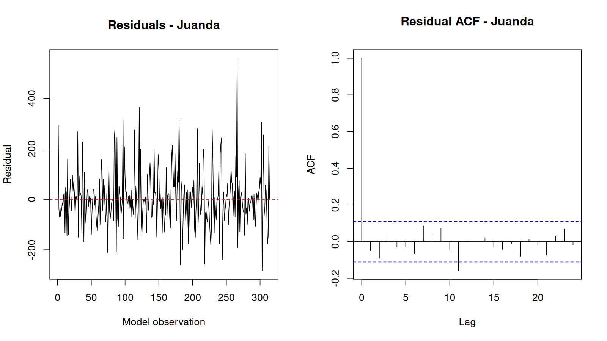

### Perak1

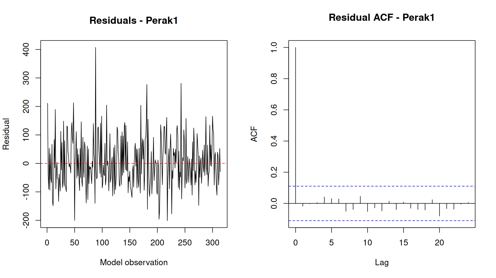

### Perak2

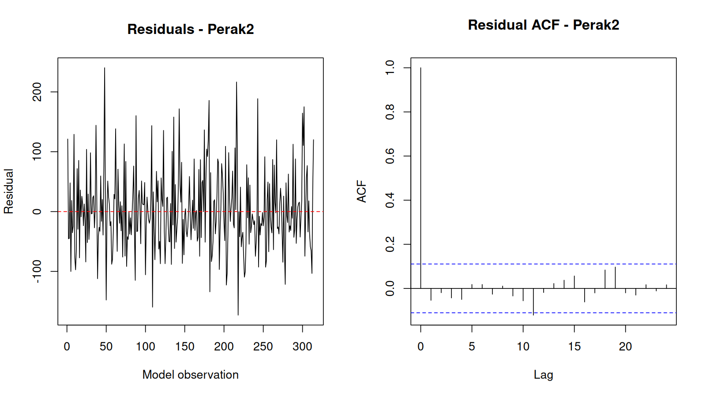

## 7. Untouched 20% test evaluation

### All test metrics

| location | MSE | RMSE | MAE | sMAPE | MAPE_nonzero |
|---|---|---|---|---|---|
| Juanda | 13861.694 | 117.73570 | 86.78639 | 77.29626 | 324.8898 |
| Perak1 | 13796.306 | 117.45768 | 93.38029 | 66.36237 | 636.1612 |
| Perak2 | 6813.451 | 82.54363 | 60.93216 | 79.79029 | 342.9782 |
| Overall | 11490.484 | 107.19367 | 80.36628 | 74.48297 | 445.0263 |

### All actual-versus-predicted test observations

| observation | location | actual | predicted |
|---|---|---|---|
| 327 | Juanda | 313.50 | 348.869708 |
| 328 | Juanda | 405.90 | 230.406257 |
| 329 | Juanda | 373.80 | 150.207051 |
| 330 | Juanda | 90.10 | 101.134144 |
| 331 | Juanda | 135.80 | 34.937286 |
| 332 | Juanda | 15.50 | 0.000000 |
| 333 | Juanda | 129.30 | 0.000000 |
| 334 | Juanda | 276.20 | 17.355954 |
| 335 | Juanda | 140.80 | 99.040326 |
| 336 | Juanda | 214.90 | 227.303755 |
| 337 | Juanda | 230.50 | 356.786432 |
| 338 | Juanda | 212.80 | 414.635428 |
| 339 | Juanda | 398.50 | 366.218242 |
| 340 | Juanda | 639.00 | 270.443996 |
| 341 | Juanda | 156.80 | 172.557389 |
| 342 | Juanda | 31.30 | 83.630880 |
| 343 | Juanda | 30.70 | 20.330680 |
| 344 | Juanda | 0.00 | 0.000000 |
| 345 | Juanda | 0.00 | 0.000000 |
| 346 | Juanda | 9.70 | 50.597151 |
| 347 | Juanda | 260.90 | 139.556008 |
| 348 | Juanda | 369.30 | 243.130478 |
| 349 | Juanda | 410.40 | 330.432925 |
| 350 | Juanda | 179.10 | 359.349575 |
| 351 | Juanda | 210.90 | 328.041536 |
| 352 | Juanda | 126.90 | 257.572010 |
| 353 | Juanda | 114.00 | 170.440100 |
| 354 | Juanda | 67.70 | 87.615861 |
| 355 | Juanda | 0.00 | 25.417045 |
| 356 | Juanda | 0.00 | 0.000000 |
| 357 | Juanda | 0.00 | 8.349385 |
| 358 | Juanda | 2.10 | 61.653628 |
| 359 | Juanda | 58.00 | 144.524707 |
| 360 | Juanda | 171.00 | 234.122764 |
| 361 | Juanda | 410.40 | 303.021355 |
| 362 | Juanda | 179.10 | 328.531597 |
| 363 | Juanda | 210.90 | 304.819650 |
| 364 | Juanda | 126.90 | 243.136207 |
| 365 | Juanda | 114.00 | 163.058192 |
| 366 | Juanda | 42.50 | 85.562745 |
| 367 | Juanda | 109.20 | 29.054233 |
| 368 | Juanda | 0.60 | 5.938270 |
| 369 | Juanda | 0.20 | 22.261205 |
| 370 | Juanda | 3.60 | 74.776331 |
| 371 | Juanda | 108.00 | 149.553594 |
| 372 | Juanda | 359.30 | 226.128717 |
| 373 | Juanda | 256.40 | 282.611133 |
| 374 | Juanda | 247.10 | 302.529189 |
| 375 | Juanda | 447.70 | 281.466584 |
| 376 | Juanda | 273.00 | 227.119226 |
| 377 | Juanda | 104.70 | 155.382901 |
| 378 | Juanda | 201.80 | 85.437577 |
| 379 | Juanda | 47.80 | 34.902339 |
| 380 | Juanda | 0.00 | 16.089036 |
| 381 | Juanda | 0.00 | 33.541717 |
| 382 | Juanda | 0.00 | 82.588738 |
| 383 | Juanda | 72.40 | 149.903210 |
| 384 | Juanda | 267.80 | 216.871204 |
| 385 | Juanda | 464.70 | 264.855444 |
| 386 | Juanda | 369.60 | 280.722393 |
| 387 | Juanda | 432.30 | 260.854710 |
| 388 | Juanda | 238.20 | 211.707678 |
| 389 | Juanda | 181.60 | 147.246885 |
| 390 | Juanda | 0.00 | 84.831711 |
| 391 | Juanda | 1.60 | 40.641044 |
| 392 | Juanda | 17.90 | 25.738943 |
| 393 | Juanda | 0.00 | 43.554464 |
| 394 | Juanda | 0.00 | 88.909639 |
| 395 | Juanda | 52.60 | 149.220403 |
| 396 | Juanda | 132.20 | 207.893443 |
| 397 | Juanda | 167.70 | 248.895570 |
| 398 | Juanda | 589.60 | 261.279783 |
| 399 | Juanda | 251.60 | 242.231049 |
| 400 | Juanda | 235.10 | 197.557608 |
| 401 | Juanda | 390.20 | 139.744019 |
| 402 | Juanda | 173.70 | 84.376096 |
| 403 | Juanda | 209.50 | 45.972142 |
| 404 | Juanda | 100.70 | 34.277576 |
| 405 | Juanda | 142.20 | 51.853708 |
| 406 | Juanda | 465.70 | 93.462639 |
| 407 | Juanda | 108.40 | 147.478591 |
| 408 | Juanda | 256.00 | 199.062446 |
| 327 | Perak1 | 322.40 | 283.918334 |
| 328 | Perak1 | 333.90 | 186.370855 |
| 329 | Perak1 | 147.30 | 111.406294 |
| 330 | Perak1 | 57.70 | 39.095250 |
| 331 | Perak1 | 66.10 | 27.954748 |
| 332 | Perak1 | 29.90 | 53.762785 |
| 333 | Perak1 | 156.30 | 63.252445 |
| 334 | Perak1 | 252.00 | 116.755417 |
| 335 | Perak1 | 85.70 | 178.660174 |
| 336 | Perak1 | 314.20 | 218.687532 |
| 337 | Perak1 | 180.50 | 286.815888 |
| 338 | Perak1 | 145.20 | 297.691749 |
| 339 | Perak1 | 461.20 | 240.293207 |
| 340 | Perak1 | 274.90 | 174.353099 |
| 341 | Perak1 | 70.00 | 107.689534 |
| 342 | Perak1 | 27.60 | 60.928316 |
| 343 | Perak1 | 0.10 | 38.801849 |
| 344 | Perak1 | 174.32 | 44.744936 |
| 345 | Perak1 | 174.32 | 77.524276 |
| 346 | Perak1 | 22.60 | 121.255097 |
| 347 | Perak1 | 205.10 | 172.919878 |
| 348 | Perak1 | 356.00 | 225.233067 |
| 349 | Perak1 | 400.10 | 259.483348 |
| 350 | Perak1 | 276.00 | 260.147507 |
| 351 | Perak1 | 263.40 | 225.543314 |
| 352 | Perak1 | 60.30 | 168.551367 |
| 353 | Perak1 | 70.60 | 109.467376 |
| 354 | Perak1 | 3.10 | 63.311689 |
| 355 | Perak1 | 153.02 | 43.659318 |
| 356 | Perak1 | 153.02 | 49.607722 |
| 357 | Perak1 | 153.02 | 77.028098 |
| 358 | Perak1 | 57.30 | 122.874963 |
| 359 | Perak1 | 40.00 | 173.790510 |
| 360 | Perak1 | 206.40 | 217.039758 |
| 361 | Perak1 | 648.70 | 242.507151 |
| 362 | Perak1 | 197.30 | 239.335722 |
| 363 | Perak1 | 430.30 | 208.236821 |
| 364 | Perak1 | 141.10 | 159.902422 |
| 365 | Perak1 | 179.40 | 108.511498 |
| 366 | Perak1 | 234.60 | 68.429722 |
| 367 | Perak1 | 90.50 | 49.174709 |
| 368 | Perak1 | 3.00 | 54.336723 |
| 369 | Perak1 | 216.53 | 81.573600 |
| 370 | Perak1 | 5.60 | 123.450592 |
| 371 | Perak1 | 80.20 | 169.423351 |
| 372 | Perak1 | 371.10 | 207.430850 |
| 373 | Perak1 | 301.70 | 226.916354 |
| 374 | Perak1 | 266.00 | 221.972014 |
| 375 | Perak1 | 342.00 | 193.935691 |
| 376 | Perak1 | 247.90 | 151.269591 |
| 377 | Perak1 | 50.90 | 106.101205 |
| 378 | Perak1 | 68.80 | 70.651563 |
| 379 | Perak1 | 5.80 | 53.996008 |
| 380 | Perak1 | 5.10 | 59.433527 |
| 381 | Perak1 | 158.33 | 84.853021 |
| 382 | Perak1 | 7.90 | 123.378839 |
| 383 | Perak1 | 68.30 | 164.566322 |
| 384 | Perak1 | 377.20 | 197.419013 |
| 385 | Perak1 | 503.40 | 213.077107 |
| 386 | Perak1 | 339.10 | 207.166923 |
| 387 | Perak1 | 282.60 | 181.497164 |
| 388 | Perak1 | 177.30 | 143.426424 |
| 389 | Perak1 | 87.60 | 103.527410 |
| 390 | Perak1 | 244.79 | 72.511366 |
| 391 | Perak1 | 244.79 | 58.281827 |
| 392 | Perak1 | 244.79 | 64.031499 |
| 393 | Perak1 | 244.79 | 87.678310 |
| 394 | Perak1 | 244.79 | 122.566474 |
| 395 | Perak1 | 167.90 | 159.193090 |
| 396 | Perak1 | 155.60 | 187.669940 |
| 397 | Perak1 | 308.20 | 200.352660 |
| 398 | Perak1 | 416.80 | 193.910809 |
| 399 | Perak1 | 150.20 | 170.302954 |
| 400 | Perak1 | 183.70 | 136.173756 |
| 401 | Perak1 | 278.90 | 100.861156 |
| 402 | Perak1 | 80.50 | 73.786649 |
| 403 | Perak1 | 73.20 | 61.903007 |
| 404 | Perak1 | 55.50 | 67.918404 |
| 405 | Perak1 | 88.70 | 89.769189 |
| 406 | Perak1 | 164.20 | 121.260483 |
| 407 | Perak1 | 223.20 | 153.735969 |
| 408 | Perak1 | 372.20 | 178.407988 |
| 327 | Perak2 | 207.20 | 228.982859 |
| 328 | Perak2 | 320.50 | 139.522036 |
| 329 | Perak2 | 129.30 | 87.754214 |
| 330 | Perak2 | 52.80 | 35.550959 |
| 331 | Perak2 | 39.40 | 0.000000 |
| 332 | Perak2 | 39.50 | 0.000000 |
| 333 | Perak2 | 88.40 | 14.678422 |
| 334 | Perak2 | 174.80 | 57.794736 |
| 335 | Perak2 | 72.50 | 103.992920 |
| 336 | Perak2 | 266.50 | 178.063417 |
| 337 | Perak2 | 174.10 | 246.162933 |
| 338 | Perak2 | 136.40 | 249.051222 |
| 339 | Perak2 | 293.50 | 213.704664 |
| 340 | Perak2 | 243.30 | 154.072867 |
| 341 | Perak2 | 78.70 | 91.000198 |
| 342 | Perak2 | 3.30 | 34.694853 |
| 343 | Perak2 | 1.60 | 0.569427 |
| 344 | Perak2 | 0.00 | 0.000000 |
| 345 | Perak2 | 0.00 | 7.048360 |
| 346 | Perak2 | 28.00 | 51.814630 |
| 347 | Perak2 | 181.00 | 113.196675 |
| 348 | Perak2 | 482.30 | 172.150441 |
| 349 | Perak2 | 303.10 | 218.923957 |
| 350 | Perak2 | 158.50 | 229.315087 |
| 351 | Perak2 | 311.40 | 199.388933 |
| 352 | Perak2 | 43.70 | 147.213851 |
| 353 | Perak2 | 39.00 | 88.468119 |
| 354 | Perak2 | 4.30 | 37.652106 |
| 355 | Perak2 | 0.00 | 5.326168 |
| 356 | Perak2 | 0.00 | 0.000000 |
| 357 | Perak2 | 0.00 | 18.918772 |
| 358 | Perak2 | 49.80 | 61.630993 |
| 359 | Perak2 | 82.90 | 115.689925 |
| 360 | Perak2 | 281.90 | 167.639679 |
| 361 | Perak2 | 342.70 | 202.029325 |
| 362 | Perak2 | 267.60 | 207.516039 |
| 363 | Perak2 | 322.40 | 183.470294 |
| 364 | Perak2 | 180.40 | 138.507943 |
| 365 | Perak2 | 159.40 | 85.853101 |
| 366 | Perak2 | 231.40 | 39.253521 |
| 367 | Perak2 | 42.20 | 10.478595 |
| 368 | Perak2 | 0.00 | 5.600745 |
| 369 | Perak2 | 0.00 | 25.450051 |
| 370 | Perak2 | 4.60 | 65.467780 |
| 371 | Perak2 | 79.10 | 114.687123 |
| 372 | Perak2 | 229.30 | 159.645455 |
| 373 | Perak2 | 255.50 | 188.040397 |
| 374 | Perak2 | 217.20 | 191.583709 |
| 375 | Perak2 | 197.70 | 169.797948 |
| 376 | Perak2 | 236.90 | 129.648776 |
| 377 | Perak2 | 51.00 | 82.552334 |
| 378 | Perak2 | 47.50 | 41.133989 |
| 379 | Perak2 | 3.00 | 15.872142 |
| 380 | Perak2 | 6.00 | 12.803553 |
| 381 | Perak2 | 0.00 | 32.344711 |
| 382 | Perak2 | 0.40 | 69.054254 |
| 383 | Perak2 | 68.60 | 112.932347 |
| 384 | Perak2 | 175.90 | 152.030316 |
| 385 | Perak2 | 275.20 | 175.656994 |
| 386 | Perak2 | 276.20 | 177.441662 |
| 387 | Perak2 | 204.80 | 157.287123 |
| 388 | Perak2 | 111.80 | 121.190102 |
| 389 | Perak2 | 20.50 | 79.193190 |
| 390 | Perak2 | 0.00 | 42.555190 |
| 391 | Perak2 | 0.00 | 20.775630 |
| 392 | Perak2 | 0.00 | 19.171285 |
| 393 | Perak2 | 0.00 | 37.753720 |
| 394 | Perak2 | 62.60 | 71.251178 |
| 395 | Perak2 | 123.40 | 110.414413 |
| 396 | Perak2 | 211.70 | 144.563837 |
| 397 | Perak2 | 256.60 | 164.485530 |
| 398 | Perak2 | 293.40 | 164.947911 |
| 399 | Perak2 | 110.40 | 146.152750 |
| 400 | Perak2 | 104.30 | 113.530558 |
| 401 | Perak2 | 321.00 | 76.080442 |
| 402 | Perak2 | 127.30 | 43.847099 |
| 403 | Perak2 | 86.80 | 25.228038 |
| 404 | Perak2 | 36.60 | 24.828408 |
| 405 | Perak2 | 176.80 | 42.354424 |
| 406 | Perak2 | 92.70 | 72.758459 |
| 407 | Perak2 | 179.90 | 107.622177 |
| 408 | Perak2 | 291.00 | 137.448186 |

### Juanda

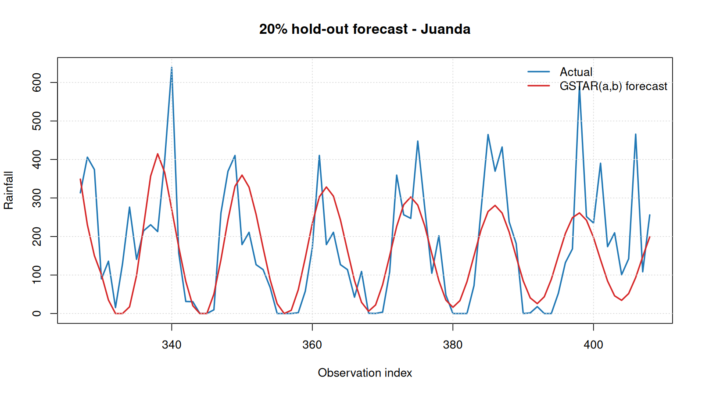

### Perak1

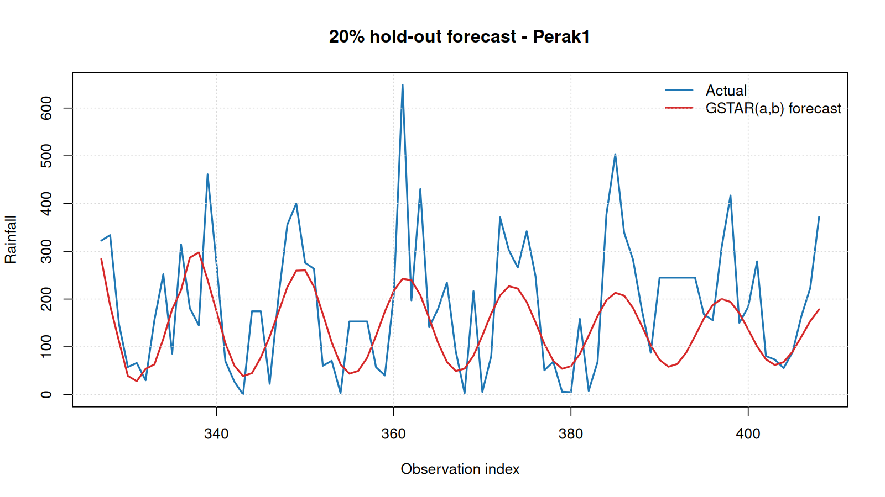

### Perak2

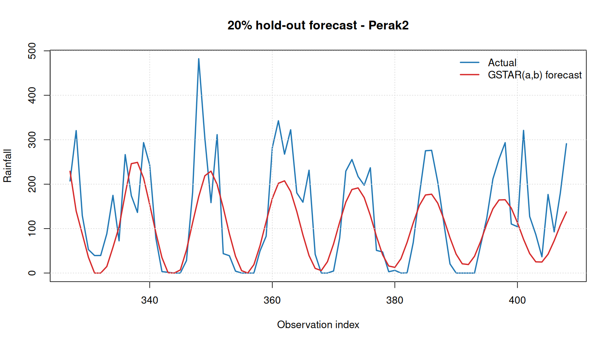

## Reproducibility

Run `Rscript Week2/gstar_ab_rainfall_w2.R` in Docker. This script imports `gstar_ab.R`; source rainfall data are read only.
