# Monthly Package GSTAR Experiments

## Experiment design

Chronological 70:30, 80:20, and 90:10 splits are evaluated independently. All transformation, ADF, ACF/PACF, CCF, candidate selection, and fitting use training data only. Monthly diagnostic lags run through 36 months; peaks only are retained, up to six per dimension.

The package accepts one temporal order p; therefore only equal-order GSTAR(a=p,b=p) candidates are fitted.

## Split comparison

| split | train_rows | test_rows | selected_model | differencing_d | selection_status | AIC | training_R_squared | testing_R_squared | testing_RMSE |
|---|---|---|---|---|---|---|---|---|---|
| 70:30 | 285 | 123 | GSTAR(17,17) | 1 | white-noise fallback | 9613.144 | 0.612657 | 0.055085 | 134.4181 |
| 80:20 | 326 | 82 | GSTAR(19,19) | 0 | white-noise fallback | 11028.841 | 0.621464 | 0.433698 | 103.3661 |
| 90:10 | 367 | 41 | GSTAR(16,16) | 1 | white-noise fallback | 12573.417 | 0.596119 | -2.346802 | 248.7761 |

## Split 70:30

Training rows: 285; test rows: 123. Selected **GSTAR(17,17)** with d = 1 (white-noise fallback).

### Stationarity

| stage | location | test | lag | statistic | p_value | stationary |
|---|---|---|---|---|---|---|
| raw_training | Juanda | Fligner-Killeen variance | NA | 0.602739 | 0.437535 | TRUE |
| raw_training | Perak1 | Fligner-Killeen variance | NA | 0.431879 | 0.511068 | TRUE |
| raw_training | Perak2 | Fligner-Killeen variance | NA | 0.450801 | 0.501955 | TRUE |
| raw_training_reused | Juanda | Fligner-Killeen variance | NA | 0.602739 | 0.437535 | TRUE |
| raw_training_reused | Perak1 | Fligner-Killeen variance | NA | 0.431879 | 0.511068 | TRUE |
| raw_training_reused | Perak2 | Fligner-Killeen variance | NA | 0.450801 | 0.501955 | TRUE |
| first_difference_training | Juanda | Fligner-Killeen variance | NA | 0.496027 | 0.481251 | TRUE |
| first_difference_training | Perak1 | Fligner-Killeen variance | NA | 0.098225 | 0.753970 | TRUE |
| first_difference_training | Perak2 | Fligner-Killeen variance | NA | 0.002854 | 0.957392 | TRUE |

| stage | location | test | lag | statistic | p_value | stationary |
|---|---|---|---|---|---|---|
| raw_training | Juanda | ADF | 0 | -8.246183 | 0.010000 | TRUE |
| raw_training | Juanda | ADF | 1 | -8.584543 | 0.010000 | TRUE |
| raw_training | Juanda | ADF | 2 | -9.726719 | 0.010000 | TRUE |
| raw_training | Juanda | ADF | 3 | -11.079397 | 0.010000 | TRUE |
| raw_training | Juanda | ADF | 4 | -12.214401 | 0.010000 | TRUE |
| raw_training | Juanda | ADF | 5 | -12.644334 | 0.010000 | TRUE |
| raw_training | Juanda | ADF | 6 | -11.964494 | 0.010000 | TRUE |
| raw_training | Juanda | ADF | 7 | -11.340732 | 0.010000 | TRUE |
| raw_training | Juanda | ADF | 8 | -9.666403 | 0.010000 | TRUE |
| raw_training | Juanda | ADF | 9 | -8.166416 | 0.010000 | TRUE |
| raw_training | Juanda | ADF | 10 | -6.336170 | 0.010000 | TRUE |
| raw_training | Juanda | ADF | 11 | -4.443628 | 0.010000 | TRUE |
| raw_training | Juanda | ADF | 12 | -4.511079 | 0.010000 | TRUE |
| raw_training | Juanda | ADF | 13 | -4.415905 | 0.010000 | TRUE |
| raw_training | Juanda | ADF | 14 | -4.802857 | 0.010000 | TRUE |
| raw_training | Juanda | ADF | 15 | -5.172013 | 0.010000 | TRUE |
| raw_training | Juanda | ADF | 16 | -5.148550 | 0.010000 | TRUE |
| raw_training | Juanda | ADF | 17 | -5.650993 | 0.010000 | TRUE |
| raw_training | Juanda | ADF | 18 | -5.629516 | 0.010000 | TRUE |
| raw_training | Juanda | ADF | 19 | -5.904306 | 0.010000 | TRUE |
| raw_training | Juanda | ADF | 20 | -6.237087 | 0.010000 | TRUE |
| raw_training | Juanda | ADF | 21 | -5.091862 | 0.010000 | TRUE |
| raw_training | Juanda | ADF | 22 | -3.969616 | 0.010951 | TRUE |
| raw_training | Juanda | ADF | 23 | -3.791481 | 0.019858 | TRUE |
| raw_training | Juanda | ADF | 24 | -3.939716 | 0.012446 | TRUE |
| raw_training | Juanda | ADF | 25 | -3.912534 | 0.013805 | TRUE |
| raw_training | Juanda | ADF | 26 | -3.828911 | 0.017986 | TRUE |
| raw_training | Juanda | ADF | 27 | -3.609899 | 0.032571 | TRUE |
| raw_training | Juanda | ADF | 28 | -3.500934 | 0.043049 | TRUE |
| raw_training | Juanda | ADF | 29 | -3.802802 | 0.019292 | TRUE |
| raw_training | Juanda | ADF | 30 | -4.024011 | 0.010000 | TRUE |
| raw_training | Juanda | ADF | 31 | -3.857187 | 0.016573 | TRUE |
| raw_training | Juanda | ADF | 32 | -3.788556 | 0.020004 | TRUE |
| raw_training | Juanda | ADF | 33 | -3.847209 | 0.017072 | TRUE |
| raw_training | Juanda | ADF | 34 | -3.130270 | 0.099955 | FALSE |
| raw_training | Juanda | ADF | 35 | -2.423823 | 0.397551 | FALSE |
| raw_training | Juanda | ADF | 36 | -2.141091 | 0.516681 | FALSE |
| raw_training | Juanda | KPSS | NA | 0.016228 | 0.100000 | TRUE |
| raw_training | Perak1 | ADF | 0 | -11.065227 | 0.010000 | TRUE |
| raw_training | Perak1 | ADF | 1 | -8.538606 | 0.010000 | TRUE |
| raw_training | Perak1 | ADF | 2 | -9.304050 | 0.010000 | TRUE |
| raw_training | Perak1 | ADF | 3 | -10.033999 | 0.010000 | TRUE |
| raw_training | Perak1 | ADF | 4 | -10.509238 | 0.010000 | TRUE |
| raw_training | Perak1 | ADF | 5 | -9.970261 | 0.010000 | TRUE |
| raw_training | Perak1 | ADF | 6 | -10.953325 | 0.010000 | TRUE |
| raw_training | Perak1 | ADF | 7 | -10.204716 | 0.010000 | TRUE |
| raw_training | Perak1 | ADF | 8 | -7.943873 | 0.010000 | TRUE |
| raw_training | Perak1 | ADF | 9 | -6.770612 | 0.010000 | TRUE |
| raw_training | Perak1 | ADF | 10 | -5.153075 | 0.010000 | TRUE |
| raw_training | Perak1 | ADF | 11 | -3.924401 | 0.013212 | TRUE |
| raw_training | Perak1 | ADF | 12 | -3.509675 | 0.042208 | TRUE |
| raw_training | Perak1 | ADF | 13 | -3.492829 | 0.043828 | TRUE |
| raw_training | Perak1 | ADF | 14 | -3.682999 | 0.025542 | TRUE |
| raw_training | Perak1 | ADF | 15 | -3.842771 | 0.017293 | TRUE |
| raw_training | Perak1 | ADF | 16 | -3.891601 | 0.014852 | TRUE |
| raw_training | Perak1 | ADF | 17 | -4.123594 | 0.010000 | TRUE |
| raw_training | Perak1 | ADF | 18 | -3.967685 | 0.011048 | TRUE |
| raw_training | Perak1 | ADF | 19 | -4.121923 | 0.010000 | TRUE |
| raw_training | Perak1 | ADF | 20 | -4.442706 | 0.010000 | TRUE |
| raw_training | Perak1 | ADF | 21 | -4.330012 | 0.010000 | TRUE |
| raw_training | Perak1 | ADF | 22 | -3.577624 | 0.035675 | TRUE |
| raw_training | Perak1 | ADF | 23 | -2.943896 | 0.178416 | FALSE |
| raw_training | Perak1 | ADF | 24 | -3.423946 | 0.050786 | FALSE |
| raw_training | Perak1 | ADF | 25 | -3.141510 | 0.098073 | FALSE |
| raw_training | Perak1 | ADF | 26 | -3.525328 | 0.040703 | TRUE |
| raw_training | Perak1 | ADF | 27 | -3.645409 | 0.029157 | TRUE |
| raw_training | Perak1 | ADF | 28 | -3.477815 | 0.045272 | TRUE |
| raw_training | Perak1 | ADF | 29 | -3.403044 | 0.054285 | FALSE |
| raw_training | Perak1 | ADF | 30 | -3.322362 | 0.067794 | FALSE |
| raw_training | Perak1 | ADF | 31 | -3.693766 | 0.024744 | TRUE |
| raw_training | Perak1 | ADF | 32 | -3.705719 | 0.024146 | TRUE |
| raw_training | Perak1 | ADF | 33 | -3.852421 | 0.016811 | TRUE |
| raw_training | Perak1 | ADF | 34 | -2.947975 | 0.176697 | FALSE |
| raw_training | Perak1 | ADF | 35 | -2.457362 | 0.383419 | FALSE |
| raw_training | Perak1 | ADF | 36 | -2.066899 | 0.547942 | FALSE |
| raw_training | Perak1 | KPSS | NA | 0.031423 | 0.100000 | TRUE |
| raw_training | Perak2 | ADF | 0 | -8.309234 | 0.010000 | TRUE |
| raw_training | Perak2 | ADF | 1 | -7.932305 | 0.010000 | TRUE |
| raw_training | Perak2 | ADF | 2 | -9.944647 | 0.010000 | TRUE |
| raw_training | Perak2 | ADF | 3 | -11.305583 | 0.010000 | TRUE |
| raw_training | Perak2 | ADF | 4 | -12.055925 | 0.010000 | TRUE |
| raw_training | Perak2 | ADF | 5 | -12.372204 | 0.010000 | TRUE |
| raw_training | Perak2 | ADF | 6 | -12.115221 | 0.010000 | TRUE |
| raw_training | Perak2 | ADF | 7 | -10.466032 | 0.010000 | TRUE |
| raw_training | Perak2 | ADF | 8 | -8.450114 | 0.010000 | TRUE |
| raw_training | Perak2 | ADF | 9 | -6.210606 | 0.010000 | TRUE |
| raw_training | Perak2 | ADF | 10 | -4.984027 | 0.010000 | TRUE |
| raw_training | Perak2 | ADF | 11 | -3.539536 | 0.039337 | TRUE |
| raw_training | Perak2 | ADF | 12 | -3.183553 | 0.091034 | FALSE |
| raw_training | Perak2 | ADF | 13 | -3.090298 | 0.116729 | FALSE |
| raw_training | Perak2 | ADF | 14 | -3.120034 | 0.104199 | FALSE |
| raw_training | Perak2 | ADF | 15 | -3.370130 | 0.059796 | FALSE |
| raw_training | Perak2 | ADF | 16 | -3.365948 | 0.060496 | FALSE |
| raw_training | Perak2 | ADF | 17 | -3.105741 | 0.110222 | FALSE |
| raw_training | Perak2 | ADF | 18 | -2.995571 | 0.156642 | FALSE |
| raw_training | Perak2 | ADF | 19 | -3.280311 | 0.074834 | FALSE |
| raw_training | Perak2 | ADF | 20 | -3.362636 | 0.061051 | FALSE |
| raw_training | Perak2 | ADF | 21 | -2.888225 | 0.201873 | FALSE |
| raw_training | Perak2 | ADF | 22 | -2.428586 | 0.395544 | FALSE |
| raw_training | Perak2 | ADF | 23 | -2.111065 | 0.529333 | FALSE |
| raw_training | Perak2 | ADF | 24 | -2.298476 | 0.450366 | FALSE |
| raw_training | Perak2 | ADF | 25 | -2.134741 | 0.519357 | FALSE |
| raw_training | Perak2 | ADF | 26 | -2.350241 | 0.428555 | FALSE |
| raw_training | Perak2 | ADF | 27 | -2.425066 | 0.397027 | FALSE |
| raw_training | Perak2 | ADF | 28 | -2.615874 | 0.316629 | FALSE |
| raw_training | Perak2 | ADF | 29 | -2.975754 | 0.164992 | FALSE |
| raw_training | Perak2 | ADF | 30 | -3.220954 | 0.084772 | FALSE |
| raw_training | Perak2 | ADF | 31 | -3.257268 | 0.078692 | FALSE |
| raw_training | Perak2 | ADF | 32 | -3.247674 | 0.080298 | FALSE |
| raw_training | Perak2 | ADF | 33 | -3.237808 | 0.081950 | FALSE |
| raw_training | Perak2 | ADF | 34 | -2.432186 | 0.394027 | FALSE |
| raw_training | Perak2 | ADF | 35 | -1.954334 | 0.595372 | FALSE |
| raw_training | Perak2 | ADF | 36 | -2.045976 | 0.556758 | FALSE |
| raw_training | Perak2 | KPSS | NA | 0.037170 | 0.100000 | TRUE |
| raw_training_reused | Juanda | ADF | 0 | -8.246183 | 0.010000 | TRUE |
| raw_training_reused | Juanda | ADF | 1 | -8.584543 | 0.010000 | TRUE |
| raw_training_reused | Juanda | ADF | 2 | -9.726719 | 0.010000 | TRUE |
| raw_training_reused | Juanda | ADF | 3 | -11.079397 | 0.010000 | TRUE |
| raw_training_reused | Juanda | ADF | 4 | -12.214401 | 0.010000 | TRUE |
| raw_training_reused | Juanda | ADF | 5 | -12.644334 | 0.010000 | TRUE |
| raw_training_reused | Juanda | ADF | 6 | -11.964494 | 0.010000 | TRUE |
| raw_training_reused | Juanda | ADF | 7 | -11.340732 | 0.010000 | TRUE |
| raw_training_reused | Juanda | ADF | 8 | -9.666403 | 0.010000 | TRUE |
| raw_training_reused | Juanda | ADF | 9 | -8.166416 | 0.010000 | TRUE |
| raw_training_reused | Juanda | ADF | 10 | -6.336170 | 0.010000 | TRUE |
| raw_training_reused | Juanda | ADF | 11 | -4.443628 | 0.010000 | TRUE |
| raw_training_reused | Juanda | ADF | 12 | -4.511079 | 0.010000 | TRUE |
| raw_training_reused | Juanda | ADF | 13 | -4.415905 | 0.010000 | TRUE |
| raw_training_reused | Juanda | ADF | 14 | -4.802857 | 0.010000 | TRUE |
| raw_training_reused | Juanda | ADF | 15 | -5.172013 | 0.010000 | TRUE |
| raw_training_reused | Juanda | ADF | 16 | -5.148550 | 0.010000 | TRUE |
| raw_training_reused | Juanda | ADF | 17 | -5.650993 | 0.010000 | TRUE |
| raw_training_reused | Juanda | ADF | 18 | -5.629516 | 0.010000 | TRUE |
| raw_training_reused | Juanda | ADF | 19 | -5.904306 | 0.010000 | TRUE |
| raw_training_reused | Juanda | ADF | 20 | -6.237087 | 0.010000 | TRUE |
| raw_training_reused | Juanda | ADF | 21 | -5.091862 | 0.010000 | TRUE |
| raw_training_reused | Juanda | ADF | 22 | -3.969616 | 0.010951 | TRUE |
| raw_training_reused | Juanda | ADF | 23 | -3.791481 | 0.019858 | TRUE |
| raw_training_reused | Juanda | ADF | 24 | -3.939716 | 0.012446 | TRUE |
| raw_training_reused | Juanda | ADF | 25 | -3.912534 | 0.013805 | TRUE |
| raw_training_reused | Juanda | ADF | 26 | -3.828911 | 0.017986 | TRUE |
| raw_training_reused | Juanda | ADF | 27 | -3.609899 | 0.032571 | TRUE |
| raw_training_reused | Juanda | ADF | 28 | -3.500934 | 0.043049 | TRUE |
| raw_training_reused | Juanda | ADF | 29 | -3.802802 | 0.019292 | TRUE |
| raw_training_reused | Juanda | ADF | 30 | -4.024011 | 0.010000 | TRUE |
| raw_training_reused | Juanda | ADF | 31 | -3.857187 | 0.016573 | TRUE |
| raw_training_reused | Juanda | ADF | 32 | -3.788556 | 0.020004 | TRUE |
| raw_training_reused | Juanda | ADF | 33 | -3.847209 | 0.017072 | TRUE |
| raw_training_reused | Juanda | ADF | 34 | -3.130270 | 0.099955 | FALSE |
| raw_training_reused | Juanda | ADF | 35 | -2.423823 | 0.397551 | FALSE |
| raw_training_reused | Juanda | ADF | 36 | -2.141091 | 0.516681 | FALSE |
| raw_training_reused | Juanda | KPSS | NA | 0.016228 | 0.100000 | TRUE |
| raw_training_reused | Perak1 | ADF | 0 | -11.065227 | 0.010000 | TRUE |
| raw_training_reused | Perak1 | ADF | 1 | -8.538606 | 0.010000 | TRUE |
| raw_training_reused | Perak1 | ADF | 2 | -9.304050 | 0.010000 | TRUE |
| raw_training_reused | Perak1 | ADF | 3 | -10.033999 | 0.010000 | TRUE |
| raw_training_reused | Perak1 | ADF | 4 | -10.509238 | 0.010000 | TRUE |
| raw_training_reused | Perak1 | ADF | 5 | -9.970261 | 0.010000 | TRUE |
| raw_training_reused | Perak1 | ADF | 6 | -10.953325 | 0.010000 | TRUE |
| raw_training_reused | Perak1 | ADF | 7 | -10.204716 | 0.010000 | TRUE |
| raw_training_reused | Perak1 | ADF | 8 | -7.943873 | 0.010000 | TRUE |
| raw_training_reused | Perak1 | ADF | 9 | -6.770612 | 0.010000 | TRUE |
| raw_training_reused | Perak1 | ADF | 10 | -5.153075 | 0.010000 | TRUE |
| raw_training_reused | Perak1 | ADF | 11 | -3.924401 | 0.013212 | TRUE |
| raw_training_reused | Perak1 | ADF | 12 | -3.509675 | 0.042208 | TRUE |
| raw_training_reused | Perak1 | ADF | 13 | -3.492829 | 0.043828 | TRUE |
| raw_training_reused | Perak1 | ADF | 14 | -3.682999 | 0.025542 | TRUE |
| raw_training_reused | Perak1 | ADF | 15 | -3.842771 | 0.017293 | TRUE |
| raw_training_reused | Perak1 | ADF | 16 | -3.891601 | 0.014852 | TRUE |
| raw_training_reused | Perak1 | ADF | 17 | -4.123594 | 0.010000 | TRUE |
| raw_training_reused | Perak1 | ADF | 18 | -3.967685 | 0.011048 | TRUE |
| raw_training_reused | Perak1 | ADF | 19 | -4.121923 | 0.010000 | TRUE |
| raw_training_reused | Perak1 | ADF | 20 | -4.442706 | 0.010000 | TRUE |
| raw_training_reused | Perak1 | ADF | 21 | -4.330012 | 0.010000 | TRUE |
| raw_training_reused | Perak1 | ADF | 22 | -3.577624 | 0.035675 | TRUE |
| raw_training_reused | Perak1 | ADF | 23 | -2.943896 | 0.178416 | FALSE |
| raw_training_reused | Perak1 | ADF | 24 | -3.423946 | 0.050786 | FALSE |
| raw_training_reused | Perak1 | ADF | 25 | -3.141510 | 0.098073 | FALSE |
| raw_training_reused | Perak1 | ADF | 26 | -3.525328 | 0.040703 | TRUE |
| raw_training_reused | Perak1 | ADF | 27 | -3.645409 | 0.029157 | TRUE |
| raw_training_reused | Perak1 | ADF | 28 | -3.477815 | 0.045272 | TRUE |
| raw_training_reused | Perak1 | ADF | 29 | -3.403044 | 0.054285 | FALSE |
| raw_training_reused | Perak1 | ADF | 30 | -3.322362 | 0.067794 | FALSE |
| raw_training_reused | Perak1 | ADF | 31 | -3.693766 | 0.024744 | TRUE |
| raw_training_reused | Perak1 | ADF | 32 | -3.705719 | 0.024146 | TRUE |
| raw_training_reused | Perak1 | ADF | 33 | -3.852421 | 0.016811 | TRUE |
| raw_training_reused | Perak1 | ADF | 34 | -2.947975 | 0.176697 | FALSE |
| raw_training_reused | Perak1 | ADF | 35 | -2.457362 | 0.383419 | FALSE |
| raw_training_reused | Perak1 | ADF | 36 | -2.066899 | 0.547942 | FALSE |
| raw_training_reused | Perak1 | KPSS | NA | 0.031423 | 0.100000 | TRUE |
| raw_training_reused | Perak2 | ADF | 0 | -8.309234 | 0.010000 | TRUE |
| raw_training_reused | Perak2 | ADF | 1 | -7.932305 | 0.010000 | TRUE |
| raw_training_reused | Perak2 | ADF | 2 | -9.944647 | 0.010000 | TRUE |
| raw_training_reused | Perak2 | ADF | 3 | -11.305583 | 0.010000 | TRUE |
| raw_training_reused | Perak2 | ADF | 4 | -12.055925 | 0.010000 | TRUE |
| raw_training_reused | Perak2 | ADF | 5 | -12.372204 | 0.010000 | TRUE |
| raw_training_reused | Perak2 | ADF | 6 | -12.115221 | 0.010000 | TRUE |
| raw_training_reused | Perak2 | ADF | 7 | -10.466032 | 0.010000 | TRUE |
| raw_training_reused | Perak2 | ADF | 8 | -8.450114 | 0.010000 | TRUE |
| raw_training_reused | Perak2 | ADF | 9 | -6.210606 | 0.010000 | TRUE |
| raw_training_reused | Perak2 | ADF | 10 | -4.984027 | 0.010000 | TRUE |
| raw_training_reused | Perak2 | ADF | 11 | -3.539536 | 0.039337 | TRUE |
| raw_training_reused | Perak2 | ADF | 12 | -3.183553 | 0.091034 | FALSE |
| raw_training_reused | Perak2 | ADF | 13 | -3.090298 | 0.116729 | FALSE |
| raw_training_reused | Perak2 | ADF | 14 | -3.120034 | 0.104199 | FALSE |
| raw_training_reused | Perak2 | ADF | 15 | -3.370130 | 0.059796 | FALSE |
| raw_training_reused | Perak2 | ADF | 16 | -3.365948 | 0.060496 | FALSE |
| raw_training_reused | Perak2 | ADF | 17 | -3.105741 | 0.110222 | FALSE |
| raw_training_reused | Perak2 | ADF | 18 | -2.995571 | 0.156642 | FALSE |
| raw_training_reused | Perak2 | ADF | 19 | -3.280311 | 0.074834 | FALSE |
| raw_training_reused | Perak2 | ADF | 20 | -3.362636 | 0.061051 | FALSE |
| raw_training_reused | Perak2 | ADF | 21 | -2.888225 | 0.201873 | FALSE |
| raw_training_reused | Perak2 | ADF | 22 | -2.428586 | 0.395544 | FALSE |
| raw_training_reused | Perak2 | ADF | 23 | -2.111065 | 0.529333 | FALSE |
| raw_training_reused | Perak2 | ADF | 24 | -2.298476 | 0.450366 | FALSE |
| raw_training_reused | Perak2 | ADF | 25 | -2.134741 | 0.519357 | FALSE |
| raw_training_reused | Perak2 | ADF | 26 | -2.350241 | 0.428555 | FALSE |
| raw_training_reused | Perak2 | ADF | 27 | -2.425066 | 0.397027 | FALSE |
| raw_training_reused | Perak2 | ADF | 28 | -2.615874 | 0.316629 | FALSE |
| raw_training_reused | Perak2 | ADF | 29 | -2.975754 | 0.164992 | FALSE |
| raw_training_reused | Perak2 | ADF | 30 | -3.220954 | 0.084772 | FALSE |
| raw_training_reused | Perak2 | ADF | 31 | -3.257268 | 0.078692 | FALSE |
| raw_training_reused | Perak2 | ADF | 32 | -3.247674 | 0.080298 | FALSE |
| raw_training_reused | Perak2 | ADF | 33 | -3.237808 | 0.081950 | FALSE |
| raw_training_reused | Perak2 | ADF | 34 | -2.432186 | 0.394027 | FALSE |
| raw_training_reused | Perak2 | ADF | 35 | -1.954334 | 0.595372 | FALSE |
| raw_training_reused | Perak2 | ADF | 36 | -2.045976 | 0.556758 | FALSE |
| raw_training_reused | Perak2 | KPSS | NA | 0.037170 | 0.100000 | TRUE |
| first_difference_training | Juanda | ADF | 0 | -18.176983 | 0.010000 | TRUE |
| first_difference_training | Juanda | ADF | 1 | -12.551027 | 0.010000 | TRUE |
| first_difference_training | Juanda | ADF | 2 | -10.479613 | 0.010000 | TRUE |
| first_difference_training | Juanda | ADF | 3 | -10.019807 | 0.010000 | TRUE |
| first_difference_training | Juanda | ADF | 4 | -10.239698 | 0.010000 | TRUE |
| first_difference_training | Juanda | ADF | 5 | -11.302220 | 0.010000 | TRUE |
| first_difference_training | Juanda | ADF | 6 | -11.813449 | 0.010000 | TRUE |
| first_difference_training | Juanda | ADF | 7 | -12.964764 | 0.010000 | TRUE |
| first_difference_training | Juanda | ADF | 8 | -13.328340 | 0.010000 | TRUE |
| first_difference_training | Juanda | ADF | 9 | -14.160375 | 0.010000 | TRUE |
| first_difference_training | Juanda | ADF | 10 | -15.574701 | 0.010000 | TRUE |
| first_difference_training | Juanda | ADF | 11 | -12.033751 | 0.010000 | TRUE |
| first_difference_training | Juanda | ADF | 12 | -10.007824 | 0.010000 | TRUE |
| first_difference_training | Juanda | ADF | 13 | -8.006894 | 0.010000 | TRUE |
| first_difference_training | Juanda | ADF | 14 | -6.831437 | 0.010000 | TRUE |
| first_difference_training | Juanda | ADF | 15 | -6.552093 | 0.010000 | TRUE |
| first_difference_training | Juanda | ADF | 16 | -5.839001 | 0.010000 | TRUE |
| first_difference_training | Juanda | ADF | 17 | -5.824944 | 0.010000 | TRUE |
| first_difference_training | Juanda | ADF | 18 | -5.527019 | 0.010000 | TRUE |
| first_difference_training | Juanda | ADF | 19 | -5.300837 | 0.010000 | TRUE |
| first_difference_training | Juanda | ADF | 20 | -6.458860 | 0.010000 | TRUE |
| first_difference_training | Juanda | ADF | 21 | -7.819334 | 0.010000 | TRUE |
| first_difference_training | Juanda | ADF | 22 | -7.638314 | 0.010000 | TRUE |
| first_difference_training | Juanda | ADF | 23 | -6.721644 | 0.010000 | TRUE |
| first_difference_training | Juanda | ADF | 24 | -6.149838 | 0.010000 | TRUE |
| first_difference_training | Juanda | ADF | 25 | -6.038896 | 0.010000 | TRUE |
| first_difference_training | Juanda | ADF | 26 | -5.953350 | 0.010000 | TRUE |
| first_difference_training | Juanda | ADF | 27 | -5.803004 | 0.010000 | TRUE |
| first_difference_training | Juanda | ADF | 28 | -5.065138 | 0.010000 | TRUE |
| first_difference_training | Juanda | ADF | 29 | -4.677906 | 0.010000 | TRUE |
| first_difference_training | Juanda | ADF | 30 | -4.775147 | 0.010000 | TRUE |
| first_difference_training | Juanda | ADF | 31 | -4.734572 | 0.010000 | TRUE |
| first_difference_training | Juanda | ADF | 32 | -4.529759 | 0.010000 | TRUE |
| first_difference_training | Juanda | ADF | 33 | -5.433138 | 0.010000 | TRUE |
| first_difference_training | Juanda | ADF | 34 | -6.713433 | 0.010000 | TRUE |
| first_difference_training | Juanda | ADF | 35 | -7.024218 | 0.010000 | TRUE |
| first_difference_training | Juanda | ADF | 36 | -6.284500 | 0.010000 | TRUE |
| first_difference_training | Juanda | KPSS | NA | 0.008615 | 0.100000 | TRUE |
| first_difference_training | Perak1 | ADF | 0 | -24.358741 | 0.010000 | TRUE |
| first_difference_training | Perak1 | ADF | 1 | -14.436805 | 0.010000 | TRUE |
| first_difference_training | Perak1 | ADF | 2 | -11.652438 | 0.010000 | TRUE |
| first_difference_training | Perak1 | ADF | 3 | -10.728744 | 0.010000 | TRUE |
| first_difference_training | Perak1 | ADF | 4 | -11.004394 | 0.010000 | TRUE |
| first_difference_training | Perak1 | ADF | 5 | -9.934325 | 0.010000 | TRUE |
| first_difference_training | Perak1 | ADF | 6 | -10.704509 | 0.010000 | TRUE |
| first_difference_training | Perak1 | ADF | 7 | -12.744702 | 0.010000 | TRUE |
| first_difference_training | Perak1 | ADF | 8 | -12.591656 | 0.010000 | TRUE |
| first_difference_training | Perak1 | ADF | 9 | -13.729645 | 0.010000 | TRUE |
| first_difference_training | Perak1 | ADF | 10 | -14.247479 | 0.010000 | TRUE |
| first_difference_training | Perak1 | ADF | 11 | -13.236576 | 0.010000 | TRUE |
| first_difference_training | Perak1 | ADF | 12 | -10.382863 | 0.010000 | TRUE |
| first_difference_training | Perak1 | ADF | 13 | -8.126610 | 0.010000 | TRUE |
| first_difference_training | Perak1 | ADF | 14 | -7.159381 | 0.010000 | TRUE |
| first_difference_training | Perak1 | ADF | 15 | -6.293887 | 0.010000 | TRUE |
| first_difference_training | Perak1 | ADF | 16 | -5.569391 | 0.010000 | TRUE |
| first_difference_training | Perak1 | ADF | 17 | -5.477187 | 0.010000 | TRUE |
| first_difference_training | Perak1 | ADF | 18 | -5.036510 | 0.010000 | TRUE |
| first_difference_training | Perak1 | ADF | 19 | -4.598035 | 0.010000 | TRUE |
| first_difference_training | Perak1 | ADF | 20 | -4.629993 | 0.010000 | TRUE |
| first_difference_training | Perak1 | ADF | 21 | -5.455111 | 0.010000 | TRUE |
| first_difference_training | Perak1 | ADF | 22 | -6.255540 | 0.010000 | TRUE |
| first_difference_training | Perak1 | ADF | 23 | -5.090276 | 0.010000 | TRUE |
| first_difference_training | Perak1 | ADF | 24 | -5.319190 | 0.010000 | TRUE |
| first_difference_training | Perak1 | ADF | 25 | -4.633385 | 0.010000 | TRUE |
| first_difference_training | Perak1 | ADF | 26 | -4.339638 | 0.010000 | TRUE |
| first_difference_training | Perak1 | ADF | 27 | -4.432959 | 0.010000 | TRUE |
| first_difference_training | Perak1 | ADF | 28 | -4.427170 | 0.010000 | TRUE |
| first_difference_training | Perak1 | ADF | 29 | -4.400581 | 0.010000 | TRUE |
| first_difference_training | Perak1 | ADF | 30 | -3.901513 | 0.014358 | TRUE |
| first_difference_training | Perak1 | ADF | 31 | -3.876490 | 0.015610 | TRUE |
| first_difference_training | Perak1 | ADF | 32 | -3.708429 | 0.024013 | TRUE |
| first_difference_training | Perak1 | ADF | 33 | -4.673701 | 0.010000 | TRUE |
| first_difference_training | Perak1 | ADF | 34 | -5.302004 | 0.010000 | TRUE |
| first_difference_training | Perak1 | ADF | 35 | -5.675043 | 0.010000 | TRUE |
| first_difference_training | Perak1 | ADF | 36 | -5.290316 | 0.010000 | TRUE |
| first_difference_training | Perak1 | KPSS | NA | 0.008639 | 0.100000 | TRUE |
| first_difference_training | Perak2 | ADF | 0 | -19.381849 | 0.010000 | TRUE |
| first_difference_training | Perak2 | ADF | 1 | -11.843942 | 0.010000 | TRUE |
| first_difference_training | Perak2 | ADF | 2 | -10.037864 | 0.010000 | TRUE |
| first_difference_training | Perak2 | ADF | 3 | -9.898492 | 0.010000 | TRUE |
| first_difference_training | Perak2 | ADF | 4 | -10.284265 | 0.010000 | TRUE |
| first_difference_training | Perak2 | ADF | 5 | -10.980066 | 0.010000 | TRUE |
| first_difference_training | Perak2 | ADF | 6 | -12.451224 | 0.010000 | TRUE |
| first_difference_training | Perak2 | ADF | 7 | -13.721463 | 0.010000 | TRUE |
| first_difference_training | Perak2 | ADF | 8 | -15.190910 | 0.010000 | TRUE |
| first_difference_training | Perak2 | ADF | 9 | -14.537313 | 0.010000 | TRUE |
| first_difference_training | Perak2 | ADF | 10 | -15.403164 | 0.010000 | TRUE |
| first_difference_training | Perak2 | ADF | 11 | -12.781148 | 0.010000 | TRUE |
| first_difference_training | Perak2 | ADF | 12 | -10.239273 | 0.010000 | TRUE |
| first_difference_training | Perak2 | ADF | 13 | -8.534110 | 0.010000 | TRUE |
| first_difference_training | Perak2 | ADF | 14 | -7.098053 | 0.010000 | TRUE |
| first_difference_training | Perak2 | ADF | 15 | -6.535307 | 0.010000 | TRUE |
| first_difference_training | Perak2 | ADF | 16 | -6.646768 | 0.010000 | TRUE |
| first_difference_training | Perak2 | ADF | 17 | -6.424833 | 0.010000 | TRUE |
| first_difference_training | Perak2 | ADF | 18 | -5.497995 | 0.010000 | TRUE |
| first_difference_training | Perak2 | ADF | 19 | -5.292854 | 0.010000 | TRUE |
| first_difference_training | Perak2 | ADF | 20 | -5.784632 | 0.010000 | TRUE |
| first_difference_training | Perak2 | ADF | 21 | -6.365585 | 0.010000 | TRUE |
| first_difference_training | Perak2 | ADF | 22 | -6.720338 | 0.010000 | TRUE |
| first_difference_training | Perak2 | ADF | 23 | -5.798767 | 0.010000 | TRUE |
| first_difference_training | Perak2 | ADF | 24 | -5.777227 | 0.010000 | TRUE |
| first_difference_training | Perak2 | ADF | 25 | -5.020233 | 0.010000 | TRUE |
| first_difference_training | Perak2 | ADF | 26 | -4.535277 | 0.010000 | TRUE |
| first_difference_training | Perak2 | ADF | 27 | -4.072415 | 0.010000 | TRUE |
| first_difference_training | Perak2 | ADF | 28 | -3.503744 | 0.042782 | TRUE |
| first_difference_training | Perak2 | ADF | 29 | -3.195811 | 0.088983 | FALSE |
| first_difference_training | Perak2 | ADF | 30 | -3.142816 | 0.097855 | FALSE |
| first_difference_training | Perak2 | ADF | 31 | -3.123841 | 0.102595 | FALSE |
| first_difference_training | Perak2 | ADF | 32 | -3.113374 | 0.107005 | FALSE |
| first_difference_training | Perak2 | ADF | 33 | -4.001831 | 0.010000 | TRUE |
| first_difference_training | Perak2 | ADF | 34 | -4.659577 | 0.010000 | TRUE |
| first_difference_training | Perak2 | ADF | 35 | -4.291734 | 0.010000 | TRUE |
| first_difference_training | Perak2 | ADF | 36 | -4.347530 | 0.010000 | TRUE |
| first_difference_training | Perak2 | KPSS | NA | 0.010414 | 0.100000 | TRUE |

### ACF/PACF and candidate lags

Own-city candidates: **1, 5, 6, 7, 8, 9**. Spatial candidates from absolute CCF peak magnitudes: **1, 5, 7, 12, 16, 17**.

| location | lag | acf | pacf | significance_bound | acf_significant | pacf_significant |
|---|---|---|---|---|---|---|
| Juanda | 1 | -0.080492 | -0.080492 | 0.116302 | FALSE | FALSE |
| Juanda | 2 | -0.015789 | -0.022414 | 0.116302 | FALSE | FALSE |
| Juanda | 3 | -0.046216 | -0.049666 | 0.116302 | FALSE | FALSE |
| Juanda | 4 | -0.113916 | -0.123350 | 0.116302 | FALSE | TRUE |
| Juanda | 5 | -0.150606 | -0.177403 | 0.116302 | TRUE | TRUE |
| Juanda | 6 | -0.199570 | -0.254494 | 0.116302 | TRUE | TRUE |
| Juanda | 7 | -0.117266 | -0.226232 | 0.116302 | TRUE | TRUE |
| Juanda | 8 | -0.114613 | -0.278871 | 0.116302 | FALSE | TRUE |
| Juanda | 9 | 0.004481 | -0.245718 | 0.116302 | FALSE | TRUE |
| Juanda | 10 | 0.044206 | -0.275615 | 0.116302 | FALSE | TRUE |
| Juanda | 11 | 0.098804 | -0.304721 | 0.116302 | FALSE | TRUE |
| Juanda | 12 | 0.345194 | -0.009013 | 0.116302 | TRUE | FALSE |
| Juanda | 13 | 0.146242 | -0.000409 | 0.116302 | TRUE | FALSE |
| Juanda | 14 | 0.084979 | 0.052479 | 0.116302 | FALSE | FALSE |
| Juanda | 15 | -0.046244 | 0.022603 | 0.116302 | FALSE | FALSE |
| Juanda | 16 | -0.141047 | -0.044478 | 0.116302 | TRUE | FALSE |
| Juanda | 17 | -0.099284 | 0.031961 | 0.116302 | FALSE | FALSE |
| Juanda | 18 | -0.201759 | -0.037239 | 0.116302 | TRUE | FALSE |
| Juanda | 19 | -0.098029 | 0.007078 | 0.116302 | FALSE | FALSE |
| Juanda | 20 | -0.090963 | -0.012646 | 0.116302 | FALSE | FALSE |
| Juanda | 21 | -0.113589 | -0.209641 | 0.116302 | FALSE | TRUE |
| Juanda | 22 | 0.071941 | -0.205020 | 0.116302 | FALSE | TRUE |
| Juanda | 23 | 0.247731 | -0.031187 | 0.116302 | TRUE | FALSE |
| Juanda | 24 | 0.257311 | 0.052480 | 0.116302 | TRUE | FALSE |
| Juanda | 25 | 0.097387 | -0.008264 | 0.116302 | FALSE | FALSE |
| Juanda | 26 | 0.051357 | -0.066662 | 0.116302 | FALSE | FALSE |
| Juanda | 27 | -0.002243 | -0.034913 | 0.116302 | FALSE | FALSE |
| Juanda | 28 | -0.110132 | -0.021238 | 0.116302 | FALSE | FALSE |
| Juanda | 29 | -0.082435 | 0.074064 | 0.116302 | FALSE | FALSE |
| Juanda | 30 | -0.197915 | 0.031231 | 0.116302 | TRUE | FALSE |
| Juanda | 31 | -0.154727 | -0.050905 | 0.116302 | TRUE | FALSE |
| Juanda | 32 | -0.048730 | -0.010973 | 0.116302 | FALSE | FALSE |
| Juanda | 33 | -0.038093 | 0.023326 | 0.116302 | FALSE | FALSE |
| Juanda | 34 | -0.040479 | -0.139867 | 0.116302 | FALSE | TRUE |
| Juanda | 35 | 0.176756 | -0.138537 | 0.116302 | TRUE | TRUE |
| Juanda | 36 | 0.326697 | 0.014918 | 0.116302 | TRUE | FALSE |
| Perak1 | 1 | -0.358457 | -0.358457 | 0.116302 | TRUE | TRUE |
| Perak1 | 2 | 0.084855 | -0.050070 | 0.116302 | FALSE | FALSE |
| Perak1 | 3 | -0.075742 | -0.071032 | 0.116302 | FALSE | FALSE |
| Perak1 | 4 | -0.056371 | -0.120349 | 0.116302 | FALSE | TRUE |
| Perak1 | 5 | -0.105489 | -0.196079 | 0.116302 | FALSE | TRUE |
| Perak1 | 6 | 0.041305 | -0.087893 | 0.116302 | FALSE | FALSE |
| Perak1 | 7 | -0.153402 | -0.226954 | 0.116302 | TRUE | TRUE |
| Perak1 | 8 | -0.078966 | -0.336572 | 0.116302 | FALSE | TRUE |
| Perak1 | 9 | 0.077795 | -0.216940 | 0.116302 | FALSE | TRUE |
| Perak1 | 10 | -0.055539 | -0.307695 | 0.116302 | FALSE | TRUE |
| Perak1 | 11 | 0.110629 | -0.293322 | 0.116302 | FALSE | TRUE |
| Perak1 | 12 | 0.131350 | -0.197754 | 0.116302 | TRUE | TRUE |
| Perak1 | 13 | 0.122305 | -0.025813 | 0.116302 | TRUE | FALSE |
| Perak1 | 14 | 0.008283 | 0.036647 | 0.116302 | FALSE | FALSE |
| Perak1 | 15 | -0.042130 | -0.019068 | 0.116302 | FALSE | FALSE |
| Perak1 | 16 | -0.061693 | 0.005956 | 0.116302 | FALSE | FALSE |
| Perak1 | 17 | -0.061383 | 0.026350 | 0.116302 | FALSE | FALSE |
| Perak1 | 18 | -0.089524 | -0.045438 | 0.116302 | FALSE | FALSE |
| Perak1 | 19 | -0.005910 | 0.031857 | 0.116302 | FALSE | FALSE |
| Perak1 | 20 | -0.069250 | 0.037771 | 0.116302 | FALSE | FALSE |
| Perak1 | 21 | -0.035493 | -0.032849 | 0.116302 | FALSE | FALSE |
| Perak1 | 22 | -0.008980 | -0.172301 | 0.116302 | FALSE | TRUE |
| Perak1 | 23 | 0.123454 | -0.141549 | 0.116302 | TRUE | TRUE |
| Perak1 | 24 | 0.208265 | 0.123186 | 0.116302 | TRUE | TRUE |
| Perak1 | 25 | -0.067123 | -0.078445 | 0.116302 | FALSE | FALSE |
| Perak1 | 26 | 0.156033 | 0.060516 | 0.116302 | TRUE | FALSE |
| Perak1 | 27 | -0.141075 | 0.010812 | 0.116302 | TRUE | FALSE |
| Perak1 | 28 | -0.038363 | -0.062306 | 0.116302 | FALSE | FALSE |
| Perak1 | 29 | -0.039294 | -0.043239 | 0.116302 | FALSE | FALSE |
| Perak1 | 30 | -0.051704 | -0.036920 | 0.116302 | FALSE | FALSE |
| Perak1 | 31 | -0.052439 | 0.072217 | 0.116302 | FALSE | FALSE |
| Perak1 | 32 | -0.039372 | -0.009915 | 0.116302 | FALSE | FALSE |
| Perak1 | 33 | -0.004344 | 0.002517 | 0.116302 | FALSE | FALSE |
| Perak1 | 34 | -0.122298 | -0.199495 | 0.116302 | TRUE | TRUE |
| Perak1 | 35 | 0.251801 | -0.102600 | 0.116302 | TRUE | FALSE |
| Perak1 | 36 | 0.036254 | -0.099760 | 0.116302 | FALSE | FALSE |
| Perak2 | 1 | -0.145856 | -0.145856 | 0.116302 | TRUE | TRUE |
| Perak2 | 2 | 0.084062 | 0.064152 | 0.116302 | FALSE | FALSE |
| Perak2 | 3 | -0.060304 | -0.040497 | 0.116302 | FALSE | FALSE |
| Perak2 | 4 | -0.117296 | -0.139971 | 0.116302 | TRUE | TRUE |
| Perak2 | 5 | -0.147573 | -0.183798 | 0.116302 | TRUE | TRUE |
| Perak2 | 6 | -0.171477 | -0.222418 | 0.116302 | TRUE | TRUE |
| Perak2 | 7 | -0.194825 | -0.293573 | 0.116302 | TRUE | TRUE |
| Perak2 | 8 | -0.110609 | -0.297712 | 0.116302 | FALSE | TRUE |
| Perak2 | 9 | -0.051064 | -0.323103 | 0.116302 | FALSE | TRUE |
| Perak2 | 10 | 0.137681 | -0.215909 | 0.116302 | TRUE | TRUE |
| Perak2 | 11 | 0.106592 | -0.253073 | 0.116302 | FALSE | TRUE |
| Perak2 | 12 | 0.308539 | -0.030368 | 0.116302 | TRUE | FALSE |
| Perak2 | 13 | 0.178452 | 0.070404 | 0.116302 | TRUE | FALSE |
| Perak2 | 14 | 0.079227 | 0.072813 | 0.116302 | FALSE | FALSE |
| Perak2 | 15 | -0.012821 | 0.067743 | 0.116302 | FALSE | FALSE |
| Perak2 | 16 | -0.136105 | -0.006298 | 0.116302 | TRUE | FALSE |
| Perak2 | 17 | -0.190053 | -0.090783 | 0.116302 | TRUE | FALSE |
| Perak2 | 18 | -0.122183 | -0.027144 | 0.116302 | TRUE | FALSE |
| Perak2 | 19 | -0.103510 | 0.086843 | 0.116302 | FALSE | FALSE |
| Perak2 | 20 | -0.172675 | -0.031588 | 0.116302 | TRUE | FALSE |
| Perak2 | 21 | -0.064907 | -0.122283 | 0.116302 | FALSE | TRUE |
| Perak2 | 22 | 0.104218 | -0.100851 | 0.116302 | FALSE | FALSE |
| Perak2 | 23 | 0.183227 | -0.049567 | 0.116302 | TRUE | FALSE |
| Perak2 | 24 | 0.287790 | 0.101245 | 0.116302 | TRUE | FALSE |
| Perak2 | 25 | 0.085235 | -0.012090 | 0.116302 | FALSE | FALSE |
| Perak2 | 26 | 0.140914 | 0.079604 | 0.116302 | TRUE | FALSE |
| Perak2 | 27 | -0.048418 | 0.040205 | 0.116302 | FALSE | FALSE |
| Perak2 | 28 | -0.090807 | 0.020197 | 0.116302 | FALSE | FALSE |
| Perak2 | 29 | -0.135439 | 0.048963 | 0.116302 | TRUE | FALSE |
| Perak2 | 30 | -0.193353 | 0.011761 | 0.116302 | TRUE | FALSE |
| Perak2 | 31 | -0.163194 | -0.042889 | 0.116302 | TRUE | FALSE |
| Perak2 | 32 | -0.091738 | -0.027106 | 0.116302 | FALSE | FALSE |
| Perak2 | 33 | -0.026807 | -0.006906 | 0.116302 | FALSE | FALSE |
| Perak2 | 34 | -0.002648 | -0.179455 | 0.116302 | FALSE | TRUE |
| Perak2 | 35 | 0.234662 | -0.049580 | 0.116302 | TRUE | FALSE |
| Perak2 | 36 | 0.285095 | 0.096228 | 0.116302 | TRUE | FALSE |

### CCF

Negative CCF lag means the second named location leads the first; positive lag means the first leads the second. The strongest correlation at each absolute non-zero lag is used to propose spatial-order candidates.

| location_x | location_y | lag | ccf | significance_bound | significant | direction |
|---|---|---|---|---|---|---|
| Juanda | Perak1 | -36 | 0.148692 | 0.116302 | TRUE | Perak1 leads Juanda |
| Juanda | Perak1 | -35 | 0.155441 | 0.116302 | TRUE | Perak1 leads Juanda |
| Juanda | Perak1 | -34 | -0.028796 | 0.116302 | FALSE | Perak1 leads Juanda |
| Juanda | Perak1 | -33 | 0.001882 | 0.116302 | FALSE | Perak1 leads Juanda |
| Juanda | Perak1 | -32 | 0.092987 | 0.116302 | FALSE | Perak1 leads Juanda |
| Juanda | Perak1 | -31 | -0.084491 | 0.116302 | FALSE | Perak1 leads Juanda |
| Juanda | Perak1 | -30 | -0.154572 | 0.116302 | TRUE | Perak1 leads Juanda |
| Juanda | Perak1 | -29 | -0.040791 | 0.116302 | FALSE | Perak1 leads Juanda |
| Juanda | Perak1 | -28 | -0.162741 | 0.116302 | TRUE | Perak1 leads Juanda |
| Juanda | Perak1 | -27 | -0.065071 | 0.116302 | FALSE | Perak1 leads Juanda |
| Juanda | Perak1 | -26 | 0.030955 | 0.116302 | FALSE | Perak1 leads Juanda |
| Juanda | Perak1 | -25 | 0.035580 | 0.116302 | FALSE | Perak1 leads Juanda |
| Juanda | Perak1 | -24 | 0.193754 | 0.116302 | TRUE | Perak1 leads Juanda |
| Juanda | Perak1 | -23 | 0.160236 | 0.116302 | TRUE | Perak1 leads Juanda |
| Juanda | Perak1 | -22 | 0.082570 | 0.116302 | FALSE | Perak1 leads Juanda |
| Juanda | Perak1 | -21 | -0.078569 | 0.116302 | FALSE | Perak1 leads Juanda |
| Juanda | Perak1 | -20 | 0.064232 | 0.116302 | FALSE | Perak1 leads Juanda |
| Juanda | Perak1 | -19 | -0.064571 | 0.116302 | FALSE | Perak1 leads Juanda |
| Juanda | Perak1 | -18 | -0.097781 | 0.116302 | FALSE | Perak1 leads Juanda |
| Juanda | Perak1 | -17 | -0.089896 | 0.116302 | FALSE | Perak1 leads Juanda |
| Juanda | Perak1 | -16 | -0.214362 | 0.116302 | TRUE | Perak1 leads Juanda |
| Juanda | Perak1 | -15 | -0.067954 | 0.116302 | FALSE | Perak1 leads Juanda |
| Juanda | Perak1 | -14 | 0.044614 | 0.116302 | FALSE | Perak1 leads Juanda |
| Juanda | Perak1 | -13 | 0.130218 | 0.116302 | TRUE | Perak1 leads Juanda |
| Juanda | Perak1 | -12 | 0.152334 | 0.116302 | TRUE | Perak1 leads Juanda |
| Juanda | Perak1 | -11 | 0.098474 | 0.116302 | FALSE | Perak1 leads Juanda |
| Juanda | Perak1 | -10 | 0.029260 | 0.116302 | FALSE | Perak1 leads Juanda |
| Juanda | Perak1 | -9 | 0.084481 | 0.116302 | FALSE | Perak1 leads Juanda |
| Juanda | Perak1 | -8 | -0.008003 | 0.116302 | FALSE | Perak1 leads Juanda |
| Juanda | Perak1 | -7 | -0.062624 | 0.116302 | FALSE | Perak1 leads Juanda |
| Juanda | Perak1 | -6 | -0.009288 | 0.116302 | FALSE | Perak1 leads Juanda |
| Juanda | Perak1 | -5 | -0.231925 | 0.116302 | TRUE | Perak1 leads Juanda |
| Juanda | Perak1 | -4 | -0.150486 | 0.116302 | TRUE | Perak1 leads Juanda |
| Juanda | Perak1 | -3 | -0.074020 | 0.116302 | FALSE | Perak1 leads Juanda |
| Juanda | Perak1 | -2 | 0.009708 | 0.116302 | FALSE | Perak1 leads Juanda |
| Juanda | Perak1 | -1 | -0.036450 | 0.116302 | FALSE | Perak1 leads Juanda |
| Juanda | Perak1 | 0 | 0.550877 | 0.116302 | TRUE | contemporaneous |
| Juanda | Perak1 | 1 | -0.059782 | 0.116302 | FALSE | Juanda leads Perak1 |
| Juanda | Perak1 | 2 | 0.081134 | 0.116302 | FALSE | Juanda leads Perak1 |
| Juanda | Perak1 | 3 | -0.054241 | 0.116302 | FALSE | Juanda leads Perak1 |
| Juanda | Perak1 | 4 | 0.038143 | 0.116302 | FALSE | Juanda leads Perak1 |
| Juanda | Perak1 | 5 | -0.091628 | 0.116302 | FALSE | Juanda leads Perak1 |
| Juanda | Perak1 | 6 | -0.018908 | 0.116302 | FALSE | Juanda leads Perak1 |
| Juanda | Perak1 | 7 | -0.216834 | 0.116302 | TRUE | Juanda leads Perak1 |
| Juanda | Perak1 | 8 | -0.121001 | 0.116302 | TRUE | Juanda leads Perak1 |
| Juanda | Perak1 | 9 | -0.051578 | 0.116302 | FALSE | Juanda leads Perak1 |
| Juanda | Perak1 | 10 | 0.009240 | 0.116302 | FALSE | Juanda leads Perak1 |
| Juanda | Perak1 | 11 | 0.093598 | 0.116302 | FALSE | Juanda leads Perak1 |
| Juanda | Perak1 | 12 | 0.184755 | 0.116302 | TRUE | Juanda leads Perak1 |
| Juanda | Perak1 | 13 | 0.151127 | 0.116302 | TRUE | Juanda leads Perak1 |
| Juanda | Perak1 | 14 | 0.043765 | 0.116302 | FALSE | Juanda leads Perak1 |
| Juanda | Perak1 | 15 | -0.002433 | 0.116302 | FALSE | Juanda leads Perak1 |
| Juanda | Perak1 | 16 | -0.005596 | 0.116302 | FALSE | Juanda leads Perak1 |
| Juanda | Perak1 | 17 | -0.044007 | 0.116302 | FALSE | Juanda leads Perak1 |
| Juanda | Perak1 | 18 | -0.063898 | 0.116302 | FALSE | Juanda leads Perak1 |
| Juanda | Perak1 | 19 | -0.153262 | 0.116302 | TRUE | Juanda leads Perak1 |
| Juanda | Perak1 | 20 | -0.149258 | 0.116302 | TRUE | Juanda leads Perak1 |
| Juanda | Perak1 | 21 | -0.098229 | 0.116302 | FALSE | Juanda leads Perak1 |
| Juanda | Perak1 | 22 | 0.032539 | 0.116302 | FALSE | Juanda leads Perak1 |
| Juanda | Perak1 | 23 | 0.172307 | 0.116302 | TRUE | Juanda leads Perak1 |
| Juanda | Perak1 | 24 | 0.164356 | 0.116302 | TRUE | Juanda leads Perak1 |
| Juanda | Perak1 | 25 | 0.028091 | 0.116302 | FALSE | Juanda leads Perak1 |
| Juanda | Perak1 | 26 | 0.118342 | 0.116302 | TRUE | Juanda leads Perak1 |
| Juanda | Perak1 | 27 | -0.043023 | 0.116302 | FALSE | Juanda leads Perak1 |
| Juanda | Perak1 | 28 | 0.004084 | 0.116302 | FALSE | Juanda leads Perak1 |
| Juanda | Perak1 | 29 | 0.054288 | 0.116302 | FALSE | Juanda leads Perak1 |
| Juanda | Perak1 | 30 | -0.176643 | 0.116302 | TRUE | Juanda leads Perak1 |
| Juanda | Perak1 | 31 | -0.104447 | 0.116302 | FALSE | Juanda leads Perak1 |
| Juanda | Perak1 | 32 | -0.138703 | 0.116302 | TRUE | Juanda leads Perak1 |
| Juanda | Perak1 | 33 | -0.043315 | 0.116302 | FALSE | Juanda leads Perak1 |
| Juanda | Perak1 | 34 | -0.048761 | 0.116302 | FALSE | Juanda leads Perak1 |
| Juanda | Perak1 | 35 | 0.152587 | 0.116302 | TRUE | Juanda leads Perak1 |
| Juanda | Perak1 | 36 | 0.146987 | 0.116302 | TRUE | Juanda leads Perak1 |
| Juanda | Perak2 | -36 | 0.254520 | 0.116302 | TRUE | Perak2 leads Juanda |
| Juanda | Perak2 | -35 | 0.265733 | 0.116302 | TRUE | Perak2 leads Juanda |
| Juanda | Perak2 | -34 | 0.005734 | 0.116302 | FALSE | Perak2 leads Juanda |
| Juanda | Perak2 | -33 | -0.034045 | 0.116302 | FALSE | Perak2 leads Juanda |
| Juanda | Perak2 | -32 | 0.017819 | 0.116302 | FALSE | Perak2 leads Juanda |
| Juanda | Perak2 | -31 | -0.145157 | 0.116302 | TRUE | Perak2 leads Juanda |
| Juanda | Perak2 | -30 | -0.190362 | 0.116302 | TRUE | Perak2 leads Juanda |
| Juanda | Perak2 | -29 | -0.102392 | 0.116302 | FALSE | Perak2 leads Juanda |
| Juanda | Perak2 | -28 | -0.165216 | 0.116302 | TRUE | Perak2 leads Juanda |
| Juanda | Perak2 | -27 | -0.096780 | 0.116302 | FALSE | Perak2 leads Juanda |
| Juanda | Perak2 | -26 | 0.103858 | 0.116302 | FALSE | Perak2 leads Juanda |
| Juanda | Perak2 | -25 | 0.083349 | 0.116302 | FALSE | Perak2 leads Juanda |
| Juanda | Perak2 | -24 | 0.205410 | 0.116302 | TRUE | Perak2 leads Juanda |
| Juanda | Perak2 | -23 | 0.225797 | 0.116302 | TRUE | Perak2 leads Juanda |
| Juanda | Perak2 | -22 | 0.222178 | 0.116302 | TRUE | Perak2 leads Juanda |
| Juanda | Perak2 | -21 | -0.086165 | 0.116302 | FALSE | Perak2 leads Juanda |
| Juanda | Perak2 | -20 | -0.120091 | 0.116302 | TRUE | Perak2 leads Juanda |
| Juanda | Perak2 | -19 | -0.069280 | 0.116302 | FALSE | Perak2 leads Juanda |
| Juanda | Perak2 | -18 | -0.111453 | 0.116302 | FALSE | Perak2 leads Juanda |
| Juanda | Perak2 | -17 | -0.195424 | 0.116302 | TRUE | Perak2 leads Juanda |
| Juanda | Perak2 | -16 | -0.191117 | 0.116302 | TRUE | Perak2 leads Juanda |
| Juanda | Perak2 | -15 | -0.091815 | 0.116302 | FALSE | Perak2 leads Juanda |
| Juanda | Perak2 | -14 | 0.064885 | 0.116302 | FALSE | Perak2 leads Juanda |
| Juanda | Perak2 | -13 | 0.172772 | 0.116302 | TRUE | Perak2 leads Juanda |
| Juanda | Perak2 | -12 | 0.244125 | 0.116302 | TRUE | Perak2 leads Juanda |
| Juanda | Perak2 | -11 | 0.191259 | 0.116302 | TRUE | Perak2 leads Juanda |
| Juanda | Perak2 | -10 | 0.058117 | 0.116302 | FALSE | Perak2 leads Juanda |
| Juanda | Perak2 | -9 | 0.059637 | 0.116302 | FALSE | Perak2 leads Juanda |
| Juanda | Perak2 | -8 | -0.091246 | 0.116302 | FALSE | Perak2 leads Juanda |
| Juanda | Perak2 | -7 | -0.082366 | 0.116302 | FALSE | Perak2 leads Juanda |
| Juanda | Perak2 | -6 | -0.159206 | 0.116302 | TRUE | Perak2 leads Juanda |
| Juanda | Perak2 | -5 | -0.208179 | 0.116302 | TRUE | Perak2 leads Juanda |
| Juanda | Perak2 | -4 | -0.171265 | 0.116302 | TRUE | Perak2 leads Juanda |
| Juanda | Perak2 | -3 | -0.060666 | 0.116302 | FALSE | Perak2 leads Juanda |
| Juanda | Perak2 | -2 | 0.026663 | 0.116302 | FALSE | Perak2 leads Juanda |
| Juanda | Perak2 | -1 | 0.010401 | 0.116302 | FALSE | Perak2 leads Juanda |
| Juanda | Perak2 | 0 | 0.551521 | 0.116302 | TRUE | contemporaneous |
| Juanda | Perak2 | 1 | 0.142915 | 0.116302 | TRUE | Juanda leads Perak2 |
| Juanda | Perak2 | 2 | 0.072976 | 0.116302 | FALSE | Juanda leads Perak2 |
| Juanda | Perak2 | 3 | -0.037009 | 0.116302 | FALSE | Juanda leads Perak2 |
| Juanda | Perak2 | 4 | -0.052589 | 0.116302 | FALSE | Juanda leads Perak2 |
| Juanda | Perak2 | 5 | -0.139388 | 0.116302 | TRUE | Juanda leads Perak2 |
| Juanda | Perak2 | 6 | -0.113718 | 0.116302 | FALSE | Juanda leads Perak2 |
| Juanda | Perak2 | 7 | -0.227462 | 0.116302 | TRUE | Juanda leads Perak2 |
| Juanda | Perak2 | 8 | -0.142525 | 0.116302 | TRUE | Juanda leads Perak2 |
| Juanda | Perak2 | 9 | -0.122000 | 0.116302 | TRUE | Juanda leads Perak2 |
| Juanda | Perak2 | 10 | 0.104737 | 0.116302 | FALSE | Juanda leads Perak2 |
| Juanda | Perak2 | 11 | 0.111645 | 0.116302 | FALSE | Juanda leads Perak2 |
| Juanda | Perak2 | 12 | 0.251042 | 0.116302 | TRUE | Juanda leads Perak2 |
| Juanda | Perak2 | 13 | 0.202679 | 0.116302 | TRUE | Juanda leads Perak2 |
| Juanda | Perak2 | 14 | 0.147697 | 0.116302 | TRUE | Juanda leads Perak2 |
| Juanda | Perak2 | 15 | 0.018493 | 0.116302 | FALSE | Juanda leads Perak2 |
| Juanda | Perak2 | 16 | -0.119243 | 0.116302 | TRUE | Juanda leads Perak2 |
| Juanda | Perak2 | 17 | -0.121399 | 0.116302 | TRUE | Juanda leads Perak2 |
| Juanda | Perak2 | 18 | -0.123632 | 0.116302 | TRUE | Juanda leads Perak2 |
| Juanda | Perak2 | 19 | -0.149433 | 0.116302 | TRUE | Juanda leads Perak2 |
| Juanda | Perak2 | 20 | -0.184735 | 0.116302 | TRUE | Juanda leads Perak2 |
| Juanda | Perak2 | 21 | -0.103086 | 0.116302 | FALSE | Juanda leads Perak2 |
| Juanda | Perak2 | 22 | 0.024123 | 0.116302 | FALSE | Juanda leads Perak2 |
| Juanda | Perak2 | 23 | 0.200731 | 0.116302 | TRUE | Juanda leads Perak2 |
| Juanda | Perak2 | 24 | 0.238320 | 0.116302 | TRUE | Juanda leads Perak2 |
| Juanda | Perak2 | 25 | 0.153747 | 0.116302 | TRUE | Juanda leads Perak2 |
| Juanda | Perak2 | 26 | 0.120733 | 0.116302 | TRUE | Juanda leads Perak2 |
| Juanda | Perak2 | 27 | 0.001209 | 0.116302 | FALSE | Juanda leads Perak2 |
| Juanda | Perak2 | 28 | -0.047390 | 0.116302 | FALSE | Juanda leads Perak2 |
| Juanda | Perak2 | 29 | -0.047840 | 0.116302 | FALSE | Juanda leads Perak2 |
| Juanda | Perak2 | 30 | -0.244656 | 0.116302 | TRUE | Juanda leads Perak2 |
| Juanda | Perak2 | 31 | -0.163548 | 0.116302 | TRUE | Juanda leads Perak2 |
| Juanda | Perak2 | 32 | -0.115152 | 0.116302 | FALSE | Juanda leads Perak2 |
| Juanda | Perak2 | 33 | -0.048614 | 0.116302 | FALSE | Juanda leads Perak2 |
| Juanda | Perak2 | 34 | -0.042751 | 0.116302 | FALSE | Juanda leads Perak2 |
| Juanda | Perak2 | 35 | 0.147522 | 0.116302 | TRUE | Juanda leads Perak2 |
| Juanda | Perak2 | 36 | 0.235516 | 0.116302 | TRUE | Juanda leads Perak2 |
| Perak1 | Perak2 | -36 | 0.124596 | 0.116302 | TRUE | Perak2 leads Perak1 |
| Perak1 | Perak2 | -35 | 0.263624 | 0.116302 | TRUE | Perak2 leads Perak1 |
| Perak1 | Perak2 | -34 | -0.059674 | 0.116302 | FALSE | Perak2 leads Perak1 |
| Perak1 | Perak2 | -33 | -0.009335 | 0.116302 | FALSE | Perak2 leads Perak1 |
| Perak1 | Perak2 | -32 | -0.099331 | 0.116302 | FALSE | Perak2 leads Perak1 |
| Perak1 | Perak2 | -31 | -0.139210 | 0.116302 | TRUE | Perak2 leads Perak1 |
| Perak1 | Perak2 | -30 | -0.102644 | 0.116302 | FALSE | Perak2 leads Perak1 |
| Perak1 | Perak2 | -29 | -0.109505 | 0.116302 | FALSE | Perak2 leads Perak1 |
| Perak1 | Perak2 | -28 | 0.044799 | 0.116302 | FALSE | Perak2 leads Perak1 |
| Perak1 | Perak2 | -27 | -0.097169 | 0.116302 | FALSE | Perak2 leads Perak1 |
| Perak1 | Perak2 | -26 | 0.155662 | 0.116302 | TRUE | Perak2 leads Perak1 |
| Perak1 | Perak2 | -25 | -0.005342 | 0.116302 | FALSE | Perak2 leads Perak1 |
| Perak1 | Perak2 | -24 | 0.185069 | 0.116302 | TRUE | Perak2 leads Perak1 |
| Perak1 | Perak2 | -23 | 0.145695 | 0.116302 | TRUE | Perak2 leads Perak1 |
| Perak1 | Perak2 | -22 | 0.092503 | 0.116302 | FALSE | Perak2 leads Perak1 |
| Perak1 | Perak2 | -21 | -0.065512 | 0.116302 | FALSE | Perak2 leads Perak1 |
| Perak1 | Perak2 | -20 | -0.155077 | 0.116302 | TRUE | Perak2 leads Perak1 |
| Perak1 | Perak2 | -19 | -0.107350 | 0.116302 | FALSE | Perak2 leads Perak1 |
| Perak1 | Perak2 | -18 | -0.043621 | 0.116302 | FALSE | Perak2 leads Perak1 |
| Perak1 | Perak2 | -17 | -0.152297 | 0.116302 | TRUE | Perak2 leads Perak1 |
| Perak1 | Perak2 | -16 | 0.012851 | 0.116302 | FALSE | Perak2 leads Perak1 |
| Perak1 | Perak2 | -15 | -0.010542 | 0.116302 | FALSE | Perak2 leads Perak1 |
| Perak1 | Perak2 | -14 | -0.030679 | 0.116302 | FALSE | Perak2 leads Perak1 |
| Perak1 | Perak2 | -13 | 0.170846 | 0.116302 | TRUE | Perak2 leads Perak1 |
| Perak1 | Perak2 | -12 | 0.220930 | 0.116302 | TRUE | Perak2 leads Perak1 |
| Perak1 | Perak2 | -11 | 0.085572 | 0.116302 | FALSE | Perak2 leads Perak1 |
| Perak1 | Perak2 | -10 | 0.016941 | 0.116302 | FALSE | Perak2 leads Perak1 |
| Perak1 | Perak2 | -9 | 0.010940 | 0.116302 | FALSE | Perak2 leads Perak1 |
| Perak1 | Perak2 | -8 | -0.091074 | 0.116302 | FALSE | Perak2 leads Perak1 |
| Perak1 | Perak2 | -7 | -0.186427 | 0.116302 | TRUE | Perak2 leads Perak1 |
| Perak1 | Perak2 | -6 | -0.089402 | 0.116302 | FALSE | Perak2 leads Perak1 |
| Perak1 | Perak2 | -5 | -0.108098 | 0.116302 | FALSE | Perak2 leads Perak1 |
| Perak1 | Perak2 | -4 | -0.033658 | 0.116302 | FALSE | Perak2 leads Perak1 |
| Perak1 | Perak2 | -3 | -0.010758 | 0.116302 | FALSE | Perak2 leads Perak1 |
| Perak1 | Perak2 | -2 | 0.111451 | 0.116302 | FALSE | Perak2 leads Perak1 |
| Perak1 | Perak2 | -1 | -0.217907 | 0.116302 | TRUE | Perak2 leads Perak1 |
| Perak1 | Perak2 | 0 | 0.730852 | 0.116302 | TRUE | contemporaneous |
| Perak1 | Perak2 | 1 | -0.131146 | 0.116302 | TRUE | Perak1 leads Perak2 |
| Perak1 | Perak2 | 2 | 0.114337 | 0.116302 | FALSE | Perak1 leads Perak2 |
| Perak1 | Perak2 | 3 | -0.097447 | 0.116302 | FALSE | Perak1 leads Perak2 |
| Perak1 | Perak2 | 4 | -0.124053 | 0.116302 | TRUE | Perak1 leads Perak2 |
| Perak1 | Perak2 | 5 | -0.160370 | 0.116302 | TRUE | Perak1 leads Perak2 |
| Perak1 | Perak2 | 6 | -0.030331 | 0.116302 | FALSE | Perak1 leads Perak2 |
| Perak1 | Perak2 | 7 | -0.140937 | 0.116302 | TRUE | Perak1 leads Perak2 |
| Perak1 | Perak2 | 8 | -0.057589 | 0.116302 | FALSE | Perak1 leads Perak2 |
| Perak1 | Perak2 | 9 | 0.025304 | 0.116302 | FALSE | Perak1 leads Perak2 |
| Perak1 | Perak2 | 10 | 0.057795 | 0.116302 | FALSE | Perak1 leads Perak2 |
| Perak1 | Perak2 | 11 | 0.114285 | 0.116302 | FALSE | Perak1 leads Perak2 |
| Perak1 | Perak2 | 12 | 0.146735 | 0.116302 | TRUE | Perak1 leads Perak2 |
| Perak1 | Perak2 | 13 | 0.128449 | 0.116302 | TRUE | Perak1 leads Perak2 |
| Perak1 | Perak2 | 14 | 0.096471 | 0.116302 | FALSE | Perak1 leads Perak2 |
| Perak1 | Perak2 | 15 | -0.027045 | 0.116302 | FALSE | Perak1 leads Perak2 |
| Perak1 | Perak2 | 16 | -0.164018 | 0.116302 | TRUE | Perak1 leads Perak2 |
| Perak1 | Perak2 | 17 | -0.119905 | 0.116302 | TRUE | Perak1 leads Perak2 |
| Perak1 | Perak2 | 18 | -0.135915 | 0.116302 | TRUE | Perak1 leads Perak2 |
| Perak1 | Perak2 | 19 | -0.017129 | 0.116302 | FALSE | Perak1 leads Perak2 |
| Perak1 | Perak2 | 20 | -0.055714 | 0.116302 | FALSE | Perak1 leads Perak2 |
| Perak1 | Perak2 | 21 | 0.004702 | 0.116302 | FALSE | Perak1 leads Perak2 |
| Perak1 | Perak2 | 22 | 0.002646 | 0.116302 | FALSE | Perak1 leads Perak2 |
| Perak1 | Perak2 | 23 | 0.125370 | 0.116302 | TRUE | Perak1 leads Perak2 |
| Perak1 | Perak2 | 24 | 0.234656 | 0.116302 | TRUE | Perak1 leads Perak2 |
| Perak1 | Perak2 | 25 | 0.015697 | 0.116302 | FALSE | Perak1 leads Perak2 |
| Perak1 | Perak2 | 26 | 0.126301 | 0.116302 | TRUE | Perak1 leads Perak2 |
| Perak1 | Perak2 | 27 | -0.058967 | 0.116302 | FALSE | Perak1 leads Perak2 |
| Perak1 | Perak2 | 28 | -0.114888 | 0.116302 | FALSE | Perak1 leads Perak2 |
| Perak1 | Perak2 | 29 | -0.116718 | 0.116302 | TRUE | Perak1 leads Perak2 |
| Perak1 | Perak2 | 30 | -0.099795 | 0.116302 | FALSE | Perak1 leads Perak2 |
| Perak1 | Perak2 | 31 | -0.123335 | 0.116302 | TRUE | Perak1 leads Perak2 |
| Perak1 | Perak2 | 32 | 0.035193 | 0.116302 | FALSE | Perak1 leads Perak2 |
| Perak1 | Perak2 | 33 | 0.000215 | 0.116302 | FALSE | Perak1 leads Perak2 |
| Perak1 | Perak2 | 34 | -0.072213 | 0.116302 | FALSE | Perak1 leads Perak2 |
| Perak1 | Perak2 | 35 | 0.215164 | 0.116302 | TRUE | Perak1 leads Perak2 |
| Perak1 | Perak2 | 36 | 0.133420 | 0.116302 | TRUE | Perak1 leads Perak2 |

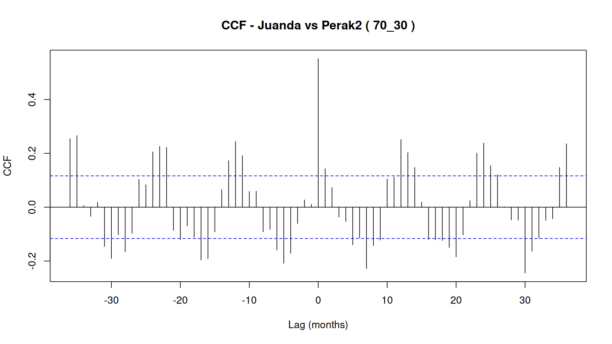

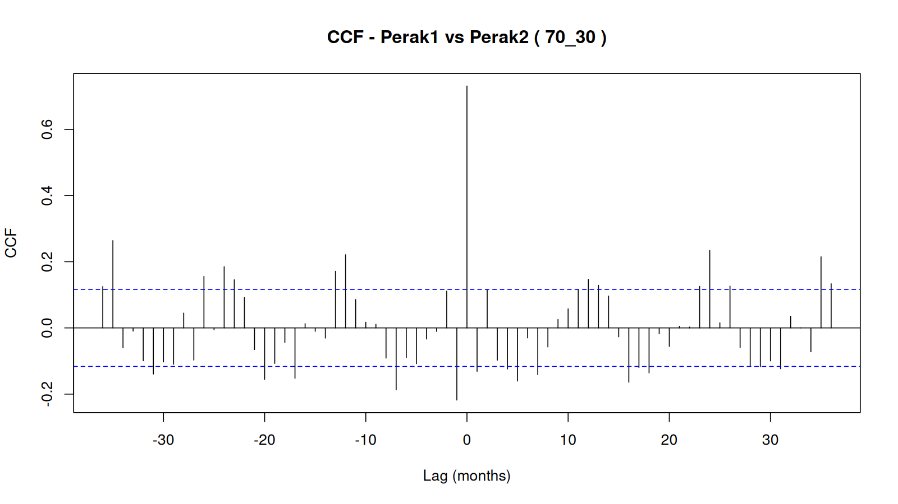

### Candidate models

| a | b | fitted | AIC | coefficients_finite | iidn_pass | white_noise_pass | error |
|---|---|---|---|---|---|---|---|
| 1 | 1 | TRUE | 10593.485 | TRUE | FALSE | FALSE |  |
| 5 | 5 | TRUE | 10356.941 | TRUE | FALSE | FALSE |  |
| 6 | 6 | TRUE | 10264.479 | TRUE | FALSE | FALSE |  |
| 7 | 7 | TRUE | 10194.440 | TRUE | FALSE | FALSE |  |
| 8 | 8 | TRUE | 10097.575 | TRUE | FALSE | FALSE |  |
| 9 | 9 | TRUE | 10013.162 | TRUE | FALSE | FALSE |  |
| 12 | 12 | TRUE | 9762.222 | TRUE | FALSE | TRUE |  |
| 16 | 16 | TRUE | 9638.662 | TRUE | FALSE | TRUE |  |
| 17 | 17 | TRUE | 9613.144 | TRUE | FALSE | TRUE |  |

### Selected parameters

| a | b | parameter | estimate | std_error | t_value | p_value |
|---|---|---|---|---|---|---|
| 17 | 17 | psi10(Juanda) | -0.606357 | 2.779717 | -0.218136 | 0.827379 |
| 17 | 17 | psi10(Perak1) | -1.029635 | 5.396924 | -0.190782 | 0.848745 |
| 17 | 17 | psi10(Perak2) | -0.681632 | 10.368441 | -0.065741 | 0.947600 |
| 17 | 17 | psi20(Juanda) | -0.612687 | 4.207083 | -0.145632 | 0.884248 |
| 17 | 17 | psi20(Perak1) | -0.878584 | 9.524488 | -0.092245 | 0.926527 |
| 17 | 17 | psi20(Perak2) | -0.687356 | 16.263654 | -0.042263 | 0.966299 |
| 17 | 17 | psi30(Juanda) | -0.508215 | 5.500078 | -0.092401 | 0.926402 |
| 17 | 17 | psi30(Perak1) | -0.785749 | 12.762448 | -0.061567 | 0.950923 |
| 17 | 17 | psi30(Perak2) | -0.771432 | 21.612152 | -0.035694 | 0.971535 |
| 17 | 17 | psi40(Juanda) | -0.510138 | 6.386642 | -0.079876 | 0.936356 |
| 17 | 17 | psi40(Perak1) | -0.722578 | 14.940780 | -0.048363 | 0.961439 |
| 17 | 17 | psi40(Perak2) | -0.752888 | 26.180797 | -0.028757 | 0.977065 |
| 17 | 17 | psi50(Juanda) | -0.520714 | 7.015129 | -0.074227 | 0.940848 |
| 17 | 17 | psi50(Perak1) | -0.599152 | 16.763766 | -0.035741 | 0.971498 |
| 17 | 17 | psi50(Perak2) | -0.705513 | 29.025231 | -0.024307 | 0.980614 |
| 17 | 17 | psi60(Juanda) | -0.551523 | 7.475678 | -0.073776 | 0.941207 |
| 17 | 17 | psi60(Perak1) | -0.579613 | 17.728624 | -0.032694 | 0.973927 |
| 17 | 17 | psi60(Perak2) | -0.749538 | 31.530128 | -0.023772 | 0.981040 |
| 17 | 17 | psi70(Juanda) | -0.384101 | 7.997259 | -0.048029 | 0.961705 |
| 17 | 17 | psi70(Perak1) | -0.713528 | 18.385109 | -0.038810 | 0.969051 |
| 17 | 17 | psi70(Perak2) | -0.841495 | 33.486089 | -0.025130 | 0.979958 |
| 17 | 17 | psi80(Juanda) | -0.400182 | 8.167853 | -0.048995 | 0.960936 |
| 17 | 17 | psi80(Perak1) | -0.714856 | 18.867954 | -0.037887 | 0.969787 |
| 17 | 17 | psi80(Perak2) | -0.922725 | 36.112702 | -0.025551 | 0.979622 |
| 17 | 17 | psi90(Juanda) | -0.263966 | 8.277449 | -0.031890 | 0.974568 |
| 17 | 17 | psi90(Perak1) | -0.503521 | 19.405949 | -0.025947 | 0.979306 |
| 17 | 17 | psi90(Perak2) | -1.064690 | 37.536478 | -0.028364 | 0.977379 |
| 17 | 17 | psi100(Juanda) | -0.285359 | 7.956173 | -0.035866 | 0.971398 |
| 17 | 17 | psi100(Perak1) | -0.476439 | 18.565348 | -0.025663 | 0.979533 |
| 17 | 17 | psi100(Perak2) | -0.926896 | 40.099893 | -0.023115 | 0.981565 |
| 17 | 17 | psi110(Juanda) | -0.281544 | 7.525905 | -0.037410 | 0.970167 |
| 17 | 17 | psi110(Perak1) | -0.359983 | 18.053504 | -0.019940 | 0.984096 |
| 17 | 17 | psi110(Perak2) | -0.903989 | 40.166543 | -0.022506 | 0.982050 |
| 17 | 17 | psi120(Juanda) | -0.006585 | 7.016475 | -0.000939 | 0.999251 |
| 17 | 17 | psi120(Perak1) | -0.234749 | 17.069257 | -0.013753 | 0.989031 |
| 17 | 17 | psi120(Perak2) | -0.671274 | 38.831857 | -0.017287 | 0.986212 |
| 17 | 17 | psi130(Juanda) | -0.022924 | 6.589739 | -0.003479 | 0.997225 |
| 17 | 17 | psi130(Perak1) | -0.125761 | 15.619641 | -0.008051 | 0.993578 |
| 17 | 17 | psi130(Perak2) | -0.642633 | 35.336843 | -0.018186 | 0.985495 |
| 17 | 17 | psi140(Juanda) | 0.083295 | 6.251637 | 0.013324 | 0.989373 |
| 17 | 17 | psi140(Perak1) | -0.209029 | 13.387957 | -0.015613 | 0.987547 |
| 17 | 17 | psi140(Perak2) | -0.438887 | 29.932846 | -0.014662 | 0.988305 |
| 17 | 17 | psi150(Juanda) | 0.086814 | 5.806878 | 0.014950 | 0.988076 |
| 17 | 17 | psi150(Perak1) | -0.205485 | 11.316587 | -0.018158 | 0.985517 |
| 17 | 17 | psi150(Perak2) | -0.266823 | 23.261923 | -0.011470 | 0.990851 |
| 17 | 17 | psi160(Juanda) | 0.039715 | 4.699703 | 0.008450 | 0.993260 |
| 17 | 17 | psi160(Perak1) | -0.002178 | 8.615091 | -0.000253 | 0.999798 |
| 17 | 17 | psi160(Perak2) | -0.270695 | 17.382199 | -0.015573 | 0.987579 |
| 17 | 17 | psi170(Juanda) | 0.084814 | 3.168630 | 0.026767 | 0.978652 |
| 17 | 17 | psi170(Perak1) | -0.010516 | 5.329900 | -0.001973 | 0.998426 |
| 17 | 17 | psi170(Perak2) | -0.172341 | 11.096104 | -0.015532 | 0.987612 |
| 17 | 17 | psi11(Juanda) | -0.231899 | 22.981538 | -0.010091 | 0.991951 |
| 17 | 17 | psi11(Perak1) | 0.212895 | 5.610817 | 0.037944 | 0.969742 |
| 17 | 17 | psi11(Perak2) | -0.089250 | 4.267159 | -0.020916 | 0.983318 |
| 17 | 17 | psi21(Juanda) | -0.467390 | 43.038515 | -0.010860 | 0.991338 |
| 17 | 17 | psi21(Perak1) | 0.209908 | 7.591574 | 0.027650 | 0.977948 |
| 17 | 17 | psi21(Perak2) | -0.027200 | 7.143437 | -0.003808 | 0.996963 |
| 17 | 17 | psi31(Juanda) | -0.869526 | 54.123074 | -0.016066 | 0.987186 |
| 17 | 17 | psi31(Perak1) | 0.114976 | 10.352895 | 0.011106 | 0.991142 |
| 17 | 17 | psi31(Perak2) | 0.006759 | 9.759316 | 0.000693 | 0.999448 |
| 17 | 17 | psi41(Juanda) | -0.806085 | 60.058636 | -0.013422 | 0.989295 |
| 17 | 17 | psi41(Perak1) | 0.062803 | 12.284029 | 0.005113 | 0.995922 |
| 17 | 17 | psi41(Perak2) | -0.020129 | 12.438528 | -0.001618 | 0.998709 |
| 17 | 17 | psi51(Juanda) | -0.869820 | 64.876193 | -0.013407 | 0.989306 |
| 17 | 17 | psi51(Perak1) | -0.121161 | 14.052141 | -0.008622 | 0.993123 |
| 17 | 17 | psi51(Perak2) | -0.041365 | 14.744364 | -0.002805 | 0.997762 |
| 17 | 17 | psi61(Juanda) | -0.865003 | 69.551951 | -0.012437 | 0.990080 |
| 17 | 17 | psi61(Perak1) | 0.004126 | 15.017551 | 0.000275 | 0.999781 |
| 17 | 17 | psi61(Perak2) | -0.002028 | 16.904906 | -0.000120 | 0.999904 |
| 17 | 17 | psi71(Juanda) | -1.460164 | 73.587277 | -0.019843 | 0.984174 |
| 17 | 17 | psi71(Perak1) | 0.114318 | 15.824618 | 0.007224 | 0.994238 |
| 17 | 17 | psi71(Perak2) | 0.035271 | 17.933458 | 0.001967 | 0.998431 |
| 17 | 17 | psi81(Juanda) | -1.654183 | 81.100606 | -0.020397 | 0.983732 |
| 17 | 17 | psi81(Perak1) | 0.150641 | 15.647350 | 0.009627 | 0.992321 |
| 17 | 17 | psi81(Perak2) | 0.076375 | 18.442581 | 0.004141 | 0.996697 |
| 17 | 17 | psi91(Juanda) | -1.737535 | 87.032651 | -0.019964 | 0.984077 |
| 17 | 17 | psi91(Perak1) | 0.136103 | 15.560805 | 0.008747 | 0.993024 |
| 17 | 17 | psi91(Perak2) | 0.206751 | 18.709907 | 0.011050 | 0.991186 |
| 17 | 17 | psi101(Juanda) | -1.437663 | 85.183122 | -0.016877 | 0.986539 |
| 17 | 17 | psi101(Perak1) | 0.154531 | 14.931446 | 0.010349 | 0.991745 |
| 17 | 17 | psi101(Perak2) | 0.198707 | 18.242263 | 0.010893 | 0.991312 |
| 17 | 17 | psi111(Juanda) | -1.058088 | 80.415026 | -0.013158 | 0.989505 |
| 17 | 17 | psi111(Perak1) | 0.092944 | 14.611639 | 0.006361 | 0.994926 |
| 17 | 17 | psi111(Perak2) | 0.294649 | 17.425155 | 0.016909 | 0.986513 |
| 17 | 17 | psi121(Juanda) | -0.804456 | 76.438780 | -0.010524 | 0.991606 |
| 17 | 17 | psi121(Perak1) | 0.144318 | 13.430963 | 0.010745 | 0.991429 |
| 17 | 17 | psi121(Perak2) | 0.362536 | 16.623524 | 0.021809 | 0.982606 |
| 17 | 17 | psi131(Juanda) | -0.461629 | 70.472329 | -0.006550 | 0.994775 |
| 17 | 17 | psi131(Perak1) | 0.158675 | 12.403807 | 0.012792 | 0.989797 |
| 17 | 17 | psi131(Perak2) | 0.446299 | 14.740603 | 0.030277 | 0.975854 |
| 17 | 17 | psi141(Juanda) | -0.378753 | 61.876207 | -0.006121 | 0.995118 |
| 17 | 17 | psi141(Perak1) | 0.308521 | 10.962538 | 0.028143 | 0.977555 |
| 17 | 17 | psi141(Perak2) | 0.320372 | 12.762245 | 0.025103 | 0.979979 |
| 17 | 17 | psi151(Juanda) | -0.341916 | 52.791423 | -0.006477 | 0.994834 |
| 17 | 17 | psi151(Perak1) | 0.303775 | 9.801331 | 0.030993 | 0.975283 |
| 17 | 17 | psi151(Perak2) | 0.213862 | 10.005237 | 0.021375 | 0.982952 |
| 17 | 17 | psi161(Juanda) | -0.176168 | 41.454656 | -0.004250 | 0.996610 |
| 17 | 17 | psi161(Perak1) | 0.034994 | 7.575581 | 0.004619 | 0.996316 |
| 17 | 17 | psi161(Perak2) | 0.192692 | 7.300422 | 0.026395 | 0.978949 |
| 17 | 17 | psi171(Juanda) | -0.114484 | 22.753262 | -0.005032 | 0.995987 |
| 17 | 17 | psi171(Perak1) | 0.069786 | 5.814820 | 0.012001 | 0.990427 |
| 17 | 17 | psi171(Perak2) | 0.067018 | 4.528979 | 0.014798 | 0.988197 |

### Training fit and hold-out forecast

Each panel compares actual rainfall with fitted values (left), recursive multi-step forecasts, and actual-lag one-step forecasts (right).

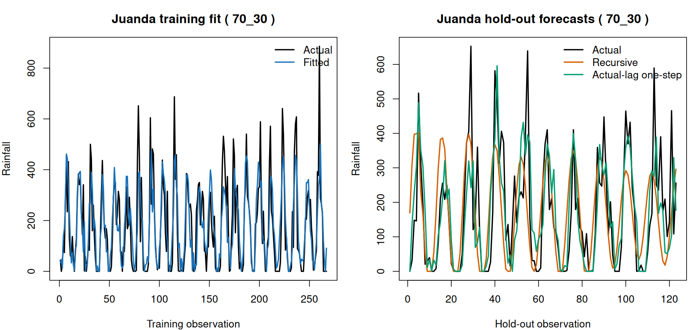

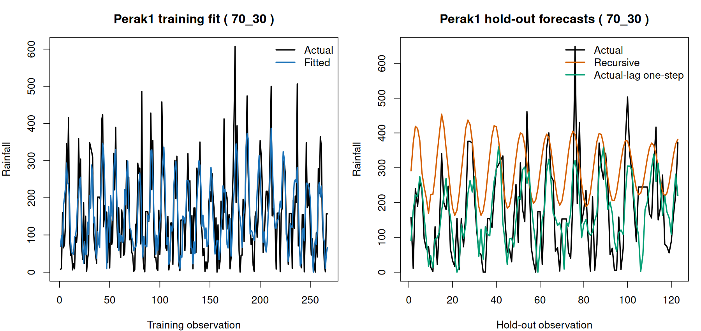

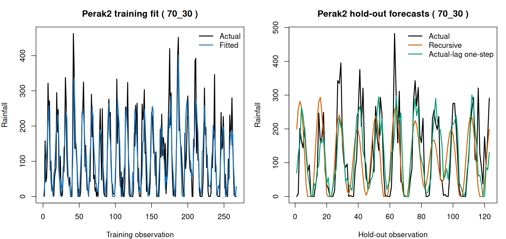

### Training metrics

| location | MSE | RMSE | MAE | sMAPE | MAPE_nonzero | R_squared |
|---|---|---|---|---|---|---|
| Juanda | 10866.151 | 104.24083 | 74.77779 | 72.88285 | 581.6574 | 0.628790 |
| Perak1 | 7306.834 | 85.48002 | 67.41726 | 59.43037 | 859.8983 | 0.475908 |
| Perak2 | 3802.513 | 61.66452 | 45.84950 | 78.49009 | 175.4241 | 0.661475 |
| Overall | 7325.166 | 85.58718 | 62.68152 | 70.26777 | 557.0529 | 0.612657 |

### Testing metrics: recursive multi-step

Each forecasted test value is used as a lag input for the next test forecast; no actual test value enters the forecast recursion.

| location | MSE | RMSE | MAE | sMAPE | MAPE_nonzero | R_squared |
|---|---|---|---|---|---|---|
| Juanda | 18178.00 | 134.82581 | 102.61890 | 95.05561 | 514.1858 | 0.309057 |
| Perak1 | 26711.45 | 163.43638 | 139.07764 | 74.86752 | 4527.8269 | -0.631054 |
| Perak2 | 9315.20 | 96.51528 | 74.81037 | 94.41721 | 539.3356 | 0.292333 |
| Overall | 18068.22 | 134.41807 | 105.50231 | 88.11345 | 2022.6001 | 0.055085 |

### Testing metrics: actual-lag one-step

Each test prediction uses observed rainfall only from earlier test months as lag inputs; it does not use the current month’s actual rainfall. This is a one-step-ahead evaluation, not a deployable long-horizon forecast.

| location | MSE | RMSE | MAE | sMAPE | MAPE_nonzero | R_squared |
|---|---|---|---|---|---|---|
| Juanda | 12917.856 | 113.65675 | 81.61514 | 75.60134 | 93.34385 | 0.508994 |
| Perak1 | 10232.065 | 101.15367 | 82.76976 | 65.71144 | 1698.36683 | 0.375210 |
| Perak2 | 6132.086 | 78.30764 | 56.70594 | 74.97731 | 257.80079 | 0.534151 |
| Overall | 9760.669 | 98.79610 | 73.69695 | 72.09669 | 744.88455 | 0.489546 |

### Selected residual diagnostics

| location | mean_residual | residual_variance | mean_zero_p_value | normality_shapiro_p_value | variance_stability_fligner_p_value | ljung_box_10_p_value | ljung_box_20_p_value |
|---|---|---|---|---|---|---|---|
| Juanda | -0.620250 | 10991.351 | 0.923060 | 0.000000 | 0.588519 | 0.996287 | 0.883309 |
| Perak1 | -0.581396 | 7337.217 | 0.911773 | 0.000018 | 0.597099 | 0.999982 | 0.994145 |
| Perak2 | -0.203357 | 3890.430 | 0.957554 | 0.000039 | 0.568033 | 0.989265 | 0.924760 |

### Equation terms

Package convention: own-city terms are psi[k,0](i) Z[i,t-k]; spatial terms are psi[k,1](i) sum_j W[j,i] Z[j,t-k].

| location | lag | effect | parameter | coefficient | equation_term |
|---|---|---|---|---|---|
| Juanda | 1 | own-city | psi10(Juanda) | -0.606357 | -0.606357 * Z_Juanda,t-1 |
| Perak1 | 1 | own-city | psi10(Perak1) | -1.029635 | -1.029635 * Z_Perak1,t-1 |
| Perak2 | 1 | own-city | psi10(Perak2) | -0.681632 | -0.681632 * Z_Perak2,t-1 |
| Juanda | 2 | own-city | psi20(Juanda) | -0.612687 | -0.612687 * Z_Juanda,t-2 |
| Perak1 | 2 | own-city | psi20(Perak1) | -0.878584 | -0.878584 * Z_Perak1,t-2 |
| Perak2 | 2 | own-city | psi20(Perak2) | -0.687356 | -0.687356 * Z_Perak2,t-2 |
| Juanda | 3 | own-city | psi30(Juanda) | -0.508215 | -0.508215 * Z_Juanda,t-3 |
| Perak1 | 3 | own-city | psi30(Perak1) | -0.785749 | -0.785749 * Z_Perak1,t-3 |
| Perak2 | 3 | own-city | psi30(Perak2) | -0.771432 | -0.771432 * Z_Perak2,t-3 |
| Juanda | 4 | own-city | psi40(Juanda) | -0.510138 | -0.510138 * Z_Juanda,t-4 |
| Perak1 | 4 | own-city | psi40(Perak1) | -0.722578 | -0.722578 * Z_Perak1,t-4 |
| Perak2 | 4 | own-city | psi40(Perak2) | -0.752888 | -0.752888 * Z_Perak2,t-4 |
| Juanda | 5 | own-city | psi50(Juanda) | -0.520714 | -0.520714 * Z_Juanda,t-5 |
| Perak1 | 5 | own-city | psi50(Perak1) | -0.599152 | -0.599152 * Z_Perak1,t-5 |
| Perak2 | 5 | own-city | psi50(Perak2) | -0.705513 | -0.705513 * Z_Perak2,t-5 |
| Juanda | 6 | own-city | psi60(Juanda) | -0.551523 | -0.551523 * Z_Juanda,t-6 |
| Perak1 | 6 | own-city | psi60(Perak1) | -0.579613 | -0.579613 * Z_Perak1,t-6 |
| Perak2 | 6 | own-city | psi60(Perak2) | -0.749538 | -0.749538 * Z_Perak2,t-6 |
| Juanda | 7 | own-city | psi70(Juanda) | -0.384101 | -0.384101 * Z_Juanda,t-7 |
| Perak1 | 7 | own-city | psi70(Perak1) | -0.713528 | -0.713528 * Z_Perak1,t-7 |
| Perak2 | 7 | own-city | psi70(Perak2) | -0.841495 | -0.841495 * Z_Perak2,t-7 |
| Juanda | 8 | own-city | psi80(Juanda) | -0.400182 | -0.400182 * Z_Juanda,t-8 |
| Perak1 | 8 | own-city | psi80(Perak1) | -0.714856 | -0.714856 * Z_Perak1,t-8 |
| Perak2 | 8 | own-city | psi80(Perak2) | -0.922725 | -0.922725 * Z_Perak2,t-8 |
| Juanda | 9 | own-city | psi90(Juanda) | -0.263966 | -0.263966 * Z_Juanda,t-9 |
| Perak1 | 9 | own-city | psi90(Perak1) | -0.503521 | -0.503521 * Z_Perak1,t-9 |
| Perak2 | 9 | own-city | psi90(Perak2) | -1.064690 | -1.06469 * Z_Perak2,t-9 |
| Juanda | 10 | own-city | psi100(Juanda) | -0.285359 | -0.285359 * Z_Juanda,t-10 |
| Perak1 | 10 | own-city | psi100(Perak1) | -0.476439 | -0.476439 * Z_Perak1,t-10 |
| Perak2 | 10 | own-city | psi100(Perak2) | -0.926896 | -0.926896 * Z_Perak2,t-10 |
| Juanda | 11 | own-city | psi110(Juanda) | -0.281544 | -0.281544 * Z_Juanda,t-11 |
| Perak1 | 11 | own-city | psi110(Perak1) | -0.359983 | -0.359983 * Z_Perak1,t-11 |
| Perak2 | 11 | own-city | psi110(Perak2) | -0.903989 | -0.903989 * Z_Perak2,t-11 |
| Juanda | 12 | own-city | psi120(Juanda) | -0.006585 | -0.006585 * Z_Juanda,t-12 |
| Perak1 | 12 | own-city | psi120(Perak1) | -0.234749 | -0.234749 * Z_Perak1,t-12 |
| Perak2 | 12 | own-city | psi120(Perak2) | -0.671274 | -0.671274 * Z_Perak2,t-12 |
| Juanda | 13 | own-city | psi130(Juanda) | -0.022924 | -0.022924 * Z_Juanda,t-13 |
| Perak1 | 13 | own-city | psi130(Perak1) | -0.125761 | -0.125761 * Z_Perak1,t-13 |
| Perak2 | 13 | own-city | psi130(Perak2) | -0.642633 | -0.642633 * Z_Perak2,t-13 |
| Juanda | 14 | own-city | psi140(Juanda) | 0.083295 | 0.083295 * Z_Juanda,t-14 |
| Perak1 | 14 | own-city | psi140(Perak1) | -0.209029 | -0.209029 * Z_Perak1,t-14 |
| Perak2 | 14 | own-city | psi140(Perak2) | -0.438887 | -0.438887 * Z_Perak2,t-14 |
| Juanda | 15 | own-city | psi150(Juanda) | 0.086814 | 0.086814 * Z_Juanda,t-15 |
| Perak1 | 15 | own-city | psi150(Perak1) | -0.205485 | -0.205485 * Z_Perak1,t-15 |
| Perak2 | 15 | own-city | psi150(Perak2) | -0.266823 | -0.266823 * Z_Perak2,t-15 |
| Juanda | 16 | own-city | psi160(Juanda) | 0.039715 | 0.039715 * Z_Juanda,t-16 |
| Perak1 | 16 | own-city | psi160(Perak1) | -0.002178 | -0.002178 * Z_Perak1,t-16 |
| Perak2 | 16 | own-city | psi160(Perak2) | -0.270695 | -0.270695 * Z_Perak2,t-16 |
| Juanda | 17 | own-city | psi170(Juanda) | 0.084814 | 0.084814 * Z_Juanda,t-17 |
| Perak1 | 17 | own-city | psi170(Perak1) | -0.010516 | -0.010516 * Z_Perak1,t-17 |
| Perak2 | 17 | own-city | psi170(Perak2) | -0.172341 | -0.172341 * Z_Perak2,t-17 |
| Juanda | 1 | spatially weighted other-city | psi11(Juanda) | -0.231899 | -0.231899 * sum_j(W_{j,Juanda} Z_j,t-1) |
| Perak1 | 1 | spatially weighted other-city | psi11(Perak1) | 0.212895 | 0.212895 * sum_j(W_{j,Perak1} Z_j,t-1) |
| Perak2 | 1 | spatially weighted other-city | psi11(Perak2) | -0.089250 | -0.08925 * sum_j(W_{j,Perak2} Z_j,t-1) |
| Juanda | 2 | spatially weighted other-city | psi21(Juanda) | -0.467390 | -0.46739 * sum_j(W_{j,Juanda} Z_j,t-2) |
| Perak1 | 2 | spatially weighted other-city | psi21(Perak1) | 0.209908 | 0.209908 * sum_j(W_{j,Perak1} Z_j,t-2) |
| Perak2 | 2 | spatially weighted other-city | psi21(Perak2) | -0.027200 | -0.0272 * sum_j(W_{j,Perak2} Z_j,t-2) |
| Juanda | 3 | spatially weighted other-city | psi31(Juanda) | -0.869526 | -0.869526 * sum_j(W_{j,Juanda} Z_j,t-3) |
| Perak1 | 3 | spatially weighted other-city | psi31(Perak1) | 0.114976 | 0.114976 * sum_j(W_{j,Perak1} Z_j,t-3) |
| Perak2 | 3 | spatially weighted other-city | psi31(Perak2) | 0.006759 | 0.006759 * sum_j(W_{j,Perak2} Z_j,t-3) |
| Juanda | 4 | spatially weighted other-city | psi41(Juanda) | -0.806085 | -0.806085 * sum_j(W_{j,Juanda} Z_j,t-4) |
| Perak1 | 4 | spatially weighted other-city | psi41(Perak1) | 0.062803 | 0.062803 * sum_j(W_{j,Perak1} Z_j,t-4) |
| Perak2 | 4 | spatially weighted other-city | psi41(Perak2) | -0.020129 | -0.020129 * sum_j(W_{j,Perak2} Z_j,t-4) |
| Juanda | 5 | spatially weighted other-city | psi51(Juanda) | -0.869820 | -0.86982 * sum_j(W_{j,Juanda} Z_j,t-5) |
| Perak1 | 5 | spatially weighted other-city | psi51(Perak1) | -0.121161 | -0.121161 * sum_j(W_{j,Perak1} Z_j,t-5) |
| Perak2 | 5 | spatially weighted other-city | psi51(Perak2) | -0.041365 | -0.041365 * sum_j(W_{j,Perak2} Z_j,t-5) |
| Juanda | 6 | spatially weighted other-city | psi61(Juanda) | -0.865003 | -0.865003 * sum_j(W_{j,Juanda} Z_j,t-6) |
| Perak1 | 6 | spatially weighted other-city | psi61(Perak1) | 0.004126 | 0.004126 * sum_j(W_{j,Perak1} Z_j,t-6) |
| Perak2 | 6 | spatially weighted other-city | psi61(Perak2) | -0.002028 | -0.002028 * sum_j(W_{j,Perak2} Z_j,t-6) |
| Juanda | 7 | spatially weighted other-city | psi71(Juanda) | -1.460164 | -1.460164 * sum_j(W_{j,Juanda} Z_j,t-7) |
| Perak1 | 7 | spatially weighted other-city | psi71(Perak1) | 0.114318 | 0.114318 * sum_j(W_{j,Perak1} Z_j,t-7) |
| Perak2 | 7 | spatially weighted other-city | psi71(Perak2) | 0.035271 | 0.035271 * sum_j(W_{j,Perak2} Z_j,t-7) |
| Juanda | 8 | spatially weighted other-city | psi81(Juanda) | -1.654183 | -1.654183 * sum_j(W_{j,Juanda} Z_j,t-8) |
| Perak1 | 8 | spatially weighted other-city | psi81(Perak1) | 0.150641 | 0.150641 * sum_j(W_{j,Perak1} Z_j,t-8) |
| Perak2 | 8 | spatially weighted other-city | psi81(Perak2) | 0.076375 | 0.076375 * sum_j(W_{j,Perak2} Z_j,t-8) |
| Juanda | 9 | spatially weighted other-city | psi91(Juanda) | -1.737535 | -1.737535 * sum_j(W_{j,Juanda} Z_j,t-9) |
| Perak1 | 9 | spatially weighted other-city | psi91(Perak1) | 0.136103 | 0.136103 * sum_j(W_{j,Perak1} Z_j,t-9) |
| Perak2 | 9 | spatially weighted other-city | psi91(Perak2) | 0.206751 | 0.206751 * sum_j(W_{j,Perak2} Z_j,t-9) |
| Juanda | 10 | spatially weighted other-city | psi101(Juanda) | -1.437663 | -1.437663 * sum_j(W_{j,Juanda} Z_j,t-10) |
| Perak1 | 10 | spatially weighted other-city | psi101(Perak1) | 0.154531 | 0.154531 * sum_j(W_{j,Perak1} Z_j,t-10) |
| Perak2 | 10 | spatially weighted other-city | psi101(Perak2) | 0.198707 | 0.198707 * sum_j(W_{j,Perak2} Z_j,t-10) |
| Juanda | 11 | spatially weighted other-city | psi111(Juanda) | -1.058088 | -1.058088 * sum_j(W_{j,Juanda} Z_j,t-11) |
| Perak1 | 11 | spatially weighted other-city | psi111(Perak1) | 0.092944 | 0.092944 * sum_j(W_{j,Perak1} Z_j,t-11) |
| Perak2 | 11 | spatially weighted other-city | psi111(Perak2) | 0.294649 | 0.294649 * sum_j(W_{j,Perak2} Z_j,t-11) |
| Juanda | 12 | spatially weighted other-city | psi121(Juanda) | -0.804456 | -0.804456 * sum_j(W_{j,Juanda} Z_j,t-12) |
| Perak1 | 12 | spatially weighted other-city | psi121(Perak1) | 0.144318 | 0.144318 * sum_j(W_{j,Perak1} Z_j,t-12) |
| Perak2 | 12 | spatially weighted other-city | psi121(Perak2) | 0.362536 | 0.362536 * sum_j(W_{j,Perak2} Z_j,t-12) |
| Juanda | 13 | spatially weighted other-city | psi131(Juanda) | -0.461629 | -0.461629 * sum_j(W_{j,Juanda} Z_j,t-13) |
| Perak1 | 13 | spatially weighted other-city | psi131(Perak1) | 0.158675 | 0.158675 * sum_j(W_{j,Perak1} Z_j,t-13) |
| Perak2 | 13 | spatially weighted other-city | psi131(Perak2) | 0.446299 | 0.446299 * sum_j(W_{j,Perak2} Z_j,t-13) |
| Juanda | 14 | spatially weighted other-city | psi141(Juanda) | -0.378753 | -0.378753 * sum_j(W_{j,Juanda} Z_j,t-14) |
| Perak1 | 14 | spatially weighted other-city | psi141(Perak1) | 0.308521 | 0.308521 * sum_j(W_{j,Perak1} Z_j,t-14) |
| Perak2 | 14 | spatially weighted other-city | psi141(Perak2) | 0.320372 | 0.320372 * sum_j(W_{j,Perak2} Z_j,t-14) |
| Juanda | 15 | spatially weighted other-city | psi151(Juanda) | -0.341916 | -0.341916 * sum_j(W_{j,Juanda} Z_j,t-15) |
| Perak1 | 15 | spatially weighted other-city | psi151(Perak1) | 0.303775 | 0.303775 * sum_j(W_{j,Perak1} Z_j,t-15) |
| Perak2 | 15 | spatially weighted other-city | psi151(Perak2) | 0.213862 | 0.213862 * sum_j(W_{j,Perak2} Z_j,t-15) |
| Juanda | 16 | spatially weighted other-city | psi161(Juanda) | -0.176168 | -0.176168 * sum_j(W_{j,Juanda} Z_j,t-16) |
| Perak1 | 16 | spatially weighted other-city | psi161(Perak1) | 0.034994 | 0.034994 * sum_j(W_{j,Perak1} Z_j,t-16) |
| Perak2 | 16 | spatially weighted other-city | psi161(Perak2) | 0.192692 | 0.192692 * sum_j(W_{j,Perak2} Z_j,t-16) |
| Juanda | 17 | spatially weighted other-city | psi171(Juanda) | -0.114484 | -0.114484 * sum_j(W_{j,Juanda} Z_j,t-17) |
| Perak1 | 17 | spatially weighted other-city | psi171(Perak1) | 0.069786 | 0.069786 * sum_j(W_{j,Perak1} Z_j,t-17) |
| Perak2 | 17 | spatially weighted other-city | psi171(Perak2) | 0.067018 | 0.067018 * sum_j(W_{j,Perak2} Z_j,t-17) |

## Split 80:20

Training rows: 326; test rows: 82. Selected **GSTAR(19,19)** with d = 0 (white-noise fallback).

### Stationarity

| stage | location | test | lag | statistic | p_value | stationary |
|---|---|---|---|---|---|---|
| raw_training | Juanda | Fligner-Killeen variance | NA | 0.527932 | 0.467478 | TRUE |
| raw_training | Perak1 | Fligner-Killeen variance | NA | 0.076708 | 0.781809 | TRUE |
| raw_training | Perak2 | Fligner-Killeen variance | NA | 0.348532 | 0.554945 | TRUE |
| raw_training_reused | Juanda | Fligner-Killeen variance | NA | 0.527932 | 0.467478 | TRUE |
| raw_training_reused | Perak1 | Fligner-Killeen variance | NA | 0.076708 | 0.781809 | TRUE |
| raw_training_reused | Perak2 | Fligner-Killeen variance | NA | 0.348532 | 0.554945 | TRUE |

| stage | location | test | lag | statistic | p_value | stationary |
|---|---|---|---|---|---|---|
| raw_training | Juanda | ADF | 0 | -8.765573 | 0.010000 | TRUE |
| raw_training | Juanda | ADF | 1 | -9.113309 | 0.010000 | TRUE |
| raw_training | Juanda | ADF | 2 | -10.191746 | 0.010000 | TRUE |
| raw_training | Juanda | ADF | 3 | -11.679412 | 0.010000 | TRUE |
| raw_training | Juanda | ADF | 4 | -12.775811 | 0.010000 | TRUE |
| raw_training | Juanda | ADF | 5 | -13.226149 | 0.010000 | TRUE |
| raw_training | Juanda | ADF | 6 | -12.397557 | 0.010000 | TRUE |
| raw_training | Juanda | ADF | 7 | -11.585973 | 0.010000 | TRUE |
| raw_training | Juanda | ADF | 8 | -9.877770 | 0.010000 | TRUE |
| raw_training | Juanda | ADF | 9 | -8.220636 | 0.010000 | TRUE |
| raw_training | Juanda | ADF | 10 | -6.262905 | 0.010000 | TRUE |
| raw_training | Juanda | ADF | 11 | -4.396225 | 0.010000 | TRUE |
| raw_training | Juanda | ADF | 12 | -4.346907 | 0.010000 | TRUE |
| raw_training | Juanda | ADF | 13 | -4.307844 | 0.010000 | TRUE |
| raw_training | Juanda | ADF | 14 | -4.865601 | 0.010000 | TRUE |
| raw_training | Juanda | ADF | 15 | -5.156432 | 0.010000 | TRUE |
| raw_training | Juanda | ADF | 16 | -5.148247 | 0.010000 | TRUE |
| raw_training | Juanda | ADF | 17 | -5.550825 | 0.010000 | TRUE |
| raw_training | Juanda | ADF | 18 | -5.502367 | 0.010000 | TRUE |
| raw_training | Juanda | ADF | 19 | -5.698409 | 0.010000 | TRUE |
| raw_training | Juanda | ADF | 20 | -5.761987 | 0.010000 | TRUE |
| raw_training | Juanda | ADF | 21 | -4.589390 | 0.010000 | TRUE |
| raw_training | Juanda | ADF | 22 | -3.663807 | 0.027230 | TRUE |
| raw_training | Juanda | ADF | 23 | -3.499724 | 0.043007 | TRUE |
| raw_training | Juanda | ADF | 24 | -3.779253 | 0.020387 | TRUE |
| raw_training | Juanda | ADF | 25 | -3.856783 | 0.016511 | TRUE |
| raw_training | Juanda | ADF | 26 | -3.696407 | 0.024530 | TRUE |
| raw_training | Juanda | ADF | 27 | -3.669030 | 0.026728 | TRUE |
| raw_training | Juanda | ADF | 28 | -3.609069 | 0.032493 | TRUE |
| raw_training | Juanda | ADF | 29 | -3.900676 | 0.014316 | TRUE |
| raw_training | Juanda | ADF | 30 | -4.137979 | 0.010000 | TRUE |
| raw_training | Juanda | ADF | 31 | -3.987985 | 0.010000 | TRUE |
| raw_training | Juanda | ADF | 32 | -3.789485 | 0.019876 | TRUE |
| raw_training | Juanda | ADF | 33 | -3.830035 | 0.017848 | TRUE |
| raw_training | Juanda | ADF | 34 | -3.043101 | 0.136647 | FALSE |
| raw_training | Juanda | ADF | 35 | -2.201996 | 0.491356 | FALSE |
| raw_training | Juanda | ADF | 36 | -2.020799 | 0.567771 | FALSE |
| raw_training | Juanda | KPSS | NA | 0.016990 | 0.100000 | TRUE |
| raw_training | Perak1 | ADF | 0 | -11.546874 | 0.010000 | TRUE |
| raw_training | Perak1 | ADF | 1 | -8.996060 | 0.010000 | TRUE |
| raw_training | Perak1 | ADF | 2 | -9.812252 | 0.010000 | TRUE |
| raw_training | Perak1 | ADF | 3 | -10.716994 | 0.010000 | TRUE |
| raw_training | Perak1 | ADF | 4 | -11.338114 | 0.010000 | TRUE |
| raw_training | Perak1 | ADF | 5 | -10.764552 | 0.010000 | TRUE |
| raw_training | Perak1 | ADF | 6 | -11.825188 | 0.010000 | TRUE |
| raw_training | Perak1 | ADF | 7 | -11.302311 | 0.010000 | TRUE |
| raw_training | Perak1 | ADF | 8 | -8.670771 | 0.010000 | TRUE |
| raw_training | Perak1 | ADF | 9 | -7.329503 | 0.010000 | TRUE |
| raw_training | Perak1 | ADF | 10 | -5.645208 | 0.010000 | TRUE |
| raw_training | Perak1 | ADF | 11 | -4.153076 | 0.010000 | TRUE |
| raw_training | Perak1 | ADF | 12 | -3.715511 | 0.023574 | TRUE |
| raw_training | Perak1 | ADF | 13 | -3.670321 | 0.026604 | TRUE |
| raw_training | Perak1 | ADF | 14 | -3.841378 | 0.017281 | TRUE |
| raw_training | Perak1 | ADF | 15 | -4.046196 | 0.010000 | TRUE |
| raw_training | Perak1 | ADF | 16 | -4.122707 | 0.010000 | TRUE |
| raw_training | Perak1 | ADF | 17 | -4.354664 | 0.010000 | TRUE |
| raw_training | Perak1 | ADF | 18 | -4.178952 | 0.010000 | TRUE |
| raw_training | Perak1 | ADF | 19 | -4.443789 | 0.010000 | TRUE |
| raw_training | Perak1 | ADF | 20 | -4.559178 | 0.010000 | TRUE |
| raw_training | Perak1 | ADF | 21 | -4.316142 | 0.010000 | TRUE |
| raw_training | Perak1 | ADF | 22 | -3.646304 | 0.028913 | TRUE |
| raw_training | Perak1 | ADF | 23 | -3.031328 | 0.141612 | FALSE |
| raw_training | Perak1 | ADF | 24 | -3.422607 | 0.050740 | FALSE |
| raw_training | Perak1 | ADF | 25 | -3.208837 | 0.086728 | FALSE |
| raw_training | Perak1 | ADF | 26 | -3.565171 | 0.036714 | TRUE |
| raw_training | Perak1 | ADF | 27 | -3.590301 | 0.034298 | TRUE |
| raw_training | Perak1 | ADF | 28 | -3.382390 | 0.057510 | FALSE |
| raw_training | Perak1 | ADF | 29 | -3.317046 | 0.068511 | FALSE |
| raw_training | Perak1 | ADF | 30 | -3.188755 | 0.090109 | FALSE |
| raw_training | Perak1 | ADF | 31 | -3.625171 | 0.030945 | TRUE |
| raw_training | Perak1 | ADF | 32 | -3.499437 | 0.043035 | TRUE |
| raw_training | Perak1 | ADF | 33 | -3.631121 | 0.030373 | TRUE |
| raw_training | Perak1 | ADF | 34 | -2.871109 | 0.209179 | FALSE |
| raw_training | Perak1 | ADF | 35 | -2.399864 | 0.407912 | FALSE |
| raw_training | Perak1 | ADF | 36 | -2.034936 | 0.561809 | FALSE |
| raw_training | Perak1 | KPSS | NA | 0.029102 | 0.100000 | TRUE |
| raw_training | Perak2 | ADF | 0 | -8.571356 | 0.010000 | TRUE |
| raw_training | Perak2 | ADF | 1 | -8.375447 | 0.010000 | TRUE |
| raw_training | Perak2 | ADF | 2 | -10.545865 | 0.010000 | TRUE |
| raw_training | Perak2 | ADF | 3 | -12.149689 | 0.010000 | TRUE |
| raw_training | Perak2 | ADF | 4 | -12.844728 | 0.010000 | TRUE |
| raw_training | Perak2 | ADF | 5 | -13.048387 | 0.010000 | TRUE |
| raw_training | Perak2 | ADF | 6 | -13.093284 | 0.010000 | TRUE |
| raw_training | Perak2 | ADF | 7 | -11.325978 | 0.010000 | TRUE |
| raw_training | Perak2 | ADF | 8 | -8.977316 | 0.010000 | TRUE |
| raw_training | Perak2 | ADF | 9 | -6.887276 | 0.010000 | TRUE |
| raw_training | Perak2 | ADF | 10 | -5.462146 | 0.010000 | TRUE |
| raw_training | Perak2 | ADF | 11 | -3.787288 | 0.019986 | TRUE |
| raw_training | Perak2 | ADF | 12 | -3.491796 | 0.043770 | TRUE |
| raw_training | Perak2 | ADF | 13 | -3.330564 | 0.066235 | FALSE |
| raw_training | Perak2 | ADF | 14 | -3.403995 | 0.053873 | FALSE |
| raw_training | Perak2 | ADF | 15 | -3.775753 | 0.020562 | TRUE |
| raw_training | Perak2 | ADF | 16 | -3.745920 | 0.022054 | TRUE |
| raw_training | Perak2 | ADF | 17 | -3.397452 | 0.054974 | FALSE |
| raw_training | Perak2 | ADF | 18 | -3.307604 | 0.070100 | FALSE |
| raw_training | Perak2 | ADF | 19 | -3.492490 | 0.043703 | TRUE |
| raw_training | Perak2 | ADF | 20 | -3.521809 | 0.040884 | TRUE |
| raw_training | Perak2 | ADF | 21 | -3.060919 | 0.129133 | FALSE |
| raw_training | Perak2 | ADF | 22 | -2.560626 | 0.340115 | FALSE |
| raw_training | Perak2 | ADF | 23 | -2.216874 | 0.485082 | FALSE |
| raw_training | Perak2 | ADF | 24 | -2.433208 | 0.393850 | FALSE |
| raw_training | Perak2 | ADF | 25 | -2.277194 | 0.459644 | FALSE |
| raw_training | Perak2 | ADF | 26 | -2.522286 | 0.356284 | FALSE |
| raw_training | Perak2 | ADF | 27 | -2.618360 | 0.315768 | FALSE |
| raw_training | Perak2 | ADF | 28 | -2.779289 | 0.247901 | FALSE |
| raw_training | Perak2 | ADF | 29 | -3.157181 | 0.095424 | FALSE |
| raw_training | Perak2 | ADF | 30 | -3.466160 | 0.046235 | TRUE |
| raw_training | Perak2 | ADF | 31 | -3.502195 | 0.042770 | TRUE |
| raw_training | Perak2 | ADF | 32 | -3.354358 | 0.062229 | FALSE |
| raw_training | Perak2 | ADF | 33 | -3.300164 | 0.071353 | FALSE |
| raw_training | Perak2 | ADF | 34 | -2.582199 | 0.331018 | FALSE |
| raw_training | Perak2 | ADF | 35 | -2.190786 | 0.496084 | FALSE |
| raw_training | Perak2 | ADF | 36 | -2.216322 | 0.485315 | FALSE |
| raw_training | Perak2 | KPSS | NA | 0.029182 | 0.100000 | TRUE |
| raw_training_reused | Juanda | ADF | 0 | -8.765573 | 0.010000 | TRUE |
| raw_training_reused | Juanda | ADF | 1 | -9.113309 | 0.010000 | TRUE |
| raw_training_reused | Juanda | ADF | 2 | -10.191746 | 0.010000 | TRUE |
| raw_training_reused | Juanda | ADF | 3 | -11.679412 | 0.010000 | TRUE |
| raw_training_reused | Juanda | ADF | 4 | -12.775811 | 0.010000 | TRUE |
| raw_training_reused | Juanda | ADF | 5 | -13.226149 | 0.010000 | TRUE |
| raw_training_reused | Juanda | ADF | 6 | -12.397557 | 0.010000 | TRUE |
| raw_training_reused | Juanda | ADF | 7 | -11.585973 | 0.010000 | TRUE |
| raw_training_reused | Juanda | ADF | 8 | -9.877770 | 0.010000 | TRUE |
| raw_training_reused | Juanda | ADF | 9 | -8.220636 | 0.010000 | TRUE |
| raw_training_reused | Juanda | ADF | 10 | -6.262905 | 0.010000 | TRUE |
| raw_training_reused | Juanda | ADF | 11 | -4.396225 | 0.010000 | TRUE |
| raw_training_reused | Juanda | ADF | 12 | -4.346907 | 0.010000 | TRUE |
| raw_training_reused | Juanda | ADF | 13 | -4.307844 | 0.010000 | TRUE |
| raw_training_reused | Juanda | ADF | 14 | -4.865601 | 0.010000 | TRUE |
| raw_training_reused | Juanda | ADF | 15 | -5.156432 | 0.010000 | TRUE |
| raw_training_reused | Juanda | ADF | 16 | -5.148247 | 0.010000 | TRUE |
| raw_training_reused | Juanda | ADF | 17 | -5.550825 | 0.010000 | TRUE |
| raw_training_reused | Juanda | ADF | 18 | -5.502367 | 0.010000 | TRUE |
| raw_training_reused | Juanda | ADF | 19 | -5.698409 | 0.010000 | TRUE |
| raw_training_reused | Juanda | ADF | 20 | -5.761987 | 0.010000 | TRUE |
| raw_training_reused | Juanda | ADF | 21 | -4.589390 | 0.010000 | TRUE |
| raw_training_reused | Juanda | ADF | 22 | -3.663807 | 0.027230 | TRUE |
| raw_training_reused | Juanda | ADF | 23 | -3.499724 | 0.043007 | TRUE |
| raw_training_reused | Juanda | ADF | 24 | -3.779253 | 0.020387 | TRUE |
| raw_training_reused | Juanda | ADF | 25 | -3.856783 | 0.016511 | TRUE |
| raw_training_reused | Juanda | ADF | 26 | -3.696407 | 0.024530 | TRUE |
| raw_training_reused | Juanda | ADF | 27 | -3.669030 | 0.026728 | TRUE |
| raw_training_reused | Juanda | ADF | 28 | -3.609069 | 0.032493 | TRUE |
| raw_training_reused | Juanda | ADF | 29 | -3.900676 | 0.014316 | TRUE |
| raw_training_reused | Juanda | ADF | 30 | -4.137979 | 0.010000 | TRUE |
| raw_training_reused | Juanda | ADF | 31 | -3.987985 | 0.010000 | TRUE |
| raw_training_reused | Juanda | ADF | 32 | -3.789485 | 0.019876 | TRUE |
| raw_training_reused | Juanda | ADF | 33 | -3.830035 | 0.017848 | TRUE |
| raw_training_reused | Juanda | ADF | 34 | -3.043101 | 0.136647 | FALSE |
| raw_training_reused | Juanda | ADF | 35 | -2.201996 | 0.491356 | FALSE |
| raw_training_reused | Juanda | ADF | 36 | -2.020799 | 0.567771 | FALSE |
| raw_training_reused | Juanda | KPSS | NA | 0.016990 | 0.100000 | TRUE |
| raw_training_reused | Perak1 | ADF | 0 | -11.546874 | 0.010000 | TRUE |
| raw_training_reused | Perak1 | ADF | 1 | -8.996060 | 0.010000 | TRUE |
| raw_training_reused | Perak1 | ADF | 2 | -9.812252 | 0.010000 | TRUE |
| raw_training_reused | Perak1 | ADF | 3 | -10.716994 | 0.010000 | TRUE |
| raw_training_reused | Perak1 | ADF | 4 | -11.338114 | 0.010000 | TRUE |
| raw_training_reused | Perak1 | ADF | 5 | -10.764552 | 0.010000 | TRUE |
| raw_training_reused | Perak1 | ADF | 6 | -11.825188 | 0.010000 | TRUE |
| raw_training_reused | Perak1 | ADF | 7 | -11.302311 | 0.010000 | TRUE |
| raw_training_reused | Perak1 | ADF | 8 | -8.670771 | 0.010000 | TRUE |
| raw_training_reused | Perak1 | ADF | 9 | -7.329503 | 0.010000 | TRUE |
| raw_training_reused | Perak1 | ADF | 10 | -5.645208 | 0.010000 | TRUE |
| raw_training_reused | Perak1 | ADF | 11 | -4.153076 | 0.010000 | TRUE |
| raw_training_reused | Perak1 | ADF | 12 | -3.715511 | 0.023574 | TRUE |
| raw_training_reused | Perak1 | ADF | 13 | -3.670321 | 0.026604 | TRUE |
| raw_training_reused | Perak1 | ADF | 14 | -3.841378 | 0.017281 | TRUE |
| raw_training_reused | Perak1 | ADF | 15 | -4.046196 | 0.010000 | TRUE |
| raw_training_reused | Perak1 | ADF | 16 | -4.122707 | 0.010000 | TRUE |
| raw_training_reused | Perak1 | ADF | 17 | -4.354664 | 0.010000 | TRUE |
| raw_training_reused | Perak1 | ADF | 18 | -4.178952 | 0.010000 | TRUE |
| raw_training_reused | Perak1 | ADF | 19 | -4.443789 | 0.010000 | TRUE |
| raw_training_reused | Perak1 | ADF | 20 | -4.559178 | 0.010000 | TRUE |
| raw_training_reused | Perak1 | ADF | 21 | -4.316142 | 0.010000 | TRUE |
| raw_training_reused | Perak1 | ADF | 22 | -3.646304 | 0.028913 | TRUE |
| raw_training_reused | Perak1 | ADF | 23 | -3.031328 | 0.141612 | FALSE |
| raw_training_reused | Perak1 | ADF | 24 | -3.422607 | 0.050740 | FALSE |
| raw_training_reused | Perak1 | ADF | 25 | -3.208837 | 0.086728 | FALSE |
| raw_training_reused | Perak1 | ADF | 26 | -3.565171 | 0.036714 | TRUE |
| raw_training_reused | Perak1 | ADF | 27 | -3.590301 | 0.034298 | TRUE |
| raw_training_reused | Perak1 | ADF | 28 | -3.382390 | 0.057510 | FALSE |
| raw_training_reused | Perak1 | ADF | 29 | -3.317046 | 0.068511 | FALSE |
| raw_training_reused | Perak1 | ADF | 30 | -3.188755 | 0.090109 | FALSE |
| raw_training_reused | Perak1 | ADF | 31 | -3.625171 | 0.030945 | TRUE |
| raw_training_reused | Perak1 | ADF | 32 | -3.499437 | 0.043035 | TRUE |
| raw_training_reused | Perak1 | ADF | 33 | -3.631121 | 0.030373 | TRUE |
| raw_training_reused | Perak1 | ADF | 34 | -2.871109 | 0.209179 | FALSE |
| raw_training_reused | Perak1 | ADF | 35 | -2.399864 | 0.407912 | FALSE |
| raw_training_reused | Perak1 | ADF | 36 | -2.034936 | 0.561809 | FALSE |
| raw_training_reused | Perak1 | KPSS | NA | 0.029102 | 0.100000 | TRUE |
| raw_training_reused | Perak2 | ADF | 0 | -8.571356 | 0.010000 | TRUE |
| raw_training_reused | Perak2 | ADF | 1 | -8.375447 | 0.010000 | TRUE |
| raw_training_reused | Perak2 | ADF | 2 | -10.545865 | 0.010000 | TRUE |
| raw_training_reused | Perak2 | ADF | 3 | -12.149689 | 0.010000 | TRUE |
| raw_training_reused | Perak2 | ADF | 4 | -12.844728 | 0.010000 | TRUE |
| raw_training_reused | Perak2 | ADF | 5 | -13.048387 | 0.010000 | TRUE |
| raw_training_reused | Perak2 | ADF | 6 | -13.093284 | 0.010000 | TRUE |
| raw_training_reused | Perak2 | ADF | 7 | -11.325978 | 0.010000 | TRUE |
| raw_training_reused | Perak2 | ADF | 8 | -8.977316 | 0.010000 | TRUE |
| raw_training_reused | Perak2 | ADF | 9 | -6.887276 | 0.010000 | TRUE |
| raw_training_reused | Perak2 | ADF | 10 | -5.462146 | 0.010000 | TRUE |
| raw_training_reused | Perak2 | ADF | 11 | -3.787288 | 0.019986 | TRUE |
| raw_training_reused | Perak2 | ADF | 12 | -3.491796 | 0.043770 | TRUE |
| raw_training_reused | Perak2 | ADF | 13 | -3.330564 | 0.066235 | FALSE |
| raw_training_reused | Perak2 | ADF | 14 | -3.403995 | 0.053873 | FALSE |
| raw_training_reused | Perak2 | ADF | 15 | -3.775753 | 0.020562 | TRUE |
| raw_training_reused | Perak2 | ADF | 16 | -3.745920 | 0.022054 | TRUE |
| raw_training_reused | Perak2 | ADF | 17 | -3.397452 | 0.054974 | FALSE |
| raw_training_reused | Perak2 | ADF | 18 | -3.307604 | 0.070100 | FALSE |
| raw_training_reused | Perak2 | ADF | 19 | -3.492490 | 0.043703 | TRUE |
| raw_training_reused | Perak2 | ADF | 20 | -3.521809 | 0.040884 | TRUE |
| raw_training_reused | Perak2 | ADF | 21 | -3.060919 | 0.129133 | FALSE |
| raw_training_reused | Perak2 | ADF | 22 | -2.560626 | 0.340115 | FALSE |
| raw_training_reused | Perak2 | ADF | 23 | -2.216874 | 0.485082 | FALSE |
| raw_training_reused | Perak2 | ADF | 24 | -2.433208 | 0.393850 | FALSE |
| raw_training_reused | Perak2 | ADF | 25 | -2.277194 | 0.459644 | FALSE |
| raw_training_reused | Perak2 | ADF | 26 | -2.522286 | 0.356284 | FALSE |
| raw_training_reused | Perak2 | ADF | 27 | -2.618360 | 0.315768 | FALSE |
| raw_training_reused | Perak2 | ADF | 28 | -2.779289 | 0.247901 | FALSE |
| raw_training_reused | Perak2 | ADF | 29 | -3.157181 | 0.095424 | FALSE |
| raw_training_reused | Perak2 | ADF | 30 | -3.466160 | 0.046235 | TRUE |
| raw_training_reused | Perak2 | ADF | 31 | -3.502195 | 0.042770 | TRUE |
| raw_training_reused | Perak2 | ADF | 32 | -3.354358 | 0.062229 | FALSE |
| raw_training_reused | Perak2 | ADF | 33 | -3.300164 | 0.071353 | FALSE |
| raw_training_reused | Perak2 | ADF | 34 | -2.582199 | 0.331018 | FALSE |
| raw_training_reused | Perak2 | ADF | 35 | -2.190786 | 0.496084 | FALSE |
| raw_training_reused | Perak2 | ADF | 36 | -2.216322 | 0.485315 | FALSE |
| raw_training_reused | Perak2 | KPSS | NA | 0.029182 | 0.100000 | TRUE |

### ACF/PACF and candidate lags

Own-city candidates: **1, 3, 4, 5, 6, 7**. Spatial candidates from absolute CCF peak magnitudes: **1, 5, 7, 12, 17, 19**.

| location | lag | acf | pacf | significance_bound | acf_significant | pacf_significant |
|---|---|---|---|---|---|---|
| Juanda | 1 | 0.603473 | 0.603473 | 0.108552 | TRUE | TRUE |
| Juanda | 2 | 0.267822 | -0.151548 | 0.108552 | TRUE | TRUE |
| Juanda | 3 | -0.036944 | -0.211851 | 0.108552 | FALSE | TRUE |
| Juanda | 4 | -0.311169 | -0.265745 | 0.108552 | TRUE | TRUE |
| Juanda | 5 | -0.497419 | -0.251991 | 0.108552 | TRUE | TRUE |
| Juanda | 6 | -0.569150 | -0.240752 | 0.108552 | TRUE | TRUE |
| Juanda | 7 | -0.486671 | -0.155122 | 0.108552 | TRUE | TRUE |
| Juanda | 8 | -0.305613 | -0.130753 | 0.108552 | TRUE | TRUE |
| Juanda | 9 | -0.040784 | -0.025074 | 0.108552 | FALSE | FALSE |
| Juanda | 10 | 0.225210 | 0.026356 | 0.108552 | TRUE | FALSE |
| Juanda | 11 | 0.469385 | 0.160047 | 0.108552 | TRUE | TRUE |
| Juanda | 12 | 0.633147 | 0.264640 | 0.108552 | TRUE | TRUE |
| Juanda | 13 | 0.504274 | -0.025882 | 0.108552 | TRUE | FALSE |
| Juanda | 14 | 0.266083 | -0.017158 | 0.108552 | TRUE | FALSE |
| Juanda | 15 | -0.055210 | -0.138626 | 0.108552 | FALSE | TRUE |
| Juanda | 16 | -0.314295 | -0.070121 | 0.108552 | TRUE | FALSE |
| Juanda | 17 | -0.463624 | -0.020314 | 0.108552 | TRUE | FALSE |
| Juanda | 18 | -0.536703 | -0.094253 | 0.108552 | TRUE | FALSE |
| Juanda | 19 | -0.453117 | -0.034518 | 0.108552 | TRUE | FALSE |
| Juanda | 20 | -0.291138 | -0.092003 | 0.108552 | TRUE | FALSE |
| Juanda | 21 | -0.049082 | -0.059141 | 0.108552 | FALSE | FALSE |
| Juanda | 22 | 0.274467 | 0.144036 | 0.108552 | TRUE | TRUE |
| Juanda | 23 | 0.522961 | 0.134918 | 0.108552 | TRUE | TRUE |
| Juanda | 24 | 0.580642 | -0.003931 | 0.108552 | TRUE | FALSE |
| Juanda | 25 | 0.435303 | -0.101845 | 0.108552 | TRUE | FALSE |
| Juanda | 26 | 0.224131 | -0.035012 | 0.108552 | TRUE | FALSE |
| Juanda | 27 | -0.032752 | 0.032577 | 0.108552 | FALSE | FALSE |
| Juanda | 28 | -0.284824 | -0.011677 | 0.108552 | TRUE | FALSE |
| Juanda | 29 | -0.439405 | -0.001940 | 0.108552 | TRUE | FALSE |
| Juanda | 30 | -0.521046 | -0.099943 | 0.108552 | TRUE | FALSE |
| Juanda | 31 | -0.457103 | -0.089371 | 0.108552 | TRUE | FALSE |
| Juanda | 32 | -0.275772 | 0.000288 | 0.108552 | TRUE | FALSE |
| Juanda | 33 | -0.032319 | 0.000700 | 0.108552 | FALSE | FALSE |
| Juanda | 34 | 0.229310 | -0.054676 | 0.108552 | TRUE | FALSE |
| Juanda | 35 | 0.518365 | 0.144961 | 0.108552 | TRUE | TRUE |
| Juanda | 36 | 0.658527 | 0.188677 | 0.108552 | TRUE | TRUE |
| Perak1 | 1 | 0.409885 | 0.409885 | 0.108552 | TRUE | TRUE |
| Perak1 | 2 | 0.225810 | 0.069477 | 0.108552 | TRUE | FALSE |
| Perak1 | 3 | -0.047893 | -0.196256 | 0.108552 | FALSE | TRUE |
| Perak1 | 4 | -0.241630 | -0.219648 | 0.108552 | TRUE | TRUE |
| Perak1 | 5 | -0.365854 | -0.208045 | 0.108552 | TRUE | TRUE |
| Perak1 | 6 | -0.354173 | -0.124507 | 0.108552 | TRUE | TRUE |
| Perak1 | 7 | -0.384714 | -0.241748 | 0.108552 | TRUE | TRUE |
| Perak1 | 8 | -0.247547 | -0.133160 | 0.108552 | TRUE | TRUE |
| Perak1 | 9 | 0.018609 | 0.092645 | 0.108552 | FALSE | FALSE |
| Perak1 | 10 | 0.184266 | 0.048500 | 0.108552 | TRUE | FALSE |
| Perak1 | 11 | 0.399161 | 0.178716 | 0.108552 | TRUE | TRUE |
| Perak1 | 12 | 0.509287 | 0.247776 | 0.108552 | TRUE | TRUE |
| Perak1 | 13 | 0.405252 | 0.125438 | 0.108552 | TRUE | TRUE |
| Perak1 | 14 | 0.181194 | -0.021203 | 0.108552 | TRUE | FALSE |
| Perak1 | 15 | -0.057054 | -0.083658 | 0.108552 | FALSE | FALSE |
| Perak1 | 16 | -0.255386 | -0.049676 | 0.108552 | TRUE | FALSE |
| Perak1 | 17 | -0.365931 | -0.051774 | 0.108552 | TRUE | FALSE |
| Perak1 | 18 | -0.389072 | -0.066156 | 0.108552 | TRUE | FALSE |
| Perak1 | 19 | -0.312134 | 0.014461 | 0.108552 | TRUE | FALSE |
| Perak1 | 20 | -0.237641 | -0.095696 | 0.108552 | TRUE | FALSE |
| Perak1 | 21 | -0.027235 | -0.052438 | 0.108552 | FALSE | FALSE |
| Perak1 | 22 | 0.181132 | -0.002027 | 0.108552 | TRUE | FALSE |
| Perak1 | 23 | 0.395234 | 0.102982 | 0.108552 | TRUE | FALSE |
| Perak1 | 24 | 0.473614 | 0.111094 | 0.108552 | TRUE | TRUE |
| Perak1 | 25 | 0.283418 | -0.150335 | 0.108552 | TRUE | TRUE |
| Perak1 | 26 | 0.162412 | 0.028867 | 0.108552 | TRUE | FALSE |
| Perak1 | 27 | -0.123141 | -0.108426 | 0.108552 | TRUE | FALSE |
| Perak1 | 28 | -0.245565 | -0.036306 | 0.108552 | TRUE | FALSE |
| Perak1 | 29 | -0.319755 | 0.045175 | 0.108552 | TRUE | FALSE |
| Perak1 | 30 | -0.339265 | -0.001925 | 0.108552 | TRUE | FALSE |
| Perak1 | 31 | -0.300039 | 0.004310 | 0.108552 | TRUE | FALSE |
| Perak1 | 32 | -0.212278 | -0.128341 | 0.108552 | TRUE | TRUE |
| Perak1 | 33 | -0.004695 | 0.004593 | 0.108552 | FALSE | FALSE |
| Perak1 | 34 | 0.140364 | -0.058207 | 0.108552 | TRUE | FALSE |
| Perak1 | 35 | 0.443714 | 0.159279 | 0.108552 | TRUE | TRUE |
| Perak1 | 36 | 0.455644 | 0.116122 | 0.108552 | TRUE | TRUE |
| Perak2 | 1 | 0.610202 | 0.610202 | 0.108552 | TRUE | TRUE |
| Perak2 | 2 | 0.321279 | -0.081361 | 0.108552 | TRUE | FALSE |
| Perak2 | 3 | -0.024292 | -0.299344 | 0.108552 | FALSE | TRUE |
| Perak2 | 4 | -0.322356 | -0.284654 | 0.108552 | TRUE | TRUE |
| Perak2 | 5 | -0.516168 | -0.236572 | 0.108552 | TRUE | TRUE |
| Perak2 | 6 | -0.588763 | -0.220222 | 0.108552 | TRUE | TRUE |
| Perak2 | 7 | -0.538558 | -0.212316 | 0.108552 | TRUE | TRUE |
| Perak2 | 8 | -0.327636 | -0.071584 | 0.108552 | TRUE | FALSE |
| Perak2 | 9 | -0.025484 | 0.046125 | 0.108552 | FALSE | FALSE |
| Perak2 | 10 | 0.293425 | 0.134797 | 0.108552 | TRUE | TRUE |
| Perak2 | 11 | 0.527590 | 0.153128 | 0.108552 | TRUE | TRUE |
| Perak2 | 12 | 0.676699 | 0.280505 | 0.108552 | TRUE | TRUE |
| Perak2 | 13 | 0.548473 | 0.031255 | 0.108552 | TRUE | FALSE |
| Perak2 | 14 | 0.310455 | -0.002724 | 0.108552 | TRUE | FALSE |
| Perak2 | 15 | -0.006904 | -0.045953 | 0.108552 | FALSE | FALSE |
| Perak2 | 16 | -0.311796 | -0.079040 | 0.108552 | TRUE | FALSE |
| Perak2 | 17 | -0.487133 | 0.010610 | 0.108552 | TRUE | FALSE |
| Perak2 | 18 | -0.518138 | 0.086730 | 0.108552 | TRUE | FALSE |
| Perak2 | 19 | -0.462346 | 0.008671 | 0.108552 | TRUE | FALSE |
| Perak2 | 20 | -0.304126 | -0.069226 | 0.108552 | TRUE | FALSE |
| Perak2 | 21 | -0.034974 | -0.000101 | 0.108552 | FALSE | FALSE |
| Perak2 | 22 | 0.277017 | 0.089815 | 0.108552 | TRUE | FALSE |
| Perak2 | 23 | 0.521382 | 0.118093 | 0.108552 | TRUE | TRUE |
| Perak2 | 24 | 0.616461 | 0.075256 | 0.108552 | TRUE | FALSE |
| Perak2 | 25 | 0.470096 | -0.086360 | 0.108552 | TRUE | FALSE |
| Perak2 | 26 | 0.275429 | 0.044516 | 0.108552 | TRUE | FALSE |
| Perak2 | 27 | -0.040758 | -0.085571 | 0.108552 | FALSE | FALSE |
| Perak2 | 28 | -0.304232 | -0.036345 | 0.108552 | TRUE | FALSE |
| Perak2 | 29 | -0.488617 | -0.044558 | 0.108552 | TRUE | FALSE |
| Perak2 | 30 | -0.568095 | -0.113927 | 0.108552 | TRUE | TRUE |
| Perak2 | 31 | -0.501558 | -0.090379 | 0.108552 | TRUE | FALSE |
| Perak2 | 32 | -0.297632 | -0.028275 | 0.108552 | TRUE | FALSE |
| Perak2 | 33 | -0.016158 | 0.005134 | 0.108552 | FALSE | FALSE |
| Perak2 | 34 | 0.260279 | -0.034646 | 0.108552 | TRUE | FALSE |
| Perak2 | 35 | 0.534088 | 0.137345 | 0.108552 | TRUE | TRUE |
| Perak2 | 36 | 0.626147 | 0.062787 | 0.108552 | TRUE | FALSE |

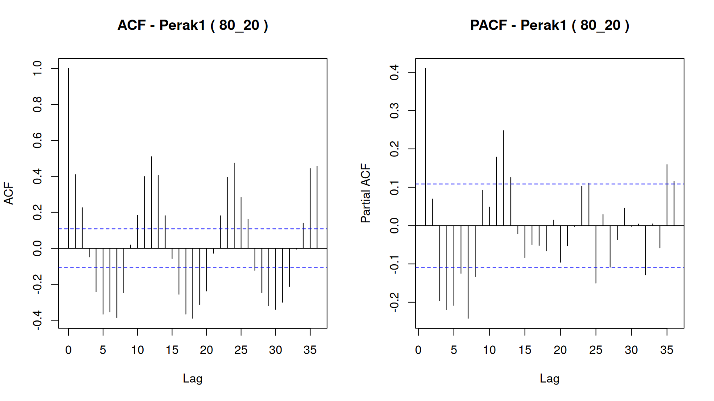

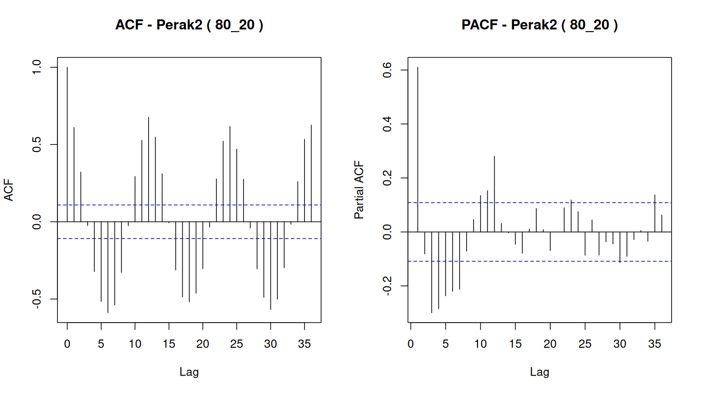

### CCF

Negative CCF lag means the second named location leads the first; positive lag means the first leads the second. The strongest correlation at each absolute non-zero lag is used to propose spatial-order candidates.

| location_x | location_y | lag | ccf | significance_bound | significant | direction |
|---|---|---|---|---|---|---|
| Juanda | Perak1 | -36 | 0.492924 | 0.108552 | TRUE | Perak1 leads Juanda |
| Juanda | Perak1 | -35 | 0.481774 | 0.108552 | TRUE | Perak1 leads Juanda |
| Juanda | Perak1 | -34 | 0.308950 | 0.108552 | TRUE | Perak1 leads Juanda |
| Juanda | Perak1 | -33 | 0.142426 | 0.108552 | TRUE | Perak1 leads Juanda |
| Juanda | Perak1 | -32 | -0.034514 | 0.108552 | FALSE | Perak1 leads Juanda |
| Juanda | Perak1 | -31 | -0.245548 | 0.108552 | TRUE | Perak1 leads Juanda |
| Juanda | Perak1 | -30 | -0.427345 | 0.108552 | TRUE | Perak1 leads Juanda |
| Juanda | Perak1 | -29 | -0.437499 | 0.108552 | TRUE | Perak1 leads Juanda |
| Juanda | Perak1 | -28 | -0.417336 | 0.108552 | TRUE | Perak1 leads Juanda |
| Juanda | Perak1 | -27 | -0.224749 | 0.108552 | TRUE | Perak1 leads Juanda |
| Juanda | Perak1 | -26 | 0.038869 | 0.108552 | FALSE | Perak1 leads Juanda |
| Juanda | Perak1 | -25 | 0.282866 | 0.108552 | TRUE | Perak1 leads Juanda |
| Juanda | Perak1 | -24 | 0.486862 | 0.108552 | TRUE | Perak1 leads Juanda |
| Juanda | Perak1 | -23 | 0.500660 | 0.108552 | TRUE | Perak1 leads Juanda |
| Juanda | Perak1 | -22 | 0.372477 | 0.108552 | TRUE | Perak1 leads Juanda |
| Juanda | Perak1 | -21 | 0.120715 | 0.108552 | TRUE | Perak1 leads Juanda |
| Juanda | Perak1 | -20 | -0.062451 | 0.108552 | FALSE | Perak1 leads Juanda |
| Juanda | Perak1 | -19 | -0.266004 | 0.108552 | TRUE | Perak1 leads Juanda |
| Juanda | Perak1 | -18 | -0.440701 | 0.108552 | TRUE | Perak1 leads Juanda |
| Juanda | Perak1 | -17 | -0.491651 | 0.108552 | TRUE | Perak1 leads Juanda |
| Juanda | Perak1 | -16 | -0.462928 | 0.108552 | TRUE | Perak1 leads Juanda |
| Juanda | Perak1 | -15 | -0.228774 | 0.108552 | TRUE | Perak1 leads Juanda |
| Juanda | Perak1 | -14 | 0.073756 | 0.108552 | FALSE | Perak1 leads Juanda |
| Juanda | Perak1 | -13 | 0.352670 | 0.108552 | TRUE | Perak1 leads Juanda |
| Juanda | Perak1 | -12 | 0.501459 | 0.108552 | TRUE | Perak1 leads Juanda |
| Juanda | Perak1 | -11 | 0.470754 | 0.108552 | TRUE | Perak1 leads Juanda |
| Juanda | Perak1 | -10 | 0.366269 | 0.108552 | TRUE | Perak1 leads Juanda |
| Juanda | Perak1 | -9 | 0.196792 | 0.108552 | TRUE | Perak1 leads Juanda |
| Juanda | Perak1 | -8 | -0.021145 | 0.108552 | FALSE | Perak1 leads Juanda |
| Juanda | Perak1 | -7 | -0.237113 | 0.108552 | TRUE | Perak1 leads Juanda |
| Juanda | Perak1 | -6 | -0.400453 | 0.108552 | TRUE | Perak1 leads Juanda |
| Juanda | Perak1 | -5 | -0.525525 | 0.108552 | TRUE | Perak1 leads Juanda |
| Juanda | Perak1 | -4 | -0.440522 | 0.108552 | TRUE | Perak1 leads Juanda |
| Juanda | Perak1 | -3 | -0.222992 | 0.108552 | TRUE | Perak1 leads Juanda |
| Juanda | Perak1 | -2 | 0.076187 | 0.108552 | FALSE | Perak1 leads Juanda |
| Juanda | Perak1 | -1 | 0.383333 | 0.108552 | TRUE | Perak1 leads Juanda |
| Juanda | Perak1 | 0 | 0.706470 | 0.108552 | TRUE | contemporaneous |
| Juanda | Perak1 | 1 | 0.506976 | 0.108552 | TRUE | Juanda leads Perak1 |
| Juanda | Perak1 | 2 | 0.349231 | 0.108552 | TRUE | Juanda leads Perak1 |
| Juanda | Perak1 | 3 | 0.108997 | 0.108552 | TRUE | Juanda leads Perak1 |
| Juanda | Perak1 | 4 | -0.067165 | 0.108552 | FALSE | Juanda leads Perak1 |
| Juanda | Perak1 | 5 | -0.286341 | 0.108552 | TRUE | Juanda leads Perak1 |
| Juanda | Perak1 | 6 | -0.430190 | 0.108552 | TRUE | Juanda leads Perak1 |
| Juanda | Perak1 | 7 | -0.532705 | 0.108552 | TRUE | Juanda leads Perak1 |
| Juanda | Perak1 | 8 | -0.442102 | 0.108552 | TRUE | Juanda leads Perak1 |
| Juanda | Perak1 | 9 | -0.217871 | 0.108552 | TRUE | Juanda leads Perak1 |
| Juanda | Perak1 | 10 | 0.069575 | 0.108552 | FALSE | Juanda leads Perak1 |
| Juanda | Perak1 | 11 | 0.354557 | 0.108552 | TRUE | Juanda leads Perak1 |
| Juanda | Perak1 | 12 | 0.527457 | 0.108552 | TRUE | Juanda leads Perak1 |
| Juanda | Perak1 | 13 | 0.507479 | 0.108552 | TRUE | Juanda leads Perak1 |
| Juanda | Perak1 | 14 | 0.351490 | 0.108552 | TRUE | Juanda leads Perak1 |
| Juanda | Perak1 | 15 | 0.116205 | 0.108552 | TRUE | Juanda leads Perak1 |
| Juanda | Perak1 | 16 | -0.080040 | 0.108552 | FALSE | Juanda leads Perak1 |
| Juanda | Perak1 | 17 | -0.261245 | 0.108552 | TRUE | Juanda leads Perak1 |
| Juanda | Perak1 | 18 | -0.413277 | 0.108552 | TRUE | Juanda leads Perak1 |
| Juanda | Perak1 | 19 | -0.496090 | 0.108552 | TRUE | Juanda leads Perak1 |
| Juanda | Perak1 | 20 | -0.426398 | 0.108552 | TRUE | Juanda leads Perak1 |
| Juanda | Perak1 | 21 | -0.219750 | 0.108552 | TRUE | Juanda leads Perak1 |
| Juanda | Perak1 | 22 | 0.088214 | 0.108552 | FALSE | Juanda leads Perak1 |
| Juanda | Perak1 | 23 | 0.367522 | 0.108552 | TRUE | Juanda leads Perak1 |
| Juanda | Perak1 | 24 | 0.468959 | 0.108552 | TRUE | Juanda leads Perak1 |
| Juanda | Perak1 | 25 | 0.414943 | 0.108552 | TRUE | Juanda leads Perak1 |
| Juanda | Perak1 | 26 | 0.333918 | 0.108552 | TRUE | Juanda leads Perak1 |
| Juanda | Perak1 | 27 | 0.111441 | 0.108552 | TRUE | Juanda leads Perak1 |
| Juanda | Perak1 | 28 | -0.044984 | 0.108552 | FALSE | Juanda leads Perak1 |
| Juanda | Perak1 | 29 | -0.205579 | 0.108552 | TRUE | Juanda leads Perak1 |
| Juanda | Perak1 | 30 | -0.411926 | 0.108552 | TRUE | Juanda leads Perak1 |
| Juanda | Perak1 | 31 | -0.453513 | 0.108552 | TRUE | Juanda leads Perak1 |
| Juanda | Perak1 | 32 | -0.382048 | 0.108552 | TRUE | Juanda leads Perak1 |
| Juanda | Perak1 | 33 | -0.172233 | 0.108552 | TRUE | Juanda leads Perak1 |
| Juanda | Perak1 | 34 | 0.067739 | 0.108552 | FALSE | Juanda leads Perak1 |
| Juanda | Perak1 | 35 | 0.375398 | 0.108552 | TRUE | Juanda leads Perak1 |
| Juanda | Perak1 | 36 | 0.491940 | 0.108552 | TRUE | Juanda leads Perak1 |
| Juanda | Perak2 | -36 | 0.613498 | 0.108552 | TRUE | Perak2 leads Juanda |
| Juanda | Perak2 | -35 | 0.576276 | 0.108552 | TRUE | Perak2 leads Juanda |
| Juanda | Perak2 | -34 | 0.342268 | 0.108552 | TRUE | Perak2 leads Juanda |
| Juanda | Perak2 | -33 | 0.065762 | 0.108552 | FALSE | Perak2 leads Juanda |
| Juanda | Perak2 | -32 | -0.188770 | 0.108552 | TRUE | Perak2 leads Juanda |
| Juanda | Perak2 | -31 | -0.417906 | 0.108552 | TRUE | Perak2 leads Juanda |
| Juanda | Perak2 | -30 | -0.539554 | 0.108552 | TRUE | Perak2 leads Juanda |
| Juanda | Perak2 | -29 | -0.516303 | 0.108552 | TRUE | Perak2 leads Juanda |
| Juanda | Perak2 | -28 | -0.403011 | 0.108552 | TRUE | Perak2 leads Juanda |
| Juanda | Perak2 | -27 | -0.162612 | 0.108552 | TRUE | Perak2 leads Juanda |
| Juanda | Perak2 | -26 | 0.150924 | 0.108552 | TRUE | Perak2 leads Juanda |
| Juanda | Perak2 | -25 | 0.403100 | 0.108552 | TRUE | Perak2 leads Juanda |
| Juanda | Perak2 | -24 | 0.580711 | 0.108552 | TRUE | Perak2 leads Juanda |
| Juanda | Perak2 | -23 | 0.588588 | 0.108552 | TRUE | Perak2 leads Juanda |
| Juanda | Perak2 | -22 | 0.435359 | 0.108552 | TRUE | Perak2 leads Juanda |
| Juanda | Perak2 | -21 | 0.072345 | 0.108552 | FALSE | Perak2 leads Juanda |
| Juanda | Perak2 | -20 | -0.207150 | 0.108552 | TRUE | Perak2 leads Juanda |
| Juanda | Perak2 | -19 | -0.394133 | 0.108552 | TRUE | Perak2 leads Juanda |
| Juanda | Perak2 | -18 | -0.516110 | 0.108552 | TRUE | Perak2 leads Juanda |
| Juanda | Perak2 | -17 | -0.546702 | 0.108552 | TRUE | Perak2 leads Juanda |
| Juanda | Perak2 | -16 | -0.427065 | 0.108552 | TRUE | Perak2 leads Juanda |
| Juanda | Perak2 | -15 | -0.164300 | 0.108552 | TRUE | Perak2 leads Juanda |
| Juanda | Perak2 | -14 | 0.170288 | 0.108552 | TRUE | Perak2 leads Juanda |
| Juanda | Perak2 | -13 | 0.462623 | 0.108552 | TRUE | Perak2 leads Juanda |
| Juanda | Perak2 | -12 | 0.613912 | 0.108552 | TRUE | Perak2 leads Juanda |
| Juanda | Perak2 | -11 | 0.552734 | 0.108552 | TRUE | Perak2 leads Juanda |
| Juanda | Perak2 | -10 | 0.357173 | 0.108552 | TRUE | Perak2 leads Juanda |
| Juanda | Perak2 | -9 | 0.102841 | 0.108552 | FALSE | Perak2 leads Juanda |
| Juanda | Perak2 | -8 | -0.184325 | 0.108552 | TRUE | Perak2 leads Juanda |
| Juanda | Perak2 | -7 | -0.402179 | 0.108552 | TRUE | Perak2 leads Juanda |
| Juanda | Perak2 | -6 | -0.539880 | 0.108552 | TRUE | Perak2 leads Juanda |
| Juanda | Perak2 | -5 | -0.555205 | 0.108552 | TRUE | Perak2 leads Juanda |
| Juanda | Perak2 | -4 | -0.406494 | 0.108552 | TRUE | Perak2 leads Juanda |
| Juanda | Perak2 | -3 | -0.139654 | 0.108552 | TRUE | Perak2 leads Juanda |
| Juanda | Perak2 | -2 | 0.183021 | 0.108552 | TRUE | Perak2 leads Juanda |
| Juanda | Perak2 | -1 | 0.503478 | 0.108552 | TRUE | Perak2 leads Juanda |
| Juanda | Perak2 | 0 | 0.789157 | 0.108552 | TRUE | contemporaneous |
| Juanda | Perak2 | 1 | 0.633732 | 0.108552 | TRUE | Juanda leads Perak2 |
| Juanda | Perak2 | 2 | 0.380155 | 0.108552 | TRUE | Juanda leads Perak2 |
| Juanda | Perak2 | 3 | 0.065468 | 0.108552 | FALSE | Juanda leads Perak2 |
| Juanda | Perak2 | 4 | -0.213622 | 0.108552 | TRUE | Juanda leads Perak2 |
| Juanda | Perak2 | 5 | -0.443815 | 0.108552 | TRUE | Juanda leads Perak2 |
| Juanda | Perak2 | 6 | -0.560886 | 0.108552 | TRUE | Juanda leads Perak2 |
| Juanda | Perak2 | 7 | -0.581498 | 0.108552 | TRUE | Juanda leads Perak2 |
| Juanda | Perak2 | 8 | -0.432962 | 0.108552 | TRUE | Juanda leads Perak2 |
| Juanda | Perak2 | 9 | -0.176224 | 0.108552 | TRUE | Juanda leads Perak2 |
| Juanda | Perak2 | 10 | 0.169552 | 0.108552 | TRUE | Juanda leads Perak2 |
| Juanda | Perak2 | 11 | 0.460784 | 0.108552 | TRUE | Juanda leads Perak2 |
| Juanda | Perak2 | 12 | 0.628240 | 0.108552 | TRUE | Juanda leads Perak2 |
| Juanda | Perak2 | 13 | 0.588186 | 0.108552 | TRUE | Juanda leads Perak2 |
| Juanda | Perak2 | 14 | 0.408227 | 0.108552 | TRUE | Juanda leads Perak2 |
| Juanda | Perak2 | 15 | 0.090393 | 0.108552 | FALSE | Juanda leads Perak2 |
| Juanda | Perak2 | 16 | -0.202632 | 0.108552 | TRUE | Juanda leads Perak2 |
| Juanda | Perak2 | 17 | -0.405063 | 0.108552 | TRUE | Juanda leads Perak2 |
| Juanda | Perak2 | 18 | -0.511548 | 0.108552 | TRUE | Juanda leads Perak2 |
| Juanda | Perak2 | 19 | -0.521876 | 0.108552 | TRUE | Juanda leads Perak2 |
| Juanda | Perak2 | 20 | -0.406396 | 0.108552 | TRUE | Juanda leads Perak2 |
| Juanda | Perak2 | 21 | -0.168680 | 0.108552 | TRUE | Juanda leads Perak2 |
| Juanda | Perak2 | 22 | 0.154259 | 0.108552 | TRUE | Juanda leads Perak2 |
| Juanda | Perak2 | 23 | 0.450801 | 0.108552 | TRUE | Juanda leads Perak2 |
| Juanda | Perak2 | 24 | 0.571275 | 0.108552 | TRUE | Juanda leads Perak2 |
| Juanda | Perak2 | 25 | 0.521910 | 0.108552 | TRUE | Juanda leads Perak2 |
| Juanda | Perak2 | 26 | 0.360717 | 0.108552 | TRUE | Juanda leads Perak2 |
| Juanda | Perak2 | 27 | 0.082743 | 0.108552 | FALSE | Juanda leads Perak2 |
| Juanda | Perak2 | 28 | -0.167997 | 0.108552 | TRUE | Juanda leads Perak2 |
| Juanda | Perak2 | 29 | -0.373358 | 0.108552 | TRUE | Juanda leads Perak2 |
| Juanda | Perak2 | 30 | -0.538540 | 0.108552 | TRUE | Juanda leads Perak2 |
| Juanda | Perak2 | 31 | -0.516066 | 0.108552 | TRUE | Juanda leads Perak2 |
| Juanda | Perak2 | 32 | -0.368830 | 0.108552 | TRUE | Juanda leads Perak2 |
| Juanda | Perak2 | 33 | -0.124675 | 0.108552 | TRUE | Juanda leads Perak2 |
| Juanda | Perak2 | 34 | 0.138485 | 0.108552 | TRUE | Juanda leads Perak2 |
| Juanda | Perak2 | 35 | 0.434616 | 0.108552 | TRUE | Juanda leads Perak2 |
| Juanda | Perak2 | 36 | 0.586737 | 0.108552 | TRUE | Juanda leads Perak2 |
| Perak1 | Perak2 | -36 | 0.522566 | 0.108552 | TRUE | Perak2 leads Perak1 |
| Perak1 | Perak2 | -35 | 0.466693 | 0.108552 | TRUE | Perak2 leads Perak1 |
| Perak1 | Perak2 | -34 | 0.173422 | 0.108552 | TRUE | Perak2 leads Perak1 |
| Perak1 | Perak2 | -33 | -0.072113 | 0.108552 | FALSE | Perak2 leads Perak1 |
| Perak1 | Perak2 | -32 | -0.337621 | 0.108552 | TRUE | Perak2 leads Perak1 |
| Perak1 | Perak2 | -31 | -0.480947 | 0.108552 | TRUE | Perak2 leads Perak1 |
| Perak1 | Perak2 | -30 | -0.472908 | 0.108552 | TRUE | Perak2 leads Perak1 |
| Perak1 | Perak2 | -29 | -0.366070 | 0.108552 | TRUE | Perak2 leads Perak1 |
| Perak1 | Perak2 | -28 | -0.160053 | 0.108552 | TRUE | Perak2 leads Perak1 |
| Perak1 | Perak2 | -27 | 0.005205 | 0.108552 | FALSE | Perak2 leads Perak1 |
| Perak1 | Perak2 | -26 | 0.263459 | 0.108552 | TRUE | Perak2 leads Perak1 |
| Perak1 | Perak2 | -25 | 0.373621 | 0.108552 | TRUE | Perak2 leads Perak1 |
| Perak1 | Perak2 | -24 | 0.497498 | 0.108552 | TRUE | Perak2 leads Perak1 |
| Perak1 | Perak2 | -23 | 0.411964 | 0.108552 | TRUE | Perak2 leads Perak1 |
| Perak1 | Perak2 | -22 | 0.192233 | 0.108552 | TRUE | Perak2 leads Perak1 |
| Perak1 | Perak2 | -21 | -0.112153 | 0.108552 | TRUE | Perak2 leads Perak1 |
| Perak1 | Perak2 | -20 | -0.362022 | 0.108552 | TRUE | Perak2 leads Perak1 |
| Perak1 | Perak2 | -19 | -0.447134 | 0.108552 | TRUE | Perak2 leads Perak1 |
| Perak1 | Perak2 | -18 | -0.428301 | 0.108552 | TRUE | Perak2 leads Perak1 |
| Perak1 | Perak2 | -17 | -0.359137 | 0.108552 | TRUE | Perak2 leads Perak1 |
| Perak1 | Perak2 | -16 | -0.161950 | 0.108552 | TRUE | Perak2 leads Perak1 |
| Perak1 | Perak2 | -15 | 0.053410 | 0.108552 | FALSE | Perak2 leads Perak1 |
| Perak1 | Perak2 | -14 | 0.277918 | 0.108552 | TRUE | Perak2 leads Perak1 |
| Perak1 | Perak2 | -13 | 0.505127 | 0.108552 | TRUE | Perak2 leads Perak1 |
| Perak1 | Perak2 | -12 | 0.585288 | 0.108552 | TRUE | Perak2 leads Perak1 |
| Perak1 | Perak2 | -11 | 0.422200 | 0.108552 | TRUE | Perak2 leads Perak1 |
| Perak1 | Perak2 | -10 | 0.181180 | 0.108552 | TRUE | Perak2 leads Perak1 |
| Perak1 | Perak2 | -9 | -0.077656 | 0.108552 | FALSE | Perak2 leads Perak1 |
| Perak1 | Perak2 | -8 | -0.348028 | 0.108552 | TRUE | Perak2 leads Perak1 |
| Perak1 | Perak2 | -7 | -0.504642 | 0.108552 | TRUE | Perak2 leads Perak1 |
| Perak1 | Perak2 | -6 | -0.483263 | 0.108552 | TRUE | Perak2 leads Perak1 |
| Perak1 | Perak2 | -5 | -0.367171 | 0.108552 | TRUE | Perak2 leads Perak1 |
| Perak1 | Perak2 | -4 | -0.159027 | 0.108552 | TRUE | Perak2 leads Perak1 |
| Perak1 | Perak2 | -3 | 0.090030 | 0.108552 | FALSE | Perak2 leads Perak1 |
| Perak1 | Perak2 | -2 | 0.334541 | 0.108552 | TRUE | Perak2 leads Perak1 |
| Perak1 | Perak2 | -1 | 0.489026 | 0.108552 | TRUE | Perak2 leads Perak1 |
| Perak1 | Perak2 | 0 | 0.824724 | 0.108552 | TRUE | contemporaneous |
| Perak1 | Perak2 | 1 | 0.465255 | 0.108552 | TRUE | Perak1 leads Perak2 |
| Perak1 | Perak2 | 2 | 0.214997 | 0.108552 | TRUE | Perak1 leads Perak2 |
| Perak1 | Perak2 | 3 | -0.127180 | 0.108552 | TRUE | Perak1 leads Perak2 |
| Perak1 | Perak2 | 4 | -0.377488 | 0.108552 | TRUE | Perak1 leads Perak2 |
| Perak1 | Perak2 | 5 | -0.503876 | 0.108552 | TRUE | Perak1 leads Perak2 |
| Perak1 | Perak2 | 6 | -0.460625 | 0.108552 | TRUE | Perak1 leads Perak2 |
| Perak1 | Perak2 | 7 | -0.389784 | 0.108552 | TRUE | Perak1 leads Perak2 |
| Perak1 | Perak2 | 8 | -0.191301 | 0.108552 | TRUE | Perak1 leads Perak2 |
| Perak1 | Perak2 | 9 | 0.082846 | 0.108552 | FALSE | Perak1 leads Perak2 |
| Perak1 | Perak2 | 10 | 0.304129 | 0.108552 | TRUE | Perak1 leads Perak2 |
| Perak1 | Perak2 | 11 | 0.478593 | 0.108552 | TRUE | Perak1 leads Perak2 |
| Perak1 | Perak2 | 12 | 0.545542 | 0.108552 | TRUE | Perak1 leads Perak2 |
| Perak1 | Perak2 | 13 | 0.423123 | 0.108552 | TRUE | Perak1 leads Perak2 |
| Perak1 | Perak2 | 14 | 0.208413 | 0.108552 | TRUE | Perak1 leads Perak2 |
| Perak1 | Perak2 | 15 | -0.094196 | 0.108552 | FALSE | Perak1 leads Perak2 |
| Perak1 | Perak2 | 16 | -0.369077 | 0.108552 | TRUE | Perak1 leads Perak2 |
| Perak1 | Perak2 | 17 | -0.475796 | 0.108552 | TRUE | Perak1 leads Perak2 |
| Perak1 | Perak2 | 18 | -0.450762 | 0.108552 | TRUE | Perak1 leads Perak2 |
| Perak1 | Perak2 | 19 | -0.317551 | 0.108552 | TRUE | Perak1 leads Perak2 |
| Perak1 | Perak2 | 20 | -0.152222 | 0.108552 | TRUE | Perak1 leads Perak2 |
| Perak1 | Perak2 | 21 | 0.074645 | 0.108552 | FALSE | Perak1 leads Perak2 |
| Perak1 | Perak2 | 22 | 0.266064 | 0.108552 | TRUE | Perak1 leads Perak2 |
| Perak1 | Perak2 | 23 | 0.459803 | 0.108552 | TRUE | Perak1 leads Perak2 |
| Perak1 | Perak2 | 24 | 0.529503 | 0.108552 | TRUE | Perak1 leads Perak2 |
| Perak1 | Perak2 | 25 | 0.356464 | 0.108552 | TRUE | Perak1 leads Perak2 |
| Perak1 | Perak2 | 26 | 0.183571 | 0.108552 | TRUE | Perak1 leads Perak2 |
| Perak1 | Perak2 | 27 | -0.113150 | 0.108552 | TRUE | Perak1 leads Perak2 |
| Perak1 | Perak2 | 28 | -0.342333 | 0.108552 | TRUE | Perak1 leads Perak2 |
| Perak1 | Perak2 | 29 | -0.448526 | 0.108552 | TRUE | Perak1 leads Perak2 |
| Perak1 | Perak2 | 30 | -0.440043 | 0.108552 | TRUE | Perak1 leads Perak2 |
| Perak1 | Perak2 | 31 | -0.340465 | 0.108552 | TRUE | Perak1 leads Perak2 |
| Perak1 | Perak2 | 32 | -0.129969 | 0.108552 | TRUE | Perak1 leads Perak2 |
| Perak1 | Perak2 | 33 | 0.092541 | 0.108552 | FALSE | Perak1 leads Perak2 |
| Perak1 | Perak2 | 34 | 0.252598 | 0.108552 | TRUE | Perak1 leads Perak2 |
| Perak1 | Perak2 | 35 | 0.493085 | 0.108552 | TRUE | Perak1 leads Perak2 |
| Perak1 | Perak2 | 36 | 0.525696 | 0.108552 | TRUE | Perak1 leads Perak2 |

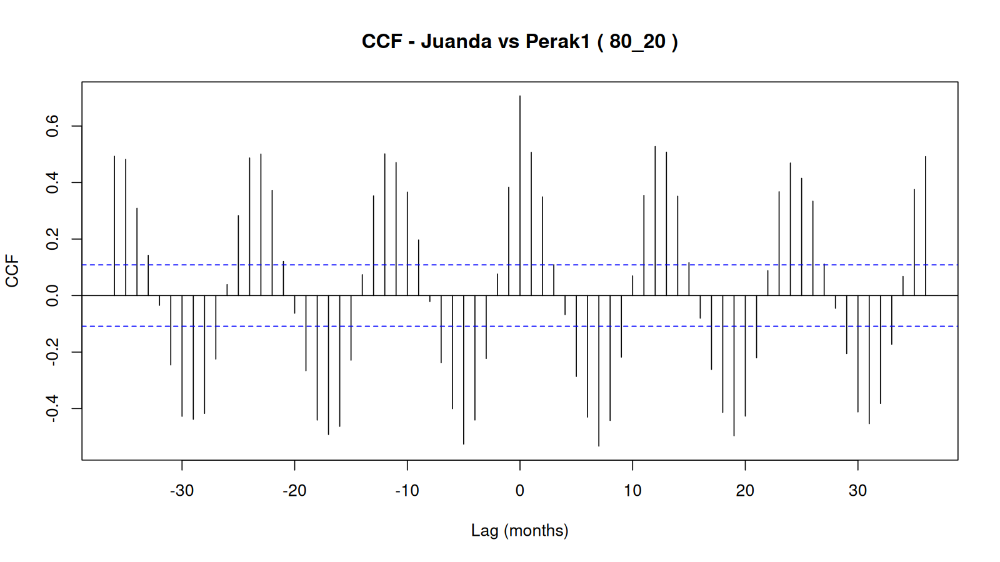

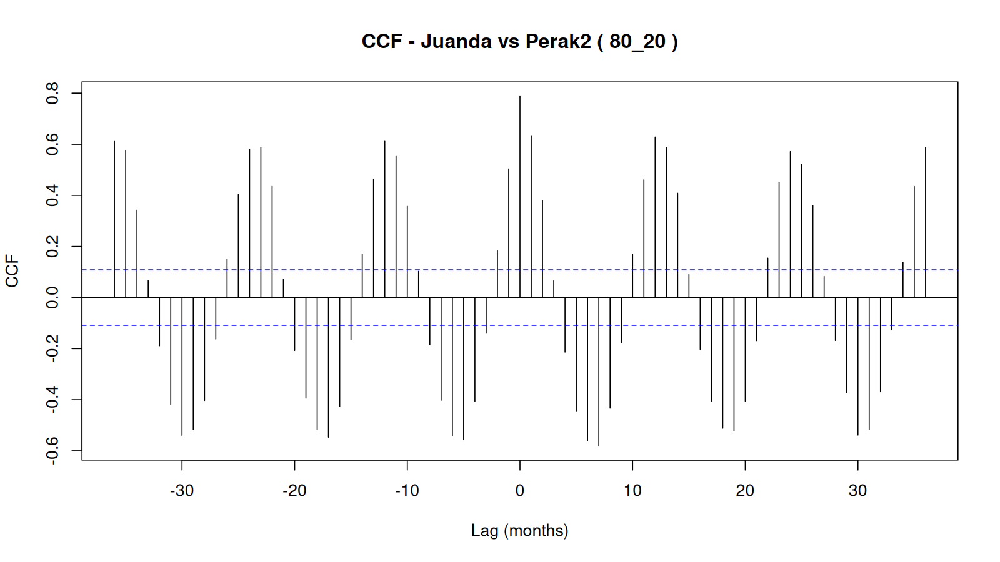

### Candidate models

| a | b | fitted | AIC | coefficients_finite | iidn_pass | white_noise_pass | error |
|---|---|---|---|---|---|---|---|
| 1 | 1 | TRUE | 12043.21 | TRUE | FALSE | FALSE |  |
| 3 | 3 | TRUE | 11902.38 | TRUE | FALSE | FALSE |  |
| 4 | 4 | TRUE | 11857.66 | TRUE | FALSE | FALSE |  |
| 5 | 5 | TRUE | 11822.62 | TRUE | FALSE | FALSE |  |
| 6 | 6 | TRUE | 11762.50 | TRUE | FALSE | FALSE |  |
| 7 | 7 | TRUE | 11700.79 | TRUE | FALSE | FALSE |  |
| 12 | 12 | TRUE | 11248.74 | TRUE | FALSE | TRUE |  |
| 17 | 17 | TRUE | 11079.72 | TRUE | FALSE | TRUE |  |
| 19 | 19 | TRUE | 11028.84 | TRUE | FALSE | TRUE |  |

### Selected parameters

| a | b | parameter | estimate | std_error | t_value | p_value |
|---|---|---|---|---|---|---|
| 19 | 19 | psi10(Juanda) | 0.340463 | 2.853026 | 0.119334 | 0.905037 |
| 19 | 19 | psi10(Perak1) | -0.081896 | 5.789202 | -0.014146 | 0.988716 |
| 19 | 19 | psi10(Perak2) | 0.312165 | 11.001831 | 0.028374 | 0.977370 |
| 19 | 19 | psi20(Juanda) | -0.024784 | 3.120265 | -0.007943 | 0.993664 |
| 19 | 19 | psi20(Perak1) | 0.090758 | 5.945429 | 0.015265 | 0.987824 |
| 19 | 19 | psi20(Perak2) | -0.046134 | 11.462055 | -0.004025 | 0.996789 |
| 19 | 19 | psi30(Juanda) | 0.109637 | 3.124805 | 0.035086 | 0.972019 |
| 19 | 19 | psi30(Perak1) | 0.045820 | 5.967138 | 0.007679 | 0.993875 |
| 19 | 19 | psi30(Perak2) | -0.124615 | 11.427580 | -0.010905 | 0.991302 |
| 19 | 19 | psi40(Juanda) | -0.030529 | 3.135192 | -0.009737 | 0.992233 |
| 19 | 19 | psi40(Perak1) | 0.024573 | 5.932728 | 0.004142 | 0.996696 |
| 19 | 19 | psi40(Perak2) | -0.049984 | 11.487043 | -0.004351 | 0.996529 |
| 19 | 19 | psi50(Juanda) | -0.017016 | 3.133245 | -0.005431 | 0.995668 |
| 19 | 19 | psi50(Perak1) | 0.071796 | 5.982224 | 0.012002 | 0.990427 |
| 19 | 19 | psi50(Perak2) | -0.001538 | 11.488397 | -0.000134 | 0.999893 |
| 19 | 19 | psi60(Juanda) | -0.060661 | 3.136495 | -0.019340 | 0.984574 |
| 19 | 19 | psi60(Perak1) | 0.022234 | 6.022117 | 0.003692 | 0.997055 |
| 19 | 19 | psi60(Perak2) | -0.054796 | 11.373012 | -0.004818 | 0.996157 |
| 19 | 19 | psi70(Juanda) | 0.108034 | 3.117413 | 0.034655 | 0.972362 |
| 19 | 19 | psi70(Perak1) | -0.150504 | 6.021560 | -0.024994 | 0.980065 |
| 19 | 19 | psi70(Perak2) | -0.164065 | 11.207496 | -0.014639 | 0.988323 |
| 19 | 19 | psi80(Juanda) | 0.003298 | 3.078673 | 0.001071 | 0.999145 |
| 19 | 19 | psi80(Perak1) | -0.081334 | 6.075216 | -0.013388 | 0.989321 |
| 19 | 19 | psi80(Perak2) | -0.084137 | 10.848991 | -0.007755 | 0.993814 |
| 19 | 19 | psi90(Juanda) | 0.077184 | 3.057233 | 0.025246 | 0.979864 |
| 19 | 19 | psi90(Perak1) | 0.167235 | 6.140343 | 0.027235 | 0.978278 |
| 19 | 19 | psi90(Perak2) | -0.113524 | 10.960673 | -0.010357 | 0.991738 |
| 19 | 19 | psi100(Juanda) | -0.065559 | 3.133161 | -0.020924 | 0.983311 |
| 19 | 19 | psi100(Perak1) | -0.014228 | 6.194752 | -0.002297 | 0.998168 |
| 19 | 19 | psi100(Perak2) | 0.022306 | 10.916543 | 0.002043 | 0.998370 |
| 19 | 19 | psi110(Juanda) | -0.034185 | 3.104761 | -0.011011 | 0.991217 |
| 19 | 19 | psi110(Perak1) | 0.058373 | 6.070194 | 0.009616 | 0.992330 |
| 19 | 19 | psi110(Perak2) | 0.025399 | 10.890418 | 0.002332 | 0.998140 |
| 19 | 19 | psi120(Juanda) | 0.197038 | 3.145173 | 0.062648 | 0.950061 |
| 19 | 19 | psi120(Perak1) | 0.130623 | 5.972694 | 0.021870 | 0.982556 |
| 19 | 19 | psi120(Perak2) | 0.246035 | 10.917070 | 0.022537 | 0.982025 |
| 19 | 19 | psi130(Juanda) | -0.023371 | 3.287210 | -0.007110 | 0.994329 |
| 19 | 19 | psi130(Perak1) | 0.051858 | 5.947817 | 0.008719 | 0.993045 |
| 19 | 19 | psi130(Perak2) | -0.049818 | 11.431806 | -0.004358 | 0.996524 |
| 19 | 19 | psi140(Juanda) | 0.038620 | 3.285471 | 0.011755 | 0.990624 |
| 19 | 19 | psi140(Perak1) | -0.091518 | 5.760042 | -0.015888 | 0.987327 |
| 19 | 19 | psi140(Perak2) | 0.189567 | 11.484547 | 0.016506 | 0.986834 |
| 19 | 19 | psi150(Juanda) | -0.063890 | 3.229138 | -0.019785 | 0.984219 |
| 19 | 19 | psi150(Perak1) | 0.003777 | 5.758698 | 0.000656 | 0.999477 |
| 19 | 19 | psi150(Perak2) | 0.103350 | 11.861355 | 0.008713 | 0.993050 |
| 19 | 19 | psi160(Juanda) | -0.063682 | 3.241902 | -0.019643 | 0.984332 |
| 19 | 19 | psi160(Perak1) | 0.149771 | 5.760394 | 0.026000 | 0.979263 |
| 19 | 19 | psi160(Perak2) | -0.075145 | 11.933117 | -0.006297 | 0.994977 |
| 19 | 19 | psi170(Juanda) | -0.000469 | 3.264118 | -0.000144 | 0.999885 |
| 19 | 19 | psi170(Perak1) | -0.057243 | 5.846458 | -0.009791 | 0.992190 |
| 19 | 19 | psi170(Perak2) | 0.046584 | 11.542530 | 0.004036 | 0.996781 |
| 19 | 19 | psi180(Juanda) | -0.094782 | 3.248508 | -0.029177 | 0.976730 |
| 19 | 19 | psi180(Perak1) | -0.040460 | 5.878372 | -0.006883 | 0.994510 |
| 19 | 19 | psi180(Perak2) | 0.118039 | 11.417817 | 0.010338 | 0.991754 |
| 19 | 19 | psi190(Juanda) | 0.029448 | 2.992594 | 0.009840 | 0.992151 |
| 19 | 19 | psi190(Perak1) | 0.018601 | 5.803272 | 0.003205 | 0.997443 |
| 19 | 19 | psi190(Perak2) | 0.107196 | 11.004503 | 0.009741 | 0.992230 |
| 19 | 19 | psi11(Juanda) | -0.049254 | 23.791751 | -0.002070 | 0.998349 |
| 19 | 19 | psi11(Perak1) | 0.271092 | 5.449900 | 0.049743 | 0.960338 |
| 19 | 19 | psi11(Perak2) | -0.065618 | 4.517773 | -0.014524 | 0.988415 |
| 19 | 19 | psi21(Juanda) | -0.108912 | 23.954167 | -0.004547 | 0.996373 |
| 19 | 19 | psi21(Perak1) | 0.036893 | 6.277574 | 0.005877 | 0.995312 |
| 19 | 19 | psi21(Perak2) | 0.086815 | 4.627425 | 0.018761 | 0.985036 |
| 19 | 19 | psi31(Juanda) | -0.318518 | 24.302156 | -0.013107 | 0.989546 |
| 19 | 19 | psi31(Perak1) | -0.059115 | 6.440817 | -0.009178 | 0.992679 |
| 19 | 19 | psi31(Perak2) | 0.055435 | 4.600651 | 0.012049 | 0.990389 |
| 19 | 19 | psi41(Juanda) | 0.170767 | 23.954092 | 0.007129 | 0.994314 |
| 19 | 19 | psi41(Perak1) | -0.030635 | 6.454585 | -0.004746 | 0.996214 |
| 19 | 19 | psi41(Perak2) | 0.007818 | 4.631472 | 0.001688 | 0.998654 |
| 19 | 19 | psi51(Juanda) | 0.050262 | 23.769416 | 0.002115 | 0.998313 |
| 19 | 19 | psi51(Perak1) | -0.130341 | 6.450994 | -0.020205 | 0.983884 |
| 19 | 19 | psi51(Perak2) | 0.000537 | 4.660461 | 0.000115 | 0.999908 |
| 19 | 19 | psi61(Juanda) | 0.127999 | 23.713349 | 0.005398 | 0.995694 |
| 19 | 19 | psi61(Perak1) | 0.092559 | 6.483859 | 0.014275 | 0.988613 |
| 19 | 19 | psi61(Perak2) | 0.038577 | 4.554396 | 0.008470 | 0.993244 |
| 19 | 19 | psi71(Juanda) | -0.398043 | 23.209583 | -0.017150 | 0.986321 |
| 19 | 19 | psi71(Perak1) | 0.111208 | 6.524871 | 0.017044 | 0.986405 |
| 19 | 19 | psi71(Perak2) | 0.072736 | 4.449585 | 0.016347 | 0.986961 |
| 19 | 19 | psi81(Juanda) | -0.195800 | 23.447752 | -0.008350 | 0.993339 |
| 19 | 19 | psi81(Perak1) | 0.098609 | 6.179343 | 0.015958 | 0.987271 |
| 19 | 19 | psi81(Perak2) | 0.028780 | 4.309568 | 0.006678 | 0.994673 |
| 19 | 19 | psi91(Juanda) | -0.033114 | 23.448074 | -0.001412 | 0.998874 |
| 19 | 19 | psi91(Perak1) | 0.013668 | 6.270699 | 0.002180 | 0.998261 |
| 19 | 19 | psi91(Perak2) | 0.111066 | 4.294462 | 0.025863 | 0.979372 |
| 19 | 19 | psi101(Juanda) | 0.378834 | 24.123589 | 0.015704 | 0.987474 |
| 19 | 19 | psi101(Perak1) | 0.073475 | 6.268380 | 0.011722 | 0.990650 |
| 19 | 19 | psi101(Perak2) | 0.048692 | 4.412079 | 0.011036 | 0.991197 |
| 19 | 19 | psi111(Juanda) | 0.510535 | 23.675939 | 0.021563 | 0.982801 |
| 19 | 19 | psi111(Perak1) | -0.006870 | 6.269678 | -0.001096 | 0.999126 |
| 19 | 19 | psi111(Perak2) | 0.073133 | 4.387724 | 0.016668 | 0.986705 |
| 19 | 19 | psi121(Juanda) | 0.340803 | 24.035877 | 0.014179 | 0.988690 |
| 19 | 19 | psi121(Perak1) | 0.063370 | 6.465101 | 0.009802 | 0.992182 |
| 19 | 19 | psi121(Perak2) | 0.075808 | 4.400919 | 0.017225 | 0.986260 |
| 19 | 19 | psi131(Juanda) | 0.364817 | 24.011056 | 0.015194 | 0.987881 |
| 19 | 19 | psi131(Perak1) | 0.055944 | 6.885126 | 0.008125 | 0.993519 |
| 19 | 19 | psi131(Perak2) | 0.115959 | 4.558755 | 0.025437 | 0.979712 |
| 19 | 19 | psi141(Juanda) | 0.217648 | 23.796328 | 0.009146 | 0.992704 |
| 19 | 19 | psi141(Perak1) | 0.152880 | 6.747041 | 0.022659 | 0.981927 |
| 19 | 19 | psi141(Perak2) | -0.103255 | 4.569446 | -0.022597 | 0.981977 |
| 19 | 19 | psi151(Juanda) | 0.053623 | 23.997751 | 0.002234 | 0.998218 |
| 19 | 19 | psi151(Perak1) | -0.009596 | 6.851218 | -0.001401 | 0.998883 |
| 19 | 19 | psi151(Perak2) | -0.061284 | 4.501815 | -0.013613 | 0.989141 |
| 19 | 19 | psi161(Juanda) | 0.148950 | 23.990973 | 0.006209 | 0.995048 |
| 19 | 19 | psi161(Perak1) | -0.207930 | 6.844041 | -0.030381 | 0.975770 |
| 19 | 19 | psi161(Perak2) | 0.010865 | 4.531106 | 0.002398 | 0.998087 |
| 19 | 19 | psi171(Juanda) | 0.171582 | 24.087903 | 0.007123 | 0.994318 |
| 19 | 19 | psi171(Perak1) | 0.071701 | 6.928650 | 0.010349 | 0.991745 |
| 19 | 19 | psi171(Perak2) | -0.072171 | 4.451875 | -0.016211 | 0.987069 |
| 19 | 19 | psi181(Juanda) | 0.148545 | 23.734005 | 0.006259 | 0.995008 |
| 19 | 19 | psi181(Perak1) | -0.020495 | 6.960578 | -0.002944 | 0.997651 |
| 19 | 19 | psi181(Perak2) | -0.021944 | 4.512470 | -0.004863 | 0.996121 |
| 19 | 19 | psi191(Juanda) | -0.230546 | 23.714691 | -0.009722 | 0.992245 |
| 19 | 19 | psi191(Perak1) | 0.027164 | 6.129831 | 0.004431 | 0.996465 |
| 19 | 19 | psi191(Perak2) | -0.073510 | 4.342385 | -0.016928 | 0.986497 |

### Training fit and hold-out forecast

Each panel compares actual rainfall with fitted values (left), recursive multi-step forecasts, and actual-lag one-step forecasts (right).

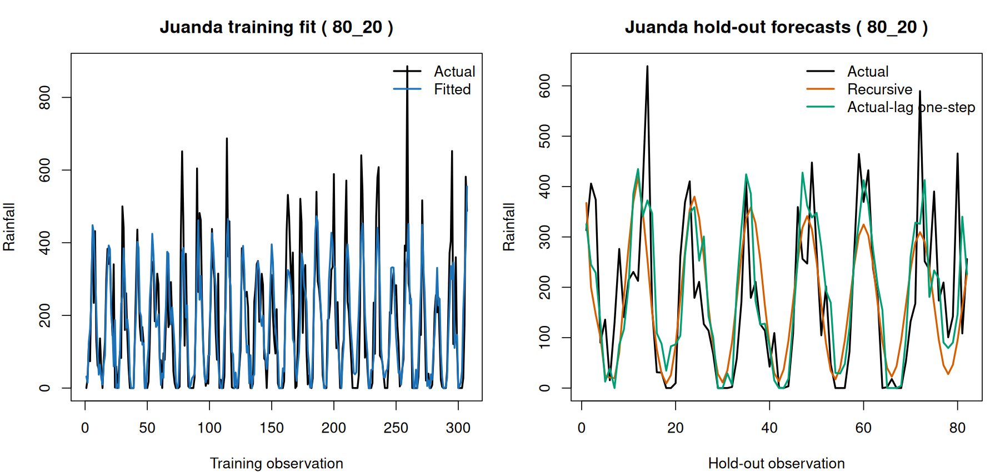

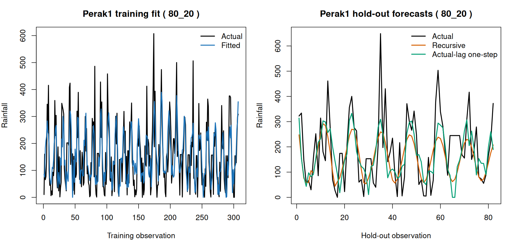

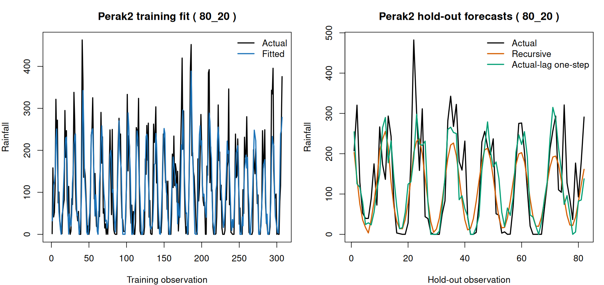

### Training metrics

| location | MSE | RMSE | MAE | sMAPE | MAPE_nonzero | R_squared |
|---|---|---|---|---|---|---|
| Juanda | 10843.143 | 104.13041 | 73.70613 | 70.47451 | 635.9651 | 0.633978 |
| Perak1 | 6868.246 | 82.87488 | 64.94969 | 58.70441 | 1055.6152 | 0.499172 |
| Perak2 | 3815.118 | 61.76664 | 45.86741 | 77.65794 | 156.2589 | 0.666304 |
| Overall | 7175.502 | 84.70834 | 61.50774 | 68.94562 | 642.1840 | 0.621464 |

### Testing metrics: recursive multi-step

Each forecasted test value is used as a lag input for the next test forecast; no actual test value enters the forecast recursion.

| location | MSE | RMSE | MAE | sMAPE | MAPE_nonzero | R_squared |
|---|---|---|---|---|---|---|
| Juanda | 13568.715 | 116.48483 | 88.21821 | 81.16385 | 477.6531 | 0.427920 |
| Perak1 | 12480.038 | 111.71409 | 88.99752 | 61.16887 | 938.5178 | 0.299760 |
| Perak2 | 6004.869 | 77.49109 | 58.67718 | 82.04798 | 403.6105 | 0.546407 |
| Overall | 10684.541 | 103.36605 | 78.63097 | 74.79357 | 623.8769 | 0.433698 |

### Testing metrics: actual-lag one-step

Each test prediction uses observed rainfall only from earlier test months as lag inputs; it does not use the current month’s actual rainfall. This is a one-step-ahead evaluation, not a deployable long-horizon forecast.

| location | MSE | RMSE | MAE | sMAPE | MAPE_nonzero | R_squared |
|---|---|---|---|---|---|---|
| Juanda | 12736.488 | 112.85605 | 84.69302 | 74.98852 | 83.61592 | 0.463008 |
| Perak1 | 12726.648 | 112.81244 | 90.89655 | 67.08556 | 1321.47707 | 0.285923 |
| Perak2 | 6702.782 | 81.87052 | 58.45895 | 70.19935 | 291.65035 | 0.493688 |
| Overall | 10721.973 | 103.54696 | 78.01617 | 70.75781 | 604.09585 | 0.431714 |

### Selected residual diagnostics

| location | mean_residual | residual_variance | mean_zero_p_value | normality_shapiro_p_value | variance_stability_fligner_p_value | ljung_box_10_p_value | ljung_box_20_p_value |
|---|---|---|---|---|---|---|---|
| Juanda | 3.140392 | 10977.018 | 0.599836 | 0.000000 | 0.514096 | 0.996320 | 0.984374 |
| Perak1 | 2.050078 | 6916.888 | 0.666118 | 0.000018 | 0.831294 | 0.999966 | 0.999342 |
| Perak2 | 0.892007 | 3879.384 | 0.802035 | 0.000011 | 0.493329 | 0.996544 | 0.952436 |

### Equation terms

Package convention: own-city terms are psi[k,0](i) Z[i,t-k]; spatial terms are psi[k,1](i) sum_j W[j,i] Z[j,t-k].

| location | lag | effect | parameter | coefficient | equation_term |
|---|---|---|---|---|---|
| Juanda | 1 | own-city | psi10(Juanda) | 0.340463 | 0.340463 * Z_Juanda,t-1 |
| Perak1 | 1 | own-city | psi10(Perak1) | -0.081896 | -0.081896 * Z_Perak1,t-1 |
| Perak2 | 1 | own-city | psi10(Perak2) | 0.312165 | 0.312165 * Z_Perak2,t-1 |
| Juanda | 2 | own-city | psi20(Juanda) | -0.024784 | -0.024784 * Z_Juanda,t-2 |
| Perak1 | 2 | own-city | psi20(Perak1) | 0.090758 | 0.090758 * Z_Perak1,t-2 |
| Perak2 | 2 | own-city | psi20(Perak2) | -0.046134 | -0.046134 * Z_Perak2,t-2 |
| Juanda | 3 | own-city | psi30(Juanda) | 0.109637 | 0.109637 * Z_Juanda,t-3 |
| Perak1 | 3 | own-city | psi30(Perak1) | 0.045820 | 0.04582 * Z_Perak1,t-3 |
| Perak2 | 3 | own-city | psi30(Perak2) | -0.124615 | -0.124615 * Z_Perak2,t-3 |
| Juanda | 4 | own-city | psi40(Juanda) | -0.030529 | -0.030529 * Z_Juanda,t-4 |
| Perak1 | 4 | own-city | psi40(Perak1) | 0.024573 | 0.024573 * Z_Perak1,t-4 |
| Perak2 | 4 | own-city | psi40(Perak2) | -0.049984 | -0.049984 * Z_Perak2,t-4 |
| Juanda | 5 | own-city | psi50(Juanda) | -0.017016 | -0.017016 * Z_Juanda,t-5 |
| Perak1 | 5 | own-city | psi50(Perak1) | 0.071796 | 0.071796 * Z_Perak1,t-5 |
| Perak2 | 5 | own-city | psi50(Perak2) | -0.001538 | -0.001538 * Z_Perak2,t-5 |
| Juanda | 6 | own-city | psi60(Juanda) | -0.060661 | -0.060661 * Z_Juanda,t-6 |
| Perak1 | 6 | own-city | psi60(Perak1) | 0.022234 | 0.022234 * Z_Perak1,t-6 |
| Perak2 | 6 | own-city | psi60(Perak2) | -0.054796 | -0.054796 * Z_Perak2,t-6 |
| Juanda | 7 | own-city | psi70(Juanda) | 0.108034 | 0.108034 * Z_Juanda,t-7 |
| Perak1 | 7 | own-city | psi70(Perak1) | -0.150504 | -0.150504 * Z_Perak1,t-7 |
| Perak2 | 7 | own-city | psi70(Perak2) | -0.164065 | -0.164065 * Z_Perak2,t-7 |
| Juanda | 8 | own-city | psi80(Juanda) | 0.003298 | 0.003298 * Z_Juanda,t-8 |
| Perak1 | 8 | own-city | psi80(Perak1) | -0.081334 | -0.081334 * Z_Perak1,t-8 |
| Perak2 | 8 | own-city | psi80(Perak2) | -0.084137 | -0.084137 * Z_Perak2,t-8 |
| Juanda | 9 | own-city | psi90(Juanda) | 0.077184 | 0.077184 * Z_Juanda,t-9 |
| Perak1 | 9 | own-city | psi90(Perak1) | 0.167235 | 0.167235 * Z_Perak1,t-9 |
| Perak2 | 9 | own-city | psi90(Perak2) | -0.113524 | -0.113524 * Z_Perak2,t-9 |
| Juanda | 10 | own-city | psi100(Juanda) | -0.065559 | -0.065559 * Z_Juanda,t-10 |
| Perak1 | 10 | own-city | psi100(Perak1) | -0.014228 | -0.014228 * Z_Perak1,t-10 |
| Perak2 | 10 | own-city | psi100(Perak2) | 0.022306 | 0.022306 * Z_Perak2,t-10 |
| Juanda | 11 | own-city | psi110(Juanda) | -0.034185 | -0.034185 * Z_Juanda,t-11 |
| Perak1 | 11 | own-city | psi110(Perak1) | 0.058373 | 0.058373 * Z_Perak1,t-11 |
| Perak2 | 11 | own-city | psi110(Perak2) | 0.025399 | 0.025399 * Z_Perak2,t-11 |
| Juanda | 12 | own-city | psi120(Juanda) | 0.197038 | 0.197038 * Z_Juanda,t-12 |
| Perak1 | 12 | own-city | psi120(Perak1) | 0.130623 | 0.130623 * Z_Perak1,t-12 |
| Perak2 | 12 | own-city | psi120(Perak2) | 0.246035 | 0.246035 * Z_Perak2,t-12 |
| Juanda | 13 | own-city | psi130(Juanda) | -0.023371 | -0.023371 * Z_Juanda,t-13 |
| Perak1 | 13 | own-city | psi130(Perak1) | 0.051858 | 0.051858 * Z_Perak1,t-13 |
| Perak2 | 13 | own-city | psi130(Perak2) | -0.049818 | -0.049818 * Z_Perak2,t-13 |
| Juanda | 14 | own-city | psi140(Juanda) | 0.038620 | 0.03862 * Z_Juanda,t-14 |
| Perak1 | 14 | own-city | psi140(Perak1) | -0.091518 | -0.091518 * Z_Perak1,t-14 |
| Perak2 | 14 | own-city | psi140(Perak2) | 0.189567 | 0.189567 * Z_Perak2,t-14 |
| Juanda | 15 | own-city | psi150(Juanda) | -0.063890 | -0.06389 * Z_Juanda,t-15 |
| Perak1 | 15 | own-city | psi150(Perak1) | 0.003777 | 0.003777 * Z_Perak1,t-15 |
| Perak2 | 15 | own-city | psi150(Perak2) | 0.103350 | 0.10335 * Z_Perak2,t-15 |
| Juanda | 16 | own-city | psi160(Juanda) | -0.063682 | -0.063682 * Z_Juanda,t-16 |
| Perak1 | 16 | own-city | psi160(Perak1) | 0.149771 | 0.149771 * Z_Perak1,t-16 |
| Perak2 | 16 | own-city | psi160(Perak2) | -0.075145 | -0.075145 * Z_Perak2,t-16 |
| Juanda | 17 | own-city | psi170(Juanda) | -0.000469 | -0.000469 * Z_Juanda,t-17 |
| Perak1 | 17 | own-city | psi170(Perak1) | -0.057243 | -0.057243 * Z_Perak1,t-17 |
| Perak2 | 17 | own-city | psi170(Perak2) | 0.046584 | 0.046584 * Z_Perak2,t-17 |
| Juanda | 18 | own-city | psi180(Juanda) | -0.094782 | -0.094782 * Z_Juanda,t-18 |
| Perak1 | 18 | own-city | psi180(Perak1) | -0.040460 | -0.04046 * Z_Perak1,t-18 |
| Perak2 | 18 | own-city | psi180(Perak2) | 0.118039 | 0.118039 * Z_Perak2,t-18 |
| Juanda | 19 | own-city | psi190(Juanda) | 0.029448 | 0.029448 * Z_Juanda,t-19 |
| Perak1 | 19 | own-city | psi190(Perak1) | 0.018601 | 0.018601 * Z_Perak1,t-19 |
| Perak2 | 19 | own-city | psi190(Perak2) | 0.107196 | 0.107196 * Z_Perak2,t-19 |
| Juanda | 1 | spatially weighted other-city | psi11(Juanda) | -0.049254 | -0.049254 * sum_j(W_{j,Juanda} Z_j,t-1) |
| Perak1 | 1 | spatially weighted other-city | psi11(Perak1) | 0.271092 | 0.271092 * sum_j(W_{j,Perak1} Z_j,t-1) |
| Perak2 | 1 | spatially weighted other-city | psi11(Perak2) | -0.065618 | -0.065618 * sum_j(W_{j,Perak2} Z_j,t-1) |
| Juanda | 2 | spatially weighted other-city | psi21(Juanda) | -0.108912 | -0.108912 * sum_j(W_{j,Juanda} Z_j,t-2) |
| Perak1 | 2 | spatially weighted other-city | psi21(Perak1) | 0.036893 | 0.036893 * sum_j(W_{j,Perak1} Z_j,t-2) |
| Perak2 | 2 | spatially weighted other-city | psi21(Perak2) | 0.086815 | 0.086815 * sum_j(W_{j,Perak2} Z_j,t-2) |
| Juanda | 3 | spatially weighted other-city | psi31(Juanda) | -0.318518 | -0.318518 * sum_j(W_{j,Juanda} Z_j,t-3) |
| Perak1 | 3 | spatially weighted other-city | psi31(Perak1) | -0.059115 | -0.059115 * sum_j(W_{j,Perak1} Z_j,t-3) |
| Perak2 | 3 | spatially weighted other-city | psi31(Perak2) | 0.055435 | 0.055435 * sum_j(W_{j,Perak2} Z_j,t-3) |
| Juanda | 4 | spatially weighted other-city | psi41(Juanda) | 0.170767 | 0.170767 * sum_j(W_{j,Juanda} Z_j,t-4) |
| Perak1 | 4 | spatially weighted other-city | psi41(Perak1) | -0.030635 | -0.030635 * sum_j(W_{j,Perak1} Z_j,t-4) |
| Perak2 | 4 | spatially weighted other-city | psi41(Perak2) | 0.007818 | 0.007818 * sum_j(W_{j,Perak2} Z_j,t-4) |
| Juanda | 5 | spatially weighted other-city | psi51(Juanda) | 0.050262 | 0.050262 * sum_j(W_{j,Juanda} Z_j,t-5) |
| Perak1 | 5 | spatially weighted other-city | psi51(Perak1) | -0.130341 | -0.130341 * sum_j(W_{j,Perak1} Z_j,t-5) |
| Perak2 | 5 | spatially weighted other-city | psi51(Perak2) | 0.000537 | 0.000537 * sum_j(W_{j,Perak2} Z_j,t-5) |
| Juanda | 6 | spatially weighted other-city | psi61(Juanda) | 0.127999 | 0.127999 * sum_j(W_{j,Juanda} Z_j,t-6) |
| Perak1 | 6 | spatially weighted other-city | psi61(Perak1) | 0.092559 | 0.092559 * sum_j(W_{j,Perak1} Z_j,t-6) |
| Perak2 | 6 | spatially weighted other-city | psi61(Perak2) | 0.038577 | 0.038577 * sum_j(W_{j,Perak2} Z_j,t-6) |
| Juanda | 7 | spatially weighted other-city | psi71(Juanda) | -0.398043 | -0.398043 * sum_j(W_{j,Juanda} Z_j,t-7) |
| Perak1 | 7 | spatially weighted other-city | psi71(Perak1) | 0.111208 | 0.111208 * sum_j(W_{j,Perak1} Z_j,t-7) |
| Perak2 | 7 | spatially weighted other-city | psi71(Perak2) | 0.072736 | 0.072736 * sum_j(W_{j,Perak2} Z_j,t-7) |
| Juanda | 8 | spatially weighted other-city | psi81(Juanda) | -0.195800 | -0.1958 * sum_j(W_{j,Juanda} Z_j,t-8) |
| Perak1 | 8 | spatially weighted other-city | psi81(Perak1) | 0.098609 | 0.098609 * sum_j(W_{j,Perak1} Z_j,t-8) |
| Perak2 | 8 | spatially weighted other-city | psi81(Perak2) | 0.028780 | 0.02878 * sum_j(W_{j,Perak2} Z_j,t-8) |
| Juanda | 9 | spatially weighted other-city | psi91(Juanda) | -0.033114 | -0.033114 * sum_j(W_{j,Juanda} Z_j,t-9) |
| Perak1 | 9 | spatially weighted other-city | psi91(Perak1) | 0.013668 | 0.013668 * sum_j(W_{j,Perak1} Z_j,t-9) |
| Perak2 | 9 | spatially weighted other-city | psi91(Perak2) | 0.111066 | 0.111066 * sum_j(W_{j,Perak2} Z_j,t-9) |
| Juanda | 10 | spatially weighted other-city | psi101(Juanda) | 0.378834 | 0.378834 * sum_j(W_{j,Juanda} Z_j,t-10) |
| Perak1 | 10 | spatially weighted other-city | psi101(Perak1) | 0.073475 | 0.073475 * sum_j(W_{j,Perak1} Z_j,t-10) |
| Perak2 | 10 | spatially weighted other-city | psi101(Perak2) | 0.048692 | 0.048692 * sum_j(W_{j,Perak2} Z_j,t-10) |
| Juanda | 11 | spatially weighted other-city | psi111(Juanda) | 0.510535 | 0.510535 * sum_j(W_{j,Juanda} Z_j,t-11) |
| Perak1 | 11 | spatially weighted other-city | psi111(Perak1) | -0.006870 | -0.00687 * sum_j(W_{j,Perak1} Z_j,t-11) |
| Perak2 | 11 | spatially weighted other-city | psi111(Perak2) | 0.073133 | 0.073133 * sum_j(W_{j,Perak2} Z_j,t-11) |
| Juanda | 12 | spatially weighted other-city | psi121(Juanda) | 0.340803 | 0.340803 * sum_j(W_{j,Juanda} Z_j,t-12) |
| Perak1 | 12 | spatially weighted other-city | psi121(Perak1) | 0.063370 | 0.06337 * sum_j(W_{j,Perak1} Z_j,t-12) |
| Perak2 | 12 | spatially weighted other-city | psi121(Perak2) | 0.075808 | 0.075808 * sum_j(W_{j,Perak2} Z_j,t-12) |
| Juanda | 13 | spatially weighted other-city | psi131(Juanda) | 0.364817 | 0.364817 * sum_j(W_{j,Juanda} Z_j,t-13) |
| Perak1 | 13 | spatially weighted other-city | psi131(Perak1) | 0.055944 | 0.055944 * sum_j(W_{j,Perak1} Z_j,t-13) |
| Perak2 | 13 | spatially weighted other-city | psi131(Perak2) | 0.115959 | 0.115959 * sum_j(W_{j,Perak2} Z_j,t-13) |
| Juanda | 14 | spatially weighted other-city | psi141(Juanda) | 0.217648 | 0.217648 * sum_j(W_{j,Juanda} Z_j,t-14) |
| Perak1 | 14 | spatially weighted other-city | psi141(Perak1) | 0.152880 | 0.15288 * sum_j(W_{j,Perak1} Z_j,t-14) |
| Perak2 | 14 | spatially weighted other-city | psi141(Perak2) | -0.103255 | -0.103255 * sum_j(W_{j,Perak2} Z_j,t-14) |
| Juanda | 15 | spatially weighted other-city | psi151(Juanda) | 0.053623 | 0.053623 * sum_j(W_{j,Juanda} Z_j,t-15) |
| Perak1 | 15 | spatially weighted other-city | psi151(Perak1) | -0.009596 | -0.009596 * sum_j(W_{j,Perak1} Z_j,t-15) |
| Perak2 | 15 | spatially weighted other-city | psi151(Perak2) | -0.061284 | -0.061284 * sum_j(W_{j,Perak2} Z_j,t-15) |
| Juanda | 16 | spatially weighted other-city | psi161(Juanda) | 0.148950 | 0.14895 * sum_j(W_{j,Juanda} Z_j,t-16) |
| Perak1 | 16 | spatially weighted other-city | psi161(Perak1) | -0.207930 | -0.20793 * sum_j(W_{j,Perak1} Z_j,t-16) |
| Perak2 | 16 | spatially weighted other-city | psi161(Perak2) | 0.010865 | 0.010865 * sum_j(W_{j,Perak2} Z_j,t-16) |
| Juanda | 17 | spatially weighted other-city | psi171(Juanda) | 0.171582 | 0.171582 * sum_j(W_{j,Juanda} Z_j,t-17) |
| Perak1 | 17 | spatially weighted other-city | psi171(Perak1) | 0.071701 | 0.071701 * sum_j(W_{j,Perak1} Z_j,t-17) |
| Perak2 | 17 | spatially weighted other-city | psi171(Perak2) | -0.072171 | -0.072171 * sum_j(W_{j,Perak2} Z_j,t-17) |
| Juanda | 18 | spatially weighted other-city | psi181(Juanda) | 0.148545 | 0.148545 * sum_j(W_{j,Juanda} Z_j,t-18) |
| Perak1 | 18 | spatially weighted other-city | psi181(Perak1) | -0.020495 | -0.020495 * sum_j(W_{j,Perak1} Z_j,t-18) |
| Perak2 | 18 | spatially weighted other-city | psi181(Perak2) | -0.021944 | -0.021944 * sum_j(W_{j,Perak2} Z_j,t-18) |
| Juanda | 19 | spatially weighted other-city | psi191(Juanda) | -0.230546 | -0.230546 * sum_j(W_{j,Juanda} Z_j,t-19) |
| Perak1 | 19 | spatially weighted other-city | psi191(Perak1) | 0.027164 | 0.027164 * sum_j(W_{j,Perak1} Z_j,t-19) |
| Perak2 | 19 | spatially weighted other-city | psi191(Perak2) | -0.073510 | -0.07351 * sum_j(W_{j,Perak2} Z_j,t-19) |

## Split 90:10

Training rows: 367; test rows: 41. Selected **GSTAR(16,16)** with d = 1 (white-noise fallback).

### Stationarity

| stage | location | test | lag | statistic | p_value | stationary |
|---|---|---|---|---|---|---|
| raw_training | Juanda | Fligner-Killeen variance | NA | 0.958784 | 0.327493 | TRUE |
| raw_training | Perak1 | Fligner-Killeen variance | NA | 0.098058 | 0.754172 | TRUE |
| raw_training | Perak2 | Fligner-Killeen variance | NA | 2.029676 | 0.154253 | TRUE |
| raw_training_reused | Juanda | Fligner-Killeen variance | NA | 0.958784 | 0.327493 | TRUE |
| raw_training_reused | Perak1 | Fligner-Killeen variance | NA | 0.098058 | 0.754172 | TRUE |
| raw_training_reused | Perak2 | Fligner-Killeen variance | NA | 2.029676 | 0.154253 | TRUE |
| first_difference_training | Juanda | Fligner-Killeen variance | NA | 0.003030 | 0.956099 | TRUE |
| first_difference_training | Perak1 | Fligner-Killeen variance | NA | 0.002363 | 0.961230 | TRUE |
| first_difference_training | Perak2 | Fligner-Killeen variance | NA | 0.228125 | 0.632918 | TRUE |

| stage | location | test | lag | statistic | p_value | stationary |
|---|---|---|---|---|---|---|
| raw_training | Juanda | ADF | 0 | -9.486285 | 0.010000 | TRUE |
| raw_training | Juanda | ADF | 1 | -9.850640 | 0.010000 | TRUE |
| raw_training | Juanda | ADF | 2 | -10.780643 | 0.010000 | TRUE |
| raw_training | Juanda | ADF | 3 | -12.337572 | 0.010000 | TRUE |
| raw_training | Juanda | ADF | 4 | -13.488704 | 0.010000 | TRUE |
| raw_training | Juanda | ADF | 5 | -13.722800 | 0.010000 | TRUE |
| raw_training | Juanda | ADF | 6 | -12.853988 | 0.010000 | TRUE |
| raw_training | Juanda | ADF | 7 | -11.698125 | 0.010000 | TRUE |
| raw_training | Juanda | ADF | 8 | -9.925496 | 0.010000 | TRUE |
| raw_training | Juanda | ADF | 9 | -8.505995 | 0.010000 | TRUE |
| raw_training | Juanda | ADF | 10 | -6.301726 | 0.010000 | TRUE |
| raw_training | Juanda | ADF | 11 | -4.455018 | 0.010000 | TRUE |
| raw_training | Juanda | ADF | 12 | -4.379069 | 0.010000 | TRUE |
| raw_training | Juanda | ADF | 13 | -4.044035 | 0.010000 | TRUE |
| raw_training | Juanda | ADF | 14 | -4.538327 | 0.010000 | TRUE |
| raw_training | Juanda | ADF | 15 | -4.940844 | 0.010000 | TRUE |
| raw_training | Juanda | ADF | 16 | -4.973735 | 0.010000 | TRUE |
| raw_training | Juanda | ADF | 17 | -5.507334 | 0.010000 | TRUE |
| raw_training | Juanda | ADF | 18 | -5.423239 | 0.010000 | TRUE |
| raw_training | Juanda | ADF | 19 | -5.553554 | 0.010000 | TRUE |
| raw_training | Juanda | ADF | 20 | -5.551826 | 0.010000 | TRUE |
| raw_training | Juanda | ADF | 21 | -4.340138 | 0.010000 | TRUE |
| raw_training | Juanda | ADF | 22 | -3.537819 | 0.039187 | TRUE |
| raw_training | Juanda | ADF | 23 | -3.522870 | 0.040624 | TRUE |
| raw_training | Juanda | ADF | 24 | -3.860455 | 0.016245 | TRUE |
| raw_training | Juanda | ADF | 25 | -3.952084 | 0.011664 | TRUE |
| raw_training | Juanda | ADF | 26 | -3.919844 | 0.013276 | TRUE |
| raw_training | Juanda | ADF | 27 | -3.981196 | 0.010208 | TRUE |
| raw_training | Juanda | ADF | 28 | -4.066628 | 0.010000 | TRUE |
| raw_training | Juanda | ADF | 29 | -4.327652 | 0.010000 | TRUE |
| raw_training | Juanda | ADF | 30 | -4.625184 | 0.010000 | TRUE |
| raw_training | Juanda | ADF | 31 | -4.502097 | 0.010000 | TRUE |
| raw_training | Juanda | ADF | 32 | -4.387424 | 0.010000 | TRUE |
| raw_training | Juanda | ADF | 33 | -4.608076 | 0.010000 | TRUE |
| raw_training | Juanda | ADF | 34 | -3.733129 | 0.022612 | TRUE |
| raw_training | Juanda | ADF | 35 | -2.818436 | 0.231506 | FALSE |
| raw_training | Juanda | ADF | 36 | -2.761384 | 0.255587 | FALSE |
| raw_training | Juanda | KPSS | NA | 0.019052 | 0.100000 | TRUE |
| raw_training | Perak1 | ADF | 0 | -12.534924 | 0.010000 | TRUE |
| raw_training | Perak1 | ADF | 1 | -9.798067 | 0.010000 | TRUE |
| raw_training | Perak1 | ADF | 2 | -10.539370 | 0.010000 | TRUE |
| raw_training | Perak1 | ADF | 3 | -11.460996 | 0.010000 | TRUE |
| raw_training | Perak1 | ADF | 4 | -11.638383 | 0.010000 | TRUE |
| raw_training | Perak1 | ADF | 5 | -11.246940 | 0.010000 | TRUE |
| raw_training | Perak1 | ADF | 6 | -12.898357 | 0.010000 | TRUE |
| raw_training | Perak1 | ADF | 7 | -12.004373 | 0.010000 | TRUE |
| raw_training | Perak1 | ADF | 8 | -9.481799 | 0.010000 | TRUE |
| raw_training | Perak1 | ADF | 9 | -7.955837 | 0.010000 | TRUE |
| raw_training | Perak1 | ADF | 10 | -6.094292 | 0.010000 | TRUE |
| raw_training | Perak1 | ADF | 11 | -4.358090 | 0.010000 | TRUE |
| raw_training | Perak1 | ADF | 12 | -3.822290 | 0.018154 | TRUE |
| raw_training | Perak1 | ADF | 13 | -3.778112 | 0.020362 | TRUE |
| raw_training | Perak1 | ADF | 14 | -3.859472 | 0.016294 | TRUE |
| raw_training | Perak1 | ADF | 15 | -3.918252 | 0.013355 | TRUE |
| raw_training | Perak1 | ADF | 16 | -3.996458 | 0.010000 | TRUE |
| raw_training | Perak1 | ADF | 17 | -4.286333 | 0.010000 | TRUE |
| raw_training | Perak1 | ADF | 18 | -4.140709 | 0.010000 | TRUE |
| raw_training | Perak1 | ADF | 19 | -4.404255 | 0.010000 | TRUE |
| raw_training | Perak1 | ADF | 20 | -4.294086 | 0.010000 | TRUE |
| raw_training | Perak1 | ADF | 21 | -3.898103 | 0.014363 | TRUE |
| raw_training | Perak1 | ADF | 22 | -3.438879 | 0.048700 | TRUE |
| raw_training | Perak1 | ADF | 23 | -2.876530 | 0.206986 | FALSE |
| raw_training | Perak1 | ADF | 24 | -3.225964 | 0.083755 | FALSE |
| raw_training | Perak1 | ADF | 25 | -3.064035 | 0.127843 | FALSE |
| raw_training | Perak1 | ADF | 26 | -3.262040 | 0.077648 | FALSE |
| raw_training | Perak1 | ADF | 27 | -3.445823 | 0.048032 | TRUE |
| raw_training | Perak1 | ADF | 28 | -3.373166 | 0.058836 | FALSE |
| raw_training | Perak1 | ADF | 29 | -3.294987 | 0.072070 | FALSE |
| raw_training | Perak1 | ADF | 30 | -3.251963 | 0.079353 | FALSE |
| raw_training | Perak1 | ADF | 31 | -3.564120 | 0.036658 | TRUE |
| raw_training | Perak1 | ADF | 32 | -3.395772 | 0.055009 | FALSE |
| raw_training | Perak1 | ADF | 33 | -3.544509 | 0.038543 | TRUE |
| raw_training | Perak1 | ADF | 34 | -2.784264 | 0.245929 | FALSE |
| raw_training | Perak1 | ADF | 35 | -2.254665 | 0.469465 | FALSE |
| raw_training | Perak1 | ADF | 36 | -1.819888 | 0.652976 | FALSE |
| raw_training | Perak1 | KPSS | NA | 0.054239 | 0.100000 | TRUE |
| raw_training | Perak2 | ADF | 0 | -9.421980 | 0.010000 | TRUE |
| raw_training | Perak2 | ADF | 1 | -9.073909 | 0.010000 | TRUE |
| raw_training | Perak2 | ADF | 2 | -10.948736 | 0.010000 | TRUE |
| raw_training | Perak2 | ADF | 3 | -13.222519 | 0.010000 | TRUE |
| raw_training | Perak2 | ADF | 4 | -13.741720 | 0.010000 | TRUE |
| raw_training | Perak2 | ADF | 5 | -13.830240 | 0.010000 | TRUE |
| raw_training | Perak2 | ADF | 6 | -13.693350 | 0.010000 | TRUE |
| raw_training | Perak2 | ADF | 7 | -11.514028 | 0.010000 | TRUE |
| raw_training | Perak2 | ADF | 8 | -9.433419 | 0.010000 | TRUE |
| raw_training | Perak2 | ADF | 9 | -7.382902 | 0.010000 | TRUE |
| raw_training | Perak2 | ADF | 10 | -5.785137 | 0.010000 | TRUE |
| raw_training | Perak2 | ADF | 11 | -3.900232 | 0.014256 | TRUE |
| raw_training | Perak2 | ADF | 12 | -3.692860 | 0.024625 | TRUE |
| raw_training | Perak2 | ADF | 13 | -3.387860 | 0.056348 | FALSE |
| raw_training | Perak2 | ADF | 14 | -3.321060 | 0.067656 | FALSE |
| raw_training | Perak2 | ADF | 15 | -3.692628 | 0.024637 | TRUE |
| raw_training | Perak2 | ADF | 16 | -3.657558 | 0.027673 | TRUE |
| raw_training | Perak2 | ADF | 17 | -3.371219 | 0.059165 | FALSE |
| raw_training | Perak2 | ADF | 18 | -3.278056 | 0.074936 | FALSE |
| raw_training | Perak2 | ADF | 19 | -3.360855 | 0.060920 | FALSE |
| raw_training | Perak2 | ADF | 20 | -3.266553 | 0.076884 | FALSE |
| raw_training | Perak2 | ADF | 21 | -2.645980 | 0.304297 | FALSE |
| raw_training | Perak2 | ADF | 22 | -2.221362 | 0.483521 | FALSE |
| raw_training | Perak2 | ADF | 23 | -2.033527 | 0.562803 | FALSE |
| raw_training | Perak2 | ADF | 24 | -2.199104 | 0.492916 | FALSE |
| raw_training | Perak2 | ADF | 25 | -2.124194 | 0.524534 | FALSE |
| raw_training | Perak2 | ADF | 26 | -2.377473 | 0.417629 | FALSE |
| raw_training | Perak2 | ADF | 27 | -2.435493 | 0.393140 | FALSE |
| raw_training | Perak2 | ADF | 28 | -2.691273 | 0.285180 | FALSE |
| raw_training | Perak2 | ADF | 29 | -2.970175 | 0.167460 | FALSE |
| raw_training | Perak2 | ADF | 30 | -3.323982 | 0.067162 | FALSE |
| raw_training | Perak2 | ADF | 31 | -3.478609 | 0.044880 | TRUE |
| raw_training | Perak2 | ADF | 32 | -3.277165 | 0.075087 | FALSE |
| raw_training | Perak2 | ADF | 33 | -3.119301 | 0.104516 | FALSE |
| raw_training | Perak2 | ADF | 34 | -2.372841 | 0.419584 | FALSE |
| raw_training | Perak2 | ADF | 35 | -1.800850 | 0.661012 | FALSE |
| raw_training | Perak2 | ADF | 36 | -1.766153 | 0.675657 | FALSE |
| raw_training | Perak2 | KPSS | NA | 0.052202 | 0.100000 | TRUE |
| raw_training_reused | Juanda | ADF | 0 | -9.486285 | 0.010000 | TRUE |
| raw_training_reused | Juanda | ADF | 1 | -9.850640 | 0.010000 | TRUE |
| raw_training_reused | Juanda | ADF | 2 | -10.780643 | 0.010000 | TRUE |
| raw_training_reused | Juanda | ADF | 3 | -12.337572 | 0.010000 | TRUE |
| raw_training_reused | Juanda | ADF | 4 | -13.488704 | 0.010000 | TRUE |
| raw_training_reused | Juanda | ADF | 5 | -13.722800 | 0.010000 | TRUE |
| raw_training_reused | Juanda | ADF | 6 | -12.853988 | 0.010000 | TRUE |
| raw_training_reused | Juanda | ADF | 7 | -11.698125 | 0.010000 | TRUE |
| raw_training_reused | Juanda | ADF | 8 | -9.925496 | 0.010000 | TRUE |
| raw_training_reused | Juanda | ADF | 9 | -8.505995 | 0.010000 | TRUE |
| raw_training_reused | Juanda | ADF | 10 | -6.301726 | 0.010000 | TRUE |
| raw_training_reused | Juanda | ADF | 11 | -4.455018 | 0.010000 | TRUE |
| raw_training_reused | Juanda | ADF | 12 | -4.379069 | 0.010000 | TRUE |
| raw_training_reused | Juanda | ADF | 13 | -4.044035 | 0.010000 | TRUE |
| raw_training_reused | Juanda | ADF | 14 | -4.538327 | 0.010000 | TRUE |
| raw_training_reused | Juanda | ADF | 15 | -4.940844 | 0.010000 | TRUE |
| raw_training_reused | Juanda | ADF | 16 | -4.973735 | 0.010000 | TRUE |
| raw_training_reused | Juanda | ADF | 17 | -5.507334 | 0.010000 | TRUE |
| raw_training_reused | Juanda | ADF | 18 | -5.423239 | 0.010000 | TRUE |
| raw_training_reused | Juanda | ADF | 19 | -5.553554 | 0.010000 | TRUE |
| raw_training_reused | Juanda | ADF | 20 | -5.551826 | 0.010000 | TRUE |
| raw_training_reused | Juanda | ADF | 21 | -4.340138 | 0.010000 | TRUE |
| raw_training_reused | Juanda | ADF | 22 | -3.537819 | 0.039187 | TRUE |
| raw_training_reused | Juanda | ADF | 23 | -3.522870 | 0.040624 | TRUE |
| raw_training_reused | Juanda | ADF | 24 | -3.860455 | 0.016245 | TRUE |
| raw_training_reused | Juanda | ADF | 25 | -3.952084 | 0.011664 | TRUE |
| raw_training_reused | Juanda | ADF | 26 | -3.919844 | 0.013276 | TRUE |
| raw_training_reused | Juanda | ADF | 27 | -3.981196 | 0.010208 | TRUE |
| raw_training_reused | Juanda | ADF | 28 | -4.066628 | 0.010000 | TRUE |
| raw_training_reused | Juanda | ADF | 29 | -4.327652 | 0.010000 | TRUE |
| raw_training_reused | Juanda | ADF | 30 | -4.625184 | 0.010000 | TRUE |
| raw_training_reused | Juanda | ADF | 31 | -4.502097 | 0.010000 | TRUE |
| raw_training_reused | Juanda | ADF | 32 | -4.387424 | 0.010000 | TRUE |
| raw_training_reused | Juanda | ADF | 33 | -4.608076 | 0.010000 | TRUE |
| raw_training_reused | Juanda | ADF | 34 | -3.733129 | 0.022612 | TRUE |
| raw_training_reused | Juanda | ADF | 35 | -2.818436 | 0.231506 | FALSE |
| raw_training_reused | Juanda | ADF | 36 | -2.761384 | 0.255587 | FALSE |
| raw_training_reused | Juanda | KPSS | NA | 0.019052 | 0.100000 | TRUE |
| raw_training_reused | Perak1 | ADF | 0 | -12.534924 | 0.010000 | TRUE |
| raw_training_reused | Perak1 | ADF | 1 | -9.798067 | 0.010000 | TRUE |
| raw_training_reused | Perak1 | ADF | 2 | -10.539370 | 0.010000 | TRUE |
| raw_training_reused | Perak1 | ADF | 3 | -11.460996 | 0.010000 | TRUE |
| raw_training_reused | Perak1 | ADF | 4 | -11.638383 | 0.010000 | TRUE |
| raw_training_reused | Perak1 | ADF | 5 | -11.246940 | 0.010000 | TRUE |
| raw_training_reused | Perak1 | ADF | 6 | -12.898357 | 0.010000 | TRUE |
| raw_training_reused | Perak1 | ADF | 7 | -12.004373 | 0.010000 | TRUE |
| raw_training_reused | Perak1 | ADF | 8 | -9.481799 | 0.010000 | TRUE |
| raw_training_reused | Perak1 | ADF | 9 | -7.955837 | 0.010000 | TRUE |
| raw_training_reused | Perak1 | ADF | 10 | -6.094292 | 0.010000 | TRUE |
| raw_training_reused | Perak1 | ADF | 11 | -4.358090 | 0.010000 | TRUE |
| raw_training_reused | Perak1 | ADF | 12 | -3.822290 | 0.018154 | TRUE |
| raw_training_reused | Perak1 | ADF | 13 | -3.778112 | 0.020362 | TRUE |
| raw_training_reused | Perak1 | ADF | 14 | -3.859472 | 0.016294 | TRUE |
| raw_training_reused | Perak1 | ADF | 15 | -3.918252 | 0.013355 | TRUE |
| raw_training_reused | Perak1 | ADF | 16 | -3.996458 | 0.010000 | TRUE |
| raw_training_reused | Perak1 | ADF | 17 | -4.286333 | 0.010000 | TRUE |
| raw_training_reused | Perak1 | ADF | 18 | -4.140709 | 0.010000 | TRUE |
| raw_training_reused | Perak1 | ADF | 19 | -4.404255 | 0.010000 | TRUE |
| raw_training_reused | Perak1 | ADF | 20 | -4.294086 | 0.010000 | TRUE |
| raw_training_reused | Perak1 | ADF | 21 | -3.898103 | 0.014363 | TRUE |
| raw_training_reused | Perak1 | ADF | 22 | -3.438879 | 0.048700 | TRUE |
| raw_training_reused | Perak1 | ADF | 23 | -2.876530 | 0.206986 | FALSE |
| raw_training_reused | Perak1 | ADF | 24 | -3.225964 | 0.083755 | FALSE |
| raw_training_reused | Perak1 | ADF | 25 | -3.064035 | 0.127843 | FALSE |
| raw_training_reused | Perak1 | ADF | 26 | -3.262040 | 0.077648 | FALSE |
| raw_training_reused | Perak1 | ADF | 27 | -3.445823 | 0.048032 | TRUE |
| raw_training_reused | Perak1 | ADF | 28 | -3.373166 | 0.058836 | FALSE |
| raw_training_reused | Perak1 | ADF | 29 | -3.294987 | 0.072070 | FALSE |
| raw_training_reused | Perak1 | ADF | 30 | -3.251963 | 0.079353 | FALSE |
| raw_training_reused | Perak1 | ADF | 31 | -3.564120 | 0.036658 | TRUE |
| raw_training_reused | Perak1 | ADF | 32 | -3.395772 | 0.055009 | FALSE |
| raw_training_reused | Perak1 | ADF | 33 | -3.544509 | 0.038543 | TRUE |
| raw_training_reused | Perak1 | ADF | 34 | -2.784264 | 0.245929 | FALSE |
| raw_training_reused | Perak1 | ADF | 35 | -2.254665 | 0.469465 | FALSE |
| raw_training_reused | Perak1 | ADF | 36 | -1.819888 | 0.652976 | FALSE |
| raw_training_reused | Perak1 | KPSS | NA | 0.054239 | 0.100000 | TRUE |
| raw_training_reused | Perak2 | ADF | 0 | -9.421980 | 0.010000 | TRUE |
| raw_training_reused | Perak2 | ADF | 1 | -9.073909 | 0.010000 | TRUE |
| raw_training_reused | Perak2 | ADF | 2 | -10.948736 | 0.010000 | TRUE |
| raw_training_reused | Perak2 | ADF | 3 | -13.222519 | 0.010000 | TRUE |
| raw_training_reused | Perak2 | ADF | 4 | -13.741720 | 0.010000 | TRUE |
| raw_training_reused | Perak2 | ADF | 5 | -13.830240 | 0.010000 | TRUE |
| raw_training_reused | Perak2 | ADF | 6 | -13.693350 | 0.010000 | TRUE |
| raw_training_reused | Perak2 | ADF | 7 | -11.514028 | 0.010000 | TRUE |
| raw_training_reused | Perak2 | ADF | 8 | -9.433419 | 0.010000 | TRUE |
| raw_training_reused | Perak2 | ADF | 9 | -7.382902 | 0.010000 | TRUE |
| raw_training_reused | Perak2 | ADF | 10 | -5.785137 | 0.010000 | TRUE |
| raw_training_reused | Perak2 | ADF | 11 | -3.900232 | 0.014256 | TRUE |
| raw_training_reused | Perak2 | ADF | 12 | -3.692860 | 0.024625 | TRUE |
| raw_training_reused | Perak2 | ADF | 13 | -3.387860 | 0.056348 | FALSE |
| raw_training_reused | Perak2 | ADF | 14 | -3.321060 | 0.067656 | FALSE |
| raw_training_reused | Perak2 | ADF | 15 | -3.692628 | 0.024637 | TRUE |
| raw_training_reused | Perak2 | ADF | 16 | -3.657558 | 0.027673 | TRUE |
| raw_training_reused | Perak2 | ADF | 17 | -3.371219 | 0.059165 | FALSE |
| raw_training_reused | Perak2 | ADF | 18 | -3.278056 | 0.074936 | FALSE |
| raw_training_reused | Perak2 | ADF | 19 | -3.360855 | 0.060920 | FALSE |
| raw_training_reused | Perak2 | ADF | 20 | -3.266553 | 0.076884 | FALSE |
| raw_training_reused | Perak2 | ADF | 21 | -2.645980 | 0.304297 | FALSE |
| raw_training_reused | Perak2 | ADF | 22 | -2.221362 | 0.483521 | FALSE |
| raw_training_reused | Perak2 | ADF | 23 | -2.033527 | 0.562803 | FALSE |
| raw_training_reused | Perak2 | ADF | 24 | -2.199104 | 0.492916 | FALSE |
| raw_training_reused | Perak2 | ADF | 25 | -2.124194 | 0.524534 | FALSE |
| raw_training_reused | Perak2 | ADF | 26 | -2.377473 | 0.417629 | FALSE |
| raw_training_reused | Perak2 | ADF | 27 | -2.435493 | 0.393140 | FALSE |
| raw_training_reused | Perak2 | ADF | 28 | -2.691273 | 0.285180 | FALSE |
| raw_training_reused | Perak2 | ADF | 29 | -2.970175 | 0.167460 | FALSE |
| raw_training_reused | Perak2 | ADF | 30 | -3.323982 | 0.067162 | FALSE |
| raw_training_reused | Perak2 | ADF | 31 | -3.478609 | 0.044880 | TRUE |
| raw_training_reused | Perak2 | ADF | 32 | -3.277165 | 0.075087 | FALSE |
| raw_training_reused | Perak2 | ADF | 33 | -3.119301 | 0.104516 | FALSE |
| raw_training_reused | Perak2 | ADF | 34 | -2.372841 | 0.419584 | FALSE |
| raw_training_reused | Perak2 | ADF | 35 | -1.800850 | 0.661012 | FALSE |
| raw_training_reused | Perak2 | ADF | 36 | -1.766153 | 0.675657 | FALSE |
| raw_training_reused | Perak2 | KPSS | NA | 0.052202 | 0.100000 | TRUE |
| first_difference_training | Juanda | ADF | 0 | -20.702517 | 0.010000 | TRUE |
| first_difference_training | Juanda | ADF | 1 | -14.668440 | 0.010000 | TRUE |
| first_difference_training | Juanda | ADF | 2 | -11.986248 | 0.010000 | TRUE |
| first_difference_training | Juanda | ADF | 3 | -11.401768 | 0.010000 | TRUE |
| first_difference_training | Juanda | ADF | 4 | -11.708726 | 0.010000 | TRUE |
| first_difference_training | Juanda | ADF | 5 | -12.798641 | 0.010000 | TRUE |
| first_difference_training | Juanda | ADF | 6 | -13.627454 | 0.010000 | TRUE |
| first_difference_training | Juanda | ADF | 7 | -14.624248 | 0.010000 | TRUE |
| first_difference_training | Juanda | ADF | 8 | -14.682567 | 0.010000 | TRUE |
| first_difference_training | Juanda | ADF | 9 | -16.265789 | 0.010000 | TRUE |
| first_difference_training | Juanda | ADF | 10 | -17.486387 | 0.010000 | TRUE |
| first_difference_training | Juanda | ADF | 11 | -13.599663 | 0.010000 | TRUE |
| first_difference_training | Juanda | ADF | 12 | -11.923028 | 0.010000 | TRUE |
| first_difference_training | Juanda | ADF | 13 | -9.170460 | 0.010000 | TRUE |
| first_difference_training | Juanda | ADF | 14 | -7.718108 | 0.010000 | TRUE |
| first_difference_training | Juanda | ADF | 15 | -7.281524 | 0.010000 | TRUE |
| first_difference_training | Juanda | ADF | 16 | -6.404017 | 0.010000 | TRUE |
| first_difference_training | Juanda | ADF | 17 | -6.377585 | 0.010000 | TRUE |
| first_difference_training | Juanda | ADF | 18 | -6.124550 | 0.010000 | TRUE |
| first_difference_training | Juanda | ADF | 19 | -6.052026 | 0.010000 | TRUE |
| first_difference_training | Juanda | ADF | 20 | -7.432581 | 0.010000 | TRUE |
| first_difference_training | Juanda | ADF | 21 | -8.388259 | 0.010000 | TRUE |
| first_difference_training | Juanda | ADF | 22 | -7.800675 | 0.010000 | TRUE |
| first_difference_training | Juanda | ADF | 23 | -6.702891 | 0.010000 | TRUE |
| first_difference_training | Juanda | ADF | 24 | -6.224584 | 0.010000 | TRUE |
| first_difference_training | Juanda | ADF | 25 | -6.051685 | 0.010000 | TRUE |
| first_difference_training | Juanda | ADF | 26 | -5.732490 | 0.010000 | TRUE |
| first_difference_training | Juanda | ADF | 27 | -5.436423 | 0.010000 | TRUE |
| first_difference_training | Juanda | ADF | 28 | -4.996173 | 0.010000 | TRUE |
| first_difference_training | Juanda | ADF | 29 | -4.630394 | 0.010000 | TRUE |
| first_difference_training | Juanda | ADF | 30 | -4.721162 | 0.010000 | TRUE |
| first_difference_training | Juanda | ADF | 31 | -4.792090 | 0.010000 | TRUE |
| first_difference_training | Juanda | ADF | 32 | -4.518096 | 0.010000 | TRUE |
| first_difference_training | Juanda | ADF | 33 | -5.483472 | 0.010000 | TRUE |
| first_difference_training | Juanda | ADF | 34 | -6.888373 | 0.010000 | TRUE |
| first_difference_training | Juanda | ADF | 35 | -6.576572 | 0.010000 | TRUE |
| first_difference_training | Juanda | ADF | 36 | -5.718942 | 0.010000 | TRUE |
| first_difference_training | Juanda | KPSS | NA | 0.005460 | 0.100000 | TRUE |
| first_difference_training | Perak1 | ADF | 0 | -27.361078 | 0.010000 | TRUE |
| first_difference_training | Perak1 | ADF | 1 | -16.569908 | 0.010000 | TRUE |
| first_difference_training | Perak1 | ADF | 2 | -13.271510 | 0.010000 | TRUE |
| first_difference_training | Perak1 | ADF | 3 | -12.502968 | 0.010000 | TRUE |
| first_difference_training | Perak1 | ADF | 4 | -12.479977 | 0.010000 | TRUE |
| first_difference_training | Perak1 | ADF | 5 | -10.970942 | 0.010000 | TRUE |
| first_difference_training | Perak1 | ADF | 6 | -12.066819 | 0.010000 | TRUE |
| first_difference_training | Perak1 | ADF | 7 | -14.355275 | 0.010000 | TRUE |
| first_difference_training | Perak1 | ADF | 8 | -14.588918 | 0.010000 | TRUE |
| first_difference_training | Perak1 | ADF | 9 | -15.735855 | 0.010000 | TRUE |
| first_difference_training | Perak1 | ADF | 10 | -17.095146 | 0.010000 | TRUE |
| first_difference_training | Perak1 | ADF | 11 | -15.427374 | 0.010000 | TRUE |
| first_difference_training | Perak1 | ADF | 12 | -12.165703 | 0.010000 | TRUE |
| first_difference_training | Perak1 | ADF | 13 | -9.892038 | 0.010000 | TRUE |
| first_difference_training | Perak1 | ADF | 14 | -8.829391 | 0.010000 | TRUE |
| first_difference_training | Perak1 | ADF | 15 | -7.600142 | 0.010000 | TRUE |
| first_difference_training | Perak1 | ADF | 16 | -6.558006 | 0.010000 | TRUE |
| first_difference_training | Perak1 | ADF | 17 | -6.383632 | 0.010000 | TRUE |
| first_difference_training | Perak1 | ADF | 18 | -5.737141 | 0.010000 | TRUE |
| first_difference_training | Perak1 | ADF | 19 | -5.767316 | 0.010000 | TRUE |
| first_difference_training | Perak1 | ADF | 20 | -6.097336 | 0.010000 | TRUE |
| first_difference_training | Perak1 | ADF | 21 | -6.560153 | 0.010000 | TRUE |
| first_difference_training | Perak1 | ADF | 22 | -7.275818 | 0.010000 | TRUE |
| first_difference_training | Perak1 | ADF | 23 | -6.140582 | 0.010000 | TRUE |
| first_difference_training | Perak1 | ADF | 24 | -6.138695 | 0.010000 | TRUE |
| first_difference_training | Perak1 | ADF | 25 | -5.582034 | 0.010000 | TRUE |
| first_difference_training | Perak1 | ADF | 26 | -5.095888 | 0.010000 | TRUE |
| first_difference_training | Perak1 | ADF | 27 | -5.053255 | 0.010000 | TRUE |
| first_difference_training | Perak1 | ADF | 28 | -5.024720 | 0.010000 | TRUE |
| first_difference_training | Perak1 | ADF | 29 | -4.941376 | 0.010000 | TRUE |
| first_difference_training | Perak1 | ADF | 30 | -4.447863 | 0.010000 | TRUE |
| first_difference_training | Perak1 | ADF | 31 | -4.592528 | 0.010000 | TRUE |
| first_difference_training | Perak1 | ADF | 32 | -4.333211 | 0.010000 | TRUE |
| first_difference_training | Perak1 | ADF | 33 | -5.266752 | 0.010000 | TRUE |
| first_difference_training | Perak1 | ADF | 34 | -6.083454 | 0.010000 | TRUE |
| first_difference_training | Perak1 | ADF | 35 | -6.715999 | 0.010000 | TRUE |
| first_difference_training | Perak1 | ADF | 36 | -5.949586 | 0.010000 | TRUE |
| first_difference_training | Perak1 | KPSS | NA | 0.006855 | 0.100000 | TRUE |
| first_difference_training | Perak2 | ADF | 0 | -21.759166 | 0.010000 | TRUE |
| first_difference_training | Perak2 | ADF | 1 | -13.726670 | 0.010000 | TRUE |
| first_difference_training | Perak2 | ADF | 2 | -10.990307 | 0.010000 | TRUE |
| first_difference_training | Perak2 | ADF | 3 | -11.235611 | 0.010000 | TRUE |
| first_difference_training | Perak2 | ADF | 4 | -11.846056 | 0.010000 | TRUE |
| first_difference_training | Perak2 | ADF | 5 | -12.492700 | 0.010000 | TRUE |
| first_difference_training | Perak2 | ADF | 6 | -14.457493 | 0.010000 | TRUE |
| first_difference_training | Perak2 | ADF | 7 | -15.550560 | 0.010000 | TRUE |
| first_difference_training | Perak2 | ADF | 8 | -16.294553 | 0.010000 | TRUE |
| first_difference_training | Perak2 | ADF | 9 | -16.346856 | 0.010000 | TRUE |
| first_difference_training | Perak2 | ADF | 10 | -17.949360 | 0.010000 | TRUE |
| first_difference_training | Perak2 | ADF | 11 | -13.966297 | 0.010000 | TRUE |
| first_difference_training | Perak2 | ADF | 12 | -12.022487 | 0.010000 | TRUE |
| first_difference_training | Perak2 | ADF | 13 | -10.199351 | 0.010000 | TRUE |
| first_difference_training | Perak2 | ADF | 14 | -8.056266 | 0.010000 | TRUE |
| first_difference_training | Perak2 | ADF | 15 | -7.448446 | 0.010000 | TRUE |
| first_difference_training | Perak2 | ADF | 16 | -7.565634 | 0.010000 | TRUE |
| first_difference_training | Perak2 | ADF | 17 | -7.219672 | 0.010000 | TRUE |
| first_difference_training | Perak2 | ADF | 18 | -6.644053 | 0.010000 | TRUE |
| first_difference_training | Perak2 | ADF | 19 | -6.672972 | 0.010000 | TRUE |
| first_difference_training | Perak2 | ADF | 20 | -7.567405 | 0.010000 | TRUE |
| first_difference_training | Perak2 | ADF | 21 | -8.054526 | 0.010000 | TRUE |
| first_difference_training | Perak2 | ADF | 22 | -7.882361 | 0.010000 | TRUE |
| first_difference_training | Perak2 | ADF | 23 | -6.854929 | 0.010000 | TRUE |
| first_difference_training | Perak2 | ADF | 24 | -6.536917 | 0.010000 | TRUE |
| first_difference_training | Perak2 | ADF | 25 | -5.609754 | 0.010000 | TRUE |
| first_difference_training | Perak2 | ADF | 26 | -5.150817 | 0.010000 | TRUE |
| first_difference_training | Perak2 | ADF | 27 | -4.587714 | 0.010000 | TRUE |
| first_difference_training | Perak2 | ADF | 28 | -4.067938 | 0.010000 | TRUE |
| first_difference_training | Perak2 | ADF | 29 | -3.585686 | 0.034588 | TRUE |
| first_difference_training | Perak2 | ADF | 30 | -3.414113 | 0.051910 | FALSE |
| first_difference_training | Perak2 | ADF | 31 | -3.571250 | 0.035976 | TRUE |
| first_difference_training | Perak2 | ADF | 32 | -3.707654 | 0.023887 | TRUE |
| first_difference_training | Perak2 | ADF | 33 | -4.609500 | 0.010000 | TRUE |
| first_difference_training | Perak2 | ADF | 34 | -5.484911 | 0.010000 | TRUE |
| first_difference_training | Perak2 | ADF | 35 | -5.346247 | 0.010000 | TRUE |
| first_difference_training | Perak2 | ADF | 36 | -5.138292 | 0.010000 | TRUE |
| first_difference_training | Perak2 | KPSS | NA | 0.008029 | 0.100000 | TRUE |

### ACF/PACF and candidate lags

Own-city candidates: **1, 4, 5, 6, 7, 8**. Spatial candidates from absolute CCF peak magnitudes: **1, 4, 5, 7, 12, 16**.

| location | lag | acf | pacf | significance_bound | acf_significant | pacf_significant |
|---|---|---|---|---|---|---|
| Juanda | 1 | -0.082823 | -0.082823 | 0.102449 | FALSE | FALSE |
| Juanda | 2 | -0.041175 | -0.048367 | 0.102449 | FALSE | FALSE |
| Juanda | 3 | -0.028724 | -0.036641 | 0.102449 | FALSE | FALSE |
| Juanda | 4 | -0.110159 | -0.119113 | 0.102449 | TRUE | TRUE |
| Juanda | 5 | -0.153178 | -0.181336 | 0.102449 | TRUE | TRUE |
| Juanda | 6 | -0.185960 | -0.247072 | 0.102449 | TRUE | TRUE |
| Juanda | 7 | -0.133667 | -0.248354 | 0.102449 | TRUE | TRUE |
| Juanda | 8 | -0.095573 | -0.274307 | 0.102449 | FALSE | TRUE |
| Juanda | 9 | 0.015994 | -0.236823 | 0.102449 | FALSE | TRUE |
| Juanda | 10 | 0.005168 | -0.326809 | 0.102449 | FALSE | TRUE |
| Juanda | 11 | 0.115609 | -0.333887 | 0.102449 | TRUE | TRUE |
| Juanda | 12 | 0.348769 | -0.053413 | 0.102449 | TRUE | FALSE |
| Juanda | 13 | 0.114290 | -0.090871 | 0.102449 | TRUE | FALSE |
| Juanda | 14 | 0.132148 | 0.065263 | 0.102449 | TRUE | FALSE |
| Juanda | 15 | -0.043619 | 0.032306 | 0.102449 | FALSE | FALSE |
| Juanda | 16 | -0.156498 | -0.042942 | 0.102449 | TRUE | FALSE |
| Juanda | 17 | -0.099640 | 0.040141 | 0.102449 | FALSE | FALSE |
| Juanda | 18 | -0.212793 | -0.054122 | 0.102449 | TRUE | FALSE |
| Juanda | 19 | -0.113580 | -0.011629 | 0.102449 | TRUE | FALSE |
| Juanda | 20 | -0.082823 | -0.035800 | 0.102449 | FALSE | FALSE |
| Juanda | 21 | -0.096138 | -0.226094 | 0.102449 | FALSE | TRUE |
| Juanda | 22 | 0.101900 | -0.169007 | 0.102449 | FALSE | TRUE |
| Juanda | 23 | 0.257083 | -0.007647 | 0.102449 | TRUE | FALSE |
| Juanda | 24 | 0.221602 | 0.059387 | 0.102449 | TRUE | FALSE |
| Juanda | 25 | 0.063086 | -0.017311 | 0.102449 | FALSE | FALSE |
| Juanda | 26 | 0.083300 | -0.058596 | 0.102449 | FALSE | FALSE |
| Juanda | 27 | 0.001191 | -0.019557 | 0.102449 | FALSE | FALSE |
| Juanda | 28 | -0.110762 | -0.019399 | 0.102449 | TRUE | FALSE |
| Juanda | 29 | -0.108656 | 0.038255 | 0.102449 | TRUE | FALSE |
| Juanda | 30 | -0.184982 | 0.047818 | 0.102449 | TRUE | FALSE |
| Juanda | 31 | -0.147963 | -0.031894 | 0.102449 | TRUE | FALSE |
| Juanda | 32 | -0.078771 | -0.023465 | 0.102449 | FALSE | FALSE |
| Juanda | 33 | -0.024869 | 0.025021 | 0.102449 | FALSE | FALSE |
| Juanda | 34 | -0.031074 | -0.193779 | 0.102449 | FALSE | TRUE |
| Juanda | 35 | 0.189410 | -0.218099 | 0.102449 | TRUE | TRUE |
| Juanda | 36 | 0.358238 | -0.009538 | 0.102449 | TRUE | FALSE |
| Perak1 | 1 | -0.348378 | -0.348378 | 0.102449 | TRUE | TRUE |
| Perak1 | 2 | 0.067399 | -0.061423 | 0.102449 | FALSE | FALSE |
| Perak1 | 3 | -0.060513 | -0.065107 | 0.102449 | FALSE | FALSE |
| Perak1 | 4 | -0.082739 | -0.140288 | 0.102449 | FALSE | TRUE |
| Perak1 | 5 | -0.073169 | -0.177542 | 0.102449 | FALSE | TRUE |
| Perak1 | 6 | 0.046325 | -0.059555 | 0.102449 | FALSE | FALSE |
| Perak1 | 7 | -0.168913 | -0.231747 | 0.102449 | TRUE | TRUE |
| Perak1 | 8 | -0.074281 | -0.330583 | 0.102449 | FALSE | TRUE |
| Perak1 | 9 | 0.051578 | -0.236060 | 0.102449 | FALSE | TRUE |
| Perak1 | 10 | -0.034349 | -0.291751 | 0.102449 | FALSE | TRUE |
| Perak1 | 11 | 0.078472 | -0.320096 | 0.102449 | FALSE | TRUE |
| Perak1 | 12 | 0.181396 | -0.168428 | 0.102449 | TRUE | TRUE |
| Perak1 | 13 | 0.089793 | -0.001901 | 0.102449 | FALSE | FALSE |
| Perak1 | 14 | 0.013948 | 0.032379 | 0.102449 | FALSE | FALSE |
| Perak1 | 15 | -0.033363 | -0.008134 | 0.102449 | FALSE | FALSE |
| Perak1 | 16 | -0.049490 | 0.035442 | 0.102449 | FALSE | FALSE |
| Perak1 | 17 | -0.066095 | 0.042983 | 0.102449 | FALSE | FALSE |
| Perak1 | 18 | -0.085305 | -0.055115 | 0.102449 | FALSE | FALSE |
| Perak1 | 19 | -0.013749 | 0.020176 | 0.102449 | FALSE | FALSE |
| Perak1 | 20 | -0.133670 | -0.066254 | 0.102449 | TRUE | FALSE |
| Perak1 | 21 | 0.023539 | -0.093910 | 0.102449 | FALSE | FALSE |
| Perak1 | 22 | 0.033796 | -0.101329 | 0.102449 | FALSE | FALSE |
| Perak1 | 23 | 0.065773 | -0.109407 | 0.102449 | FALSE | TRUE |
| Perak1 | 24 | 0.213046 | 0.107555 | 0.102449 | TRUE | TRUE |
| Perak1 | 25 | -0.040639 | -0.027675 | 0.102449 | FALSE | FALSE |
| Perak1 | 26 | 0.080848 | 0.027730 | 0.102449 | FALSE | FALSE |
| Perak1 | 27 | -0.038351 | 0.045773 | 0.102449 | FALSE | FALSE |
| Perak1 | 28 | -0.065165 | -0.030403 | 0.102449 | FALSE | FALSE |
| Perak1 | 29 | -0.058283 | -0.049512 | 0.102449 | FALSE | FALSE |
| Perak1 | 30 | -0.035744 | -0.023502 | 0.102449 | FALSE | FALSE |
| Perak1 | 31 | -0.065436 | 0.056255 | 0.102449 | FALSE | FALSE |
| Perak1 | 32 | -0.092953 | -0.042100 | 0.102449 | FALSE | FALSE |
| Perak1 | 33 | 0.056449 | 0.026454 | 0.102449 | FALSE | FALSE |
| Perak1 | 34 | -0.115770 | -0.161769 | 0.102449 | TRUE | TRUE |
| Perak1 | 35 | 0.205702 | -0.119452 | 0.102449 | TRUE | TRUE |
| Perak1 | 36 | 0.091456 | -0.108058 | 0.102449 | FALSE | TRUE |
| Perak2 | 1 | -0.137200 | -0.137200 | 0.102449 | TRUE | TRUE |
| Perak2 | 2 | 0.056573 | 0.038473 | 0.102449 | FALSE | FALSE |
| Perak2 | 3 | -0.003556 | 0.009376 | 0.102449 | FALSE | FALSE |
| Perak2 | 4 | -0.159198 | -0.163968 | 0.102449 | TRUE | TRUE |
| Perak2 | 5 | -0.146258 | -0.197952 | 0.102449 | TRUE | TRUE |
| Perak2 | 6 | -0.163088 | -0.214443 | 0.102449 | TRUE | TRUE |
| Perak2 | 7 | -0.220583 | -0.310325 | 0.102449 | TRUE | TRUE |
| Perak2 | 8 | -0.087821 | -0.284274 | 0.102449 | FALSE | TRUE |
| Perak2 | 9 | -0.024463 | -0.277242 | 0.102449 | FALSE | TRUE |
| Perak2 | 10 | 0.083723 | -0.240949 | 0.102449 | FALSE | TRUE |
| Perak2 | 11 | 0.105413 | -0.292389 | 0.102449 | TRUE | TRUE |
| Perak2 | 12 | 0.349154 | 0.005653 | 0.102449 | TRUE | FALSE |
| Perak2 | 13 | 0.120760 | 0.000934 | 0.102449 | TRUE | FALSE |
| Perak2 | 14 | 0.112686 | 0.042083 | 0.102449 | TRUE | FALSE |
| Perak2 | 15 | 0.033945 | 0.095854 | 0.102449 | FALSE | FALSE |
| Perak2 | 16 | -0.176617 | -0.020232 | 0.102449 | TRUE | FALSE |
| Perak2 | 17 | -0.182230 | -0.106199 | 0.102449 | TRUE | TRUE |
| Perak2 | 18 | -0.121630 | -0.041189 | 0.102449 | TRUE | FALSE |
| Perak2 | 19 | -0.156084 | 0.006387 | 0.102449 | TRUE | FALSE |
| Perak2 | 20 | -0.124785 | -0.066387 | 0.102449 | TRUE | FALSE |
| Perak2 | 21 | -0.053630 | -0.138730 | 0.102449 | FALSE | TRUE |
| Perak2 | 22 | 0.117878 | -0.058555 | 0.102449 | TRUE | FALSE |
| Perak2 | 23 | 0.185081 | 0.024820 | 0.102449 | TRUE | FALSE |
| Perak2 | 24 | 0.247203 | 0.097315 | 0.102449 | TRUE | FALSE |
| Perak2 | 25 | 0.094401 | 0.017477 | 0.102449 | FALSE | FALSE |
| Perak2 | 26 | 0.132801 | 0.082194 | 0.102449 | TRUE | FALSE |
| Perak2 | 27 | -0.030288 | 0.013220 | 0.102449 | FALSE | FALSE |
| Perak2 | 28 | -0.101805 | 0.024022 | 0.102449 | FALSE | FALSE |
| Perak2 | 29 | -0.150376 | 0.042398 | 0.102449 | TRUE | FALSE |
| Perak2 | 30 | -0.169695 | 0.038011 | 0.102449 | TRUE | FALSE |
| Perak2 | 31 | -0.182464 | -0.019115 | 0.102449 | TRUE | FALSE |
| Perak2 | 32 | -0.109132 | -0.065918 | 0.102449 | TRUE | FALSE |
| Perak2 | 33 | -0.002863 | -0.042341 | 0.102449 | FALSE | FALSE |
| Perak2 | 34 | 0.035981 | -0.153769 | 0.102449 | FALSE | TRUE |
| Perak2 | 35 | 0.220673 | -0.061661 | 0.102449 | TRUE | FALSE |
| Perak2 | 36 | 0.270442 | 0.068178 | 0.102449 | TRUE | FALSE |

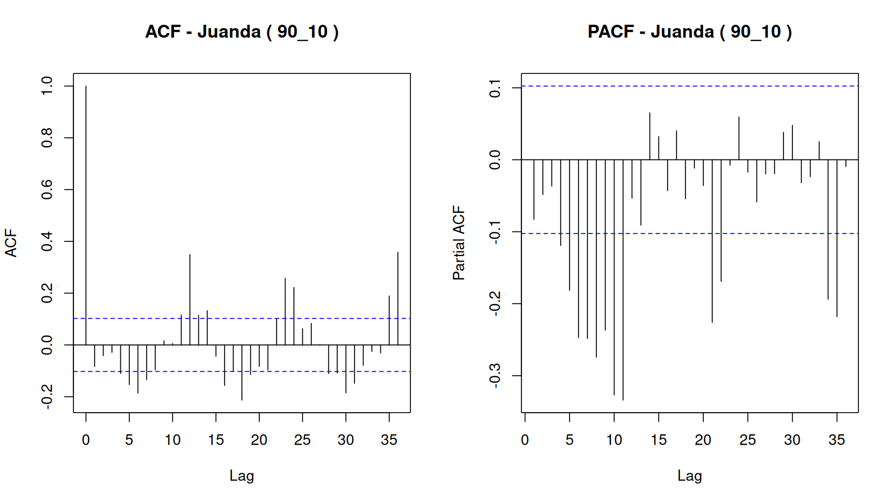

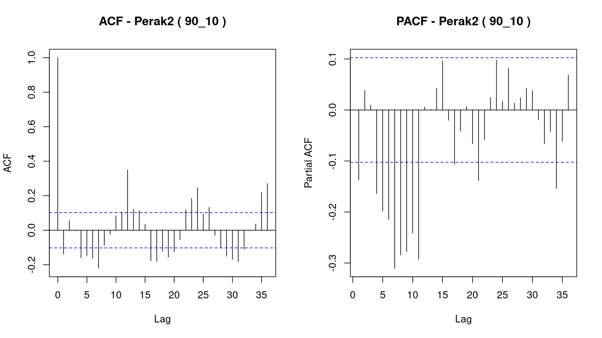

### CCF

Negative CCF lag means the second named location leads the first; positive lag means the first leads the second. The strongest correlation at each absolute non-zero lag is used to propose spatial-order candidates.

| location_x | location_y | lag | ccf | significance_bound | significant | direction |
|---|---|---|---|---|---|---|
| Juanda | Perak1 | -36 | 0.183681 | 0.102449 | TRUE | Perak1 leads Juanda |
| Juanda | Perak1 | -35 | 0.166028 | 0.102449 | TRUE | Perak1 leads Juanda |
| Juanda | Perak1 | -34 | -0.020848 | 0.102449 | FALSE | Perak1 leads Juanda |
| Juanda | Perak1 | -33 | -0.000227 | 0.102449 | FALSE | Perak1 leads Juanda |
| Juanda | Perak1 | -32 | 0.049322 | 0.102449 | FALSE | Perak1 leads Juanda |
| Juanda | Perak1 | -31 | -0.040981 | 0.102449 | FALSE | Perak1 leads Juanda |
| Juanda | Perak1 | -30 | -0.150298 | 0.102449 | TRUE | Perak1 leads Juanda |
| Juanda | Perak1 | -29 | -0.074929 | 0.102449 | FALSE | Perak1 leads Juanda |
| Juanda | Perak1 | -28 | -0.167953 | 0.102449 | TRUE | Perak1 leads Juanda |
| Juanda | Perak1 | -27 | -0.040230 | 0.102449 | FALSE | Perak1 leads Juanda |
| Juanda | Perak1 | -26 | 0.021582 | 0.102449 | FALSE | Perak1 leads Juanda |
| Juanda | Perak1 | -25 | 0.045939 | 0.102449 | FALSE | Perak1 leads Juanda |
| Juanda | Perak1 | -24 | 0.149740 | 0.102449 | TRUE | Perak1 leads Juanda |
| Juanda | Perak1 | -23 | 0.153672 | 0.102449 | TRUE | Perak1 leads Juanda |
| Juanda | Perak1 | -22 | 0.146453 | 0.102449 | TRUE | Perak1 leads Juanda |
| Juanda | Perak1 | -21 | -0.058108 | 0.102449 | FALSE | Perak1 leads Juanda |
| Juanda | Perak1 | -20 | 0.012077 | 0.102449 | FALSE | Perak1 leads Juanda |
| Juanda | Perak1 | -19 | -0.031444 | 0.102449 | FALSE | Perak1 leads Juanda |
| Juanda | Perak1 | -18 | -0.155513 | 0.102449 | TRUE | Perak1 leads Juanda |
| Juanda | Perak1 | -17 | -0.082001 | 0.102449 | FALSE | Perak1 leads Juanda |
| Juanda | Perak1 | -16 | -0.184656 | 0.102449 | TRUE | Perak1 leads Juanda |
| Juanda | Perak1 | -15 | -0.074281 | 0.102449 | FALSE | Perak1 leads Juanda |
| Juanda | Perak1 | -14 | 0.066775 | 0.102449 | FALSE | Perak1 leads Juanda |
| Juanda | Perak1 | -13 | 0.113797 | 0.102449 | TRUE | Perak1 leads Juanda |
| Juanda | Perak1 | -12 | 0.143687 | 0.102449 | TRUE | Perak1 leads Juanda |
| Juanda | Perak1 | -11 | 0.095433 | 0.102449 | FALSE | Perak1 leads Juanda |
| Juanda | Perak1 | -10 | 0.066566 | 0.102449 | FALSE | Perak1 leads Juanda |
| Juanda | Perak1 | -9 | 0.037982 | 0.102449 | FALSE | Perak1 leads Juanda |
| Juanda | Perak1 | -8 | 0.027838 | 0.102449 | FALSE | Perak1 leads Juanda |
| Juanda | Perak1 | -7 | -0.072231 | 0.102449 | FALSE | Perak1 leads Juanda |
| Juanda | Perak1 | -6 | -0.070084 | 0.102449 | FALSE | Perak1 leads Juanda |
| Juanda | Perak1 | -5 | -0.173884 | 0.102449 | TRUE | Perak1 leads Juanda |
| Juanda | Perak1 | -4 | -0.145331 | 0.102449 | TRUE | Perak1 leads Juanda |
| Juanda | Perak1 | -3 | -0.089783 | 0.102449 | FALSE | Perak1 leads Juanda |
| Juanda | Perak1 | -2 | 0.023540 | 0.102449 | FALSE | Perak1 leads Juanda |
| Juanda | Perak1 | -1 | -0.048661 | 0.102449 | FALSE | Perak1 leads Juanda |
| Juanda | Perak1 | 0 | 0.538450 | 0.102449 | TRUE | contemporaneous |
| Juanda | Perak1 | 1 | -0.023435 | 0.102449 | FALSE | Juanda leads Perak1 |
| Juanda | Perak1 | 2 | 0.050296 | 0.102449 | FALSE | Juanda leads Perak1 |
| Juanda | Perak1 | 3 | -0.060051 | 0.102449 | FALSE | Juanda leads Perak1 |
| Juanda | Perak1 | 4 | 0.059757 | 0.102449 | FALSE | Juanda leads Perak1 |
| Juanda | Perak1 | 5 | -0.097971 | 0.102449 | FALSE | Juanda leads Perak1 |
| Juanda | Perak1 | 6 | -0.026519 | 0.102449 | FALSE | Juanda leads Perak1 |
| Juanda | Perak1 | 7 | -0.189020 | 0.102449 | TRUE | Juanda leads Perak1 |
| Juanda | Perak1 | 8 | -0.127997 | 0.102449 | TRUE | Juanda leads Perak1 |
| Juanda | Perak1 | 9 | -0.061956 | 0.102449 | FALSE | Juanda leads Perak1 |
| Juanda | Perak1 | 10 | -0.000735 | 0.102449 | FALSE | Juanda leads Perak1 |
| Juanda | Perak1 | 11 | 0.086751 | 0.102449 | FALSE | Juanda leads Perak1 |
| Juanda | Perak1 | 12 | 0.200134 | 0.102449 | TRUE | Juanda leads Perak1 |
| Juanda | Perak1 | 13 | 0.140352 | 0.102449 | TRUE | Juanda leads Perak1 |
| Juanda | Perak1 | 14 | 0.076431 | 0.102449 | FALSE | Juanda leads Perak1 |
| Juanda | Perak1 | 15 | -0.020081 | 0.102449 | FALSE | Juanda leads Perak1 |
| Juanda | Perak1 | 16 | -0.012245 | 0.102449 | FALSE | Juanda leads Perak1 |
| Juanda | Perak1 | 17 | -0.039770 | 0.102449 | FALSE | Juanda leads Perak1 |
| Juanda | Perak1 | 18 | -0.083354 | 0.102449 | FALSE | Juanda leads Perak1 |
| Juanda | Perak1 | 19 | -0.146545 | 0.102449 | TRUE | Juanda leads Perak1 |
| Juanda | Perak1 | 20 | -0.134067 | 0.102449 | TRUE | Juanda leads Perak1 |
| Juanda | Perak1 | 21 | -0.092156 | 0.102449 | FALSE | Juanda leads Perak1 |
| Juanda | Perak1 | 22 | 0.054030 | 0.102449 | FALSE | Juanda leads Perak1 |
| Juanda | Perak1 | 23 | 0.137347 | 0.102449 | TRUE | Juanda leads Perak1 |
| Juanda | Perak1 | 24 | 0.144214 | 0.102449 | TRUE | Juanda leads Perak1 |
| Juanda | Perak1 | 25 | 0.039716 | 0.102449 | FALSE | Juanda leads Perak1 |
| Juanda | Perak1 | 26 | 0.129103 | 0.102449 | TRUE | Juanda leads Perak1 |
| Juanda | Perak1 | 27 | -0.032559 | 0.102449 | FALSE | Juanda leads Perak1 |
| Juanda | Perak1 | 28 | 0.017461 | 0.102449 | FALSE | Juanda leads Perak1 |
| Juanda | Perak1 | 29 | 0.020006 | 0.102449 | FALSE | Juanda leads Perak1 |
| Juanda | Perak1 | 30 | -0.175108 | 0.102449 | TRUE | Juanda leads Perak1 |
| Juanda | Perak1 | 31 | -0.100445 | 0.102449 | FALSE | Juanda leads Perak1 |
| Juanda | Perak1 | 32 | -0.152509 | 0.102449 | TRUE | Juanda leads Perak1 |
| Juanda | Perak1 | 33 | -0.019315 | 0.102449 | FALSE | Juanda leads Perak1 |
| Juanda | Perak1 | 34 | -0.053791 | 0.102449 | FALSE | Juanda leads Perak1 |
| Juanda | Perak1 | 35 | 0.171193 | 0.102449 | TRUE | Juanda leads Perak1 |
| Juanda | Perak1 | 36 | 0.137623 | 0.102449 | TRUE | Juanda leads Perak1 |
| Juanda | Perak2 | -36 | 0.268802 | 0.102449 | TRUE | Perak2 leads Juanda |
| Juanda | Perak2 | -35 | 0.244213 | 0.102449 | TRUE | Perak2 leads Juanda |
| Juanda | Perak2 | -34 | 0.091966 | 0.102449 | FALSE | Perak2 leads Juanda |
| Juanda | Perak2 | -33 | -0.056959 | 0.102449 | FALSE | Perak2 leads Juanda |
| Juanda | Perak2 | -32 | -0.034155 | 0.102449 | FALSE | Perak2 leads Juanda |
| Juanda | Perak2 | -31 | -0.122583 | 0.102449 | TRUE | Perak2 leads Juanda |
| Juanda | Perak2 | -30 | -0.189489 | 0.102449 | TRUE | Perak2 leads Juanda |
| Juanda | Perak2 | -29 | -0.126021 | 0.102449 | TRUE | Perak2 leads Juanda |
| Juanda | Perak2 | -28 | -0.171309 | 0.102449 | TRUE | Perak2 leads Juanda |
| Juanda | Perak2 | -27 | -0.087666 | 0.102449 | FALSE | Perak2 leads Juanda |
| Juanda | Perak2 | -26 | 0.114764 | 0.102449 | TRUE | Perak2 leads Juanda |
| Juanda | Perak2 | -25 | 0.082296 | 0.102449 | FALSE | Perak2 leads Juanda |
| Juanda | Perak2 | -24 | 0.163329 | 0.102449 | TRUE | Perak2 leads Juanda |
| Juanda | Perak2 | -23 | 0.238215 | 0.102449 | TRUE | Perak2 leads Juanda |
| Juanda | Perak2 | -22 | 0.287857 | 0.102449 | TRUE | Perak2 leads Juanda |
| Juanda | Perak2 | -21 | -0.131949 | 0.102449 | TRUE | Perak2 leads Juanda |
| Juanda | Perak2 | -20 | -0.083562 | 0.102449 | FALSE | Perak2 leads Juanda |
| Juanda | Perak2 | -19 | -0.089211 | 0.102449 | FALSE | Perak2 leads Juanda |
| Juanda | Perak2 | -18 | -0.152932 | 0.102449 | TRUE | Perak2 leads Juanda |
| Juanda | Perak2 | -17 | -0.175454 | 0.102449 | TRUE | Perak2 leads Juanda |
| Juanda | Perak2 | -16 | -0.197396 | 0.102449 | TRUE | Perak2 leads Juanda |
| Juanda | Perak2 | -15 | -0.074661 | 0.102449 | FALSE | Perak2 leads Juanda |
| Juanda | Perak2 | -14 | 0.106705 | 0.102449 | TRUE | Perak2 leads Juanda |
| Juanda | Perak2 | -13 | 0.137857 | 0.102449 | TRUE | Perak2 leads Juanda |
| Juanda | Perak2 | -12 | 0.231027 | 0.102449 | TRUE | Perak2 leads Juanda |
| Juanda | Perak2 | -11 | 0.222536 | 0.102449 | TRUE | Perak2 leads Juanda |
| Juanda | Perak2 | -10 | 0.038081 | 0.102449 | FALSE | Perak2 leads Juanda |
| Juanda | Perak2 | -9 | 0.036741 | 0.102449 | FALSE | Perak2 leads Juanda |
| Juanda | Perak2 | -8 | -0.039379 | 0.102449 | FALSE | Perak2 leads Juanda |
| Juanda | Perak2 | -7 | -0.121190 | 0.102449 | TRUE | Perak2 leads Juanda |
| Juanda | Perak2 | -6 | -0.176695 | 0.102449 | TRUE | Perak2 leads Juanda |
| Juanda | Perak2 | -5 | -0.192722 | 0.102449 | TRUE | Perak2 leads Juanda |
| Juanda | Perak2 | -4 | -0.167610 | 0.102449 | TRUE | Perak2 leads Juanda |
| Juanda | Perak2 | -3 | -0.050026 | 0.102449 | FALSE | Perak2 leads Juanda |
| Juanda | Perak2 | -2 | 0.016340 | 0.102449 | FALSE | Perak2 leads Juanda |
| Juanda | Perak2 | -1 | 0.021752 | 0.102449 | FALSE | Perak2 leads Juanda |
| Juanda | Perak2 | 0 | 0.552679 | 0.102449 | TRUE | contemporaneous |
| Juanda | Perak2 | 1 | 0.147244 | 0.102449 | TRUE | Juanda leads Perak2 |
| Juanda | Perak2 | 2 | 0.039687 | 0.102449 | FALSE | Juanda leads Perak2 |
| Juanda | Perak2 | 3 | -0.017826 | 0.102449 | FALSE | Juanda leads Perak2 |
| Juanda | Perak2 | 4 | -0.067516 | 0.102449 | FALSE | Juanda leads Perak2 |
| Juanda | Perak2 | 5 | -0.142704 | 0.102449 | TRUE | Juanda leads Perak2 |
| Juanda | Perak2 | 6 | -0.112011 | 0.102449 | TRUE | Juanda leads Perak2 |
| Juanda | Perak2 | 7 | -0.220838 | 0.102449 | TRUE | Juanda leads Perak2 |
| Juanda | Perak2 | 8 | -0.117413 | 0.102449 | TRUE | Juanda leads Perak2 |
| Juanda | Perak2 | 9 | -0.109687 | 0.102449 | TRUE | Juanda leads Perak2 |
| Juanda | Perak2 | 10 | 0.060429 | 0.102449 | FALSE | Juanda leads Perak2 |
| Juanda | Perak2 | 11 | 0.135600 | 0.102449 | TRUE | Juanda leads Perak2 |
| Juanda | Perak2 | 12 | 0.243376 | 0.102449 | TRUE | Juanda leads Perak2 |
| Juanda | Perak2 | 13 | 0.183848 | 0.102449 | TRUE | Juanda leads Perak2 |
| Juanda | Perak2 | 14 | 0.180575 | 0.102449 | TRUE | Juanda leads Perak2 |
| Juanda | Perak2 | 15 | -0.003806 | 0.102449 | FALSE | Juanda leads Perak2 |
| Juanda | Perak2 | 16 | -0.118227 | 0.102449 | TRUE | Juanda leads Perak2 |
| Juanda | Perak2 | 17 | -0.109241 | 0.102449 | TRUE | Juanda leads Perak2 |
| Juanda | Perak2 | 18 | -0.158751 | 0.102449 | TRUE | Juanda leads Perak2 |
| Juanda | Perak2 | 19 | -0.157081 | 0.102449 | TRUE | Juanda leads Perak2 |
| Juanda | Perak2 | 20 | -0.145257 | 0.102449 | TRUE | Juanda leads Perak2 |
| Juanda | Perak2 | 21 | -0.089308 | 0.102449 | FALSE | Juanda leads Perak2 |
| Juanda | Perak2 | 22 | 0.057123 | 0.102449 | FALSE | Juanda leads Perak2 |
| Juanda | Perak2 | 23 | 0.196129 | 0.102449 | TRUE | Juanda leads Perak2 |
| Juanda | Perak2 | 24 | 0.179617 | 0.102449 | TRUE | Juanda leads Perak2 |
| Juanda | Perak2 | 25 | 0.146525 | 0.102449 | TRUE | Juanda leads Perak2 |
| Juanda | Perak2 | 26 | 0.144096 | 0.102449 | TRUE | Juanda leads Perak2 |
| Juanda | Perak2 | 27 | -0.012907 | 0.102449 | FALSE | Juanda leads Perak2 |
| Juanda | Perak2 | 28 | -0.034974 | 0.102449 | FALSE | Juanda leads Perak2 |
| Juanda | Perak2 | 29 | -0.065364 | 0.102449 | FALSE | Juanda leads Perak2 |
| Juanda | Perak2 | 30 | -0.252532 | 0.102449 | TRUE | Juanda leads Perak2 |
| Juanda | Perak2 | 31 | -0.136854 | 0.102449 | TRUE | Juanda leads Perak2 |
| Juanda | Perak2 | 32 | -0.145224 | 0.102449 | TRUE | Juanda leads Perak2 |
| Juanda | Perak2 | 33 | -0.014453 | 0.102449 | FALSE | Juanda leads Perak2 |
| Juanda | Perak2 | 34 | -0.037076 | 0.102449 | FALSE | Juanda leads Perak2 |
| Juanda | Perak2 | 35 | 0.189740 | 0.102449 | TRUE | Juanda leads Perak2 |
| Juanda | Perak2 | 36 | 0.190087 | 0.102449 | TRUE | Juanda leads Perak2 |
| Perak1 | Perak2 | -36 | 0.168332 | 0.102449 | TRUE | Perak2 leads Perak1 |
| Perak1 | Perak2 | -35 | 0.212555 | 0.102449 | TRUE | Perak2 leads Perak1 |
| Perak1 | Perak2 | -34 | -0.031408 | 0.102449 | FALSE | Perak2 leads Perak1 |
| Perak1 | Perak2 | -33 | 0.020087 | 0.102449 | FALSE | Perak2 leads Perak1 |
| Perak1 | Perak2 | -32 | -0.121602 | 0.102449 | TRUE | Perak2 leads Perak1 |
| Perak1 | Perak2 | -31 | -0.170520 | 0.102449 | TRUE | Perak2 leads Perak1 |
| Perak1 | Perak2 | -30 | -0.091692 | 0.102449 | FALSE | Perak2 leads Perak1 |
| Perak1 | Perak2 | -29 | -0.105535 | 0.102449 | TRUE | Perak2 leads Perak1 |
| Perak1 | Perak2 | -28 | -0.000199 | 0.102449 | FALSE | Perak2 leads Perak1 |
| Perak1 | Perak2 | -27 | -0.018035 | 0.102449 | FALSE | Perak2 leads Perak1 |
| Perak1 | Perak2 | -26 | 0.128923 | 0.102449 | TRUE | Perak2 leads Perak1 |
| Perak1 | Perak2 | -25 | -0.009108 | 0.102449 | FALSE | Perak2 leads Perak1 |
| Perak1 | Perak2 | -24 | 0.205378 | 0.102449 | TRUE | Perak2 leads Perak1 |
| Perak1 | Perak2 | -23 | 0.110664 | 0.102449 | TRUE | Perak2 leads Perak1 |
| Perak1 | Perak2 | -22 | 0.088163 | 0.102449 | FALSE | Perak2 leads Perak1 |
| Perak1 | Perak2 | -21 | -0.022234 | 0.102449 | FALSE | Perak2 leads Perak1 |
| Perak1 | Perak2 | -20 | -0.169048 | 0.102449 | TRUE | Perak2 leads Perak1 |
| Perak1 | Perak2 | -19 | -0.116746 | 0.102449 | TRUE | Perak2 leads Perak1 |
| Perak1 | Perak2 | -18 | -0.064122 | 0.102449 | FALSE | Perak2 leads Perak1 |
| Perak1 | Perak2 | -17 | -0.125891 | 0.102449 | TRUE | Perak2 leads Perak1 |
| Perak1 | Perak2 | -16 | -0.037479 | 0.102449 | FALSE | Perak2 leads Perak1 |
| Perak1 | Perak2 | -15 | 0.032706 | 0.102449 | FALSE | Perak2 leads Perak1 |
| Perak1 | Perak2 | -14 | 0.008228 | 0.102449 | FALSE | Perak2 leads Perak1 |
| Perak1 | Perak2 | -13 | 0.115091 | 0.102449 | TRUE | Perak2 leads Perak1 |
| Perak1 | Perak2 | -12 | 0.266245 | 0.102449 | TRUE | Perak2 leads Perak1 |
| Perak1 | Perak2 | -11 | 0.070945 | 0.102449 | FALSE | Perak2 leads Perak1 |
| Perak1 | Perak2 | -10 | -0.007302 | 0.102449 | FALSE | Perak2 leads Perak1 |
| Perak1 | Perak2 | -9 | 0.032204 | 0.102449 | FALSE | Perak2 leads Perak1 |
| Perak1 | Perak2 | -8 | -0.117082 | 0.102449 | TRUE | Perak2 leads Perak1 |
| Perak1 | Perak2 | -7 | -0.182741 | 0.102449 | TRUE | Perak2 leads Perak1 |
| Perak1 | Perak2 | -6 | -0.096851 | 0.102449 | FALSE | Perak2 leads Perak1 |
| Perak1 | Perak2 | -5 | -0.084303 | 0.102449 | FALSE | Perak2 leads Perak1 |
| Perak1 | Perak2 | -4 | -0.057094 | 0.102449 | FALSE | Perak2 leads Perak1 |
| Perak1 | Perak2 | -3 | 0.034594 | 0.102449 | FALSE | Perak2 leads Perak1 |
| Perak1 | Perak2 | -2 | 0.063927 | 0.102449 | FALSE | Perak2 leads Perak1 |
| Perak1 | Perak2 | -1 | -0.182840 | 0.102449 | TRUE | Perak2 leads Perak1 |
| Perak1 | Perak2 | 0 | 0.711805 | 0.102449 | TRUE | contemporaneous |
| Perak1 | Perak2 | 1 | -0.102285 | 0.102449 | FALSE | Perak1 leads Perak2 |
| Perak1 | Perak2 | 2 | 0.078336 | 0.102449 | FALSE | Perak1 leads Perak2 |
| Perak1 | Perak2 | 3 | -0.059906 | 0.102449 | FALSE | Perak1 leads Perak2 |
| Perak1 | Perak2 | 4 | -0.160061 | 0.102449 | TRUE | Perak1 leads Perak2 |
| Perak1 | Perak2 | 5 | -0.135746 | 0.102449 | TRUE | Perak1 leads Perak2 |
| Perak1 | Perak2 | 6 | -0.048352 | 0.102449 | FALSE | Perak1 leads Perak2 |
| Perak1 | Perak2 | 7 | -0.150946 | 0.102449 | TRUE | Perak1 leads Perak2 |
| Perak1 | Perak2 | 8 | -0.035985 | 0.102449 | FALSE | Perak1 leads Perak2 |
| Perak1 | Perak2 | 9 | 0.024496 | 0.102449 | FALSE | Perak1 leads Perak2 |
| Perak1 | Perak2 | 10 | 0.065814 | 0.102449 | FALSE | Perak1 leads Perak2 |
| Perak1 | Perak2 | 11 | 0.077751 | 0.102449 | FALSE | Perak1 leads Perak2 |
| Perak1 | Perak2 | 12 | 0.167809 | 0.102449 | TRUE | Perak1 leads Perak2 |
| Perak1 | Perak2 | 13 | 0.134603 | 0.102449 | TRUE | Perak1 leads Perak2 |
| Perak1 | Perak2 | 14 | 0.076520 | 0.102449 | FALSE | Perak1 leads Perak2 |
| Perak1 | Perak2 | 15 | -0.004593 | 0.102449 | FALSE | Perak1 leads Perak2 |
| Perak1 | Perak2 | 16 | -0.154963 | 0.102449 | TRUE | Perak1 leads Perak2 |
| Perak1 | Perak2 | 17 | -0.135825 | 0.102449 | TRUE | Perak1 leads Perak2 |
| Perak1 | Perak2 | 18 | -0.121915 | 0.102449 | TRUE | Perak1 leads Perak2 |
| Perak1 | Perak2 | 19 | -0.041404 | 0.102449 | FALSE | Perak1 leads Perak2 |
| Perak1 | Perak2 | 20 | -0.085159 | 0.102449 | FALSE | Perak1 leads Perak2 |
| Perak1 | Perak2 | 21 | 0.051614 | 0.102449 | FALSE | Perak1 leads Perak2 |
| Perak1 | Perak2 | 22 | 0.038036 | 0.102449 | FALSE | Perak1 leads Perak2 |
| Perak1 | Perak2 | 23 | 0.096277 | 0.102449 | FALSE | Perak1 leads Perak2 |
| Perak1 | Perak2 | 24 | 0.210624 | 0.102449 | TRUE | Perak1 leads Perak2 |
| Perak1 | Perak2 | 25 | 0.040180 | 0.102449 | FALSE | Perak1 leads Perak2 |
| Perak1 | Perak2 | 26 | 0.067818 | 0.102449 | FALSE | Perak1 leads Perak2 |
| Perak1 | Perak2 | 27 | 0.008420 | 0.102449 | FALSE | Perak1 leads Perak2 |
| Perak1 | Perak2 | 28 | -0.140746 | 0.102449 | TRUE | Perak1 leads Perak2 |
| Perak1 | Perak2 | 29 | -0.126366 | 0.102449 | TRUE | Perak1 leads Perak2 |
| Perak1 | Perak2 | 30 | -0.087141 | 0.102449 | FALSE | Perak1 leads Perak2 |
| Perak1 | Perak2 | 31 | -0.106472 | 0.102449 | TRUE | Perak1 leads Perak2 |
| Perak1 | Perak2 | 32 | -0.036687 | 0.102449 | FALSE | Perak1 leads Perak2 |
| Perak1 | Perak2 | 33 | 0.081051 | 0.102449 | FALSE | Perak1 leads Perak2 |
| Perak1 | Perak2 | 34 | -0.098983 | 0.102449 | FALSE | Perak1 leads Perak2 |
| Perak1 | Perak2 | 35 | 0.220996 | 0.102449 | TRUE | Perak1 leads Perak2 |
| Perak1 | Perak2 | 36 | 0.147228 | 0.102449 | TRUE | Perak1 leads Perak2 |

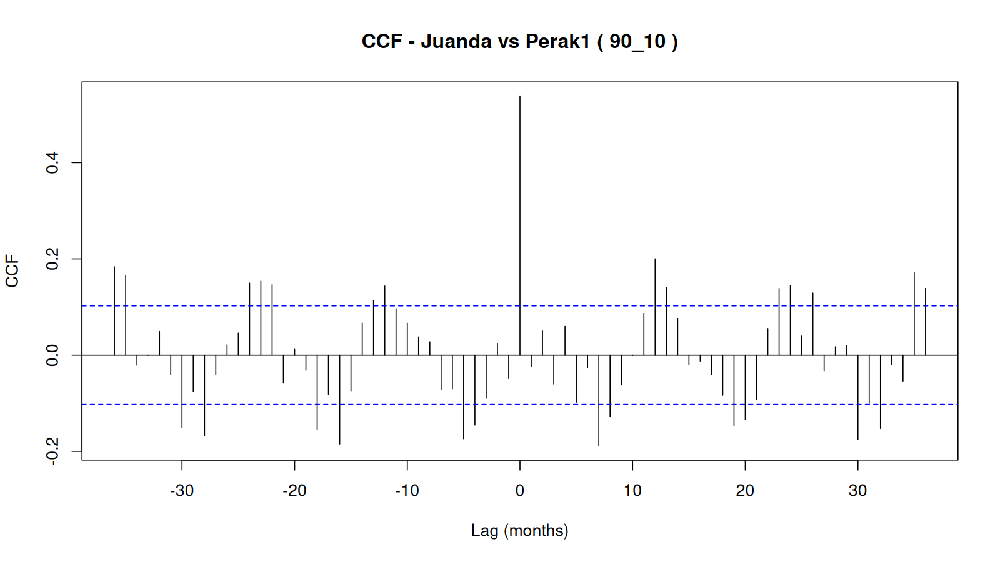

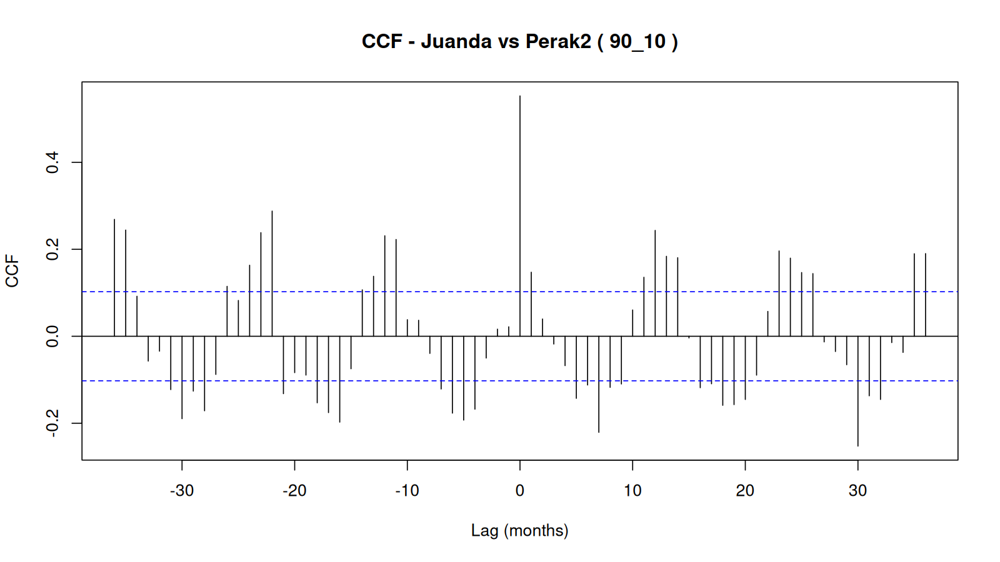

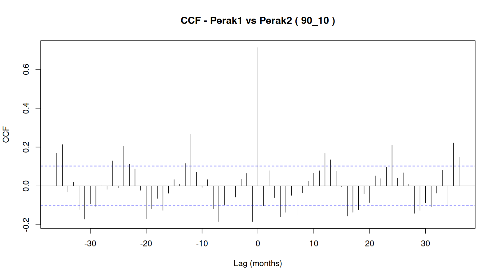

### Candidate models

| a | b | fitted | AIC | coefficients_finite | iidn_pass | white_noise_pass | error |
|---|---|---|---|---|---|---|---|
| 1 | 1 | TRUE | 13679.35 | TRUE | FALSE | FALSE |  |
| 4 | 4 | TRUE | 13509.76 | TRUE | FALSE | FALSE |  |
| 5 | 5 | TRUE | 13412.06 | TRUE | FALSE | FALSE |  |
| 6 | 6 | TRUE | 13296.25 | TRUE | FALSE | FALSE |  |
| 7 | 7 | TRUE | 13196.17 | TRUE | FALSE | FALSE |  |
| 8 | 8 | TRUE | 13093.91 | TRUE | FALSE | FALSE |  |
| 12 | 12 | TRUE | 12701.99 | TRUE | FALSE | TRUE |  |
| 16 | 16 | TRUE | 12573.42 | TRUE | FALSE | TRUE |  |

### Selected parameters

| a | b | parameter | estimate | std_error | t_value | p_value |
|---|---|---|---|---|---|---|
| 16 | 16 | psi10(Juanda) | -0.615250 | 2.935761 | -0.209571 | 0.834043 |
| 16 | 16 | psi10(Perak1) | -1.060218 | 5.402660 | -0.196240 | 0.844460 |
| 16 | 16 | psi10(Perak2) | -0.634045 | 9.962324 | -0.063644 | 0.949266 |
| 16 | 16 | psi20(Juanda) | -0.620525 | 4.339697 | -0.142988 | 0.886327 |
| 16 | 16 | psi20(Perak1) | -0.934518 | 9.845652 | -0.094917 | 0.924399 |
| 16 | 16 | psi20(Perak2) | -0.604059 | 16.146901 | -0.037410 | 0.970165 |
| 16 | 16 | psi30(Juanda) | -0.498537 | 5.640965 | -0.088378 | 0.929593 |
| 16 | 16 | psi30(Perak1) | -0.867282 | 13.393577 | -0.064754 | 0.948383 |
| 16 | 16 | psi30(Perak2) | -0.648831 | 21.071023 | -0.030793 | 0.975441 |
| 16 | 16 | psi40(Juanda) | -0.508193 | 6.360607 | -0.079897 | 0.936334 |
| 16 | 16 | psi40(Perak1) | -0.810582 | 16.180764 | -0.050095 | 0.960056 |
| 16 | 16 | psi40(Perak2) | -0.724118 | 25.135995 | -0.028808 | 0.977023 |
| 16 | 16 | psi50(Juanda) | -0.507455 | 7.027825 | -0.072206 | 0.942451 |
| 16 | 16 | psi50(Perak1) | -0.669682 | 18.923522 | -0.035389 | 0.971776 |
| 16 | 16 | psi50(Perak2) | -0.710738 | 29.095889 | -0.024427 | 0.980516 |
| 16 | 16 | psi60(Juanda) | -0.561081 | 7.117067 | -0.078836 | 0.937178 |
| 16 | 16 | psi60(Perak1) | -0.531594 | 19.968057 | -0.026622 | 0.978766 |
| 16 | 16 | psi60(Perak2) | -0.700917 | 31.741724 | -0.022082 | 0.982387 |
| 16 | 16 | psi70(Juanda) | -0.422116 | 7.221660 | -0.058451 | 0.953400 |
| 16 | 16 | psi70(Perak1) | -0.682776 | 20.152891 | -0.033880 | 0.972979 |
| 16 | 16 | psi70(Perak2) | -0.812252 | 33.886956 | -0.023969 | 0.980882 |
| 16 | 16 | psi80(Juanda) | -0.376872 | 7.298382 | -0.051638 | 0.958827 |
| 16 | 16 | psi80(Perak1) | -0.745738 | 20.653831 | -0.036107 | 0.971204 |
| 16 | 16 | psi80(Perak2) | -0.817851 | 36.112923 | -0.022647 | 0.981936 |
| 16 | 16 | psi90(Juanda) | -0.240879 | 7.298420 | -0.033004 | 0.973677 |
| 16 | 16 | psi90(Perak1) | -0.572327 | 20.671744 | -0.027686 | 0.977918 |
| 16 | 16 | psi90(Perak2) | -0.930911 | 37.690712 | -0.024699 | 0.980300 |
| 16 | 16 | psi100(Juanda) | -0.284884 | 7.038883 | -0.040473 | 0.967724 |
| 16 | 16 | psi100(Perak1) | -0.587332 | 20.111780 | -0.029203 | 0.976708 |
| 16 | 16 | psi100(Perak2) | -0.850518 | 38.810343 | -0.021915 | 0.982520 |
| 16 | 16 | psi110(Juanda) | -0.236881 | 6.789331 | -0.034890 | 0.972174 |
| 16 | 16 | psi110(Perak1) | -0.483806 | 19.767521 | -0.024475 | 0.980479 |
| 16 | 16 | psi110(Perak2) | -0.821857 | 38.264016 | -0.021479 | 0.982868 |
| 16 | 16 | psi120(Juanda) | -0.023093 | 6.653384 | -0.003471 | 0.997231 |
| 16 | 16 | psi120(Perak1) | -0.252719 | 18.354729 | -0.013769 | 0.989017 |
| 16 | 16 | psi120(Perak2) | -0.535405 | 36.286782 | -0.014755 | 0.988231 |
| 16 | 16 | psi130(Juanda) | -0.067662 | 6.027000 | -0.011226 | 0.991045 |
| 16 | 16 | psi130(Perak1) | -0.153764 | 15.604283 | -0.009854 | 0.992140 |
| 16 | 16 | psi130(Perak2) | -0.506271 | 30.271483 | -0.016724 | 0.986660 |
| 16 | 16 | psi140(Juanda) | 0.044010 | 5.380836 | 0.008179 | 0.993476 |
| 16 | 16 | psi140(Perak1) | -0.254320 | 12.998324 | -0.019566 | 0.984394 |
| 16 | 16 | psi140(Perak2) | -0.264850 | 24.175677 | -0.010955 | 0.991261 |
| 16 | 16 | psi150(Juanda) | 0.024786 | 4.282602 | 0.005788 | 0.995383 |
| 16 | 16 | psi150(Perak1) | -0.238116 | 9.810754 | -0.024271 | 0.980641 |
| 16 | 16 | psi150(Perak2) | -0.082149 | 17.770076 | -0.004623 | 0.996312 |
| 16 | 16 | psi160(Juanda) | -0.023680 | 2.847630 | -0.008316 | 0.993367 |
| 16 | 16 | psi160(Perak1) | -0.028599 | 5.825559 | -0.004909 | 0.996084 |
| 16 | 16 | psi160(Perak2) | -0.095929 | 10.847855 | -0.008843 | 0.992946 |
| 16 | 16 | psi11(Juanda) | -0.094310 | 22.509645 | -0.004190 | 0.996658 |
| 16 | 16 | psi11(Perak1) | 0.236087 | 5.255974 | 0.044918 | 0.964181 |
| 16 | 16 | psi11(Perak2) | -0.082650 | 4.395939 | -0.018801 | 0.985003 |
| 16 | 16 | psi21(Juanda) | -0.329137 | 39.831997 | -0.008263 | 0.993409 |
| 16 | 16 | psi21(Perak1) | 0.235696 | 7.320591 | 0.032196 | 0.974322 |
| 16 | 16 | psi21(Perak2) | -0.067836 | 7.589729 | -0.008938 | 0.992870 |
| 16 | 16 | psi31(Juanda) | -0.666811 | 49.832099 | -0.013381 | 0.989326 |
| 16 | 16 | psi31(Perak1) | 0.162530 | 9.835520 | 0.016525 | 0.986819 |
| 16 | 16 | psi31(Perak2) | -0.025727 | 10.451015 | -0.002462 | 0.998036 |
| 16 | 16 | psi41(Juanda) | -0.582851 | 58.235206 | -0.010009 | 0.992016 |
| 16 | 16 | psi41(Perak1) | 0.063951 | 11.387314 | 0.005616 | 0.995520 |
| 16 | 16 | psi41(Perak2) | -0.007503 | 13.439731 | -0.000558 | 0.999555 |
| 16 | 16 | psi51(Juanda) | -0.673258 | 67.579833 | -0.009962 | 0.992053 |
| 16 | 16 | psi51(Perak1) | -0.079053 | 13.160814 | -0.006007 | 0.995209 |
| 16 | 16 | psi51(Perak2) | -0.010578 | 15.775013 | -0.000671 | 0.999465 |
| 16 | 16 | psi61(Juanda) | -0.565788 | 70.283875 | -0.008050 | 0.993579 |
| 16 | 16 | psi61(Perak1) | -0.129084 | 13.683494 | -0.009434 | 0.992475 |
| 16 | 16 | psi61(Perak2) | -0.004731 | 17.545794 | -0.000270 | 0.999785 |
| 16 | 16 | psi71(Juanda) | -1.107606 | 73.149352 | -0.015142 | 0.987922 |
| 16 | 16 | psi71(Perak1) | -0.043852 | 13.745520 | -0.003190 | 0.997455 |
| 16 | 16 | psi71(Perak2) | 0.044441 | 18.080692 | 0.002458 | 0.998039 |
| 16 | 16 | psi81(Juanda) | -1.383612 | 80.331820 | -0.017224 | 0.986261 |
| 16 | 16 | psi81(Perak1) | 0.076209 | 13.397164 | 0.005688 | 0.995462 |
| 16 | 16 | psi81(Perak2) | 0.074597 | 18.387813 | 0.004057 | 0.996764 |
| 16 | 16 | psi91(Juanda) | -1.572877 | 82.811692 | -0.018993 | 0.984850 |
| 16 | 16 | psi91(Perak1) | 0.054200 | 13.115005 | 0.004133 | 0.996703 |
| 16 | 16 | psi91(Perak2) | 0.194352 | 18.218061 | 0.010668 | 0.991490 |
| 16 | 16 | psi101(Juanda) | -1.324604 | 81.782648 | -0.016197 | 0.987081 |
| 16 | 16 | psi101(Perak1) | 0.137905 | 12.800039 | 0.010774 | 0.991406 |
| 16 | 16 | psi101(Perak2) | 0.185206 | 17.616332 | 0.010513 | 0.991614 |
| 16 | 16 | psi111(Juanda) | -0.998763 | 81.668950 | -0.012229 | 0.990245 |
| 16 | 16 | psi111(Perak1) | 0.096448 | 12.471767 | 0.007733 | 0.993831 |
| 16 | 16 | psi111(Perak2) | 0.271741 | 16.755173 | 0.016218 | 0.987063 |
| 16 | 16 | psi121(Juanda) | -0.678789 | 79.018655 | -0.008590 | 0.993148 |
| 16 | 16 | psi121(Perak1) | 0.053593 | 11.948888 | 0.004485 | 0.996422 |
| 16 | 16 | psi121(Perak2) | 0.315469 | 15.103069 | 0.020888 | 0.983339 |
| 16 | 16 | psi131(Juanda) | -0.335638 | 69.876416 | -0.004803 | 0.996168 |
| 16 | 16 | psi131(Perak1) | 0.063780 | 10.459089 | 0.006098 | 0.995136 |
| 16 | 16 | psi131(Perak2) | 0.339419 | 12.525366 | 0.027099 | 0.978386 |
| 16 | 16 | psi141(Juanda) | -0.193742 | 59.292393 | -0.003268 | 0.997393 |
| 16 | 16 | psi141(Perak1) | 0.212956 | 9.337224 | 0.022807 | 0.981808 |
| 16 | 16 | psi141(Perak2) | 0.225417 | 9.877629 | 0.022821 | 0.981797 |
| 16 | 16 | psi151(Juanda) | -0.214313 | 45.566708 | -0.004703 | 0.996248 |
| 16 | 16 | psi151(Perak1) | 0.204464 | 7.306862 | 0.027982 | 0.977681 |
| 16 | 16 | psi151(Perak2) | 0.125035 | 7.197365 | 0.017372 | 0.986143 |
| 16 | 16 | psi161(Juanda) | -0.085978 | 24.884047 | -0.003455 | 0.997244 |
| 16 | 16 | psi161(Perak1) | 0.003001 | 5.502475 | 0.000545 | 0.999565 |
| 16 | 16 | psi161(Perak2) | 0.090207 | 4.317845 | 0.020892 | 0.983336 |

### Training fit and hold-out forecast

Each panel compares actual rainfall with fitted values (left), recursive multi-step forecasts, and actual-lag one-step forecasts (right).

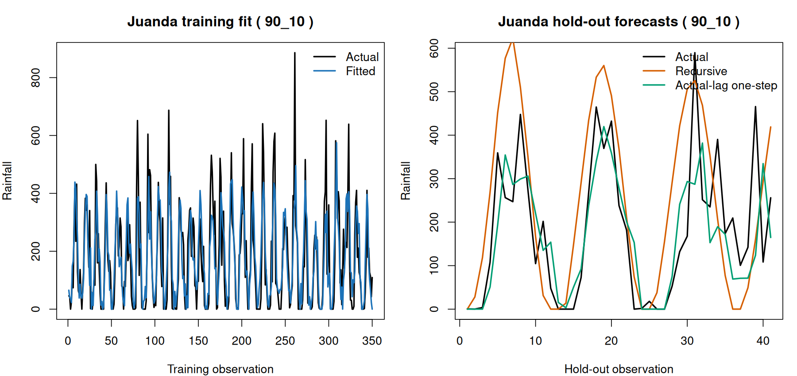

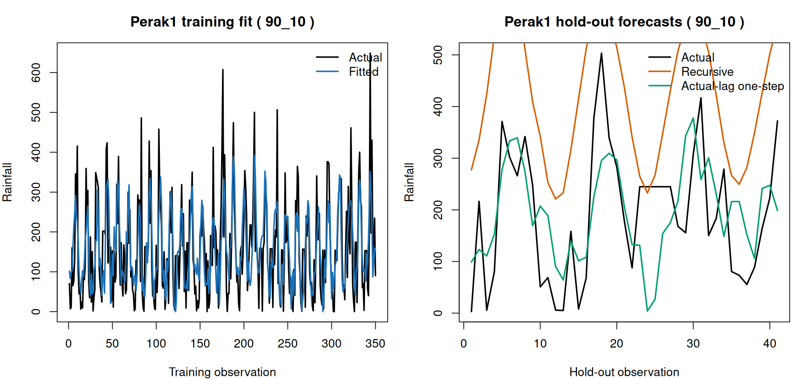

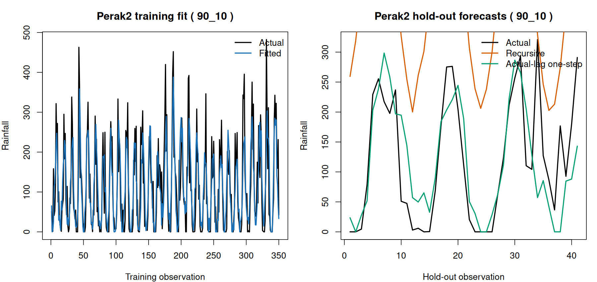

### Training metrics

| location | MSE | RMSE | MAE | sMAPE | MAPE_nonzero | R_squared |
|---|---|---|---|---|---|---|
| Juanda | 11178.694 | 105.72934 | 77.08737 | 74.30985 | 439.8915 | 0.609819 |
| Perak1 | 7500.401 | 86.60485 | 68.50165 | 60.30197 | 1124.8351 | 0.482480 |
| Perak2 | 4340.474 | 65.88227 | 48.56564 | 76.32948 | 163.6682 | 0.638007 |
| Overall | 7673.189 | 87.59674 | 64.71822 | 70.31377 | 609.0223 | 0.596119 |

### Testing metrics: recursive multi-step

Each forecasted test value is used as a lag input for the next test forecast; no actual test value enters the forecast recursion.

| location | MSE | RMSE | MAE | sMAPE | MAPE_nonzero | R_squared |
|---|---|---|---|---|---|---|
| Juanda | 27016.62 | 164.3673 | 132.2587 | 105.07649 | 581.8958 | -0.062004 |
| Perak1 | 66383.87 | 257.6507 | 231.9344 | 87.82338 | 874.7213 | -3.090957 |
| Perak2 | 92268.23 | 303.7569 | 288.9120 | 126.08425 | 3662.4972 | -7.525021 |
| Overall | 61889.57 | 248.7761 | 217.7017 | 106.32804 | 1643.2258 | -2.346802 |

### Testing metrics: actual-lag one-step

Each test prediction uses observed rainfall only from earlier test months as lag inputs; it does not use the current month’s actual rainfall. This is a one-step-ahead evaluation, not a deployable long-horizon forecast.

| location | MSE | RMSE | MAE | sMAPE | MAPE_nonzero | R_squared |
|---|---|---|---|---|---|---|
| Juanda | 13003.107 | 114.03117 | 80.69101 | 78.14260 | 58.3414 | 0.488857 |
| Perak1 | 12588.471 | 112.19836 | 96.39303 | 68.09866 | 272.5769 | 0.224226 |
| Perak2 | 5403.642 | 73.50947 | 51.42981 | 72.64673 | 372.6780 | 0.500736 |
| Overall | 10331.740 | 101.64517 | 76.17128 | 72.96266 | 235.3514 | 0.441291 |

### Selected residual diagnostics

| location | mean_residual | residual_variance | mean_zero_p_value | normality_shapiro_p_value | variance_stability_fligner_p_value | ljung_box_10_p_value | ljung_box_20_p_value |
|---|---|---|---|---|---|---|---|
| Juanda | -1.088101 | 11290.028 | 0.848181 | 0.000000 | 0.650616 | 0.969392 | 0.916173 |
| Perak1 | 0.711886 | 7546.602 | 0.878243 | 0.000000 | 0.880040 | 0.999977 | 0.992129 |
| Perak2 | 1.324340 | 4397.287 | 0.708907 | 0.000004 | 0.412954 | 0.951404 | 0.674116 |

### Equation terms

Package convention: own-city terms are psi[k,0](i) Z[i,t-k]; spatial terms are psi[k,1](i) sum_j W[j,i] Z[j,t-k].

| location | lag | effect | parameter | coefficient | equation_term |
|---|---|---|---|---|---|
| Juanda | 1 | own-city | psi10(Juanda) | -0.615250 | -0.61525 * Z_Juanda,t-1 |
| Perak1 | 1 | own-city | psi10(Perak1) | -1.060218 | -1.060218 * Z_Perak1,t-1 |
| Perak2 | 1 | own-city | psi10(Perak2) | -0.634045 | -0.634045 * Z_Perak2,t-1 |
| Juanda | 2 | own-city | psi20(Juanda) | -0.620525 | -0.620525 * Z_Juanda,t-2 |
| Perak1 | 2 | own-city | psi20(Perak1) | -0.934518 | -0.934518 * Z_Perak1,t-2 |
| Perak2 | 2 | own-city | psi20(Perak2) | -0.604059 | -0.604059 * Z_Perak2,t-2 |
| Juanda | 3 | own-city | psi30(Juanda) | -0.498537 | -0.498537 * Z_Juanda,t-3 |
| Perak1 | 3 | own-city | psi30(Perak1) | -0.867282 | -0.867282 * Z_Perak1,t-3 |
| Perak2 | 3 | own-city | psi30(Perak2) | -0.648831 | -0.648831 * Z_Perak2,t-3 |
| Juanda | 4 | own-city | psi40(Juanda) | -0.508193 | -0.508193 * Z_Juanda,t-4 |
| Perak1 | 4 | own-city | psi40(Perak1) | -0.810582 | -0.810582 * Z_Perak1,t-4 |
| Perak2 | 4 | own-city | psi40(Perak2) | -0.724118 | -0.724118 * Z_Perak2,t-4 |
| Juanda | 5 | own-city | psi50(Juanda) | -0.507455 | -0.507455 * Z_Juanda,t-5 |
| Perak1 | 5 | own-city | psi50(Perak1) | -0.669682 | -0.669682 * Z_Perak1,t-5 |
| Perak2 | 5 | own-city | psi50(Perak2) | -0.710738 | -0.710738 * Z_Perak2,t-5 |
| Juanda | 6 | own-city | psi60(Juanda) | -0.561081 | -0.561081 * Z_Juanda,t-6 |
| Perak1 | 6 | own-city | psi60(Perak1) | -0.531594 | -0.531594 * Z_Perak1,t-6 |
| Perak2 | 6 | own-city | psi60(Perak2) | -0.700917 | -0.700917 * Z_Perak2,t-6 |
| Juanda | 7 | own-city | psi70(Juanda) | -0.422116 | -0.422116 * Z_Juanda,t-7 |
| Perak1 | 7 | own-city | psi70(Perak1) | -0.682776 | -0.682776 * Z_Perak1,t-7 |
| Perak2 | 7 | own-city | psi70(Perak2) | -0.812252 | -0.812252 * Z_Perak2,t-7 |
| Juanda | 8 | own-city | psi80(Juanda) | -0.376872 | -0.376872 * Z_Juanda,t-8 |
| Perak1 | 8 | own-city | psi80(Perak1) | -0.745738 | -0.745738 * Z_Perak1,t-8 |
| Perak2 | 8 | own-city | psi80(Perak2) | -0.817851 | -0.817851 * Z_Perak2,t-8 |
| Juanda | 9 | own-city | psi90(Juanda) | -0.240879 | -0.240879 * Z_Juanda,t-9 |
| Perak1 | 9 | own-city | psi90(Perak1) | -0.572327 | -0.572327 * Z_Perak1,t-9 |
| Perak2 | 9 | own-city | psi90(Perak2) | -0.930911 | -0.930911 * Z_Perak2,t-9 |
| Juanda | 10 | own-city | psi100(Juanda) | -0.284884 | -0.284884 * Z_Juanda,t-10 |
| Perak1 | 10 | own-city | psi100(Perak1) | -0.587332 | -0.587332 * Z_Perak1,t-10 |
| Perak2 | 10 | own-city | psi100(Perak2) | -0.850518 | -0.850518 * Z_Perak2,t-10 |
| Juanda | 11 | own-city | psi110(Juanda) | -0.236881 | -0.236881 * Z_Juanda,t-11 |
| Perak1 | 11 | own-city | psi110(Perak1) | -0.483806 | -0.483806 * Z_Perak1,t-11 |
| Perak2 | 11 | own-city | psi110(Perak2) | -0.821857 | -0.821857 * Z_Perak2,t-11 |
| Juanda | 12 | own-city | psi120(Juanda) | -0.023093 | -0.023093 * Z_Juanda,t-12 |
| Perak1 | 12 | own-city | psi120(Perak1) | -0.252719 | -0.252719 * Z_Perak1,t-12 |
| Perak2 | 12 | own-city | psi120(Perak2) | -0.535405 | -0.535405 * Z_Perak2,t-12 |
| Juanda | 13 | own-city | psi130(Juanda) | -0.067662 | -0.067662 * Z_Juanda,t-13 |
| Perak1 | 13 | own-city | psi130(Perak1) | -0.153764 | -0.153764 * Z_Perak1,t-13 |
| Perak2 | 13 | own-city | psi130(Perak2) | -0.506271 | -0.506271 * Z_Perak2,t-13 |
| Juanda | 14 | own-city | psi140(Juanda) | 0.044010 | 0.04401 * Z_Juanda,t-14 |
| Perak1 | 14 | own-city | psi140(Perak1) | -0.254320 | -0.25432 * Z_Perak1,t-14 |
| Perak2 | 14 | own-city | psi140(Perak2) | -0.264850 | -0.26485 * Z_Perak2,t-14 |
| Juanda | 15 | own-city | psi150(Juanda) | 0.024786 | 0.024786 * Z_Juanda,t-15 |
| Perak1 | 15 | own-city | psi150(Perak1) | -0.238116 | -0.238116 * Z_Perak1,t-15 |
| Perak2 | 15 | own-city | psi150(Perak2) | -0.082149 | -0.082149 * Z_Perak2,t-15 |
| Juanda | 16 | own-city | psi160(Juanda) | -0.023680 | -0.02368 * Z_Juanda,t-16 |
| Perak1 | 16 | own-city | psi160(Perak1) | -0.028599 | -0.028599 * Z_Perak1,t-16 |
| Perak2 | 16 | own-city | psi160(Perak2) | -0.095929 | -0.095929 * Z_Perak2,t-16 |
| Juanda | 1 | spatially weighted other-city | psi11(Juanda) | -0.094310 | -0.09431 * sum_j(W_{j,Juanda} Z_j,t-1) |
| Perak1 | 1 | spatially weighted other-city | psi11(Perak1) | 0.236087 | 0.236087 * sum_j(W_{j,Perak1} Z_j,t-1) |
| Perak2 | 1 | spatially weighted other-city | psi11(Perak2) | -0.082650 | -0.08265 * sum_j(W_{j,Perak2} Z_j,t-1) |
| Juanda | 2 | spatially weighted other-city | psi21(Juanda) | -0.329137 | -0.329137 * sum_j(W_{j,Juanda} Z_j,t-2) |
| Perak1 | 2 | spatially weighted other-city | psi21(Perak1) | 0.235696 | 0.235696 * sum_j(W_{j,Perak1} Z_j,t-2) |
| Perak2 | 2 | spatially weighted other-city | psi21(Perak2) | -0.067836 | -0.067836 * sum_j(W_{j,Perak2} Z_j,t-2) |
| Juanda | 3 | spatially weighted other-city | psi31(Juanda) | -0.666811 | -0.666811 * sum_j(W_{j,Juanda} Z_j,t-3) |
| Perak1 | 3 | spatially weighted other-city | psi31(Perak1) | 0.162530 | 0.16253 * sum_j(W_{j,Perak1} Z_j,t-3) |
| Perak2 | 3 | spatially weighted other-city | psi31(Perak2) | -0.025727 | -0.025727 * sum_j(W_{j,Perak2} Z_j,t-3) |
| Juanda | 4 | spatially weighted other-city | psi41(Juanda) | -0.582851 | -0.582851 * sum_j(W_{j,Juanda} Z_j,t-4) |
| Perak1 | 4 | spatially weighted other-city | psi41(Perak1) | 0.063951 | 0.063951 * sum_j(W_{j,Perak1} Z_j,t-4) |
| Perak2 | 4 | spatially weighted other-city | psi41(Perak2) | -0.007503 | -0.007503 * sum_j(W_{j,Perak2} Z_j,t-4) |
| Juanda | 5 | spatially weighted other-city | psi51(Juanda) | -0.673258 | -0.673258 * sum_j(W_{j,Juanda} Z_j,t-5) |
| Perak1 | 5 | spatially weighted other-city | psi51(Perak1) | -0.079053 | -0.079053 * sum_j(W_{j,Perak1} Z_j,t-5) |
| Perak2 | 5 | spatially weighted other-city | psi51(Perak2) | -0.010578 | -0.010578 * sum_j(W_{j,Perak2} Z_j,t-5) |
| Juanda | 6 | spatially weighted other-city | psi61(Juanda) | -0.565788 | -0.565788 * sum_j(W_{j,Juanda} Z_j,t-6) |
| Perak1 | 6 | spatially weighted other-city | psi61(Perak1) | -0.129084 | -0.129084 * sum_j(W_{j,Perak1} Z_j,t-6) |
| Perak2 | 6 | spatially weighted other-city | psi61(Perak2) | -0.004731 | -0.004731 * sum_j(W_{j,Perak2} Z_j,t-6) |
| Juanda | 7 | spatially weighted other-city | psi71(Juanda) | -1.107606 | -1.107606 * sum_j(W_{j,Juanda} Z_j,t-7) |
| Perak1 | 7 | spatially weighted other-city | psi71(Perak1) | -0.043852 | -0.043852 * sum_j(W_{j,Perak1} Z_j,t-7) |
| Perak2 | 7 | spatially weighted other-city | psi71(Perak2) | 0.044441 | 0.044441 * sum_j(W_{j,Perak2} Z_j,t-7) |
| Juanda | 8 | spatially weighted other-city | psi81(Juanda) | -1.383612 | -1.383612 * sum_j(W_{j,Juanda} Z_j,t-8) |
| Perak1 | 8 | spatially weighted other-city | psi81(Perak1) | 0.076209 | 0.076209 * sum_j(W_{j,Perak1} Z_j,t-8) |
| Perak2 | 8 | spatially weighted other-city | psi81(Perak2) | 0.074597 | 0.074597 * sum_j(W_{j,Perak2} Z_j,t-8) |
| Juanda | 9 | spatially weighted other-city | psi91(Juanda) | -1.572877 | -1.572877 * sum_j(W_{j,Juanda} Z_j,t-9) |
| Perak1 | 9 | spatially weighted other-city | psi91(Perak1) | 0.054200 | 0.0542 * sum_j(W_{j,Perak1} Z_j,t-9) |
| Perak2 | 9 | spatially weighted other-city | psi91(Perak2) | 0.194352 | 0.194352 * sum_j(W_{j,Perak2} Z_j,t-9) |
| Juanda | 10 | spatially weighted other-city | psi101(Juanda) | -1.324604 | -1.324604 * sum_j(W_{j,Juanda} Z_j,t-10) |
| Perak1 | 10 | spatially weighted other-city | psi101(Perak1) | 0.137905 | 0.137905 * sum_j(W_{j,Perak1} Z_j,t-10) |
| Perak2 | 10 | spatially weighted other-city | psi101(Perak2) | 0.185206 | 0.185206 * sum_j(W_{j,Perak2} Z_j,t-10) |
| Juanda | 11 | spatially weighted other-city | psi111(Juanda) | -0.998763 | -0.998763 * sum_j(W_{j,Juanda} Z_j,t-11) |
| Perak1 | 11 | spatially weighted other-city | psi111(Perak1) | 0.096448 | 0.096448 * sum_j(W_{j,Perak1} Z_j,t-11) |
| Perak2 | 11 | spatially weighted other-city | psi111(Perak2) | 0.271741 | 0.271741 * sum_j(W_{j,Perak2} Z_j,t-11) |
| Juanda | 12 | spatially weighted other-city | psi121(Juanda) | -0.678789 | -0.678789 * sum_j(W_{j,Juanda} Z_j,t-12) |
| Perak1 | 12 | spatially weighted other-city | psi121(Perak1) | 0.053593 | 0.053593 * sum_j(W_{j,Perak1} Z_j,t-12) |
| Perak2 | 12 | spatially weighted other-city | psi121(Perak2) | 0.315469 | 0.315469 * sum_j(W_{j,Perak2} Z_j,t-12) |
| Juanda | 13 | spatially weighted other-city | psi131(Juanda) | -0.335638 | -0.335638 * sum_j(W_{j,Juanda} Z_j,t-13) |
| Perak1 | 13 | spatially weighted other-city | psi131(Perak1) | 0.063780 | 0.06378 * sum_j(W_{j,Perak1} Z_j,t-13) |
| Perak2 | 13 | spatially weighted other-city | psi131(Perak2) | 0.339419 | 0.339419 * sum_j(W_{j,Perak2} Z_j,t-13) |
| Juanda | 14 | spatially weighted other-city | psi141(Juanda) | -0.193742 | -0.193742 * sum_j(W_{j,Juanda} Z_j,t-14) |
| Perak1 | 14 | spatially weighted other-city | psi141(Perak1) | 0.212956 | 0.212956 * sum_j(W_{j,Perak1} Z_j,t-14) |
| Perak2 | 14 | spatially weighted other-city | psi141(Perak2) | 0.225417 | 0.225417 * sum_j(W_{j,Perak2} Z_j,t-14) |
| Juanda | 15 | spatially weighted other-city | psi151(Juanda) | -0.214313 | -0.214313 * sum_j(W_{j,Juanda} Z_j,t-15) |
| Perak1 | 15 | spatially weighted other-city | psi151(Perak1) | 0.204464 | 0.204464 * sum_j(W_{j,Perak1} Z_j,t-15) |
| Perak2 | 15 | spatially weighted other-city | psi151(Perak2) | 0.125035 | 0.125035 * sum_j(W_{j,Perak2} Z_j,t-15) |
| Juanda | 16 | spatially weighted other-city | psi161(Juanda) | -0.085978 | -0.085978 * sum_j(W_{j,Juanda} Z_j,t-16) |
| Perak1 | 16 | spatially weighted other-city | psi161(Perak1) | 0.003001 | 0.003001 * sum_j(W_{j,Perak1} Z_j,t-16) |
| Perak2 | 16 | spatially weighted other-city | psi161(Perak2) | 0.090207 | 0.090207 * sum_j(W_{j,Perak2} Z_j,t-16) |

## Reproducibility

Run `Rscript Week2/gstar_monthly_experiments.R` in Docker.
