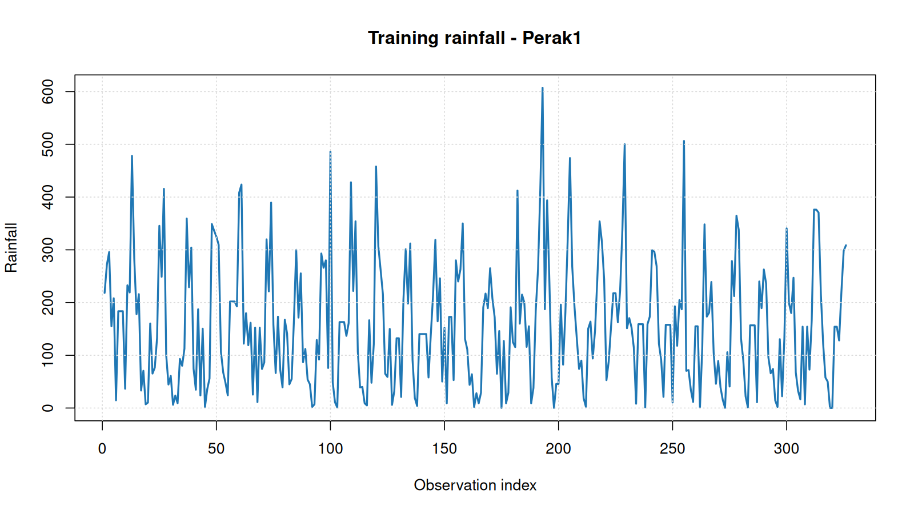
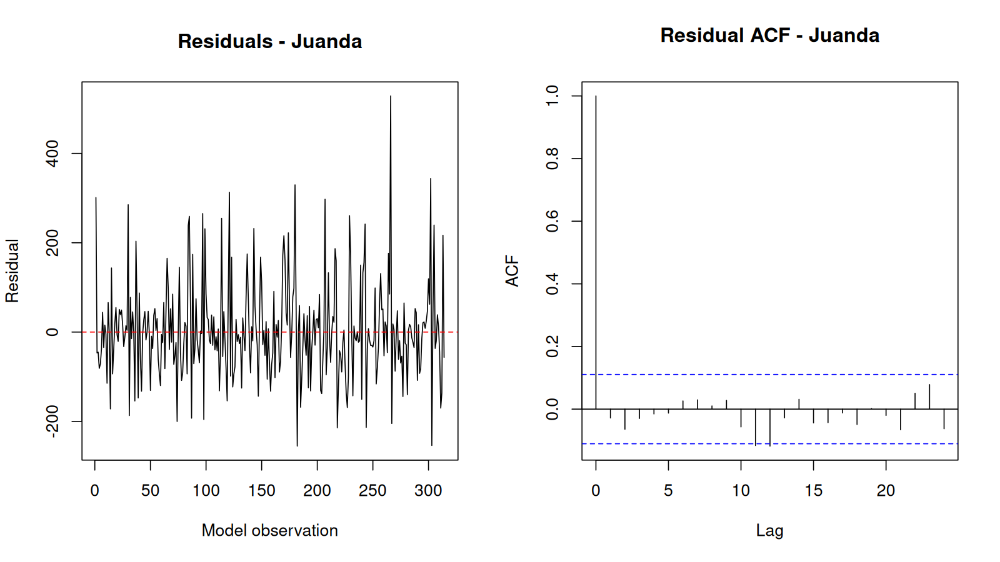
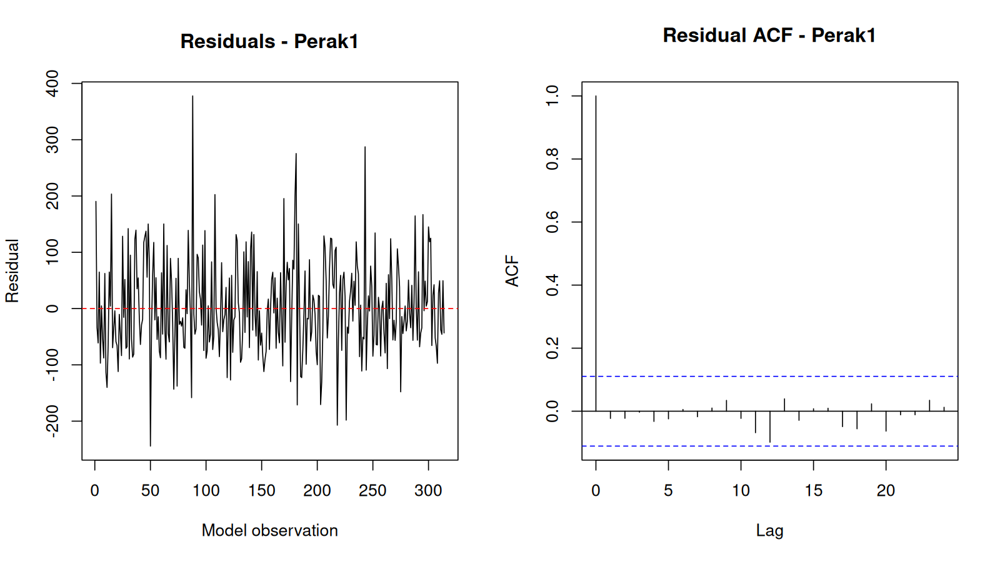
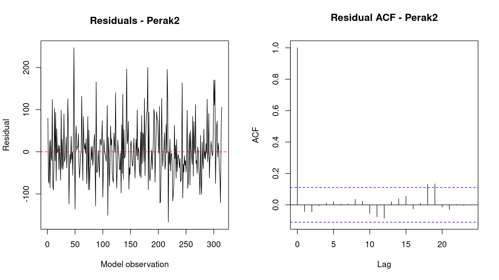
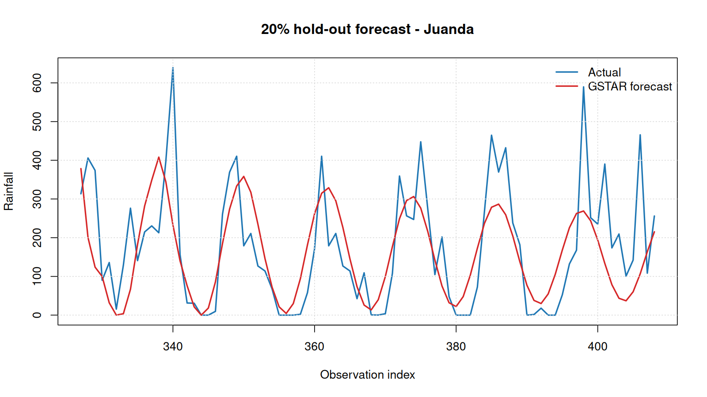
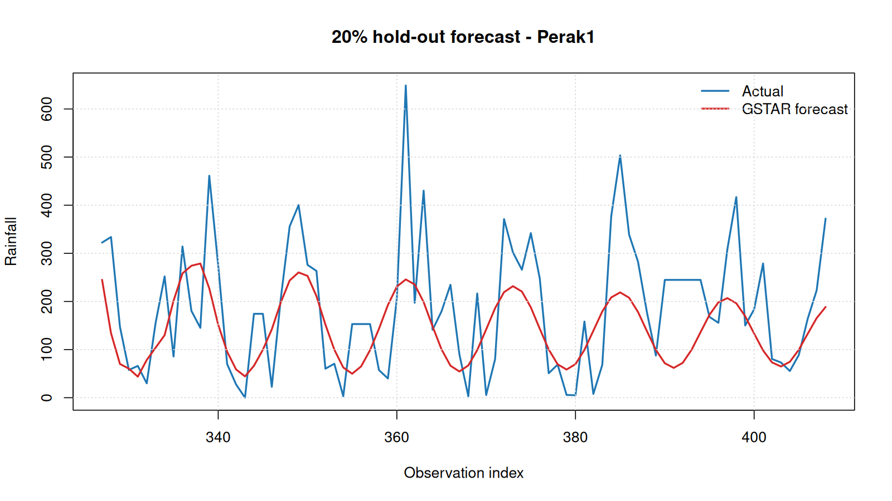
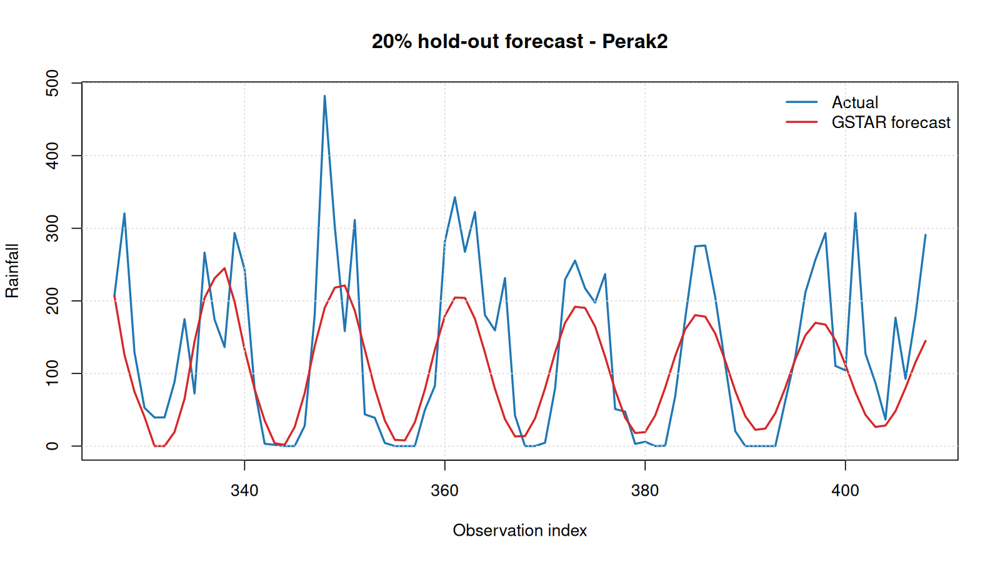

# GSTAR Analysis of Rainfall at Juanda, Perak1, and Perak2

## Pipeline recap

The first 326 rows are training data and the final 82 rows are the untouched 20% chronological test set. The data frequency is unknown, so all lags are observation lags.

1. Read and validate rainfall plus station coordinates.
2. Build inverse-distance spatial weights.
3. Plot raw training data and check variance/mean stationarity.
4. Apply Box–Cox only if variance is non-stationary; difference only if mean remains non-stationary.
5. Fit GSTAR candidates, diagnose residuals, then evaluate the untouched test data.

## 1. Coordinates, distances, and spatial weights

### Input coordinates

| location | latitude | longitude |
|---|---|---|
| Juanda | -7.372564 | 112.7817 |
| Perak1 | -7.223913 | 112.7241 |
| Perak2 | -7.205236 | 112.7817 |

### Haversine distance matrix (km)

| location | Juanda | Perak1 | Perak2 |
|---|---|---|---|
| Juanda | 0.00000 | 17.708382 | 18.605991 |
| Perak1 | 17.70838 | 0.000000 | 6.685798 |
| Perak2 | 18.60599 | 6.685798 | 0.000000 |

### Row-standardized inverse-distance matrix

| location | Juanda | Perak1 | Perak2 |
|---|---|---|---|
| Juanda | 0.000000 | 0.512359 | 0.487641 |
| Perak1 | 0.274073 | 0.000000 | 0.725927 |
| Perak2 | 0.264347 | 0.735653 | 0.000000 |

## 2. Raw training plots

### Juanda

### Perak1

### Perak2

## 3. Stationarity checks and treatment decision

Raw variance was tested before transformation. Box–Cox is used only when variance stationarity is rejected; first differencing is used only when mean stationarity remains unsupported by ADF (lags 0–12) and KPSS.

**Decision:** Box–Cox = FALSE; lambda = NA; shift = 0; GSTAR d = 0.

### All variance-stationarity results

| stage | location | test | lag | statistic | p_value | stationary |
|---|---|---|---|---|---|---|
| raw_training | Juanda | Fligner-Killeen variance | NA | 0.527932 | 0.467478 | TRUE |
| raw_training | Perak1 | Fligner-Killeen variance | NA | 0.076708 | 0.781809 | TRUE |
| raw_training | Perak2 | Fligner-Killeen variance | NA | 0.348532 | 0.554945 | TRUE |
| raw_training_reused | Juanda | Fligner-Killeen variance | NA | 0.527932 | 0.467478 | TRUE |
| raw_training_reused | Perak1 | Fligner-Killeen variance | NA | 0.076708 | 0.781809 | TRUE |
| raw_training_reused | Perak2 | Fligner-Killeen variance | NA | 0.348532 | 0.554945 | TRUE |

### All mean-stationarity results: ADF lags 0–12 and KPSS

| stage | location | test | lag | statistic | p_value | stationary |
|---|---|---|---|---|---|---|
| raw_training | Juanda | ADF | 0 | -8.765573 | 0.010000 | TRUE |
| raw_training | Juanda | ADF | 1 | -9.113309 | 0.010000 | TRUE |
| raw_training | Juanda | ADF | 2 | -10.191746 | 0.010000 | TRUE |
| raw_training | Juanda | ADF | 3 | -11.679412 | 0.010000 | TRUE |
| raw_training | Juanda | ADF | 4 | -12.775811 | 0.010000 | TRUE |
| raw_training | Juanda | ADF | 5 | -13.226149 | 0.010000 | TRUE |
| raw_training | Juanda | ADF | 6 | -12.397557 | 0.010000 | TRUE |
| raw_training | Juanda | ADF | 7 | -11.585973 | 0.010000 | TRUE |
| raw_training | Juanda | ADF | 8 | -9.877770 | 0.010000 | TRUE |
| raw_training | Juanda | ADF | 9 | -8.220636 | 0.010000 | TRUE |
| raw_training | Juanda | ADF | 10 | -6.262905 | 0.010000 | TRUE |
| raw_training | Juanda | ADF | 11 | -4.396225 | 0.010000 | TRUE |
| raw_training | Juanda | ADF | 12 | -4.346907 | 0.010000 | TRUE |
| raw_training | Perak1 | ADF | 0 | -11.546874 | 0.010000 | TRUE |
| raw_training | Perak1 | ADF | 1 | -8.996060 | 0.010000 | TRUE |
| raw_training | Perak1 | ADF | 2 | -9.812252 | 0.010000 | TRUE |
| raw_training | Perak1 | ADF | 3 | -10.716994 | 0.010000 | TRUE |
| raw_training | Perak1 | ADF | 4 | -11.338114 | 0.010000 | TRUE |
| raw_training | Perak1 | ADF | 5 | -10.764552 | 0.010000 | TRUE |
| raw_training | Perak1 | ADF | 6 | -11.825188 | 0.010000 | TRUE |
| raw_training | Perak1 | ADF | 7 | -11.302311 | 0.010000 | TRUE |
| raw_training | Perak1 | ADF | 8 | -8.670771 | 0.010000 | TRUE |
| raw_training | Perak1 | ADF | 9 | -7.329503 | 0.010000 | TRUE |
| raw_training | Perak1 | ADF | 10 | -5.645208 | 0.010000 | TRUE |
| raw_training | Perak1 | ADF | 11 | -4.153076 | 0.010000 | TRUE |
| raw_training | Perak1 | ADF | 12 | -3.715511 | 0.023574 | TRUE |
| raw_training | Perak2 | ADF | 0 | -8.571356 | 0.010000 | TRUE |
| raw_training | Perak2 | ADF | 1 | -8.375447 | 0.010000 | TRUE |
| raw_training | Perak2 | ADF | 2 | -10.545865 | 0.010000 | TRUE |
| raw_training | Perak2 | ADF | 3 | -12.149689 | 0.010000 | TRUE |
| raw_training | Perak2 | ADF | 4 | -12.844728 | 0.010000 | TRUE |
| raw_training | Perak2 | ADF | 5 | -13.048387 | 0.010000 | TRUE |
| raw_training | Perak2 | ADF | 6 | -13.093284 | 0.010000 | TRUE |
| raw_training | Perak2 | ADF | 7 | -11.325978 | 0.010000 | TRUE |
| raw_training | Perak2 | ADF | 8 | -8.977316 | 0.010000 | TRUE |
| raw_training | Perak2 | ADF | 9 | -6.887276 | 0.010000 | TRUE |
| raw_training | Perak2 | ADF | 10 | -5.462146 | 0.010000 | TRUE |
| raw_training | Perak2 | ADF | 11 | -3.787288 | 0.019986 | TRUE |
| raw_training | Perak2 | ADF | 12 | -3.491796 | 0.043770 | TRUE |
| raw_training | Juanda | KPSS | NA | 0.016990 | 0.100000 | TRUE |
| raw_training | Perak1 | KPSS | NA | 0.029102 | 0.100000 | TRUE |
| raw_training | Perak2 | KPSS | NA | 0.029182 | 0.100000 | TRUE |
| raw_training_reused | Juanda | ADF | 0 | -8.765573 | 0.010000 | TRUE |
| raw_training_reused | Juanda | ADF | 1 | -9.113309 | 0.010000 | TRUE |
| raw_training_reused | Juanda | ADF | 2 | -10.191746 | 0.010000 | TRUE |
| raw_training_reused | Juanda | ADF | 3 | -11.679412 | 0.010000 | TRUE |
| raw_training_reused | Juanda | ADF | 4 | -12.775811 | 0.010000 | TRUE |
| raw_training_reused | Juanda | ADF | 5 | -13.226149 | 0.010000 | TRUE |
| raw_training_reused | Juanda | ADF | 6 | -12.397557 | 0.010000 | TRUE |
| raw_training_reused | Juanda | ADF | 7 | -11.585973 | 0.010000 | TRUE |
| raw_training_reused | Juanda | ADF | 8 | -9.877770 | 0.010000 | TRUE |
| raw_training_reused | Juanda | ADF | 9 | -8.220636 | 0.010000 | TRUE |
| raw_training_reused | Juanda | ADF | 10 | -6.262905 | 0.010000 | TRUE |
| raw_training_reused | Juanda | ADF | 11 | -4.396225 | 0.010000 | TRUE |
| raw_training_reused | Juanda | ADF | 12 | -4.346907 | 0.010000 | TRUE |
| raw_training_reused | Perak1 | ADF | 0 | -11.546874 | 0.010000 | TRUE |
| raw_training_reused | Perak1 | ADF | 1 | -8.996060 | 0.010000 | TRUE |
| raw_training_reused | Perak1 | ADF | 2 | -9.812252 | 0.010000 | TRUE |
| raw_training_reused | Perak1 | ADF | 3 | -10.716994 | 0.010000 | TRUE |
| raw_training_reused | Perak1 | ADF | 4 | -11.338114 | 0.010000 | TRUE |
| raw_training_reused | Perak1 | ADF | 5 | -10.764552 | 0.010000 | TRUE |
| raw_training_reused | Perak1 | ADF | 6 | -11.825188 | 0.010000 | TRUE |
| raw_training_reused | Perak1 | ADF | 7 | -11.302311 | 0.010000 | TRUE |
| raw_training_reused | Perak1 | ADF | 8 | -8.670771 | 0.010000 | TRUE |
| raw_training_reused | Perak1 | ADF | 9 | -7.329503 | 0.010000 | TRUE |
| raw_training_reused | Perak1 | ADF | 10 | -5.645208 | 0.010000 | TRUE |
| raw_training_reused | Perak1 | ADF | 11 | -4.153076 | 0.010000 | TRUE |
| raw_training_reused | Perak1 | ADF | 12 | -3.715511 | 0.023574 | TRUE |
| raw_training_reused | Perak2 | ADF | 0 | -8.571356 | 0.010000 | TRUE |
| raw_training_reused | Perak2 | ADF | 1 | -8.375447 | 0.010000 | TRUE |
| raw_training_reused | Perak2 | ADF | 2 | -10.545865 | 0.010000 | TRUE |
| raw_training_reused | Perak2 | ADF | 3 | -12.149689 | 0.010000 | TRUE |
| raw_training_reused | Perak2 | ADF | 4 | -12.844728 | 0.010000 | TRUE |
| raw_training_reused | Perak2 | ADF | 5 | -13.048387 | 0.010000 | TRUE |
| raw_training_reused | Perak2 | ADF | 6 | -13.093284 | 0.010000 | TRUE |
| raw_training_reused | Perak2 | ADF | 7 | -11.325978 | 0.010000 | TRUE |
| raw_training_reused | Perak2 | ADF | 8 | -8.977316 | 0.010000 | TRUE |
| raw_training_reused | Perak2 | ADF | 9 | -6.887276 | 0.010000 | TRUE |
| raw_training_reused | Perak2 | ADF | 10 | -5.462146 | 0.010000 | TRUE |
| raw_training_reused | Perak2 | ADF | 11 | -3.787288 | 0.019986 | TRUE |
| raw_training_reused | Perak2 | ADF | 12 | -3.491796 | 0.043770 | TRUE |
| raw_training_reused | Juanda | KPSS | NA | 0.016990 | 0.100000 | TRUE |
| raw_training_reused | Perak1 | KPSS | NA | 0.029102 | 0.100000 | TRUE |
| raw_training_reused | Perak2 | KPSS | NA | 0.029182 | 0.100000 | TRUE |

## 4. Iterative GSTAR candidate identification

Temporal orders p = 1 through p = 12 were fitted in a loop. Every candidate has separate parameter estimates, IIDN diagnostics, and residual cross-location correlations below. A fully IIDN candidate must have p-values of at least 0.05 for mean-zero, normality, variance stability, and both Ljung–Box tests at every location. If no full-IIDN candidate exists, the script selects the lowest-AIC candidate that passes the white-noise checks; otherwise it records the lowest-AIC finite-coefficient fallback.

### Candidate summary and selection flags

| p | d | fitted | AIC | coefficients_finite | min_ljung_box_p | error | min_mean_zero_p | min_normality_p | min_variance_stability_p | min_ljung_box_10_p | min_ljung_box_20_p | iidn_pass | white_noise_pass |
|---|---|---|---|---|---|---|---|---|---|---|---|---|---|
| 1 | 0 | TRUE | 12043.21 | TRUE | 0.000000 |  | 0.000000 | 0 | 0.377841 | 0.000000 | 0.000000 | FALSE | FALSE |
| 2 | 0 | TRUE | 11959.55 | TRUE | 0.000000 |  | 0.000030 | 0 | 0.436659 | 0.000000 | 0.000000 | FALSE | FALSE |
| 3 | 0 | TRUE | 11902.38 | TRUE | 0.000000 |  | 0.000021 | 0 | 0.335697 | 0.001372 | 0.000000 | FALSE | FALSE |
| 4 | 0 | TRUE | 11857.66 | TRUE | 0.000000 |  | 0.000056 | 0 | 0.309158 | 0.004099 | 0.000000 | FALSE | FALSE |
| 5 | 0 | TRUE | 11822.62 | TRUE | 0.000000 |  | 0.000599 | 0 | 0.300742 | 0.000765 | 0.000000 | FALSE | FALSE |
| 6 | 0 | TRUE | 11762.50 | TRUE | 0.000001 |  | 0.004125 | 0 | 0.286386 | 0.002078 | 0.000001 | FALSE | FALSE |
| 7 | 0 | TRUE | 11700.79 | TRUE | 0.000001 |  | 0.012244 | 0 | 0.330467 | 0.003349 | 0.000001 | FALSE | FALSE |
| 8 | 0 | TRUE | 11641.16 | TRUE | 0.000000 |  | 0.041040 | 0 | 0.361655 | 0.003220 | 0.000000 | FALSE | FALSE |
| 9 | 0 | TRUE | 11548.07 | TRUE | 0.000000 |  | 0.118629 | 0 | 0.343787 | 0.000049 | 0.000000 | FALSE | FALSE |
| 10 | 0 | TRUE | 11460.16 | TRUE | 0.000002 |  | 0.241931 | 0 | 0.298879 | 0.000432 | 0.000002 | FALSE | FALSE |
| 11 | 0 | TRUE | 11365.36 | TRUE | 0.000226 |  | 0.396373 | 0 | 0.311128 | 0.237792 | 0.000226 | FALSE | FALSE |
| 12 | 0 | TRUE | 11248.74 | TRUE | 0.397463 |  | 0.551223 | 0 | 0.295936 | 0.955636 | 0.397463 | FALSE | TRUE |

### All candidate parameter estimates

| p | parameter | estimate | std_error | t_value | p_value |
|---|---|---|---|---|---|
| 1 | psi10(Juanda) | 0.373529 | 3.413354 | 0.109432 | 0.912883 |
| 1 | psi10(Perak1) | 0.501931 | 6.568117 | 0.076419 | 0.939101 |
| 1 | psi10(Perak2) | 0.572799 | 14.774924 | 0.038768 | 0.969083 |
| 1 | psi11(Juanda) | 1.295424 | 24.273805 | 0.053367 | 0.957450 |
| 1 | psi11(Perak1) | 0.261049 | 4.595345 | 0.056807 | 0.954710 |
| 1 | psi11(Perak2) | 0.159857 | 5.490635 | 0.029114 | 0.976779 |
| 2 | psi10(Juanda) | 0.418680 | 3.952427 | 0.105930 | 0.915660 |
| 2 | psi10(Perak1) | 0.325692 | 6.948400 | 0.046873 | 0.962624 |
| 2 | psi10(Perak2) | 0.600718 | 15.183743 | 0.039563 | 0.968449 |
| 2 | psi20(Juanda) | -0.245330 | 3.607944 | -0.067997 | 0.945802 |
| 2 | psi20(Perak1) | 0.535191 | 7.100467 | 0.075374 | 0.939933 |
| 2 | psi20(Perak2) | -0.170121 | 15.646795 | -0.010873 | 0.991327 |
| 2 | psi11(Juanda) | 1.078857 | 26.433832 | 0.040813 | 0.967453 |
| 2 | psi11(Perak1) | 0.345481 | 6.305254 | 0.054793 | 0.956315 |
| 2 | psi11(Perak2) | 0.129390 | 6.212622 | 0.020827 | 0.983388 |
| 2 | psi21(Juanda) | 0.725856 | 29.852203 | 0.024315 | 0.980606 |
| 2 | psi21(Perak1) | -0.368367 | 5.889440 | -0.062547 | 0.950140 |
| 2 | psi21(Perak2) | 0.119583 | 5.818328 | 0.020553 | 0.983607 |
| 3 | psi10(Juanda) | 0.410439 | 3.825142 | 0.107300 | 0.914573 |
| 3 | psi10(Perak1) | 0.305504 | 6.859656 | 0.044536 | 0.964486 |
| 3 | psi10(Perak2) | 0.576337 | 14.682381 | 0.039254 | 0.968696 |
| 3 | psi20(Juanda) | -0.168899 | 4.318086 | -0.039114 | 0.968807 |
| 3 | psi20(Perak1) | 0.452181 | 7.365330 | 0.061393 | 0.951059 |
| 3 | psi20(Perak2) | -0.065194 | 16.519421 | -0.003947 | 0.996852 |
| 3 | psi30(Juanda) | -0.120422 | 3.696486 | -0.032577 | 0.974018 |
| 3 | psi30(Perak1) | 0.309668 | 7.847831 | 0.039459 | 0.968533 |
| 3 | psi30(Perak2) | -0.387284 | 15.247553 | -0.025400 | 0.979741 |
| 3 | psi11(Juanda) | 1.068142 | 26.478899 | 0.040339 | 0.967831 |
| 3 | psi11(Perak1) | 0.291955 | 6.279746 | 0.046492 | 0.962928 |
| 3 | psi11(Perak2) | 0.136146 | 6.018546 | 0.022621 | 0.981957 |
| 3 | psi21(Juanda) | 0.775796 | 30.532976 | 0.025408 | 0.979734 |
| 3 | psi21(Perak1) | -0.199343 | 8.521391 | -0.023393 | 0.981341 |
| 3 | psi21(Perak2) | 0.161144 | 6.526268 | 0.024692 | 0.980306 |
| 3 | psi31(Juanda) | 0.041988 | 31.025386 | 0.001353 | 0.998920 |
| 3 | psi31(Perak1) | -0.303496 | 6.347417 | -0.047814 | 0.961874 |
| 3 | psi31(Perak2) | 0.117448 | 5.688531 | 0.020646 | 0.983532 |
| 4 | psi10(Juanda) | 0.411586 | 3.750205 | 0.109750 | 0.912630 |
| 4 | psi10(Perak1) | 0.290016 | 6.731474 | 0.043084 | 0.965644 |
| 4 | psi10(Perak2) | 0.547134 | 14.749605 | 0.037095 | 0.970417 |
| 4 | psi20(Juanda) | -0.169812 | 4.224606 | -0.040196 | 0.967945 |
| 4 | psi20(Perak1) | 0.426643 | 7.305935 | 0.058397 | 0.953445 |
| 4 | psi20(Perak2) | -0.058012 | 16.157094 | -0.003590 | 0.997136 |
| 4 | psi30(Juanda) | -0.071310 | 4.329177 | -0.016472 | 0.986861 |
| 4 | psi30(Perak1) | 0.260319 | 7.935780 | 0.032803 | 0.973838 |
| 4 | psi30(Perak2) | -0.302182 | 16.186072 | -0.018669 | 0.985109 |
| 4 | psi40(Juanda) | -0.175953 | 3.681884 | -0.047789 | 0.961895 |
| 4 | psi40(Perak1) | 0.258163 | 8.027432 | 0.032160 | 0.974351 |
| 4 | psi40(Perak2) | -0.270421 | 15.674212 | -0.017253 | 0.986239 |
| 4 | psi11(Juanda) | 1.024119 | 26.174035 | 0.039127 | 0.968797 |
| 4 | psi11(Perak1) | 0.276761 | 6.316718 | 0.043814 | 0.965062 |
| 4 | psi11(Perak2) | 0.129426 | 5.906356 | 0.021913 | 0.982522 |
| 4 | psi21(Juanda) | 0.727349 | 30.591347 | 0.023776 | 0.981036 |
| 4 | psi21(Perak1) | -0.206468 | 8.331572 | -0.024781 | 0.980234 |
| 4 | psi21(Perak2) | 0.172801 | 6.418579 | 0.026922 | 0.978528 |
| 4 | psi31(Juanda) | 0.031912 | 32.111621 | 0.000994 | 0.999207 |
| 4 | psi31(Perak1) | -0.250871 | 8.546329 | -0.029354 | 0.976588 |
| 4 | psi31(Perak2) | 0.134573 | 6.507204 | 0.020681 | 0.983505 |
| 4 | psi41(Juanda) | 0.393618 | 30.496994 | 0.012907 | 0.989705 |
| 4 | psi41(Perak1) | -0.172009 | 6.633108 | -0.025932 | 0.979317 |
| 4 | psi41(Perak2) | 0.090317 | 5.645285 | 0.015999 | 0.987239 |
| 5 | psi10(Juanda) | 0.408055 | 3.749901 | 0.108818 | 0.913370 |
| 5 | psi10(Perak1) | 0.264667 | 6.755112 | 0.039180 | 0.968755 |
| 5 | psi10(Perak2) | 0.546632 | 14.984519 | 0.036480 | 0.970907 |
| 5 | psi20(Juanda) | -0.167761 | 4.192688 | -0.040013 | 0.968091 |
| 5 | psi20(Perak1) | 0.420072 | 7.232779 | 0.058079 | 0.953698 |
| 5 | psi20(Perak2) | -0.065824 | 16.208786 | -0.004061 | 0.996761 |
| 5 | psi30(Juanda) | -0.075112 | 4.277024 | -0.017562 | 0.985992 |
| 5 | psi30(Perak1) | 0.234746 | 7.899746 | 0.029716 | 0.976300 |
| 5 | psi30(Perak2) | -0.300225 | 15.983955 | -0.018783 | 0.985018 |
| 5 | psi40(Juanda) | -0.165051 | 4.334423 | -0.038079 | 0.969633 |
| 5 | psi40(Perak1) | 0.235889 | 8.080963 | 0.029191 | 0.976719 |
| 5 | psi40(Perak2) | -0.244527 | 16.474353 | -0.014843 | 0.988161 |
| 5 | psi50(Juanda) | -0.022294 | 3.698706 | -0.006028 | 0.995192 |
| 5 | psi50(Perak1) | 0.140603 | 8.365324 | 0.016808 | 0.986593 |
| 5 | psi50(Perak2) | -0.129113 | 15.858144 | -0.008142 | 0.993506 |
| 5 | psi11(Juanda) | 1.038860 | 25.909383 | 0.040096 | 0.968025 |
| 5 | psi11(Perak1) | 0.291210 | 6.560205 | 0.044390 | 0.964602 |
| 5 | psi11(Perak2) | 0.123410 | 5.945069 | 0.020758 | 0.983443 |
| 5 | psi21(Juanda) | 0.707082 | 30.417358 | 0.023246 | 0.981459 |
| 5 | psi21(Perak1) | -0.197919 | 8.272413 | -0.023925 | 0.980917 |
| 5 | psi21(Perak2) | 0.174111 | 6.349919 | 0.027419 | 0.978131 |
| 5 | psi31(Juanda) | 0.026792 | 32.311596 | 0.000829 | 0.999339 |
| 5 | psi31(Perak1) | -0.253865 | 8.471303 | -0.029968 | 0.976099 |
| 5 | psi31(Perak2) | 0.135429 | 6.483354 | 0.020889 | 0.983339 |
| 5 | psi41(Juanda) | 0.381357 | 31.862621 | 0.011969 | 0.990453 |
| 5 | psi41(Perak1) | -0.255004 | 8.629390 | -0.029551 | 0.976432 |
| 5 | psi41(Perak2) | 0.076908 | 6.537407 | 0.011764 | 0.990616 |
| 5 | psi51(Juanda) | 0.052502 | 30.419728 | 0.001726 | 0.998623 |
| 5 | psi51(Perak1) | 0.028214 | 6.992987 | 0.004035 | 0.996782 |
| 5 | psi51(Perak2) | 0.081555 | 5.672601 | 0.014377 | 0.988532 |
| 6 | psi10(Juanda) | 0.425463 | 3.680547 | 0.115598 | 0.907996 |
| 6 | psi10(Perak1) | 0.165934 | 6.810300 | 0.024365 | 0.980566 |
| 6 | psi10(Perak2) | 0.560529 | 14.646975 | 0.038269 | 0.969481 |
| 6 | psi20(Juanda) | -0.168268 | 4.066072 | -0.041383 | 0.966999 |
| 6 | psi20(Perak1) | 0.387936 | 6.987073 | 0.055522 | 0.955734 |
| 6 | psi20(Perak2) | -0.040201 | 15.949652 | -0.002521 | 0.997989 |
| 6 | psi30(Juanda) | -0.074619 | 4.130094 | -0.018067 | 0.985589 |
| 6 | psi30(Perak1) | 0.242075 | 7.608574 | 0.031816 | 0.974625 |
| 6 | psi30(Perak2) | -0.295932 | 15.627225 | -0.018937 | 0.984895 |
| 6 | psi40(Juanda) | -0.162041 | 4.170175 | -0.038857 | 0.969012 |
| 6 | psi40(Perak1) | 0.194876 | 7.817301 | 0.024929 | 0.980117 |
| 6 | psi40(Perak2) | -0.250267 | 15.844908 | -0.015795 | 0.987401 |
| 6 | psi50(Juanda) | -0.050616 | 4.224667 | -0.011981 | 0.990443 |
| 6 | psi50(Perak1) | 0.120174 | 8.166601 | 0.014715 | 0.988262 |
| 6 | psi50(Perak2) | -0.102564 | 16.152815 | -0.006350 | 0.994935 |
| 6 | psi60(Juanda) | 0.026333 | 3.578932 | 0.007358 | 0.994131 |
| 6 | psi60(Perak1) | 0.047055 | 8.116648 | 0.005797 | 0.995376 |
| 6 | psi60(Perak2) | -0.142880 | 15.336200 | -0.009317 | 0.992569 |
| 6 | psi11(Juanda) | 0.995844 | 25.606053 | 0.038891 | 0.968985 |
| 6 | psi11(Perak1) | 0.362256 | 6.471175 | 0.055980 | 0.955369 |
| 6 | psi11(Perak2) | 0.105477 | 5.904384 | 0.017864 | 0.985751 |
| 6 | psi21(Juanda) | 0.693947 | 29.317870 | 0.023670 | 0.981121 |
| 6 | psi21(Perak1) | -0.157192 | 8.145118 | -0.019299 | 0.984607 |
| 6 | psi21(Perak2) | 0.158982 | 6.168954 | 0.025771 | 0.979445 |
| 6 | psi31(Juanda) | 0.055175 | 31.347559 | 0.001760 | 0.998596 |
| 6 | psi31(Perak1) | -0.231056 | 8.193888 | -0.028199 | 0.977510 |
| 6 | psi31(Perak2) | 0.138502 | 6.253495 | 0.022148 | 0.982335 |
| 6 | psi41(Juanda) | 0.370012 | 31.177043 | 0.011868 | 0.990533 |
| 6 | psi41(Perak1) | -0.254054 | 8.342293 | -0.030454 | 0.975712 |
| 6 | psi41(Perak2) | 0.070717 | 6.350652 | 0.011135 | 0.991118 |
| 6 | psi51(Juanda) | 0.026617 | 30.967959 | 0.000860 | 0.999314 |
| 6 | psi51(Perak1) | -0.182718 | 8.640331 | -0.021147 | 0.983133 |
| 6 | psi51(Perak2) | 0.025941 | 6.334851 | 0.004095 | 0.996734 |
| 6 | psi61(Juanda) | 0.047115 | 29.271954 | 0.001610 | 0.998716 |
| 6 | psi61(Perak1) | 0.238995 | 6.798995 | 0.035152 | 0.971966 |
| 6 | psi61(Perak2) | 0.147343 | 5.540886 | 0.026592 | 0.978791 |
| 7 | psi10(Juanda) | 0.459127 | 3.690799 | 0.124398 | 0.901027 |
| 7 | psi10(Perak1) | 0.045235 | 7.511884 | 0.006022 | 0.995197 |
| 7 | psi10(Perak2) | 0.570773 | 14.200714 | 0.040193 | 0.967947 |
| 7 | psi20(Juanda) | -0.158861 | 3.977144 | -0.039943 | 0.968147 |
| 7 | psi20(Perak1) | 0.354542 | 6.816551 | 0.052012 | 0.958530 |
| 7 | psi20(Perak2) | -0.008056 | 15.622337 | -0.000516 | 0.999589 |
| 7 | psi30(Juanda) | -0.056546 | 3.988430 | -0.014178 | 0.988691 |
| 7 | psi30(Perak1) | 0.233745 | 7.301617 | 0.032013 | 0.974469 |
| 7 | psi30(Perak2) | -0.265619 | 15.356272 | -0.017297 | 0.986203 |
| 7 | psi40(Juanda) | -0.182652 | 4.027141 | -0.045355 | 0.963834 |
| 7 | psi40(Perak1) | 0.220256 | 7.524502 | 0.029272 | 0.976654 |
| 7 | psi40(Perak2) | -0.258995 | 15.449623 | -0.016764 | 0.986629 |
| 7 | psi50(Juanda) | -0.047747 | 4.055995 | -0.011772 | 0.990610 |
| 7 | psi50(Perak1) | 0.093502 | 7.876871 | 0.011870 | 0.990531 |
| 7 | psi50(Perak2) | -0.113366 | 15.533694 | -0.007298 | 0.994179 |
| 7 | psi60(Juanda) | -0.036808 | 4.070173 | -0.009043 | 0.992786 |
| 7 | psi60(Perak1) | 0.074187 | 7.900433 | 0.009390 | 0.992510 |
| 7 | psi60(Perak2) | -0.135988 | 15.569935 | -0.008734 | 0.993033 |
| 7 | psi70(Juanda) | 0.237611 | 3.651505 | 0.065072 | 0.948130 |
| 7 | psi70(Perak1) | -0.183050 | 7.810596 | -0.023436 | 0.981307 |
| 7 | psi70(Perak2) | -0.103643 | 14.830559 | -0.006988 | 0.994425 |
| 7 | psi11(Juanda) | 0.855819 | 27.560674 | 0.031052 | 0.975234 |
| 7 | psi11(Perak1) | 0.439596 | 6.536338 | 0.067254 | 0.946393 |
| 7 | psi11(Perak2) | 0.080012 | 5.883026 | 0.013601 | 0.989152 |
| 7 | psi21(Juanda) | 0.691491 | 28.215394 | 0.024508 | 0.980453 |
| 7 | psi21(Perak1) | -0.126887 | 7.944415 | -0.015972 | 0.987260 |
| 7 | psi21(Perak2) | 0.143323 | 6.051852 | 0.023682 | 0.981111 |
| 7 | psi31(Juanda) | 0.079861 | 30.335789 | 0.002633 | 0.997900 |
| 7 | psi31(Perak1) | -0.173393 | 8.031711 | -0.021589 | 0.982781 |
| 7 | psi31(Perak2) | 0.128462 | 6.038251 | 0.021275 | 0.983031 |
| 7 | psi41(Juanda) | 0.433613 | 30.337324 | 0.014293 | 0.988599 |
| 7 | psi41(Perak1) | -0.267450 | 8.034417 | -0.033288 | 0.973452 |
| 7 | psi41(Perak2) | 0.078781 | 6.120110 | 0.012872 | 0.989732 |
| 7 | psi51(Juanda) | 0.070966 | 30.272879 | 0.002344 | 0.998130 |
| 7 | psi51(Perak1) | -0.171206 | 8.340151 | -0.020528 | 0.983627 |
| 7 | psi51(Perak2) | 0.018631 | 6.131890 | 0.003038 | 0.997576 |
| 7 | psi61(Juanda) | 0.065635 | 29.730002 | 0.002208 | 0.998239 |
| 7 | psi61(Perak1) | 0.042552 | 8.402249 | 0.005064 | 0.995960 |
| 7 | psi61(Perak2) | 0.096478 | 6.093879 | 0.015832 | 0.987372 |
| 7 | psi71(Juanda) | -0.520123 | 28.101838 | -0.018508 | 0.985237 |
| 7 | psi71(Perak1) | 0.339437 | 6.861401 | 0.049471 | 0.960555 |
| 7 | psi71(Perak2) | 0.134429 | 5.487849 | 0.024496 | 0.980462 |
| 8 | psi10(Juanda) | 0.481096 | 3.605589 | 0.133431 | 0.893881 |
| 8 | psi10(Perak1) | -0.039803 | 7.616424 | -0.005226 | 0.995831 |
| 8 | psi10(Perak2) | 0.555900 | 13.728922 | 0.040491 | 0.967710 |
| 8 | psi20(Juanda) | -0.121219 | 4.018994 | -0.030162 | 0.975945 |
| 8 | psi20(Perak1) | 0.244404 | 7.374874 | 0.033140 | 0.973570 |
| 8 | psi20(Perak2) | 0.040912 | 15.250704 | 0.002683 | 0.997860 |
| 8 | psi30(Juanda) | -0.046269 | 3.902334 | -0.011857 | 0.990542 |
| 8 | psi30(Perak1) | 0.218905 | 7.094280 | 0.030857 | 0.975390 |
| 8 | psi30(Perak2) | -0.216180 | 15.084571 | -0.014331 | 0.988569 |
| 8 | psi40(Juanda) | -0.189573 | 3.887156 | -0.048769 | 0.961114 |
| 8 | psi40(Perak1) | 0.228695 | 7.233190 | 0.031617 | 0.974784 |
| 8 | psi40(Perak2) | -0.206774 | 15.117922 | -0.013677 | 0.989090 |
| 8 | psi50(Juanda) | -0.053815 | 3.945246 | -0.013640 | 0.989120 |
| 8 | psi50(Perak1) | 0.125678 | 7.631478 | 0.016468 | 0.986864 |
| 8 | psi50(Perak2) | -0.113460 | 15.210527 | -0.007459 | 0.994050 |
| 8 | psi60(Juanda) | -0.045078 | 3.918347 | -0.011504 | 0.990823 |
| 8 | psi60(Perak1) | 0.054098 | 7.620536 | 0.007099 | 0.994337 |
| 8 | psi60(Perak2) | -0.156566 | 15.011548 | -0.010430 | 0.991681 |
| 8 | psi70(Juanda) | 0.170394 | 3.997862 | 0.042621 | 0.966012 |
| 8 | psi70(Perak1) | -0.164701 | 7.626193 | -0.021597 | 0.982774 |
| 8 | psi70(Perak2) | -0.144369 | 15.066901 | -0.009582 | 0.992357 |
| 8 | psi80(Juanda) | 0.089366 | 3.763136 | 0.023748 | 0.981059 |
| 8 | psi80(Perak1) | -0.083929 | 7.659467 | -0.010958 | 0.991260 |
| 8 | psi80(Perak2) | 0.067694 | 14.307167 | 0.004731 | 0.996226 |
| 8 | psi11(Juanda) | 0.736833 | 28.346798 | 0.025994 | 0.979268 |
| 8 | psi11(Perak1) | 0.462597 | 6.381297 | 0.072493 | 0.942225 |
| 8 | psi11(Perak2) | 0.069379 | 5.705937 | 0.012159 | 0.990301 |
| 8 | psi21(Juanda) | 0.559381 | 28.835411 | 0.019399 | 0.984527 |
| 8 | psi21(Perak1) | -0.034345 | 8.110785 | -0.004234 | 0.996622 |
| 8 | psi21(Perak2) | 0.101271 | 6.007699 | 0.016857 | 0.986554 |
| 8 | psi31(Juanda) | 0.085007 | 29.349120 | 0.002896 | 0.997690 |
| 8 | psi31(Perak1) | -0.151105 | 7.822835 | -0.019316 | 0.984593 |
| 8 | psi31(Perak2) | 0.112631 | 5.912529 | 0.019050 | 0.984806 |
| 8 | psi41(Juanda) | 0.499575 | 29.589494 | 0.016884 | 0.986533 |
| 8 | psi41(Perak1) | -0.235104 | 7.822272 | -0.030056 | 0.976029 |
| 8 | psi41(Perak2) | 0.064455 | 5.906831 | 0.010912 | 0.991296 |
| 8 | psi51(Juanda) | 0.110224 | 29.555253 | 0.003729 | 0.997025 |
| 8 | psi51(Perak1) | -0.197977 | 8.073311 | -0.024522 | 0.980441 |
| 8 | psi51(Perak2) | 0.028955 | 5.928799 | 0.004884 | 0.996104 |
| 8 | psi61(Juanda) | 0.008113 | 29.144720 | 0.000278 | 0.999778 |
| 8 | psi61(Perak1) | 0.033334 | 8.120226 | 0.004105 | 0.996725 |
| 8 | psi61(Perak2) | 0.076510 | 5.908650 | 0.012949 | 0.989671 |
| 8 | psi71(Juanda) | -0.643356 | 28.653000 | -0.022453 | 0.982091 |
| 8 | psi71(Perak1) | 0.177357 | 8.207398 | 0.021609 | 0.982764 |
| 8 | psi71(Perak2) | 0.056410 | 5.949138 | 0.009482 | 0.992437 |
| 8 | psi81(Juanda) | 0.186626 | 27.562845 | 0.006771 | 0.994599 |
| 8 | psi81(Perak1) | 0.271834 | 6.980390 | 0.038943 | 0.968944 |
| 8 | psi81(Perak2) | 0.104699 | 5.377437 | 0.019470 | 0.984470 |
| 9 | psi10(Juanda) | 0.488974 | 3.360109 | 0.145523 | 0.884329 |
| 9 | psi10(Perak1) | -0.103230 | 7.409656 | -0.013932 | 0.988887 |
| 9 | psi10(Perak2) | 0.513520 | 12.845927 | 0.039975 | 0.968121 |
| 9 | psi20(Juanda) | -0.068569 | 3.831508 | -0.017896 | 0.985725 |
| 9 | psi20(Perak1) | 0.163542 | 7.193968 | 0.022733 | 0.981868 |
| 9 | psi20(Perak2) | 0.056276 | 14.211617 | 0.003960 | 0.996841 |
| 9 | psi30(Juanda) | -0.003403 | 3.765138 | -0.000904 | 0.999279 |
| 9 | psi30(Perak1) | 0.107645 | 7.148254 | 0.015059 | 0.987988 |
| 9 | psi30(Perak2) | -0.146312 | 14.227986 | -0.010283 | 0.991797 |
| 9 | psi40(Juanda) | -0.177505 | 3.670365 | -0.048362 | 0.961438 |
| 9 | psi40(Perak1) | 0.207143 | 6.763573 | 0.030626 | 0.975574 |
| 9 | psi40(Perak2) | -0.160452 | 14.227040 | -0.011278 | 0.991004 |
| 9 | psi50(Juanda) | -0.079010 | 3.684838 | -0.021442 | 0.982898 |
| 9 | psi50(Perak1) | 0.149486 | 7.100242 | 0.021054 | 0.983207 |
| 9 | psi50(Perak2) | -0.061257 | 14.253291 | -0.004298 | 0.996572 |
| 9 | psi60(Juanda) | -0.055374 | 3.687376 | -0.015017 | 0.988022 |
| 9 | psi60(Perak1) | 0.084895 | 7.153466 | 0.011868 | 0.990534 |
| 9 | psi60(Perak2) | -0.161702 | 14.195965 | -0.011391 | 0.990914 |
| 9 | psi70(Juanda) | 0.165240 | 3.709097 | 0.044550 | 0.964476 |
| 9 | psi70(Perak1) | -0.187708 | 7.093128 | -0.026463 | 0.978893 |
| 9 | psi70(Perak2) | -0.183346 | 14.053676 | -0.013046 | 0.989594 |
| 9 | psi80(Juanda) | 0.003476 | 3.824832 | 0.000909 | 0.999275 |
| 9 | psi80(Perak1) | -0.104118 | 7.211336 | -0.014438 | 0.988483 |
| 9 | psi80(Perak2) | 0.009306 | 14.078777 | 0.000661 | 0.999473 |
| 9 | psi90(Juanda) | 0.099545 | 3.575781 | 0.027839 | 0.977797 |
| 9 | psi90(Perak1) | 0.125805 | 7.167137 | 0.017553 | 0.985999 |
| 9 | psi90(Perak2) | 0.084429 | 13.352992 | 0.006323 | 0.994956 |
| 9 | psi11(Juanda) | 0.564624 | 27.636143 | 0.020431 | 0.983704 |
| 9 | psi11(Perak1) | 0.464130 | 5.972920 | 0.077706 | 0.938079 |
| 9 | psi11(Perak2) | 0.047262 | 5.343436 | 0.008845 | 0.992945 |
| 9 | psi21(Juanda) | 0.445291 | 27.791341 | 0.016023 | 0.987220 |
| 9 | psi21(Perak1) | 0.028145 | 7.707697 | 0.003652 | 0.997087 |
| 9 | psi21(Perak2) | 0.098706 | 5.600864 | 0.017623 | 0.985943 |
| 9 | psi31(Juanda) | -0.067548 | 28.136610 | -0.002401 | 0.998085 |
| 9 | psi31(Perak1) | -0.068671 | 7.655168 | -0.008971 | 0.992845 |
| 9 | psi31(Perak2) | 0.062329 | 5.620206 | 0.011090 | 0.991154 |
| 9 | psi41(Juanda) | 0.518255 | 27.719693 | 0.018696 | 0.985087 |
| 9 | psi41(Perak1) | -0.211123 | 7.333295 | -0.028790 | 0.977038 |
| 9 | psi41(Perak2) | 0.053992 | 5.570542 | 0.009692 | 0.992269 |
| 9 | psi51(Juanda) | 0.222690 | 27.906647 | 0.007980 | 0.993635 |
| 9 | psi51(Perak1) | -0.201249 | 7.555049 | -0.026638 | 0.978754 |
| 9 | psi51(Perak2) | 0.014458 | 5.514748 | 0.002622 | 0.997909 |
| 9 | psi61(Juanda) | 0.062947 | 27.455004 | 0.002293 | 0.998171 |
| 9 | psi61(Perak1) | 0.004683 | 7.630110 | 0.000614 | 0.999510 |
| 9 | psi61(Perak2) | 0.090961 | 5.516682 | 0.016488 | 0.986848 |
| 9 | psi71(Juanda) | -0.759236 | 27.161829 | -0.027952 | 0.977706 |
| 9 | psi71(Perak1) | 0.154959 | 7.662340 | 0.020223 | 0.983869 |
| 9 | psi71(Perak2) | 0.038535 | 5.549958 | 0.006943 | 0.994462 |
| 9 | psi81(Juanda) | -0.055831 | 27.530525 | -0.002028 | 0.998382 |
| 9 | psi81(Perak1) | 0.143568 | 7.723944 | 0.018587 | 0.985174 |
| 9 | psi81(Perak2) | 0.003401 | 5.541395 | 0.000614 | 0.999510 |
| 9 | psi91(Juanda) | 0.448730 | 25.657253 | 0.017489 | 0.986050 |
| 9 | psi91(Perak1) | 0.154239 | 6.756197 | 0.022829 | 0.981791 |
| 9 | psi91(Perak2) | 0.150812 | 5.073231 | 0.029727 | 0.976291 |
| 10 | psi10(Juanda) | 0.490528 | 3.145023 | 0.155970 | 0.876090 |
| 10 | psi10(Perak1) | -0.130509 | 7.112323 | -0.018350 | 0.985364 |
| 10 | psi10(Perak2) | 0.459121 | 12.179454 | 0.037696 | 0.969938 |
| 10 | psi20(Juanda) | -0.034880 | 3.635589 | -0.009594 | 0.992347 |
| 10 | psi20(Perak1) | 0.120217 | 7.082892 | 0.016973 | 0.986462 |
| 10 | psi20(Perak2) | 0.067959 | 13.276805 | 0.005119 | 0.995917 |
| 10 | psi30(Juanda) | 0.047400 | 3.584987 | 0.013222 | 0.989454 |
| 10 | psi30(Perak1) | 0.081210 | 6.890765 | 0.011785 | 0.990599 |
| 10 | psi30(Perak2) | -0.118633 | 13.347043 | -0.008888 | 0.992910 |
| 10 | psi40(Juanda) | -0.163129 | 3.538887 | -0.046096 | 0.963243 |
| 10 | psi40(Perak1) | 0.139900 | 6.714887 | 0.020834 | 0.983382 |
| 10 | psi40(Perak2) | -0.114904 | 13.380844 | -0.008587 | 0.993150 |
| 10 | psi50(Juanda) | -0.083514 | 3.494879 | -0.023896 | 0.980941 |
| 10 | psi50(Perak1) | 0.155167 | 6.656586 | 0.023310 | 0.981408 |
| 10 | psi50(Perak2) | -0.036696 | 13.408503 | -0.002737 | 0.997817 |
| 10 | psi60(Juanda) | -0.100820 | 3.484098 | -0.028937 | 0.976921 |
| 10 | psi60(Perak1) | 0.106011 | 6.717230 | 0.015782 | 0.987412 |
| 10 | psi60(Perak2) | -0.120986 | 13.325372 | -0.009079 | 0.992758 |
| 10 | psi70(Juanda) | 0.180969 | 3.512067 | 0.051528 | 0.958916 |
| 10 | psi70(Perak1) | -0.161658 | 6.702697 | -0.024118 | 0.980763 |
| 10 | psi70(Perak2) | -0.199343 | 13.372039 | -0.014907 | 0.988109 |
| 10 | psi80(Juanda) | 0.020177 | 3.572144 | 0.005648 | 0.995494 |
| 10 | psi80(Perak1) | -0.127767 | 6.782299 | -0.018838 | 0.984974 |
| 10 | psi80(Perak2) | -0.036761 | 13.274887 | -0.002769 | 0.997791 |
| 10 | psi90(Juanda) | 0.045552 | 3.602451 | 0.012645 | 0.989914 |
| 10 | psi90(Perak1) | 0.118130 | 6.787462 | 0.017404 | 0.986118 |
| 10 | psi90(Perak2) | 0.006489 | 13.212850 | 0.000491 | 0.999608 |
| 10 | psi100(Juanda) | -0.019843 | 3.404914 | -0.005828 | 0.995351 |
| 10 | psi100(Perak1) | -0.025163 | 6.801648 | -0.003700 | 0.997049 |
| 10 | psi100(Perak2) | 0.193193 | 12.509842 | 0.015443 | 0.987682 |
| 10 | psi11(Juanda) | 0.288079 | 27.570577 | 0.010449 | 0.991665 |
| 10 | psi11(Perak1) | 0.441241 | 5.624143 | 0.078455 | 0.937483 |
| 10 | psi11(Perak2) | 0.019198 | 5.034433 | 0.003813 | 0.996958 |
| 10 | psi21(Juanda) | 0.367415 | 26.695662 | 0.013763 | 0.989022 |
| 10 | psi21(Perak1) | 0.059811 | 7.334015 | 0.008155 | 0.993495 |
| 10 | psi21(Perak2) | 0.087959 | 5.245311 | 0.016769 | 0.986624 |
| 10 | psi31(Juanda) | -0.065416 | 26.958211 | -0.002427 | 0.998064 |
| 10 | psi31(Perak1) | -0.050527 | 7.308447 | -0.006913 | 0.994485 |
| 10 | psi31(Perak2) | 0.067662 | 5.267965 | 0.012844 | 0.989755 |
| 10 | psi41(Juanda) | 0.418103 | 26.521183 | 0.015765 | 0.987425 |
| 10 | psi41(Perak1) | -0.158462 | 7.155421 | -0.022146 | 0.982336 |
| 10 | psi41(Perak2) | 0.019824 | 5.286510 | 0.003750 | 0.997009 |
| 10 | psi51(Juanda) | 0.246433 | 26.347906 | 0.009353 | 0.992539 |
| 10 | psi51(Perak1) | -0.190451 | 7.082993 | -0.026888 | 0.978554 |
| 10 | psi51(Perak2) | 0.008117 | 5.220097 | 0.001555 | 0.998760 |
| 10 | psi61(Juanda) | 0.176407 | 26.129112 | 0.006751 | 0.994615 |
| 10 | psi61(Perak1) | -0.000167 | 7.185118 | -0.000023 | 0.999981 |
| 10 | psi61(Perak2) | 0.081592 | 5.154241 | 0.015830 | 0.987373 |
| 10 | psi71(Juanda) | -0.751041 | 25.695960 | -0.029228 | 0.976689 |
| 10 | psi71(Perak1) | 0.140757 | 7.226628 | 0.019478 | 0.984464 |
| 10 | psi71(Perak2) | 0.061194 | 5.230870 | 0.011699 | 0.990669 |
| 10 | psi81(Juanda) | -0.280090 | 26.825487 | -0.010441 | 0.991671 |
| 10 | psi81(Perak1) | 0.145498 | 7.230177 | 0.020124 | 0.983949 |
| 10 | psi81(Perak2) | -0.011619 | 5.186290 | -0.002240 | 0.998213 |
| 10 | psi91(Juanda) | 0.170190 | 25.769649 | 0.006604 | 0.994732 |
| 10 | psi91(Perak1) | 0.057905 | 7.319134 | 0.007912 | 0.993689 |
| 10 | psi91(Perak2) | 0.078054 | 5.188194 | 0.015044 | 0.988000 |
| 10 | psi101(Juanda) | 0.827595 | 25.448757 | 0.032520 | 0.974064 |
| 10 | psi101(Perak1) | 0.185175 | 6.451285 | 0.028704 | 0.977107 |
| 10 | psi101(Perak2) | 0.073785 | 4.849709 | 0.015214 | 0.987864 |
| 11 | psi10(Juanda) | 0.434932 | 2.982345 | 0.145835 | 0.884082 |
| 11 | psi10(Perak1) | -0.122213 | 6.673119 | -0.018314 | 0.985392 |
| 11 | psi10(Perak2) | 0.375946 | 11.657824 | 0.032248 | 0.974281 |
| 11 | psi20(Juanda) | 0.002636 | 3.409776 | 0.000773 | 0.999383 |
| 11 | psi20(Perak1) | 0.079680 | 6.821218 | 0.011681 | 0.990682 |
| 11 | psi20(Perak2) | 0.058692 | 12.323894 | 0.004762 | 0.996201 |
| 11 | psi30(Juanda) | 0.088942 | 3.373929 | 0.026361 | 0.978975 |
| 11 | psi30(Perak1) | 0.060175 | 6.668044 | 0.009024 | 0.992802 |
| 11 | psi30(Perak2) | -0.094520 | 12.386066 | -0.007631 | 0.993913 |
| 11 | psi40(Juanda) | -0.106851 | 3.340199 | -0.031990 | 0.974487 |
| 11 | psi40(Perak1) | 0.120702 | 6.395230 | 0.018874 | 0.984946 |
| 11 | psi40(Perak2) | -0.101832 | 12.425523 | -0.008195 | 0.993463 |
| 11 | psi50(Juanda) | -0.069999 | 3.334845 | -0.020990 | 0.983258 |
| 11 | psi50(Perak1) | 0.114840 | 6.422758 | 0.017880 | 0.985738 |
| 11 | psi50(Perak2) | -0.003550 | 12.466259 | -0.000285 | 0.999773 |
| 11 | psi60(Juanda) | -0.123892 | 3.281496 | -0.037755 | 0.969891 |
| 11 | psi60(Perak1) | 0.107139 | 6.252313 | 0.017136 | 0.986332 |
| 11 | psi60(Perak2) | -0.092211 | 12.438214 | -0.007414 | 0.994086 |
| 11 | psi70(Juanda) | 0.133902 | 3.294651 | 0.040642 | 0.967590 |
| 11 | psi70(Perak1) | -0.139242 | 6.272643 | -0.022198 | 0.982294 |
| 11 | psi70(Perak2) | -0.176874 | 12.405262 | -0.014258 | 0.988627 |
| 11 | psi80(Juanda) | 0.048654 | 3.368068 | 0.014446 | 0.988477 |
| 11 | psi80(Perak1) | -0.119642 | 6.325428 | -0.018915 | 0.984913 |
| 11 | psi80(Perak2) | -0.086652 | 12.569607 | -0.006894 | 0.994501 |
| 11 | psi90(Juanda) | 0.070849 | 3.345119 | 0.021180 | 0.983107 |
| 11 | psi90(Perak1) | 0.096733 | 6.337068 | 0.015265 | 0.987824 |
| 11 | psi90(Perak2) | -0.048964 | 12.397336 | -0.003950 | 0.996850 |
| 11 | psi100(Juanda) | -0.089032 | 3.413483 | -0.026082 | 0.979197 |
| 11 | psi100(Perak1) | -0.038578 | 6.390586 | -0.006037 | 0.995185 |
| 11 | psi100(Perak2) | 0.144478 | 12.235592 | 0.011808 | 0.990581 |
| 11 | psi110(Juanda) | 0.054979 | 3.181403 | 0.017281 | 0.986216 |
| 11 | psi110(Perak1) | 0.097386 | 6.365036 | 0.015300 | 0.987796 |
| 11 | psi110(Perak2) | 0.062009 | 11.772522 | 0.005267 | 0.995798 |
| 11 | psi11(Juanda) | 0.157841 | 25.929188 | 0.006087 | 0.995144 |
| 11 | psi11(Perak1) | 0.398395 | 5.457512 | 0.072999 | 0.941822 |
| 11 | psi11(Perak2) | 0.013650 | 4.697756 | 0.002906 | 0.997682 |
| 11 | psi21(Juanda) | 0.122817 | 25.858906 | 0.004749 | 0.996211 |
| 11 | psi21(Perak1) | 0.072113 | 6.833976 | 0.010552 | 0.991583 |
| 11 | psi21(Perak2) | 0.058513 | 4.906068 | 0.011927 | 0.990487 |
| 11 | psi31(Juanda) | -0.127997 | 25.482691 | -0.005023 | 0.995993 |
| 11 | psi31(Perak1) | -0.030283 | 6.900615 | -0.004388 | 0.996499 |
| 11 | psi31(Perak2) | 0.061538 | 4.889603 | 0.012586 | 0.989961 |
| 11 | psi41(Juanda) | 0.388734 | 25.161862 | 0.015449 | 0.987677 |
| 11 | psi41(Perak1) | -0.132624 | 6.773256 | -0.019580 | 0.984382 |
| 11 | psi41(Perak2) | 0.028574 | 4.920179 | 0.005807 | 0.995368 |
| 11 | psi51(Juanda) | 0.158056 | 24.906018 | 0.006346 | 0.994938 |
| 11 | psi51(Perak1) | -0.166203 | 6.772926 | -0.024539 | 0.980428 |
| 11 | psi51(Perak2) | -0.024169 | 4.907422 | -0.004925 | 0.996072 |
| 11 | psi61(Juanda) | 0.246728 | 24.500663 | 0.010070 | 0.991967 |
| 11 | psi61(Perak1) | 0.001147 | 6.673502 | 0.000172 | 0.999863 |
| 11 | psi61(Perak2) | 0.069867 | 4.844668 | 0.014421 | 0.988497 |
| 11 | psi71(Juanda) | -0.604081 | 24.289215 | -0.024870 | 0.980164 |
| 11 | psi71(Perak1) | 0.119604 | 6.779884 | 0.017641 | 0.985929 |
| 11 | psi71(Perak2) | 0.062508 | 4.842498 | 0.012908 | 0.989704 |
| 11 | psi81(Juanda) | -0.336423 | 25.201799 | -0.013349 | 0.989352 |
| 11 | psi81(Perak1) | 0.140660 | 6.751982 | 0.020832 | 0.983384 |
| 11 | psi81(Perak2) | 0.021681 | 4.865446 | 0.004456 | 0.996445 |
| 11 | psi91(Juanda) | -0.090991 | 25.143916 | -0.003619 | 0.997113 |
| 11 | psi91(Perak1) | 0.051445 | 6.807572 | 0.007557 | 0.993972 |
| 11 | psi91(Perak2) | 0.068616 | 4.816282 | 0.014247 | 0.988636 |
| 11 | psi101(Juanda) | 0.580084 | 24.700098 | 0.023485 | 0.981268 |
| 11 | psi101(Perak1) | 0.134631 | 6.901083 | 0.019509 | 0.984439 |
| 11 | psi101(Perak2) | 0.004815 | 4.843302 | 0.000994 | 0.999207 |
| 11 | psi111(Juanda) | 0.777695 | 24.781901 | 0.031382 | 0.974972 |
| 11 | psi111(Perak1) | 0.063562 | 6.152426 | 0.010331 | 0.991759 |
| 11 | psi111(Perak2) | 0.160597 | 4.524878 | 0.035492 | 0.971695 |
| 12 | psi10(Juanda) | 0.362556 | 2.805269 | 0.129241 | 0.897195 |
| 12 | psi10(Perak1) | -0.106924 | 6.060930 | -0.017641 | 0.985929 |
| 12 | psi10(Perak2) | 0.317674 | 10.756782 | 0.029532 | 0.976446 |
| 12 | psi20(Juanda) | 0.002504 | 3.091743 | 0.000810 | 0.999354 |
| 12 | psi20(Perak1) | 0.073316 | 6.238747 | 0.011752 | 0.990626 |
| 12 | psi20(Perak2) | 0.016838 | 11.247987 | 0.001497 | 0.998806 |
| 12 | psi30(Juanda) | 0.110665 | 3.087685 | 0.035841 | 0.971417 |
| 12 | psi30(Perak1) | 0.015381 | 6.226206 | 0.002470 | 0.998029 |
| 12 | psi30(Perak2) | -0.097076 | 11.221831 | -0.008651 | 0.993100 |
| 12 | psi40(Juanda) | -0.053288 | 3.075901 | -0.017324 | 0.986182 |
| 12 | psi40(Perak1) | 0.098333 | 6.037459 | 0.016287 | 0.987009 |
| 12 | psi40(Perak2) | -0.093225 | 11.241220 | -0.008293 | 0.993385 |
| 12 | psi50(Juanda) | -0.034090 | 3.048619 | -0.011182 | 0.991081 |
| 12 | psi50(Perak1) | 0.104354 | 5.941174 | 0.017565 | 0.985990 |
| 12 | psi50(Perak2) | -0.005682 | 11.298487 | -0.000503 | 0.999599 |
| 12 | psi60(Juanda) | -0.098338 | 3.048836 | -0.032254 | 0.974276 |
| 12 | psi60(Perak1) | 0.054752 | 5.874568 | 0.009320 | 0.992566 |
| 12 | psi60(Perak2) | -0.054736 | 11.284394 | -0.004851 | 0.996131 |
| 12 | psi70(Juanda) | 0.112893 | 3.033333 | 0.037218 | 0.970319 |
| 12 | psi70(Perak1) | -0.130541 | 5.715578 | -0.022840 | 0.981783 |
| 12 | psi70(Perak2) | -0.172778 | 11.282841 | -0.015313 | 0.987785 |
| 12 | psi80(Juanda) | 0.028421 | 3.060818 | 0.009285 | 0.992593 |
| 12 | psi80(Perak1) | -0.099071 | 5.750452 | -0.017228 | 0.986258 |
| 12 | psi80(Perak2) | -0.079264 | 11.363637 | -0.006975 | 0.994436 |
| 12 | psi90(Juanda) | 0.086768 | 3.081980 | 0.028153 | 0.977546 |
| 12 | psi90(Perak1) | 0.105851 | 5.775928 | 0.018326 | 0.985382 |
| 12 | psi90(Perak2) | -0.090437 | 11.518464 | -0.007851 | 0.993737 |
| 12 | psi100(Juanda) | -0.060972 | 3.097007 | -0.019687 | 0.984297 |
| 12 | psi100(Perak1) | -0.063698 | 5.810704 | -0.010962 | 0.991256 |
| 12 | psi100(Perak2) | 0.081059 | 11.215008 | 0.007228 | 0.994235 |
| 12 | psi110(Juanda) | -0.051619 | 3.110199 | -0.016597 | 0.986762 |
| 12 | psi110(Perak1) | 0.083872 | 5.834267 | 0.014376 | 0.988533 |
| 12 | psi110(Perak2) | 0.014305 | 11.163023 | 0.001281 | 0.998978 |
| 12 | psi120(Juanda) | 0.207949 | 2.913880 | 0.071365 | 0.943122 |
| 12 | psi120(Perak1) | 0.134472 | 5.812320 | 0.023136 | 0.981547 |
| 12 | psi120(Perak2) | 0.222128 | 10.694827 | 0.020770 | 0.983434 |
| 12 | psi11(Juanda) | 0.054606 | 23.637167 | 0.002310 | 0.998157 |
| 12 | psi11(Perak1) | 0.332678 | 5.230085 | 0.063608 | 0.949296 |
| 12 | psi11(Perak2) | -0.028939 | 4.310530 | -0.006713 | 0.994645 |
| 12 | psi21(Juanda) | -0.000300 | 23.612316 | -0.000013 | 0.999990 |
| 12 | psi21(Perak1) | 0.054088 | 6.217569 | 0.008699 | 0.993061 |
| 12 | psi21(Perak2) | 0.049732 | 4.457704 | 0.011157 | 0.991101 |
| 12 | psi31(Juanda) | -0.297464 | 23.796072 | -0.012501 | 0.990029 |
| 12 | psi31(Perak1) | -0.017143 | 6.276591 | -0.002731 | 0.997821 |
| 12 | psi31(Perak2) | 0.042071 | 4.450351 | 0.009453 | 0.992459 |
| 12 | psi41(Juanda) | 0.294575 | 23.202116 | 0.012696 | 0.989873 |
| 12 | psi41(Perak1) | -0.105767 | 6.252346 | -0.016916 | 0.986507 |
| 12 | psi41(Perak2) | 0.034902 | 4.456685 | 0.007831 | 0.993753 |
| 12 | psi51(Juanda) | 0.117592 | 23.096708 | 0.005091 | 0.995939 |
| 12 | psi51(Perak1) | -0.144177 | 6.221732 | -0.023173 | 0.981517 |
| 12 | psi51(Perak2) | -0.003458 | 4.463909 | -0.000775 | 0.999382 |
| 12 | psi61(Juanda) | 0.121940 | 22.571082 | 0.005402 | 0.995691 |
| 12 | psi61(Perak1) | 0.029458 | 6.227806 | 0.004730 | 0.996227 |
| 12 | psi61(Perak2) | 0.028206 | 4.450943 | 0.006337 | 0.994945 |
| 12 | psi71(Juanda) | -0.495058 | 22.299529 | -0.022200 | 0.982293 |
| 12 | psi71(Perak1) | 0.113035 | 6.162429 | 0.018343 | 0.985369 |
| 12 | psi71(Perak2) | 0.075422 | 4.442943 | 0.016976 | 0.986460 |
| 12 | psi81(Juanda) | -0.250969 | 22.938841 | -0.010941 | 0.991273 |
| 12 | psi81(Perak1) | 0.117438 | 6.167467 | 0.019042 | 0.984812 |
| 12 | psi81(Perak2) | 0.028910 | 4.402398 | 0.006567 | 0.994762 |
| 12 | psi91(Juanda) | -0.128219 | 23.138966 | -0.005541 | 0.995580 |
| 12 | psi91(Perak1) | 0.045973 | 6.219056 | 0.007392 | 0.994103 |
| 12 | psi91(Perak2) | 0.100953 | 4.421660 | 0.022831 | 0.981790 |
| 12 | psi101(Juanda) | 0.376576 | 23.348644 | 0.016128 | 0.987135 |
| 12 | psi101(Perak1) | 0.125655 | 6.258507 | 0.020077 | 0.983986 |
| 12 | psi101(Perak2) | -0.000357 | 4.386408 | -0.000081 | 0.999935 |
| 12 | psi111(Juanda) | 0.627424 | 22.916884 | 0.027378 | 0.978164 |
| 12 | psi111(Perak1) | 0.002976 | 6.306000 | 0.000472 | 0.999624 |
| 12 | psi111(Perak2) | 0.084353 | 4.385926 | 0.019233 | 0.984660 |
| 12 | psi121(Juanda) | 0.465942 | 23.500366 | 0.019827 | 0.984186 |
| 12 | psi121(Perak1) | 0.091552 | 5.742199 | 0.015944 | 0.987283 |
| 12 | psi121(Perak2) | 0.107243 | 4.226335 | 0.025375 | 0.979761 |

### All candidate IIDN diagnostics

| p | location | mean_residual | residual_variance | mean_zero_p_value | normality_shapiro_p_value | variance_stability_fligner_p_value | ljung_box_10_p_value | ljung_box_20_p_value |
|---|---|---|---|---|---|---|---|---|
| 1 | Juanda | 17.060605 | 18256.005 | 0.023479 | 0.000000 | 0.671618 | 0.035993 | 0.000000 |
| 1 | Perak1 | 32.909937 | 12798.902 | 0.000000 | 0.298883 | 0.377841 | 0.000000 | 0.000000 |
| 1 | Perak2 | 15.934098 | 7505.729 | 0.001018 | 0.000004 | 0.701748 | 0.000000 | 0.000000 |
| 2 | Juanda | 14.884814 | 17556.438 | 0.043992 | 0.000000 | 0.762992 | 0.111059 | 0.000080 |
| 2 | Perak1 | 25.456987 | 11732.325 | 0.000030 | 0.016717 | 0.436659 | 0.001108 | 0.000001 |
| 2 | Perak2 | 13.956249 | 7484.101 | 0.003940 | 0.000007 | 0.860411 | 0.000000 | 0.000000 |
| 3 | Juanda | 18.054199 | 17251.402 | 0.014014 | 0.000000 | 0.559304 | 0.416867 | 0.009163 |
| 3 | Perak1 | 25.397168 | 11202.825 | 0.000021 | 0.018891 | 0.335697 | 0.007068 | 0.000474 |
| 3 | Perak2 | 14.801595 | 6951.199 | 0.001559 | 0.000014 | 0.983695 | 0.001372 | 0.000000 |
| 4 | Juanda | 19.524365 | 16925.533 | 0.007453 | 0.000000 | 0.309158 | 0.597745 | 0.036811 |
| 4 | Perak1 | 23.870386 | 10993.441 | 0.000056 | 0.019406 | 0.371203 | 0.004099 | 0.000445 |
| 4 | Perak2 | 15.824154 | 6725.844 | 0.000608 | 0.000597 | 0.901094 | 0.165619 | 0.000000 |
| 5 | Juanda | 19.843322 | 16876.213 | 0.006552 | 0.000000 | 0.300742 | 0.569159 | 0.033323 |
| 5 | Perak1 | 20.139651 | 10834.197 | 0.000599 | 0.003585 | 0.448604 | 0.000765 | 0.000391 |
| 5 | Perak2 | 15.258573 | 6720.564 | 0.000954 | 0.000375 | 0.889641 | 0.261420 | 0.000000 |
| 6 | Juanda | 18.605760 | 16817.889 | 0.010730 | 0.000000 | 0.286386 | 0.458117 | 0.014359 |
| 6 | Perak1 | 13.973733 | 10002.760 | 0.012944 | 0.002339 | 0.343689 | 0.002078 | 0.007504 |
| 6 | Perak2 | 13.163293 | 6641.966 | 0.004125 | 0.000659 | 0.910161 | 0.392985 | 0.000001 |
| 7 | Juanda | 17.367075 | 16399.264 | 0.015986 | 0.000000 | 0.330467 | 0.190618 | 0.014041 |
| 7 | Perak1 | 10.752524 | 9368.786 | 0.048104 | 0.001909 | 0.367601 | 0.003349 | 0.025103 |
| 7 | Perak2 | 11.425144 | 6559.980 | 0.012244 | 0.000533 | 0.942439 | 0.342603 | 0.000001 |
| 8 | Juanda | 14.637691 | 16189.433 | 0.041040 | 0.000000 | 0.380564 | 0.035951 | 0.001666 |
| 8 | Perak1 | 8.216435 | 8839.205 | 0.120126 | 0.002386 | 0.361655 | 0.020768 | 0.109329 |
| 8 | Perak2 | 8.660759 | 6299.508 | 0.052553 | 0.000235 | 0.771267 | 0.003220 | 0.000000 |
| 9 | Juanda | 10.905746 | 15397.436 | 0.118629 | 0.000000 | 0.994233 | 0.034048 | 0.012873 |
| 9 | Perak1 | 5.428621 | 8152.864 | 0.285236 | 0.003256 | 0.343787 | 0.320122 | 0.574958 |
| 9 | Perak2 | 5.684829 | 5743.797 | 0.182670 | 0.024681 | 0.642639 | 0.000049 | 0.000000 |
| 10 | Juanda | 7.886838 | 14300.709 | 0.241931 | 0.000000 | 0.950615 | 0.039087 | 0.089574 |
| 10 | Perak1 | 4.146145 | 7877.372 | 0.406931 | 0.002817 | 0.298879 | 0.481379 | 0.844978 |
| 10 | Perak2 | 3.797271 | 5284.057 | 0.353804 | 0.009490 | 0.985369 | 0.000432 | 0.000002 |
| 11 | Juanda | 5.457871 | 13009.390 | 0.396373 | 0.000000 | 0.578703 | 0.495043 | 0.041916 |
| 11 | Perak1 | 3.277527 | 7702.026 | 0.507929 | 0.003311 | 0.460550 | 0.921079 | 0.838766 |
| 11 | Perak2 | 2.382658 | 4806.588 | 0.542332 | 0.000163 | 0.311128 | 0.237792 | 0.000226 |
| 12 | Juanda | 3.629301 | 11621.102 | 0.551223 | 0.000000 | 0.295936 | 0.955636 | 0.739403 |
| 12 | Perak1 | 2.358141 | 7342.320 | 0.626131 | 0.000054 | 0.630355 | 0.998798 | 0.959813 |
| 12 | Perak2 | 1.147492 | 4178.568 | 0.753307 | 0.000029 | 0.361564 | 0.981805 | 0.397463 |

### All candidate residual cross-location correlations

| p | location_1 | location_2 | correlation |
|---|---|---|---|
| 1 | Juanda | Juanda | 1.000000 |
| 1 | Perak1 | Juanda | 0.637827 |
| 1 | Perak2 | Juanda | 0.669285 |
| 1 | Juanda | Perak1 | 0.637827 |
| 1 | Perak1 | Perak1 | 1.000000 |
| 1 | Perak2 | Perak1 | 0.784359 |
| 1 | Juanda | Perak2 | 0.669285 |
| 1 | Perak1 | Perak2 | 0.784359 |
| 1 | Perak2 | Perak2 | 1.000000 |
| 2 | Juanda | Juanda | 1.000000 |
| 2 | Perak1 | Juanda | 0.592494 |
| 2 | Perak2 | Juanda | 0.616960 |
| 2 | Juanda | Perak1 | 0.592494 |
| 2 | Perak1 | Perak1 | 1.000000 |
| 2 | Perak2 | Perak1 | 0.711973 |
| 2 | Juanda | Perak2 | 0.616960 |
| 2 | Perak1 | Perak2 | 0.711973 |
| 2 | Perak2 | Perak2 | 1.000000 |
| 3 | Juanda | Juanda | 1.000000 |
| 3 | Perak1 | Juanda | 0.577654 |
| 3 | Perak2 | Juanda | 0.593579 |
| 3 | Juanda | Perak1 | 0.577654 |
| 3 | Perak1 | Perak1 | 1.000000 |
| 3 | Perak2 | Perak1 | 0.668764 |
| 3 | Juanda | Perak2 | 0.593579 |
| 3 | Perak1 | Perak2 | 0.668764 |
| 3 | Perak2 | Perak2 | 1.000000 |
| 4 | Juanda | Juanda | 1.000000 |
| 4 | Perak1 | Juanda | 0.562277 |
| 4 | Perak2 | Juanda | 0.569617 |
| 4 | Juanda | Perak1 | 0.562277 |
| 4 | Perak1 | Perak1 | 1.000000 |
| 4 | Perak2 | Perak1 | 0.651817 |
| 4 | Juanda | Perak2 | 0.569617 |
| 4 | Perak1 | Perak2 | 0.651817 |
| 4 | Perak2 | Perak2 | 1.000000 |
| 5 | Juanda | Juanda | 1.000000 |
| 5 | Perak1 | Juanda | 0.563910 |
| 5 | Perak2 | Juanda | 0.567169 |
| 5 | Juanda | Perak1 | 0.563910 |
| 5 | Perak1 | Perak1 | 1.000000 |
| 5 | Perak2 | Perak1 | 0.654169 |
| 5 | Juanda | Perak2 | 0.567169 |
| 5 | Perak1 | Perak2 | 0.654169 |
| 5 | Perak2 | Perak2 | 1.000000 |
| 6 | Juanda | Juanda | 1.000000 |
| 6 | Perak1 | Juanda | 0.579303 |
| 6 | Perak2 | Juanda | 0.566624 |
| 6 | Juanda | Perak1 | 0.579303 |
| 6 | Perak1 | Perak1 | 1.000000 |
| 6 | Perak2 | Perak1 | 0.659480 |
| 6 | Juanda | Perak2 | 0.566624 |
| 6 | Perak1 | Perak2 | 0.659480 |
| 6 | Perak2 | Perak2 | 1.000000 |
| 7 | Juanda | Juanda | 1.000000 |
| 7 | Perak1 | Juanda | 0.557529 |
| 7 | Perak2 | Juanda | 0.551951 |
| 7 | Juanda | Perak1 | 0.557529 |
| 7 | Perak1 | Perak1 | 1.000000 |
| 7 | Perak2 | Perak1 | 0.643383 |
| 7 | Juanda | Perak2 | 0.551951 |
| 7 | Perak1 | Perak2 | 0.643383 |
| 7 | Perak2 | Perak2 | 1.000000 |
| 8 | Juanda | Juanda | 1.000000 |
| 8 | Perak1 | Juanda | 0.554255 |
| 8 | Perak2 | Juanda | 0.558986 |
| 8 | Juanda | Perak1 | 0.554255 |
| 8 | Perak1 | Perak1 | 1.000000 |
| 8 | Perak2 | Perak1 | 0.652387 |
| 8 | Juanda | Perak2 | 0.558986 |
| 8 | Perak1 | Perak2 | 0.652387 |
| 8 | Perak2 | Perak2 | 1.000000 |
| 9 | Juanda | Juanda | 1.000000 |
| 9 | Perak1 | Juanda | 0.535042 |
| 9 | Perak2 | Juanda | 0.551698 |
| 9 | Juanda | Perak1 | 0.535042 |
| 9 | Perak1 | Perak1 | 1.000000 |
| 9 | Perak2 | Perak1 | 0.649981 |
| 9 | Juanda | Perak2 | 0.551698 |
| 9 | Perak1 | Perak2 | 0.649981 |
| 9 | Perak2 | Perak2 | 1.000000 |
| 10 | Juanda | Juanda | 1.000000 |
| 10 | Perak1 | Juanda | 0.524388 |
| 10 | Perak2 | Juanda | 0.530826 |
| 10 | Juanda | Perak1 | 0.524388 |
| 10 | Perak1 | Perak1 | 1.000000 |
| 10 | Perak2 | Perak1 | 0.650027 |
| 10 | Juanda | Perak2 | 0.530826 |
| 10 | Perak1 | Perak2 | 0.650027 |
| 10 | Perak2 | Perak2 | 1.000000 |
| 11 | Juanda | Juanda | 1.000000 |
| 11 | Perak1 | Juanda | 0.518824 |
| 11 | Perak2 | Juanda | 0.517207 |
| 11 | Juanda | Perak1 | 0.518824 |
| 11 | Perak1 | Perak1 | 1.000000 |
| 11 | Perak2 | Perak1 | 0.656631 |
| 11 | Juanda | Perak2 | 0.517207 |
| 11 | Perak1 | Perak2 | 0.656631 |
| 11 | Perak2 | Perak2 | 1.000000 |
| 12 | Juanda | Juanda | 1.000000 |
| 12 | Perak1 | Juanda | 0.496991 |
| 12 | Perak2 | Juanda | 0.481590 |
| 12 | Juanda | Perak1 | 0.496991 |
| 12 | Perak1 | Perak1 | 1.000000 |
| 12 | Perak2 | Perak1 | 0.653072 |
| 12 | Juanda | Perak2 | 0.481590 |
| 12 | Perak1 | Perak2 | 0.653072 |
| 12 | Perak2 | Perak2 | 1.000000 |

## 5. Selected GSTAR model

Selected temporal order: **p = 12**; differencing order: **d = 0**.

### All parameter estimates

| parameter | estimate | std_error | t_value | p_value |
|---|---|---|---|---|
| psi10(Juanda) | 0.362556 | 2.805269 | 0.129241 | 0.897195 |
| psi10(Perak1) | -0.106924 | 6.060930 | -0.017641 | 0.985929 |
| psi10(Perak2) | 0.317674 | 10.756782 | 0.029532 | 0.976446 |
| psi20(Juanda) | 0.002504 | 3.091743 | 0.000810 | 0.999354 |
| psi20(Perak1) | 0.073316 | 6.238747 | 0.011752 | 0.990626 |
| psi20(Perak2) | 0.016838 | 11.247987 | 0.001497 | 0.998806 |
| psi30(Juanda) | 0.110665 | 3.087685 | 0.035841 | 0.971417 |
| psi30(Perak1) | 0.015381 | 6.226206 | 0.002470 | 0.998029 |
| psi30(Perak2) | -0.097076 | 11.221831 | -0.008651 | 0.993100 |
| psi40(Juanda) | -0.053288 | 3.075901 | -0.017324 | 0.986182 |
| psi40(Perak1) | 0.098333 | 6.037459 | 0.016287 | 0.987009 |
| psi40(Perak2) | -0.093225 | 11.241220 | -0.008293 | 0.993385 |
| psi50(Juanda) | -0.034090 | 3.048619 | -0.011182 | 0.991081 |
| psi50(Perak1) | 0.104354 | 5.941174 | 0.017565 | 0.985990 |
| psi50(Perak2) | -0.005682 | 11.298487 | -0.000503 | 0.999599 |
| psi60(Juanda) | -0.098338 | 3.048836 | -0.032254 | 0.974276 |
| psi60(Perak1) | 0.054752 | 5.874568 | 0.009320 | 0.992566 |
| psi60(Perak2) | -0.054736 | 11.284394 | -0.004851 | 0.996131 |
| psi70(Juanda) | 0.112893 | 3.033333 | 0.037218 | 0.970319 |
| psi70(Perak1) | -0.130541 | 5.715578 | -0.022840 | 0.981783 |
| psi70(Perak2) | -0.172778 | 11.282841 | -0.015313 | 0.987785 |
| psi80(Juanda) | 0.028421 | 3.060818 | 0.009285 | 0.992593 |
| psi80(Perak1) | -0.099071 | 5.750452 | -0.017228 | 0.986258 |
| psi80(Perak2) | -0.079264 | 11.363637 | -0.006975 | 0.994436 |
| psi90(Juanda) | 0.086768 | 3.081980 | 0.028153 | 0.977546 |
| psi90(Perak1) | 0.105851 | 5.775928 | 0.018326 | 0.985382 |
| psi90(Perak2) | -0.090437 | 11.518464 | -0.007851 | 0.993737 |
| psi100(Juanda) | -0.060972 | 3.097007 | -0.019687 | 0.984297 |
| psi100(Perak1) | -0.063698 | 5.810704 | -0.010962 | 0.991256 |
| psi100(Perak2) | 0.081059 | 11.215008 | 0.007228 | 0.994235 |
| psi110(Juanda) | -0.051619 | 3.110199 | -0.016597 | 0.986762 |
| psi110(Perak1) | 0.083872 | 5.834267 | 0.014376 | 0.988533 |
| psi110(Perak2) | 0.014305 | 11.163023 | 0.001281 | 0.998978 |
| psi120(Juanda) | 0.207949 | 2.913880 | 0.071365 | 0.943122 |
| psi120(Perak1) | 0.134472 | 5.812320 | 0.023136 | 0.981547 |
| psi120(Perak2) | 0.222128 | 10.694827 | 0.020770 | 0.983434 |
| psi11(Juanda) | 0.054606 | 23.637167 | 0.002310 | 0.998157 |
| psi11(Perak1) | 0.332678 | 5.230085 | 0.063608 | 0.949296 |
| psi11(Perak2) | -0.028939 | 4.310530 | -0.006713 | 0.994645 |
| psi21(Juanda) | -0.000300 | 23.612316 | -0.000013 | 0.999990 |
| psi21(Perak1) | 0.054088 | 6.217569 | 0.008699 | 0.993061 |
| psi21(Perak2) | 0.049732 | 4.457704 | 0.011157 | 0.991101 |
| psi31(Juanda) | -0.297464 | 23.796072 | -0.012501 | 0.990029 |
| psi31(Perak1) | -0.017143 | 6.276591 | -0.002731 | 0.997821 |
| psi31(Perak2) | 0.042071 | 4.450351 | 0.009453 | 0.992459 |
| psi41(Juanda) | 0.294575 | 23.202116 | 0.012696 | 0.989873 |
| psi41(Perak1) | -0.105767 | 6.252346 | -0.016916 | 0.986507 |
| psi41(Perak2) | 0.034902 | 4.456685 | 0.007831 | 0.993753 |
| psi51(Juanda) | 0.117592 | 23.096708 | 0.005091 | 0.995939 |
| psi51(Perak1) | -0.144177 | 6.221732 | -0.023173 | 0.981517 |
| psi51(Perak2) | -0.003458 | 4.463909 | -0.000775 | 0.999382 |
| psi61(Juanda) | 0.121940 | 22.571082 | 0.005402 | 0.995691 |
| psi61(Perak1) | 0.029458 | 6.227806 | 0.004730 | 0.996227 |
| psi61(Perak2) | 0.028206 | 4.450943 | 0.006337 | 0.994945 |
| psi71(Juanda) | -0.495058 | 22.299529 | -0.022200 | 0.982293 |
| psi71(Perak1) | 0.113035 | 6.162429 | 0.018343 | 0.985369 |
| psi71(Perak2) | 0.075422 | 4.442943 | 0.016976 | 0.986460 |
| psi81(Juanda) | -0.250969 | 22.938841 | -0.010941 | 0.991273 |
| psi81(Perak1) | 0.117438 | 6.167467 | 0.019042 | 0.984812 |
| psi81(Perak2) | 0.028910 | 4.402398 | 0.006567 | 0.994762 |
| psi91(Juanda) | -0.128219 | 23.138966 | -0.005541 | 0.995580 |
| psi91(Perak1) | 0.045973 | 6.219056 | 0.007392 | 0.994103 |
| psi91(Perak2) | 0.100953 | 4.421660 | 0.022831 | 0.981790 |
| psi101(Juanda) | 0.376576 | 23.348644 | 0.016128 | 0.987135 |
| psi101(Perak1) | 0.125655 | 6.258507 | 0.020077 | 0.983986 |
| psi101(Perak2) | -0.000357 | 4.386408 | -0.000081 | 0.999935 |
| psi111(Juanda) | 0.627424 | 22.916884 | 0.027378 | 0.978164 |
| psi111(Perak1) | 0.002976 | 6.306000 | 0.000472 | 0.999624 |
| psi111(Perak2) | 0.084353 | 4.385926 | 0.019233 | 0.984660 |
| psi121(Juanda) | 0.465942 | 23.500366 | 0.019827 | 0.984186 |
| psi121(Perak1) | 0.091552 | 5.742199 | 0.015944 | 0.987283 |
| psi121(Perak2) | 0.107243 | 4.226335 | 0.025375 | 0.979761 |

## 6. IIDN residual diagnostics

IIDN is assessed as: residual mean near zero (t-test), approximately constant variance (Fligner–Killeen), normality (Shapiro–Wilk), temporal independence (Ljung–Box at lags 10 and 20), and cross-location independence (correlation matrix below). A p-value below 0.05 is evidence against the relevant IIDN condition.

### All IIDN diagnostic results

| location | mean_residual | residual_variance | mean_zero_p_value | normality_shapiro_p_value | variance_stability_fligner_p_value | ljung_box_10_p_value | ljung_box_20_p_value |
|---|---|---|---|---|---|---|---|
| Juanda | 3.629301 | 11621.102 | 0.551223 | 0.000000 | 0.295936 | 0.955636 | 0.739403 |
| Perak1 | 2.358141 | 7342.320 | 0.626131 | 0.000054 | 0.630355 | 0.998798 | 0.959813 |
| Perak2 | 1.147492 | 4178.568 | 0.753307 | 0.000029 | 0.361564 | 0.981805 | 0.397463 |

### Residual cross-location correlation

| location | Juanda | Perak1 | Perak2 |
|---|---|---|---|
| Juanda | 1.000000 | 0.496991 | 0.481590 |
| Perak1 | 0.496991 | 1.000000 | 0.653072 |
| Perak2 | 0.481590 | 0.653072 | 1.000000 |

### Juanda

### Perak1

### Perak2

## 7. Untouched 20% test evaluation

MSE, RMSE, and MAE use every test observation. `MAPE_nonzero` excludes zero observed rainfall; sMAPE is the zero-safe percentage metric.

### All test metrics

| location | MSE | RMSE | MAE | sMAPE | MAPE_nonzero |
|---|---|---|---|---|---|
| Juanda | 14249.598 | 119.37168 | 90.05012 | 82.39539 | 501.2089 |
| Perak1 | 13777.806 | 117.37890 | 92.99935 | 64.22784 | 719.6119 |
| Perak2 | 6804.505 | 82.48942 | 62.04530 | 84.74139 | 392.2313 |
| Overall | 11610.636 | 107.75266 | 81.69826 | 77.12154 | 547.3103 |

### All actual-versus-predicted test observations

| observation | location | actual | predicted |
|---|---|---|---|
| 327 | Juanda | 313.50 | 378.476981 |
| 328 | Juanda | 405.90 | 200.555900 |
| 329 | Juanda | 373.80 | 123.965144 |
| 330 | Juanda | 90.10 | 99.935493 |
| 331 | Juanda | 135.80 | 31.835125 |
| 332 | Juanda | 15.50 | 0.000000 |
| 333 | Juanda | 129.30 | 3.634417 |
| 334 | Juanda | 276.20 | 66.852359 |
| 335 | Juanda | 140.80 | 182.634371 |
| 336 | Juanda | 214.90 | 281.938067 |
| 337 | Juanda | 230.50 | 348.310803 |
| 338 | Juanda | 212.80 | 408.100781 |
| 339 | Juanda | 398.50 | 344.102629 |
| 340 | Juanda | 639.00 | 232.540038 |
| 341 | Juanda | 156.80 | 140.396216 |
| 342 | Juanda | 31.30 | 76.007557 |
| 343 | Juanda | 30.70 | 21.277989 |
| 344 | Juanda | 0.00 | 0.000000 |
| 345 | Juanda | 0.00 | 18.237057 |
| 346 | Juanda | 9.70 | 85.876539 |
| 347 | Juanda | 260.90 | 185.069202 |
| 348 | Juanda | 369.30 | 273.888687 |
| 349 | Juanda | 410.40 | 333.517889 |
| 350 | Juanda | 179.10 | 358.325502 |
| 351 | Juanda | 210.90 | 317.460383 |
| 352 | Juanda | 126.90 | 234.980922 |
| 353 | Juanda | 114.00 | 146.066605 |
| 354 | Juanda | 67.70 | 72.339125 |
| 355 | Juanda | 0.00 | 21.315629 |
| 356 | Juanda | 0.00 | 4.297595 |
| 357 | Juanda | 0.00 | 29.819802 |
| 358 | Juanda | 2.10 | 94.273015 |
| 359 | Juanda | 58.00 | 181.428701 |
| 360 | Juanda | 171.00 | 261.689021 |
| 361 | Juanda | 410.40 | 314.758395 |
| 362 | Juanda | 179.10 | 329.037650 |
| 363 | Juanda | 210.90 | 295.483583 |
| 364 | Juanda | 126.90 | 226.627508 |
| 365 | Juanda | 114.00 | 145.366880 |
| 366 | Juanda | 42.50 | 73.442746 |
| 367 | Juanda | 109.20 | 25.960918 |
| 368 | Juanda | 0.60 | 13.432607 |
| 369 | Juanda | 0.20 | 39.771631 |
| 370 | Juanda | 3.60 | 99.640299 |
| 371 | Juanda | 108.00 | 177.186822 |
| 372 | Juanda | 359.30 | 249.104177 |
| 373 | Juanda | 256.40 | 296.073436 |
| 374 | Juanda | 247.10 | 306.331698 |
| 375 | Juanda | 447.70 | 276.404762 |
| 376 | Juanda | 273.00 | 215.704939 |
| 377 | Juanda | 104.70 | 142.087412 |
| 378 | Juanda | 201.80 | 75.381632 |
| 379 | Juanda | 47.80 | 31.942305 |
| 380 | Juanda | 0.00 | 22.029075 |
| 381 | Juanda | 0.00 | 47.924622 |
| 382 | Juanda | 0.00 | 103.144300 |
| 383 | Juanda | 72.40 | 172.778893 |
| 384 | Juanda | 267.80 | 237.101087 |
| 385 | Juanda | 464.70 | 278.660361 |
| 386 | Juanda | 369.60 | 286.688640 |
| 387 | Juanda | 432.30 | 259.287939 |
| 388 | Juanda | 238.20 | 204.586040 |
| 389 | Juanda | 181.60 | 137.916198 |
| 390 | Juanda | 0.00 | 77.178793 |
| 391 | Juanda | 1.60 | 37.970874 |
| 392 | Juanda | 17.90 | 29.936714 |
| 393 | Juanda | 0.00 | 54.666433 |
| 394 | Juanda | 0.00 | 105.377300 |
| 395 | Juanda | 52.60 | 168.210570 |
| 396 | Juanda | 132.20 | 225.816271 |
| 397 | Juanda | 167.70 | 262.622125 |
| 398 | Juanda | 589.60 | 269.017154 |
| 399 | Juanda | 251.60 | 243.691875 |
| 400 | Juanda | 235.10 | 193.976462 |
| 401 | Juanda | 390.20 | 133.565289 |
| 402 | Juanda | 173.70 | 78.642963 |
| 403 | Juanda | 209.50 | 43.525551 |
| 404 | Juanda | 100.70 | 37.013422 |
| 405 | Juanda | 142.20 | 60.286498 |
| 406 | Juanda | 465.70 | 106.721795 |
| 407 | Juanda | 108.40 | 163.538341 |
| 408 | Juanda | 256.00 | 215.206895 |
| 327 | Perak1 | 322.40 | 244.960659 |
| 328 | Perak1 | 333.90 | 134.026508 |
| 329 | Perak1 | 147.30 | 70.128293 |
| 330 | Perak1 | 57.70 | 60.408575 |
| 331 | Perak1 | 66.10 | 43.740815 |
| 332 | Perak1 | 29.90 | 78.495503 |
| 333 | Perak1 | 156.30 | 104.168493 |
| 334 | Perak1 | 252.00 | 129.957154 |
| 335 | Perak1 | 85.70 | 201.349341 |
| 336 | Perak1 | 314.20 | 258.276498 |
| 337 | Perak1 | 180.50 | 274.219804 |
| 338 | Perak1 | 145.20 | 278.835351 |
| 339 | Perak1 | 461.20 | 227.231410 |
| 340 | Perak1 | 274.90 | 151.690059 |
| 341 | Perak1 | 70.00 | 95.742728 |
| 342 | Perak1 | 27.60 | 58.773102 |
| 343 | Perak1 | 0.10 | 44.321573 |
| 344 | Perak1 | 174.32 | 66.291051 |
| 345 | Perak1 | 174.32 | 99.591465 |
| 346 | Perak1 | 22.60 | 142.024486 |
| 347 | Perak1 | 205.10 | 197.652950 |
| 348 | Perak1 | 356.00 | 243.649614 |
| 349 | Perak1 | 400.10 | 260.367332 |
| 350 | Perak1 | 276.00 | 253.044738 |
| 351 | Perak1 | 263.40 | 211.107037 |
| 352 | Perak1 | 60.30 | 152.082312 |
| 353 | Perak1 | 70.60 | 99.861086 |
| 354 | Perak1 | 3.10 | 62.815662 |
| 355 | Perak1 | 153.02 | 49.823077 |
| 356 | Perak1 | 153.02 | 65.057278 |
| 357 | Perak1 | 153.02 | 98.903016 |
| 358 | Perak1 | 57.30 | 143.353951 |
| 359 | Perak1 | 40.00 | 192.622255 |
| 360 | Perak1 | 206.40 | 230.888946 |
| 361 | Perak1 | 648.70 | 245.782027 |
| 362 | Perak1 | 197.30 | 235.227362 |
| 363 | Perak1 | 430.30 | 198.539234 |
| 364 | Perak1 | 141.10 | 148.267023 |
| 365 | Perak1 | 179.40 | 100.576175 |
| 366 | Perak1 | 234.60 | 66.588422 |
| 367 | Perak1 | 90.50 | 54.463517 |
| 368 | Perak1 | 3.00 | 67.088651 |
| 369 | Perak1 | 216.53 | 98.938429 |
| 370 | Perak1 | 5.60 | 141.809132 |
| 371 | Perak1 | 80.20 | 186.168911 |
| 372 | Perak1 | 371.10 | 219.309410 |
| 373 | Perak1 | 301.70 | 231.800680 |
| 374 | Perak1 | 266.00 | 220.557824 |
| 375 | Perak1 | 342.00 | 187.777019 |
| 376 | Perak1 | 247.90 | 143.378427 |
| 377 | Perak1 | 50.90 | 100.294705 |
| 378 | Perak1 | 68.80 | 69.457066 |
| 379 | Perak1 | 5.80 | 58.498942 |
| 380 | Perak1 | 5.10 | 69.798858 |
| 381 | Perak1 | 158.33 | 99.340538 |
| 382 | Perak1 | 7.90 | 139.210568 |
| 383 | Perak1 | 68.30 | 179.229048 |
| 384 | Perak1 | 377.20 | 208.425797 |
| 385 | Perak1 | 503.40 | 218.847573 |
| 386 | Perak1 | 339.10 | 207.778977 |
| 387 | Perak1 | 282.60 | 178.095882 |
| 388 | Perak1 | 177.30 | 138.291148 |
| 389 | Perak1 | 87.60 | 99.436303 |
| 390 | Perak1 | 244.79 | 71.660593 |
| 391 | Perak1 | 244.79 | 61.959116 |
| 392 | Perak1 | 244.79 | 72.414535 |
| 393 | Perak1 | 244.79 | 99.642246 |
| 394 | Perak1 | 244.79 | 136.174750 |
| 395 | Perak1 | 167.90 | 172.269647 |
| 396 | Perak1 | 155.60 | 198.161436 |
| 397 | Perak1 | 308.20 | 206.917880 |
| 398 | Perak1 | 416.80 | 196.291785 |
| 399 | Perak1 | 150.20 | 169.239547 |
| 400 | Perak1 | 183.70 | 133.302419 |
| 401 | Perak1 | 278.90 | 98.270819 |
| 402 | Perak1 | 80.50 | 73.353268 |
| 403 | Perak1 | 73.20 | 64.873923 |
| 404 | Perak1 | 55.50 | 74.665632 |
| 405 | Perak1 | 88.70 | 99.669692 |
| 406 | Perak1 | 164.20 | 132.946199 |
| 407 | Perak1 | 223.20 | 165.481195 |
| 408 | Perak1 | 372.20 | 188.503632 |
| 327 | Perak2 | 207.20 | 206.834823 |
| 328 | Perak2 | 320.50 | 125.759566 |
| 329 | Perak2 | 129.30 | 74.868729 |
| 330 | Perak2 | 52.80 | 40.298988 |
| 331 | Perak2 | 39.40 | 0.000000 |
| 332 | Perak2 | 39.50 | 0.000000 |
| 333 | Perak2 | 88.40 | 19.423949 |
| 334 | Perak2 | 174.80 | 65.068389 |
| 335 | Perak2 | 72.50 | 144.035488 |
| 336 | Perak2 | 266.50 | 203.985440 |
| 337 | Perak2 | 174.10 | 231.127444 |
| 338 | Perak2 | 136.40 | 245.030567 |
| 339 | Perak2 | 293.50 | 198.596462 |
| 340 | Perak2 | 243.30 | 133.178934 |
| 341 | Perak2 | 78.70 | 78.324173 |
| 342 | Perak2 | 3.30 | 35.281863 |
| 343 | Perak2 | 1.60 | 3.968559 |
| 344 | Perak2 | 0.00 | 1.684126 |
| 345 | Perak2 | 0.00 | 26.310799 |
| 346 | Perak2 | 28.00 | 72.999323 |
| 347 | Perak2 | 181.00 | 137.725051 |
| 348 | Perak2 | 482.30 | 190.592794 |
| 349 | Perak2 | 303.10 | 218.180715 |
| 350 | Perak2 | 158.50 | 221.247489 |
| 351 | Perak2 | 311.40 | 186.676327 |
| 352 | Perak2 | 43.70 | 132.967958 |
| 353 | Perak2 | 39.00 | 79.407376 |
| 354 | Perak2 | 4.30 | 35.293357 |
| 355 | Perak2 | 0.00 | 8.532572 |
| 356 | Perak2 | 0.00 | 7.852787 |
| 357 | Perak2 | 0.00 | 32.740186 |
| 358 | Perak2 | 49.80 | 77.630952 |
| 359 | Perak2 | 82.90 | 132.943896 |
| 360 | Perak2 | 281.90 | 179.496151 |
| 361 | Perak2 | 342.70 | 204.585699 |
| 362 | Perak2 | 267.60 | 204.109517 |
| 363 | Perak2 | 322.40 | 175.234370 |
| 364 | Perak2 | 180.40 | 128.689700 |
| 365 | Perak2 | 159.40 | 78.733433 |
| 366 | Perak2 | 231.40 | 37.071468 |
| 367 | Perak2 | 42.20 | 13.316286 |
| 368 | Perak2 | 0.00 | 13.775575 |
| 369 | Perak2 | 0.00 | 37.930705 |
| 370 | Perak2 | 4.60 | 79.739313 |
| 371 | Perak2 | 79.10 | 128.523887 |
| 372 | Perak2 | 229.30 | 169.669965 |
| 373 | Perak2 | 255.50 | 191.959251 |
| 374 | Perak2 | 217.20 | 190.288382 |
| 375 | Perak2 | 197.70 | 164.671763 |
| 376 | Perak2 | 236.90 | 123.089059 |
| 377 | Perak2 | 51.00 | 77.370359 |
| 378 | Perak2 | 47.50 | 39.178187 |
| 379 | Perak2 | 3.00 | 18.031365 |
| 380 | Perak2 | 6.00 | 19.235055 |
| 381 | Perak2 | 0.00 | 42.092662 |
| 382 | Perak2 | 0.40 | 80.507541 |
| 383 | Perak2 | 68.60 | 124.158198 |
| 384 | Perak2 | 175.90 | 160.753785 |
| 385 | Perak2 | 275.20 | 180.407764 |
| 386 | Perak2 | 276.20 | 178.225367 |
| 387 | Perak2 | 204.80 | 154.943998 |
| 388 | Perak2 | 111.80 | 117.339283 |
| 389 | Perak2 | 20.50 | 75.788609 |
| 390 | Perak2 | 0.00 | 41.188293 |
| 391 | Perak2 | 0.00 | 22.407552 |
| 392 | Perak2 | 0.00 | 24.100673 |
| 393 | Perak2 | 0.00 | 45.448463 |
| 394 | Perak2 | 62.60 | 80.555052 |
| 395 | Perak2 | 123.40 | 119.841956 |
| 396 | Perak2 | 211.70 | 152.515214 |
| 397 | Perak2 | 256.60 | 169.812233 |
| 398 | Perak2 | 293.40 | 167.329248 |
| 399 | Perak2 | 110.40 | 145.981365 |
| 400 | Perak2 | 104.30 | 111.818778 |
| 401 | Perak2 | 321.00 | 74.158090 |
| 402 | Perak2 | 127.30 | 42.970245 |
| 403 | Perak2 | 86.80 | 26.333358 |
| 404 | Perak2 | 36.60 | 28.361109 |
| 405 | Perak2 | 176.80 | 48.159730 |
| 406 | Perak2 | 92.70 | 80.168210 |
| 407 | Perak2 | 179.90 | 115.608100 |
| 408 | Perak2 | 291.00 | 144.836550 |

### Juanda

### Perak1

### Perak2

## Reproducibility

Run `Rscript Week2/gstar_rainfall_w2.R` in Docker. Source rainfall data are read only; derived files are written to `results/` and `plots_rstudio/`.
